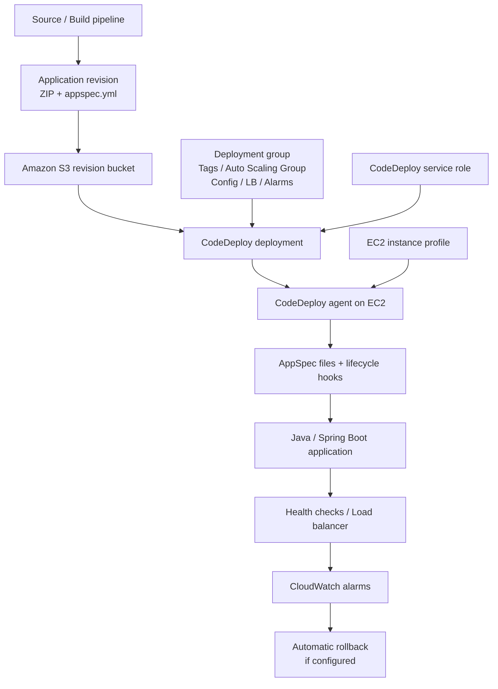
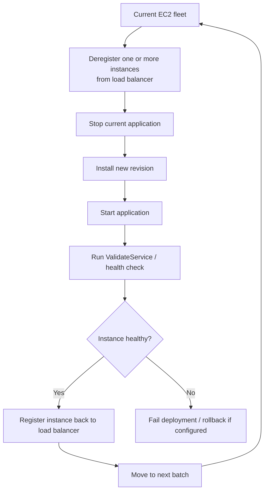
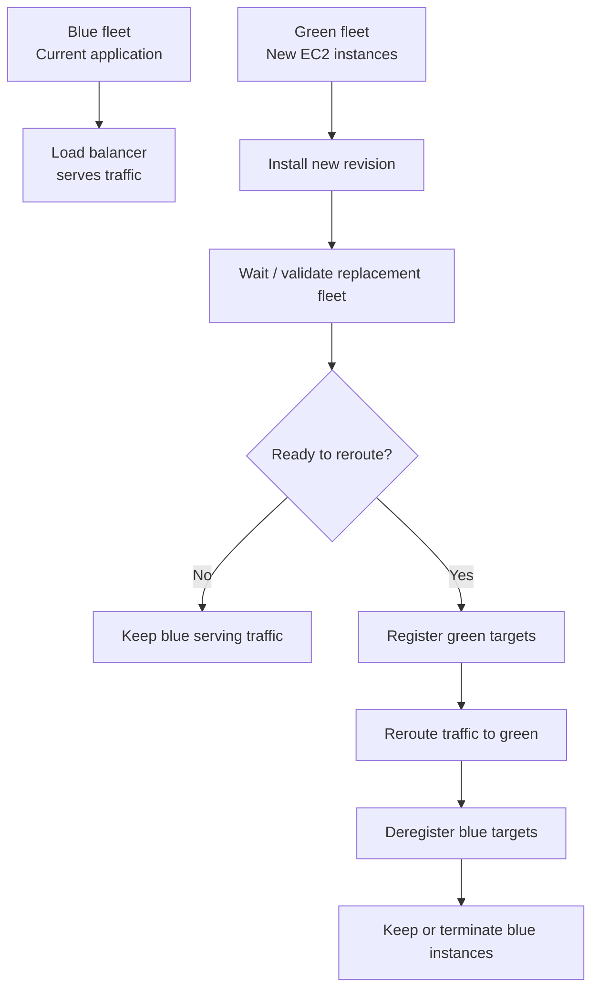
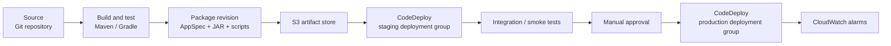

# CodeDeploy deployment group và triển khai trên EC2

**AWS CodeDeploy** tự động triển khai application revision lên các Amazon EC2 instances theo quy tắc được cấu hình trong **deployment group**. Deployment group xác định fleet đích, cách chia đợt triển khai, load balancer, health checks, alarms và rollback behavior. Mỗi revision chứa ứng dụng cùng file **AppSpec** để CodeDeploy biết phải cài file nào và chạy script ở lifecycle event nào.

Với EC2, hai kiểu triển khai chính là **in-place** và **blue/green**. In-place cập nhật phần mềm trên chính các instances đang chạy; blue/green chuẩn bị một fleet thay thế, cài phiên bản mới rồi chuyển traffic qua load balancer. Lựa chọn phụ thuộc vào khả năng chịu downtime, chi phí fleet tạm thời, thời gian rollback và cách ứng dụng quản lý state.

Bài thuộc chương **CI/CD trên AWS** của mô-đun **CLOUD_PROVIDERS_AWS**. Nội dung kết nối EC2, Auto Scaling Group (ASG), Elastic Load Balancing, IAM, S3, CloudWatch, CodePipeline, Java/Spring Boot và vận hành deployment có kiểm soát.

> **Nguyên tắc triển khai:** Một deployment group phải nhắm đúng fleet và có deployment configuration phù hợp với capacity. AppSpec hooks cần có thể chạy lặp lại an toàn. Giữ revision bất biến trong S3, kiểm tra health sau khi start, bật alarms/automatic rollback và giữ database schema tương thích giữa phiên bản cũ với mới.

## 1. Mục tiêu học tập

Sau bài học, bạn có thể:

1. Giải thích vai trò của CodeDeploy application, application revision, deployment và deployment group.
2. Mô tả CodeDeploy agent, EC2 instance profile và CodeDeploy service role.
3. Chuẩn bị EC2 instances và Auto Scaling Group để nhận deployment.
4. Chọn EC2 instances bằng tags hoặc ASG.
5. Tạo deployment group và cấu hình deployment configuration.
6. Phân biệt in-place deployment với blue/green deployment trên EC2.
7. Viết AppSpec YAML để cài Java/Spring Boot application.
8. Sắp xếp lifecycle hooks, script timeout, runas và health validation.
9. Tích hợp Elastic Load Balancing để drain/register instances an toàn.
10. Cấu hình CloudWatch alarms, automatic rollback và SNS notifications.
11. Đóng gói application revision, upload lên S3 và triển khai bằng AWS CLI.
12. Theo dõi deployment qua Console, CLI, agent logs và CloudWatch.
13. Xử lý lỗi AppSpec, agent, IAM, network, health check và ASG.
14. Tích hợp CodeDeploy với CodePipeline và quy trình CI/CD.
15. Thiết kế rollback, database migration và release strategy an toàn.

## 2. CodeDeploy hoạt động như thế nào?

Trong EC2/On-Premises compute platform, CodeDeploy điều phối việc cài application revision lên một nhóm EC2 instances. Trên mỗi instance, **CodeDeploy agent** nhận lệnh triển khai, tải revision, cài file và chạy lifecycle scripts.



Các thành phần chính:

| Thành phần | Trách nhiệm |
| --- | --- |
| **CodeDeploy application** | Đại diện cho ứng dụng được triển khai và compute platform |
| **Application revision** | Phiên bản có thể triển khai: code, file cấu hình, scripts và AppSpec |
| **Deployment group** | Chọn instances đích và lưu deployment settings |
| **Deployment configuration** | Xác định số lượng/percentage hosts tối thiểu phải healthy |
| **CodeDeploy service role** | Cho phép CodeDeploy thay mặt bạn tương tác với EC2, ASG, ELB và các dịch vụ liên quan |
| **EC2 instance profile** | Cấp credentials cho agent trên instance, ví dụ đọc revision từ S3 |
| **CodeDeploy agent** | Poll CodeDeploy, tải revision, cài file và chạy hooks |
| **AppSpec** | Mô tả file mappings và lifecycle scripts |
| **CloudWatch alarms** | Phát hiện metric xấu và có thể kích hoạt rollback |

CodeDeploy không thay thế build system. Maven/Gradle hoặc CI pipeline vẫn compile/test ứng dụng và tạo artifact; CodeDeploy nhận revision đã được build để triển khai.

### 2.1. Application, revision và deployment group

Một CodeDeploy application có thể có nhiều deployment groups:

- **orders-development**: instances mang tag Environment=dev.
- **orders-staging**: instances mang tag Environment=staging.
- **orders-production**: instances mang tag Environment=prod.

Cùng một revision đã kiểm thử có thể được triển khai lần lượt tới staging rồi production. Mỗi deployment group có thể có deployment configuration, alarms, load balancer và rollback settings riêng.

Một deployment group không phải là một máy chủ hay một bản release. Nó là tập hợp cấu hình xác định nơi và cách CodeDeploy thực hiện deployment.

### 2.2. Compute platform

CodeDeploy application dùng compute platform **Server** cho EC2/On-Premises. Trong bài này, phạm vi thực hành là Amazon EC2.

Một số khái niệm deployment group tương tự tồn tại trên ECS và Lambda, nhưng cấu trúc AppSpec, lifecycle hooks, traffic shifting và deployment configuration của chúng khác nhau. Không dùng AppSpec EC2 cho ECS/Lambda.

## 3. Hai IAM roles cần phân biệt

CodeDeploy deployment trên EC2 cần phân biệt quyền của dịch vụ điều phối và quyền của instance tải artifact.

### 3.1. CodeDeploy service role

Service role được CodeDeploy assume. Trust relationship phải cho phép service principal:

```json
{
  "Version": "2012-10-17",
  "Statement": [
    {
      "Effect": "Allow",
      "Principal": {
        "Service": "codedeploy.amazonaws.com"
      },
      "Action": "sts:AssumeRole"
    }
  ]
}
```

Role này cần quyền phù hợp với compute platform và kiểu deployment:

- Nhận diện/kiểm tra EC2 instances.
- Làm việc với Auto Scaling Groups.
- Deregister/register instances với Elastic Load Balancing.
- Tạo replacement fleet cho blue/green nếu cấu hình yêu cầu.
- Đọc trạng thái CloudWatch alarms và publish SNS notifications khi bật triggers.

AWS cung cấp managed policy **AWSCodeDeployRole** làm điểm bắt đầu cho nhiều EC2 deployments. Production nên review policy hiện hành, giới hạn quyền theo kiến trúc và dùng permissions boundary/SCP theo guardrails của tổ chức.

Nếu ASG được tạo bằng launch template và CodeDeploy cần tạo replacement instances cho blue/green, service role có thể cần thêm các quyền **ec2:RunInstances**, **ec2:CreateTags** và **iam:PassRole** theo cấu hình launch template. Kiểm tra quyền thực tế theo deployment path; không cấp rộng các actions này nếu deployment không cần.

### 3.2. EC2 instance profile

Mỗi EC2 instance tham gia deployment cần IAM instance profile. Trust relationship của instance role cho phép EC2 assume role:

```json
{
  "Version": "2012-10-17",
  "Statement": [
    {
      "Effect": "Allow",
      "Principal": {
        "Service": "ec2.amazonaws.com"
      },
      "Action": "sts:AssumeRole"
    }
  ]
}
```

Agent cần tải revision từ S3. Policy tối thiểu cần cho phép đọc đúng artifact bucket và object prefix, ví dụ:

```json
{
  "Version": "2012-10-17",
  "Statement": [
    {
      "Effect": "Allow",
      "Action": [
        "s3:GetObject",
        "s3:GetObjectVersion"
      ],
      "Resource": "arn:aws:s3:::company-deployments/orders-api/*"
    },
    {
      "Effect": "Allow",
      "Action": "s3:ListBucket",
      "Resource": "arn:aws:s3:::company-deployments",
      "Condition": {
        "StringLike": {
          "s3:prefix": [
            "orders-api/*"
          ]
        }
      }
    }
  ]
}
```

Đây là policy minh họa; bucket policy, KMS key policy và quyền tải CodeDeploy agent package cũng cần được xét theo cách cài đặt. Nếu artifact dùng SSE-KMS customer-managed key, instance role phải có quyền giải mã phù hợp và key policy phải cho phép.

**Không gộp hai roles thành một.** Service role cho phép CodeDeploy quản lý deployment; instance profile cho phép EC2 agent truy cập các tài nguyên cần thiết khi chạy.

## 4. Chuẩn bị EC2 instances

Mỗi EC2 instance mục tiêu cần đáp ứng các điều kiện:

- Chạy hệ điều hành/architecture được CodeDeploy agent hỗ trợ.
- Có IAM instance profile phù hợp.
- Có thể kết nối tới CodeDeploy service endpoint.
- Có thể tải revision từ S3 hoặc source repository đã cấu hình.
- Có CodeDeploy agent được cài đặt và đang chạy.
- Được gắn EC2 tags hoặc thuộc Auto Scaling Group mà deployment group chọn.
- Có disk space và quyền filesystem đủ cho revision, scripts và application.
- Có network path tới downstream dependencies và load balancer health checks.

### 4.1. CodeDeploy agent

Agent là service chạy trên từng instance. Nó liên hệ với CodeDeploy để nhận công việc và thực thi deployment lifecycle.

Trên Amazon Linux, Ubuntu hoặc RHEL, kiểm tra service:

```bash
sudo systemctl status codedeploy-agent
sudo systemctl start codedeploy-agent
sudo systemctl enable codedeploy-agent
```

Trên agent 2.0.x trở lên, có thể kiểm tra version bằng:

```bash
sudo /opt/codedeploy-agent/bin/codedeploy-agent --version
```

Agent version 2.x dùng installer prefix **latestv2**. Ví dụ cài trên Amazon Linux/RHEL; kiểm tra region bucket và kiến trúc theo tài liệu AWS trước khi dùng:

```bash
sudo yum install -y wget
cd /home/ec2-user

AWS_REGION=ap-southeast-1
wget "https://aws-codedeploy-$AWS_REGION.s3.$AWS_REGION.amazonaws.com/latestv2/install"

chmod +x ./install
sudo ./install auto

sudo systemctl enable codedeploy-agent
sudo systemctl start codedeploy-agent
sudo systemctl status codedeploy-agent
```

Đối với Ubuntu, package manager và lệnh cài dependency khác. Dùng trang cài đặt chính thức cho hệ điều hành/architecture cụ thể. Trong production, cân nhắc bake agent version đã kiểm thử vào AMI hoặc quản lý nâng cấp agent bằng một quy trình riêng.

### 4.2. Network path

EC2 agent cần outbound connectivity tới CodeDeploy và nơi chứa revision. Nếu instance nằm trong private subnet:

- Cấu hình NAT/egress path hoặc VPC endpoints phù hợp với service hỗ trợ.
- S3 gateway endpoint có thể phục vụ truy cập S3 trong cùng Region.
- Kiểm tra DNS resolution, route tables, NACL và security groups.
- Kiểm tra bucket policy có chặn VPC endpoint hoặc source conditions không.
- Không mở inbound management ports từ Internet chỉ để agent hoạt động.

Agent chủ động liên hệ dịch vụ AWS; không cần mở một inbound port công khai trên EC2 để CodeDeploy điều khiển instance.

### 4.3. Agent logs

Trên Linux, agent log mặc định thường ở:

```text
/var/log/aws/codedeploy-agent/codedeploy-agent.log
```

Deployment-specific scripts logs thường nằm dưới deployment root:

```text
/opt/codedeploy-agent/deployment-root/
  <deployment-group-id>/
    <deployment-id>/
      logs/
        scripts.log
```

Đường dẫn deployment root có thể được thay đổi trong agent configuration. Trên Windows Server, log và deployment files nằm dưới ProgramData của CodeDeploy.

Trên Linux, deployment log tổng hợp của agent thường nằm ở **/opt/codedeploy-agent/deployment-root/deployment-logs/codedeploy-agent-deployments.log**. Có thể cài CloudWatch agent để tập trung agent/deployment logs thay vì đăng nhập từng instance.

## 5. Nhắm EC2 instances bằng tags và Auto Scaling Groups

Deployment group phải xác định chính xác instance fleet.

### 5.1. EC2 tag filters

Gắn tag cho instances theo environment và application:

| Instance | Environment | Application | Role |
| --- | --- | --- | --- |
| i-01 | staging | orders-api | web |
| i-02 | staging | orders-api | web |
| i-03 | production | orders-api | web |
| i-04 | production | orders-api | worker |

Deployment group staging có thể chọn:

```text
Environment = staging
Application = orders-api
Role = web
```

Tag filters giúp tái sử dụng cùng CodeDeploy application cho các môi trường khác nhau. Hãy dùng keys/values thống nhất, không gắn tag quá rộng như Environment=prod cho cả những instance không thuộc workload đó.

Nếu cấu hình nhiều tag filter groups, CodeDeploy dùng điều kiện của các groups để thu hẹp fleet; instances cần thỏa tiêu chí trong từng group. Trong một group, một instance có thể được chọn nếu khớp một trong các tag filters của group đó. Hãy xem phần tag filters của deployment group khi thiết kế điều kiện kết hợp.

### 5.2. Auto Scaling Group

Thay vì liệt kê từng instance, deployment group có thể chọn ASG. Khi ASG launch instance mới, CodeDeploy có thể tự động deploy revision phù hợp lên instance đó nếu cấu hình integration được thiết lập.

ASG hữu ích khi:

- Fleet scale in/out theo CPU hoặc request load.
- Instances được thay thế thường xuyên.
- Cần dùng launch template/AMI chuẩn.
- Cần deployment gắn với fleet lifecycle.

Đảm bảo launch template gắn đúng instance profile, security groups, subnet và CodeDeploy agent. Nếu instance mới không có agent hoặc không tải được revision, ASG có thể tạo instance healthy ở mức EC2 nhưng application chưa sẵn sàng.

### 5.3. Tránh gắn một ASG vào nhiều deployment groups

AWS cảnh báo việc liên kết một ASG với nhiều deployment groups có thể gây vấn đề khi deployment thất bại hoặc termination hooks cùng hoạt động. Thiết kế một ownership boundary rõ ràng cho từng application/fleet, hoặc đánh giá kỹ cách các deployment groups phối hợp trước khi dùng chung ASG.

## 6. Tạo CodeDeploy application và deployment group

Quy trình cơ bản:

1. Tạo CodeDeploy application với compute platform Server.
2. Tạo hoặc chọn CodeDeploy service role.
3. Chuẩn bị EC2 instances hoặc ASG.
4. Cài agent và instance profile.
5. Gắn tags hoặc chọn ASG.
6. Tạo deployment group với deployment type và deployment configuration.
7. Nếu dùng load balancer, chọn Classic Load Balancer, Application Load Balancer hoặc Network Load Balancer phù hợp.
8. Cấu hình alarms, automatic rollback và notifications.
9. Upload application revision và tạo deployment.

### 6.1. Các cấu hình quan trọng của deployment group

| Setting | Ý nghĩa |
| --- | --- |
| Application name | CodeDeploy application chứa revision |
| Deployment group name | Tên nhóm fleet/configuration |
| Service role ARN | Role CodeDeploy assume |
| EC2 tag filters | Chọn instances theo tags |
| Auto Scaling groups | Chọn fleet do ASG quản lý |
| Deployment type | In-place hoặc blue/green |
| Deployment configuration | Quy tắc minimum healthy hosts |
| Load balancer | Điều phối traffic trong deployment |
| Alarm configuration | Dừng deployment khi alarm ở trạng thái ALARM |
| Automatic rollback | Tự deploy lại revision trước khi deployment thất bại |
| Deployment triggers | Gửi notification qua SNS cho các sự kiện deployment |

Một application có thể có nhiều deployment groups, ví dụ staging và production. Không cần tạo application riêng chỉ vì muốn chia môi trường, miễn là trust boundary, compute platform và ownership phù hợp.

## 7. In-place deployment

Trong **in-place deployment**, CodeDeploy cập nhật application trên chính những instances thuộc deployment group.



Nếu không cấu hình load balancer, instance vẫn có thể được update, nhưng người dùng có thể gặp downtime trong thời gian application dừng và khởi động lại.

### 7.1. Ưu điểm

- Không cần tạo fleet EC2 thứ hai.
- Chi phí hạ tầng tạm thời thấp hơn blue/green.
- Phù hợp với ứng dụng stateful hoặc legacy cần cập nhật tại chỗ nếu có kế hoạch downtime.
- Có thể giới hạn số instances được update đồng thời bằng deployment configuration.

### 7.2. Rủi ro

- Trong lúc update, capacity của fleet giảm.
- Lỗi cài đặt có thể để instance ở trạng thái không phục vụ.
- Rollback có thể mất thời gian vì revision cũ cần được deploy lại.
- Thay đổi OS packages/configuration có thể không hoàn toàn đảo ngược bằng cách copy revision cũ.
- Nếu không dùng load balancer, traffic có thể đến instance đang restart.

Với production web tier, thường nên kết hợp in-place deployment với ALB/NLB và chọn minimum healthy hosts sao cho còn đủ capacity.

## 8. Blue/green deployment trên EC2

Trong **blue/green deployment**, CodeDeploy thay thế original fleet bằng một replacement fleet. CodeDeploy cài revision lên instances mới, chờ thời gian kiểm tra nếu được cấu hình, rồi đăng ký replacement instances với load balancer và deregister original instances.



Với EC2/On-Premises compute platform, blue/green deployment chỉ hỗ trợ Amazon EC2 instances. Không nhầm mô hình này với canary/linear traffic shifting của Lambda hoặc ECS.

Load balancer là yêu cầu của EC2 blue/green deployment. Nếu dùng ALB, target group dành cho EC2 instances phải có target type **instance**. Original environment và replacement environment cần ở cùng VPC với load balancer theo yêu cầu của ELB.

### 8.1. Nguồn replacement fleet

Deployment group có thể được cấu hình để:

- Tạo replacement environment dựa trên cấu hình Auto Scaling Group hiện có.
- Dùng một replacement ASG/instances đã được chuẩn bị theo quy trình được hỗ trợ.

Replacement instances cần cùng network/security prerequisites và có CodeDeploy agent. CodeDeploy sẽ cài revision lên fleet mới trước khi chuyển traffic.

### 8.2. Xử lý original instances

Sau khi traffic được chuyển sang replacement environment, có thể:

- Terminate original instances sau một thời gian chờ.
- Giữ original instances đang chạy để điều tra hoặc dùng cho mục đích khác.

Nếu terminate, hãy xác định rõ lifecycle/backup và dữ liệu local trên instance. Nếu giữ lại, quản lý chi phí và tránh để fleet cũ tiếp tục nhận traffic ngoài ý muốn.

### 8.3. Khi nào nên dùng blue/green?

Chọn blue/green khi:

- Muốn kiểm thử phiên bản mới trên fleet riêng trước khi chuyển traffic.
- Cần giảm thời gian downtime.
- Cần khả năng quay lại fleet cũ nhanh.
- Có thể chi trả cho capacity của hai fleet trong thời gian chuyển đổi.
- Ứng dụng và database schema hỗ trợ hai phiên bản cùng tồn tại trong giai đoạn release.

Blue/green không tự giải quyết backward compatibility. Nếu phiên bản mới chạy migration làm database cũ không đọc được, chuyển traffic về blue có thể vẫn thất bại.

## 9. So sánh in-place và blue/green

| Tiêu chí | In-place | Blue/green |
| --- | --- | --- |
| Fleet được cập nhật | Instances hiện tại | Fleet thay thế |
| EC2 capacity tạm thời | Không cần fleet thứ hai | Có thể cần hai fleet |
| Load balancer | Tùy chọn, nhưng hữu ích cho web fleet | Cần cho traffic rerouting |
| Downtime | Có thể có nếu không drain traffic đúng cách | Thường giảm downtime khi chuyển traffic |
| Rollback | Deploy lại revision trước trên fleet | Có thể chuyển lại original fleet trong thời gian giữ fleet cũ |
| Chi phí | Thường thấp hơn trong lúc deploy | Cao hơn trong thời gian hai fleet cùng tồn tại |
| Kiểm thử trước traffic | Cần tự thiết kế | Có thể kiểm thử replacement fleet trước reroute |
| Phạm vi hỗ trợ EC2 platform | EC2 và on-premises | Amazon EC2 instances |

Đối với ứng dụng web Java trên EC2, blue/green thường phù hợp khi uptime và khả năng kiểm tra fleet mới là ưu tiên. In-place phù hợp khi fleet nhỏ, có maintenance window hoặc cần tối ưu chi phí.

## 10. Deployment configurations và minimum healthy hosts

Deployment configuration quyết định số lượng hoặc tỷ lệ instances có thể bị update đồng thời, dựa trên minimum healthy hosts.

Ba cấu hình mặc định cho EC2/On-Premises:

| Deployment configuration | Minimum healthy hosts | Hành vi |
| --- | ---: | --- |
| CodeDeployDefault.OneAtATime | 1 | Triển khai từng instance một |
| CodeDeployDefault.HalfAtATime | 50% | Cho phép update một phần fleet theo batch |
| CodeDeployDefault.AllAtOnce | 0 | Cố gắng update nhiều instances nhất có thể cùng lúc |

Ví dụ fleet có 8 instances:

- **OneAtATime:** mỗi lần update một instance; giữ phần còn lại healthy trong lúc deploy.
- **HalfAtATime:** có thể update tối đa khoảng một nửa fleet cùng lúc, tùy làm tròn và trạng thái healthy.
- **AllAtOnce:** giảm thời gian deploy nhưng blast radius lớn nhất; nhiều instances có thể cùng offline.

Cần đọc success/failure semantics của từng deployment configuration. Ví dụ OneAtATime có quy tắc đặc biệt cho instance cuối cùng: deployment có thể vẫn được đánh dấu thành công nếu lần triển khai cuối thất bại, vì các instances còn lại đã được giữ healthy.

### 10.1. Custom deployment configuration

Bạn có thể tạo custom configuration theo:

- **HOST_COUNT:** số instances tối thiểu phải healthy.
- **FLEET_PERCENT:** phần trăm fleet tối thiểu phải healthy.

Ví dụ fleet 12 instances, muốn luôn giữ tối thiểu 9 healthy:

```text
Minimum healthy hosts:
type = FLEET_PERCENT
value = 75
```

Nếu dùng HOST_COUNT=5, CodeDeploy phải giữ ít nhất 5 instances healthy trong suốt deployment theo cấu hình đó.

### 10.2. Availability Zone awareness

Một fleet trải nhiều AZ có thể cần minimum healthy hosts theo từng AZ để tránh deployment làm mất toàn bộ capacity của một AZ. AWS cung cấp custom deployment configurations hỗ trợ minimum healthy hosts per Availability Zone. Cần thiết kế số lượng instance/AZ và deployment config đồng bộ; các cấu hình mặc định không tự cung cấp zonal minimum.

### 10.3. Chọn batch size theo capacity

Đừng chọn HalfAtATime chỉ vì fleet có số lượng instance chẵn. Tính capacity còn lại sau khi một batch bị drain:

- Request rate bình thường và peak.
- CPU/memory utilization.
- Số instances tối thiểu để đáp ứng SLA.
- Health check và warm-up time.
- Khả năng scale out của ASG.
- Database connection limits và downstream rate limits.

Deployment config chỉ kiểm soát tiến trình deploy; nó không bảo đảm application còn đủ capacity nếu sizing ban đầu sai.

## 11. Elastic Load Balancing và instance health

CodeDeploy có thể phối hợp với Classic Load Balancer, Application Load Balancer hoặc Network Load Balancer để drain/register instances trong deployment.

### 11.1. In-place với load balancer

Khi update một instance:

1. CodeDeploy yêu cầu deregister instance khỏi load balancer.
2. Load balancer ngừng gửi request mới tới instance.
3. Application hoàn tất hoặc xử lý các requests đang chạy theo connection draining/deregistration delay.
4. CodeDeploy chạy các lifecycle events và cài revision.
5. Application được start và kiểm tra.
6. Instance được register lại.
7. Load balancer chờ target health check thành healthy trước khi gửi traffic theo cơ chế của service.

Cấu hình deregistration delay, health check interval, healthy threshold và timeout phù hợp với thời gian shutdown/startup của ứng dụng.

Với in-place deployment dùng load balancer, CodeDeploy có thể chờ tối đa một giờ để instance trở lại trạng thái healthy sau khi register. Nếu target không healthy trong thời gian chờ, deployment tiếp tục hoặc thất bại tùy deployment configuration. Đặt health check và startup timeout thực tế để tránh deployment treo lâu.

### 11.2. Health check của Spring Boot

Một Spring Boot service có thể expose health endpoint qua Spring Boot Actuator:

```text
GET /actuator/health
```

ALB target group nên kiểm tra endpoint phản ánh readiness của application. Không để health check trả healthy khi app chưa kết nối được database hoặc dependency bắt buộc nếu nghiệp vụ không thể phục vụ request.

Nếu health check phụ thuộc mọi downstream optional service, một outage phụ trợ có thể làm toàn fleet unhealthy. Chọn readiness/liveness semantics theo thiết kế ứng dụng.

### 11.3. Không chỉ dựa vào script exit code

Hook script có thể exit code 0 nhưng application vẫn không nhận traffic được vì:

- Port chưa listen.
- ALB health check path sai.
- Security Group chặn traffic từ load balancer.
- TLS certificate hoặc listener rule sai.
- Application khởi động chậm hơn timeout.
- DB migration/configuration thất bại.

Kết hợp ValidateService script với load balancer target health và CloudWatch alarms.

## 12. Application revision và S3

Một application revision cho EC2 là archive chứa file ứng dụng, cấu hình, scripts và AppSpec. Có thể lưu revision trên Amazon S3 hoặc GitHub repository theo nguồn được CodeDeploy hỗ trợ.

### 12.1. Quy tắc đóng gói

- AppSpec phải ở root của archive.
- Với EC2/On-Premises, file phải tên **appspec.yml**.
- AppSpec EC2 phải dùng YAML.
- Source paths trong AppSpec tương đối với root của revision.
- Scripts được khai báo trong hooks cũng phải nằm trong archive.
- ZIP là định dạng phổ biến cho Linux/Windows.
- TAR/TAR.GZ không được hỗ trợ cho Windows Server instances.
- Revision nên bất biến theo build ID hoặc commit SHA.

Ví dụ cấu trúc:

```text
orders-api-revision/
├── appspec.yml
├── build/
│   └── orders-api.jar
├── systemd/
│   └── orders-api.service
└── scripts/
    ├── stop.sh
    ├── prepare.sh
    ├── configure.sh
    ├── start.sh
    └── validate.sh
```

### 12.2. Lưu revision bất biến

Không ghi đè cùng một S3 object key như latest.zip cho mọi build nếu pipeline cần khả năng rollback chính xác. Dùng key riêng theo version/build ID, ví dụ:

```text
s3://company-deployments/orders-api/1.4.2/revision.zip
s3://company-deployments/orders-api/1.4.3/revision.zip
```

Bật S3 versioning, encryption và bucket policy phù hợp. Giữ lại các revisions cần thiết cho rollback/audit theo retention policy.

## 13. AppSpec file cho EC2

**AppSpec** mô tả file mappings và scripts gắn với lifecycle events. Với EC2, file phải là YAML và có tên **appspec.yml** ở root revision.

Cấu trúc tổng quát:

```yaml
version: "0.0"
os: linux
files:
  - source: build/orders-api.jar
    destination: /opt/orders
  - source: systemd/orders-api.service
    destination: /etc/systemd/system
hooks:
  ApplicationStop:
    - location: scripts/stop.sh
      timeout: 120
      runas: root
  BeforeInstall:
    - location: scripts/prepare.sh
      timeout: 120
      runas: root
  AfterInstall:
    - location: scripts/configure.sh
      timeout: 120
      runas: root
  ApplicationStart:
    - location: scripts/start.sh
      timeout: 120
      runas: root
  ValidateService:
    - location: scripts/validate.sh
      timeout: 180
      runas: root
```

Các field chính:

| Field | Vai trò |
| --- | --- |
| version | AppSpec format version; hiện dùng 0.0 |
| os | linux hoặc windows |
| files | Ánh xạ source trong revision sang destination trên instance |
| permissions | Thiết lập ownership/mode/ACL cho file trên các Linux platforms được hỗ trợ |
| hooks | Gắn scripts vào deployment lifecycle events |

### 13.1. files mapping

Ví dụ:

```yaml
files:
  - source: build/orders-api.jar
    destination: /opt/orders
```

Source path tương đối với root archive. Destination là đường dẫn trên instance. CodeDeploy copy file trong Install event.

### 13.2. permissions

Với Linux, có thể dùng permissions section để thiết lập owner, group, mode, ACL và SELinux context cho các file được cài. Kiểm tra OS support và syntax của AppSpec trước khi dùng. Windows Server không dùng permissions section theo cùng cách Linux.

### 13.3. hooks

Hook entry chỉ định script location, timeout và runas:

```yaml
hooks:
  AfterInstall:
    - location: scripts/configure.sh
      timeout: 120
      runas: root
```

Script location tương đối với root của revision. Mỗi hook script cần exit code 0 khi thành công; exit code khác 0 hoặc timeout sẽ khiến lifecycle event thất bại. Với Amazon Linux/Ubuntu, runas có thể dùng để chạy script dưới user chỉ định nếu user tồn tại và không yêu cầu password; kiểm tra giới hạn hỗ trợ theo OS.

### 13.4. ApplicationStop chạy từ revision trước

Hook **ApplicationStop** đặc biệt:

- Chạy trước khi revision mới được download.
- Script được lấy từ revision đã deploy thành công trước đó.
- Không chạy trong lần deploy đầu tiên vì instance chưa có AppSpec revision trước đó.
- Dùng để stop service, drain worker hoặc giải phóng resource của phiên bản cũ.

Vì vậy, nếu thay đổi logic stop script, hãy nhớ deployment đầu tiên áp dụng script mới ở lần deploy kế tiếp. Đảm bảo script cũ vẫn có thể stop phiên bản đang chạy.

## 14. Lifecycle events và thứ tự thực thi

Với in-place deployment không có load balancer, chuỗi chính thường là:

```text
ApplicationStop
DownloadBundle
BeforeInstall
Install
AfterInstall
ApplicationStart
ValidateService
```

Một số events được agent dành riêng cho việc download/install và không thể gắn script trực tiếp. Bạn cấu hình file mappings để CodeDeploy thực hiện Install.

### 14.1. Ý nghĩa từng hook

| Lifecycle event | Dùng để |
| --- | --- |
| ApplicationStop | Dừng phiên bản trước; script đến từ revision trước |
| DownloadBundle | Agent tải revision vào deployment archive |
| BeforeInstall | Backup, chuẩn bị thư mục, giải mã config |
| Install | Agent copy file theo AppSpec |
| AfterInstall | Thiết lập permission, config, symlink hoặc migration tương thích |
| ApplicationStart | Start/restart application service |
| ValidateService | Kiểm tra application sau khi start |

### 14.2. Traffic hooks khi có load balancer

Nếu deployment group có load balancer, có thêm các events liên quan traffic:

- BeforeBlockTraffic.
- BlockTraffic.
- AfterBlockTraffic.
- BeforeAllowTraffic.
- AllowTraffic.
- AfterAllowTraffic.

BlockTraffic và AllowTraffic là events do CodeDeploy xử lý, không phải nơi chạy custom scripts. Sáu traffic-related hooks áp dụng cho in-place deployments khi deployment group chỉ định Classic Load Balancer, ALB hoặc NLB.

Với blue/green, hooks có thể chạy trên replacement instances và original instances theo lifecycle tương ứng. Xem bảng availability chính thức để tránh gắn hook vào event không chạy trên loại deployment đang dùng.

Mỗi hook được thực thi cho từng instance tham gia deployment. Nếu fleet có 20 instances, ValidateService có thể chạy 20 lần, mỗi lần trên một instance. Đừng đặt side effect toàn cục hoặc database migration độc quyền vào hook chạy trên mọi host nếu không có lock/coordination phù hợp.

### 14.3. Script timeout và idempotency

- Mặc định mỗi lifecycle event có thể cho script chạy tối đa 3600 giây.
- Tổng timeout của các scripts trong cùng event không được vượt 1 giờ.
- Đặt timeout thực tế, ngắn hơn giới hạn mặc định nếu script chỉ cần vài giây.
- Dùng set -e hoặc kiểm tra exit status để lỗi không bị che.
- Script phải có thể chạy lại an toàn sau deployment failure/retry.
- Tránh script phá hủy state không thể phục hồi.
- Không log secret hoặc environment values nhạy cảm.

## 15. Ví dụ triển khai Spring Boot service trên EC2

Giả sử Spring Boot application đóng gói thành executable JAR và chạy dưới systemd service tên orders-api.

### 15.1. systemd unit

File systemd/orders-api.service:

```ini
[Unit]
Description=Orders API
After=network.target

[Service]
Type=simple
User=orders
Group=orders
WorkingDirectory=/opt/orders
ExecStart=/usr/bin/java -jar /opt/orders/orders-api.jar
Restart=on-failure
RestartSec=5
SuccessExitStatus=143
EnvironmentFile=-/etc/orders/orders-api.env

[Install]
WantedBy=multi-user.target
```

Tạo user orders trên AMI trước khi deployment hoặc trong provisioning process. File environment chứa cấu hình runtime có thể được quản lý bởi SSM/Secrets Manager/configuration management; không đóng secret vào revision.

### 15.2. Stop script

File scripts/stop.sh:

```bash
#!/usr/bin/env bash
set -euo pipefail

if systemctl cat orders-api.service >/dev/null 2>&1; then
  systemctl stop orders-api.service
fi
```

Lệnh này cho phép first deployment chạy tiếp khi service chưa được cài. Tuy nhiên, CodeDeploy không gọi ApplicationStop ở lần deploy đầu tiên; script chỉ được dùng trong các deployment tiếp theo.

### 15.3. Prepare script

File scripts/prepare.sh:

```bash
#!/usr/bin/env bash
set -euo pipefail

install -d -o orders -g orders -m 0750 /opt/orders
install -d -o root -g root -m 0755 /etc/systemd/system
```

### 15.4. Configure script

File scripts/configure.sh:

```bash
#!/usr/bin/env bash
set -euo pipefail

test -s /opt/orders/orders-api.jar
chown orders:orders /opt/orders/orders-api.jar
chmod 0640 /opt/orders/orders-api.jar

systemctl daemon-reload
```

### 15.5. Start script

File scripts/start.sh:

```bash
#!/usr/bin/env bash
set -euo pipefail

systemctl enable orders-api.service
systemctl restart orders-api.service
```

### 15.6. Validate script

File scripts/validate.sh:

```bash
#!/usr/bin/env bash
set -euo pipefail

for attempt in $(seq 1 30); do
  if curl --fail --silent --show-error \
      http://127.0.0.1:8080/actuator/health >/dev/null; then
    exit 0
  fi
  sleep 2
done

echo "Orders API did not become healthy before timeout" >&2
systemctl status orders-api.service --no-pager >&2 || true
exit 1
```

Endpoint Actuator phải được bật và chỉ mở theo security policy phù hợp. Nếu health endpoint có auth, cấu hình validation script dùng một phương thức an toàn; không hard-code token trong revision.

### 15.7. Chuẩn bị archive

Ví dụ trên Linux build agent:

```bash
mkdir -p revision/build revision/systemd revision/scripts

cp target/orders-api.jar revision/build/
cp systemd/orders-api.service revision/systemd/
cp scripts/*.sh revision/scripts/
cp appspec.yml revision/

chmod +x revision/scripts/*.sh

cd revision
zip -r ../orders-api-1.4.2.zip .
```

Kiểm tra archive có AppSpec ở root:

```bash
unzip -l orders-api-1.4.2.zip
```

Không để cấu trúc thành revision/revision/appspec.yml vì CodeDeploy sẽ không tìm thấy file AppSpec ở root.

## 16. Load balancer và health validation

Với web application, dùng load balancer để bảo vệ traffic trong khi CodeDeploy cập nhật instances.

Cần kiểm tra:

- ALB/NLB target group đúng với EC2 fleet.
- Listener rule chuyển request đến target group.
- Health check path/port/protocol chính xác.
- Security Group cho phép traffic từ load balancer đến app port.
- Deregistration delay đủ cho request đang xử lý.
- Spring Boot startup time không vượt validation/deployment timeout.
- Health endpoint thể hiện readiness đúng với business dependencies.

Với blue/green, CodeDeploy đăng ký replacement instances và chuyển traffic theo cấu hình deployment group. Việc chọn giữ hay terminate original fleet ảnh hưởng cửa sổ rollback và chi phí.

Không nhầm EC2 blue/green với traffic shifting theo tỷ lệ phần trăm. Với EC2 platform, deployment configuration điều khiển số lượng instances được đăng ký/chuyển đổi theo từng bước; nó không cung cấp canary/linear routing giống Lambda/ECS.

## 17. CloudWatch alarms và automatic rollback

Deployment group có thể gắn một hoặc nhiều CloudWatch alarms. Alarm cần được tạo trước trong CloudWatch, sau đó được tham chiếu trong deployment group.

Các metric phù hợp với web tier:

- ALB HTTPCode_Target_5XX_Count.
- ALB TargetResponseTime.
- HealthyHostCount.
- EC2 CPUUtilization.
- Application custom metrics như request error rate, queue backlog hoặc JVM heap pressure.

### 17.1. Alarm design

Một alarm deployment nên có:

- Metric đúng với application và target group.
- Threshold phản ánh mức lỗi có ý nghĩa.
- Evaluation periods tránh phản ứng với spike rất ngắn.
- Missing data treatment phù hợp.
- Dimension scope chính xác.
- Runbook khi alarm chuyển ALARM.

Nếu alarm quá nhạy, deployment có thể rollback liên tục. Nếu alarm quá lỏng, phiên bản lỗi có thể nhận traffic trong thời gian dài.

### 17.2. Automatic rollback

Có thể bật rollback khi:

- Deployment thất bại.
- Một hoặc nhiều CloudWatch alarms chuyển sang ALARM.
- Deployment bị dừng theo cấu hình được chọn.

CodeDeploy rollback bằng cách triển khai lại revision đã biết là tốt gần nhất. Đây là **một deployment mới với deployment ID mới**, không phải thao tác undo tức thì hay khôi phục database tự động.

### 17.3. Alarm polling failure

Deployment group có tùy chọn cho phép tiếp tục deployment khi CodeDeploy không lấy được trạng thái alarm. Với production, chỉ bật khi có lý do rõ ràng và hiểu rằng khi đó deployment có thể tiếp tục mà không được alarm bảo vệ.

## 18. Rollback và database migration

Rollback application revision không bảo đảm rollback mọi thay đổi hệ thống.

Ví dụ Spring Boot release 2.0 thêm cột mới vào database. Nếu migration xóa/đổi cột mà release 1.9 cần dùng, rollback JAR về 1.9 vẫn có thể lỗi.

Dùng chiến lược **expand-and-contract**:

1. Release A thêm schema mới theo cách tương thích ngược.
2. Release B ghi/đọc schema mới nhưng vẫn hỗ trợ dữ liệu cũ.
3. Di chuyển dữ liệu hoặc bật feature flag theo giai đoạn.
4. Chờ fleet cũ không còn cần schema cũ.
5. Release sau mới xóa cột/API cũ.

Các lưu ý:

- Database migration phải được review như một thay đổi riêng.
- Backup/snapshot/PITR trước migration quan trọng.
- Không chạy migration phá hủy trong ApplicationStart trên mọi instance.
- Dùng migration lock hoặc một bước job duy nhất để tránh nhiều instances cùng chạy migration.
- Tách rollback code khỏi rollback data.
- Giữ artifact cũ và cấu hình tương thích để có thể redeploy.

## 19. AWS CLI: tạo application và deployment group

Ví dụ dưới đây tạo một CodeDeploy application và deployment group staging dùng EC2 tag filter. Thay role ARN, account, bucket và tags bằng giá trị đã được cấp trong sandbox.

### 19.1. Tạo application

```bash
aws deploy create-application \
  --application-name orders-api \
  --compute-platform Server \
  --profile staging
```

### 19.2. Tạo deployment group

```bash
aws deploy create-deployment-group \
  --application-name orders-api \
  --deployment-group-name orders-staging \
  --service-role-arn arn:aws:iam::111122223333:role/CodeDeployServiceRole \
  --ec2-tag-filters Key=Environment,Value=staging,Type=KEY_AND_VALUE \
  --deployment-config-name CodeDeployDefault.OneAtATime \
  --profile staging
```

Nếu target là ASG, dùng tham số Auto Scaling group phù hợp thay cho hoặc kết hợp với EC2 tag filters theo thiết kế deployment group. Nếu dùng load balancer, cấu hình load balancer info trong deployment group.

### 19.3. Tạo deployment

Upload revision vào S3:

```bash
aws s3 cp orders-api-1.4.2.zip \
  s3://company-deployments/orders-api/1.4.2/revision.zip \
  --sse AES256 \
  --profile staging
```

Tạo deployment:

```bash
aws deploy create-deployment \
  --application-name orders-api \
  --deployment-group-name orders-staging \
  --deployment-config-name CodeDeployDefault.OneAtATime \
  --s3-location bucket=company-deployments,key=orders-api/1.4.2/revision.zip,bundleType=zip \
  --description "orders-api release 1.4.2" \
  --profile staging
```

Lưu deployment ID trả về. Revision key nên bất biến theo build/version. Nếu bucket bật versioning, có thể pin object version khi tạo deployment để bảo đảm đúng artifact đã được review.

### 19.4. Theo dõi deployment

```bash
aws deploy get-deployment \
  --deployment-id d-EXAMPLE123 \
  --profile staging

aws deploy list-deployment-instances \
  --deployment-id d-EXAMPLE123 \
  --profile staging
```

Khi cần chi tiết một instance:

```bash
aws deploy get-deployment-instance \
  --deployment-id d-EXAMPLE123 \
  --instance-id i-0123456789abcdef0 \
  --profile staging
```

Dùng deployment ID để liên kết CodeDeploy events, instance logs và pipeline run.

## 20. Tạo deployment group qua Console

Trong AWS Management Console:

1. Mở CodeDeploy và chọn Applications.
2. Chọn application có compute platform EC2/On-Premises.
3. Chọn Create deployment group.
4. Đặt tên deployment group.
5. Chọn service role.
6. Chọn deployment type: In-place hoặc Blue/green.
7. Chọn EC2 tag filters hoặc Auto Scaling Groups.
8. Chọn deployment configuration.
9. Nếu dùng load balancer, chọn load balancer/target group phù hợp.
10. Cấu hình alarms, automatic rollback và SNS triggers.
11. Review rồi tạo deployment group.
12. Tạo deployment từ application revision đã upload.

Console hiển thị các trường theo deployment type. Một số options chỉ xuất hiện khi chọn ASG, load balancer hoặc blue/green.

## 21. Deployment group với Auto Scaling Group

CodeDeploy có thể tích hợp ASG theo hai hướng:

- Khi ASG launch instance mới, CodeDeploy triển khai revision lên instance đó.
- Khi ASG scale-in, có thể bật termination deployment để chạy scripts cleanup trước khi instance bị terminate.

### 21.1. Launch deployments

Đảm bảo:

- Launch template gắn instance profile.
- AMI có CodeDeploy agent hoặc bootstrap script cài agent.
- Instance có thể tải revision.
- Application service được cài/start đúng thứ tự.
- Load balancer health check không đánh dấu instance healthy trước khi app ready.

Có thể dùng custom AMI đã chứa agent và dependencies để giảm thời gian bootstrap. Khi tạo AMI, kiểm tra agent state/cache theo hướng dẫn AWS để instance clone đăng ký đúng.

### 21.2. Termination deployments

Khi scale-in, CodeDeploy có thể chạy termination lifecycle hooks để application thực hiện graceful shutdown, flush buffer, drain work hoặc deregister khỏi hệ thống phụ trợ.

Nếu termination deployment thất bại, Auto Scaling vẫn có thể tiếp tục terminate instance. Vì vậy, cleanup hook không được là nơi duy nhất bảo đảm dữ liệu quan trọng đã được lưu bền vững.

### 21.3. Deployment trong khi ASG đang scale

Nếu ASG launch instances trong lúc deployment đang chạy, cần hiểu cơ chế automatic updates to outdated instances. CodeDeploy có thể deploy revision cũ cho instance được launch ở một số thời điểm theo deployment state; cấu hình tự cập nhật outdated instances giúp giảm tình trạng fleet không đồng nhất.

Không liên kết một ASG với nhiều deployment groups nếu chưa đánh giá tương tác giữa các deployments và lifecycle hooks.

## 22. Tích hợp CodePipeline

CodePipeline có thể dùng CodeDeploy action để triển khai revision tới deployment group.

Một pipeline điển hình:



Pipeline nên:

- Dùng đúng artifact build đã test, không build lại artifact khác giữa staging và production.
- Gắn commit SHA/build number vào artifact metadata.
- Lưu revision trong S3 với key/version bất biến.
- Chạy CodeDeploy staging trước.
- Chạy smoke/integration tests sau deployment.
- Có approval trước production.
- Deploy bằng service roles có quyền đúng phạm vi.
- Theo dõi deployment ID và CodePipeline execution ID.

### 22.1. Phân tách deployment groups theo environment

Staging và production thường cần:

- Fleet khác nhau.
- IAM/deployment roles khác nhau.
- Deployment configurations khác nhau.
- Alarms và rollback settings khác nhau.
- Approval policy khác nhau.

Cùng một revision có thể được promote qua các groups để giảm rủi ro “staging chạy một artifact, production chạy artifact khác”.

## 23. Quan sát deployment và metrics

Trong CodeDeploy Console hoặc CLI, theo dõi:

- Deployment status và deployment ID.
- Số instances thành công/thất bại/pending.
- Lifecycle event đang chạy.
- Instance-specific error message.
- Revision source và deployment configuration.
- Rollback status.

### 23.1. CloudWatch metrics

Kết hợp CodeDeploy deployment events với:

- ALB/NLB healthy host count.
- Target 4xx/5xx count.
- Target response time.
- EC2 CPU, memory (nếu có agent metric), disk và network.
- JVM heap/GC và application request metrics.
- SQS backlog nếu app là worker.
- Database connection count/latency.

Metric nên được phân biệt theo environment, target group, ASG và application version nếu instrumentation hỗ trợ.

### 23.2. SNS notifications

Deployment group có thể tạo triggers gửi notification qua SNS cho các deployment events/instance events. Subscribe email, Lambda hoặc hệ thống notification nội bộ theo policy.

SNS trigger là thông báo; nó không thay thế CloudWatch alarms hoặc automatic rollback.

## 24. Troubleshooting

| Triệu chứng | Nguyên nhân thường gặp | Cách kiểm tra |
| --- | --- | --- |
| Deployment không tìm thấy instances | Tag filter/ASG sai, tag chưa gắn | Kiểm tra target filters và instance tags |
| Instance không xuất hiện trong deployment group | Agent không chạy hoặc instance profile sai | systemctl status, IAM profile, agent logs |
| Revision download AccessDenied | Instance role thiếu S3 permission hoặc bucket policy chặn | S3 GetObject/GetObjectVersion, KMS, VPC endpoint policy |
| Agent không poll được CodeDeploy | Network/DNS/egress hoặc clock issue | Route, DNS, proxy, NTP, agent log |
| AppSpec file not found | appspec.yml không ở root archive hoặc sai tên | unzip -l revision.zip |
| AppSpec parse error | YAML indentation, key hoặc value sai | Validate YAML và AppSpec schema |
| Hook script not found | Script path không tương đối root revision hoặc không được bundle | Kiểm tra archive và location |
| Hook permission denied | Script thiếu executable permission hoặc runas sai | chmod, owner, user, filesystem |
| ApplicationStop thất bại | Script cũ lỗi; service state không như giả định | Xem script từ revision trước và logs |
| Deployment dừng ở ValidateService | Health endpoint/port/startup time sai | curl local, systemd status, app logs |
| Instance unhealthy sau deploy | ALB health check/SG/listener sai | Target health reason, SG, path, port |
| Rollback thất bại | Revision cũ không tương thích hoặc scripts không idempotent | Artifact cũ, AppSpec/hooks, DB schema |
| ASG instance mới chưa có app | Agent/bootstrap/automatic update config sai | Launch template, lifecycle events, agent |
| Deployment chậm | Batch size nhỏ, hook timeout dài, health check chậm | Deployment timeline và hook duration |
| CloudWatch alarm stop deployment | Threshold quá nhạy hoặc application error tăng | Alarm history, metric dimensions |
| Original fleet bị terminate ngoài dự kiến | Blue/green termination option | Deployment group cleanup settings |
| Revision đúng nhưng code khác | S3 key bị overwrite hoặc pipeline build lại | Object version, artifact checksum, build ID |

### 24.1. Agent log trên Linux

```bash
sudo tail -n 200 /var/log/aws/codedeploy-agent/codedeploy-agent.log
sudo systemctl status codedeploy-agent
```

### 24.2. Deployment scripts log

Tìm deployment ID và deployment group ID trong deployment root. Kiểm tra scripts log để biết hook nào thất bại, stdout/stderr và exit code.

### 24.3. Runbook điều tra

1. Xác nhận AWS account, Region, application và deployment group.
2. Ghi deployment ID, revision S3 key/version và build SHA.
3. Xác định instance bị lỗi và lifecycle event thất bại.
4. Kiểm tra agent service/version và agent log.
5. Kiểm tra instance profile, CodeDeploy service role và bucket/KMS policies.
6. Kiểm tra AppSpec root, YAML, files mapping và script paths.
7. Chạy hook script thủ công trong sandbox để tái hiện lỗi.
8. Kiểm tra systemd status, application logs và health endpoint.
9. Kiểm tra ALB target health và CloudWatch alarms.
10. Xác nhận rollback đã được khởi tạo hay chưa.
11. Chỉ tạo deployment mới sau khi xác định nguyên nhân và revision đích.

## 25. Bảo mật và vận hành tốt

### 25.1. IAM least privilege

- Tách CodeDeploy service role khỏi EC2 instance profile.
- Giới hạn S3 read vào đúng revision bucket/prefix.
- Dùng KMS key policy phù hợp nếu artifact mã hóa bằng customer-managed key.
- Giới hạn ai có quyền tạo deployment group, thay đổi service role hoặc gọi create-deployment.
- Review iam:PassRole, ASG launch template và EC2 permissions.
- Dùng CloudTrail để audit deployment/API actions.

### 25.2. Artifact integrity

- Dùng immutable S3 object keys.
- Bật versioning và encryption.
- Lưu build SHA, commit SHA và checksum.
- Không đưa secrets vào ZIP/AppSpec/scripts.
- Scan dependency/artifact trước khi publish.
- Giữ lại last-known-good revision trong retention window.
- Chỉ cho pipeline role ghi vào revision prefix.

### 25.3. Hook scripts

- Dùng absolute paths hoặc xác định rõ working directory.
- Quote shell variables và bật error handling.
- Không dùng lệnh tải script rồi chạy trực tiếp từ Internet như một bước deploy không kiểm soát.
- Giới hạn quyền script và file được sửa.
- Không log token/password.
- Đặt timeout và kiểm tra exit status.
- Thiết kế scripts idempotent.
- Tránh chạy database migration nặng trên mọi instance.

### 25.4. Host security

- Dùng private subnets khi kiến trúc cho phép.
- Chỉ mở app port từ load balancer security group.
- Quản lý SSH/SSM access riêng.
- Patch OS và agent.
- Dùng EDR/host monitoring theo chuẩn tổ chức.
- Giữ application config/secrets ngoài deployment archive.

## 26. Chi phí và lựa chọn chiến lược

CodeDeploy điều phối deployment; chi phí chính thường đến từ EC2, load balancer, S3, CloudWatch, NAT và các tài nguyên khác.

| Thành phần | Tác động |
| --- | --- |
| EC2 fleet | Compute và storage |
| Blue/green replacement fleet | Chi phí hai fleet trong thời gian chuyển đổi |
| ALB/NLB | Load balancer hours, capacity units và data processing theo loại |
| S3 revision bucket | Storage, request và transfer |
| CloudWatch | Logs, metrics, alarms và retention |
| NAT Gateway | Hourly và data processing nếu private instances dùng NAT |
| KMS | Key và API requests nếu dùng customer-managed key |

### 26.1. Chọn deployment type

- Dùng in-place nếu downtime có thể kiểm soát, capacity dư và chi phí fleet thứ hai không phù hợp.
- Dùng in-place + load balancer khi muốn update tuần tự và drain traffic.
- Dùng blue/green khi cần kiểm tra replacement fleet trước khi chuyển traffic và có thể trả chi phí capacity tạm thời.
- Dùng ASG để duy trì fleet size và tự deploy lên instances mới.
- Chọn deployment config theo capacity/SLO, không chỉ theo tốc độ release.

## 27. Bài thực hành: triển khai Orders API lên EC2

### 27.1. Bối cảnh

Một Spring Boot Orders API được đóng gói thành JAR, chạy trên Amazon Linux EC2 dưới systemd. Hai instances nằm trong ASG và được ALB phân phối traffic. CodeDeploy sẽ cập nhật staging fleet bằng in-place deployment trước khi promote cùng revision sang production.

### 27.2. Nhiệm vụ A — Chuẩn bị hạ tầng

Tạo hoặc sử dụng:

- VPC có ít nhất hai subnets cho ALB.
- ALB và target group.
- ASG gồm hai EC2 instances.
- Launch template có IAM instance profile.
- Security Group chỉ cho phép app port từ ALB.
- S3 bucket chứa CodeDeploy revisions.
- CodeDeploy service role và instance profile permissions.
- CodeDeploy agent đang chạy trên cả hai instances.

### 27.3. Nhiệm vụ B — Chuẩn bị ứng dụng

Build JAR:

```bash
mvn clean test package
```

Tạo systemd unit, hook scripts và AppSpec như các ví dụ trước. Đảm bảo endpoint health trả trạng thái healthy sau khi application start.

### 27.4. Nhiệm vụ C — Bundle và upload revision

```bash
cd revision
zip -r orders-api-1.4.2.zip appspec.yml build systemd scripts
cd ..

aws s3 cp orders-api-1.4.2.zip \
  s3://company-deployments/orders-api/1.4.2/revision.zip \
  --sse AES256 \
  --profile staging
```

Kiểm tra archive root và S3 object metadata/version.

### 27.5. Nhiệm vụ D — Tạo deployment group

Tạo application và deployment group staging:

```bash
aws deploy create-application \
  --application-name orders-api \
  --compute-platform Server \
  --profile staging

aws deploy create-deployment-group \
  --application-name orders-api \
  --deployment-group-name orders-staging \
  --service-role-arn arn:aws:iam::111122223333:role/CodeDeployServiceRole \
  --auto-scaling-groups orders-staging-asg \
  --deployment-config-name CodeDeployDefault.OneAtATime \
  --profile staging
```

Trong Console hoặc CLI, cấu hình ALB target group, CloudWatch alarms và automatic rollback theo environment.

### 27.6. Nhiệm vụ E — Deploy và xác minh

```bash
aws deploy create-deployment \
  --application-name orders-api \
  --deployment-group-name orders-staging \
  --s3-location bucket=company-deployments,key=orders-api/1.4.2/revision.zip,bundleType=zip \
  --profile staging
```

Sau deployment:

1. Ghi deployment ID.
2. Theo dõi deployment đến trạng thái kết thúc.
3. Xác nhận cả hai EC2 instances đã chạy revision mới.
4. Kiểm tra systemd service.
5. Kiểm tra ALB target health.
6. Gọi API smoke test.
7. Kiểm tra CloudWatch alarms và logs.
8. Xác nhận không có message backlog hoặc error rate bất thường.

### 27.7. Nhiệm vụ F — Thử automatic rollback

Trong sandbox, tạo revision có health endpoint không healthy hoặc hook ValidateService trả exit code khác 0. Quan sát:

- Deployment thất bại ở lifecycle event nào.
- CodeDeploy automatic rollback có được bật không.
- Revision cũ được redeploy với deployment ID mới.
- ALB target health trở lại healthy.
- Application logs có đủ thông tin để điều tra.

Không thử phá health check trên production.

### 27.8. Nhiệm vụ G — So sánh blue/green

Tạo replacement ASG/instances theo hướng dẫn blue/green của CodeDeploy. Triển khai cùng revision lên green fleet, kiểm tra health rồi chuyển traffic. Ghi lại:

- Thời gian tạo replacement fleet.
- Thời gian cài revision.
- Thời gian health validation.
- Traffic rerouting duration.
- Thời gian giữ blue fleet.
- Chi phí fleet overlap.
- Kết quả khi rollback trong thời gian blue fleet còn tồn tại.

## 28. Câu hỏi tự kiểm tra

1. CodeDeploy application khác deployment group thế nào?
2. Application revision chứa những gì?
3. Deployment group xác định các thông tin nào?
4. Compute platform Server trong CodeDeploy đại diện cho nền tảng nào?
5. CodeDeploy service role khác EC2 instance profile thế nào?
6. CodeDeploy agent làm nhiệm vụ gì?
7. Vì sao EC2 cần truy cập S3 revision bucket?
8. Những network path nào cần có cho agent?
9. Deployment group có thể chọn instances bằng cách nào?
10. Tag filters giúp chia staging và production ra sao?
11. Vì sao không nên dùng chung ASG cho nhiều deployment groups nếu chưa phân tích?
12. In-place deployment cập nhật fleet như thế nào?
13. Blue/green deployment thay thế fleet ra sao?
14. Vì sao blue/green EC2 cần load balancer?
15. Blue/green EC2 khác canary traffic shifting của Lambda/ECS như thế nào?
16. CodeDeployDefault.OneAtATime có ý nghĩa gì?
17. Minimum healthy hosts là gì?
18. Khi nào nên tạo custom deployment configuration?
19. AppSpec EC2 phải có tên và vị trí nào?
20. AppSpec EC2 có những top-level fields nào?
21. Source path trong files mapping được tính từ đâu?
22. ApplicationStop chạy script từ revision nào?
23. Vì sao ApplicationStop không chạy ở lần deployment đầu?
24. ValidateService dùng để làm gì?
25. Những traffic hooks nào xuất hiện khi có load balancer?
26. Vì sao hook scripts phải idempotent?
27. Rollback của CodeDeploy có phải undo tức thời không?
28. Vì sao database migration cần backward compatibility?
29. CloudWatch alarms có thể tác động deployment như thế nào?
30. Revision bất biến giúp rollback và audit ra sao?
31. ASG launch deployments giúp xử lý instance mới như thế nào?
32. Vì sao termination deployment không bảo đảm cleanup luôn thành công?
33. Agent log mặc định trên Linux nằm ở đâu?
34. Làm sao điều tra AppSpec parse error?
35. Khi nào nên chọn blue/green thay in-place?
36. CodePipeline tích hợp CodeDeploy theo luồng nào?
37. Những permissions nào cần review trong service role?
38. Vì sao instance profile không nên chứa quyền admin?
39. Health check của ALB và ValidateService bổ sung cho nhau thế nào?
40. Những thông tin nào cần lưu để tái hiện một deployment?

## 29. Tài liệu AWS chính thức

1. [What is AWS CodeDeploy?](https://docs.aws.amazon.com/codedeploy/latest/userguide/welcome.html).
2. [Working with deployment groups in CodeDeploy](https://docs.aws.amazon.com/codedeploy/latest/userguide/deployment-groups.html).
3. [Working with deployments in CodeDeploy](https://docs.aws.amazon.com/codedeploy/latest/userguide/deployments.html).
4. [Deployment steps for EC2/On-Premises](https://docs.aws.amazon.com/codedeploy/latest/userguide/deployment-steps-server.html).
5. [Configure EC2 instances for CodeDeploy](https://docs.aws.amazon.com/codedeploy/latest/userguide/instances-ec2-configure.html).
6. [Working with the CodeDeploy agent](https://docs.aws.amazon.com/codedeploy/latest/userguide/codedeploy-agent.html).
7. [Install CodeDeploy agent on Amazon Linux/RHEL](https://docs.aws.amazon.com/codedeploy/latest/userguide/codedeploy-agent-operations-install-linux.html).
8. [Create an IAM instance profile for EC2 instances](https://docs.aws.amazon.com/codedeploy/latest/userguide/getting-started-create-iam-instance-profile.html).
9. [Create a service role for CodeDeploy](https://docs.aws.amazon.com/codedeploy/latest/userguide/getting-started-create-service-role.html).
10. [Application revision and AppSpec files](https://docs.aws.amazon.com/codedeploy/latest/userguide/application-specification-files.html).
11. [AppSpec file reference](https://docs.aws.amazon.com/codedeploy/latest/userguide/reference-appspec-file.html).
12. [AppSpec lifecycle hooks for EC2/On-Premises](https://docs.aws.amazon.com/codedeploy/latest/userguide/reference-appspec-file-structure-hooks.html).
13. [AppSpec files and permissions](https://docs.aws.amazon.com/codedeploy/latest/userguide/reference-appspec-file-structure.html).
14. [Deployment configurations](https://docs.aws.amazon.com/codedeploy/latest/userguide/deployment-configurations.html).
15. [Instance health and minimum healthy hosts](https://docs.aws.amazon.com/codedeploy/latest/userguide/instances-health.html).
16. [Integrating CodeDeploy with Elastic Load Balancing](https://docs.aws.amazon.com/codedeploy/latest/userguide/integrations-aws-elastic-load-balancing.html).
17. [Integrating CodeDeploy with Auto Scaling](https://docs.aws.amazon.com/codedeploy/latest/userguide/integrations-aws-auto-scaling.html).
18. [Configure deployment group alarms and automatic rollback](https://docs.aws.amazon.com/codedeploy/latest/userguide/deployment-groups-configure-advanced-options.html).
19. [Redeploy and roll back a deployment](https://docs.aws.amazon.com/codedeploy/latest/userguide/deployments-rollback-and-redeploy.html).
20. [View deployment log data](https://docs.aws.amazon.com/codedeploy/latest/userguide/deployments-view-logs.html).
21. [CodeDeploy CLI reference](https://docs.aws.amazon.com/cli/latest/reference/deploy/index.html).
22. [CodePipeline CodeDeploy deployment action](https://docs.aws.amazon.com/codepipeline/latest/userguide/action-reference-CodeDeploy.html).

> **Ghi nhớ:** Deployment group là nơi định nghĩa fleet đích và cách triển khai. Trên EC2, in-place cập nhật instances hiện tại; blue/green tạo replacement fleet và chuyển traffic qua load balancer. Agent, instance profile, service role, AppSpec hooks, minimum healthy hosts, health checks và automatic rollback phải được thiết kế cùng nhau để deployment có thể quan sát, kiểm soát và phục hồi.
