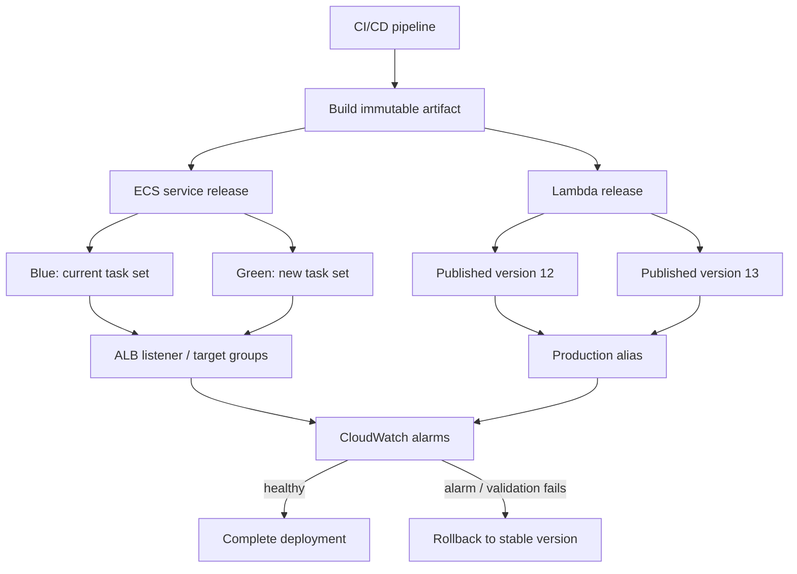
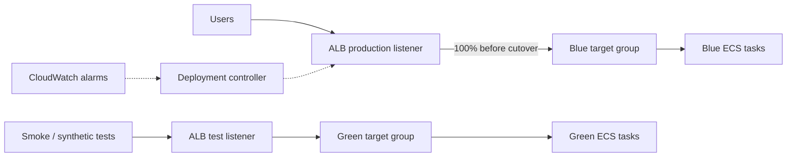
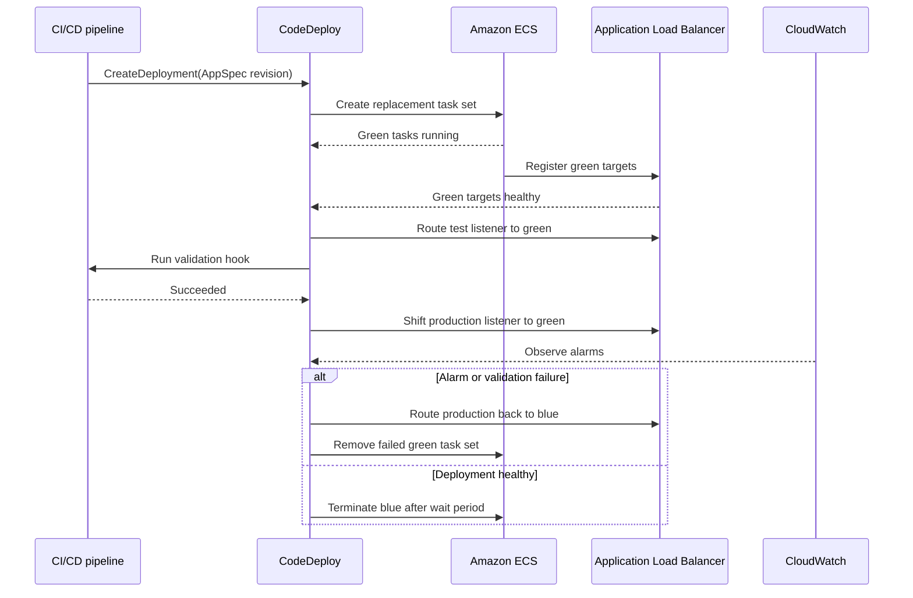
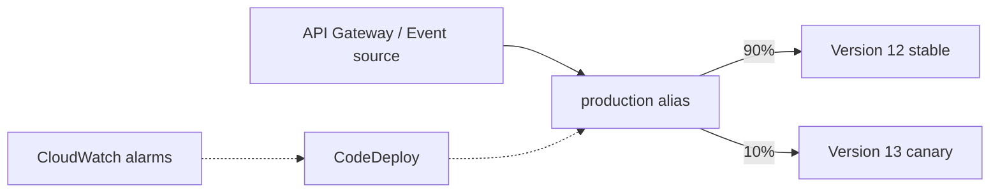
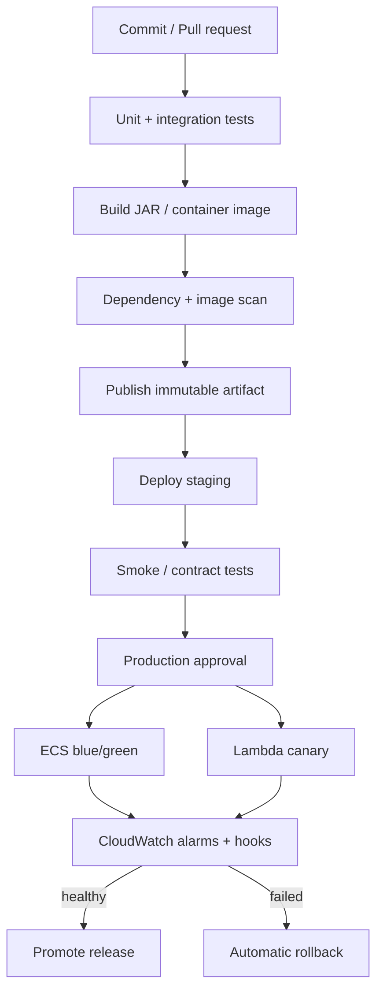

# Blue/green deployment cho ECS và canary cho Lambda

> **Học phần:** CLOUD_PROVIDERS_AWS  
> **Chương:** CI/CD trên AWS  
> **Bài học:** Blue/green deployment cho ECS và canary cho Lambda  
> **Bối cảnh:** Phát hành ứng dụng Java/Spring Boot trên Amazon ECS và AWS Lambda với traffic shifting, kiểm thử phiên bản mới, giám sát CloudWatch và tự động rollback.

## 1. Vì sao cần triển khai theo từng bước traffic?

Một Course API phục vụ học viên liên tục. Mỗi lần release có thể sửa logic tính học phí, thay đổi database query hoặc nâng thư viện. Nếu đưa toàn bộ traffic sang phiên bản mới ngay khi container hoặc Lambda function vừa khởi chạy, lỗi cấu hình, memory leak hay regression có thể ảnh hưởng tất cả người dùng.

CI/CD không chỉ cần build artifact và chạy lệnh deploy. Một quy trình release an toàn cần:

- Khởi chạy phiên bản mới trong môi trường có thể kiểm tra.
- Xác nhận health checks, dependency connectivity và application behavior.
- Chuyển traffic theo chiến lược phù hợp.
- Theo dõi error rate, latency, throttling và business metrics.
- Tự động dừng hoặc rollback khi có tín hiệu bất thường.
- Giữ phiên bản cũ đủ lâu để phục hồi nhanh.
- Bảo đảm database schema và message contracts tương thích trong giai đoạn hai phiên bản cùng chạy.

Hai mô hình chính trong bài:

- **ECS blue/green:** chạy service revision mới (green) bên cạnh revision hiện tại (blue), kiểm tra green rồi chuyển traffic. Amazon ECS hiện hỗ trợ deployment controller `ECS` với các strategy `ROLLING`, `BLUE_GREEN`, `LINEAR`, `CANARY`. Ngoài ra vẫn có mô hình CodeDeploy ECS controller (`CODE_DEPLOY`) dùng task sets và AppSpec.
- **Lambda canary:** publish một version bất biến, giữ alias production trỏ vào version hiện tại rồi dùng CodeDeploy dịch chuyển một phần traffic sang version mới theo thời gian.



### Mục tiêu học tập

Sau bài học, bạn có thể:

1. Phân biệt rolling, blue/green, canary và linear deployment.
2. Mô tả traffic flow blue/green trên ECS với ALB và hai target groups.
3. Phân biệt ECS native deployment strategies với CodeDeploy ECS deployment controller.
4. Cấu hình task definition, service revision, listeners, target groups và lifecycle hooks.
5. Dùng Lambda alias và published versions để canary traffic.
6. Chọn CodeDeploy deployment configuration phù hợp.
7. Thiết lập CloudWatch alarms, validation hooks và automatic rollback.
8. Thiết kế pipeline promotion từ build đến production.
9. Xử lý IAM, secrets, database migrations và backward compatibility.
10. Kiểm thử rollback, theo dõi deployment và đo release health.

## 2. Các chiến lược traffic shifting

| Chiến lược | Cách hoạt động | Ưu điểm | Đánh đổi |
|---|---|---|---|
| Rolling | Thay tasks/instances theo từng đợt | Ít tài nguyên trùng lặp, cấu hình đơn giản | Khó kiểm tra toàn bộ phiên bản mới trước khi nhận traffic |
| Blue/green | Chạy blue và green song song, sau đó chuyển traffic | Test độc lập, rollback nhanh | Tạm thời cần tài nguyên cho cả hai phiên bản |
| Canary | Chuyển một tỷ lệ nhỏ traffic trước, chờ quan sát rồi chuyển phần còn lại | Giới hạn blast radius | Cần đủ traffic và metrics để đánh giá |
| Linear | Tăng tỷ lệ traffic theo từng bước đều nhau | Phát hiện lỗi theo từng giai đoạn | Thời gian release dài hơn, cần theo dõi liên tục |
| All-at-once | Chuyển 100% traffic một lần | Nhanh, ít giai đoạn | Blast radius lớn nếu phiên bản mới có lỗi |

Ví dụ:

- Blue/green: blue giữ 100% traffic trong lúc green khởi chạy; sau test, listener chuyển 100% sang green.
- Canary 10%/5 phút: 10% traffic đi tới phiên bản mới; nếu qua thời gian quan sát và không có alarm, 90% còn lại được chuyển.
- Linear 10%/1 phút: traffic tăng 10% mỗi phút cho tới 100%.

Canary và linear chỉ có ý nghĩa khi traffic sample đủ lớn để quan sát. Nếu hệ thống chỉ có vài request mỗi phút, 10% traffic có thể không đủ để phát hiện regression.

## 3. ECS: kiến trúc blue/green

Blue/green tạo hai service revisions cùng tồn tại trong thời gian triển khai:

- **Blue:** revision hiện đang phục vụ production.
- **Green:** revision mới, dùng task definition mới.
- **Target groups:** định tuyến tới các tasks của mỗi revision.
- **Production listener:** nhận traffic thật từ người dùng.
- **Test listener (optional):** gửi test traffic tới green trước khi chuyển production.
- **CloudWatch alarms:** phát hiện lỗi và kích hoạt rollback.
- **Bake time:** khoảng thời gian quan sát sau khi traffic đã chuyển sang green, trong khi blue vẫn còn khả năng phục hồi.



Trước cutover, production listener trỏ blue; test listener có thể trỏ green. Khi green healthy và validation thành công, deployment controller thay đổi listener routing. Nếu deployment thất bại, traffic có thể được đưa lại blue.

### 3.1. Hai target groups là thành phần bắt buộc của mô hình ALB

Với ECS blue/green qua Elastic Load Balancing:

| Thành phần | Vai trò |
|---|---|
| Primary target group | Gắn với blue revision ban đầu |
| Alternate target group | Gắn với green revision thay thế |
| Production listener | Nhận traffic production |
| Test listener | Optional, dùng kiểm thử green |
| ECS service | Quản lý service revisions/tasks |
| Deployment controller | ECS native hoặc CodeDeploy, tùy mô hình |
| IAM role | Cho phép controller quản lý ECS/ELB resources |

Với Fargate hoặc ECS tasks dùng `awsvpc`, target group thường phải dùng target type `ip`. Hai target groups phải cùng VPC, protocol/port và health check phù hợp với container.

### 3.2. Health check cần phản ánh khả năng phục vụ

Không chỉ kiểm tra TCP port đã mở. Endpoint readiness nên xác nhận ứng dụng đã khởi tạo và sẵn sàng xử lý request.

Ví dụ Spring Boot:

```yaml
management:
  endpoint:
    health:
      probes:
        enabled: true
  endpoints:
    web:
      exposure:
        include: health,info

server:
  shutdown: graceful
```

Cấu hình target group health check trỏ tới endpoint phù hợp, ví dụ `/actuator/health/readiness`. Không để readiness endpoint trả healthy trước khi application đã kết nối dependency bắt buộc.

### 3.3. Bake time và capacity

Blue/green có thể cần gần gấp đôi task capacity trong giai đoạn green khởi chạy trước khi blue được kết thúc. Với ECS EC2, cluster phải còn đủ CPU/memory để chạy hai revision; với Fargate, cần tính chi phí task chạy song song.

Bake time nên đủ để quan sát traffic thật, nhưng không kéo dài không cần thiết vì blue và green cùng tiêu thụ tài nguyên. Nếu rollback cần giữ blue lâu hơn, cân nhắc chi phí và trạng thái database/message compatibility.

## 4. ECS có hai mô hình controller blue/green

Cần phân biệt:

| Mô hình | ECS deploymentController.type | Ai điều phối | Đặc điểm |
|---|---|---|---|
| ECS native blue/green | `ECS` | ECS service deployment | Dùng `deploymentConfiguration.strategy` như `BLUE_GREEN`, `CANARY`, `LINEAR` hoặc `ROLLING` |
| CodeDeploy ECS blue/green | `CODE_DEPLOY` | AWS CodeDeploy | Dùng task sets, deployment group, AppSpec, hooks và CodeDeploy deployment configuration |

Đây là hai mô hình khác nhau. Không cấu hình một ECS service vừa dùng native ECS strategy vừa dùng CodeDeploy controller cho cùng deployment.

### 4.1. ECS native deployment strategy

Với ECS controller, service deployment strategy có thể là:

- `ROLLING`: cập nhật tasks theo deployment configuration.
- `BLUE_GREEN`: chạy revision mới cạnh revision cũ, rồi chuyển traffic.
- `CANARY`: chuyển một tỷ lệ nhỏ trước, chờ bake/validation, sau đó chuyển phần còn lại.
- `LINEAR`: chuyển traffic theo các bước tỷ lệ đều nhau.

Các strategy blue/green, canary và linear cần cơ chế traffic management được hỗ trợ như ALB, NLB, Service Connect hoặc VPC Lattice. Headless service không có traffic routing layer thì ECS không thể tự quản lý listener traffic shift theo cách tương tự.

Ví dụ phần cấu hình deployment strategy ở mức khái niệm:

```yaml
deploymentController:
  type: ECS

deploymentConfiguration:
  strategy: BLUE_GREEN
  bakeTimeInMinutes: 10
```

Đây là fragment minh họa các thuộc tính service deployment; cấu hình hoàn chỉnh còn cần task definition, network, load balancer, target groups, role và các thông số service phù hợp. Kiểm tra API/CloudFormation schema của Region và platform đang triển khai trước khi dùng.

### 4.2. CodeDeploy ECS blue/green

CodeDeploy ECS dùng `deploymentController.type: CODE_DEPLOY`. Deployment group chỉ định:

- ECS cluster và service.
- Production listener, optional test listener.
- Hai target groups.
- Traffic rerouting behavior.
- Original task set termination wait.
- CloudWatch alarms và automatic rollback.
- Service role để CodeDeploy điều phối deployment.

CodeDeploy tạo replacement task set (green), đăng ký với target group còn lại, chạy validation hooks nếu có, rồi đổi listener để chuyển production traffic. Sau khi deployment thành công và thời gian chờ kết thúc, task set cũ mới bị loại bỏ.

### 4.3. Chọn mô hình nào?

- Chọn **ECS native** nếu muốn dùng deployment strategy được quản lý trực tiếp bởi ECS service và các lifecycle stages hiện hành.
- Chọn **CodeDeploy controller** nếu hệ thống đang dùng CodeDeploy deployment groups/AppSpec, hooks và quy trình đã tích hợp với CodeDeploy.
- Nếu migrate từ CodeDeploy sang native ECS, phải lập kế hoạch thay controller, roles, listeners, lifecycle hooks và deployment automation; không chỉ đổi một field.

## 5. CodeDeploy ECS: AppSpec và lifecycle hooks

AppSpec mô tả task definition mới, container/port dùng để định tuyến và Lambda hooks chạy tại các lifecycle events.

Ví dụ AppSpec YAML rút gọn:

```yaml
version: 0.0
Resources:
  - TargetService:
      Type: AWS::ECS::Service
      Properties:
        TaskDefinition: arn:aws:ecs:ap-southeast-1:123456789012:task-definition/course-api:42
        LoadBalancerInfo:
          ContainerName: app
          ContainerPort: 8080
Hooks:
  - AfterAllowTestTraffic: ValidateGreenEnvironment
  - BeforeAllowTraffic: FinalPreTrafficCheck
  - AfterAllowTraffic: VerifyProductionTraffic
```

Các hook có thể chạy Lambda validation functions:

| Hook | Thời điểm | Mục tiêu |
|---|---|---|
| `AfterAllowTestTraffic` | Green đã nhận test traffic | Smoke test, contract test, kiểm tra dependency |
| `BeforeAllowTraffic` | Trước khi production traffic chuyển sang green | Kiểm tra cuối, xác nhận release gate |
| `AfterAllowTraffic` | Sau khi production traffic chuyển sang green | Kiểm tra production behavior và metrics |

Với CodeDeploy hook Lambda, function cần thông báo kết quả lifecycle event về CodeDeploy qua API `PutLifecycleEventHookExecutionStatus`. Nếu hook không callback trong giới hạn thời gian, deployment có thể thất bại. Không chỉ trả về HTTP 200 từ Lambda handler rồi giả định CodeDeploy đã nhận kết quả.

### 5.1. AppSpec không chứa toàn bộ task definition

AppSpec tham chiếu ARN task definition revision đã đăng ký. Task definition chứa image, CPU/memory, environment, secrets, logging, IAM task role, execution role và container port mappings.

Không trỏ task definition tới `latest` image tag có thể bị ghi đè. Hãy build image bất biến, push lên ECR và tham chiếu tag bất biến hoặc image digest.

## 6. ECS CodeDeploy: cấu hình và triển khai

### 6.1. Điều kiện trước khi triển khai

- ECS service được tạo với deployment controller `CODE_DEPLOY`.
- Có ALB hoặc NLB phù hợp.
- Có production listener; test listener là tùy chọn.
- Có hai target groups cho original và replacement task sets.
- Target group health checks phù hợp.
- CodeDeploy deployment group trỏ đúng cluster/service/listeners/target groups.
- CodeDeploy service role có quyền cần thiết với ECS và ELB.
- AppSpec trỏ đúng task definition, container name và port.
- CloudWatch alarms và rollback settings được cấu hình.

### 6.2. Traffic flow



### 6.3. Tạo deployment bằng CLI

Sau khi đã có CodeDeploy application, deployment group và revision trong S3:

```bash
aws deploy create-deployment \
  --application-name course-api-ecs \
  --deployment-group-name course-api-production \
  --revision revisionType=S3,s3Location="{bucket=course-release-artifacts,key=releases/42/appspec.yaml,bundleType=YAML}" \
  --profile prod \
  --region ap-southeast-1
```

Ví dụ này minh họa tạo deployment từ AppSpec được lưu ở S3. Bucket/key, revision bundle và profile cần trỏ tới artifact đã được kiểm tra. Trong pipeline thực tế, có thể dùng CodePipeline CodeDeploy action hoặc SDK/API tương ứng.

### 6.4. Theo dõi deployment

```bash
aws deploy get-deployment \
  --deployment-id d-ABC123456 \
  --profile prod \
  --region ap-southeast-1

aws deploy list-deployment-targets \
  --deployment-id d-ABC123456 \
  --profile prod \
  --region ap-southeast-1
```

Kiểm tra deployment status, lifecycle events, target group health, ECS task health, hook logs và CloudWatch alarms. Không đánh dấu release thành công chỉ vì API `create-deployment` trả về deployment ID.

## 7. ECS native blue/green: alarms và lifecycle stages

ECS native deployment có các lifecycle stages để theo dõi quá trình green được tạo, test và chuyển traffic. Tên stage cụ thể phụ thuộc strategy và loại resource.

Một số stage tiêu biểu:

- `PRE_SCALE_UP`: trước khi green tasks được scale lên.
- `POST_SCALE_UP`: green đã được tạo nhưng production vẫn ở blue.
- `TEST_TRAFFIC_SHIFT`: chuyển test traffic tới green (khi cấu hình).
- `POST_TEST_TRAFFIC_SHIFT`: hoàn tất test traffic shift.
- `PRE_PRODUCTION_TRAFFIC_SHIFT`: kiểm tra trước production cutover.
- `POST_PRODUCTION_TRAFFIC_SHIFT`: production traffic đã chuyển.
- `BAKE_TIME`: theo dõi sau khi traffic chuyển.
- `CLEAN_UP`: kết thúc revision cũ sau khi deployment thành công.

Lifecycle hooks có thể chạy Lambda validation hoặc pause để chờ quyết định tiếp tục. Các hook cần idempotent vì có thể được gọi lại trong tình huống retry/reconciliation. Đừng đặt thao tác không thể đảo ngược vào hook pre-traffic nếu chưa có cơ chế bù trừ.

### 7.1. Automatic rollback

Có thể cấu hình CloudWatch alarms để phát hiện deployment có lỗi. Khi alarm vào trạng thái ALARM, ECS deployment có thể rollback về revision trước theo cấu hình service.

Ví dụ tín hiệu:

- ALB target 5xx tăng.
- Target response time tăng vượt SLO.
- Healthy target count giảm dưới ngưỡng.
- ECS service CPU/memory bất thường.
- Custom application error-rate metric tăng.

## 8. Lambda canary: published versions và alias

AWS Lambda function có thể được gọi qua `$LATEST` hoặc một published version. `$LATEST` thay đổi khi code/configuration được cập nhật; published version là snapshot bất biến. Để canary, pipeline publish version mới, giữ alias production trỏ vào stable version và để CodeDeploy thêm routing weight cho version mới.



### 8.1. Alias là điểm tích hợp production

API Gateway, EventBridge, Function URL hoặc service gọi Lambda nên invoke alias ARN production thay vì function ARN không có qualifier hoặc `$LATEST`.

```text
Function ARN:
arn:aws:lambda:ap-southeast-1:123456789012:function:course-handler

Production alias ARN:
arn:aws:lambda:ap-southeast-1:123456789012:function:course-handler:production
```

Nếu integration gọi thẳng function ARN không có alias, traffic routing của alias sẽ không được áp dụng.

### 8.2. Routing configuration

Lambda alias có thể phân phối invocation giữa primary version và additional version weights:

```json
{
  "FunctionVersion": "12",
  "RoutingConfig": {
    "AdditionalVersionWeights": {
      "13": 0.1
    }
  }
}
```

Ví dụ gửi khoảng 10% invocation tới version 13 và phần còn lại tới version 12. Weighted routing là phân phối theo tỷ lệ; trong một cửa sổ ngắn với ít invocation, tỷ lệ thực tế có thể lệch đáng kể. CodeDeploy tự quản lý alias routing trong deployment; không sửa alias thủ công giữa lúc đang triển khai.

Alias chỉ có thể trỏ tới tối đa hai published versions trong weighted routing. Hai versions phải dùng cùng execution role và cùng cấu hình dead-letter queue (hoặc cả hai không cấu hình DLQ); alias không thể trỏ tới `$LATEST`. CloudWatch Lambda metrics có dimension `ExecutedVersion` để phân biệt version thực sự được invoke.

### 8.3. Predefined Lambda deployment configurations

| Deployment configuration | Traffic shift |
|---|---|
| `CodeDeployDefault.LambdaCanary10Percent5Minutes` | 10% trước, chờ 5 phút, sau đó 90% còn lại |
| `CodeDeployDefault.LambdaCanary10Percent10Minutes` | 10% trước, chờ 10 phút |
| `CodeDeployDefault.LambdaCanary10Percent30Minutes` | 10% trước, chờ 30 phút |
| `CodeDeployDefault.LambdaLinear10PercentEvery1Minute` | Tăng 10% mỗi phút tới 100% |
| `CodeDeployDefault.LambdaLinear10PercentEvery10Minutes` | Tăng 10% mỗi 10 phút |
| `CodeDeployDefault.LambdaAllAtOnce` | Chuyển toàn bộ traffic ngay lập tức |

Canary 10%/5 phút không có nghĩa CodeDeploy tự hiểu business behavior. Bạn phải cấu hình alarms và validation để quyết định deployment có tiếp tục hay không.

## 9. Cấu hình Lambda canary bằng AWS SAM

AWS SAM hỗ trợ deployment preference cho Lambda function có alias. SAM transform tạo các tài nguyên CodeDeploy cần thiết như deployment group và role.

Ví dụ template rút gọn:

```yaml
Transform: AWS::Serverless-2016-10-31

Resources:
  CourseHandler:
    Type: AWS::Serverless::Function
    Properties:
      CodeUri: course-handler/
      Handler: com.example.CourseHandler::handleRequest
      Runtime: java21
      MemorySize: 1024
      Timeout: 15
      AutoPublishAlias: production
      DeploymentPreference:
        Type: Canary10Percent5Minutes
        Alarms:
          - !Ref CourseHandlerErrorAlarm
        Hooks:
          PreTraffic: !Ref PreTrafficValidation
          PostTraffic: !Ref PostTrafficValidation

  CourseHandlerErrorAlarm:
    Type: AWS::CloudWatch::Alarm
    Properties:
      AlarmDescription: Roll back when Lambda errors increase
      Namespace: AWS/Lambda
      MetricName: Errors
      Dimensions:
        - Name: FunctionName
          Value: !Ref CourseHandler
      Statistic: Sum
      Period: 60
      EvaluationPeriods: 1
      Threshold: 5
      ComparisonOperator: GreaterThanOrEqualToThreshold
```

Đây là template minh họa; thư mục `course-handler/` cần chứa Maven/Gradle build files và source theo quy ước SAM Java. Kiểm tra SAM CLI/transform version, runtime và alarm dimensions theo ứng dụng. Alarm cần đo đúng function/version/alias hoặc custom metric mà bạn muốn bảo vệ. Metric tổng hợp toàn function có thể trộn lỗi nền của stable version với lỗi canary. Các logical IDs PreTrafficValidation và PostTrafficValidation phải trỏ tới các Lambda hook functions được khai báo trong template.

### 9.1. AutoPublishAlias

`AutoPublishAlias: production` yêu cầu SAM tạo/publish version mới khi code hoặc configuration thay đổi theo quy tắc versioning của SAM, sau đó gắn alias production. Alias giữ endpoint tích hợp ổn định qua các release.

### 9.2. PreTraffic và PostTraffic hooks

- **PreTraffic:** kiểm tra version mới trước khi CodeDeploy chuyển traffic.
- **PostTraffic:** kiểm tra sau khi traffic shift hoàn tất.
- Hook phải trả kết quả cho CodeDeploy lifecycle event đúng giao thức.
- Hook cần timeout hữu hạn, idempotent và ghi log đủ để điều tra.
- Nếu hook thất bại hoặc không callback, deployment có thể bị đánh dấu thất bại.

Với CodeDeploy Lambda hook, handler phải gọi API `PutLifecycleEventHookExecutionStatus` và gửi đúng deployment ID, lifecycle event hook execution ID cùng trạng thái Succeeded/Failed. Chỉ return bình thường từ Lambda handler không tự hoàn tất lifecycle hook.

Validation có thể gọi canary endpoint, kiểm tra dependency, schema compatibility hoặc synthetic transaction. Không tạo business side effect không thể đảo ngược trong smoke test.

## 10. Cấu hình Lambda canary bằng CDK

CDK có thể tạo Lambda function, published version, alias, CloudWatch alarm và CodeDeploy deployment group.

```typescript
import * as cdk from 'aws-cdk-lib';
import * as lambda from 'aws-cdk-lib/aws-lambda';
import * as cloudwatch from 'aws-cdk-lib/aws-cloudwatch';
import * as codedeploy from 'aws-cdk-lib/aws-codedeploy';
import { Construct } from 'constructs';

export class CourseLambdaStack extends cdk.Stack {
  constructor(scope: Construct, id: string, props?: cdk.StackProps) {
    super(scope, id, props);

    const fn = new lambda.Function(this, 'CourseHandler', {
      runtime: lambda.Runtime.JAVA_21,
      handler: 'com.example.CourseHandler::handleRequest',
      code: lambda.Code.fromAsset('../course-handler/target/function.zip'),
      memorySize: 1024,
      timeout: cdk.Duration.seconds(15),
    });

    const alias = new lambda.Alias(this, 'ProductionAlias', {
      aliasName: 'production',
      version: fn.currentVersion,
    });

    const errorAlarm = new cloudwatch.Alarm(this, 'CanaryErrorAlarm', {
      metric: alias.metricErrors({
        period: cdk.Duration.minutes(1),
      }),
      threshold: 5,
      evaluationPeriods: 1,
      comparisonOperator:
        cloudwatch.ComparisonOperator.GREATER_THAN_OR_EQUAL_TO_THRESHOLD,
      treatMissingData: cloudwatch.TreatMissingData.MISSING,
    });

    new codedeploy.LambdaDeploymentGroup(this, 'CanaryDeployment', {
      alias,
      deploymentConfig:
        codedeploy.LambdaDeploymentConfig.CANARY_10PERCENT_5MINUTES,
      alarms: [errorAlarm],
      autoRollback: {
        failedDeployment: true,
        deploymentInAlarm: true,
      },
    });
  }
}
```

Đây là ví dụ CDK minh họa. Với production, version phải thay đổi theo mỗi release; kiểm tra asset hash, published version và deployment group synthesis để chắc chắn CodeDeploy thực sự nhận version mới.

### 10.1. Java Lambda và immutable release artifact

- Build JAR/ZIP hoặc container image từ commit bất biến.
- Ghim dependency versions và runtime version.
- Tạo published version cho release.
- Dùng alias production làm integration target.
- Không sửa code của version đã publish; tạo version mới cho mỗi release.
- Giữ artifact, commit SHA, build ID và version number trong deployment metadata.

## 11. Lambda AppSpec và lifecycle hooks

CodeDeploy Lambda AppSpec chỉ định function, alias, current version, target version và optional validation hooks:

```yaml
version: 0.0
Resources:
  - CourseHandler:
      Type: AWS::Lambda::Function
      Properties:
        Name: course-handler
        Alias: production
        CurrentVersion: "12"
        TargetVersion: "13"
Hooks:
  - BeforeAllowTraffic: PreTrafficValidation
  - AfterAllowTraffic: PostTrafficValidation
```

`CurrentVersion` là version hiện tại của alias; `TargetVersion` là version mới đã publish. CodeDeploy điều khiển alias routing trong suốt quá trình traffic shifting.

PreTraffic hook có thể kiểm tra function startup, environment variables, secrets, database connection, API contract và downstream dependencies. PostTraffic hook kiểm tra error rate, latency, business transaction và metrics sau khi traffic shift hoàn tất.

Hook không thay thế CloudWatch alarms. Hook là logic validation chủ động; alarm theo dõi metrics liên tục trong quá trình deploy.

## 12. CloudWatch alarms cho canary và blue/green

Một deployment chỉ nên được coi là khỏe khi cả application metrics và infrastructure metrics ổn định.

### 12.1. ECS/ALB metrics

| Metric | Dùng để phát hiện |
|---|---|
| `HTTPCode_Target_5XX_Count` | Lỗi HTTP từ target tasks |
| `HTTPCode_ELB_5XX_Count` | Lỗi do load balancer |
| `TargetResponseTime` | Latency phía target |
| `HealthyHostCount` | Số targets healthy |
| `UnHealthyHostCount` | Targets unhealthy |
| ECS CPU utilization | CPU saturation |
| ECS memory utilization | Memory pressure |
| Application error-rate metric | Business/API errors |

Đối chiếu metric với target group và deployment revision nếu dimensions cho phép. Alarm toàn service có thể bị ảnh hưởng bởi blue traffic hoặc downstream outage; cân nhắc custom metrics có dimension release/version.

### 12.2. Lambda metrics

| Metric | Dùng để phát hiện |
|---|---|
| `Errors` | Invocation thất bại |
| `Throttles` | Function bị throttle |
| `Duration` | Execution duration và latency trend |
| `ConcurrentExecutions` | Concurrency pressure |
| `IteratorAge` | Stream consumer bị chậm (nếu áp dụng) |
| Custom business metric | Tỷ lệ transaction thành công, validation errors |

Đối với canary, theo dõi riêng version/alias khi có thể. Một alarm tổng hợp trên toàn function có thể không phân biệt stable version vốn đã có error nền với canary mới.

### 12.3. Chọn ngưỡng alarm

Không lấy một con số cố định cho mọi API. Thiết kế ngưỡng theo SLO và baseline:

- Error rate: vượt baseline/SLO trong một số evaluation periods.
- Latency: p95/p99 tăng đáng kể so với stable version.
- Throttles: tăng trong khi concurrency đã gần quota.
- Healthy targets: không đủ số lượng tối thiểu để phục vụ.
- Business success rate: giảm dù HTTP status vẫn là 200.

Dùng CloudWatch composite alarms khi cần kết hợp nhiều tín hiệu. Cân nhắc `TreatMissingData` theo traffic volume; missing datapoints không tự động đồng nghĩa deployment khỏe.
## 13. Rollback và giới hạn của rollback

Rollback traffic không đồng nghĩa rollback mọi thay đổi của hệ thống.

### 13.1. ECS rollback

- Nếu green có lỗi trước cutover, giữ production trên blue và đánh dấu deployment thất bại.
- Nếu green có lỗi trong bake time, chuyển listener traffic về blue theo controller behavior.
- Kiểm tra blue tasks còn healthy và chưa bị terminate.
- Sau khi deployment hoàn tất và blue bị cleanup, rollback có thể cần tạo deployment mới dùng task definition revision cũ.
- Với ECS native, kiểm tra deployment circuit breaker/alarms và service deployment history theo strategy đang dùng.
- Với CodeDeploy controller, kiểm tra automatic rollback configuration, alarms và deployment lifecycle events.

### 13.2. Lambda rollback

- CodeDeploy có thể chuyển alias về version ổn định trước đó khi deployment thất bại hoặc alarm kích hoạt.
- Published versions vẫn tồn tại cho tới khi bị xóa theo quy trình cleanup.
- Alias routing config phải trở lại stable version; không chỉ redeploy cùng source code nếu version/configuration đã thay đổi.
- Kiểm tra event source mappings, API integrations và permissions có gọi đúng alias.
- Giữ ít nhất phiên bản stable gần nhất trong thời gian rollback window.

### 13.3. Database migration và backward compatibility

Trong blue/green hoặc canary, hai phiên bản có thể cùng truy cập database trong một thời gian. Vì vậy:

- Dùng chiến lược **expand-contract**: thêm schema/column mới trước, deploy code tương thích cả schema cũ và mới, rồi mới loại bỏ schema cũ trong release sau.
- Không rename/drop column trong cùng release mà code cũ vẫn còn chạy.
- Giữ message/event schema tương thích giữa producer và consumer versions.
- Tránh migration lock dài ngay trước traffic cutover.
- Có backup/restore plan; CloudFormation/CodeDeploy rollback không hoàn tác dữ liệu đã commit.

### 13.4. Rollback runbook

1. Dừng pipeline promotion và không phát hành thêm artifact.
2. Xác định deployment ID, service revision hoặc Lambda alias version.
3. Xác minh alarm, logs, traces và thời điểm lỗi bắt đầu.
4. ECS: chuyển traffic về blue hoặc deploy lại task definition revision ổn định.
5. Lambda: để CodeDeploy rollback alias hoặc khôi phục alias tới published version ổn định.
6. Kiểm tra database/message compatibility.
7. Xác nhận error rate/latency trở lại baseline.
8. Lưu incident timeline, artifact digest và nguyên nhân gốc.

## 14. CI/CD pipeline cho ECS và Lambda

Pipeline nên tạo một artifact bất biến và dùng cùng artifact qua các môi trường. Không build lại code khác nhau giữa staging và production.



### 14.1. Các stage khuyến nghị

1. **Source:** checkout commit SHA bất biến.
2. **Test:** unit, integration, contract và migration compatibility tests.
3. **Build:** tạo JAR/image, SBOM và metadata.
4. **Security:** dependency scan, container scan, secret scan, policy checks.
5. **Publish:** push ECR image bằng digest hoặc artifact version bất biến.
6. **Staging:** deploy cùng task definition/Lambda artifact đã build.
7. **Validation:** smoke test, synthetic transactions và load checks.
8. **Approval:** phê duyệt production khi release risk yêu cầu.
9. **Production rollout:** ECS blue/green hoặc Lambda canary.
10. **Observe:** theo dõi alarms trong bake/canary interval.
11. **Promote/rollback:** đánh dấu release thành công hoặc quay về stable revision.
12. **Record:** lưu commit SHA, image digest, Lambda version, deployment ID và metrics.

### 14.2. Không build artifact mới ở bước production

Nếu staging đã kiểm thử image digest `sha256:abc...`, production phải deploy đúng digest đó. Nếu build lại từ cùng Git commit nhưng dependency không được ghim, output có thể khác.

Tương tự Lambda, giữ đúng ZIP/image artifact và published version đã được kiểm thử. Release metadata nên liên kết:

```text
Git commit SHA
Build ID
Container image digest / Lambda artifact checksum
ECS task definition revision
Lambda published version
CodeDeploy deployment ID
CloudWatch alarm state
Deployment start/end timestamps
```

## 15. IAM và bảo mật deployment

Blue/green/canary có nhiều actors: pipeline, CodeDeploy, ECS, Lambda hooks, load balancer và application task roles.

### 15.1. Tách các role

| Role | Trách nhiệm |
|---|---|
| CI/CD execution role | Build/publish artifacts và gọi deployment API |
| CodeDeploy service role | Điều phối ECS/Lambda traffic shifting và deployment lifecycle |
| ECS task execution role | Pull ECR image, ghi logs, lấy secrets theo cấu hình |
| ECS task role | Quyền runtime của ứng dụng |
| Lambda execution role | Quyền runtime của function |
| Validation hook role | Gọi test endpoints, đọc metrics và báo lifecycle status |

Không gộp toàn bộ quyền vào một role có `AdministratorAccess`.

### 15.2. Quy tắc least privilege

- Chỉ cho pipeline deploy đúng ECS service, CodeDeploy application/deployment group và Lambda function/alias.
- Giới hạn quyền update alias/publish version theo function ARN phù hợp.
- CodeDeploy service role chỉ được quản lý ECS/ELB/Lambda resources cần thiết.
- Task execution role chỉ có ECR pull, CloudWatch Logs và secrets access cần thiết.
- Validation hooks không được dùng production write privileges nếu chỉ cần smoke test.
- Giới hạn quyền `iam:PassRole` vào các task/execution roles đã định danh.
- Dùng KMS key policies và Secrets Manager resource policies theo environment.
- Dùng CloudTrail để audit ai đã bắt đầu, dừng hoặc rollback deployment.

### 15.3. Secrets và configuration

Không nhúng database passwords, API keys hoặc private certificates vào image, AppSpec, SAM template hay deployment logs. Tham chiếu Secrets Manager/SSM Parameter Store theo runtime role. Khi canary và stable cùng chạy, bảo đảm cả hai version đọc được configuration trong giai đoạn chuyển tiếp.

## 16. Vận hành và troubleshooting

| Triệu chứng | Nguyên nhân có thể | Cách xử lý |
|---|---|---|
| Green tasks không healthy | Readiness path sai, port mapping sai, SG hoặc app startup lỗi | Kiểm tra ECS task events, target health reason và application logs |
| CodeDeploy không tạo được replacement task set | AppSpec task definition/container name/port sai hoặc thiếu IAM permissions | Kiểm tra AppSpec, task definition và service role |
| Test listener không route tới green | Listener/rule hoặc target group mapping sai | Kiểm tra deployment group và ALB listener rules |
| Traffic shift bị pause hoặc fail | Lifecycle hook timeout/failure | Kiểm tra Lambda hook logs và callback status |
| Rollback không kích hoạt | Alarm chưa gắn, missing data hoặc evaluation window chưa đủ | Kiểm tra alarm state và rollback settings |
| Lambda canary không nhận traffic | Integration gọi function ARN thay vì alias ARN | Cập nhật API/event source integration tới alias |
| Lambda version mới không được publish | SAM/CDK version configuration không đổi hoặc artifact hash không đổi | Kiểm tra AutoPublishAlias/currentVersion và build artifact |
| Lambda canary errors tăng nhưng alarm không báo | Metric dimension không tách version/alias hoặc threshold sai | Dùng metric dimensions/custom metric phù hợp |
| Canary không có đủ sample | Traffic thấp hoặc thời gian quan sát quá ngắn | Kéo dài interval hoặc chạy synthetic traffic có kiểm soát |
| Rollback traffic thành công nhưng lỗi vẫn còn | Database/schema hoặc side effect đã thay đổi | Kiểm tra expand-contract, compatibility và recovery plan |
| Deployment tốn gấp đôi tài nguyên | Blue và green cùng chạy trong bake time | Dự trù capacity/cost và chọn bake time hợp lý |
| Old tasks bị terminate quá sớm | Termination wait/bake time không phù hợp | Điều chỉnh cleanup wait và xác minh rollback window |

### 16.1. Checklist trước release

- Artifact digest/version đã được cố định và scan.
- ECS task definition hoặc Lambda published version đã sẵn sàng.
- Alias/target group/listener trỏ đúng.
- Readiness/health checks đã thử.
- CloudWatch alarms có dữ liệu và ngưỡng hợp lý.
- Validation hooks đã test cả success và failure path.
- IAM roles và iam:PassRole đã được review.
- Database migration tương thích với cả phiên bản cũ và mới.
- Có đủ capacity cho blue và green cùng chạy.
- Rollback procedure đã được diễn tập trong staging.
## 17. Lab: ECS blue/green cho Course API

**Tình huống:** Course API chạy Spring Boot trên ECS Fargate sau ALB. Nhóm phát hành task definition revision mới và muốn kiểm tra green trước khi chuyển production traffic.

### 17.1. Chuẩn bị

1. Tạo ECS cluster và Fargate service trong sandbox.
2. Tạo task definition revision có container name `app`, port 8080 và image digest bất biến.
3. Tạo ALB production listener và hai target groups cùng VPC.
4. Với CodeDeploy controller, tạo optional test listener, CodeDeploy application/deployment group và service role.
5. Với ECS native, cấu hình service deployment strategy phù hợp và các traffic routing resources được hỗ trợ.
6. Cấu hình readiness endpoint, target group health checks và CloudWatch alarms.
7. Tạo validation hook để chạy smoke test vào green.

### 17.2. Thực hành CodeDeploy ECS

- Deploy revision đầu tiên và xác nhận blue target group nhận 100% production traffic.
- Tạo task definition revision mới, push image mới lên ECR.
- Cập nhật AppSpec với task definition ARN, container name và port.
- Chạy CodeDeploy deployment.
- Xác nhận green tasks được tạo và healthy.
- Gửi test traffic tới green qua test listener.
- Chạy hook validation và xác nhận hook callback thành công.
- Theo dõi production traffic shift, bake time và CloudWatch alarms.
- Khi deployment thành công, xác nhận green là primary revision và blue được cleanup theo termination wait.
- Tạo một release lỗi trong sandbox để xác nhận traffic được trả về blue khi alarm/hook thất bại.

### 17.3. Thực hành ECS native

- Tạo service với deployment controller ECS.
- Chọn strategy BLUE_GREEN; sau đó thử CANARY hoặc LINEAR nếu được hỗ trợ trong môi trường.
- Cấu hình bake time, target groups/listener và CloudWatch alarms.
- Deploy task definition revision mới.
- Quan sát lifecycle stages, traffic shift và rollback behavior.
- So sánh resource consumption với rolling deployment.

Không thay deployment controller của production service chỉ để thử lab. Tạo service sandbox riêng cho từng controller model.

## 18. Lab: Lambda canary cho Java handler

**Tình huống:** Lambda Java xử lý yêu cầu tạo báo cáo. Version 12 đang phục vụ alias production; version 13 thêm logic mới.

### 18.1. Chuẩn bị

1. Tạo Java Lambda function và runtime/dependencies được hỗ trợ.
2. Tạo published version ổn định và alias `production`.
3. Cấu hình API Gateway hoặc event source integration gọi alias ARN.
4. Tạo CloudWatch alarm cho Errors và Duration; thêm custom metric cho business success rate.
5. Tạo CodeDeploy deployment group hoặc dùng SAM DeploymentPreference/CDK LambdaDeploymentGroup.
6. Cấu hình Canary10Percent5Minutes và PreTraffic/PostTraffic hooks.

### 18.2. Thực hành

- Deploy code version 12 và xác nhận alias production trỏ tới version 12.
- Build version 13 từ commit mới và publish immutable artifact.
- Chạy PreTraffic validation trên version 13.
- Bắt đầu canary 10%/5 phút.
- Gửi synthetic requests và quan sát metric theo version/alias.
- Khi alarm không kích hoạt, xác nhận phần traffic còn lại được chuyển tới version 13.
- Trong một lần thử sandbox khác, cố ý tạo lỗi để alarm kích hoạt rollback.
- Xác nhận alias trở lại version 12 và API integration vẫn gọi alias.
- Lưu deployment ID, function version, artifact checksum và alarm timeline.

### 18.3. Bảng kết quả

| Thử nghiệm | Stable version | New version | Traffic strategy | Error rate | p95 latency | Rollback | Kết quả |
|---|---:|---:|---|---:|---:|---|---|
| ECS blue/green success | Đo | Đo | 100% cutover | Đo | Đo | Không | Pass/Fail |
| ECS blue/green failure | Đo | Đo | Test + cutover | Đo | Đo | Có/Không | Pass/Fail |
| Lambda canary success | 12 | 13 | 10% / 5 phút | Đo | Đo | Không | Pass/Fail |
| Lambda canary failure | 12 | 13 | 10% / 5 phút | Đo | Đo | Có/Không | Pass/Fail |

Không điền benchmark giả. Chạy cùng workload, cùng Region và cùng alarm settings để so sánh.
## 19. Negative tests

| Test | Điều kiện | Kết quả mong đợi |
|---|---|---|
| T1 | Green task dùng sai container port | Target group health check fail, production vẫn ở blue |
| T2 | Green task thiếu secret permission | Startup/readiness fail; không cutover |
| T3 | Test listener trỏ nhầm target group | Validation không thực sự kiểm tra green; test phải phát hiện |
| T4 | AppSpec tham chiếu task definition revision không tồn tại | CodeDeploy deployment fail trước traffic shift |
| T5 | Lifecycle hook không callback status | Deployment timeout/fail theo hook contract |
| T6 | CloudWatch alarm threshold quá cao | Regression không kích hoạt rollback; test hiệu chỉnh alarm |
| T7 | Canary alias integration gọi unqualified function ARN | Traffic không đi qua alias routing |
| T8 | Lambda version mới chưa publish | CodeDeploy không có target version hợp lệ |
| T9 | Alarm dùng dimension không tách canary | Error của version mới bị che bởi metric tổng hợp |
| T10 | Traffic thấp, canary interval quá ngắn | Không đủ sample để đánh giá release health |
| T11 | DB migration drop column khi blue vẫn chạy | Phiên bản cũ có thể lỗi sau cutover/rollback |
| T12 | Xóa blue ngay sau cutover | Mất khả năng rollback nhanh về task set cũ |
| T13 | CI build lại image ở production | Artifact production khác artifact đã kiểm thử ở staging |
| T14 | Pipeline có quyền iam:PassRole quá rộng | Có nguy cơ deploy task/function với role ngoài phạm vi |

Chỉ chạy test có khả năng gây lỗi, rollback hoặc làm gián đoạn traffic trong sandbox/staging. Không cố tình làm hỏng production.

## 20. Câu hỏi tự kiểm tra

**1. Blue/green deployment là gì?**  
Tạo green revision song song với blue, kiểm tra green rồi chuyển production traffic; blue có thể được giữ lại trong bake/termination window để rollback.

**2. Canary khác linear thế nào?**  
Canary chuyển một tỷ lệ nhỏ trước rồi chuyển phần còn lại sau interval; linear tăng traffic theo các bước đều nhau.

**3. ECS native deployment controller khác CodeDeploy controller ra sao?**  
ECS native dùng controller ECS và deployment strategy của ECS service; CodeDeploy controller dùng task sets, deployment group, AppSpec và CodeDeploy lifecycle hooks.

**4. Vì sao ECS blue/green cần hai target groups?**  
Một target group gắn với blue/original task set và target group còn lại gắn với green/replacement task set để load balancer chuyển traffic.

**5. Test listener dùng để làm gì?**  
Cho phép kiểm tra green bằng test traffic trước khi chuyển production traffic.

**6. Bake time là gì?**  
Khoảng thời gian quan sát sau traffic shift trong khi revision cũ còn được giữ lại theo cấu hình.

**7. Lambda canary dùng alias để làm gì?**  
Alias là endpoint ổn định trỏ tới published version và hỗ trợ routing weights giữa stable và canary versions.

**8. Vì sao không gọi Lambda unqualified ARN khi cần canary?**  
Invocation không đi qua alias routing configuration, nên traffic shifting của alias không được áp dụng.

**9. CodeDeploy Lambda canary 10%/5 phút hoạt động thế nào?**  
Chuyển 10% invocation tới version mới, chờ 5 phút rồi chuyển phần còn lại nếu deployment vẫn khỏe.

**10. CloudWatch alarms có vai trò gì?**  
Theo dõi error, latency, throttling, health và kích hoạt rollback khi ngưỡng đã cấu hình bị vi phạm.

**11. PreTraffic hook dùng để làm gì?**  
Kiểm tra version mới trước khi chuyển traffic; hook phải báo kết quả đúng lifecycle protocol của CodeDeploy.

**12. Rollback traffic có đảo ngược database migration không?**  
Không. Database changes cần backward compatibility, expand-contract và backup/recovery riêng.

**13. Vì sao nên dùng image digest thay tag có thể thay đổi?**  
Đảm bảo production chạy đúng artifact đã được build, scan và kiểm thử ở staging.

**14. Khi nào canary 10% không đủ để đánh giá?**  
Khi traffic quá thấp hoặc observation interval quá ngắn khiến sample không đại diện.

**15. Vì sao giữ blue trong bake time có chi phí?**  
Blue và green cùng chạy, nên cần thêm task capacity và trả chi phí tài nguyên trong thời gian đó.

## 21. Tổng kết và tài liệu AWS chính thức

ECS blue/green giúp triển khai service revision mới song song với revision đang phục vụ production. Green được kiểm tra qua health checks và optional test listener trước khi chuyển traffic. ECS native controller hiện hỗ trợ các chiến lược ROLLING, BLUE_GREEN, LINEAR và CANARY; CodeDeploy ECS controller là một mô hình riêng dùng task sets, deployment groups, AppSpec và lifecycle hooks.

Lambda canary sử dụng published versions và alias production. CodeDeploy điều chỉnh additional version weights theo deployment configuration, chẳng hạn 10% traffic trong 5 phút trước khi chuyển phần còn lại. CloudWatch alarms và validation hooks giúp dừng/rollback khi phát hiện lỗi.

Một release an toàn cần artifact bất biến, health checks, alarm có dữ liệu, least-privilege roles, database backward compatibility và rollback runbook đã được diễn tập. Traffic rollback chỉ phục hồi routing; nó không tự hoàn tác database writes hoặc side effects của business workflow.

### Tài liệu AWS chính thức

- [Amazon ECS — Service deployment controllers and strategies](https://docs.aws.amazon.com/AmazonECS/latest/developerguide/ecs_service-options.html)
- [Amazon ECS — Blue/green deployment workflow](https://docs.aws.amazon.com/AmazonECS/latest/developerguide/blue-green-deployment-how-it-works.html)
- [Amazon ECS — Blue/green deployment resources](https://docs.aws.amazon.com/AmazonECS/latest/developerguide/blue-green-deployment-implementation.html)
- [Amazon ECS — ALB resources for blue/green, linear and canary](https://docs.aws.amazon.com/AmazonECS/latest/developerguide/alb-resources-for-blue-green.html)
- [Amazon ECS — Update deployment strategy](https://docs.aws.amazon.com/AmazonECS/latest/developerguide/migrate-deployment-strategies.html)
- [AWS CodeDeploy — ECS deployment steps](https://docs.aws.amazon.com/codedeploy/latest/userguide/deployment-steps-ecs.html)
- [AWS CodeDeploy — ECS AppSpec hooks](https://docs.aws.amazon.com/codedeploy/latest/userguide/reference-appspec-file-structure-hooks.html)
- [AWS CodeDeploy — Lambda deployment configurations](https://docs.aws.amazon.com/codedeploy/latest/userguide/deployment-configurations.html)
- [AWS CodeDeploy — Lambda AppSpec example](https://docs.aws.amazon.com/codedeploy/latest/userguide/reference-appspec-file-example.html)
- [AWS SAM — Safe Lambda deployments](https://docs.aws.amazon.com/serverless-application-model/latest/developerguide/automating-updates-to-serverless-apps.html)
- [AWS Lambda — Aliases and weighted routing](https://docs.aws.amazon.com/lambda/latest/dg/configuration-aliases.html)
- [AWS Lambda — Traffic shifting with CodeDeploy](https://docs.aws.amazon.com/lambda/latest/dg/configuring-alias-routing.html)
- [Amazon CloudWatch — Alarm concepts](https://docs.aws.amazon.com/AmazonCloudWatch/latest/monitoring/AlarmThatSendsEmail.html)

> **Lưu ý thực hành:** Cluster/service names, account IDs, Region, target groups, function names, versions, alarm thresholds và deployment intervals trong bài là ví dụ. Kiểm tra ECS controller model, CodeDeploy AppSpec schema, alias integrations, alarm dimensions, IAM roles và rollback behavior trong sandbox trước khi áp dụng vào production.


