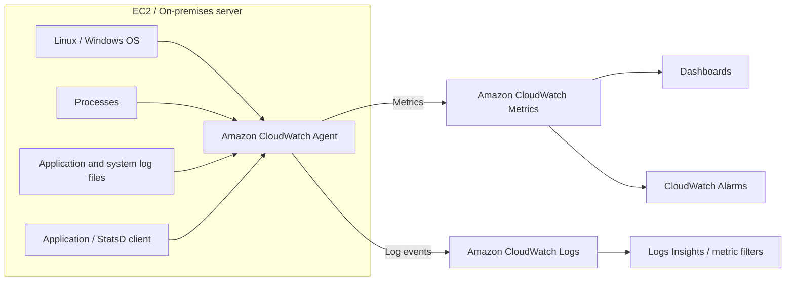

# CloudWatch Agent và thu thập metric máy chủ

> **Chương:** Quan sát với CloudWatch  
> **Module:** CLOUD_PROVIDERS_AWS  
> **Phạm vi:** Cài đặt, cấu hình và vận hành Amazon CloudWatch Agent để thu thập metric hệ điều hành, metric tiến trình và log từ Amazon EC2 hoặc máy chủ on-premises. Bài học tập trung vào IAM, quản lý cấu hình tập trung, xác minh dữ liệu, cảnh báo, chi phí và xử lý sự cố.

## Mục tiêu học tập

Sau bài này, người học có thể:

1. Phân biệt metric hạ tầng EC2 mặc định với metric bên trong hệ điều hành do CloudWatch Agent thu thập.
2. Mô tả luồng dữ liệu từ agent tới CloudWatch Metrics và CloudWatch Logs.
3. Chọn metric CPU, memory, disk, disk I/O, network, swap và TCP phù hợp.
4. Cài đặt agent trên Linux, Windows Server và máy chủ on-premises.
5. Cấp IAM permissions theo least privilege và phân biệt quyền gửi telemetry với quyền quản lý máy chủ qua Systems Manager.
6. Tạo, đọc và kiểm tra cấu hình JSON của CloudWatch Agent.
7. Dùng configuration wizard hoặc quản lý file cấu hình qua Systems Manager Parameter Store.
8. Khởi động, cập nhật, kiểm tra trạng thái và xem log của agent.
9. Thu thập metric tiến trình bằng procstat và metric tùy chỉnh bằng StatsD/collectd.
10. Thu thập log file, tạo dashboard và CloudWatch alarms.
11. Hiểu namespace, dimensions, aggregation, high-resolution metrics và chi phí.
12. Triển khai cấu hình đồng nhất trên nhiều EC2 instances.
13. Xử lý lỗi IAM, network, JSON, missing metrics, log streams và agent service.
14. Thực hành giám sát một máy chủ Linux chạy ứng dụng Java.

## 1. Vì sao cần CloudWatch Agent?

Amazon CloudWatch cung cấp khả năng quan sát tài nguyên AWS bằng metrics, logs, alarms và dashboards. Tuy nhiên, không phải mọi thông tin bên trong máy chủ đều tự động được EC2 gửi lên CloudWatch.

### 1.1 EC2 metrics mặc định và OS metrics

EC2 cung cấp các metric hạ tầng như:

- CPUUtilization.
- NetworkIn và NetworkOut.
- NetworkPacketsIn và NetworkPacketsOut.
- DiskReadOps và DiskWriteOps cho những loại lưu trữ được hỗ trợ.
- StatusCheckFailed.

Các metric này hữu ích để đánh giá tình trạng instance và hạ tầng, nhưng không trực tiếp cho biết đầy đủ RAM đã sử dụng bao nhiêu phần trăm, filesystem còn bao nhiêu dung lượng, process Java đang dùng bao nhiêu CPU/RAM, số TCP connections đang established hoặc log ứng dụng có xuất hiện lỗi hay không.

CloudWatch Agent chạy bên trong máy chủ để đọc thông tin từ operating system, process, application và các nguồn telemetry được cấu hình, sau đó gửi dữ liệu lên CloudWatch.

### 1.2 CloudWatch Agent thu thập những gì?

| Nhóm dữ liệu | Ví dụ | Mục đích |
|---|---|---|
| CPU | usage_active, usage_idle | Phát hiện CPU saturation |
| Memory | mem_used_percent | Phát hiện thiếu RAM |
| Disk | disk_used_percent, disk_inodes_free | Phát hiện đầy filesystem và cạn inode |
| Disk I/O | diskio_reads, diskio_writes | Theo dõi hoạt động lưu trữ |
| Network | net_bytes_sent, net_bytes_recv | Theo dõi traffic interface |
| TCP | netstat_tcp_established | Phát hiện connection buildup |
| Process | procstat_cpu_usage, procstat_memory_rss | Theo dõi tiến trình |
| Application metrics | StatsD, collectd | Thu thập metric ứng dụng |
| Logs | application.log, system.log | Điều tra lỗi và sự kiện |
| Traces | OpenTelemetry pipeline | Gửi trace telemetry theo cấu hình hỗ trợ |

Metric được xuất qua CloudWatch Metrics có namespace mặc định là CWAgent, trừ khi cấu hình namespace khác. Các metrics này được tính là custom metrics theo chính sách giá CloudWatch.

### 1.3 Khi nào nên dùng CloudWatch Agent?

Dùng agent khi cần theo dõi memory, filesystem, process, application logs, OS metrics hoặc custom metrics từ máy chủ. Agent cũng phù hợp để chuẩn hóa telemetry cho fleet EC2 và máy chủ on-premises.

Nếu chỉ cần CPU và network cơ bản của EC2, metric mặc định có thể đã đủ. Không nên cài agent chỉ để thu thập lại dữ liệu không tạo thêm giá trị vận hành.

## 2. Kiến trúc và luồng dữ liệu

### 2.1 Kiến trúc tổng quát



### 2.2 Các thành phần

| Thành phần | Vai trò |
|---|---|
| Operating system | Cung cấp số liệu CPU, RAM, filesystem, network |
| Process | Cung cấp số liệu theo tiến trình |
| Application | Phát custom metrics hoặc ghi log |
| CloudWatch Agent | Thu thập, xử lý và gửi telemetry |
| IAM role/user | Cho phép agent gửi metrics/logs |
| Systems Manager | Cài đặt agent, quản lý cấu hình và chạy lệnh từ xa |
| CloudWatch Metrics | Lưu time-series metrics |
| CloudWatch Logs | Lưu log events |
| CloudWatch Alarm | Đánh giá metric theo điều kiện |
| CloudWatch Dashboard | Hiển thị nhiều metric trên một giao diện |

### 2.3 Agent không cần inbound port để gửi metric

Trong mô hình thông thường:

- Agent khởi tạo kết nối HTTPS outbound tới AWS service endpoints.
- Không cần mở inbound port từ Internet vào EC2 chỉ để gửi metric.
- Nếu dùng private subnet, cần NAT Gateway hoặc VPC endpoints phù hợp để tới CloudWatch, CloudWatch Logs và Systems Manager.
- Nếu dùng StatsD, agent có thể lắng nghe UDP port cục bộ; giới hạn listener vào loopback nếu chỉ application trên cùng host gửi metric.

### 2.4 CloudWatch Agent và Systems Manager

Hai dịch vụ có thể kết hợp:

- Systems Manager cài agent lên nhiều EC2 instances.
- Parameter Store lưu cấu hình JSON dùng chung.
- Run Command hoặc State Manager triển khai/cập nhật agent.
- CloudWatch Agent gửi telemetry tới CloudWatch.

Không nhầm quyền của SSM Agent với quyền của CloudWatch Agent. Một instance có thể được Systems Manager quản lý nhưng CloudWatch Agent vẫn không gửi được metric nếu thiếu quyền CloudWatch.

## 3. Những metric máy chủ cần theo dõi

### 3.1 CPU

| Metric | Ý nghĩa |
|---|---|
| cpu_usage_active | Phần trăm thời gian CPU hoạt động |
| cpu_usage_idle | Phần trăm thời gian CPU idle |
| cpu_usage_user | CPU time chạy user-space |
| cpu_usage_system | CPU time chạy kernel/system |
| cpu_usage_iowait | Thời gian CPU chờ I/O trên Linux |
| cpu_usage_steal | Thời gian CPU bị hypervisor lấy đi trên Linux |

CPU utilization cao liên tục có thể cho thấy workload tăng đột biến, query hoặc thuật toán tiêu thụ CPU lớn, thread contention, process bị stuck hoặc instance chưa đủ capacity.

CPU cao trong thời gian ngắn không nhất thiết là sự cố. Cần kết hợp latency, throughput, queue depth và application errors.

### 3.2 Memory

Metric thường dùng:

- mem_used_percent.
- mem_available.
- mem_available_percent.
- swap_used_percent.
- swap_free.

Memory pressure có thể dẫn đến Linux OOM killer, Java OutOfMemoryError, garbage collection kéo dài, swap tăng, application latency tăng hoặc process bị hệ điều hành dừng.

mem_used_percent không đồng nghĩa với heap utilization của JVM. CloudWatch Agent có plugin JMX để thu thập JVM heap, garbage collection, class loading và thread metrics; cũng có thể dùng OpenTelemetry hoặc cơ chế metric của ứng dụng.

### 3.3 Disk và filesystem

Metric thường dùng:

- disk_used_percent.
- disk_used.
- disk_free.
- disk_total.
- disk_inodes_free.
- disk_inodes_used.

Cần theo dõi các mount point quan trọng: /, /var, /var/log, /opt và mount chứa application data.

Một filesystem có thể hết inode dù dung lượng byte vẫn còn. Vì vậy, chỉ theo dõi disk_used_percent có thể bỏ sót sự cố tạo quá nhiều file nhỏ.

CloudWatch Agent thu thập disk metrics trên Linux đối với mounted filesystems. Dùng resources để chỉ định mount points và ignore_file_system_types để loại bỏ filesystem ảo hoặc không cần thiết.

### 3.4 Disk I/O

Các metric disk I/O có thể gồm:

- diskio_reads.
- diskio_writes.
- diskio_read_bytes.
- diskio_write_bytes.
- diskio_read_time.
- diskio_write_time.
- diskio_io_time.

Chúng giúp phát hiện workload ghi log quá nhiều, database I/O tăng, disk I/O bất thường và storage contention.

Metric của agent phản ánh hoạt động bên trong OS/device. Khi phân tích hiệu năng EBS, kết hợp với metric EBS như VolumeReadOps, VolumeWriteOps, VolumeQueueLength và VolumeThroughputPercentage nếu loại volume hỗ trợ.

### 3.5 Network

Metric Linux thường dùng:

- net_bytes_sent.
- net_bytes_recv.
- net_packets_sent.
- net_packets_recv.
- net_drop_in.
- net_drop_out.
- netstat_tcp_established.
- netstat_tcp_time_wait.
- netstat_tcp_syn_sent.

Dùng các metric này để phát hiện traffic tăng đột biến, packet drops, connection count tăng bất thường, TCP connection buildup hoặc ứng dụng không giải phóng connections.

Không đồng nhất net_bytes_sent với EC2 NetworkOut trong mọi tình huống. Chúng được thu thập ở các tầng khác nhau và có thể có phạm vi/định nghĩa khác nhau.

### 3.6 Process

CloudWatch Agent có plugin procstat để thu thập metric theo process:

- CPU usage.
- Memory RSS.
- Virtual memory.
- PID count.
- Số threads.
- Disk read/write bytes.
- File descriptor usage trên Linux.

Ví dụ theo dõi process Java của orders-api:

```text
procstat_cpu_usage
procstat_memory_rss
procstat_memory_vms
procstat_lookup_pid_count
```

procstat_lookup_pid_count cho biết số process phù hợp với điều kiện tìm kiếm. Đây là metric hữu ích để cảnh báo khi service process biến mất.

### 3.7 Chọn metric theo mục tiêu vận hành

| Mục tiêu | Metric gợi ý |
|---|---|
| Phát hiện CPU saturation | cpu_usage_active |
| Phát hiện RAM pressure | mem_used_percent |
| Phát hiện đầy ổ đĩa | disk_used_percent |
| Phát hiện cạn inode | disk inode metrics |
| Phát hiện process chết | procstat_lookup_pid_count |
| Phát hiện Java process dùng RAM cao | procstat_memory_rss |
| Phát hiện connection buildup | netstat_tcp_established |
| Phát hiện network drops | net_drop_in, net_drop_out |

Không bật tất cả metric cho mọi máy chủ một cách máy móc. Chọn metric theo workload, SLO, chi phí và mục đích xử lý sự cố.

## 4. Chuẩn bị IAM permissions

CloudWatch Agent cần AWS credentials để gửi telemetry.

### 4.1 EC2 instance role

Với EC2, nên sử dụng IAM role gắn với instance profile.

Policy AWS managed phổ biến:

```text
CloudWatchAgentServerPolicy
```

ARN:

```text
arn:aws:iam::aws:policy/CloudWatchAgentServerPolicy
```

Policy này bao gồm các quyền agent cần để gửi metrics/logs và đọc một số SSM parameters theo quy ước của AWS. Nội dung managed policy có thể được AWS cập nhật; kiểm tra phiên bản hiện hành trước khi xây custom policy.

### 4.2 Tạo role cho EC2

Quy trình:

1. Mở IAM Console.
2. Chọn Roles.
3. Create role.
4. Trusted entity: AWS service.
5. Use case: EC2.
6. Gắn CloudWatchAgentServerPolicy.
7. Đặt tên CloudWatchAgentEC2Role.
8. Gắn role vào EC2 instance profile.
9. Xác minh instance đã nhận role.

Nếu dùng Systems Manager để cài agent và chạy Run Command, instance còn cần quyền quản lý SSM, thường qua AmazonSSMManagedInstanceCore hoặc policy tương đương theo mô hình triển khai.

| Policy | Vai trò |
|---|---|
| CloudWatchAgentServerPolicy | Gửi metrics/logs/traces và đọc config parameter theo phạm vi policy |
| AmazonSSMManagedInstanceCore | Cho phép SSM Agent đăng ký và nhận lệnh quản lý |

Không gắn AdministratorAccess cho EC2 chỉ để CloudWatch Agent gửi metric.

### 4.3 On-premises server

Với máy chủ ngoài AWS, agent cần AWS credentials riêng để gửi telemetry. Cách cấu hình phổ biến là dùng IAM user có programmatic credentials và profile chuyên dụng trong shared credentials file; agent đọc profile theo cấu hình common-config.toml tại /opt/aws/amazon-cloudwatch-agent/etc/common-config.toml. Hãy giới hạn quyền vào CloudWatch, lưu credentials với quyền file phù hợp và rotate theo chính sách tổ chức. Không hardcode access key trong script, image hoặc agent JSON.

Ví dụ common-config.toml trên Linux khi agent chạy dưới user root:

```toml
[credentials]
shared_credential_profile = "AmazonCloudWatchAgent"
shared_credential_file = "/root/.aws/credentials"
```

Profile AmazonCloudWatchAgent phải tồn tại trong credentials file. Giới hạn quyền đọc file, không commit file vào source control và kiểm thử credential refresh sau khi rotate. Environment variables của shell đăng nhập thường không tự được kế thừa bởi systemd service.

Systems Manager hybrid activation có thể giúp quản lý máy chủ on-premises bằng SSM, nhưng không nên mặc định rằng đăng ký hybrid tự động thay thế credential provider mà CloudWatch Agent dùng để publish metrics/logs. Cấu hình credential cho agent và quyền quản lý SSM là hai phần cần xác minh riêng.

### 4.4 Quyền khi dùng Parameter Store

Nếu agent đọc config từ Parameter Store, role cần ssm:GetParameter cho đúng parameter ARN.

Ví dụ:

```json
{
  "Version": "2012-10-17",
  "Statement": [
    {
      "Sid": "ReadCloudWatchAgentConfig",
      "Effect": "Allow",
      "Action": "ssm:GetParameter",
      "Resource": "arn:aws:ssm:ap-southeast-1:111122223333:parameter/AmazonCloudWatch-linux-prod"
    }
  ]
}
```

Nếu dùng CloudWatchAgentServerPolicy, quyền đọc parameter theo prefix AmazonCloudWatch-* đã có trong managed policy hiện hành. Kiểm tra policy version và parameter naming trước khi thêm quyền trùng lặp.

### 4.5 Permission để quản lý log retention

Nếu cấu hình agent tự đặt retention policy cho log group, cần logs:PutRetentionPolicy.

Cẩn thận: thay retention của một log group đã tồn tại có thể làm các log cũ hơn thời hạn mới bị xóa. Với production, nên quản lý retention bằng IaC và change process.

### 4.6 Permission boundary và SCP

Ngay cả khi EC2 instance role có CloudWatchAgentServerPolicy, việc gửi dữ liệu vẫn có thể bị chặn bởi permission boundary, Service Control Policy, VPC endpoint policy, KMS key policy hoặc explicit Deny trong IAM.

Khi gặp AccessDenied, cần xem toàn bộ authorization path, không chỉ attached policy.

## 5. Network prerequisites

### 5.1 Kết nối outbound

CloudWatch Agent cần truy cập endpoint AWS qua HTTPS port 443.

Các dịch vụ thường liên quan:

- CloudWatch Monitoring API để gửi metrics.
- CloudWatch Logs API để gửi log events.
- Systems Manager API nếu tải cấu hình hoặc quản lý qua SSM.
- Amazon S3 nếu tải package cài đặt.
- EC2 metadata service nếu lấy instance dimensions.

### 5.2 Private subnet

Nếu EC2 nằm trong private subnet:

- Dùng NAT Gateway để đi tới public AWS service endpoints; hoặc
- Dùng VPC interface endpoints phù hợp cho CloudWatch, Logs và Systems Manager.
- Dùng S3 gateway endpoint hoặc network path phù hợp để tải package.
- Kiểm tra endpoint policy và security group của interface endpoint.

Ví dụ service endpoint theo Region:

```text
com.amazonaws.ap-southeast-1.monitoring
com.amazonaws.ap-southeast-1.logs
com.amazonaws.ap-southeast-1.ec2
com.amazonaws.ap-southeast-1.ssm
com.amazonaws.ap-southeast-1.ssmmessages
com.amazonaws.ap-southeast-1.ec2messages
com.amazonaws.ap-southeast-1.s3
com.amazonaws.ap-southeast-1.sts
```

Danh sách endpoint cần có tùy theo việc agent chỉ gửi metrics/logs hay còn dùng Systems Manager để cài đặt và quản lý. Endpoint EC2 có thể cần khi agent đọc instance tags; S3 dùng để tải package; STS cần nếu cấu hình assume role hoặc gửi telemetry cross-account. Một số endpoint hoặc tính năng có thể thay đổi theo Region.

### 5.3 Không mở inbound cho agent

Agent chủ động gửi dữ liệu ra AWS. Không cần mở inbound port 443 vào EC2.

Nếu bật StatsD hoặc Prometheus scrape, chỉ mở port nội bộ cần thiết, hạn chế nguồn gửi metric và không để listener nhận UDP từ toàn Internet.

## 6. Cài đặt CloudWatch Agent

AWS hỗ trợ cài agent qua Systems Manager, CloudWatch Console, package manager hoặc tải package thủ công.

### 6.1 Cài đặt qua Systems Manager Run Command

Đây là cách phù hợp khi triển khai cho nhiều EC2 instances.

Trong Systems Manager Console:

1. Mở Systems Manager.
2. Chọn Run Command.
3. Chọn Run command.
4. Document: AWS-ConfigureAWSPackage.
5. Action: Install.
6. Name: AmazonCloudWatchAgent.
7. Version: latest hoặc version được tổ chức pin.
8. Chọn các EC2 managed instances.
9. Chạy command.
10. Kiểm tra command status.

SSM Agent trên EC2 phải đủ mới để hỗ trợ document này (tối thiểu 2.2.93.0). Khi cần nâng version CloudWatch Agent, quy trình được hỗ trợ là uninstall version cũ rồi install version mới; không giả định có thể nâng cấp in-place bằng action Install.

AWS CLI:

```bash
aws ssm send-command \
  --document-name "AWS-ConfigureAWSPackage" \
  --instance-ids "i-0123456789abcdef0" \
  --parameters '{"action":["Install"],"name":["AmazonCloudWatchAgent"],"version":["latest"]}' \
  --region ap-southeast-1
```

Lệnh này cần quyền gửi Run Command và instance phải được Systems Manager quản lý.

### 6.2 Cài đặt thủ công trên Linux

Có thể tải package chính thức từ Amazon S3 theo operating system, architecture và Region, sau đó cài bằng package manager.

Ví dụ Amazon Linux x86_64:

```bash
wget https://amazoncloudwatch-agent.s3.amazonaws.com/amazon_linux/amd64/latest/amazon-cloudwatch-agent.rpm
sudo rpm -U ./amazon-cloudwatch-agent.rpm
```

Với Ubuntu/Debian, sử dụng package .deb đúng phiên bản và architecture theo trang tải chính thức.

Không tải package từ mirror không đáng tin cậy. Trong môi trường yêu cầu kiểm soát supply chain, xác minh chữ ký/checksum theo hướng dẫn AWS.

### 6.3 Cài đặt trên Windows Server

Có thể dùng Systems Manager Run Command hoặc tải installer MSI từ nguồn AWS chính thức.

Sau khi cài đặt, agent thường nằm tại:

```text
C:\Program Files\Amazon\AmazonCloudWatchAgent\
```

Configuration và logs nằm dưới ProgramData:

```text
C:\ProgramData\Amazon\AmazonCloudWatchAgent\
C:\ProgramData\Amazon\AmazonCloudWatchAgent\Logs\
```

### 6.4 Xác nhận package đã cài

Linux:

```bash
rpm -qa | grep amazon-cloudwatch-agent
```

Ubuntu/Debian:

```bash
dpkg -l | grep amazon-cloudwatch-agent
```

Windows PowerShell:

```powershell
Get-Service AmazonCloudWatchAgent
```

Việc package đã cài không có nghĩa agent đã chạy hoặc gửi metric thành công. Cần kiểm tra status và CloudWatch data sau đó.

## 7. Tạo cấu hình CloudWatch Agent

### 7.1 Cấu hình là JSON

CloudWatch Agent sử dụng JSON config để xác định agent behavior, metrics namespace, metrics collection interval, các plugin metric, dimensions và aggregation, log files và log groups, trace/OTel pipeline nếu được cấu hình.

Có thể tạo cấu hình bằng wizard hoặc viết thủ công.

### 7.2 Cấu trúc tổng quát

```json
{
  "agent": {
    "metrics_collection_interval": 60
  },
  "metrics": {
    "namespace": "CWAgent",
    "metrics_collected": {}
  },
  "logs": {
    "logs_collected": {}
  }
}
```

| Section | Mục đích |
|---|---|
| agent | Cấu hình chung của agent |
| metrics | Cấu hình metric collection |
| metrics_collected | Các plugin CPU, memory, disk, net, procstat... |
| append_dimensions | Gắn metadata vào metric |
| aggregation_dimensions | Tổng hợp metric theo nhóm |
| logs | Cấu hình log collection |
| traces | Cấu hình trace pipeline nếu sử dụng |
| opentelemetry | Cấu hình OpenTelemetry receivers/processors/exporters nếu sử dụng |

### 7.3 Vị trí cấu hình phổ biến

Linux:

```text
/opt/aws/amazon-cloudwatch-agent/etc/amazon-cloudwatch-agent.json
```

Windows:

```text
C:\ProgramData\Amazon\AmazonCloudWatchAgent\amazon-cloudwatch-agent.json
```

Agent có thể tạo file cấu hình runtime TOML từ JSON. Không nên chỉnh sửa file TOML sinh tự động để thay thế cấu hình nguồn. Thay JSON source rồi dùng fetch-config để áp dụng.

### 7.4 Cấu hình wizard

Linux:

```bash
sudo /opt/aws/amazon-cloudwatch-agent/bin/amazon-cloudwatch-agent-config-wizard
```

Wizard hỏi operating system, EC2 hay on-premises, metrics collection interval, CPU/memory/disk/network metrics, log files, namespace/dimensions và StatsD/collectd nếu cần.

Wizard giúp tạo cấu hình ban đầu. Sau đó có thể chỉnh JSON thủ công để kiểm soát chi tiết hơn. Không chọn tất cả metric chỉ vì wizard có hiển thị; hãy xác định mục tiêu giám sát trước.

## 8. Cấu hình Linux: CPU, memory, disk, network và process

Ví dụ cấu hình cho EC2 Linux chạy ứng dụng Java.

```json
{
  "agent": {
    "metrics_collection_interval": 60,
    "logfile": "/opt/aws/amazon-cloudwatch-agent/logs/amazon-cloudwatch-agent.log",
    "run_as_user": "root"
  },
  "metrics": {
    "namespace": "CWAgent",
    "append_dimensions": {
      "InstanceId": "INSTANCE_ID_DIMENSION",
      "InstanceType": "INSTANCE_TYPE_DIMENSION",
      "AutoScalingGroupName": "ASG_NAME_DIMENSION"
    },
    "metrics_collected": {
      "cpu": {
        "resources": ["*"],
        "totalcpu": true,
        "measurement": [
          "usage_active",
          "usage_idle",
          "usage_system",
          "usage_user",
          "usage_iowait"
        ]
      },
      "mem": {
        "measurement": [
          "used_percent",
          "available",
          "available_percent"
        ]
      },
      "swap": {
        "measurement": [
          "swap_used",
          "swap_free",
          "swap_used_percent"
        ]
      },
      "disk": {
        "resources": ["/", "/var"],
        "measurement": [
          "used_percent",
          "free",
          "total",
          "inodes_free"
        ],
        "ignore_file_system_types": [
          "sysfs",
          "devtmpfs",
          "tmpfs"
        ]
      },
      "diskio": {
        "resources": ["*"],
        "measurement": [
          "reads",
          "writes",
          "read_bytes",
          "write_bytes",
          "io_time"
        ]
      },
      "net": {
        "resources": ["eth0"],
        "measurement": [
          "bytes_sent",
          "bytes_recv",
          "packets_sent",
          "packets_recv",
          "drop_in",
          "drop_out"
        ]
      },
      "netstat": {
        "measurement": [
          "tcp_established",
          "tcp_time_wait",
          "tcp_syn_sent"
        ]
      },
      "procstat": [
        {
          "pattern": "java.*orders-api",
          "measurement": [
            "cpu_usage",
            "memory_rss",
            "memory_vms",
            "pid_count"
          ],
          "metrics_collection_interval": 60
        }
      ]
    }
  }
}
```

**Lưu ý khi sử dụng:**

- INSTANCE_ID_DIMENSION, INSTANCE_TYPE_DIMENSION, ASG_NAME_DIMENSION là placeholder. Khi triển khai EC2, thay chúng bằng biến dimension metadata tương ứng của CloudWatch Agent (InstanceId, InstanceType và AutoScalingGroupName).
- eth0 là tên interface ví dụ. Máy chủ có thể dùng ens5, ens160 hoặc tên khác. Kiểm tra bằng ip link.
- Mount point /var có thể không tồn tại; thay bằng mount point thực tế.
- procstat.pattern cần khớp command line thật của process. Kiểm tra bằng ps -ef.
- procstat chỉ dùng một phương pháp chọn process cho mỗi entry: pid_file, exe hoặc pattern.
- Cấu hình trên minh họa Linux; không dùng nguyên xi cho Windows Server.

### 8.1 Dimension metadata

Dimensions giúp phân biệt metric giữa các máy chủ.

Ví dụ:

```text
Namespace: CWAgent
Metric: mem_used_percent
Dimensions:
  InstanceId = i-0123456789abcdef0
  InstanceType = m7i.large
```

Khi nhiều instances có cùng metric name nhưng khác InstanceId, CloudWatch tạo các time series riêng.

### 8.2 Biến metadata

Trong append_dimensions, có thể dùng các biến metadata của CloudWatch Agent để tự động điền InstanceId, InstanceType và AutoScalingGroupName. Agent lấy giá trị tương ứng từ EC2 metadata. Cú pháp cấu hình cụ thể:

```json
{
  "append_dimensions": {
    "InstanceId": "${aws:InstanceId}",
    "InstanceType": "${aws:InstanceType}",
    "AutoScalingGroupName": "${aws:AutoScalingGroupName}"
  }
}
```

Nếu cấu hình trên máy chủ on-premises, không dùng EC2 metadata variables khi môi trường không có metadata tương ứng.

### 8.3 Cấu hình disk trên EC2 Nitro

Trên EC2 Nitro, device names có thể thay đổi theo lần khởi động hoặc mapping volume. Nếu đưa Device dimension vào disk metrics, có thể tạo time series không ổn định.

Có thể dùng drop_device: true trong cấu hình disk khi không cần phân biệt device và muốn ổn định dimensions theo mount point.

Luôn kiểm tra dimension thực tế trong CloudWatch trước khi tạo alarm.

## 9. Cấu hình Windows Server

CloudWatch Agent thu thập Windows metrics thông qua Performance Counters.

Ví dụ:

```json
{
  "agent": {
    "metrics_collection_interval": 60,
    "logfile": "C:\\ProgramData\\Amazon\\AmazonCloudWatchAgent\\Logs\\amazon-cloudwatch-agent.log"
  },
  "metrics": {
    "namespace": "CWAgent",
    "append_dimensions": {
      "InstanceId": "INSTANCE_ID_DIMENSION",
      "InstanceType": "INSTANCE_TYPE_DIMENSION"
    },
    "metrics_collected": {
      "Processor": {
        "measurement": [
          "% Processor Time",
          "% User Time",
          "% Privileged Time",
          "% Idle Time"
        ],
        "resources": ["*"]
      },
      "Memory": {
        "measurement": [
          "Available Bytes",
          "% Committed Bytes In Use"
        ]
      },
      "LogicalDisk": {
        "measurement": [
          "% Free Space",
          "Free Megabytes"
        ],
        "resources": ["*"]
      },
      "Network Interface": {
        "measurement": [
          "Bytes Received/sec",
          "Bytes Sent/sec",
          "Packets Received/sec",
          "Packets Sent/sec"
        ],
        "resources": ["*"]
      },
      "System": {
        "measurement": [
          "Context Switches/sec",
          "Processor Queue Length",
          "System Calls/sec"
        ]
      },
      "procstat": [
        {
          "exe": "w3wp",
          "measurement": [
            "cpu_usage",
            "memory_rss",
            "pid_count"
          ]
        }
      ]
    }
  }
}
```

Thay các placeholder dimension bằng biến EC2 tương ứng nếu chạy trên EC2.

### 9.1 Performance counter names

Windows counter names phụ thuộc ngôn ngữ hệ điều hành và cấu hình performance counters.

Kiểm tra counter sets bằng PowerShell:

```powershell
Get-Counter -ListSet *
```

Hoặc:

```powershell
Get-Counter '\Processor(_Total)\% Processor Time'
```

Khi counter không tồn tại hoặc tên khác trên Windows localized installation, cần chọn counter đúng với máy chủ thực tế.

Với counter có nhiều instance, resources ["*"] tạo time series theo từng core/volume/interface. Nếu cần giá trị tổng CPU, kiểm tra và cấu hình instance _Total riêng; không mặc định wildcard đã bao gồm mọi aggregate counter.

### 9.2 Process matching trên Windows

- exe được đánh giá theo regular expression trên process name.
- pattern dùng cú pháp WMI LIKE trên Windows.
- Với IIS, exe: w3wp có thể khớp nhiều worker processes.
- pid_count giúp quan sát số process được khớp.

Không dùng cú pháp pattern của Linux rồi giả định Windows xử lý giống hệt.

## 10. Thu thập metric theo process với procstat

### 10.1 Vì sao cần procstat?

CPU của cả instance có thể thấp nhưng một process cụ thể vẫn gặp vấn đề: Java process bị memory leak, Nginx worker tăng bất thường, background worker restart liên tục, process quan trọng biến mất hoặc một tiến trình dùng quá nhiều file descriptors.

Procstat cho phép thu thập metrics theo process được chọn.

### 10.2 Ba cách chọn process

| Selector | Cách hoạt động | Ví dụ |
|---|---|---|
| pid_file | Đọc PID từ file | /var/run/orders.pid |
| exe | Khớp tên executable | java |
| pattern | Khớp command line | orders-api |

Mỗi procstat entry chỉ sử dụng một phương pháp lựa chọn process. Nếu khai báo nhiều selector, agent có quy tắc ưu tiên; nên chỉ khai báo một selector để tránh cấu hình khó hiểu.

### 10.3 Ví dụ theo PID file

```json
{
  "metrics": {
    "metrics_collected": {
      "procstat": [
        {
          "pid_file": "/var/run/orders-api.pid",
          "measurement": [
            "cpu_usage",
            "memory_rss",
            "memory_vms",
            "pid_count"
          ],
          "metrics_collection_interval": 60
        }
      ]
    }
  }
}
```

### 10.4 Ví dụ theo executable

```json
{
  "metrics": {
    "metrics_collected": {
      "procstat": [
        {
          "exe": "java",
          "measurement": [
            "cpu_usage",
            "memory_rss",
            "num_threads",
            "pid_count"
          ]
        }
      ]
    }
  }
}
```

Nếu có nhiều Java applications trên cùng host, selector java có thể khớp nhiều process. Dùng pattern cụ thể hoặc PID file để phân biệt.

### 10.5 Giám sát process count

Ví dụ trên Linux:

- Expected process count: 1.
- Observed procstat_lookup_pid_count: 0.
- Có thể application đã dừng hoặc pattern không khớp.

Tên metric procstat phụ thuộc operating system và selector; trên Windows, tên counter thường chứa khoảng trắng, ví dụ procstat pid_count. Chọn đúng metric name trong namespace CWAgent thay vì dùng nguyên tên Linux.

Không kết luận service chết chỉ từ một datapoint. Kiểm tra process thật, agent status, collection interval và metric dimensions.

### 10.6 Giới hạn

Procstat plugin không được hỗ trợ cho ECS Fargate launch type. Với container workloads, lựa chọn telemetry phù hợp có thể là Container Insights, OpenTelemetry hoặc giải pháp quan sát container tương ứng.

## 11. Thu thập log files

CloudWatch Agent có thể theo dõi log files và gửi log events tới CloudWatch Logs.

### 11.1 Cấu hình log collection

Ví dụ:

```json
{
  "logs": {
    "logs_collected": {
      "files": {
        "collect_list": [
          {
            "file_path": "/var/log/messages",
            "log_group_name": "/infra/ec2/system",
            "log_stream_name": "{instance_id}/messages",
            "timezone": "UTC"
          },
          {
            "file_path": "/opt/orders/logs/application.log",
            "log_group_name": "/application/orders-api",
            "log_stream_name": "{instance_id}/orders-api",
            "timezone": "UTC",
            "multi_line_start_pattern": "^\\d{4}-\\d{2}-\\d{2}"
          }
        ]
      }
    }
  }
}
```

### 11.2 Log group và log stream

- Log group đại diện cho nhóm log theo ứng dụng hoặc môi trường.
- Log stream thường đại diện cho một instance hoặc nguồn log.
- Một log group có thể chứa nhiều log streams.
- Có thể dùng các biến instance_id, hostname, local_hostname và ip_address trong tên log group/log stream theo cấu hình được hỗ trợ.

Ví dụ:

```text
Log group:
  /application/orders-api

Log streams:
  i-0123456789abcdef0/orders-api
  i-0abcdef1234567890/orders-api
```

### 11.3 Multi-line log

Java stack trace thường có nhiều dòng cho một exception. Nếu không cấu hình multi-line pattern phù hợp, từng dòng có thể trở thành log event riêng.

Ví dụ:

```text
2026-11-20 10:15:30 ERROR OrderService - Failed to create order
java.lang.IllegalStateException: Payment unavailable
    at example.orders.PaymentService.charge(PaymentService.java:42)
    at example.orders.OrderService.create(OrderService.java:81)
```

Có thể cấu hình multi_line_start_pattern để xác định đầu mỗi log event. Regex phải khớp chính xác format timestamp thực tế.

### 11.4 Log retention

Có thể đặt retention_in_days trong log collection config nếu agent có quyền logs:PutRetentionPolicy.

Ví dụ:

```json
{
  "file_path": "/opt/orders/logs/application.log",
  "log_group_name": "/application/orders-api",
  "log_stream_name": "{instance_id}/orders-api",
  "retention_in_days": 30
}
```

Nếu log group đã tồn tại và retention được thay đổi, log cũ hơn retention mới có thể bị xóa. Production nên quản lý retention bằng IaC và review trước khi thay đổi.

### 11.5 Theo dõi log rotation

Khi ứng dụng rotate log:

- Xác định cách ứng dụng rename, truncate hoặc tạo file mới.
- Kiểm tra agent có đọc được file mới không.
- Đảm bảo user chạy agent có quyền đọc thư mục/file.
- Kiểm tra inode và file descriptor khi có sự cố.
- Không xóa file log đang được agent đọc mà chưa hiểu cơ chế rotation.

### 11.6 Bảo vệ dữ liệu nhạy cảm

Không gửi những nội dung không cần thiết lên CloudWatch Logs: password, access tokens, session cookies, private keys, PII hoặc dữ liệu khách hàng nhạy cảm.

Dùng masking/redaction ở application logging layer trước khi agent gửi log. Agent không thay thế cơ chế bảo vệ dữ liệu trong ứng dụng.

## 12. Custom metrics với StatsD và collectd

Ngoài OS metrics, CloudWatch Agent có thể nhận custom metrics từ application thông qua StatsD hoặc collectd.

### 12.1 StatsD

StatsD thường dùng UDP.

Cấu hình minh họa:

```json
{
  "metrics": {
    "namespace": "OrdersApplication",
    "metrics_collected": {
      "statsd": {
        "service_address": "127.0.0.1:8125",
        "metrics_collection_interval": 10,
        "metrics_aggregation_interval": 60
      }
    }
  }
}
```

StatsD được hỗ trợ trên Linux và Windows; listener mặc định sử dụng UDP port 8125 nếu không đổi cấu hình. Đặt service_address thành loopback khi application chạy cùng host để tránh lắng nghe trên mọi network interface.

### 12.2 Ví dụ application gửi metric

Một StatsD client có thể phát:

```text
orders.created:1|c
orders.processing_time:120|ms
orders.queue_depth:18|g
```

Ý nghĩa:

- c: counter.
- ms: timing.
- g: gauge.

CloudWatch Agent nhận và tổng hợp metric theo cấu hình StatsD.

### 12.3 StatsD aggregation

Ví dụ collection interval 10 giây và aggregation interval 60 giây. Agent nhận nhiều sample trong một phút và tổng hợp trước khi gửi theo aggregation behavior của plugin.

Nếu đặt aggregation interval bằng 0, StatsD aggregation bị tắt theo cấu hình được hỗ trợ.

### 12.4 collectd

collectd là daemon thu thập metric hệ thống/application. CloudWatch Agent có thể nhận custom metrics từ collectd protocol trên Linux.

Chỉ bật collectd khi workload có nhu cầu thực tế. Mỗi custom metric và dimension bổ sung có thể làm tăng chi phí.

### 12.5 JMX metrics cho ứng dụng Java

CloudWatch Agent có plugin JMX để thu thập metric từ JVM, chẳng hạn heap usage, garbage collection, số class đã load và thread count. JVM phải expose JMX endpoint mà agent truy cập được.

Ví dụ cấu hình plugin trong metrics_collected:

```json
{
  "jmx": [
    {
      "endpoint": "localhost:9010",
      "jvm": {
        "measurement": [
          "jvm.memory.heap.used",
          "jvm.memory.heap.max",
          "jvm.memory.heap.committed",
          "jvm.gc.collections.count",
          "jvm.gc.collections.elapsed",
          "jvm.threads.count"
        ]
      }
    }
  ]
}
```

Endpoint và measurements cần khớp JVM/JMX configuration thực tế. Ưu tiên bind JMX vào loopback khi agent chạy cùng host. Nếu cần kết nối từ xa, bật xác thực và TLS, giới hạn network access và không mở JMX port ra Internet.

### 12.6 Gửi metrics tới Amazon Managed Service for Prometheus

CloudWatch Agent có thể gửi metrics tới CloudWatch, Amazon Managed Service for Prometheus (AMP), hoặc cả hai. Với AMP, cấu hình metrics_destinations và workspace ID phù hợp. IAM role cần quyền ghi remote write vào workspace, và network phải truy cập được AMP endpoint.

Ví dụ phần metrics_destinations:

```json
{
  "metrics": {
    "metrics_destinations": {
      "cloudwatch": {},
      "amp": {
        "workspace_id": "ws-abcd1234-ef56-7890-ab12-example"
      }
    }
  }
}
```

## 13. High-resolution metrics, dimensions và chi phí

### 13.1 Collection interval

Thông thường agent thu thập metric theo interval 60 giây.

Nếu đặt interval nhỏ hơn 60 giây, metric được gửi ở chế độ high resolution theo định nghĩa CloudWatch.

| Interval | Đặc điểm |
|---:|---|
| 60 giây | Standard-resolution metric |
| 30 giây | High-resolution metric |
| 10 giây | High-resolution metric |
| 5 giây | High-resolution metric |
| 1 giây | High-resolution metric nếu plugin/metric hỗ trợ |

High-resolution metrics có thể phù hợp khi cần quan sát burst ngắn, nhưng không nên đặt 1 giây cho mọi metric trên mọi instance.

### 13.2 Dimensions làm tăng số time series

Một metric có thể có nhiều dimensions:

```text
mem_used_percent
  InstanceId = i-0123456789abcdef0
  InstanceType = m7i.large
```

Nếu thêm InstanceId, InstanceType, AutoScalingGroupName, Application, Environment, Device và Mount path, số tổ hợp dimension có thể tăng nhanh.

Mỗi tổ hợp metric name + dimensions được xem là một metric time series riêng và có ảnh hưởng đến chi phí custom metrics.

### 13.3 Aggregation dimensions

Có thể tổng hợp metric theo AutoScalingGroupName, InstanceType, Environment hoặc Application.

Ví dụ:

```json
{
  "aggregation_dimensions": [
    ["AutoScalingGroupName"],
    ["InstanceType"]
  ]
}
```

Agent có thể gửi metric gốc theo dimensions đầy đủ và metric aggregate theo cấu hình. Điều này giúp quan sát cả từng instance lẫn toàn fleet nhưng có thể làm tăng số metric.

Có thể sử dụng drop_original_metrics trong plugin phù hợp nếu chỉ muốn giữ metric aggregate cho một số measurements. Kiểm tra config reference trước khi áp dụng vì field này nằm trong cấu hình từng collector.

### 13.4 Chiến lược giảm chi phí

- Chỉ thu thập metric cần thiết.
- Dùng interval 60 giây nếu không cần high resolution.
- Giới hạn disk resources và network interfaces.
- Hạn chế dimensions có cardinality cao.
- Cân nhắc aggregation theo Auto Scaling Group.
- Dùng drop_original_metrics nếu không cần cả hai loại time series.
- Đặt log retention phù hợp.
- Tránh gửi log debug liên tục trong production.
- Review custom metrics và log ingestion định kỳ.

### 13.5 Giữ khả năng chẩn đoán

Giảm mọi dimensions hoặc bỏ hết per-instance metrics có thể khiến khó xác định host gây sự cố. Cần giữ đủ metadata để trả lời instance nào đang có vấn đề, instance thuộc Auto Scaling Group nào, ứng dụng/environment nào bị ảnh hưởng và metric nào có thể so sánh giữa các host.

Thiết kế dimensions phải cân bằng khả năng điều tra và chi phí.

## 14. Lưu và quản lý cấu hình qua Systems Manager Parameter Store

### 14.1 Vì sao quản lý tập trung?

Giả sử có 100 EC2 instances chạy cùng một ứng dụng. Nếu sửa config thủ công trên từng máy, có thể xuất hiện drift, một số máy không được cập nhật, khó rollback và không biết máy nào dùng config version nào.

Parameter Store cho phép lưu cấu hình agent và triển khai tới nhiều instances theo một chuẩn chung.

### 14.2 Upload cấu hình lên Parameter Store

Ví dụ:

```bash
aws ssm put-parameter \
  --name "AmazonCloudWatch-linux-prod" \
  --type "String" \
  --value file://amazon-cloudwatch-agent.json \
  --overwrite \
  --region ap-southeast-1
```

Config không chứa password hoặc secret thì thường có thể dùng String. Nếu cấu hình chứa dữ liệu nhạy cảm, không nên đưa secret vào đây; lưu secret riêng trong Secrets Manager và cấp quyền truy cập theo nhu cầu.

### 14.3 Áp dụng cấu hình từ Parameter Store

Linux:

```bash
sudo /opt/aws/amazon-cloudwatch-agent/bin/amazon-cloudwatch-agent-ctl \
  -a fetch-config \
  -m ec2 \
  -c ssm:AmazonCloudWatch-linux-prod \
  -s
```

Giải thích:

- -a fetch-config: tải và áp dụng cấu hình.
- -m ec2: agent chạy trên EC2.
- -c ssm:...: tên parameter chứa config.
- -s: khởi động agent sau khi áp dụng.

### 14.4 Cấu hình riêng theo môi trường

Ví dụ:

```text
AmazonCloudWatch-linux-dev
AmazonCloudWatch-linux-staging
AmazonCloudWatch-linux-prod
AmazonCloudWatch-windows-prod
```

Có thể dùng tag để chọn instance và triển khai config phù hợp qua Systems Manager.

### 14.5 Versioning và rollback

Khi cập nhật config:

1. Lưu version mới.
2. Kiểm tra JSON.
3. Test trên staging.
4. Triển khai cho một nhóm nhỏ.
5. Xác minh metrics/logs.
6. Mở rộng deployment.
7. Nếu lỗi, khôi phục version trước và chạy lại fetch-config.

Không update đồng loạt toàn fleet nếu chưa kiểm thử config trên đúng OS/agent version.

## 15. Khởi động, cập nhật và kiểm tra agent

### 15.1 Áp dụng file config trên Linux

```bash
sudo /opt/aws/amazon-cloudwatch-agent/bin/amazon-cloudwatch-agent-ctl \
  -a fetch-config \
  -m ec2 \
  -c file:/opt/aws/amazon-cloudwatch-agent/etc/amazon-cloudwatch-agent.json \
  -s
```

### 15.2 Áp dụng file config trên Windows

PowerShell:

```powershell
& "C:\Program Files\Amazon\AmazonCloudWatchAgent\amazon-cloudwatch-agent-ctl.ps1" -a fetch-config -m ec2 -c file:"C:\Program Files\Amazon\AmazonCloudWatchAgent\amazon-cloudwatch-agent.json" -s
```

### 15.3 fetch-config và append-config

| Action | Ý nghĩa |
|---|---|
| fetch-config | Nạp cấu hình chính và áp dụng |
| append-config | Thêm cấu hình vào cấu hình agent đang chạy |
| start | Khởi động agent |
| stop | Dừng agent |
| status | Xem trạng thái |
| remove-config | Gỡ cấu hình được chỉ định theo cú pháp hỗ trợ |

Sau khi sửa JSON, dùng fetch-config hoặc append-config theo mục tiêu. Chỉ sửa file nguồn mà không nạp lại config sẽ không tự làm agent áp dụng thay đổi.

### 15.4 Kiểm tra status trên Linux

```bash
sudo /opt/aws/amazon-cloudwatch-agent/bin/amazon-cloudwatch-agent-ctl -a status
```

Output có thể cho biết agent status, start time, config status và agent version.

Nếu agent báo running nhưng không có metric, vẫn phải kiểm tra log, IAM và network.

### 15.5 Kiểm tra service

Linux:

```bash
sudo systemctl status amazon-cloudwatch-agent
sudo systemctl restart amazon-cloudwatch-agent
```

Windows:

```powershell
Get-Service AmazonCloudWatchAgent
Restart-Service AmazonCloudWatchAgent
```

Ưu tiên dùng control script của agent để fetch/apply configuration; systemctl hoặc Windows service controls dùng để kiểm tra và vận hành service khi cần.

### 15.6 Kiểm tra log agent

Linux:

```bash
sudo tail -n 100 /opt/aws/amazon-cloudwatch-agent/logs/amazon-cloudwatch-agent.log
```

Configuration validation log:

```text
/opt/aws/amazon-cloudwatch-agent/logs/configuration-validation.log
```

Windows:

```text
C:\ProgramData\Amazon\AmazonCloudWatchAgent\Logs\amazon-cloudwatch-agent.log
C:\ProgramData\Amazon\AmazonCloudWatchAgent\Logs\configuration-validation.log
```

Log này là điểm kiểm tra đầu tiên khi agent không khởi động hoặc config bị từ chối.

## 16. Xác minh dữ liệu trong CloudWatch

### 16.1 CloudWatch Metrics console

1. Mở CloudWatch Console.
2. Chọn Metrics.
3. Chọn namespace CWAgent.
4. Chọn dimension tương ứng.
5. Chọn InstanceId.
6. Chọn metric như mem_used_percent.
7. Hiển thị time series.

Nếu cấu hình namespace khác, chọn namespace đã khai báo trong JSON.

### 16.2 Kiểm tra bằng AWS CLI

Liệt kê metric:

```bash
aws cloudwatch list-metrics \
  --namespace CWAgent \
  --region ap-southeast-1
```

Lọc metric memory:

```bash
aws cloudwatch list-metrics \
  --namespace CWAgent \
  --metric-name mem_used_percent \
  --region ap-southeast-1
```

Nếu kết quả rỗng, kiểm tra agent status, config, IAM role, network, collection interval, namespace và dimensions thực tế.

### 16.3 CloudWatch Logs

Kiểm tra log group:

```bash
aws logs describe-log-groups \
  --log-group-name-prefix "/application/orders-api" \
  --region ap-southeast-1
```

Kiểm tra log streams:

```bash
aws logs describe-log-streams \
  --log-group-name "/application/orders-api" \
  --region ap-southeast-1
```

Log group không xuất hiện có thể do config sai, quyền tạo log group thiếu hoặc agent chưa gửi được log event.

### 16.4 Phân biệt metric missing và metric zero

- Không có datapoint: agent chưa gửi, dimensions khác, metric chưa được tạo hoặc chưa đến thời điểm publish.
- Datapoint bằng 0: agent gửi giá trị 0.
- Alarm INSUFFICIENT_DATA: có thể thiếu datapoint, metric mới hoặc cấu hình treat-missing-data chưa phù hợp.

Không diễn giải metric missing là máy chủ khỏe mạnh.

## 17. Dashboard và alarm cho máy chủ

### 17.1 Các metric quan trọng

| Panel | Metric | Mục đích |
|---|---|---|
| CPU | cpu_usage_active | CPU pressure |
| Memory | mem_used_percent | RAM pressure |
| Root disk | disk_used_percent | Dung lượng filesystem |
| Swap | swap_used_percent | Swap usage |
| Java process | procstat_cpu_usage | CPU của ứng dụng |
| Java RSS | procstat_memory_rss | RAM thực của process |
| TCP | netstat_tcp_established | Connection count |

### 17.2 Tạo alarm memory cao

Ví dụ alarm khi memory sử dụng trung bình đạt 85% trong 3 chu kỳ 5 phút.

```bash
aws cloudwatch put-metric-alarm \
  --alarm-name "orders-ec2-memory-high" \
  --namespace "CWAgent" \
  --metric-name "mem_used_percent" \
  --dimensions Name=InstanceId,Value=i-0123456789abcdef0 Name=InstanceType,Value=m7i.large Name=AutoScalingGroupName,Value=orders-asg \
  --statistic Average \
  --period 300 \
  --evaluation-periods 3 \
  --datapoints-to-alarm 2 \
  --threshold 85 \
  --comparison-operator GreaterThanOrEqualToThreshold \
  --treat-missing-data missing \
  --region ap-southeast-1
```

Lệnh này tạo alarm nhưng chưa cấu hình notification. Để gửi cảnh báo, thêm alarm-actions với SNS topic ARN hoặc action phù hợp.

Metric dimension phải khớp đúng dimensions của time series đã thu thập. Với disk metrics, có thể cần thêm path/device/fstype dimensions; không copy dimension InstanceId đơn lẻ nếu metric thực tế có dimensions khác.

### 17.3 Alarm disk usage

Ví dụ điều kiện: disk_used_percent >= 85%, period 5 phút, evaluation periods 3, datapoints to alarm 2.

Nên tạo alarm riêng cho filesystem quan trọng, chẳng hạn / và /var, nếu dimensions phân biệt mount point.

### 17.4 Alarm process count

Với service quan trọng:

- Expected process count = 1.
- procstat_lookup_pid_count < 1.
- Alarm khi condition kéo dài qua nhiều evaluation periods.

Nếu application chạy nhiều worker processes, điều chỉnh threshold theo expected process count.

### 17.5 Missing data policy

CloudWatch alarm hỗ trợ cách xử lý missing data như missing, notBreaching, breaching và ignore.

Lựa chọn tùy theo metric:

- Với memory metrics, missing có thể là agent/host telemetry bị gián đoạn.
- Với heartbeat/process-count metrics, missing có thể cần coi là bất thường.
- Với instance sắp terminate, missing data có thể là hành vi dự kiến.

Không dùng một treat-missing-data policy cho mọi alarm.

## 18. Triển khai cho fleet EC2

### 18.1 Không quản lý thủ công từng instance

Với fleet lớn, nên chuẩn hóa agent package version, IAM instance profile, JSON configuration, SSM Parameter Store parameter, tags, deployment groups, alarm templates và dashboard naming.

### 18.2 Systems Manager Run Command

Có thể dùng document:

```text
AWS-ConfigureAWSPackage
```

Để install hoặc uninstall agent. Khi thay version agent, thực hiện uninstall rồi install version mới theo hướng dẫn AWS. Để áp dụng config, chạy command phù hợp hoặc sử dụng State Manager association.

### 18.3 State Manager association

State Manager giúp duy trì desired state:

- Các instance có tag Monitoring=true phải cài CloudWatch Agent.
- Các instance thuộc environment production phải dùng parameter tương ứng.
- Agent cần được kiểm tra và tái áp dụng khi có drift.

Cần thử association trên nhóm nhỏ trước khi áp dụng toàn fleet.

### 18.4 Auto Scaling Group

Với Auto Scaling Group:

- Gắn IAM instance profile vào launch template.
- Cài agent qua user data hoặc SSM.
- Tải config chung từ Parameter Store.
- Dùng dimensions AutoScalingGroupName.
- Đảm bảo instance mới gửi metric ngay sau khi boot.
- Không giả định instance cũ và mới luôn có cùng InstanceId.

Metric tổng hợp theo AutoScalingGroupName hữu ích khi số lượng instances thay đổi liên tục.

### 18.5 User data minh họa

Ví dụ user data trên Amazon Linux đã có SSM role, agent package và package access:

```bash
#!/bin/bash
set -e

/opt/aws/amazon-cloudwatch-agent/bin/amazon-cloudwatch-agent-ctl \
  -a fetch-config \
  -m ec2 \
  -c ssm:AmazonCloudWatch-linux-prod \
  -s
```

Cách cài package phụ thuộc AMI và package source. Trong môi trường cần tính nhất quán, dùng SSM AWS-ConfigureAWSPackage hoặc package repository được tổ chức quản lý.

## 19. Troubleshooting theo triệu chứng

| Triệu chứng | Nguyên nhân có thể | Kiểm tra đầu tiên |
|---|---|---|
| Agent không start | Package/service/config lỗi | systemctl, service status, validation log |
| Config invalid | JSON syntax hoặc field sai | JSON parser và configuration-validation.log |
| Agent running nhưng không có metrics | IAM/network/dimensions | Agent log, role, endpoint, CWAgent namespace |
| AccessDenied PutMetricData | Thiếu quyền CloudWatch | CloudWatchAgentServerPolicy hoặc custom policy |
| Logs không xuất hiện | File path/quyền đọc/logs permission | File exists, owner, log group/stream |
| SSM parameter không đọc được | Thiếu ssm:GetParameter | Instance role và parameter ARN |
| Metrics duplicate | Nhiều dimensions/aggregation | append_dimensions và aggregation_dimensions |
| Metric cost tăng | Nhiều custom metrics/high resolution | Metric count, interval, dimensions |
| Process metric không xuất hiện | Pattern không match | ps -ef, exe/pattern/pid_file |
| Disk metric thiếu | Mount point không tồn tại hoặc filesystem bị loại | df -h, ignore_file_system_types |
| Windows counter invalid | Counter name sai/localized | Get-Counter -ListSet |
| Agent không tải package | S3 endpoint/network/SSM issue | DNS, route, endpoint policy |
| CloudWatch log stream không tạo | IAM/log group permissions | logs:CreateLogStream, PutLogEvents |
| Alarm INSUFFICIENT_DATA | Missing datapoints hoặc dimensions sai | Metric graph, alarm dimensions |

### 19.1 Kiểm tra thứ tự khi agent không gửi metric

1. Xác nhận package đã cài.
2. Xác nhận service đang chạy.
3. Chạy amazon-cloudwatch-agent-ctl -a status.
4. Xem amazon-cloudwatch-agent.log.
5. Xem configuration-validation.log.
6. Kiểm tra JSON config.
7. Kiểm tra instance profile/credentials.
8. Kiểm tra CloudWatch endpoint và outbound HTTPS 443.
9. Kiểm tra namespace và dimensions.
10. Kiểm tra metric bằng CloudWatch Console/CLI.

### 19.2 Lỗi IAM

Nếu log có AccessDenied:

- Kiểm tra instance profile đã attach chưa.
- Kiểm tra role đúng trust policy EC2.
- Kiểm tra CloudWatchAgentServerPolicy.
- Kiểm tra permission boundary và SCP.
- Kiểm tra VPC endpoint policy.
- Kiểm tra SSM parameter ARN.
- Kiểm tra KMS key policy nếu log group mã hóa bằng customer-managed key.

Không cấp AdministratorAccess như cách xử lý mặc định.

### 19.3 Lỗi JSON configuration

Kiểm tra syntax bằng Python hoặc JSON validator phù hợp trong quy trình build/deployment.

Ví dụ:

```bash
python3 -m json.tool amazon-cloudwatch-agent.json
```

Đây là lệnh kiểm tra cú pháp JSON. Agent vẫn có thể từ chối config hợp lệ về JSON nhưng sai schema/plugin field; cần xem configuration validation log.

### 19.4 Lỗi credential

CloudWatch Agent có credential provider preference riêng. Nếu agent sử dụng nhầm credential source:

- Kiểm tra instance profile.
- Kiểm tra credential file trên host.
- Kiểm tra environment variables của service.
- Kiểm tra cấu hình role_arn nếu gửi telemetry cross-account.
- Xóa credential cũ không còn cần thiết theo change process.

Không ghi access key vào agent config.

### 19.5 Lỗi thiếu metric do dimensions

Mỗi dimension combination tạo một metric time series riêng.

Nếu dashboard truy vấn:

```text
InstanceId = i-0123456789abcdef0
```

Nhưng agent thực tế gửi:

```text
InstanceId = i-0123456789abcdef0
AutoScalingGroupName = orders-asg
InstanceType = m7i.large
```

thì truy vấn dimensions không khớp có thể không tìm thấy series mong muốn.

Mở Metrics → CWAgent để xác định dimensions thực tế trước khi sửa dashboard hoặc alarm.

### 19.6 Runbook: CPU cao

1. Kiểm tra EC2 CPUUtilization.
2. Kiểm tra CWAgent cpu_usage_active và từng core nếu có.
3. Xác định process qua procstat.
4. Kiểm tra thread count, logs và application latency.
5. Kiểm tra workload tăng đột biến.
6. Xem CPU throttling/credit nếu instance family có cơ chế CPU credits.
7. Tối ưu ứng dụng hoặc điều chỉnh instance size sau khi có bằng chứng.

### 19.7 Runbook: RAM tăng

1. Kiểm tra mem_used_percent.
2. Kiểm tra mem_available.
3. Kiểm tra swap_used_percent.
4. Kiểm tra procstat_memory_rss.
5. Với Java, kiểm tra JVM heap, GC logs và native memory.
6. Kiểm tra OOM logs.
7. Xác định leak hay workload tăng.
8. Điều chỉnh heap, application memory hoặc instance size theo kết quả phân tích.

### 19.8 Runbook: disk đầy

1. Kiểm tra disk_used_percent theo từng mount.
2. Kiểm tra inode metrics.
3. Chạy df -h và df -i.
4. Tìm thư mục tăng nhanh bằng du.
5. Kiểm tra application log rotation.
6. Kiểm tra temporary files và core dumps.
7. Giải phóng dữ liệu theo retention policy.
8. Tăng volume nếu cần và kiểm tra filesystem expansion.

## 20. Bài lab: giám sát EC2 Linux chạy Spring Boot

**Mục tiêu:** Cài CloudWatch Agent, gửi CPU/memory/disk/process metrics và application log của một Spring Boot service lên CloudWatch.

**Môi trường:**

- Một EC2 Linux instance trong AWS sandbox.
- Instance profile có CloudWatchAgentServerPolicy.
- Systems Manager managed instance nếu cài qua Run Command.
- Một ứng dụng Java/Spring Boot đang chạy.
- Outbound HTTPS tới AWS service endpoints.
- AWS Region ví dụ: ap-southeast-1.

Không sử dụng production credentials hoặc log chứa dữ liệu nhạy cảm.

### 20.1 Chuẩn bị instance

1. Tạo EC2 Linux instance.
2. Gắn IAM instance profile.
3. Xác nhận instance vào được Systems Manager.
4. Cài Java và deploy một Spring Boot sample.
5. Xác định process command line và log file path.
6. Xác nhận df -h, free -m, ps -ef hoạt động.

### 20.2 Cài CloudWatch Agent

Dùng SSM Run Command với document AWS-ConfigureAWSPackage.

Parameters:

- action: Install.
- name: AmazonCloudWatchAgent.
- version: latest hoặc version đã pin.

Kiểm tra agent package đã được cài.

### 20.3 Tạo config

Tạo JSON config gồm CPU, memory, swap, disk, disk I/O, network, procstat cho process Java và log collection cho application log.

Đặt namespace CWAgent và append InstanceId.

### 20.4 Lưu config vào Parameter Store

Tạo parameter:

```text
AmazonCloudWatch-orders-api-lab
```

Upload JSON bằng aws ssm put-parameter.

### 20.5 Khởi động agent

Chạy:

```bash
sudo /opt/aws/amazon-cloudwatch-agent/bin/amazon-cloudwatch-agent-ctl \
  -a fetch-config \
  -m ec2 \
  -c ssm:AmazonCloudWatch-orders-api-lab \
  -s
```

Kiểm tra status và log.

### 20.6 Xác minh metric

Mở CloudWatch Metrics → CWAgent. Tìm mem_used_percent, cpu_usage_active, disk_used_percent, procstat_memory_rss và procstat_lookup_pid_count.

Kiểm tra dimensions InstanceId và các dimensions khác nếu được cấu hình.

### 20.7 Xác minh application log

1. Tạo một log entry thử nghiệm trong Spring Boot.
2. Chờ agent gửi log.
3. Mở CloudWatch Logs.
4. Tìm log group đã cấu hình.
5. Xác nhận stream tương ứng với EC2.
6. Kiểm tra timestamp và multi-line stack trace.

### 20.8 Tạo alarm

Tạo alarm khi memory trên 85% hoặc disk trên 85%. Nếu cần notification, cấu hình SNS topic và subscription.

### 20.9 Kiểm tra hành vi khi process dừng

1. Dừng Spring Boot process trong lab.
2. Theo dõi procstat_lookup_pid_count.
3. Xác nhận process count về 0.
4. Xác minh alarm/metric phản ánh trạng thái.
5. Khởi động lại ứng dụng và xác nhận metric trở lại.

### 20.10 Kết quả mong đợi

| Kiểm tra | Kết quả |
|---|---|
| IAM | Agent dùng instance role |
| Installation | Package đã cài |
| Configuration | JSON được validate |
| Agent status | Running |
| CPU/memory | Metric xuất hiện trong CWAgent |
| Disk | Metric có đúng mount dimensions |
| Process | Java process có procstat metrics |
| Logs | Application log xuất hiện trong CloudWatch Logs |
| Dashboard | Có thể hiển thị các metric đã thu thập |
| Alarm | Phát hiện memory/disk/process bất thường |

## 21. Bài tập tự kiểm tra

**Bài 1 — Khái niệm.** CloudWatch Agent bổ sung dữ liệu gì mà EC2 basic monitoring không cung cấp đầy đủ?

**Bài 2 — Kiến trúc.** Mô tả luồng dữ liệu từ process Java tới CloudWatch Metrics.

**Bài 3 — IAM.** Vì sao instance role cần CloudWatchAgentServerPolicy?

**Bài 4 — SSM.** AmazonSSMManagedInstanceCore khác CloudWatchAgentServerPolicy ở mục đích nào?

**Bài 5 — Network.** EC2 private subnet cần đường truyền nào để agent gửi metrics và logs?

**Bài 6 — Namespace.** Namespace mặc định của CloudWatch Agent metrics là gì?

**Bài 7 — Memory.** mem_used_percent có phản ánh chính xác JVM heap usage không? Vì sao?

**Bài 8 — Disk.** Vì sao cần theo dõi inode bên cạnh disk_used_percent?

**Bài 9 — Process.** Phân biệt procstat pid_file, exe và pattern.

**Bài 10 — Windows.** Làm thế nào xác minh performance counter name trên Windows Server?

**Bài 11 — Logs.** Phân biệt log group và log stream.

**Bài 12 — Multi-line.** Vì sao Java stack trace cần multi_line_start_pattern?

**Bài 13 — Config.** Khi sửa JSON config, vì sao chỉ lưu file chưa đủ để agent áp dụng?

**Bài 14 — SSM Parameter Store.** Làm thế nào để nhiều EC2 instances dùng chung cấu hình agent?

**Bài 15 — High resolution.** Điều gì xảy ra khi metrics_collection_interval nhỏ hơn 60 giây?

**Bài 16 — Dimensions.** Vì sao thêm nhiều dimensions có thể làm tăng chi phí?

**Bài 17 — StatsD.** StatsD mặc định dùng protocol/port nào? Vì sao nên giới hạn listener vào loopback?

**Bài 18 — Troubleshooting.** Agent running nhưng CloudWatch không có metric. Cần kiểm tra theo thứ tự nào?

**Bài 19 — Alarm.** Vì sao một alarm có thể ở INSUFFICIENT_DATA dù EC2 vẫn hoạt động?

**Bài 20 — Fleet.** Khi triển khai config mới cho 100 EC2 instances, vì sao nên rollout theo nhóm nhỏ trước?

<details>
<summary>Gợi ý đáp án</summary>

1. OS memory, filesystem, process, TCP state, application logs và custom metrics.
2. Agent đọc process/OS metrics, gắn dimensions, gửi tới CloudWatch Metrics qua HTTPS.
3. Policy cấp quyền cần thiết để publish metrics/logs và đọc config parameter theo phạm vi policy.
4. SSM policy giúp SSM Agent quản lý instance; CloudWatchAgentServerPolicy giúp agent gửi telemetry.
5. NAT hoặc VPC endpoints phù hợp tới CloudWatch, Logs, SSM và S3 nếu tải package.
6. CWAgent.
7. Không. mem_used_percent là RAM của OS; JVM heap cần JMX/OTel/JVM metrics.
8. Filesystem có thể hết inode dù byte capacity vẫn còn.
9. pid_file chọn theo PID file; exe khớp process name; pattern khớp command line.
10. Dùng Get-Counter -ListSet * và Get-Counter.
11. Log group nhóm log theo ứng dụng/nguồn; log stream là luồng log cụ thể trong group.
12. Để gom nhiều dòng stack trace thành một log event.
13. Phải dùng fetch-config hoặc append-config để nạp cấu hình mới và restart/apply agent.
14. Lưu JSON trong Parameter Store, cấp ssm:GetParameter và dùng SSM để triển khai.
15. Metric được gửi dưới dạng high-resolution metric và có thể tăng chi phí.
16. Mỗi tổ hợp metric name và dimensions tạo time series riêng.
17. UDP port 8125; loopback giới hạn nguồn gửi trên cùng host.
18. Status, agent logs, validation log, IAM, network, namespace và dimensions.
19. Metric chưa có datapoint, dimensions sai, collection chưa chạy hoặc agent mất kết nối.
20. Để phát hiện lỗi config/permissions/OS compatibility trước khi ảnh hưởng toàn fleet.

</details>

## 22. Checklist production

### IAM và network

- [ ] EC2 instance có instance profile phù hợp.
- [ ] CloudWatchAgentServerPolicy hoặc custom policy đủ quyền.
- [ ] SSM role được cấp riêng nếu dùng Systems Manager.
- [ ] Không hardcode AWS access keys.
- [ ] EC2 có outbound HTTPS tới CloudWatch/Logs/SSM endpoints.
- [ ] Private subnet có NAT hoặc VPC endpoints cần thiết.
- [ ] Không mở inbound Internet chỉ để agent gửi metric.

### Installation và configuration

- [ ] Agent version được quản lý.
- [ ] Package được lấy từ nguồn AWS chính thức.
- [ ] JSON config được validate.
- [ ] Metrics interval phù hợp workload và cost.
- [ ] Namespace thống nhất.
- [ ] Dimensions có cardinality hợp lý.
- [ ] Mount points và network interfaces khớp máy chủ.
- [ ] Procstat selector khớp process thật.
- [ ] Log file permissions và rotation được kiểm thử.
- [ ] Configuration được quản lý tập trung qua IaC/Parameter Store khi phù hợp.

### Monitoring và cost

- [ ] Dashboard có CPU, memory, disk, network và process metrics.
- [ ] Alarm có threshold, period, evaluation và missing-data policy phù hợp.
- [ ] Alarm dimensions khớp metric time series.
- [ ] Log groups có retention phù hợp.
- [ ] Không gửi secrets/PII vào logs.
- [ ] High-resolution metrics chỉ bật khi cần.
- [ ] Custom metric count và dimensions được review.
- [ ] Có kế hoạch xử lý agent stopped, missing metrics và AccessDenied.

### Fleet operations

- [ ] Cấu hình được test trên staging.
- [ ] Rollout theo nhóm nhỏ.
- [ ] Có rollback configuration version.
- [ ] ASG instances mới tự cài và khởi động agent.
- [ ] Agent status được theo dõi.
- [ ] Có runbook cho Linux, Windows và on-premises.
- [ ] Có owner cho agent package/config và CloudWatch alarms.

## 23. Tài liệu AWS chính thức

### CloudWatch Agent

- [Collect metrics, logs, and traces using the CloudWatch agent](https://docs.aws.amazon.com/AmazonCloudWatch/latest/monitoring/Install-CloudWatch-Agent.html)
- [Installing the CloudWatch agent](https://docs.aws.amazon.com/AmazonCloudWatch/latest/monitoring/install-CloudWatch-Agent-on-EC2-Instance.html)
- [CloudWatch agent prerequisites and IAM permissions](https://docs.aws.amazon.com/AmazonCloudWatch/latest/monitoring/prerequisites.html)
- [Create the CloudWatch agent configuration file](https://docs.aws.amazon.com/AmazonCloudWatch/latest/monitoring/create-cloudwatch-agent-configuration-file.html)
- [CloudWatch agent configuration file details](https://docs.aws.amazon.com/AmazonCloudWatch/latest/monitoring/CloudWatch-Agent-Configuration-File-Details.html)
- [Configuration file examples](https://docs.aws.amazon.com/AmazonCloudWatch/latest/monitoring/create-cloudwatch-agent-configuration-file-examples.html)
- [Install the CloudWatch agent using Systems Manager](https://docs.aws.amazon.com/AmazonCloudWatch/latest/monitoring/installing-cloudwatch-agent-ssm.html)
- [Troubleshooting the CloudWatch agent](https://docs.aws.amazon.com/AmazonCloudWatch/latest/monitoring/troubleshooting-CloudWatch-Agent.html)

### Process, StatsD và custom metrics

- [Collect process metrics with procstat](https://docs.aws.amazon.com/AmazonCloudWatch/latest/monitoring/CloudWatch-Agent-procstat-process-metrics.html)
- [Retrieve custom metrics with StatsD](https://docs.aws.amazon.com/AmazonCloudWatch/latest/monitoring/CloudWatch-Agent-custom-metrics-statsd.html)
- [Retrieve custom metrics with collectd](https://docs.aws.amazon.com/AmazonCloudWatch/latest/monitoring/CloudWatch-Agent-custom-metrics-collectd.html)
- [Common scenarios with the CloudWatch agent](https://docs.aws.amazon.com/AmazonCloudWatch/latest/monitoring/CloudWatch-Agent-common-scenarios.html)
- [CloudWatchAgentServerPolicy](https://docs.aws.amazon.com/aws-managed-policy/latest/reference/CloudWatchAgentServerPolicy.html)

## Tổng kết

Amazon CloudWatch Agent mở rộng khả năng quan sát từ metric hạ tầng EC2 sang dữ liệu bên trong hệ điều hành và ứng dụng. Agent có thể thu thập CPU, memory, disk, network, process metrics và log files, sau đó gửi dữ liệu tới CloudWatch Metrics hoặc CloudWatch Logs.

Khi triển khai cần nhớ:

1. Dùng EC2 instance profile với CloudWatchAgentServerPolicy hoặc custom policy phù hợp.
2. Phân biệt quyền gửi telemetry với quyền quản lý instance bằng Systems Manager.
3. Cấu hình JSON phải khớp Linux/Windows và process thực tế.
4. Dùng fetch-config hoặc append-config để áp dụng cấu hình; kiểm tra agent status và validation logs.
5. Dùng Parameter Store và Systems Manager để quản lý cấu hình tập trung cho fleet.
6. Theo dõi namespace CWAgent, dimensions và metric collection interval.
7. Kiểm soát high-resolution metrics, dimensions, log volume và retention để quản lý chi phí.
8. Tạo dashboard/alarms dựa trên metric thực tế và có runbook cho missing data, IAM, network và agent errors.

**Nguyên tắc cốt lõi:** Một agent service đang chạy chưa chứng minh dữ liệu đã tới CloudWatch. Cần xác minh đủ ba bước: agent thu thập đúng dữ liệu, AWS credentials/network cho phép publish và metric/log xuất hiện đúng namespace, dimensions, log group và stream.

