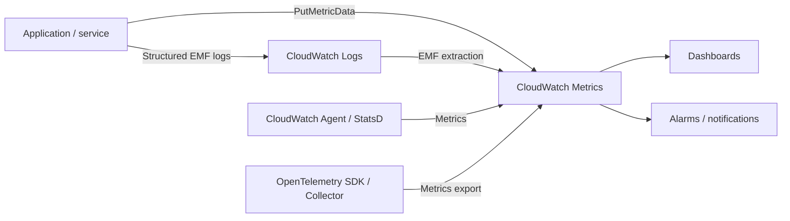
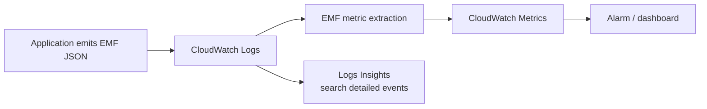

# Custom metric và Embedded Metric Format

## Mục tiêu học tập

Sau bài học, bạn có thể:

1. Giải thích custom metric trong Amazon CloudWatch và khi nào ứng dụng cần tự xuất metric.
2. Phân biệt namespace, metric name, dimensions, timestamp, unit, statistic và storage resolution.
3. Xuất metric trực tiếp bằng CloudWatch PutMetricData API/AWS SDK.
4. Hiểu Embedded Metric Format (EMF), cấu trúc JSON và cách CloudWatch Logs trích xuất metric.
5. Chọn giữa PutMetricData, EMF, CloudWatch Agent/StatsD và OpenTelemetry.
6. Thiết kế dimension sets có cardinality thấp, tránh tạo hàng loạt time series ngoài ý muốn.
7. Tạo dashboard và alarm từ custom metrics, xử lý missing data và high-resolution metrics.
8. Tích hợp custom metrics vào ứng dụng, Lambda, container và EC2.
9. Kiểm tra ingestion, quyền IAM, log parsing, timestamp và chi phí.
10. Thực hành xuất metric cho API đơn hàng, quan sát log chi tiết và tạo alarm.

## 1. Custom metric trong CloudWatch

Amazon CloudWatch thu thập metrics từ nhiều dịch vụ AWS như EC2, Lambda, RDS, S3 và API Gateway. Các metric có sẵn giúp theo dõi hạ tầng, nhưng không phải lúc nào cũng thể hiện sức khỏe nghiệp vụ của ứng dụng.

Ví dụ, CPU của EC2 thấp không có nghĩa API hoạt động tốt. Một ứng dụng đặt hàng có thể cần theo dõi:

- Số request tạo đơn thành công.
- Số request bị từ chối hoặc thất bại.
- Thời gian xử lý request.
- Số đơn hàng được thanh toán.
- Số lần gọi dịch vụ thanh toán timeout.
- Số message bị retry hoặc đưa vào dead-letter queue.
- Số connection đang chờ trong connection pool.

Những số liệu do ứng dụng hoặc agent tự xuất được gọi là **custom metrics**. Chúng cho phép quan sát tín hiệu đặc thù của hệ thống thay vì chỉ nhìn tài nguyên máy chủ.



### 1.1. Custom metric dùng để trả lời câu hỏi nào?

| Câu hỏi vận hành | Metric gợi ý | Ý nghĩa |
| --- | --- | --- |
| API có nhận request không? | RequestCount | Lưu lượng theo service/route group. |
| Request có lỗi không? | ErrorCount, ErrorRate | Tín hiệu chất lượng ứng dụng. |
| API phản hồi chậm không? | RequestLatency | Đo độ trễ, thường quan tâm p90/p95/p99. |
| Nghiệp vụ có bị nghẽn? | OrdersPending, PaymentFailures | Đo backlog và lỗi nghiệp vụ. |
| Worker có theo kịp queue? | MessagesProcessed, ProcessingLatency | Theo dõi năng lực xử lý. |
| Dependency có bất ổn? | DependencyTimeouts | Đếm timeout theo dependency có kiểm soát. |

Metric nên biểu diễn một tín hiệu có thể tổng hợp theo thời gian và dùng để ra quyết định. Log phù hợp để giữ chi tiết từng sự kiện; metric phù hợp để xem xu hướng, tạo alarm và dashboard.

### 1.2. Namespace và metric identity

Một metric trong CloudWatch được xác định bởi tổ hợp:

- **Namespace:** nhóm metric, ví dụ MyCompany/Orders.
- **Metric name:** tên tín hiệu, ví dụ RequestLatency.
- **Dimensions:** các cặp tên/giá trị phân loại time series, ví dụ Service=orders-api, Environment=prod.

Ví dụ hai metric identities khác nhau:

```text
Namespace: MyCompany/Orders
Metric:    RequestCount
Dimensions:
  Service=orders-api
  Environment=prod

Namespace: MyCompany/Orders
Metric:    RequestCount
Dimensions:
  Service=payments-api
  Environment=prod
```

Hai chuỗi dimension khác nhau tạo ra hai time series riêng, dù namespace và metric name giống nhau. Khi truy vấn một metric có dimensions, phải chọn đúng tổ hợp dimension đã publish.

CloudWatch metrics được lưu theo Region. Khi publish vào ap-southeast-1, hãy truy vấn namespace đó ở cùng Region; việc chọn nhầm Region là một nguyên nhân phổ biến khiến metric trông như bị mất.

Nên dùng namespace riêng của tổ chức hoặc ứng dụng. Không đặt custom metrics vào namespace dành riêng của AWS service như AWS/EC2; điều đó dễ gây nhầm lẫn với metrics do AWS quản lý.

### 1.3. Metric, log và trace bổ sung cho nhau

| Telemetry | Trả lời | Ví dụ |
| --- | --- | --- |
| Metric | Điều gì đang tăng, giảm hoặc vượt ngưỡng? | Error rate tăng từ 0,2% lên 8%. |
| Log | Sự kiện cụ thể nào đã xảy ra? | Payment provider trả HTTP 503 với mã lỗi. |
| Trace | Một request đi qua những thành phần nào và chậm ở đâu? | API mất 900 ms, trong đó gọi payment mất 720 ms. |

Một metric tốt thường có thể dẫn người vận hành tới dashboard, log query hoặc trace để điều tra nguyên nhân. Tránh cố nhét toàn bộ nội dung log vào metric dimensions.

## 2. Thiết kế custom metric đúng cách

### 2.1. Metric name, unit và timestamp

- **Metric name** nên ngắn, ổn định và thể hiện rõ đại lượng: RequestCount, RequestLatency, PaymentFailures.
- **Unit** mô tả đơn vị: Count, Milliseconds, Bytes, Percent, Seconds hoặc None.
- **Timestamp** là thời điểm dữ liệu được đo, không nhất thiết là thời điểm collector gửi dữ liệu.

Đối với PutMetricData, timestamp có thể tối đa khoảng hai tuần trong quá khứ và hai giờ trong tương lai. Dữ liệu cũ có thể cần thêm thời gian để xuất hiện trong truy vấn metrics. Với EMF, timestamp trong _aws.Timestamp dùng đơn vị milliseconds từ Unix epoch và cũng bị giới hạn thời gian hợp lệ.

Nếu không chỉ định unit, CloudWatch dùng None. Hãy giữ unit nhất quán cho một metric name; cùng một metric name không nên lúc thì gửi milliseconds, lúc lại gửi seconds.

### 2.2. Dimensions và cardinality

Dimension giúp phân tách metric theo những thuộc tính có giá trị vận hành:

- Service=orders-api
- Environment=prod
- Operation=CreateOrder
- Region=ap-southeast-1
- StatusClass=5xx

Mỗi tổ hợp dimension tạo một metric time series riêng. CloudWatch hỗ trợ tối đa 30 dimensions cho một metric. Đây là nguồn chi phí quan trọng cần quản lý.

**Không dùng các giá trị cardinality cao làm dimensions**, ví dụ:

- requestId, traceId, correlationId.
- Email, customer ID hoặc order ID.
- URL đầy đủ có path parameter.
- Session ID hoặc IP address của từng người dùng.
- Timestamp hoặc giá trị ngẫu nhiên.

Nếu mỗi request có một requestId khác nhau và requestId là dimension, hệ thống có thể tạo một custom metric identity cho từng request. Số lượng time series và chi phí sẽ tăng nhanh.

Đưa các ID này vào log hoặc trace để điều tra. Giữ chúng ngoài dimension của metric.

| Thuộc tính | Nên là dimension? | Lý do |
| --- | --- | --- |
| Environment (dev, prod) | Có | Tập giá trị nhỏ và ổn định. |
| Service (orders-api) | Có | Phân tách thành phần. |
| Operation (CreateOrder) | Có, nếu số operation hữu hạn | Giúp tìm operation gây lỗi/chậm. |
| HTTP status class (2xx, 4xx, 5xx) | Có | Cardinality thấp, có ý nghĩa vận hành. |
| Request ID | Không | Mỗi request có thể là một giá trị riêng. |
| User ID | Không | Có thể có hàng triệu giá trị. |
| Raw URL | Thường không | Path parameter/query string làm cardinality tăng. |

### 2.3. Dimension sets và roll-up

Có thể cần metric theo service tổng thể và theo từng operation. Một chiến lược là publish hai tập dimensions:

```text
Tập tổng hợp:
  Service=orders-api, Environment=prod

Tập chi tiết:
  Service=orders-api, Environment=prod, Operation=CreateOrder
```

Với EMF, một MetricDirective có thể khai báo nhiều dimension sets. Mỗi dimension set tạo metric identity riêng. Điều này giúp có cả số liệu tổng hợp và số liệu phân rã, nhưng mỗi set bổ sung làm tăng số time series.

Không tạo dimensions chỉ vì field đó có sẵn trong log. Hãy bắt đầu với các dimensions cần thiết cho dashboard, alarm và truy vấn vận hành.

### 2.4. Resolution: standard và high resolution

| Loại | Storage resolution | Ý nghĩa |
| --- | --- | --- |
| Standard resolution | 60 giây | Lựa chọn mặc định cho phần lớn metric vận hành. |
| High resolution | 1 giây | Theo dõi tín hiệu cần quan sát dưới một phút. |

Metric high-resolution có thể truy vấn với period 1, 5, 10, 30 giây hoặc bội số của 60 giây. Alarm high-resolution có thể dùng period 10 hoặc 30 giây; alarm có chu kỳ ngắn có mức phí cao hơn.

Chỉ dùng high resolution khi phản ứng trong vài giây thực sự quan trọng, ví dụ saturation nhanh của một hệ thống giao dịch. Với số đơn hàng theo phút hoặc số lỗi theo 5 phút, standard resolution thường phù hợp hơn.

### 2.5. Statistics và percentiles

CloudWatch lưu metric data points và tính thống kê theo period:

- Sum: tổng các giá trị trong period.
- SampleCount: số sample.
- Average: trung bình.
- Minimum, Maximum: giá trị nhỏ nhất/lớn nhất.
- Percentiles như p90, p95, p99: phân vị của phân phối sample khi dữ liệu hỗ trợ.

Ví dụ, RequestCount thường xem Sum; RequestLatency thường xem Average, Maximum và p95/p99. Không dùng Average để thay thế percentile khi cần hiểu tail latency.

Nếu publish statistic set thay vì raw samples, CloudWatch chỉ có thể tính percentile trong các điều kiện giới hạn, ví dụ SampleCount=1 và Min/Max/Sum tương ứng cùng một giá trị, hoặc Min bằng Max và Sum bằng Min nhân SampleCount. Muốn percentile có ý nghĩa, hãy publish raw values hoặc dùng cơ chế values/counts phù hợp.

## 3. Publish metric trực tiếp bằng PutMetricData

### 3.1. Khi nào dùng PutMetricData?

PutMetricData là CloudWatch API để gửi metric data trực tiếp. Đây là lựa chọn phù hợp khi:

- Ứng dụng có thể gọi AWS SDK/API.
- Muốn kiểm soát rõ metric name, dimensions, unit, timestamp và resolution.
- Không cần giữ từng log event chi tiết cho metric đó.
- Có thể batch dữ liệu và quản lý retry.

Ứng dụng cần quyền IAM cloudwatch:PutMetricData cho namespace được phép publish. API call được tính phí theo cơ chế CloudWatch pricing; batch nhiều MetricDatum trong một request có thể giảm số lần gọi.

### 3.2. Ví dụ AWS CLI

Gửi một request count vào namespace riêng:

```bash
aws cloudwatch put-metric-data \
  --namespace "MyCompany/Orders" \
  --metric-name "RequestCount" \
  --value 1 \
  --unit Count \
  --dimensions Service=orders-api,Environment=dev
```

Gửi một metric latency high-resolution:

```bash
aws cloudwatch put-metric-data \
  --namespace "MyCompany/Orders" \
  --metric-name "RequestLatency" \
  --value 125.4 \
  --unit Milliseconds \
  --storage-resolution 1 \
  --dimensions Service=orders-api,Environment=dev,Operation=CreateOrder
```

storage-resolution 1 yêu cầu high-resolution. Nếu bỏ qua hoặc đặt 60, metric dùng standard resolution.

### 3.3. Publish bằng AWS SDK for Java 2.x

Trong ứng dụng Java/Spring Boot, nên inject và tái sử dụng CloudWatchClient thay vì tạo client mới cho từng request:

Với Maven, thêm dependency CloudWatch SDK module. Ví dụ dưới đây giả định dự án đã quản lý phiên bản AWS SDK for Java 2.x bằng BOM trong dependencyManagement:

```xml
<dependency>
  <groupId>software.amazon.awssdk</groupId>
  <artifactId>cloudwatch</artifactId>
</dependency>
```

```java
import java.time.Instant;
import java.util.List;

import software.amazon.awssdk.regions.Region;
import software.amazon.awssdk.services.cloudwatch.CloudWatchClient;
import software.amazon.awssdk.services.cloudwatch.model.Dimension;
import software.amazon.awssdk.services.cloudwatch.model.MetricDatum;
import software.amazon.awssdk.services.cloudwatch.model.PutMetricDataRequest;
import software.amazon.awssdk.services.cloudwatch.model.StandardUnit;

public final class OrderMetricsPublisher implements AutoCloseable {

    private static final String NAMESPACE = "MyCompany/Orders";

    private final CloudWatchClient cloudWatch;

    public OrderMetricsPublisher() {
        this.cloudWatch = CloudWatchClient.builder()
                .region(Region.AP_SOUTHEAST_1)
                .build();
    }

    public void publishRequestLatency(
            String environment,
            String operation,
            double latencyMillis) {

        MetricDatum datum = MetricDatum.builder()
                .metricName("RequestLatency")
                .dimensions(List.of(
                        Dimension.builder()
                                .name("Service")
                                .value("orders-api")
                                .build(),
                        Dimension.builder()
                                .name("Environment")
                                .value(environment)
                                .build(),
                        Dimension.builder()
                                .name("Operation")
                                .value(operation)
                                .build()
                ))
                .unit(StandardUnit.MILLISECONDS)
                .value(latencyMillis)
                .timestamp(Instant.now())
                .storageResolution(60)
                .build();

        PutMetricDataRequest request = PutMetricDataRequest.builder()
                .namespace(NAMESPACE)
                .metricData(datum)
                .build();

        cloudWatch.putMetricData(request);
    }

    @Override
    public void close() {
        cloudWatch.close();
    }
}
```

Đây là ví dụ tối giản minh họa SDK. Trong Spring Boot, đăng ký client/publisher dưới dạng bean singleton và quản lý lifecycle qua dependency injection. Không gọi CloudWatch synchronously cho mọi request nếu độ trễ API là quan trọng; cân nhắc buffer, batch hoặc xuất metric bất đồng bộ.

### 3.4. Batch metric data

PutMetricData nhận tối đa 1.000 metric data entries trong một request và payload HTTP POST tối đa 1 MB. Mỗi metric hỗ trợ tối đa 30 dimensions. Có thể nén gzip. API hỗ trợ gửi một giá trị, statistic set hoặc mảng values/counts cho metric.

Batch giúp giảm overhead và số request, nhưng phải cân bằng giữa:

- Độ trễ từ lúc đo tới lúc metric xuất hiện.
- Dung lượng buffer và rủi ro mất dữ liệu khi process dừng.
- Retry/backoff khi API throttling hoặc lỗi tạm thời.
- Số metric identities và tần suất gửi.

Timestamp của từng sample nên phản ánh thời điểm đo. Tránh retry không kiểm soát khiến một sự kiện được publish lặp lại nhiều lần; CloudWatch metric ingestion không nên được xem như một kho lưu trữ exactly-once cho business events.

### 3.5. Quyền IAM

Role của ứng dụng dùng PutMetricData cần quyền cloudwatch:PutMetricData. Có thể giới hạn namespace bằng condition cloudwatch:namespace:

```json
{
  "Version": "2012-10-17",
  "Statement": [
    {
      "Effect": "Allow",
      "Action": "cloudwatch:PutMetricData",
      "Resource": "*",
      "Condition": {
        "StringEquals": {
          "cloudwatch:namespace": "MyCompany/Orders"
        }
      }
    }
  ]
}
```

PutMetricData không hỗ trợ resource-level ARN scoping giống một số resource APIs; namespace condition là cách thu hẹp quyền phổ biến. Không cấp cloudwatch:* nếu ứng dụng chỉ cần publish metrics.

## 4. Embedded Metric Format (EMF)

### 4.1. EMF là gì?

**Embedded Metric Format** là một định dạng JSON cho phép nhúng metric values vào structured log event. Ứng dụng ghi JSON log vào CloudWatch Logs; CloudWatch nhận diện metadata EMF, trích metric và publish chúng vào CloudWatch Metrics.

EMF đặc biệt phù hợp với Lambda và các workload ephemeral vì ứng dụng chỉ cần ghi log ra stdout/stderr. Không cần gọi riêng cloudwatch:PutMetricData để tạo metric từ EMF; workload cần quyền gửi log event vào CloudWatch Logs.



EMF kết hợp hai lợi ích:

- Metric có thể dùng cho graph, alarm và metric math.
- Log event gốc vẫn chứa các field chi tiết để truy vấn bằng CloudWatch Logs Insights.

### 4.2. Cấu trúc EMF tối thiểu

Một EMF log event là một JSON object hợp lệ. Root object phải có _aws, bên trong chứa CloudWatchMetrics directive:

```json
{
  "_aws": {
    "Timestamp": 1795150800000,
    "CloudWatchMetrics": [
      {
        "Namespace": "MyCompany/Orders",
        "Dimensions": [
          ["Service", "Environment", "Operation"]
        ],
        "Metrics": [
          {
            "Name": "RequestCount",
            "Unit": "Count",
            "StorageResolution": 60
          },
          {
            "Name": "RequestLatency",
            "Unit": "Milliseconds",
            "StorageResolution": 1
          },
          {
            "Name": "ErrorCount",
            "Unit": "Count"
          }
        ]
      }
    ]
  },
  "Service": "orders-api",
  "Environment": "dev",
  "Operation": "CreateOrder",
  "RequestCount": 1,
  "RequestLatency": 125.4,
  "ErrorCount": 0,
  "requestId": "req-7f6d9a"
}
```

Các thành phần:

| Thành phần | Ý nghĩa |
| --- | --- |
| _aws.Timestamp | Unix timestamp tính bằng milliseconds. |
| _aws.CloudWatchMetrics | Danh sách metric directives. |
| Namespace | Namespace nhận metric. |
| Dimensions | Danh sách dimension sets; mỗi set là một tổ hợp keys. |
| Metrics | Metric names, unit và storage resolution. |
| Root fields Service, Environment, Operation | Giá trị thực tế cho dimensions. |
| Root fields RequestCount, RequestLatency, ErrorCount | Numeric metric targets. |
| Root field requestId | Field log phục vụ điều tra; không phải dimension. |

Timestamp trong các JSON minh họa là giá trị ví dụ. Khi ứng dụng phát log thực tế, tạo Unix epoch milliseconds tại thời điểm đo; không giữ nguyên timestamp của tài liệu hoặc sample cũ.

### 4.3. Quy tắc quan trọng của EMF

- Log event phải là JSON object hợp lệ, không có text trước hoặc sau JSON.
- _aws.CloudWatchMetrics phải là array chứa ít nhất một metric directive hợp lệ.
- Metric target được tham chiếu bằng tên field ở root level; target là số hoặc array số, không phải nested object.
- Dimension target phải là string ở root level.
- Namespace dài từ 1 đến 255 ký tự ASCII in được.
- Mỗi dimension set có tối đa 30 dimension keys.
- Tổng số metric definitions trong một log event không vượt quá 100.
- Log event EMF tối đa 1 MB.
- Timestamp phải nằm trong khoảng CloudWatch chấp nhận: tối đa 14 ngày trong quá khứ và 2 giờ trong tương lai.
- StorageResolution hợp lệ là 1 hoặc 60; mặc định là 60.

Một log event EMF có thể có nhiều metric directives. Các field được tham chiếu phải ở root node và tên field phân biệt chữ hoa/chữ thường.

### 4.4. Dimension sets tạo metric identities

Có thể khai báo nhiều dimension sets để tạo metric ở nhiều mức tổng hợp:

```json
{
  "_aws": {
    "Timestamp": 1795150800000,
    "CloudWatchMetrics": [
      {
        "Namespace": "MyCompany/Orders",
        "Dimensions": [
          ["Service", "Environment"],
          ["Service", "Environment", "Operation"]
        ],
        "Metrics": [
          {
            "Name": "RequestCount",
            "Unit": "Count"
          }
        ]
      }
    ]
  },
  "Service": "orders-api",
  "Environment": "prod",
  "Operation": "CreateOrder",
  "RequestCount": 1,
  "requestId": "req-7f6d9a"
}
```

Với event này, EMF tạo series tổng hợp theo Service + Environment và series chi tiết theo Service + Environment + Operation. requestId vẫn được giữ trong log nhưng không tạo dimension riêng.

Mỗi dimension set bổ sung tạo thêm metric identity. Hãy dự tính số lượng tổ hợp dimension trước khi phát hành EMF trong production.

### 4.5. EMF delivery semantics

EMF bảo đảm metric extraction theo mô hình at-least-once; đôi khi metric value có thể bị duplicate. Vì vậy, EMF phù hợp với telemetry và thống kê quan sát, nhưng không phải cơ chế lưu transaction hoặc đếm nghiệp vụ exactly-once.

Nếu metric cần số lượng nghiệp vụ chính xác để đối soát tài chính, dùng dữ liệu giao dịch/event store làm nguồn sự thật. CloudWatch metric là tín hiệu vận hành và có thể được aggregate cho monitoring.

### 4.6. EMF từ Lambda

Lambda tự chuyển stdout/stderr thành log events trong CloudWatch Logs khi execution role có quyền logging phù hợp. Nếu ứng dụng in ra một JSON EMF object trên một dòng, CloudWatch Logs có thể xử lý metric directive.

Quyền cơ bản thường cần:

- logs:CreateLogGroup nếu function tự tạo log group.
- logs:CreateLogStream.
- logs:PutLogEvents.

Khi gửi EMF qua CloudWatch Logs, không cần thêm cloudwatch:PutMetricData chỉ để extract metric. Nếu ứng dụng còn gọi PutMetricData trực tiếp cho metric khác, khi đó cần quyền riêng cho API đó.

### 4.7. EMF từ EC2/container/on-premises

Với EC2, ECS hoặc workload không tự động gửi stdout vào CloudWatch Logs, dùng CloudWatch Agent hoặc logging pipeline để ship log event chứa EMF. Agent có thể tail file, thu thập metrics và gửi log/metric đến CloudWatch theo cấu hình.

Đảm bảo log event được gửi dưới dạng JSON nguyên vẹn. Nếu log shipper bọc JSON vào một chuỗi khác, thêm prefix, chia nhỏ hoặc multi-line sai cách, EMF parser có thể không nhận diện được directive.

### 4.8. Theo dõi EMF extraction

CloudWatch công bố các metric vận hành cho việc xử lý EMF trong namespace AWS/Logs. Có thể dùng chúng để theo dõi lỗi parsing/validation và tình trạng metric generation. Khi metric không xuất hiện, kiểm tra cả log ingestion và metric extraction; log có thể đã vào log group nhưng EMF directive bị lỗi.

## 5. Chọn phương thức publish metric

| Phương thức | Cơ chế | Quyền thường cần | Phù hợp khi |
| --- | --- | --- | --- |
| PutMetricData | Gọi CloudWatch API/SDK trực tiếp. | cloudwatch:PutMetricData | Service lâu dài, cần kiểm soát batch, timestamp và metric publishing. |
| EMF | Ghi JSON log; CloudWatch Logs trích metric. | logs:PutLogEvents (và quyền tạo log group/stream khi cần) | Lambda, ephemeral compute, muốn giữ log event chi tiết. |
| CloudWatch Agent + StatsD/collectd | App gửi metric tới agent; agent buffer và aggregate. | Agent role cần quyền publish đích | EC2, on-premises, app đã có StatsD hoặc collectd. |
| OpenTelemetry | SDK/instrumentation và exporter/collector gửi metrics. | Phụ thuộc exporter và destination | Thiết kế telemetry mới, muốn chuẩn hóa instrumentation và portability. |

AWS khuyến nghị cân nhắc OpenTelemetry cho triển khai custom metrics mới. Tuy nhiên, EMF vẫn hữu ích khi structured logs là luồng telemetry tự nhiên của workload; PutMetricData vẫn phù hợp khi cần gọi API trực tiếp.

## 6. CloudWatch Agent và StatsD

CloudWatch Agent có thể thu thập metrics hệ điều hành, logs và custom metrics từ StatsD hoặc collectd. StatsD hỗ trợ Linux và Windows Server; collectd hỗ trợ Linux.

Ví dụ cấu hình agent cho StatsD trên EC2:

```json
{
  "agent": {
    "metrics_collection_interval": 60,
    "run_as_user": "cwagent"
  },
  "metrics": {
    "namespace": "MyCompany/Host",
    "append_dimensions": {
      "InstanceId": "${aws:InstanceId}"
    },
    "metrics_collected": {
      "statsd": {
        "service_address": ":8125",
        "metrics_collection_interval": 10,
        "metrics_aggregation_interval": 60
      }
    }
  }
}
```

Đây là cấu hình minh họa; lưu file theo vị trí agent hỗ trợ và dùng amazon-cloudwatch-agent-ctl để fetch/start cấu hình trên hệ điều hành tương ứng. Role instance cần quyền gửi metric tới CloudWatch. service_address mở listener StatsD; giới hạn interface/network access để chỉ workload tin cậy gửi dữ liệu.

Một StatsD client có thể gửi:

```text
orders.request.count:1|c
orders.request.latency:125|ms
orders.queue.depth:8|g
```

Trong đó c biểu diễn counter, ms biểu diễn timing và g biểu diễn gauge theo StatsD protocol. Agent gom/buffer metrics theo collection interval rồi publish lên CloudWatch.

### 6.1. Aggregation dimensions

CloudWatch Agent hỗ trợ aggregation_dimensions để tổng hợp metric qua các dimensions. Ví dụ có thể giữ metric theo từng InstanceId và đồng thời tạo series tổng hợp theo AutoScalingGroupName.

Aggregation giúp giảm số metric identities cần theo dõi. Tuy nhiên cần quyết định có giữ original per-instance metrics hay chỉ giữ series tổng hợp; cấu hình drop_original_metrics có thể giảm metric volume nhưng làm mất khả năng drill down theo dimension gốc.

## 7. Tạo dashboard và alarm cho custom metrics

### 7.1. Dashboard

Dashboard giúp kết hợp custom metrics với metrics hạ tầng:

- Request count và error count theo service.
- p95/p99 latency.
- CPU/memory hoặc queue depth.
- Số lượng retry và dependency failures.
- Alarm state và deployment annotations.

Metric widget phải dùng đúng namespace, metric name, dimensions, statistic và period. Nếu dimension values khác với giá trị publish, widget có thể không hiển thị dữ liệu.

### 7.2. Tạo alarm từ custom metric

Ví dụ alarm khi ErrorCount vượt 10 lỗi trong một period 5 phút:

```bash
aws cloudwatch put-metric-alarm \
  --alarm-name "orders-api-high-errors-dev" \
  --namespace "MyCompany/Orders" \
  --metric-name "ErrorCount" \
  --dimensions Name=Service,Value=orders-api Name=Environment,Value=dev \
  --statistic Sum \
  --period 300 \
  --evaluation-periods 2 \
  --datapoints-to-alarm 2 \
  --threshold 10 \
  --comparison-operator GreaterThanOrEqualToThreshold \
  --treat-missing-data notBreaching \
  --alarm-actions "arn:aws:sns:ap-southeast-1:123456789012:ops-alerts"
```

Thay SNS topic ARN bằng topic thật và xác nhận subscription đã được cấu hình. Alarm trên giả định metric có dimensions Service và Environment; nếu metric publish thêm dimension Operation mà không có dimension set tổng hợp, alarm này sẽ không khớp series đó.

### 7.3. Chọn statistic và period đúng

| Metric | Statistic thường dùng | Lưu ý |
| --- | --- | --- |
| RequestCount | Sum | Tổng request trong period. |
| ErrorCount | Sum | Tổng lỗi trong period. |
| RequestLatency | Average, p95, p99, Maximum | Dùng raw samples nếu cần percentile. |
| QueueDepth | Maximum hoặc Average | Maximum phát hiện backlog spike; Average cho mức tồn trung bình. |
| ActiveConnections | Maximum | Quan sát peak connection. |

Period phải phù hợp storage resolution và nhịp publish. Không đặt alarm period 10 giây cho metric standard-resolution 60 giây rồi kỳ vọng dữ liệu xuất hiện mỗi 10 giây.

### 7.4. Missing data và metric không có traffic

CloudWatch alarm có bốn cách xử lý missing data:

- breaching: coi điểm dữ liệu thiếu là vi phạm ngưỡng.
- notBreaching: coi điểm dữ liệu thiếu là bình thường.
- ignore: giữ trạng thái hiện tại.
- missing: để CloudWatch đánh giá trạng thái thiếu dữ liệu; nếu không có đủ dữ liệu có thể thành INSUFFICIENT_DATA.

Chọn theo ngữ nghĩa metric:

| Tình huống | Gợi ý |
| --- | --- |
| Heartbeat metric phải được gửi liên tục | Có thể dùng breaching; mất heartbeat là vấn đề. |
| Metric chỉ được gửi khi có lỗi | notBreaching; không có lỗi thì không có datapoint. |
| RequestCount chỉ gửi khi có request | Xác định rõ lúc không có traffic là bình thường hay cần cảnh báo. |
| Metric nghiệp vụ theo lịch | Cân nhắc publish zero/heartbeat nếu cần phân biệt “không phát sinh” với “publisher bị ngừng”. |

**Không có datapoint không đồng nghĩa giá trị bằng 0.** Nếu ứng dụng chỉ publish ErrorCount khi có lỗi, không có datapoint có thể có nghĩa không lỗi, không traffic hoặc publisher bị hỏng. Thiết kế heartbeat hoặc zero datapoint nếu cần phân biệt các trạng thái này.

## 8. Chi phí và giới hạn cần kiểm soát

### 8.1. Những yếu tố ảnh hưởng chi phí

- Số lượng custom metric identities, phụ thuộc namespace/name/dimensions.
- Storage resolution và số lượng high-resolution metrics.
- Tần suất gọi PutMetricData.
- Số lượng metric data points/series và API queries.
- Số lượng alarms, dashboards và metric streams nếu sử dụng.
- Với EMF: CloudWatch Logs ingestion/retention cùng custom metrics được trích xuất.
- Với agent: số metric, aggregation và tần suất flush.

EMF không miễn phí chỉ vì metric được gửi cùng log. Bạn vẫn chịu phí log ingestion/retention và custom metrics được tạo ra.

### 8.2. Cardinality là nguồn phát sinh metric ngoài ý muốn

Giả sử ứng dụng có:

- 3 environments.
- 8 services.
- 12 operations.
- 5 status classes.

Tổ hợp dimensions tối đa theo các field này là 3 × 8 × 12 × 5 = 1.440 series cho một metric name, nếu tất cả tổ hợp đều xuất hiện. Thêm request ID với hàng triệu giá trị có thể làm số series tăng lên cực lớn.

Trước khi thêm dimension, hỏi:

1. Dimension có tập giá trị hữu hạn và ổn định không?
2. Có cần alarm/dashboard theo dimension này không?
3. Có thể giữ giá trị chi tiết trong log/trace thay vì metric không?
4. Số tổ hợp tối đa là bao nhiêu?
5. Metric mới có thật sự cần high resolution không?

### 8.3. Retention của metric

CloudWatch giữ metric data ở độ chi tiết khác nhau theo thời gian:

| Độ phân giải/period | Thời gian lưu |
| --- | --- |
| High-resolution datapoints có period dưới 60 giây | 3 giờ |
| 1 phút | 15 ngày |
| 5 phút | 63 ngày |
| 1 giờ | 455 ngày |

CloudWatch tự tổng hợp dữ liệu cũ sang độ phân giải thô hơn. Nếu cần phân tích chi tiết lâu dài, hãy lưu raw events/logs hoặc telemetry ở hệ thống lưu trữ phù hợp; không kỳ vọng high-resolution datapoints tồn tại mãi.

## 9. Troubleshooting

| Triệu chứng | Nguyên nhân thường gặp | Hướng kiểm tra |
| --- | --- | --- |
| PutMetricData trả AccessDenied | Role thiếu cloudwatch:PutMetricData hoặc namespace condition không khớp. | Kiểm tra execution role và IAM condition. |
| Không thấy metric trong console | Sai namespace/name/dimensions, Region hoặc thời gian. | Kiểm tra Region, dimension set và timestamp; metric mới có thể mất tới khoảng 15 phút để xuất hiện trong ListMetrics. |
| EMF log xuất hiện nhưng metric không có | JSON sai, _aws/directive sai hoặc metric target không hợp lệ. | Kiểm tra log event nguyên bản và EMF validation rules. |
| EMF không được trích xuất từ container | Log shipper bọc JSON, thêm prefix hoặc chia multiline. | Đảm bảo mỗi EMF event là một JSON object nguyên vẹn. |
| Dimension không xuất hiện | Dimension key không có ở root level hoặc value không phải string. | Kiểm tra field name và type; EMF target không được nested. |
| Metric có quá nhiều series | Dimension cardinality cao như requestId/userId/path. | Loại bỏ dimension high-cardinality; giữ ID trong logs/traces. |
| Alarm ở INSUFFICIENT_DATA | Không có datapoint, publisher dừng hoặc period/resolution không khớp. | Kiểm tra metric emission, timestamp, missing data treatment và period. |
| Alarm không chuyển ALARM dù lỗi tăng | Chọn sai statistic, dimension, threshold hoặc evaluation periods. | Đối chiếu đúng metric identity và aggregation. |
| p95/p99 không có dữ liệu | Chỉ gửi statistic set không đủ điều kiện percentile. | Publish raw samples/values hoặc chọn statistic phù hợp. |
| EMF duplicate count | EMF delivery at-least-once có thể duplicate. | Không dùng EMF làm nguồn transaction exactly-once; dùng business store cho đối soát. |
| CloudWatch Agent không nhận StatsD | Sai listener/port, network interface hoặc agent config. | Kiểm tra service_address, agent status, port và log agent. |
| Metric high resolution không có datapoint 10 giây | Metric được gửi với StorageResolution 60. | Gửi StorageResolution 1 và chọn period hợp lệ. |

### 9.1. Theo dõi EMF pipeline

Khi điều tra EMF, đi theo thứ tự:

1. Ứng dụng có thực sự ghi JSON ra stdout/file không?
2. Log group/stream có nhận event không?
3. Event có phải một JSON object hợp lệ, không có prefix/suffix?
4. _aws.Timestamp có đúng milliseconds và nằm trong khoảng hợp lệ?
5. Namespace, dimensions và metric targets có thỏa spec không?
6. Các field được tham chiếu có ở root node và đúng kiểu dữ liệu không?
7. Metric có xuất hiện ở đúng Region, namespace và dimension set không?
8. AWS/Logs có ghi nhận lỗi EMF parsing/validation không?

## 10. Lab: publish custom metrics và EMF cho Orders API

Lab minh họa hai luồng: publish một metric trực tiếp bằng CLI và ghi EMF log event. Dùng AWS account sandbox được phép; không đưa request ID, customer ID hoặc dữ liệu cá nhân vào metric dimensions.

### 10.1. Chuẩn bị namespace và quyền

Chọn Region và xác minh identity:

```bash
aws sts get-caller-identity
aws configure get region
```

Identity thực thi lệnh cần cloudwatch:PutMetricData cho namespace MyCompany/Orders. Nếu thử EMF qua CloudWatch Logs API, identity cần quyền ghi log event vào log group tương ứng.

### 10.2. Gửi metric trực tiếp

```bash
aws cloudwatch put-metric-data \
  --namespace "MyCompany/Orders" \
  --metric-data '[
    {
      "MetricName": "RequestCount",
      "Dimensions": [
        {"Name": "Service", "Value": "orders-api"},
        {"Name": "Environment", "Value": "dev"},
        {"Name": "Operation", "Value": "CreateOrder"}
      ],
      "Timestamp": "2026-11-20T05:00:00Z",
      "Unit": "Count",
      "Value": 1,
      "StorageResolution": 60
    },
    {
      "MetricName": "RequestLatency",
      "Dimensions": [
        {"Name": "Service", "Value": "orders-api"},
        {"Name": "Environment", "Value": "dev"},
        {"Name": "Operation", "Value": "CreateOrder"}
      ],
      "Timestamp": "2026-11-20T05:00:00Z",
      "Unit": "Milliseconds",
      "Value": 125.4,
      "StorageResolution": 1
    }
  ]'
```

Timestamp ở đây là ví dụ cố định để minh họa; khi thực hành, thay bằng timestamp hiện tại trong khoảng CloudWatch chấp nhận. Lệnh publish hai metric identities trong một request.

### 10.3. Kiểm tra metric

Liệt kê metric name trong namespace:

```bash
aws cloudwatch list-metrics \
  --namespace "MyCompany/Orders"
```

Metric mới có thể mất tới khoảng 15 phút mới xuất hiện trong ListMetrics. Khi truy vấn, dùng đúng dimensions đã publish.

Lấy statistic bằng get-metric-statistics:

```bash
aws cloudwatch get-metric-statistics \
  --namespace "MyCompany/Orders" \
  --metric-name "RequestCount" \
  --dimensions Name=Service,Value=orders-api Name=Environment,Value=dev Name=Operation,Value=CreateOrder \
  --start-time "2026-11-20T04:55:00Z" \
  --end-time "2026-11-20T05:10:00Z" \
  --period 60 \
  --statistics Sum
```

Thay time window cho khớp timestamp đã gửi. Với dữ liệu high-resolution, có thể truy vấn period 1, 5, 10 hoặc 30 giây; metric standard-resolution cần period phù hợp từ 60 giây trở lên.

### 10.4. Gửi EMF log event

Tạo file emf-event.json chứa một JSON object cho mỗi log event. Khối bên dưới được xuống dòng để dễ đọc; khi ghi log thực tế, serializer nên xuất mỗi object thành một dòng JSON hoàn chỉnh:

```json
{
  "_aws": {
    "Timestamp": 1795150800000,
    "CloudWatchMetrics": [
      {
        "Namespace": "MyCompany/Orders",
        "Dimensions": [
          ["Service", "Environment"],
          ["Service", "Environment", "Operation"]
        ],
        "Metrics": [
          {"Name": "PaymentFailureCount", "Unit": "Count", "StorageResolution": 60},
          {"Name": "PaymentLatency", "Unit": "Milliseconds", "StorageResolution": 1}
        ]
      }
    ]
  },
  "Service": "orders-api",
  "Environment": "dev",
  "Operation": "AuthorizePayment",
  "PaymentFailureCount": 1,
  "PaymentLatency": 820.5,
  "requestId": "req-example-001",
  "errorCode": "PAYMENT_PROVIDER_TIMEOUT"
}
```

Timestamp trong JSON trên chỉ là ví dụ; thay bằng Unix epoch milliseconds hiện tại trước khi gửi. Có thể ghi event ra stdout của Lambda hoặc gửi tới CloudWatch Logs bằng agent/PutLogEvents.

Ví dụ event được gửi qua CloudWatch Logs phải nằm trong log stream thuộc log group đã tạo. Khi dùng PutLogEvents, cần log stream và sequence token theo API behavior hiện hành; trong thực tế ưu tiên SDK hoặc logging agent thay vì tự quản lý thủ công.

### 10.5. Tạo alarm

Tạo alarm cho tổng PaymentFailureCount:

```bash
aws cloudwatch put-metric-alarm \
  --alarm-name "orders-payment-failures-dev" \
  --namespace "MyCompany/Orders" \
  --metric-name "PaymentFailureCount" \
  --dimensions Name=Service,Value=orders-api Name=Environment,Value=dev \
  --statistic Sum \
  --period 300 \
  --evaluation-periods 1 \
  --datapoints-to-alarm 1 \
  --threshold 0 \
  --comparison-operator GreaterThanThreshold \
  --treat-missing-data notBreaching
```

Alarm này dùng dimension set tổng hợp Service + Environment trong EMF. Nếu event chỉ khai báo dimension set có thêm Operation, alarm phải khai báo đầy đủ dimension đó. Trong production, gắn SNS action và xác định threshold/evaluation window theo baseline thực tế.

### 10.6. Quan sát và điều tra

- Mở CloudWatch Metrics, chọn namespace MyCompany/Orders.
- Chọn PaymentFailureCount và dimension set Service + Environment.
- Mở CloudWatch Logs Insights để tìm errorCode=PAYMENT_PROVIDER_TIMEOUT.
- So sánh metric trend với log events có cùng operation.
- Kiểm tra AWS/Logs nếu log đã vào nhưng metric không được trích xuất.

### 10.7. Cleanup

Xóa alarm lab nếu không cần giữ:

```bash
aws cloudwatch delete-alarms \
  --alarm-names "orders-payment-failures-dev"
```

CloudWatch metric data không cần xóa thủ công để dừng phát sinh metric; ngừng publish và dữ liệu sẽ hết hạn theo retention. Xóa log group lab nếu không còn cần giữ log và đã tuân thủ retention/audit policy.

## 11. Những ngộ nhận thường gặp

**Ngộ nhận 1: “Custom metric chỉ là log có tên khác.”**

Không. Metric là time series có namespace/name/dimensions/statistics; log là sự kiện chi tiết có thể chứa nhiều field.

**Ngộ nhận 2: “EMF cần cloudwatch:PutMetricData.”**

Không. EMF metric extraction dựa trên log ingestion; quyền gửi log như logs:PutLogEvents là cần thiết. PutMetricData chỉ cần khi gọi API đó trực tiếp.

**Ngộ nhận 3: “Dimension chỉ là nhãn miễn phí.”**

Không. Mỗi tổ hợp dimension tạo metric identity riêng và ảnh hưởng custom metric usage/chi phí.

**Ngộ nhận 4: “Có thể dùng requestId làm dimension để drill down.”**

Không. Request ID có cardinality rất cao; giữ nó trong logs/traces.

**Ngộ nhận 5: “Không có datapoint nghĩa là metric bằng 0.”**

Không. Không có datapoint có thể là không phát sinh, không có traffic hoặc publisher bị ngừng.

**Ngộ nhận 6: “High resolution luôn tốt hơn.”**

Không. Nó phù hợp với tín hiệu cần phản ứng dưới một phút, nhưng tăng chi phí và dữ liệu chi tiết có retention ngắn hơn.

**Ngộ nhận 7: “EMF là exactly-once.”**

Không. EMF đảm bảo at-least-once metric delivery; duplicate values có thể xuất hiện.

**Ngộ nhận 8: “Mọi field trong EMF đều có thể dùng làm dimension.”**

Không. Dimension target phải là root-level string; chỉ chọn một tập field có cardinality thấp.

**Ngộ nhận 9: “Average latency đủ để biết API có chậm không.”**

Không. Tail latency p95/p99 có thể xấu dù average vẫn tốt.

**Ngộ nhận 10: “CloudWatch Agent chỉ thu thập metric hệ điều hành.”**

Không. Agent có thể thu thập custom metrics qua StatsD/collectd, ngoài logs và các telemetry khác.

## 12. Câu hỏi tự kiểm tra

**Câu 1.** Custom metric là gì?

**Đáp án:** Metric do ứng dụng/agent tự publish để biểu diễn tín hiệu đặc thù mà metrics AWS có sẵn không thể hiện đầy đủ.

**Câu 2.** Metric identity gồm những thành phần nào?

**Đáp án:** Namespace, metric name và tổ hợp dimensions.

**Câu 3.** PutMetricData cần IAM permission nào?

**Đáp án:** cloudwatch:PutMetricData.

**Câu 4.** EMF là gì?

**Đáp án:** Định dạng JSON nhúng metric values trong log event để CloudWatch Logs tự trích metric.

**Câu 5.** EMF cần quyền nào để ghi log?

**Đáp án:** logs:PutLogEvents và các quyền tạo log group/stream khi workload cần tự tạo chúng.

**Câu 6.** Trường nào trong EMF chứa metric directives?

**Đáp án:** _aws.CloudWatchMetrics.

**Câu 7.** EMF timestamp dùng đơn vị gì?

**Đáp án:** Unix epoch milliseconds.

**Câu 8.** Một EMF dimension set tối đa bao nhiêu dimension keys?

**Đáp án:** 30.

**Câu 9.** Vì sao requestId không nên là metric dimension?

**Đáp án:** Cardinality rất cao, tạo nhiều metric identities và làm tăng chi phí.

**Câu 10.** StorageResolution 1 có ý nghĩa gì?

**Đáp án:** High-resolution metric với độ phân giải một giây.

**Câu 11.** Vì sao EMF không phù hợp làm nguồn đếm giao dịch exactly-once?

**Đáp án:** EMF metric delivery là at-least-once và đôi khi có thể duplicate.

**Câu 12.** Missing data của alarm có những lựa chọn nào?

**Đáp án:** breaching, notBreaching, ignore và missing.

**Câu 13.** Khi nào dùng StatsD với CloudWatch Agent?

**Đáp án:** Khi ứng dụng hoặc thư viện đã xuất StatsD và workload cần agent thu thập/buffer/publish custom metrics.

**Câu 14.** Vì sao cần p95/p99 cho latency?

**Đáp án:** Percentile thể hiện tail latency mà Average có thể che khuất.

**Câu 15.** EMF metric không xuất hiện dù log đã có trong CloudWatch Logs thì kiểm tra gì?

**Đáp án:** JSON event, _aws directive, timestamp, root-level target fields, dimension types/cardinality, metric definitions và AWS/Logs extraction errors.

## Tài liệu chính thức

- [Amazon CloudWatch — Publish custom metrics (PutMetricData / EMF)](https://docs.aws.amazon.com/AmazonCloudWatch/latest/monitoring/publishingMetrics.html)
- [Amazon CloudWatch — Embedded Metric Format](https://docs.aws.amazon.com/AmazonCloudWatch/latest/monitoring/CloudWatch_Embedded_Metric_Format.html)
- [Amazon CloudWatch — EMF specification](https://docs.aws.amazon.com/AmazonCloudWatch/latest/monitoring/CloudWatch_Embedded_Metric_Format_Specification.html)
- [Amazon CloudWatch API — PutMetricData](https://docs.aws.amazon.com/AmazonCloudWatch/latest/APIReference/API_PutMetricData.html)
- [Amazon CloudWatch — Metrics concepts](https://docs.aws.amazon.com/AmazonCloudWatch/latest/monitoring/cloudwatch_concepts.html)
- [Amazon CloudWatch — CloudWatch Agent configuration](https://docs.aws.amazon.com/AmazonCloudWatch/latest/monitoring/CloudWatch-Agent-Configuration-File-Details.html)
- [Amazon CloudWatch — Install and configure the CloudWatch Agent](https://docs.aws.amazon.com/AmazonCloudWatch/latest/monitoring/Install-CloudWatch-Agent.html)
- [Amazon CloudWatch — StatsD custom metrics](https://docs.aws.amazon.com/AmazonCloudWatch/latest/monitoring/CloudWatch-Agent-custom-metrics-statsd.html)
- [Amazon CloudWatch — Configure alarm missing data](https://docs.aws.amazon.com/AmazonCloudWatch/latest/monitoring/alarms-and-missing-data.html)
- [Amazon CloudWatch — Alarm evaluation](https://docs.aws.amazon.com/AmazonCloudWatch/latest/monitoring/alarm-evaluation.html)
- [Amazon CloudWatch — GetMetricData and retention](https://docs.aws.amazon.com/AmazonCloudWatch/latest/APIReference/API_GetMetricData.html)
- [AWS Distro for OpenTelemetry](https://aws-otel.github.io/)
- [OpenTelemetry metrics concepts](https://opentelemetry.io/docs/concepts/signals/metrics/)

**Ghi nhớ:** PutMetricData gửi metric trực tiếp qua API; EMF nhúng metric trong structured log để CloudWatch Logs trích xuất; CloudWatch Agent/StatsD và OpenTelemetry là các lựa chọn instrumentation/collection khác. Thiết kế namespace và dimension ổn định, cardinality thấp; chọn standard hay high resolution theo nhu cầu; hiểu missing data, retention và chi phí trước khi tạo alarm production.

