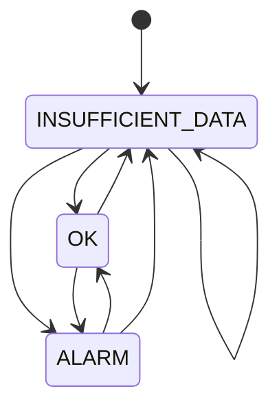

# Alarm, composite alarm và anomaly detection

## 1. Vai trò của CloudWatch alarms trong observability

Một ứng dụng Java Spring Boot chạy trên ECS có thể hoạt động bình thường trong nhiều giờ rồi đột ngột tăng độ trễ, trả về nhiều HTTP 5xx hoặc cạn connection pool. CloudWatch metrics giúp quan sát những tín hiệu này, nhưng một dashboard chỉ hữu ích khi có người mở và đọc nó. Đội vận hành cần một cơ chế phát hiện tình trạng bất thường, xác định mức độ nghiêm trọng và khởi động hành động phù hợp.

**Amazon CloudWatch alarms** theo dõi metrics hoặc kết quả metric math, đánh giá chúng theo điều kiện đã cấu hình và chuyển trạng thái khi điều kiện được đáp ứng. Alarm có thể gửi thông báo, kích hoạt hành động hỗ trợ hoặc trở thành đầu vào cho một composite alarm. **Anomaly detection** bổ sung cách đặt ngưỡng dựa trên mô hình học máy về hành vi lịch sử của metric, thay vì buộc người vận hành chọn một con số cố định.

Bài học thuộc chương **Quan sát với CloudWatch** của module **CLOUD_PROVIDERS_AWS**. Module khám phá Region/AZ, IAM, VPC, compute, storage, database, integration và serverless; người học cần thiết kế và triển khai ứng dụng an toàn, có giám sát, khả năng phục hồi và kiểm soát chi phí. Alarms nối metrics với hoạt động vận hành: phát hiện tín hiệu cần chú ý, giảm cảnh báo nhiễu và giúp đội ngũ phản ứng theo mức độ ảnh hưởng.

Sau bài học, bạn sẽ có thể:

- Phân biệt metric alarm, composite alarm và anomaly detection alarm.
- Giải thích ba trạng thái OK, ALARM và INSUFFICIENT_DATA.
- Chọn period, statistic, threshold, evaluation periods và datapoints to alarm.
- Xử lý missing data, percentile metrics và metric math.
- Kết hợp nhiều alarm bằng biểu thức AND, OR, NOT.
- Dùng composite alarm và suppressor để giảm thông báo trùng lặp trong incident/maintenance.
- Tạo anomaly detection band, đọc hành vi mô hình và điều chỉnh độ nhạy.
- Thiết kế alarm actions, SNS/EventBridge routing, IAM permissions và runbook.

## 2. CloudWatch alarm hoạt động như thế nào?

Một alarm nhận dữ liệu metric theo chu kỳ, tính statistic trên mỗi period rồi so sánh kết quả với điều kiện đã định nghĩa. Khi đủ số datapoints đáp ứng điều kiện, alarm chuyển sang trạng thái tương ứng. Alarm không tự hiểu business impact; người thiết kế phải chọn metric, dimension, statistic, threshold và cách xử lý dữ liệu thiếu phù hợp với workload.

Ví dụ một service có metric HTTP5xxCount. Nếu số lỗi 5xx tăng cao trong nhiều periods liên tiếp, alarm có thể chuyển sang ALARM và gửi SNS notification tới đội trực. Một metric CPUUtilization cao có thể báo hiệu saturation, nhưng nếu CPU tăng trong một batch job đã lên lịch thì đó chưa chắc là incident.

### 2.1. Thành phần của metric alarm

| Thành phần | Câu hỏi cần trả lời | Ví dụ |
| --- | --- | --- |
| Metric | Đang đo tín hiệu nào? | CPUUtilization, 5xxCount, TargetResponseTime |
| Namespace | Metric thuộc hệ thống nào? | AWS/EC2, AWS/ApplicationELB, Orders/API |
| Dimensions | Đang đo resource/nhóm nào? | InstanceId, LoadBalancer, Service |
| Statistic | Tổng hợp datapoints ra sao? | Average, Sum, p99 |
| Period | Cửa sổ tổng hợp dài bao lâu? | 60 giây hoặc 5 phút |
| Threshold/condition | Giá trị nào được xem là vượt giới hạn? | Average CPU lớn hơn 80% |
| Evaluation | Cần bao nhiêu datapoints vi phạm? | 2 trong 3 periods |
| Missing data | Xử lý khi không có datapoint thế nào? | missing, notBreaching |
| Actions | Khi trạng thái đổi thì làm gì? | SNS topic, Auto Scaling policy |

### 2.2. Chọn đúng metric và dimensions

Alarm chỉ có ý nghĩa nếu metric đại diện cho điều cần bảo vệ. Một alarm CPUUtilization trên từng EC2 instance khác với alarm trên toàn bộ service; một metric không có dimension phù hợp có thể gộp nhiều resource và che khuất một instance đang lỗi.

Ví dụ:

- EC2: namespace AWS/EC2, metric CPUUtilization, dimension InstanceId.
- Application Load Balancer: namespace AWS/ApplicationELB, metric HTTPCode_Target_5XX_Count hoặc TargetResponseTime, dimension tương ứng với load balancer/target group.
- Lambda: namespace AWS/Lambda, metrics Errors, Throttles, Duration, dimension FunctionName.
- DynamoDB: namespace AWS/DynamoDB, metrics ThrottledRequests hoặc SystemErrors, dimension TableName.
- Ứng dụng tự instrument: namespace riêng như Orders/API với dimensions có cardinality được kiểm soát.

Không dùng user ID, request ID hoặc giá trị ngẫu nhiên làm dimensions cho alarm metric. Cardinality quá cao làm tăng số time series, khó vận hành và có thể tăng chi phí.

### 2.3. Metric alarm và composite alarm

**Metric alarm** đánh giá một metric hoặc biểu thức metric math/anomaly detection. **Composite alarm** đánh giá trạng thái của những alarm khác bằng một biểu thức logic. Composite alarm không thay thế metric collection; nó gom tín hiệu cấp thấp thành một điều kiện cấp cao hơn.

Ví dụ: HighLatency và High5xxRate cùng ở trạng thái ALARM mới tạo OrdersApiIncident. Điều này có thể giúp tránh gửi incident page chỉ vì một metric tăng ngắn hạn.

## 3. Ba trạng thái của alarm

CloudWatch metric alarm có ba trạng thái:

| State | Ý nghĩa | Cách diễn giải |
| --- | --- | --- |
| OK | Điều kiện alarm không được đáp ứng | Metric đang trong phạm vi bình thường theo rule |
| ALARM | Điều kiện alarm được đáp ứng | Cần hành động theo mức độ và runbook |
| INSUFFICIENT_DATA | Chưa đủ dữ liệu để đánh giá | Có thể do metric mới, telemetry gián đoạn hoặc missing-data policy |

INSUFFICIENT_DATA không có nghĩa service chắc chắn hỏng hoặc chắc chắn khỏe. Ví dụ EC2 instance vừa khởi động chưa có đủ metric, agent bị dừng hoặc custom metric publisher không gửi dữ liệu. Cần kết hợp alarm với tình trạng telemetry và health checks.

### 3.1. State transition



Alarm có thể bắt đầu ở INSUFFICIENT_DATA, sau đó chuyển trạng thái khi có datapoints. Actions được cấu hình cho một state transition có thể được gọi khi alarm đi vào state tương ứng. Trạng thái hiện tại và lịch sử state changes có thể được xem qua CloudWatch console/API.

### 3.2. State không đồng nghĩa với action

State mô tả kết quả đánh giá; action là phản ứng được cấu hình riêng. Một alarm có thể chuyển sang ALARM nhưng không gửi notification nếu không có AlarmActions, actions bị disable hoặc action target/permissions sai. Ngược lại, một alarm có thể gửi notification nhưng người nhận không xử lý kịp.

Thiết kế vận hành cần cả hai: rule đáng tin cậy và action/notification có owner, escalation path, runbook rõ ràng.

## 4. Cấu hình metric alarm: period, statistic và threshold

### 4.1. Period

Period là độ dài mỗi cửa sổ đánh giá metric. Với standard-resolution metrics, alarm thường dùng period từ 60 giây trở lên theo bội số 60 giây. Với high-resolution custom metrics, có thể dùng các period 10, 20 hoặc 30 giây. Alarm high-resolution có thể phát hiện nhanh hơn nhưng tạo nhiều lần đánh giá hơn và có chi phí cao hơn.

Chọn period theo tốc độ mà tín hiệu thay đổi và mức độ nhiễu:

- 1 phút phù hợp với tín hiệu cần phản ứng tương đối nhanh và có đủ datapoints.
- 5 phút có thể làm mượt biến động ngắn, nhưng tăng thời gian phát hiện.
- Period quá ngắn với metric thưa có thể khiến alarm thường xuyên thiếu dữ liệu.
- Period quá dài có thể che một spike ngắn nhưng nghiêm trọng.

### 4.2. Statistic

Statistic quyết định cách tổng hợp datapoints trong period:

| Statistic | Ý nghĩa | Ví dụ sử dụng |
| --- | --- | --- |
| Average | Trung bình | CPU utilization trung bình |
| Sum | Tổng | Số request lỗi trong period |
| Minimum | Giá trị nhỏ nhất | Dung lượng còn lại thấp nhất |
| Maximum | Giá trị lớn nhất | CPU/latency peak |
| SampleCount | Số datapoints | Kiểm tra telemetry volume |
| pNN | Percentile | p95 hoặc p99 latency |

Chọn statistic phải theo cách metric được publish. Với counter tăng dần, thường cần Sum hoặc metric dạng rate; với gauge như CPU %, Average hoặc Maximum có thể hợp lý. Không áp dụng cùng statistic cho mọi metric.

### 4.3. Threshold và comparison operator

Metric alarm với static threshold có thể dùng các comparison operators như:

- GreaterThanThreshold
- GreaterThanOrEqualToThreshold
- LessThanThreshold
- LessThanOrEqualToThreshold

Ví dụ Average CPUUtilization lớn hơn 80 là điều kiện đơn giản. Tuy nhiên, threshold 80% không phải giá trị phổ quát: workload có thể hoạt động bình thường ở 90% CPU hoặc gặp vấn đề ở 45% nếu latency tăng do lock contention.

Đặt threshold dựa trên SLO, capacity, load testing, historical behavior và impact. Tách warning threshold và critical threshold nếu đội vận hành có hai mức phản ứng khác nhau.

### 4.4. Unit và dimensions

Nếu chỉ định Unit, metric datapoints có unit khác có thể không được dùng trong đánh giá. Chỉ đặt unit khi biết chính xác unit của metric. Dimension values phải khớp với metric time series thực tế; dimension sai thường dẫn tới INSUFFICIENT_DATA hoặc không có datapoints.

## 5. Evaluation periods và M out of N

CloudWatch đánh giá một tập các datapoints theo EvaluationPeriods (N). DatapointsToAlarm xác định cần bao nhiêu datapoints vi phạm (M) để chuyển sang ALARM. Đây thường được gọi là **M out of N**.

Ví dụ:

- EvaluationPeriods: 3
- DatapointsToAlarm: 2
- Period: 60

Alarm chuyển sang ALARM khi ít nhất 2 trong 3 datapoints được đánh giá vi phạm threshold. Nếu DatapointsToAlarm không được chỉ định, mặc định tất cả N datapoints phải vi phạm.

### 5.1. Vì sao M out of N hữu ích?

Một datapoint bất thường có thể do spike ngắn, network jitter hoặc sampling. M out of N giúp giảm false positives trong khi vẫn phát hiện chuỗi lỗi. Chọn M/N là một trade-off:

| Cấu hình | Đặc điểm | Khi cân nhắc |
| --- | --- | --- |
| 1/1 | Nhạy, phản ứng nhanh | Sự cố cần phản ứng tức thời, metric ổn định |
| 2/3 | Cân bằng giữa tốc độ và nhiễu | Nhiều metric ứng dụng |
| 3/5 | Chấp nhận một số datapoints bình thường | Metric có biến động ngắn |
| 5/5 | Cần vi phạm liên tục | Cảnh báo cần độ chắc chắn cao, không nhạy với spike |

Không chọn M/N chỉ để giảm số notification. Nếu alarm phản ứng chậm hơn SLO/error budget cho phép, rule đang làm mất khả năng phát hiện.

### 5.2. Evaluation cadence

Alarm được đánh giá định kỳ dựa trên period và loại metric. High-resolution alarms có thể được đánh giá thường xuyên hơn standard alarms. Thời gian từ khi sự cố bắt đầu đến notification còn phụ thuộc period, số datapoints cần vi phạm, ingestion delay, action delivery và hệ thống nhận notification.

Đừng coi Period nhân EvaluationPeriods là cam kết chính xác về thời gian phát hiện trong mọi trường hợp; CloudWatch có thể xét thêm datapoints sẵn có để xử lý missing data và dữ liệu đến trễ.

## 6. Missing data và low sample count

Metric có thể không gửi datapoint trong một period. Điều này có thể có nghĩa workload không hoạt động, telemetry bị mất hoặc metric chỉ được publish khi có sự kiện. Missing data không tự động tương đương zero.

### 6.1. TreatMissingData

TreatMissingData xác định cách CloudWatch diễn giải missing datapoints:

| Giá trị | Hành vi khái quát |
| --- | --- |
| missing | Coi datapoint là thiếu; nếu không đủ dữ liệu để đánh giá, alarm có thể ở INSUFFICIENT_DATA |
| notBreaching | Coi datapoint thiếu là không vi phạm threshold |
| breaching | Coi datapoint thiếu là vi phạm threshold |
| ignore | Giữ nguyên state hiện tại khi gặp datapoint thiếu |

Mặc định thường là missing. CloudWatch có thể lấy thêm datapoints gần nhất ngoài evaluation window để cố gắng có đủ dữ liệu thực trước khi áp dụng missing-data treatment. Vì vậy, hành vi thực tế cần được kiểm tra với metric frequency và alarm history.

### 6.2. Chọn missing-data policy theo ý nghĩa metric

| Loại metric | Cách cân nhắc |
| --- | --- |
| Heartbeat/agent lẽ ra phải gửi đều | Missing có thể là incident; breaching hoặc alarm telemetry riêng |
| Request count của service không có traffic ban đêm | notBreaching có thể phù hợp |
| Event metric chỉ publish khi có lỗi | Cần hiểu rõ cách publish zero/absence; có thể dùng notBreaching |
| Metric quan trọng bị ngắt telemetry | missing giúp lộ trạng thái không đủ dữ liệu |
| Metric có giai đoạn maintenance | Có thể dùng suppressor/maintenance alarm thay vì che missing data toàn cục |

Không chọn notBreaching cho mọi alarm chỉ để tránh INSUFFICIENT_DATA: điều đó có thể che một sự cố telemetry. Với metric event-driven, xác định rõ khi không có datapoint nghĩa là “không có sự kiện” hay “publisher đã ngừng hoạt động”.

### 6.3. Percentile và EvaluateLowSampleCountPercentile

Percentile như p99 có thể dao động mạnh khi sample count nhỏ. EvaluateLowSampleCountPercentile cho phép chọn evaluate hoặc ignore trong trường hợp sample count thấp đối với percentile alarm. ignore giữ state hiện tại khi sample count quá thấp; evaluate vẫn đánh giá percentile.

Chỉ dùng ignore khi hiểu rõ traffic volume và hậu quả của việc bỏ qua datapoints ít mẫu. Một service có traffic thấp vẫn có thể có request quan trọng bị chậm; percentile sample count nhỏ không có nghĩa impact nhỏ.

## 7. Alarm actions và notification

Metric alarm có thể cấu hình actions theo từng state transition:

| Property | Khi nào chạy |
| --- | --- |
| AlarmActions | Alarm chuyển vào ALARM |
| OKActions | Alarm chuyển vào OK |
| InsufficientDataActions | Alarm chuyển vào INSUFFICIENT_DATA |

Các action thường dùng gồm SNS notification, EC2 actions cho những tình huống hỗ trợ, Auto Scaling policies và tích hợp vận hành như Systems Manager/OpsCenter hoặc Incident Manager theo loại alarm/action được hỗ trợ. EventBridge có thể nhận CloudWatch alarm state change events để routing, enrichment hoặc automation phức tạp hơn.

### 7.1. SNS notification

SNS phù hợp khi cần gửi notification tới email, HTTPS endpoint, SQS hoặc subscriber khác. Ví dụ: AlarmActions trỏ tới một SNS topic; subscription của topic gửi cảnh báo tới kênh on-call.

Để hoạt động:

- Alarm và action target phải được cấu hình đúng Region/ARN theo yêu cầu dịch vụ.
- Topic/subscriber phải có policy và subscription hợp lệ.
- Người nhận phải biết severity, owner, runbook và cách xác nhận incident.
- Notification không được chứa secret, customer data hoặc payload nhạy cảm.

### 7.2. EC2 và Auto Scaling actions

Một số EC2 metric alarms có thể gọi actions như stop, terminate, reboot hoặc recover instance khi đáp ứng điều kiện và loại instance/action hỗ trợ. Auto Scaling actions có thể thực thi scaling policy khi alarm vào ALARM.

Đây là actions có thể ảnh hưởng trực tiếp workload. Trước khi bật:

- Xác nhận action phù hợp loại instance/resource.
- Kiểm thử behavior trong môi trường an toàn.
- Xem xét instance role, ASG health checks, cooldown và scaling limits.
- Tránh action có thể làm mất dữ liệu hoặc tạo scaling oscillation.

### 7.3. ActionsEnabled và state history

Có thể tạm disable alarm actions mà vẫn tiếp tục đánh giá state. Điều này hữu ích khi bảo trì hoặc kiểm thử, nhưng cần có owner, thời hạn và cách bật lại. Disable action không có nghĩa alarm bị disable.

CloudWatch lưu state history để điều tra transition, reason và timestamp. Khi notification không đến, kiểm tra alarm state/history, actions enabled, action ARN, SNS topic policy/subscription, IAM/resource policies và EventBridge rule nếu có.

### 7.4. Một alarm, một trách nhiệm rõ ràng

Mỗi alarm nên có:

- Tên mô tả service, signal và severity.
- Description nêu điều kiện và runbook link.
- Owner/team chịu trách nhiệm.
- Metric/dimension/statistic/period có chủ đích.
- Threshold dựa trên SLO/capacity.
- Missing-data policy đã được quyết định.
- Action target có kiểm thử.

Tránh tạo alarm cho mọi metric mà không xác định ai sẽ xử lý. Cảnh báo không có owner tạo alert fatigue và giảm niềm tin vào hệ thống.

## 8. Anomaly detection và dynamic threshold

Static threshold hoạt động tốt khi metric có giới hạn tương đối ổn định. Nhưng nhiều workload có seasonality: traffic tăng vào giờ làm việc, giảm ban đêm, tăng theo ngày trong tuần hoặc có đợt cao điểm theo mùa. Một threshold cố định có thể báo động quá nhiều trong giờ cao điểm và bỏ sót bất thường vào giờ thấp điểm.

**CloudWatch anomaly detection** dùng machine learning để học hành vi metric theo thời gian và tạo một expected band. Alarm có thể chuyển sang ALARM khi datapoint vượt lên trên hoặc xuống dưới band đã học. Band thích nghi với trend và pattern lặp lại, giúp phát hiện thay đổi bất thường mà không phải tự đặt một ngưỡng cố định cho mọi thời điểm.

### 8.1. Anomaly detection band

Band gồm upper bound và lower bound. Khi tạo metric math expression, có thể dùng hàm ANOMALY_DETECTION_BAND với metric đầu vào và độ rộng band:

```text
ANOMALY_DETECTION_BAND(m1, 2)
```

Tham số 2 điều chỉnh độ rộng band quanh giá trị dự kiến. Band rộng hơn thường ít nhạy hơn; band hẹp hơn thường nhạy hơn nhưng có thể tăng false positives. Độ rộng cần được hiệu chỉnh theo metric, seasonality và mức độ rủi ro của workload.

### 8.2. Comparison operators cho anomaly alarm

Anomaly detection alarms dùng comparison operators dành riêng cho band:

| Operator | Điều kiện |
| --- | --- |
| GreaterThanUpperThreshold | Giá trị metric cao hơn upper band |
| LessThanLowerThreshold | Giá trị metric thấp hơn lower band |
| LessThanLowerOrGreaterThanUpperThreshold | Giá trị nằm ngoài band theo cả hai hướng |

Chọn hướng theo ý nghĩa metric. Với error rate hoặc latency, tăng bất thường thường đáng chú ý. Với free storage hoặc available capacity, giảm bất thường có thể quan trọng. Với request volume, cả tăng lẫn giảm đột ngột đều có thể biểu thị vấn đề.

### 8.3. Mô hình học gì?

Mô hình sử dụng lịch sử của metric để nhận diện trend, seasonality và biến động thường gặp. Khi có thêm dữ liệu, mô hình tiếp tục điều chỉnh expected band. Chất lượng mô hình phụ thuộc vào dữ liệu lịch sử đủ đại diện và cách chọn metric/dimensions/statistic/period.

Không xem band là định nghĩa của SLO. Anomaly detection trả lời “điều này có khác hành vi dự kiến không?”, trong khi SLO trả lời “dịch vụ có đáp ứng mục tiêu chất lượng đã cam kết không?”. Một metric có thể bất thường nhưng vẫn nằm trong SLO; cũng có thể vi phạm SLO mà không bị xem là anomaly nếu mô hình đã học pattern đó.

### 8.4. Chuẩn bị dữ liệu huấn luyện

- Chọn metric có lịch sử ổn định và có ý nghĩa vận hành.
- Bảo đảm dimensions xác định đúng một time series có hành vi nhất quán.
- Kiểm tra gaps, publisher failures và thay đổi schema/units.
- Tránh đưa giai đoạn incident kéo dài vào baseline mà không xem xét.
- Dùng excluded time ranges cho những giai đoạn đã biết là bất thường, ví dụ migration/deployment lớn, khi tính năng và workflow hỗ trợ.
- Quan sát band trên dashboard trước khi bật paging action.

Nếu workload mới, metric ít datapoints hoặc pattern vừa thay đổi, expected band ban đầu có thể chưa đáng tin. Cho mô hình thời gian thu thập dữ liệu, đánh giá lại sau các chu kỳ hoạt động đại diện và không bật hành động tự động có rủi ro cao khi chưa hiểu kết quả.

### 8.5. Anomaly detection với metric math

Metric math cho phép tạo biểu thức từ một hoặc nhiều metrics trước khi alarm đánh giá. Ví dụ có thể tính error ratio:

```text
errorRate = 100 * errors / requests
```

Sau đó áp dụng anomaly detection band cho biểu thức nếu expression và metric đáp ứng giới hạn hỗ trợ của CloudWatch. Điều này hữu ích khi tỷ lệ lỗi có ý nghĩa hơn số lỗi tuyệt đối: 10 lỗi trên 100 request khác với 10 lỗi trên 1 triệu request.

Khi dùng metric math, xác minh mẫu số không bằng zero, missing data, units, period và ReturnData/metric query IDs. Expression sai hoặc không trả time series hợp lệ sẽ khiến alarm thiếu dữ liệu.

### 8.6. Anomaly detection không thay thế static alarms

Giữ static alarms cho giới hạn cứng có ý nghĩa rõ ràng như disk gần đầy, queue age vượt SLA, error budget exhausted hoặc capacity limit. Dùng anomaly detection cho metrics có pattern biến động theo thời gian. Có thể kết hợp cả hai trong composite alarm để phân biệt bất thường và impact thực tế.

## 9. Composite alarms và logic nhiều tín hiệu

Composite alarm đánh giá một biểu thức logic dựa trên state của metric alarms hoặc composite alarms khác. Nó giúp tạo tín hiệu cấp service từ nhiều nguyên nhân có liên quan, thay vì page đội trực cho từng metric độc lập.

### 9.1. Alarm rule

Các hàm state phổ biến:

| Hàm | Ý nghĩa |
| --- | --- |
| ALARM("AlarmName") | Alarm con đang ở ALARM |
| OK("AlarmName") | Alarm con đang ở OK |
| INSUFFICIENT_DATA("AlarmName") | Alarm con thiếu dữ liệu |

Kết hợp với toán tử logic:

- AND: mọi điều kiện phải đúng.
- OR: chỉ cần một điều kiện đúng.
- NOT: phủ định điều kiện.

Ví dụ:

```text
ALARM("OrdersHighLatency") AND ALARM("OrdersHigh5xx")
```

Composite alarm chỉ chuyển sang ALARM khi cả hai metric alarms đều ở ALARM. Một rule khác có thể là:

```text
ALARM("OrdersHigh5xx") OR ALARM("OrdersQueueAge")
```

Rule này chuyển sang ALARM nếu một trong hai điều kiện được đáp ứng. Có thể tham chiếu trạng thái của composite alarm khác, nhưng cần giữ dependency graph dễ hiểu và tránh vòng lặp logic.

### 9.2. Thiết kế composite alarm theo service impact

Ví dụ Orders API:

| Alarm con | Ý nghĩa |
| --- | --- |
| OrdersHigh5xx | Tỷ lệ lỗi HTTP tăng |
| OrdersHighLatency | Request latency vượt ngưỡng |
| OrdersTargetUnhealthy | Target group có targets unhealthy |
| OrdersQueueAge | Message age tăng |
| OrdersDatabaseThrottle | Database throttling |

Một composite alarm OrdersApiCustomerImpact có thể kết hợp high 5xx và high latency để page đội ứng dụng. Một composite alarm khác OrdersApiDependencyIssue có thể gom queue age hoặc database throttling để route tới đội platform/data. Logic phụ thuộc service architecture và ownership.

### 9.3. Composite alarm state và actions

Composite alarm cũng có các state OK, ALARM và INSUFFICIENT_DATA. Nó có thể có AlarmActions, OKActions và InsufficientDataActions giống cách quản lý action ở mức composite. Chỉ cấu hình actions ở composite alarm khi muốn gom notification; nếu metric alarms con vẫn có actions, chúng vẫn có thể gửi notification riêng.

Một thiết kế phổ biến:

1. Metric alarms con đo tín hiệu kỹ thuật và không page trực tiếp.
2. Composite alarm kết hợp tín hiệu theo impact/ownership.
3. Composite alarm gửi SNS notification hoặc tạo incident.
4. Dashboard hiển thị cả composite alarm lẫn alarm con để người trực tìm nguyên nhân.

Đừng bỏ actions trên alarm con một cách máy móc: có trường hợp một metric riêng như database failure cần cảnh báo trực tiếp. Quyết định routing theo ownership và severity.

### 9.4. Suppressor alarm và action suppression

Composite alarm hỗ trợ suppressor alarm để tạm ngăn **actions của composite alarm** trong giai đoạn khác đã được biểu diễn bằng alarm riêng, chẳng hạn maintenance window hoặc primary dependency incident.

Các thuộc tính:

- ActionsSuppressor: tên alarm được dùng làm suppressor.
- ActionsSuppressorWaitPeriod: số giây chờ suppressor có cơ hội chuyển sang ALARM trước khi composite actions được thực thi.
- ActionsSuppressorExtensionPeriod: số giây tiếp tục suppress actions sau khi suppressor trở về OK.

Ví dụ: khi maintenance alarm ở ALARM, composite alarm không gửi page; wait period giúp tránh gửi page ngay trước khi suppressor chuyển trạng thái; extension period tránh page lập tức khi maintenance vừa kết thúc.

Action suppression không tự động tắt actions được cấu hình trực tiếp trên metric alarms con. Nếu muốn chỉ có một notification cho incident, thiết kế child alarm actions và composite actions tương ứng.

### 9.5. Tránh composite rule quá phức tạp

- Dùng tên alarm có ý nghĩa và nhất quán.
- Tách logic theo service boundary/ownership.
- Không tạo composite alarm chỉ để gom một alarm con nếu không có mục đích vận hành.
- Tránh rule phụ thuộc quá nhiều tầng khiến khó xác định nguyên nhân.
- Kiểm thử các tổ hợp state OK/ALARM/INSUFFICIENT_DATA.
- Lưu mô tả rule và runbook để đội trực hiểu điều kiện paging.

## 10. Ví dụ CloudFormation: metric alarm và composite alarm

CloudFormation giúp quản lý alarm cùng hạ tầng ứng dụng bằng code. Ví dụ dưới đây tạo alarm CPU tĩnh và composite alarm cho một service. ARN SNS topic được truyền vào qua parameter để tái sử dụng theo environment.

### 10.1. Metric alarm với M out of N

```yaml
Parameters:
  AlarmTopicArn:
    Type: String
  InstanceId:
    Type: AWS::EC2::Instance::Id

Resources:
  HighCpuAlarm:
    Type: AWS::CloudWatch::Alarm
    Properties:
      AlarmName: orders-worker-high-cpu
      AlarmDescription: CPU trung bình vượt 80% trong ít nhất 2 trên 3 phút.
      Namespace: AWS/EC2
      MetricName: CPUUtilization
      Dimensions:
        - Name: InstanceId
          Value: !Ref InstanceId
      Statistic: Average
      Period: 60
      EvaluationPeriods: 3
      DatapointsToAlarm: 2
      Threshold: 80
      ComparisonOperator: GreaterThanThreshold
      TreatMissingData: missing
      AlarmActions:
        - !Ref AlarmTopicArn
```

Đây là alarm ví dụ cho một EC2 instance. Với production, resource ID thường được lấy từ output/parameter của stack compute hoặc dùng dimension phù hợp với workload. Threshold 80 chỉ là giá trị minh họa; xác định ngưỡng từ load test, capacity và SLO.

### 10.2. Composite alarm

Giả sử hai metric alarms OrdersHighLatency và OrdersHigh5xx đã được tạo trong cùng Region:

```yaml
Resources:
  OrdersCustomerImpact:
    Type: AWS::CloudWatch::CompositeAlarm
    Properties:
      AlarmName: orders-api-customer-impact
      AlarmDescription: Latency và HTTP 5xx cùng vượt ngưỡng.
      AlarmRule: 'ALARM("OrdersHighLatency") AND ALARM("OrdersHigh5xx")'
      AlarmActions:
        - !Ref AlarmTopicArn
      ActionsEnabled: true
```

Rule tham chiếu alarm names, không phải SNS topic ARN. Những alarm được tham chiếu phải tồn tại trong cùng account/Region theo phạm vi hỗ trợ của composite alarm. Trong stack thực tế, khai báo resource references/stack outputs theo ownership để tránh typo và dependency không rõ.

### 10.3. Composite alarm có suppressor

```yaml
Resources:
  OrdersCustomerImpact:
    Type: AWS::CloudWatch::CompositeAlarm
    Properties:
      AlarmName: orders-api-customer-impact
      AlarmRule: 'ALARM("OrdersHighLatency") OR ALARM("OrdersHigh5xx")'
      AlarmActions:
        - !Ref AlarmTopicArn
      ActionsSuppressor: OrdersMaintenanceAlarm
      ActionsSuppressorWaitPeriod: 90
      ActionsSuppressorExtensionPeriod: 180
```

OrdersMaintenanceAlarm phải là alarm đã được tạo và có lifecycle rõ ràng. Thời gian 90/180 giây chỉ minh họa; chọn theo thời gian phát hiện maintenance và quy trình vận hành. Suppressor chỉ ngăn actions của composite alarm, không tự chặn actions trên alarm con.

## 11. Ví dụ CloudFormation: anomaly detection alarm

Anomaly alarm dùng MetricDataQueries để khai báo metric gốc và expression tạo band. ThresholdMetricId trỏ tới expression anomaly band.

```yaml
Resources:
  CpuAnomalyAlarm:
    Type: AWS::CloudWatch::Alarm
    Properties:
      AlarmName: orders-worker-cpu-anomaly
      AlarmDescription: CPU nằm ngoài expected band.
      ComparisonOperator: LessThanLowerOrGreaterThanUpperThreshold
      EvaluationPeriods: 3
      DatapointsToAlarm: 2
      TreatMissingData: missing
      ThresholdMetricId: anomalyBand
      Metrics:
        - Id: cpu
          MetricStat:
            Metric:
              Namespace: AWS/EC2
              MetricName: CPUUtilization
              Dimensions:
                - Name: InstanceId
                  Value: i-0123456789abcdef0
            Period: 300
            Stat: Average
          ReturnData: false
        - Id: anomalyBand
          Expression: ANOMALY_DETECTION_BAND(cpu, 2)
          Label: CPU expected band
          ReturnData: true
```

Ví dụ dùng EC2 instance ID minh họa và band multiplier 2. Thay ID bằng resource dimension thực tế. Với alarm dựa trên anomaly band, CloudFormation resource không dùng static Threshold; ThresholdMetricId trỏ đến metric math expression tạo band. Kiểm tra template/resource specification hiện hành khi thêm các thuộc tính khác như actions, tags hoặc excluded time ranges.

## 12. Tạo và quản lý alarm bằng AWS CLI

AWS CLI hữu ích cho automation, scripting và kiểm tra nhanh. Các lệnh dưới đây cần credentials có quyền CloudWatch tương ứng và chạy ở Region chứa metric/alarm.

### 12.1. Tạo static metric alarm

```bash
aws cloudwatch put-metric-alarm \
  --alarm-name orders-worker-high-cpu \
  --namespace AWS/EC2 \
  --metric-name CPUUtilization \
  --dimensions Name=InstanceId,Value=i-0123456789abcdef0 \
  --statistic Average \
  --period 60 \
  --evaluation-periods 3 \
  --datapoints-to-alarm 2 \
  --threshold 80 \
  --comparison-operator GreaterThanThreshold \
  --treat-missing-data missing \
  --alarm-actions arn:aws:sns:ap-southeast-1:111122223333:platform-alerts \
  --region ap-southeast-1
```

Lệnh PutMetricAlarm tạo mới hoặc cập nhật cấu hình alarm cùng tên. Trong automation, hãy kiểm tra account/Region và review các tham số trước khi chạy vì cùng lệnh có thể ghi đè cấu hình alarm đang tồn tại.

### 12.2. Tạo composite alarm

```bash
aws cloudwatch put-composite-alarm \
  --alarm-name orders-api-customer-impact \
  --alarm-rule 'ALARM("OrdersHighLatency") AND ALARM("OrdersHigh5xx")' \
  --alarm-actions arn:aws:sns:ap-southeast-1:111122223333:platform-alerts \
  --region ap-southeast-1
```

Alarm rule tham chiếu alarm names. Nếu tên chứa ký tự đặc biệt, escape đúng cú pháp shell và CloudWatch alarm rule. Với rule phức tạp, lưu expression trong file/config được review thay vì ghép chuỗi động không kiểm soát.

### 12.3. Describe và xem alarm history

```bash
aws cloudwatch describe-alarms \
  --alarm-names orders-worker-high-cpu orders-api-customer-impact \
  --region ap-southeast-1

aws cloudwatch describe-alarm-history \
  --alarm-name orders-worker-high-cpu \
  --history-item-type StateUpdate \
  --region ap-southeast-1
```

Describe giúp xem state, metric configuration, actions và timestamps. Alarm history giúp điều tra vì sao state đổi, nhưng cần đối chiếu cùng metric graph và application logs.

### 12.4. Enable/disable actions

```bash
aws cloudwatch disable-alarm-actions \
  --alarm-names orders-worker-high-cpu \
  --region ap-southeast-1

aws cloudwatch enable-alarm-actions \
  --alarm-names orders-worker-high-cpu \
  --region ap-southeast-1
```

Disable actions chỉ dừng action execution; alarm vẫn được đánh giá và state vẫn thay đổi. Mọi thao tác disable phải có lý do, owner và thời hạn bật lại.

## 13. Ví dụ Java AWS SDK for Java 2.x

Ứng dụng Java hoặc công cụ platform có thể quản lý CloudWatch alarms bằng AWS SDK for Java 2.x. Thông thường, việc provision alarm nên nằm trong IaC; SDK phù hợp hơn cho automation vận hành có kiểm soát hoặc công cụ nội bộ.

### 13.1. Tạo metric alarm

Dependencies sử dụng module CloudWatch của AWS SDK for Java 2.x và BOM được pin theo version thống nhất của dự án.

```java
import software.amazon.awssdk.regions.Region;
import software.amazon.awssdk.services.cloudwatch.CloudWatchClient;
import software.amazon.awssdk.services.cloudwatch.model.ComparisonOperator;
import software.amazon.awssdk.services.cloudwatch.model.Dimension;
import software.amazon.awssdk.services.cloudwatch.model.PutMetricAlarmRequest;
import software.amazon.awssdk.services.cloudwatch.model.Statistic;

public final class AlarmProvisioner {
    public static void createCpuAlarm(
            String instanceId,
            String alarmTopicArn) {

        try (CloudWatchClient cloudWatch = CloudWatchClient.builder()
                .region(Region.AP_SOUTHEAST_1)
                .build()) {

            PutMetricAlarmRequest request = PutMetricAlarmRequest.builder()
                    .alarmName("orders-worker-high-cpu")
                    .alarmDescription(
                            "Average CPU exceeds 80 percent in two of three periods")
                    .namespace("AWS/EC2")
                    .metricName("CPUUtilization")
                    .dimensions(Dimension.builder()
                            .name("InstanceId")
                            .value(instanceId)
                            .build())
                    .statistic(Statistic.AVERAGE)
                    .period(60)
                    .evaluationPeriods(3)
                    .datapointsToAlarm(2)
                    .threshold(80.0)
                    .comparisonOperator(
                            ComparisonOperator.GREATER_THAN_THRESHOLD)
                    .treatMissingData("missing")
                    .alarmActions(alarmTopicArn)
                    .build();

            cloudWatch.putMetricAlarm(request);
        }
    }
}
```

SDK client nên được tái sử dụng trong ứng dụng dài hạn thay vì tạo mới cho mỗi request; ví dụ đóng client bằng try-with-resources để minh họa lifecycle trong một tác vụ ngắn. Region, account credentials và resource ARNs phải được cấp qua cấu hình/role phù hợp. Không hardcode credentials.

### 13.2. Tạo composite alarm

```java
import software.amazon.awssdk.services.cloudwatch.model.PutCompositeAlarmRequest;

PutCompositeAlarmRequest compositeRequest =
        PutCompositeAlarmRequest.builder()
                .alarmName("orders-api-customer-impact")
                .alarmDescription(
                        "Latency and HTTP 5xx alarms are both breaching")
                .alarmRule(
                        "ALARM(\"OrdersHighLatency\") AND " +
                        "ALARM(\"OrdersHigh5xx\")")
                .alarmActions(alarmTopicArn)
                .actionsEnabled(true)
                .build();

cloudWatch.putCompositeAlarm(compositeRequest);
```

Composite alarm không chứa metric configuration trực tiếp; nó tham chiếu state của alarm khác. Trước khi gọi API, bảo đảm alarm con tồn tại và rule được kiểm tra. Với production, quản lý alarm definitions bằng IaC giúp review diff và tránh cấu hình trôi giữa các environments.

### 13.3. Error handling và retry

CloudWatch API có thể trả throttling, access denied, validation errors hoặc resource-not-found. Chỉ retry lỗi tạm thời theo retry policy của SDK; không retry vô hạn lỗi validation/permission. Khi cập nhật alarm, ghi lại alarm name, account, Region và request context nhưng không log credentials hay sensitive payload.

## 14. Dashboard, EventBridge và incident workflow

Alarm không nên là nguồn thông tin duy nhất khi điều tra. Dashboard cho thấy metric theo thời gian; alarm state cho biết rule đang được đáp ứng; logs/traces giúp tìm request hoặc dependency cụ thể.

### 14.1. Dashboard cho alarm

Một dashboard service nên hiển thị:

- Composite alarm cấp service và metric alarms con.
- Request rate, error rate, latency percentiles.
- Saturation: CPU, memory, connections, queue depth/age.
- Dependency health: database throttling, downstream errors, retry rate.
- Deployment markers hoặc annotation cho release/maintenance.

Khi composite alarm chuyển ALARM, người trực nên nhìn thấy cả các alarm con để xác định điều kiện nào tạo incident.

### 14.2. EventBridge state change events

CloudWatch alarm state change events có thể được EventBridge route tới:

- SNS/SQS để thông báo hoặc xử lý bất đồng bộ.
- Lambda để enrichment, deduplication hoặc cập nhật incident system.
- Systems Manager Automation hoặc workflow vận hành phù hợp.
- Event bus trung tâm trong mô hình multi-account khi được cấu hình.

EventBridge rule nên lọc theo account, Region, alarm name/tags hoặc state. Automation phải idempotent vì event delivery có thể lặp; ghi lại event ID và state transition để tránh tạo incident trùng.

### 14.3. Runbook và escalation

Notification nên có:

- Alarm name và state mới.
- Service/environment/Region.
- Metric, threshold hoặc composite rule.
- Link dashboard và logs/traces.
- Runbook với bước xác minh, mitigation và escalation.
- Owner/team và severity.

Không tự động reboot, terminate hoặc scale resource chỉ vì một alarm nếu chưa xác định action an toàn và có guardrails. Với hành động tự động, cần giới hạn phạm vi, idempotency, timeout và audit.

### 14.4. Maintenance windows

Trong maintenance, có thể dùng suppressor alarm, disable actions có thời hạn hoặc điều chỉnh rule theo quy trình đã duyệt. Chọn cách sao cho alarm vẫn đánh giá và giữ state/history khi cần. Đảm bảo notification không bị tắt vĩnh viễn sau khi bảo trì kết thúc.

## 15. Thiết kế alarm theo SLI/SLO và mức độ ảnh hưởng

Một alarm tốt phát hiện điều ảnh hưởng người dùng hoặc khả năng phục vụ, không chỉ báo rằng một resource có con số cao. Kết hợp **symptom-based signals** với **cause-based signals**:

- Symptom: latency, error rate, availability, queue age.
- Cause: CPU, memory, connection pool, throttling, disk, dependency failures.

Symptom alarms giúp ưu tiên incident theo user impact. Cause alarms giúp tìm nguyên nhân và xử lý trước khi symptom trở nên nghiêm trọng.

### 15.1. SLI và SLO

Ví dụ service có SLO 99.9% successful requests trong rolling window. Alarm có thể theo dõi error ratio hoặc burn rate của error budget thay vì chỉ dùng số lỗi tuyệt đối. Với low traffic, error count đơn lẻ có thể không phản ánh tỷ lệ; metric math giữa errors và total requests giúp đo tỷ lệ.

### 15.2. Severity và notification routing

| Severity | Ví dụ | Phản ứng |
| --- | --- | --- |
| Critical/page | Customer impact rõ, SLO burn nhanh | On-call ngay, runbook mitigation |
| High/ticket | Capacity sắp chạm giới hạn | Tạo ticket, owner xử lý trong giờ làm |
| Warning/dashboard | Deviation nhỏ hoặc xu hướng dài hạn | Theo dõi, điều tra theo lịch |
| Telemetry | Metric/agent không gửi dữ liệu | Đội observability kiểm tra pipeline telemetry |

Không gán severity chỉ theo giá trị threshold. Một CPU alarm có thể chỉ là warning; một latency alarm có thể là critical nếu ảnh hưởng checkout/payment.

### 15.3. Multi-window và multi-burn-rate

Đối với SLO, có thể dùng nhiều alarms theo các cửa sổ ngắn và dài để phát hiện error budget burn nhanh/chậm. Composite alarm có thể kết hợp những burn-rate alarms thành một paging rule. Chọn windows/thresholds dựa trên SLO, traffic profile và incident response objectives; tránh copy một bộ số chung cho mọi service.

## 16. Security và governance cho alarms

### 16.1. IAM permissions

Tách quyền quản lý alarm khỏi quyền xem dashboard nếu tổ chức cần separation of duties:

- Read-only: xem alarms, metrics và history.
- Alarm operator: tạo/update/delete alarms và bật/tắt actions trong phạm vi cho phép.
- Platform automation: quản lý alarm definitions theo IaC pipeline.

Các API actions thường gặp gồm cloudwatch:PutMetricAlarm, cloudwatch:PutCompositeAlarm, cloudwatch:DescribeAlarms, cloudwatch:DescribeAlarmHistory, cloudwatch:DeleteAlarms, cloudwatch:EnableAlarmActions và cloudwatch:DisableAlarmActions. Scope resources theo ARN/conditions khi API và resource type hỗ trợ; một số thao tác có thể yêu cầu wildcard resource.

### 16.2. Action target permissions

Alarm action ARN phải trỏ tới target hợp lệ. Với SNS, kiểm tra topic policy, encryption key policy và subscription. Với EventBridge, kiểm tra rule pattern, target permission và dead-letter/retry behavior nếu cấu hình. Một alarm state ALARM không đảm bảo notification đã được giao tới người trực.

### 16.3. Multi-account observability

Trong môi trường AWS Organizations, có thể dùng cross-account observability để xem metrics/logs/traces từ source accounts trong monitoring account. Alarm được tạo trong account/Region theo nơi metric được quan sát và quyền được cấp; thiết kế naming, ownership, topic routing và dashboard sao cho không nhầm environment/account.

### 16.4. Tags và ownership

Gắn tags như Application, Environment, Owner, CostCenter và Severity theo chuẩn nội bộ. Dùng tags/metadata để tìm alarm thiếu owner, phân tích coverage và hỗ trợ automation. Không xem tags là cơ chế bảo mật duy nhất; IAM và resource policies mới quyết định quyền.

## 17. Troubleshooting alarms

| Triệu chứng | Nguyên nhân thường gặp | Cách kiểm tra |
| --- | --- | --- |
| Alarm ở INSUFFICIENT_DATA | Metric chưa có datapoints, dimension sai, publisher/agent ngừng gửi | Xem metric graph, namespace, dimensions, unit và source telemetry |
| Alarm luôn OK dù service lỗi | Chọn sai metric/statistic, threshold quá cao hoặc dimension không đúng | So sánh raw metric với alarm configuration và state history |
| Alarm chuyển ALARM quá thường xuyên | Threshold/M-N/period quá nhạy, metric có spike tự nhiên | Xem datapoints, điều chỉnh period và M/N dựa trên SLO |
| Alarm phát hiện quá chậm | Period dài, M/N quá chặt hoặc ingestion/action delay | Xem timeline metric, evaluation và notification delivery |
| Alarm không có notification | Actions disabled, ARN sai, SNS topic policy/subscription lỗi | Kiểm tra actions, state history, SNS/EventBridge permissions |
| Notification đến nhiều lần | Alarm con và composite đều có actions, hoặc nhiều rules cùng route | Kiểm tra action targets, composite rules và EventBridge filters |
| Composite alarm không vào ALARM | Alarm names sai, child alarms chưa ở state cần thiết, logic sai | Đọc AlarmRule và state của từng alarm con |
| Composite action bị suppress mãi | Suppressor đang ALARM hoặc extension/wait config chưa phù hợp | Kiểm tra state/history của suppressor và suppression periods |
| Anomaly band quá rộng | Model học biến động lớn hoặc multiplier cao | Xem lịch sử metric, excluded ranges và band multiplier |
| Anomaly alarm báo liên tục | Baseline không đại diện, metric có incident trong training history | Kiểm tra training range, seasonality, dimensions và expected band |
| Percentile alarm thiếu dữ liệu | Sample count thấp hoặc metric không hỗ trợ percentile như kỳ vọng | Kiểm tra sample volume và EvaluateLowSampleCountPercentile |
| Alarm dùng metric math không hoạt động | Query ID, expression, period hoặc ReturnData sai | Kiểm tra từng input metric và expression trên graph |

### 17.1. Quy trình điều tra

1. Xác nhận account, Region, alarm name và state hiện tại.
2. Mở alarm history để tìm thời điểm và reason của state transition.
3. Mở metric graph với cùng dimensions, statistic và period.
4. Kiểm tra evaluation periods, datapoints to alarm và missing-data treatment.
5. Nếu là composite alarm, đánh giá từng child alarm và suppressor.
6. Nếu action không đến, kiểm tra actions enabled, target ARN, resource policy, subscription và delivery logs.
7. Nếu là anomaly alarm, kiểm tra expected band và dữ liệu lịch sử dùng để học.
8. Ghi root cause, cập nhật IaC và bổ sung test/runbook để tránh lặp lại.

### 17.2. Test alarm an toàn

Tạo alarm thử trong sandbox với metric namespace riêng hoặc resource test. Publish datapoints có kiểm soát để xác minh threshold/M-N, state transition, SNS subscription và dashboard. Dọn alarm/test metrics theo policy sau khi kiểm thử.

Không kiểm thử action phá hủy như terminate production instance hoặc scale production service bằng cách cố tình làm metric vượt threshold. Với hành động tự động, dùng resource thử nghiệm và kiểm tra quyền/target trước.

## 18. Case study: giám sát Orders API trên ECS

Một Orders API chạy trên ECS Fargate sau Application Load Balancer. Ứng dụng đọc/ghi DynamoDB, gửi sự kiện qua SQS và phát metrics tùy chỉnh về request count, latency và error rate.

### 18.1. Chọn tín hiệu

| Metric/alarm | Vai trò |
| --- | --- |
| OrdersHigh5xx | Phát hiện lỗi trả về cho khách hàng |
| OrdersHighLatency | Phát hiện request chậm |
| OrdersTargetUnhealthy | Phát hiện target không healthy |
| OrdersQueueAge | Phát hiện backlog xử lý tăng |
| OrdersDynamoThrottles | Phát hiện database throttling |
| OrdersRequestRateAnomaly | Phát hiện request volume khác pattern |
| OrdersLatencyAnomaly | Phát hiện latency khác pattern |

### 18.2. Logic incident

Composite alarm OrdersCustomerImpact có thể dùng:

```text
ALARM("OrdersHigh5xx") AND ALARM("OrdersHighLatency")
```

Điều này page đội ứng dụng khi cả error rate và latency cùng vi phạm. Một composite alarm OrdersDependencyRisk có thể dùng:

```text
ALARM("OrdersQueueAge") OR ALARM("OrdersDynamoThrottles")
```

Rule thứ hai route tới owner của dependency/data platform để điều tra backlog hoặc throttling. Các metric alarms vẫn hiển thị trên dashboard giúp xác định nguyên nhân.

### 18.3. Anomaly detection

Request rate thường tăng theo giờ trong ngày và ngày trong tuần. Dùng anomaly detection band để phát hiện giảm traffic bất thường (có thể do API không nhận request) hoặc spike đột ngột. Với latency, chỉ anomaly detection có thể tạo cảnh báo khi latency khác pattern; vẫn giữ static SLO alarm để phát hiện vi phạm tuyệt đối.

Trước khi bật paging, quan sát band qua nhiều chu kỳ traffic, loại trừ maintenance/deployment windows đã biết nếu phù hợp và kiểm tra false positives. Không huấn luyện mô hình trên một giai đoạn outage kéo dài mà không đánh giá tác động tới baseline.

### 18.4. Maintenance và notification

Khi team thực hiện database maintenance, tạo/đưa maintenance alarm vào ALARM theo workflow đã kiểm thử. Composite alarm customer-impact dùng maintenance alarm làm suppressor trong thời gian đã định. Sau maintenance, suppressor trở lại OK; extension period giữ suppression ngắn để metrics ổn định. Child alarms tiếp tục đánh giá và giữ state/history.

### 18.5. Runbook

Khi OrdersCustomerImpact page:

1. Kiểm tra dashboard error rate, latency, request rate và target health.
2. Xác định release gần nhất và so sánh deployment markers.
3. Kiểm tra ECS task health, CPU/memory, restarts và service events.
4. Kiểm tra DynamoDB throttles, capacity, request errors và SQS queue age.
5. Xác định rollback/scale/mitigation có an toàn không; theo runbook và owner.
6. Ghi incident timeline, root cause và hành động phòng ngừa.

## 19. Checklist thiết kế CloudWatch alarms production

1. **Signal:** metric phản ánh user impact, capacity hoặc telemetry health.
2. **Scope:** namespace, dimensions và Region đúng resource/service.
3. **Statistic:** Average/Sum/Maximum/percentile phù hợp loại metric.
4. **Period:** cân bằng tốc độ phát hiện và độ ổn định của datapoints.
5. **Threshold:** dựa trên SLO, capacity, load test và historical behavior.
6. **M out of N:** giảm nhiễu nhưng vẫn phát hiện trong thời gian cho phép.
7. **Missing data:** phân biệt no traffic với telemetry failure.
8. **Percentile:** đánh giá sample count thấp và chính sách evaluate/ignore.
9. **Actions:** target ARN, Region, policy và subscription được kiểm thử.
10. **Composite:** logic AND/OR/NOT phản ánh incident và ownership.
11. **Suppressor:** wait/extension periods có mục đích, có owner và hết hạn.
12. **Anomaly:** model có dữ liệu đại diện, band multiplier phù hợp và excluded ranges được review.
13. **SLO:** anomaly detection bổ sung, không thay thế SLO/static guardrails.
14. **Dashboard:** alarm con, composite alarm và supporting metrics cùng hiển thị.
15. **Runbook:** notification chứa owner, severity, dashboard và mitigation steps.
16. **Security:** IAM least privilege, SNS/EventBridge policies và không lộ dữ liệu nhạy cảm.
17. **Governance:** alarm definitions được version hóa bằng IaC, có tags/owner.
18. **Testing:** sandbox test state transitions, action delivery và suppression.
19. **Noise:** theo dõi false positives, duplicate pages và alert fatigue.
20. **Lifecycle:** rà soát alarm khi service, metric schema, SLO hoặc architecture thay đổi.

## 20. Câu hỏi tự kiểm tra

**Câu 1.** CloudWatch metric alarm dùng để làm gì?

**Gợi ý:** Đánh giá metric/metric math theo điều kiện và chuyển state để kích hoạt notification hoặc action.

**Câu 2.** Ba trạng thái metric alarm là gì?

**Gợi ý:** OK, ALARM và INSUFFICIENT_DATA.

**Câu 3.** Period và statistic khác nhau thế nào?

**Gợi ý:** Period là độ dài cửa sổ; statistic là cách tổng hợp datapoints trong cửa sổ đó.

**Câu 4.** M out of N nghĩa là gì?

**Gợi ý:** Cần M datapoints vi phạm trong N evaluation periods để alarm chuyển ALARM.

**Câu 5.** Vì sao missing data không nên luôn được coi là zero?

**Gợi ý:** Không có datapoint có thể nghĩa là không có traffic hoặc telemetry publisher bị lỗi; hai tình huống có ý nghĩa khác nhau.

**Câu 6.** TreatMissingData có những giá trị nào?

**Gợi ý:** missing, notBreaching, breaching và ignore.

**Câu 7.** Khi nào dùng percentile alarm?

**Gợi ý:** Khi cần theo dõi tail latency hoặc phân phối metric thay vì chỉ average; phải xem xét sample count.

**Câu 8.** AlarmActions khác OKActions thế nào?

**Gợi ý:** AlarmActions chạy khi state chuyển ALARM; OKActions chạy khi state chuyển OK.

**Câu 9.** Composite alarm đánh giá điều gì?

**Gợi ý:** State của các metric/composite alarms khác thông qua biểu thức logic.

**Câu 10.** ALARM(A) AND ALARM(B) khác ALARM(A) OR ALARM(B) thế nào?

**Gợi ý:** AND yêu cầu cả hai alarm con ALARM; OR chỉ cần một alarm con ALARM.

**Câu 11.** Composite alarm có tự tắt actions của child alarms không?

**Gợi ý:** Không. Actions cấu hình trực tiếp trên child alarms vẫn có thể chạy.

**Câu 12.** ActionsSuppressorWaitPeriod có mục đích gì?

**Gợi ý:** Chờ suppressor có cơ hội chuyển ALARM trước khi composite alarm thực thi actions.

**Câu 13.** Anomaly detection band là gì?

**Gợi ý:** Khoảng upper/lower dự kiến do mô hình học từ lịch sử metric tạo ra.

**Câu 14.** Band multiplier lớn hơn thường làm gì?

**Gợi ý:** Band rộng hơn, thường giảm độ nhạy và giảm false positives nhưng có thể bỏ sót biến động nhỏ.

**Câu 15.** Vì sao anomaly detection không thay thế SLO alarm?

**Gợi ý:** Anomaly đo khác biệt so với pattern; SLO đo mục tiêu chất lượng dịch vụ đã cam kết.

**Câu 16.** Metric math hữu ích thế nào trong alarm?

**Gợi ý:** Kết hợp metrics, ví dụ tính error ratio từ errors và requests trước khi đánh giá.

**Câu 17.** Khi composite alarm không chuyển ALARM cần kiểm tra gì?

**Gợi ý:** AlarmRule, tên alarm con, state của từng child và logic AND/OR/NOT.

**Câu 18.** Khi alarm ALARM nhưng SNS không gửi notification cần kiểm tra gì?

**Gợi ý:** ActionsEnabled, AlarmActions ARN, SNS topic policy, subscription, KMS và Region.

**Câu 19.** Vì sao alarm nên có owner và runbook?

**Gợi ý:** Giúp notification có người chịu trách nhiệm, hướng dẫn phản ứng và giảm alert fatigue.

**Câu 20.** Làm thế nào kiểm thử alarm action an toàn?

**Gợi ý:** Dùng sandbox/test metrics và action target thử nghiệm; không kích hoạt hành động phá hủy trên production.

## 21. Ghi nhớ

**Metric alarm** đánh giá một metric hoặc metric math theo period, statistic, threshold và M out of N. Ba trạng thái OK, ALARM và INSUFFICIENT_DATA phản ánh kết quả đánh giá, không tự đảm bảo action đã được giao. Missing data cần được diễn giải theo ý nghĩa telemetry; percentile alarms cần xem xét low sample count.

**Composite alarm** kết hợp state của alarm con bằng AND, OR và NOT để phản ánh incident/service impact. Suppressor có thể trì hoãn hoặc tạm ngăn actions của composite alarm trong maintenance/incident khác; nó không tự tắt actions đã cấu hình trên child alarms. SNS, EventBridge và các action targets cần policy, owner, runbook và kiểm thử delivery.

**Anomaly detection** dùng lịch sử metric để tạo expected band, phù hợp với traffic có seasonality hoặc trend. Band multiplier điều chỉnh độ nhạy; dữ liệu lịch sử phải đại diện và incident/maintenance đã biết cần được xem xét trong training. Anomaly detection bổ sung cho SLO/static thresholds, không thay thế chúng. Production alarms cần được version hóa, gắn owner, hiển thị trên dashboard, theo dõi noise và kiểm thử state/action lifecycle.

### Tài liệu AWS tham khảo

- [CloudWatch alarms — User Guide](https://docs.aws.amazon.com/AmazonCloudWatch/latest/monitoring/AlarmThatSendsEmail.html)
- [Using CloudWatch alarms](https://docs.aws.amazon.com/AmazonCloudWatch/latest/monitoring/AlarmThatSendsEmail.html)
- [Alarm evaluation and missing data](https://docs.aws.amazon.com/AmazonCloudWatch/latest/monitoring/alarms-and-missing-data.html)
- [Create a composite alarm](https://docs.aws.amazon.com/AmazonCloudWatch/latest/monitoring/Create_Composite_Alarm.html)
- [Suppress actions for composite alarms](https://docs.aws.amazon.com/AmazonCloudWatch/latest/monitoring/alarm-actions-suppressor.html)
- [CloudWatch anomaly detection](https://docs.aws.amazon.com/AmazonCloudWatch/latest/monitoring/CloudWatch_Anomaly_Detection.html)
- [Using metric math](https://docs.aws.amazon.com/AmazonCloudWatch/latest/monitoring/using-metric-math.html)
- [CloudWatch alarm actions](https://docs.aws.amazon.com/AmazonCloudWatch/latest/monitoring/AlarmThatSendsEmail.html#AlarmThatSendsEmail-AlarmActions)
- [CloudWatch API — PutMetricAlarm](https://docs.aws.amazon.com/AmazonCloudWatch/latest/APIReference/API_PutMetricAlarm.html)
- [CloudWatch API — PutCompositeAlarm](https://docs.aws.amazon.com/AmazonCloudWatch/latest/APIReference/API_PutCompositeAlarm.html)
- [CloudWatch API — PutAnomalyDetector](https://docs.aws.amazon.com/AmazonCloudWatch/latest/APIReference/API_PutAnomalyDetector.html)
- [CloudWatch alarm state change events](https://docs.aws.amazon.com/AmazonCloudWatch/latest/monitoring/cloudwatch-and-eventbridge.html)
- [CloudWatch pricing](https://aws.amazon.com/cloudwatch/pricing/)

