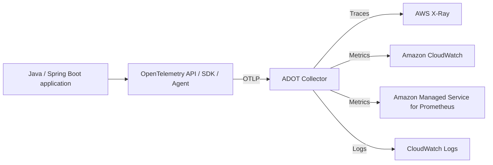
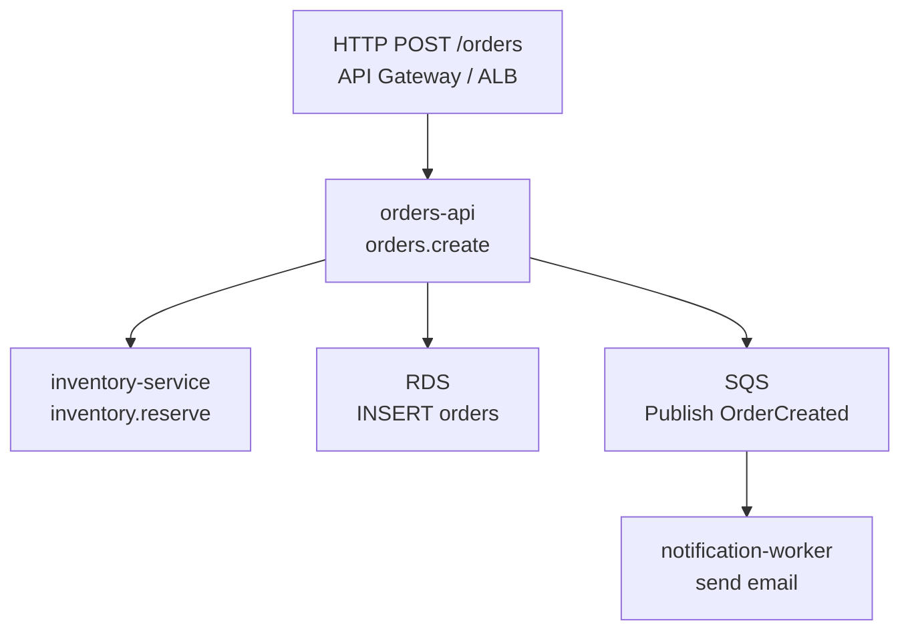
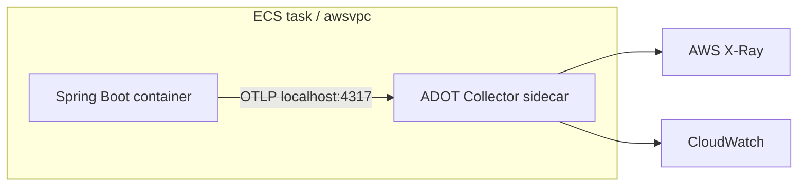
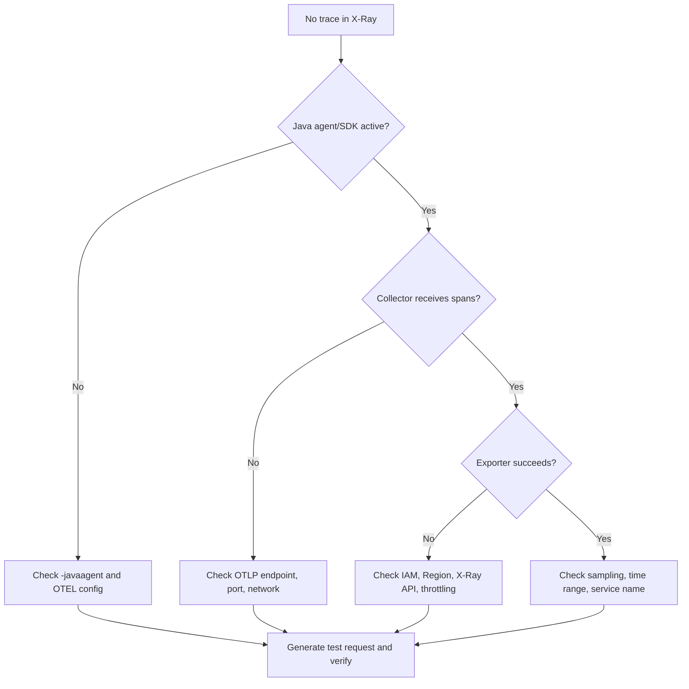

# OpenTelemetry và AWS Distro for OpenTelemetry

> **Chương:** Quan sát với CloudWatch · **Mô-đun:** `CLOUD_PROVIDERS_AWS`

## 1. Vì sao cần OpenTelemetry?

Một ứng dụng Java Spring Boot chạy trên ECS hoặc EKS có thể gọi nhiều service, truy vấn RDS, phát message lên SQS, đọc cache và gọi API bên ngoài. Khi một request chậm hoặc thất bại, chỉ xem log của một container thường không đủ để biết request đi qua những thành phần nào, thời gian nằm ở đâu và service nào gây lỗi.

**Observability (khả năng quan sát)** giúp suy luận trạng thái nội bộ của hệ thống từ telemetry mà ứng dụng và hạ tầng phát ra. Ba tín hiệu phổ biến:

- **Metrics:** số liệu tổng hợp theo thời gian như request rate, error rate, latency, CPU và memory.
- **Traces:** hành trình của một request qua nhiều services; mỗi trace gồm các spans có quan hệ cha-con.
- **Logs:** sự kiện có timestamp và nội dung chi tiết; có thể liên kết với trace/span để điều tra một request cụ thể.

**OpenTelemetry (OTel)** là bộ tiêu chuẩn và công cụ mã nguồn mở để instrument ứng dụng, thu thập, xử lý và export telemetry theo cách trung lập với vendor. Nó cung cấp API, SDK, instrumentation libraries, semantic conventions và Collector.

**AWS Distro for OpenTelemetry (ADOT)** là bản phân phối OpenTelemetry do AWS hỗ trợ, tập hợp các thành phần OTel cùng tích hợp cho AWS. ADOT giúp ứng dụng instrument theo chuẩn OTel rồi gửi telemetry tới AWS services như AWS X-Ray, Amazon CloudWatch và Amazon Managed Service for Prometheus (AMP).



OTel là cách instrument và vận chuyển telemetry; ADOT là distribution hỗ trợ triển khai OTel trên AWS; CloudWatch, X-Ray và AMP là các backend lưu trữ, truy vấn, trực quan hóa và cảnh báo. Không nên nhầm lẫn ba vai trò này.

**Mục tiêu sau bài học:**

1. Phân biệt metrics, traces, logs và vai trò của OpenTelemetry.
2. Hiểu API, SDK, auto-instrumentation agent và Collector.
3. Giải thích pipeline receivers–processors–exporters của Collector.
4. Cấu hình ADOT Collector gửi traces tới X-Ray và metrics tới CloudWatch/AMP.
5. Instrument Java/Spring Boot bằng Java agent và API.
6. Triển khai Collector trên ECS, EKS, EC2 và Lambda.
7. Áp dụng context propagation, resource attributes, sampling và batching.
8. Bảo vệ telemetry bằng IAM, TLS, redaction và least privilege.
9. Theo dõi Collector, xử lý lỗi export và tối ưu chi phí.

## 2. Ba tín hiệu telemetry và cách chúng bổ trợ nhau

### 2.1. Metrics — biết điều gì đang xảy ra

Metric là phép đo được tổng hợp theo thời gian. Ví dụ:

| Metric | Ý nghĩa | Dùng để |
| --- | --- | --- |
| `http.server.request.duration` | Thời gian xử lý HTTP request | Latency SLO, p95/p99. |
| Request count (count của histogram duration) | Số request | Traffic, throughput. |
| `http.server.active_requests` | Request đang xử lý | Saturation, concurrency. |
| `process.runtime.jvm.memory.used` | JVM memory đang dùng | Memory pressure, leak investigation. |
| `process.runtime.jvm.cpu.utilization` | CPU utilization của JVM | Capacity và saturation. |
| `db.client.operation.duration` | Thời gian thao tác DB | Database latency. |

Metrics giúp phát hiện xu hướng và bất thường. Một dashboard có thể cho thấy p99 tăng từ 200 ms lên 2 s; trace sẽ giúp xác định thời gian tăng ở service, database hay downstream dependency nào.

### 2.2. Traces — request đã đi qua đâu?

Một trace biểu diễn một request xuyên qua hệ thống. Mỗi span ghi lại một operation với:

- Trace ID: định danh toàn bộ hành trình.
- Span ID: định danh operation hiện tại.
- Parent span ID: liên kết span với operation gọi nó.
- Start/end timestamps và duration.
- Attributes, events, status và links.

Ví dụ request tạo đơn hàng:



Các spans có cùng Trace ID cho phép xem request end-to-end. Trace giúp trả lời “request cụ thể này chậm ở đâu?”.

### 2.3. Logs — chi tiết sự kiện

Logs thường chứa message và fields của một sự kiện. Ví dụ:

```json
{
  "timestamp": "2026-11-20T09:30:00Z",
  "severity": "ERROR",
  "service.name": "orders-api",
  "message": "Failed to reserve inventory",
  "trace_id": "4bf92f3577b34da6a3ce929d0e0e4736",
  "span_id": "00f067aa0ba902b7",
  "error.type": "TimeoutException"
}
```

Log có thể cho biết exception cụ thể, input đã được redacted và mã nghiệp vụ. Trace cung cấp quan hệ thời gian/call graph; metric cho biết lỗi có đang tăng trên toàn hệ thống không.

### 2.4. Correlation giữa metrics, traces và logs

Khi một alarm báo p99 latency tăng:

1. Dùng metric để xác định thời điểm, service và mức độ ảnh hưởng.
2. Mở traces cùng service/time range để tìm spans chậm.
3. Mở logs tương ứng với Trace ID/Span ID để đọc exception/context.
4. Đối chiếu deployment/version để biết lỗi bắt đầu sau release nào.

Không phải mọi backend tự động liên kết mọi signal. Cần instrument, export trace context vào logs và cấu hình dashboard/log query phù hợp.

## 3. OpenTelemetry architecture

### 3.1. API, SDK và instrumentation

OpenTelemetry tách API khỏi SDK:

- **API:** interface mà application/library gọi để tạo spans, metrics và logs.
- **SDK:** implementation xử lý sampling, aggregation, resource detection, processors và exporters.
- **Instrumentation library:** tự động instrument framework/library như HTTP server/client, JDBC, messaging và runtime.
- **Auto-instrumentation agent:** attach vào JVM để instrument nhiều libraries mà không cần sửa từng call site.

Application có thể dùng OTel API trực tiếp cho business operations, đồng thời agent instrument framework/database client. Dùng chung Trace Context để các spans nối thành một trace.

### 3.2. Collector

OpenTelemetry Collector là service nhận telemetry, xử lý và export đến một hoặc nhiều backends. Collector tách application khỏi backend:

- Ứng dụng gửi OTLP đến Collector.
- Collector batch, filter, enrich, sample hoặc transform telemetry.
- Collector export đến X-Ray, CloudWatch, AMP hoặc OTLP endpoint khác.

Collector có thể chạy dưới dạng agent gần workload hoặc gateway tập trung. Collector không tự tạo trace spans nếu ứng dụng chưa instrument và cũng không tự biến logs bất kỳ thành trace có đầy đủ context.

### 3.3. OTLP — OpenTelemetry Protocol

**OTLP** là giao thức chuẩn để truyền telemetry giữa SDK/agent và Collector/backend:

| Transport | Port mặc định thường dùng | Mô tả |
| --- | ---: | --- |
| OTLP/gRPC | `4317` | gRPC transport, phù hợp cho SDK/agent hỗ trợ gRPC. |
| OTLP/HTTP | `4318` | HTTP transport, thường dùng protobuf payload. |

Port mặc định có thể được thay đổi trong Collector config. Chỉ expose receiver trên network interface mà workload cần; tránh bind ra public interface không có TLS/auth.

### 3.4. W3C Trace Context và propagation

Khi service A gọi service B, trace context phải được truyền qua request để B tiếp tục trace thay vì bắt đầu một trace mới.

W3C Trace Context phổ biến dùng HTTP headers:

- `traceparent`: version, trace ID, parent span ID và trace flags.
- `tracestate`: vendor-specific trace state.
- `baggage`: các key/value context được truyền qua service boundary.

Ví dụ `traceparent`:

```text
00-4bf92f3577b34da6a3ce929d0e0e4736-00f067aa0ba902b7-01
```

Không tự tạo hoặc ghi đè trace IDs ở mỗi service. Dùng propagators OTel để inject/extract context. Baggage có thể được chuyển qua nhiều service; không đưa PII, credentials hoặc dữ liệu nhạy cảm vào baggage.

## 4. Resource attributes và semantic conventions

### 4.1. Resource mô tả nguồn phát telemetry

Resource attributes nhận diện entity tạo telemetry, ví dụ:

```text
service.name=orders-api
service.namespace=commerce
service.version=2.4.1
deployment.environment.name=production
cloud.provider=aws
cloud.region=ap-southeast-1
cloud.platform=aws_ecs
```

Các attributes này gắn vào nhiều spans/metrics/log records của cùng resource. Chúng giúp lọc theo service, version, environment, Region và platform.

### 4.2. Resource attributes khác span attributes

| Loại | Phạm vi | Ví dụ |
| --- | --- | --- |
| Resource attributes | Process/service instance hoặc entity phát telemetry | `service.name`, `service.version`, `cloud.region`. |
| Span attributes | Operation cụ thể | `http.request.method`, `url.route`, `db.system.name`. |
| Span events | Sự kiện xảy ra trong span | Exception, retry, cache miss. |
| Metric attributes | Dimension của data point | `http.request.method`, `http.response.status_code`. |

Không đưa `order.id`, `user.id`, request UUID hoặc session ID làm metric dimensions nếu chúng tạo cardinality cao. Có thể dùng thuộc tính phù hợp trong trace/log đã được kiểm soát, nhưng phải xem xét privacy và retention.

### 4.3. Semantic conventions

Semantic conventions quy định tên attributes và ý nghĩa thống nhất cho HTTP, database, messaging, RPC, cloud và runtime. Ví dụ:

- `service.name`
- `http.request.method`
- `http.response.status_code`
- `server.address`
- `db.system.name`
- `messaging.system`
- `exception.type`

Semantic conventions có thể thay đổi giữa các phiên bản. Khi nâng OTel agent/SDK, kiểm tra schema/semantic convention version và dashboard/queries phụ thuộc attribute names.

### 4.4. Service name và environment phải ổn định

`service.name` nên là tên logic của service, không phải container ID, pod UID hoặc hostname. Những giá trị thay đổi mỗi lần deploy làm dashboard và service map bị phân mảnh.

Dùng `service.version` cho release/build version, `deployment.environment.name` cho môi trường và platform attributes do resource detector phù hợp tạo ra. Tránh tự đặt cùng một key theo nhiều cách viết khác nhau trong từng service.

## 5. ADOT là gì và gồm những gì?

### 5.1. AWS Distro for OpenTelemetry

ADOT là distribution của OpenTelemetry được AWS hỗ trợ để giúp instrument, collect và export telemetry từ workloads chạy trên AWS hoặc môi trường khác. ADOT dựa trên upstream OpenTelemetry và bổ sung/đóng gói các components, exporters, receivers và instrumentation phù hợp với AWS.

ADOT không phải một monitoring backend riêng. Nó là lớp instrumentation/collection/transport. Backend có thể là:

- **AWS X-Ray:** distributed tracing và service map.
- **Amazon CloudWatch:** metrics, logs, dashboards, alarms và Application Signals.
- **Amazon Managed Service for Prometheus (AMP):** Prometheus-compatible metrics storage/query.
- OTLP-compatible backend khác theo kiến trúc.

### 5.2. Các thành phần ADOT thường gặp

| Thành phần | Vai trò |
| --- | --- |
| ADOT Java auto-instrumentation agent | Tự động tạo telemetry cho các Java frameworks/libraries được hỗ trợ. |
| OTel API/SDK | Instrument thủ công và cấu hình telemetry trong ứng dụng. |
| ADOT Collector | Nhận, xử lý và export telemetry. |
| EKS add-on | Cách cài Collector vào Kubernetes cluster qua cơ chế add-on được hỗ trợ. |
| Lambda layers/extensions | Hỗ trợ instrument và thu thập telemetry cho một số runtimes/deployment models. |

Danh sách components và support matrix phụ thuộc ADOT release. Kiểm tra release notes và tài liệu chính thức trước khi chọn receiver/exporter hoặc runtime version.

### 5.3. ADOT Collector và upstream Collector

Collector có kiến trúc component-based. ADOT Collector là bản build/distribution bao gồm tập hợp components đã chọn và được AWS hỗ trợ. Không mặc định mọi component trong upstream `otelcol-contrib` đều có trong mọi ADOT image/version.

Khi chọn config:

1. Xác định image/version ADOT Collector đang chạy.
2. Kiểm tra receiver, processor, exporter, extension đó có trong distribution không.
3. Dùng schema/configuration reference của đúng version.
4. Test config khi nâng image; component có thể thay đổi/deprecate.

### 5.4. Chọn backend theo signal

| Signal | AWS destination thường dùng | Công dụng |
| --- | --- | --- |
| Traces | AWS X-Ray | Trace search, service map, latency/error analysis. |
| Metrics | CloudWatch EMF exporter | CloudWatch metrics và dashboards/alarms. |
| Metrics | AMP Prometheus Remote Write | Prometheus metrics và PromQL. |
| Logs | CloudWatch Logs exporter hoặc Fluent Bit/agent phù hợp | Log search và retention. |

Có thể export cùng một signal đến nhiều backends nếu cần, nhưng sẽ tăng network/API cost và phải quản lý duplicate/retention/query semantics.

## 6. Collector pipeline: receivers, processors và exporters

### 6.1. Ba khối chính

Một Collector pipeline có ba phần:

| Thành phần | Chức năng | Ví dụ |
| --- | --- | --- |
| **Receiver** | Nhận telemetry từ SDK, agent hoặc service khác. | `otlp`, `prometheus`, `jaeger`, `filelog` nếu distribution có component. |
| **Processor** | Xử lý dữ liệu sau khi nhận, trước khi export. | `memory_limiter`, `batch`, `resource`, `attributes`, `filter`, `tail_sampling`. |
| **Exporter** | Gửi telemetry đến backend hoặc destination khác. | `awsxray`, `awsemf`, `prometheusremotewrite`, `otlp`. |

Collector config khai báo component, sau đó nối chúng vào từng pipeline theo signal (`traces`, `metrics`, `logs`).

### 6.2. Extensions

Extensions cung cấp khả năng vận hành ngoài luồng xử lý telemetry, ví dụ:

- `health_check`: health endpoint để orchestrator kiểm tra Collector.
- `pprof`: profiling Collector khi điều tra CPU/memory.
- `zpages`: debug internal telemetry/state trong môi trường được bảo vệ.
- `sigv4auth`: ký AWS requests cho exporter hỗ trợ SigV4 authentication.

Extensions cần được khai báo trong `extensions` và bật trong `service.extensions`. Chỉ expose debug endpoints trong private management network; không mở public.

### 6.3. Pipeline theo signal

Một Collector có thể có nhiều pipelines:

```yaml
service:
  pipelines:
    traces:
      receivers: [otlp]
      processors: [memory_limiter, batch]
      exporters: [awsxray]
    metrics:
      receivers: [otlp]
      processors: [memory_limiter, batch]
      exporters: [awsemf]
```

Mỗi pipeline phải tham chiếu component đã được khai báo. Receiver/exporter có thể được dùng trong nhiều pipelines; cấu hình component dùng chung vẫn cần phù hợp với từng signal.

### 6.4. Processor theo thứ tự

Processor chạy theo thứ tự được liệt kê trong pipeline. Một thứ tự phổ biến:

1. `memory_limiter`: bảo vệ Collector khỏi vượt giới hạn memory.
2. `resource` hoặc `attributes`: chuẩn hóa/enrich metadata.
3. `filter`: loại bỏ telemetry không cần thiết hoặc dữ liệu không được phép gửi.
4. `batch`: gom telemetry thành batches trước khi export.

Thứ tự thực tế phụ thuộc use case. Ví dụ cần filter trước khi batch; cần thêm resource attributes trước exporter; cần đảm bảo sampling được áp dụng trước khi gửi ra backend. Đọc behavior của processor và kiểm tra config version cụ thể.

### 6.5. Memory limiter và batching

`memory_limiter` giúp giới hạn memory Collector. Nếu Collector chạm ngưỡng, processor có thể từ chối dữ liệu để tạo backpressure. Cần sizing memory limit thấp hơn container limit để còn chỗ cho runtime/overhead.

`batch` gom spans/metrics/log records để giảm số lần gọi exporter và tăng throughput. Batch quá lớn có thể tăng memory và latency; batch quá nhỏ làm tăng API calls và overhead.

Ví dụ:

```yaml
processors:
  memory_limiter:
    check_interval: 1s
    limit_mib: 512
    spike_limit_mib: 128
  batch:
    timeout: 5s
    send_batch_size: 1024
```

Giá trị chỉ là điểm bắt đầu cho lab; điều chỉnh theo memory limit, telemetry volume, exporter latency và drop/retry metrics.

### 6.6. Filter và redaction

Collector có thể loại bỏ spans/attributes không cần thiết trước export:

- Health-check requests có tần suất cao và ít giá trị điều tra.
- Query parameters có thể chứa token hoặc PII.
- Headers như `Authorization`, `Cookie`, `Set-Cookie`.
- SQL statements chứa literal values hoặc dữ liệu người dùng.
- Attributes có cardinality quá cao.

Ưu tiên không thu thập dữ liệu nhạy cảm ngay từ instrumentation. Filter/redaction ở Collector là lớp bảo vệ bổ sung, không phải lý do để gửi secrets vào telemetry rồi mới xóa.

### 6.7. Export retry và backpressure

Exporter thường có sending queue/retry behavior tùy component. Khi backend unavailable:

- Queue giúp hấp thụ gián đoạn ngắn nhưng dùng memory/disk.
- Retry giúp xử lý lỗi transient nhưng không bảo đảm dữ liệu được giữ vô hạn.
- Queue đầy hoặc Collector bị restart có thể làm mất telemetry chưa flush.
- Backpressure có thể làm SDK/agent chậm hoặc drop dữ liệu nếu buffers cạn.

Thiết kế Collector theo failure budget: giới hạn queue, bật persistent storage khi component hỗ trợ và phù hợp, theo dõi send failures/dropped items, và không để telemetry làm cạn tài nguyên của application.

## 7. ADOT Collector gửi traces tới X-Ray và metrics tới CloudWatch

### 7.1. Config mẫu cho ECS/EC2

Ví dụ dưới đây minh họa OTLP receiver, memory limiter, batch processor và hai AWS exporters:

```yaml
receivers:
  otlp:
    protocols:
      grpc:
        endpoint: 0.0.0.0:4317
      http:
        endpoint: 0.0.0.0:4318

processors:
  memory_limiter:
    check_interval: 1s
    limit_mib: 512
    spike_limit_mib: 128
  batch:
    timeout: 5s
    send_batch_size: 1024

exporters:
  awsxray:
    region: ap-southeast-1
  awsemf:
    namespace: OrdersAPI
    log_group_name: /aws/otel/metrics
    dimension_rollup_option: NoDimensionRollup
    resource_to_telemetry_conversion:
      enabled: true

extensions:
  health_check:
    endpoint: 0.0.0.0:13133

service:
  extensions: [health_check]
  pipelines:
    traces:
      receivers: [otlp]
      processors: [memory_limiter, batch]
      exporters: [awsxray]
    metrics:
      receivers: [otlp]
      processors: [memory_limiter, batch]
      exporters: [awsemf]
```

Đây là cấu hình minh họa; component availability và exporter options phụ thuộc ADOT Collector image/version. Validate bằng đúng binary/image trước khi deploy. `awsemf` dùng CloudWatch Embedded Metric Format, thường gửi payload metric qua CloudWatch Logs; log group phải tồn tại hoặc exporter được cấp quyền tạo theo cấu hình. `awsxray` gửi trace segments đến X-Ray.

### 7.2. IAM permissions cho exporters

Workload role của Collector cần quyền theo destination:

| Destination | API permissions thường cần |
| --- | --- |
| X-Ray | `xray:PutTraceSegments`, `xray:PutTelemetryRecords` |
| CloudWatch EMF | CloudWatch Logs permissions như `logs:CreateLogGroup`, `logs:CreateLogStream`, `logs:PutLogEvents` tùy log group lifecycle/configuration |
| AMP Remote Write | `aps:RemoteWrite` trên workspace ARN |

Đây là quyền tham khảo theo exporter. Tạo log groups/streams trước bằng IaC nếu muốn bỏ quyền create từ runtime role. Scope resource ARN và KMS/log resource policies theo đúng workload; không cấp `logs:*`, `xray:*` hoặc `aps:*` toàn account.

### 7.3. Gửi metrics tới AMP bằng Prometheus Remote Write

Khi muốn dùng PromQL/Grafana và Prometheus data model, ADOT Collector có thể export metrics tới AMP qua `prometheusremotewrite`. AMP yêu cầu AWS Signature Version 4; có thể cấu hình `sigv4auth` extension:

```yaml
extensions:
  sigv4auth:
    region: ap-southeast-1
    service: aps

exporters:
  prometheusremotewrite:
    endpoint: https://aps-workspaces.ap-southeast-1.amazonaws.com/workspaces/ws-EXAMPLE/api/v1/remote_write
    auth:
      authenticator: sigv4auth

service:
  extensions: [sigv4auth]
  pipelines:
    metrics:
      receivers: [otlp]
      processors: [memory_limiter, batch]
      exporters: [prometheusremotewrite]
```

Endpoint/workspace ID là placeholder. Dùng AWS credentials provider chain của workload role; không đặt access key/secret key trực tiếp trong Collector config. Cấu hình endpoint, Region và SigV4 service name đúng với AMP workspace và ADOT version.

### 7.4. CloudWatch EMF và Prometheus khác nhau

| Tiêu chí | CloudWatch EMF | AMP |
| --- | --- | --- |
| Data model | CloudWatch metrics được trích từ EMF log events | Prometheus time series |
| Query | CloudWatch Metrics/Metric Insights | PromQL |
| Tích hợp | CloudWatch dashboards, alarms, Application Signals | Prometheus ecosystem, Grafana |
| Cardinality/cost | Dimensions ảnh hưởng số metric và chi phí | Label cardinality ảnh hưởng ingest/storage/query |
| Dùng khi | AWS-native operations và alarms | Cần Prometheus-compatible monitoring/query |

Không export cùng một metric vào cả hai backend nếu không có nhu cầu rõ ràng; duplication làm tăng chi phí và tạo hai nguồn dữ liệu cần đối chiếu.

### 7.5. Export logs

Logs có thể đi qua OTel Logs pipeline nếu application/agent phát OTel log records và Collector distribution có exporter phù hợp. Trên AWS, một số kiến trúc vẫn dùng CloudWatch Agent hoặc Fluent Bit cho container stdout/stderr, trong khi ADOT tập trung vào traces/metrics.

Không cần ép tất cả logs qua ADOT chỉ để có distributed tracing. Có thể giữ log shipping riêng, nhưng cần trace context correlation (`trace_id`, `span_id`) và thống nhất service/environment attributes.

## 8. Instrument Java và Spring Boot

### 8.1. Auto-instrumentation bằng Java agent

Java agent là cách nhanh để bắt đầu tracing mà không cần sửa mọi controller, HTTP client hoặc JDBC call. Agent attach vào JVM lúc startup, instrument các libraries/frameworks được hỗ trợ và export telemetry qua OTLP.

Ví dụ khởi chạy:

```bash
java \
  -javaagent:/opt/aws-opentelemetry-agent.jar \
  -Dotel.service.name=orders-api \
  -Dotel.resource.attributes=service.version=2.4.1,deployment.environment.name=staging \
  -Dotel.exporter.otlp.endpoint=http://adot-collector:4317 \
  -Dotel.exporter.otlp.protocol=grpc \
  -jar orders-api.jar
```

Tên/path agent jar phụ thuộc gói ADOT Java agent được chọn và cách đóng gói image. Trong container, thường đưa agent vào image qua build stage hoặc mount từ artifact đã kiểm soát. Không tải agent không pin version ở mỗi lần container startup.

### 8.2. Cấu hình qua environment variables

Có thể cấu hình agent bằng environment variables:

```bash
OTEL_SERVICE_NAME=orders-api
OTEL_RESOURCE_ATTRIBUTES=service.version=2.4.1,deployment.environment.name=production,cloud.region=ap-southeast-1
OTEL_EXPORTER_OTLP_ENDPOINT=http://adot-collector:4317
OTEL_EXPORTER_OTLP_PROTOCOL=grpc
OTEL_TRACES_EXPORTER=otlp
OTEL_METRICS_EXPORTER=otlp
OTEL_LOGS_EXPORTER=otlp
JAVA_TOOL_OPTIONS=-javaagent:/opt/aws-opentelemetry-agent.jar
```

Các exporters/signal được hỗ trợ phụ thuộc agent distribution/version; không phải mọi Java agent release đều auto-instrument logs. Nếu dùng OTLP/HTTP protobuf, cấu hình protocol `http/protobuf` và endpoint/port HTTP receiver phù hợp (thường `4318`). Tránh đồng thời cấu hình system properties và environment variables với giá trị xung đột.

### 8.3. Những gì agent có thể instrument

Tùy agent release và thư viện, auto-instrumentation có thể tạo spans cho:

- Spring MVC/WebFlux server requests.
- HTTP clients như Apache HttpClient, OkHttp hoặc Java HTTP client.
- JDBC/database clients.
- Messaging clients như Kafka, JMS và một số AWS SDK calls.
- Executor/thread context propagation.
- JVM/runtime metrics.

Kiểm tra compatibility matrix của agent trước khi dựa vào một integration. Framework version mới, custom networking stack hoặc thư viện không được hỗ trợ có thể không tạo spans tự động.

### 8.4. Tránh duplicate instrumentation

Không attach hai OTel agents hoặc vừa bật instrumentation agent vừa tự instrument cùng một framework bằng custom instrumentation mà không có kế hoạch. Duplicate spans làm trace tree có thêm operation lặp, tăng ingest cost và gây hiểu sai latency.

Nếu cần custom spans, giữ auto-instrumentation cho framework và thêm spans cho business operations chưa được agent mô tả. Có thể disable instrumentation cụ thể qua agent configuration khi đã thay bằng instrumentation khác.

### 8.5. Sampling và resource attributes cho Java

Có thể đặt sampler bằng environment variables:

```bash
OTEL_TRACES_SAMPLER=parentbased_traceidratio
OTEL_TRACES_SAMPLER_ARG=0.10
```

Ví dụ này lấy mẫu khoảng 10% root traces theo ratio; child spans tuân theo parent decision. Production sampling cần dựa trên traffic, latency/error requirements và khả năng backend. Nếu muốn giữ tất cả errors hoặc slow traces, đánh giá tail sampling ở Collector thay vì chỉ head sampling trong SDK.

### 8.6. Spring Boot và cấu hình service identity

`service.name` nên nhất quán giữa tất cả replicas của cùng một logical service. Đưa `service.version` từ build metadata và `deployment.environment.name` từ deployment config. Với ECS/EKS, có thể bổ sung cluster, namespace, task/pod attributes qua resource detectors phù hợp.

Không dùng container ID/pod name làm `service.name`; chúng phù hợp hơn với instance/container attributes do detector tạo ra.

## 9. Instrument business operations bằng OTel API

### 9.1. Khi nào cần manual instrumentation?

Auto-instrumentation thường biết request HTTP, JDBC hoặc messaging operation, nhưng không hiểu business step như:

- Tạo order và áp dụng discount.
- Reserve inventory.
- Tính phí vận chuyển.
- Gửi order tới fulfillment.

Manual spans bổ sung ngữ nghĩa nghiệp vụ để trace thể hiện nơi logic ứng dụng thực sự tiêu tốn thời gian hoặc phát sinh lỗi.

### 9.2. Thêm một span trong Java

Ví dụ sau dùng global OpenTelemetry instance đã được khởi tạo bởi Java agent/SDK:

```java
import io.opentelemetry.api.GlobalOpenTelemetry;
import io.opentelemetry.api.trace.Span;
import io.opentelemetry.api.trace.SpanKind;
import io.opentelemetry.api.trace.StatusCode;
import io.opentelemetry.api.trace.Tracer;
import io.opentelemetry.context.Scope;

public class OrderService {
    private final Tracer tracer =
            GlobalOpenTelemetry.getTracer("com.example.orders");

    public void createOrder() {
        Span span = tracer.spanBuilder("orders.create")
                .setSpanKind(SpanKind.INTERNAL)
                .startSpan();

        try (Scope scope = span.makeCurrent()) {
            span.setAttribute("order.channel", "web");
            reserveInventory();
        } catch (RuntimeException exception) {
            span.recordException(exception);
            span.setStatus(StatusCode.ERROR);
            throw exception;
        } finally {
            span.end();
        }
    }

    private void reserveInventory() {
        // Business operation.
    }
}
```

Thêm import `io.opentelemetry.api.trace.Tracer` cho field `tracer`. `makeCurrent()` đặt span thành active context trong scope hiện tại để downstream instrumentation tạo child spans. Luôn đóng scope và kết thúc span; try-with-resources cùng finally giúp tránh rò context/span khi có exception.

Nếu không có agent hoặc SDK provider được cấu hình, global API có thể trả noop implementation; code vẫn chạy nhưng không export spans. Trong ứng dụng tự quản lý SDK, khởi tạo SDK/exporter/processor một lần lúc startup và shutdown đúng lifecycle.

### 9.3. Attributes và events

Attributes nên mô tả operation bằng các giá trị có ích và cardinality được kiểm soát:

```java
span.setAttribute("order.channel", "mobile");
span.setAttribute("payment.provider", "example-pay");
span.addEvent("inventory.reservation.started");
```

Không gắn password, bearer token, full card number, email, địa chỉ hoặc raw request body vào span. Với identifier nghiệp vụ, đánh giá privacy, retention, cardinality và quyền truy cập trước khi thu thập.

### 9.4. Record exception đúng cách

Khi operation thất bại:

- Ghi exception bằng `recordException`.
- Đặt span status `ERROR` khi exception làm operation thất bại.
- Re-throw hoặc xử lý exception theo business contract.
- Không tạo log/span chứa toàn bộ exception message nếu message có thể chứa secrets/PII.

Không đánh dấu mọi exception đã được xử lý như lỗi của request nếu đó là nhánh business bình thường, ví dụ kiểm tra dữ liệu không tồn tại đã được dự kiến.

### 9.5. Tạo metric cho business operation

Ví dụ dùng counter và histogram:

```java
import io.opentelemetry.api.GlobalOpenTelemetry;
import io.opentelemetry.api.common.AttributeKey;
import io.opentelemetry.api.common.Attributes;
import io.opentelemetry.api.metrics.DoubleHistogram;
import io.opentelemetry.api.metrics.LongCounter;
import io.opentelemetry.api.metrics.Meter;

Meter meter = GlobalOpenTelemetry.getMeter("com.example.orders");

LongCounter ordersCreated = meter.counterBuilder("orders.created")
        .setDescription("Number of orders created")
        .build();

DoubleHistogram orderDuration = meter.histogramBuilder("orders.processing.duration")
        .setUnit("s")
        .setDescription("Time spent processing an order")
        .build();

Attributes dimensions = Attributes.of(
        AttributeKey.stringKey("order.channel"), "web");

ordersCreated.add(1, dimensions);
orderDuration.record(0.245, dimensions);
```

Tạo instruments một lần và tái sử dụng, không tạo counter mới trên mỗi request. Chỉ dùng dimensions có tập giá trị giới hạn như channel/provider/status; không dùng order ID, user ID hoặc request ID làm metric attributes.

### 9.6. Liên kết logs với trace context

Khi log trong một span active, logging integration có thể đưa trace ID/span ID vào log record. Có thể đọc context hiện tại khi cần:

```java
import io.opentelemetry.api.trace.Span;
import io.opentelemetry.api.trace.SpanContext;

SpanContext context = Span.current().getSpanContext();
if (context.isValid()) {
    String traceId = context.getTraceId();
    String spanId = context.getSpanId();
    // Đưa IDs vào structured log fields; không log secrets.
}
```

Ưu tiên OTel logging appender/bridge hoặc logging integration được hỗ trợ để correlation được thêm nhất quán. Không tự tạo trace ID mới cho mỗi log event.

## 10. Triển khai ADOT theo compute platform

### 10.1. Amazon ECS

Với ECS, một cách triển khai phổ biến là chạy ADOT Collector như sidecar trong cùng task với ứng dụng:



Các containers trong cùng ECS task dùng chung network namespace theo task network mode phù hợp, nên sidecar có thể nhận OTLP qua localhost. Kiểm tra network mode, port mapping và health check khi cấu hình.

**Ưu điểm:** telemetry đi gần application, tách collector lifecycle theo task, dễ gắn resource/task metadata. **Trade-off:** mỗi task tiêu thụ thêm CPU/memory; khi scale service từ 5 lên 100 tasks, số Collector cũng tăng.

Một gateway Collector service riêng có thể giảm số exporters connections và gom xử lý, nhưng cần service discovery, network permissions, TLS/auth và khả năng scale/HA.

Lưu ý IAM: ECS task có một task role ở cấp task; các containers trong task dùng task role đó. Task execution role phục vụ ECS agent pull image/ghi logs theo cấu hình. Nếu muốn Collector có quyền AWS khác biệt với application container, cân nhắc tách Collector thành task/service riêng thay vì giả định sidecar có role độc lập.

### 10.2. Amazon EKS

Các deployment patterns thường dùng:

| Pattern | Mục đích |
| --- | --- |
| DaemonSet | Một Collector agent trên mỗi node, nhận telemetry từ workloads/node trên node đó. |
| Deployment gateway | Một nhóm Collector replicas nhận telemetry tập trung từ nhiều workloads. |
| Sidecar | Collector riêng cho workload/pod cần isolation hoặc custom processing. |
| EKS add-on | Quản lý ADOT Collector qua add-on lifecycle của EKS. |

Workload có thể export OTLP tới Collector service trong cluster hoặc endpoint local tùy pattern. Dùng Kubernetes service discovery, NetworkPolicy và security groups for pods khi cần giới hạn network paths.

Để Collector gọi AWS APIs, gắn IAM permissions vào Kubernetes service account bằng **EKS Pod Identity** hoặc **IRSA** theo mô hình tổ chức. Tránh gắn quyền rộng vào node instance role nếu chỉ một Collector cần quyền export.

### 10.3. Amazon EC2

Trên EC2 có thể chạy Collector như system service hoặc container. Instance profile cung cấp credentials theo IAM role:

- Cài và pin ADOT Collector version.
- Đặt config trong thư mục được bảo vệ quyền đọc.
- Chạy dưới user riêng, giới hạn filesystem permissions.
- Dùng systemd/container health checks và restart policy.
- Export telemetry qua VPC/network path được kiểm soát.

Không chạy Collector dưới root nếu không cần. Không để port OTLP hoặc debug endpoints mở ra public internet.

### 10.4. AWS Lambda

Với Lambda, ADOT cung cấp các Lambda layers/extension và instrumentation options cho một số runtime. Layer/extension có thể thu thập telemetry trong execution environment và gửi tới configured destination.

Trước khi triển khai:

- Kiểm tra runtime, architecture, Region và layer version được hỗ trợ.
- Chọn đúng layer cho Java/runtime và mô hình collector extension.
- Cấp IAM permissions cho Lambda execution role.
- Kiểm tra timeout/memory overhead và cold-start impact.
- Kiểm thử telemetry trong cả cold start, warm invocation và lỗi timeout.

Lambda có lifecycle execution environment đặc thù; không giả định một Collector process luôn sống như daemon trên ECS/EC2. Tuân thủ tài liệu ADOT Lambda integration đúng runtime/version.

### 10.5. Chọn sidecar hay gateway?

| Tiêu chí | Sidecar/agent gần workload | Gateway tập trung |
| --- | --- | --- |
| Network | Local/cluster-local | Workload cần gọi endpoint gateway |
| Resource overhead | Tăng theo số tasks/pods/nodes | Tập trung, dễ chia sẻ |
| Isolation | Tốt hơn theo workload | Cần tenant/resource isolation trong gateway |
| Scaling | Đi cùng workload replicas | Scale độc lập theo telemetry throughput |
| Failure domain | Collector lỗi ảnh hưởng workload gần nó | Gateway lỗi có thể ảnh hưởng nhiều services |
| Use case | Workload ít, yêu cầu isolation, low latency | Nhiều services, central processing/tail sampling |

Có thể kết hợp agent ở node/task và gateway tier cho xử lý tập trung. Thiết kế phải tính tới network, queue, retry và trace affinity.

## 11. Sampling, cardinality và chi phí telemetry

### 11.1. Head sampling

Head sampling quyết định lấy trace ngay khi root span bắt đầu, thường trong SDK/agent. Ưu điểm là giảm dữ liệu ngay từ nguồn và tiết kiệm băng thông/Collector/backend. Nhược điểm là chưa biết trace có lỗi hoặc chậm hay không khi quyết định.

Ví dụ parent-based ratio sampler 10%:

```bash
OTEL_TRACES_SAMPLER=parentbased_traceidratio
OTEL_TRACES_SAMPLER_ARG=0.10
```

Parent-based sampling giữ quyết định của trace parent cho child spans, giúp trace không bị thiếu spans ngẫu nhiên giữa các services.

### 11.2. Tail sampling

Tail sampling quyết định sau khi Collector đã nhận spans của trace, có thể giữ trace theo latency, status hoặc attributes. Ví dụ muốn giữ 100% traces có error và chỉ 5% traces thành công.

```yaml
processors:
  tail_sampling:
    decision_wait: 10s
    num_traces: 50000
    expected_new_traces_per_sec: 1000
    policies:
      - name: keep-errors
        type: status_code
        status_code:
          status_codes: [ERROR]
      - name: sample-success
        type: probabilistic
        probabilistic:
          sampling_percentage: 5
```

Đây là cấu hình khái niệm; kiểm tra policy syntax và component availability của ADOT Collector version đang dùng. Tail sampling cần giữ state trong thời gian chờ quyết định, dùng memory đáng kể và cần routing để spans của cùng trace tới cùng tail-sampling Collector. Nếu spans của một trace bị phân tán giữa replicas, quyết định có thể không đầy đủ.

### 11.3. Không sampling traces một cách độc lập ở mỗi service

Nếu service A lấy 10% trace còn service B tự lấy 10% độc lập, trace có thể bị thiếu spans ở một phía. Dùng parent-based sampler và propagate trace flags; nếu tail sampling ở gateway, cần đảm bảo trace affinity hoặc routing theo trace ID.

### 11.4. Metric cardinality

Cardinality tăng khi một metric có nhiều tổ hợp attribute values. Ví dụ `http.server.request.count` với dimensions method (5 giá trị), status code (10 giá trị), route (20 giá trị) có thể tạo nhiều series; nếu thêm user ID với hàng triệu giá trị thì số series tăng mạnh.

Quy tắc:

- Dùng route template (`/orders/{id}`) thay URL path có ID cụ thể.
- Không đưa user/order/session/request IDs vào metric labels.
- Giới hạn dimensions theo tập giá trị nhỏ.
- Theo dõi active time series và ingestion volume.
- Tách high-cardinality diagnostics sang traces/logs đã kiểm soát.

### 11.5. Chi phí và retention

Chi phí phụ thuộc backend, volume, retention, query và dimensions. Với CloudWatch, EMF log ingestion và custom metric dimensions có thể ảnh hưởng chi phí. Với X-Ray, số traces được ghi/scan ảnh hưởng chi phí. Với AMP, samples/time series và retention ảnh hưởng chi phí.

Để kiểm soát:

1. Chọn sampling rate theo SLO và incident use cases.
2. Filter health checks/noisy spans không có giá trị.
3. Giới hạn metric dimensions.
4. Batch export và giảm duplicate telemetry.
5. Thiết lập retention phù hợp theo signal.
6. Theo dõi ingestion volume và cost allocation theo service/environment.

Không giảm sampling đến mức mất khả năng điều tra lỗi hiếm hoặc latency tail. Đánh giá bằng incident scenarios, không chỉ theo phần trăm traffic.

## 12. Security và quyền truy cập

### 12.1. IAM role cho Collector

Collector cần quyền tới backend đích. Chọn identity theo compute:

| Compute | Identity thường dùng |
| --- | --- |
| ECS | ECS task role |
| EKS | EKS Pod Identity hoặc IRSA cho service account |
| EC2 | Instance profile role |
| Lambda | Lambda execution role |

AWS exporters thường dùng AWS SDK credential provider chain. Dùng role credentials ngắn hạn; không hard-code access key/secret key trong Collector YAML, Docker image hoặc environment variables.

### 12.2. Quyền tham khảo

| Export destination | Quyền tham khảo |
| --- | --- |
| X-Ray | `xray:PutTraceSegments`, `xray:PutTelemetryRecords` |
| CloudWatch EMF | CloudWatch Logs permissions như `logs:PutLogEvents`, `logs:CreateLogStream`; `logs:CreateLogGroup` nếu runtime được phép tạo group |
| AMP | `aps:RemoteWrite` trên workspace ARN |

Exporter/version cụ thể có thể cần thêm API calls. Dựa vào documentation, CloudTrail và error responses để hoàn thiện policy. Không cấp wildcard actions/resources rộng cho toàn account.

### 12.3. Network và TLS

Nếu application và Collector cùng host/task/pod, có thể dùng loopback/private network. Nếu Collector gateway nhận OTLP từ nhiều workloads:

- Chỉ expose listener trong private network.
- Bật TLS/mTLS khi traffic đi qua network boundary không đáng tin cậy.
- Dùng authentication phù hợp với gateway và tenant.
- Giới hạn source security groups/NetworkPolicy.
- Không expose pprof/zpages/health endpoints công khai.

Với AWS endpoints, đảm bảo route/DNS/NAT hoặc VPC endpoint phù hợp. Xác minh endpoint service có hỗ trợ PrivateLink trong Region/use case cụ thể; không giả định mọi telemetry destination đều có VPC endpoint.

### 12.4. Privacy và data minimization

Telemetry có thể chứa dữ liệu nhạy cảm qua span attributes, exception messages, baggage, SQL statements hoặc logs. Trước khi production:

1. Xác định dữ liệu được phép thu thập.
2. Không capture authorization/cookie headers hoặc request bodies mặc định.
3. Redact PII/payment data/secrets ở instrumentation layer.
4. Dùng Collector filter làm defense-in-depth.
5. Giới hạn quyền truy cập traces/logs và retention.
6. Kiểm tra data residency và cross-Region export.

Telemetry thường được truy cập bởi nhiều nhóm vận hành; áp dụng least privilege như dữ liệu production.

### 12.5. Protect Collector configuration

Collector config quyết định nơi telemetry được gửi và dữ liệu nào được giữ. Bảo vệ config:

- Lưu trong version control và review như application code.
- Không ghi credentials vào YAML.
- Pin image version/digest và scan image.
- Hạn chế quyền chỉnh sửa task definition/Helm release/config map.
- Bật audit trail cho thay đổi deployment/config.
- Roll out config changes theo canary nếu ảnh hưởng nhiều workloads.

## 13. Monitoring Collector và vận hành production

### 13.1. Theo dõi chính Collector

Collector cũng là một service production. Cần quan sát:

- CPU, memory, restarts và health status.
- Số telemetry receiver accepted/refused.
- Số spans/metrics/logs exporter sent/failed.
- Queue size/capacity và retry counts nếu exporter bật queue.
- Processor dropped/refused items.
- Export latency và backend throttling.
- Số connections/requests tới Collector.

Collector phát internal metrics; tên metric cụ thể có thể thay đổi theo version và distribution. Một số tên thường gặp trong upstream Collector gồm `otelcol_receiver_accepted_spans`, `otelcol_receiver_refused_spans`, `otelcol_exporter_sent_spans`, `otelcol_exporter_send_failed_spans`. Xác minh metrics thực tế của ADOT image trước khi tạo dashboard/alarms.

### 13.2. Health checks

`health_check` extension có thể expose endpoint để ECS/EKS/orchestrator kiểm tra process:

```yaml
extensions:
  health_check:
    endpoint: 0.0.0.0:13133

service:
  extensions: [health_check]
```

Health endpoint chỉ cho biết trạng thái Collector theo health extension. Một Collector process healthy vẫn có thể không export được telemetry do IAM/KMS/network/backend errors. Cần thêm alarms trên exporter failures và receiver/exporter counters.

### 13.3. Alerting cho telemetry pipeline

Các alert nên có:

| Điều kiện | Ý nghĩa |
| --- | --- |
| Exporter send failures tăng | Backend unavailable, IAM denied, throttling hoặc config sai. |
| Receiver refused/dropped tăng | Collector quá tải hoặc memory limiter kích hoạt. |
| Queue utilization gần 100% | Exporter không theo kịp ingestion. |
| Collector restart/OOM tăng | Memory limit thấp hoặc batch/queue quá lớn. |
| Không có telemetry từ service | App agent/SDK lỗi, endpoint sai hoặc service không phát signal. |
| Trace volume giảm bất thường | Sampling/filter/propagation hoặc source workload có vấn đề. |

Alert Collector failure nên độc lập với alert application failure. Nếu monitoring pipeline gặp lỗi, phải có cách phát hiện qua container logs, CloudWatch metrics hoặc platform health signals.

### 13.4. Versioning và rollout config

Collector config là code vận hành:

1. Pin ADOT image tag/digest.
2. Lưu config trong Git.
3. Validate config bằng đúng binary/image version.
4. Chạy canary Collector hoặc một workload nhỏ.
5. Theo dõi drop/failure/latency trước khi rollout rộng.
6. Giữ bản config/image trước đó để rollback.

Không tự động kéo `latest` trong production. Upgrade ADOT có thể đổi component versions, defaults, semantic conventions hoặc exporter behavior.

### 13.5. Capacity planning

Ước lượng Collector capacity theo:

- Số spans/metrics/log records mỗi giây.
- Kích thước attributes và event payload.
- Sampling rate và số signals.
- Batch size/timeout.
- Exporter latency/retry.
- Tail sampling state và decision wait.
- CPU/memory limit và network throughput.

Load test với traffic gần production, bao gồm burst và backend throttling. Tail sampling và large batches có thể làm memory tăng nhanh; đừng chỉ sizing theo CPU trung bình.

## 14. Troubleshooting theo triệu chứng

| Triệu chứng | Nguyên nhân cần kiểm tra | Hướng xử lý |
| --- | --- | --- |
| Không thấy spans trong X-Ray. | Java agent chưa attach, exporter endpoint sai, Collector không nhận OTLP hoặc thiếu IAM. | Kiểm tra JVM startup options, Collector receiver logs, `xray:PutTraceSegments` và Region. |
| Trace bị chia thành nhiều trace IDs. | Context propagation không được inject/extract hoặc proxy strip headers. | Kiểm tra `traceparent`, propagator và HTTP/messaging instrumentation. |
| Trace thiếu spans ở downstream. | Sampling độc lập, SDK không propagate parent decision hoặc tail sampling phân tán. | Dùng parent-based sampling và route cùng trace về một tail sampler. |
| Collector báo connection refused. | Sai endpoint/port, receiver bind sai interface hoặc network policy/security group chặn. | Kiểm tra OTLP gRPC 4317/HTTP 4318, DNS và connectivity. |
| Collector healthy nhưng exporter fail. | IAM/KMS, endpoint, Region, throttling hoặc backend unavailable. | Xem exporter logs/metrics và CloudTrail; xác minh role/policy. |
| CloudWatch không có custom metrics. | EMF log group/permissions sai hoặc dimensions/namespace không như mong đợi. | Kiểm tra log group, `logs:PutLogEvents`, EMF format và namespace. |
| AMP trả 403/AccessDenied. | Thiếu `aps:RemoteWrite`, SigV4 region/service sai hoặc workspace ARN sai. | Kiểm tra `sigv4auth`, Region, endpoint và workload role. |
| `otelcol_exporter_send_failed_*` tăng. | Backend error, queue full hoặc network latency. | Kiểm tra backend/API quotas, queue, retry và export latency. |
| `receiver_refused` hoặc dropped items tăng. | Memory limiter, Collector quá tải hoặc downstream backpressure. | Tăng capacity, giảm telemetry, điều chỉnh batch/queue và sampling. |
| Collector OOM/restart liên tục. | Memory limit thấp, tail sampling state lớn, batch/queue quá lớn. | Giảm state/queue, scale Collector, tăng memory có kiểm soát. |
| Duplicate spans. | Agent duplicate hoặc custom instrumentation trùng với auto-instrumentation. | Chỉ bật một integration cho mỗi operation và kiểm tra agent config. |
| Service map có nhiều service names. | `service.name` lấy từ pod/container ID hoặc naming không nhất quán. | Dùng logical service name ổn định, version/environment ở attributes riêng. |
| Metric series tăng đột biến. | High-cardinality labels như user/order/request ID hoặc URL path raw. | Xóa dimensions không bounded, dùng route template và giảm attribute set. |
| Logs không có trace IDs. | Logging bridge/appender chưa tích hợp hoặc log xảy ra ngoài active span. | Bật trace-context correlation và kiểm tra context propagation. |
| Lambda chỉ có telemetry cold start. | Extension/layer/runtime config sai hoặc flush không hoàn tất. | Kiểm tra ADOT Lambda layer/extension version, timeout và execution role. |
| EKS Collector không export được AWS data. | Pod Identity/IRSA trust/service account annotation sai. | Kiểm tra service account, role trust, token audience và permissions. |

### 14.1. Runbook khi không thấy traces



1. Gửi một request kiểm thử có correlation ID.
2. Kiểm tra JVM startup log để xác nhận agent đã attach.
3. Kiểm tra OTLP receiver accepted spans và Collector logs.
4. Kiểm tra exporter send failures, Region và IAM role.
5. Xác nhận sampling decision và time range trong X-Ray.
6. Mở trace và đối chiếu `service.name`, `service.version`, Trace ID.

### 14.2. Runbook khi telemetry pipeline bị quá tải

1. Xác định signal nào chiếm volume: traces, metrics hay logs.
2. Kiểm tra receiver accepted/refused và exporter sent/failed.
3. Kiểm tra CPU/memory, queue utilization và backend throttling.
4. Loại bỏ health-check/noisy spans hoặc attributes không cần thiết.
5. Giảm high-cardinality metrics và điều chỉnh sampling có kiểm soát.
6. Scale Collector hoặc tách pipeline theo signal/tenant nếu cần.
7. Theo dõi drop rate và service impact sau thay đổi.

## 15. Bài tập thực hành và tình huống đánh giá

> **Quy tắc lab:** Chỉ triển khai Collector, Lambda layers, EKS add-ons và IAM roles trong AWS account/Region được cấp phép. Telemetry export có thể phát sinh chi phí. Nếu không có lab, hãy thiết kế config/policy và giải thích expected behavior.

### Bài tập 1 — Phân biệt ba signals

Một API có p99 tăng, 5% requests trả HTTP 500 và một số logs có `TimeoutException`.

- Chọn metrics để phát hiện latency/error rate.
- Mô tả trace cần có để xác định downstream chậm.
- Thiết kế log fields để liên kết bằng Trace ID/Span ID.
- Giải thích vì sao chỉ dùng logs không đủ để tính p99 toàn hệ thống.

### Bài tập 2 — Trace propagation qua microservices

`orders-api` gọi `inventory-service`, ghi RDS và publish SQS event:

1. Vẽ trace với parent/child spans.
2. Chỉ ra HTTP `traceparent` được inject/extract ở đâu.
3. Giải thích propagation qua asynchronous messaging.
4. Nêu điều gì xảy ra nếu consumer không extract context.
5. Thiết kế log correlation cho producer và consumer.

### Bài tập 3 — Cấu hình ADOT Collector

Tạo config nhận OTLP gRPC/HTTP, thêm memory limiter và batch, export traces sang X-Ray và metrics sang CloudWatch EMF:

- Viết receivers/processors/exporters.
- Bật health check extension.
- Chọn namespace/log group.
- Nêu IAM permissions.
- Validate config với đúng ADOT image version.

### Bài tập 4 — Java auto-instrumentation

Một Spring Boot service chạy trên ECS:

1. Đưa ADOT Java agent vào container image.
2. Cấu hình `JAVA_TOOL_OPTIONS`.
3. Đặt `OTEL_SERVICE_NAME`, resource attributes và OTLP endpoint.
4. Kiểm tra HTTP/JDBC spans.
5. Thêm một custom business span.
6. Kiểm tra duplicate instrumentation.

### Bài tập 5 — Manual span và business metrics

Trong `OrderService.createOrder()`:

- Tạo span `orders.create`.
- Ghi attribute `order.channel`.
- Record exception và status `ERROR`.
- Tạo counter `orders.created`.
- Tạo histogram `orders.processing.duration`.
- Giải thích vì sao không dùng `order.id` làm metric dimension.

### Bài tập 6 — Chọn deployment pattern

Một cluster ECS có 80 tasks; EKS có 40 nodes và 300 pods:

1. So sánh sidecar, DaemonSet và gateway Collector.
2. Ước lượng resource overhead.
3. Chọn IAM identity cho ECS/EKS Collector.
4. Thiết kế network path và TLS.
5. Nêu failure domain và cách scale/HA.

### Bài tập 7 — Head sampling và tail sampling

Traffic có 10.000 requests/giây; team muốn giữ tất cả traces lỗi và 5% traces thành công:

- So sánh head và tail sampling.
- Viết tail sampling policy khái niệm.
- Giải thích memory/decision wait.
- Thiết kế trace affinity giữa Collector replicas.
- Nêu tác động khi một trace bị chia qua hai collectors.

### Bài tập 8 — Export metrics tới AMP

Một team cần PromQL và Grafana:

1. Cấu hình `prometheusremotewrite`.
2. Cấu hình `sigv4auth` với Region/workspace endpoint.
3. Cấp `aps:RemoteWrite` cho đúng workspace.
4. Kiểm tra DNS/network tới AMP.
5. Xác minh samples xuất hiện và query được.

### Bài tập 9 — Incident: Collector không export

CloudWatch dashboard không có metrics mới, nhưng Collector health check vẫn healthy:

- Kiểm tra exporter errors và internal metrics.
- Kiểm tra log group, IAM permissions và KMS nếu có.
- Kiểm tra batch/queue và CloudWatch throttling.
- Xác định telemetry có bị dropped/refused không.
- Viết runbook khôi phục và alarm phòng ngừa.

### Bài tập 10 — Privacy và cardinality review

Trace attributes hiện có `user.email`, `authorization`, raw URL và `order.id`; metric có label `customer_id`:

- Phân loại dữ liệu nhạy cảm/high-cardinality.
- Thiết kế redaction ở instrumentation.
- Viết Collector filter làm defense-in-depth.
- Chọn dimensions thay thế có cardinality giới hạn.
- Đề xuất retention/access policy cho traces và logs.

### Câu hỏi tự kiểm tra

1. OpenTelemetry cung cấp những thành phần nào?
2. ADOT khác CloudWatch/X-Ray như thế nào?
3. Metrics, traces và logs trả lời những câu hỏi gì?
4. Trace gồm những spans có quan hệ nào?
5. API khác SDK ra sao?
6. Collector có ba thành phần pipeline chính nào?
7. OTLP/gRPC và OTLP/HTTP thường dùng port nào?
8. `traceparent` có vai trò gì?
9. Resource attributes khác span attributes thế nào?
10. Vì sao `service.name` cần ổn định?
11. ADOT Collector có bảo đảm chứa mọi upstream component không?
12. `awsxray` exporter gửi signal nào?
13. `awsemf` chuyển metrics tới CloudWatch bằng cơ chế nào?
14. AMP Remote Write cần authentication nào?
15. ECS task role khác task execution role như thế nào?
16. EKS có những cách nào để cấp IAM identity cho Collector?
17. Head sampling khác tail sampling ở thời điểm quyết định ra sao?
18. Vì sao tail sampling cần trace affinity?
19. `memory_limiter` và `batch` giải quyết vấn đề gì?
20. Metric cardinality tăng khi nào?
21. Vì sao không dùng user ID làm metric label?
22. Khi nào nên dùng sidecar và khi nào nên dùng gateway?
23. Vì sao Collector healthy không có nghĩa exporter thành công?
24. Những IAM permissions nào thường cần để gửi spans tới X-Ray?
25. Làm sao liên kết logs với trace context?
26. Vì sao không đưa secrets vào baggage/span attributes?
27. Khi nào cần VPC endpoint/NAT cho telemetry export?
28. Làm sao phát hiện telemetry bị drop?
29. Vì sao cần pin ADOT Collector image version?
30. Khi nào nên dùng CloudWatch EMF thay vì AMP?

## 16. Tài liệu AWS/OpenTelemetry chính thức và checklist production

### 16.1. OpenTelemetry

- [OpenTelemetry documentation](https://opentelemetry.io/docs/)
- [OpenTelemetry signals](https://opentelemetry.io/docs/concepts/signals/)
- [Distributed tracing concepts](https://opentelemetry.io/docs/concepts/signals/traces/)
- [OpenTelemetry Collector](https://opentelemetry.io/docs/collector/)
- [OpenTelemetry Java](https://opentelemetry.io/docs/languages/java/)
- [Java zero-code instrumentation](https://opentelemetry.io/docs/zero-code/java/agent/)
- [Semantic conventions](https://opentelemetry.io/docs/specs/semconv/)
- [OTLP specification](https://opentelemetry.io/docs/specs/otlp/)

### 16.2. AWS Distro for OpenTelemetry

- [AWS Distro for OpenTelemetry documentation](https://aws-otel.github.io/docs/)
- [ADOT Collector getting started](https://aws-otel.github.io/docs/getting-started/collector)
- [ADOT Java auto-instrumentation](https://aws-otel.github.io/docs/getting-started/java-sdk/auto-instr)
- [ADOT on Amazon EKS](https://aws-otel.github.io/docs/getting-started/collector/eks)
- [ADOT on Amazon ECS](https://aws-otel.github.io/docs/getting-started/collector/ecs)
- [ADOT Lambda integration](https://aws-otel.github.io/docs/getting-started/lambda)
- [ADOT Collector components and configuration](https://aws-otel.github.io/docs/components)

### 16.3. AWS telemetry backends

- [AWS X-Ray and OpenTelemetry](https://docs.aws.amazon.com/xray/latest/devguide/xray-services-adot.html)
- [Amazon CloudWatch and OpenTelemetry](https://docs.aws.amazon.com/AmazonCloudWatch/latest/monitoring/CloudWatch-OTel-ADOT.html)
- [Amazon Managed Service for Prometheus with ADOT](https://docs.aws.amazon.com/prometheus/latest/userguide/AMP-collector.html)
- [CloudWatch Embedded Metric Format](https://docs.aws.amazon.com/AmazonCloudWatch/latest/monitoring/CloudWatch_Embedded_Metric_Format.html)
- [AWS X-Ray IAM permissions](https://docs.aws.amazon.com/xray/latest/devguide/security_iam_service-with-iam.html)
- [EKS Pod Identity](https://docs.aws.amazon.com/eks/latest/userguide/pod-identities.html)
- [IAM roles for service accounts (IRSA)](https://docs.aws.amazon.com/eks/latest/userguide/iam-roles-for-service-accounts.html)

### 16.4. Checklist trước production

| Hạng mục | Bằng chứng cần có |
| --- | --- |
| **Instrumentation** | Agent/SDK version được pin; framework integrations được hỗ trợ và test. |
| **Service identity** | `service.name`, version, environment và cloud resource attributes ổn định. |
| **Propagation** | Trace context xuyên HTTP/messaging boundaries; downstream spans nối đúng trace. |
| **Collector** | ADOT image/version pin; receivers/processors/exporters đã validate. |
| **Deployment** | ECS/EKS/EC2/Lambda pattern phù hợp; resource limits/health checks có cấu hình. |
| **Export destinations** | X-Ray/CloudWatch/AMP endpoint, Region và signal mapping rõ ràng. |
| **IAM** | Task role/Pod Identity/IRSA/instance profile/Lambda role least privilege. |
| **Network** | OTLP chỉ expose trong private network; TLS/mTLS và SG/NetworkPolicy phù hợp. |
| **Sampling** | Head/tail policy phù hợp SLO; trace affinity nếu tail sampling. |
| **Cardinality** | Không có unbounded metric dimensions; route templates và attributes được review. |
| **Privacy** | PII/secrets/authorization headers không xuất hiện trong telemetry. |
| **Reliability** | Batch, memory limiter, queue/retry và overload behavior được test. |
| **Observability of Collector** | Health, receiver/exporter counters, queue, memory và send failures có alarms. |
| **Cost/retention** | Sampling, volume, dimensions, retention và multi-backend duplication được dự toán. |
| **Operations** | Troubleshooting, rollback config/image và incident runbook đã diễn tập. |

**Ghi nhớ:** OpenTelemetry chuẩn hóa cách tạo và vận chuyển telemetry; ADOT cung cấp distribution/Collector tích hợp với AWS. Java agent giúp instrument framework nhanh, OTel API bổ sung business spans/metrics, Collector xử lý và export đến X-Ray, CloudWatch hoặc AMP. Production cần kiểm soát context propagation, sampling, cardinality, IAM, network, privacy và sức khỏe chính Collector.
