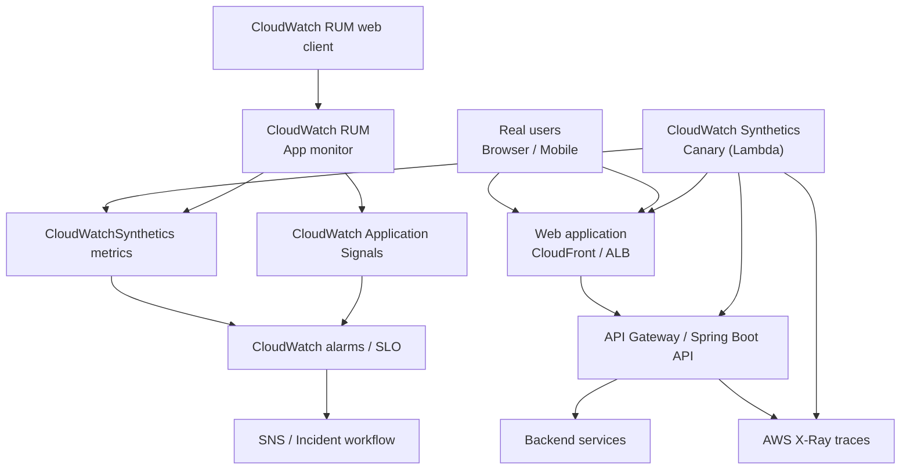

# CloudWatch Synthetics và giám sát trải nghiệm người dùng

**CloudWatch Synthetics** và **CloudWatch Real User Monitoring (RUM)** giúp quan sát ứng dụng từ hai góc nhìn bổ sung cho nhau. Synthetics chạy các kịch bản kiểm tra do đội phát triển định nghĩa theo lịch để xác minh website, API và hành trình nghiệp vụ vẫn hoạt động. RUM thu thập telemetry từ các phiên sử dụng thật để cho biết người dùng đang gặp độ trễ, lỗi JavaScript, lỗi HTTP hoặc vấn đề hiệu năng trên thiết bị và trình duyệt nào.

Synthetics trả lời câu hỏi: *Nếu một khách hàng mở trang và thực hiện hành động quan trọng ngay bây giờ, hệ thống có hoạt động không?* RUM trả lời câu hỏi: *Khách hàng thực tế đang trải nghiệm ứng dụng như thế nào?* Kết hợp hai nguồn dữ liệu giúp phát hiện sự cố trước khi có người dùng bị ảnh hưởng, đồng thời đo mức độ ảnh hưởng thực tế khi sự cố xảy ra.

Bài thuộc chương **Quan sát với CloudWatch** của mô-đun **CLOUD_PROVIDERS_AWS**. Nội dung kết nối CloudWatch Synthetics, CloudWatch RUM, Lambda, CloudWatch Logs/Metrics/Alarms, Application Signals, AWS X-Ray, Cognito, IAM, S3, VPC và ứng dụng Java/Spring Boot có giao diện web.

> **Nguyên tắc thiết kế:** Canary phải kiểm tra đúng hành trình quan trọng, chạy bằng danh tính và dữ liệu thử nghiệm có giới hạn. RUM phải thu thập đúng mức telemetry cần thiết, có kiểm soát sampling và quyền riêng tư. Mỗi cảnh báo cần gắn với hành động xử lý cụ thể.

## 1. Mục tiêu học tập

Sau bài học, bạn có thể:

1. Phân biệt synthetic monitoring với real user monitoring và hiểu vai trò của từng loại.
2. Giải thích CloudWatch Synthetics canary được thực thi bằng Lambda như thế nào.
3. Chọn blueprint, runtime và browser framework phù hợp cho canary.
4. Viết Node.js Playwright canary kiểm tra một hành trình web có ý nghĩa.
5. Kiểm tra API, endpoint, nội dung trang, điều hướng và thời gian phản hồi.
6. Lập lịch canary bằng rate/cron expression và chọn nhiều AWS Regions.
7. Đọc screenshots, HAR, logs, reports và artifacts của canary run.
8. Sử dụng các metric SuccessPercent, Duration, Failed, 4xx và 5xx.
9. Tạo CloudWatch alarms và SLO từ kết quả synthetic monitoring.
10. Chạy canary trong VPC để kiểm tra private endpoints.
11. Cấp IAM permissions và bảo vệ artifact/source code của canary.
12. Tích hợp CloudWatch RUM vào web application bằng JavaScript/TypeScript.
13. Cấu hình app monitor, telemetry, session sampling và authorization.
14. Hiểu các chỉ số trải nghiệm như page load, Web Vitals, JavaScript errors và HTTP failures.
15. Kết hợp RUM với X-Ray và Application Signals để truy vết request.
16. Thiết kế session replay, redaction và data retention có trách nhiệm.
17. Phân tích chi phí, troubleshooting và xây dựng quy trình giám sát liên tục.

## 2. Synthetic monitoring và real user monitoring

### 2.1. Synthetic monitoring

Synthetic monitoring sử dụng các script mô phỏng hành động của người dùng. Script chạy từ một hoặc nhiều vị trí theo lịch và kiểm tra kết quả mong đợi.

Ví dụ:

- Mở trang đăng nhập.
- Nhập thông tin của synthetic test account.
- Đăng nhập thành công.
- Mở trang danh sách đơn hàng.
- Kiểm tra một API trả dữ liệu đúng schema.
- Thêm một mặt hàng vào giỏ hàng trong môi trường kiểm thử.
- Kiểm tra trang thanh toán sandbox hiển thị đúng.

Một canary có thể chạy ngay cả khi ứng dụng không có traffic. Vì vậy, nó giúp phát hiện sự cố trước khi khách hàng truy cập.

### 2.2. Real user monitoring (RUM)

RUM thu thập telemetry từ trình duyệt hoặc thiết bị thật trong các phiên người dùng thực tế. Với web application, CloudWatch RUM có thể quan sát:

- Thời gian tải trang và tài nguyên.
- Core Web Vitals và các chỉ số hiệu năng trình duyệt.
- JavaScript errors.
- HTTP request failures.
- Page views, session và hành trình qua các trang nếu bật chức năng tương ứng.
- Browser, browser version, operating system, device và một số metadata vị trí.
- Session replay nếu bật plugin và cấu hình phù hợp.

RUM phản ánh sự đa dạng thật của mạng, thiết bị, browser extensions, vùng địa lý và dữ liệu người dùng.

### 2.3. So sánh hai cách tiếp cận

| Tiêu chí | CloudWatch Synthetics | CloudWatch RUM |
| --- | --- | --- |
| Dữ liệu đến từ | Script kiểm thử do đội phát triển kiểm soát | Phiên sử dụng thật đã được sampling |
| Thời điểm | Theo lịch, có thể chạy khi không có traffic | Khi người dùng thực sự sử dụng ứng dụng |
| Góc nhìn | Outside-in: kiểm tra từ endpoint/browser tới ứng dụng | Client-side: quan sát trải nghiệm trên thiết bị người dùng |
| Phát hiện | Availability, latency, hành trình nghiệp vụ bị hỏng | Lỗi frontend, page load chậm, HTTP errors và mức độ ảnh hưởng |
| Tính lặp lại | Cao nếu script và dữ liệu thử nghiệm ổn định | Phụ thuộc môi trường và hành vi thực tế |
| Vị trí | Một hoặc nhiều AWS Regions được chọn | Vị trí/thiết bị của phiên người dùng theo dữ liệu được thu thập |
| Khi không có traffic | Vẫn có thể phát hiện lỗi | Không có phiên mới để thu thập |
| Kết quả | Canary metrics, logs, screenshots, HAR và reports | RUM dashboard, events, Web Vitals, session data và replay |

Không dùng Synthetics thay cho RUM hoặc ngược lại. Một canary đăng nhập thành công từ một AWS Region không chứng minh tất cả khách hàng ở mọi quốc gia, browser và mạng đều có trải nghiệm tốt.

### 2.4. Kết hợp với CloudWatch Application Signals và X-Ray

Application Signals giúp theo dõi health, service level indicators (SLIs), service level objectives (SLOs) và quan hệ phụ thuộc giữa các services. X-Ray cung cấp trace để điều tra request qua các thành phần.

Khi bật tracing phù hợp:

- Canary có thể xuất hiện trên Application Map và được liên kết với service mà nó gọi.
- RUM có thể gửi trace headers cho các HTTP requests được chọn.
- X-Ray giúp theo dõi request từ frontend qua API Gateway/load balancer tới backend services.
- CloudWatch Logs/Metrics cung cấp bằng chứng bổ sung để xác định lỗi nằm ở browser, API, Lambda, EC2, database hay downstream service.

## 3. Kiến trúc giám sát trải nghiệm

Một kiến trúc web application có thể sử dụng đồng thời Synthetics và RUM:



Luồng dữ liệu:

1. Người dùng truy cập website; RUM web client thu thập telemetry theo cấu hình.
2. RUM gửi các events tới app monitor của CloudWatch.
3. Canary chạy từ Lambda, truy cập website/API và kiểm tra kết quả mong đợi.
4. Canary lưu logs, screenshots, HAR và run reports vào các vị trí artifacts được cấu hình.
5. Synthetics phát metrics vào namespace CloudWatchSynthetics.
6. CloudWatch alarms/SLO phát hiện success rate giảm, duration tăng hoặc lỗi tăng.
7. X-Ray/Application Signals giúp tìm service hoặc dependency gây ra vấn đề.
8. SNS hoặc incident integration chuyển cảnh báo tới đội vận hành.

CloudWatch Synthetics không phải load testing service. Không tăng tần suất hoặc số lượng canaries để tạo tải lớn lên production. Dùng công cụ load/performance testing riêng cho mục tiêu đó.

## 4. CloudWatch Synthetics canary là gì?

Canary là một script được CloudWatch Synthetics chạy theo lịch. Canary được triển khai dưới dạng Lambda function trong AWS account của bạn và sử dụng runtime/layer do Synthetics cung cấp.

Canary có thể kiểm tra:

- HTTP/HTTPS endpoint.
- REST API và response payload.
- Website content.
- Browser rendering và điều hướng.
- Hành trình nhiều bước như login, search hoặc checkout sandbox.
- Thay đổi bất thường của giao diện qua visual monitoring.
- Các vấn đề availability và latency từ nhiều vị trí.

### 4.1. Các thành phần của canary

| Thành phần | Vai trò |
| --- | --- |
| Canary | Định nghĩa script, schedule, runtime và cấu hình thực thi |
| Synthetics runtime | Wrapper và thư viện giúp chạy script |
| Lambda function | Execution environment của canary |
| Execution role | IAM role mà Lambda canary assume |
| Artifact S3 location | Lưu screenshots, HAR, logs và reports |
| Schedule | Quy định thời điểm chạy |
| Location | AWS Region nơi canary được thực thi |
| CloudWatch metrics | Success, duration, failed runs và request counts |
| CloudWatch alarms | Cảnh báo khi canary không đạt điều kiện |

### 4.2. Canary blueprint và custom script

CloudWatch cung cấp blueprint để bắt đầu nhanh. Các loại blueprint phổ biến gồm:

- Heartbeat: kiểm tra URL có phản hồi.
- API canary: gửi request và kiểm tra status/response.
- GUI workflow: mở browser và thực hiện nhiều thao tác.
- Broken link checker: kiểm tra liên kết trên website.
- Visual monitoring: so sánh screenshots với baseline.

Blueprint phù hợp để tạo bản kiểm tra đầu tiên. Khi cần xác minh nghiệp vụ, viết custom script để kiểm tra nội dung và hành vi cụ thể.

## 5. Chọn runtime và browser framework

CloudWatch Synthetics hỗ trợ script viết bằng Node.js, Python hoặc Java.

| Ngôn ngữ/runtime | Khả năng chính | Khi dùng |
| --- | --- | --- |
| Node.js + Playwright | Browser automation và kiểm tra UI | Web application hiện đại, SPA, nhiều bước |
| Node.js + Puppeteer | Browser automation dựa trên Chromium | Website cần kiểm tra qua Chrome/Chromium |
| Python + Selenium WebDriver | Browser automation | Đội kiểm thử dùng Python/Selenium |
| Java runtime | Kiểm tra service/API bằng code Java; không có browser framework tích hợp | Java developer muốn viết probe cho HTTP/service |

Một số lưu ý:

- Playwright và Puppeteer cho phép điều khiển headless browser.
- Selenium runtime của Synthetics chỉ hỗ trợ Chrome.
- Java runtime phù hợp kiểm tra HTTP/service nhưng không tích hợp browser framework.
- Runtime versions được AWS cập nhật theo thời gian. Chọn runtime còn được hỗ trợ và ưu tiên runtime mới đã được kiểm thử.
- Không giả định mọi runtime version có cùng thư viện, namespace hoặc API.
- Khi nâng runtime, kiểm tra lại imports, handler name, browser configuration và local tests.

### 5.1. Runtime version

Runtime Synthetics là tổ hợp của code gọi handler và Lambda layers chứa dependencies. Tên runtime thường biểu thị ngôn ngữ/framework và version.

Khi nâng runtime:

1. Đọc release notes và runtime support policy.
2. Kiểm tra thay đổi namespace/module imports.
3. Chạy script trên môi trường local theo hướng dẫn AWS.
4. Tạo canary clone hoặc canary thử nghiệm.
5. Kiểm tra screenshots, HAR, metrics và artifacts.
6. Chỉ cập nhật canary production sau khi xác minh.

Không hard-code một runtime version cũ trong tài liệu vận hành dài hạn. Hãy chọn version đang được hỗ trợ tại thời điểm triển khai.

## 6. Viết UI canary bằng Node.js và Playwright

Ví dụ dưới đây kiểm tra trang chủ của một ứng dụng Orders. Script xác minh response, heading và đường dẫn tới trang đăng nhập.

File **orders-canary.mjs**:

```javascript
import { synthetics } from '@aws/synthetics-playwright';

export const handler = async () => {
  try {
    const browser = await synthetics.launch();
    const page = await synthetics.newPage(browser);

    const baseUrl = process.env.BASE_URL;
    if (!baseUrl || !baseUrl.startsWith('https://')) {
      throw new Error('BASE_URL must be configured with HTTPS');
    }

    const response = await page.goto(baseUrl, {
      waitUntil: 'domcontentloaded',
      timeout: 30000
    });

    if (!response) {
      throw new Error('The browser did not receive a page response');
    }

    if (response.status() < 200 || response.status() >= 400) {
      throw new Error('Unexpected home page status: ' + response.status());
    }

    const heading = page.getByRole('heading', {
      name: 'Orders Portal'
    });

    if (await heading.count() === 0) {
      throw new Error('Orders Portal heading was not found');
    }

    const signInLink = page.getByRole('link', {
      name: 'Sign in'
    });

    if (await signInLink.count() === 0) {
      throw new Error('Sign in link was not found');
    }

    await signInLink.click();
    await page.waitForURL('**/login', { timeout: 10000 });

    const loginHeading = page.getByRole('heading', {
      name: 'Sign in to Orders'
    });

    if (await loginHeading.count() === 0) {
      throw new Error('Login page did not render the expected heading');
    }

    await page.screenshot({
      path: '/tmp/orders-login.png',
      fullPage: true
    });
  } finally {
    await synthetics.close();
  }
};
```

Đặt handler của canary theo tên file và function, ví dụ **orders-canary.handler**. Chọn Node.js Playwright runtime tương thích với package import trong script.

### 6.1. Vì sao script kiểm tra nhiều hơn HTTP 200?

Một website có thể trả HTTP 200 nhưng vẫn không sử dụng được:

- JavaScript bundle bị lỗi.
- API backend trả lỗi.
- Trang render thiếu dữ liệu.
- Login link biến mất.
- Route chuyển sai.
- UI hiển thị thông báo lỗi nhưng server vẫn trả 200.

Vì vậy, UI canary cần xác minh các phần tử hoặc trạng thái đại diện cho hành trình người dùng.

### 6.2. Không phụ thuộc selector dễ vỡ

Ưu tiên selector theo accessibility:

- getByRole.
- getByLabel.
- getByText khi nội dung ổn định.
- data-testid dành riêng cho kiểm thử.

Hạn chế selector phụ thuộc CSS class sinh tự động, vị trí DOM sâu hoặc thứ tự phần tử không ổn định. Nếu giao diện thay đổi, canary nên thất bại vì thay đổi nghiệp vụ có ý nghĩa, không phải vì một class CSS vô tình đổi tên.

### 6.3. Tạo synthetic test account

Nếu canary cần đăng nhập:

- Tạo account chuyên dụng cho monitoring.
- Không dùng tài khoản cá nhân của developer.
- Chỉ cấp quyền nghiệp vụ tối thiểu.
- Đặt password/secret trong Secrets Manager hoặc môi trường được mã hóa.
- Không ghi password, token, cookie hoặc authorization header vào logs.
- Có quy trình rotate secret và xác minh canary sau rotation.
- Tránh các thao tác tạo giao dịch thật hoặc gửi email/SMS cho khách hàng.

Với production, tạo dữ liệu synthetic có thể nhận diện, idempotent và có cơ chế cleanup. Với payment, dùng sandbox/test gateway hoặc luồng kiểm thử không phát sinh giao dịch tài chính thật.

## 7. API canary và kiểm tra response

Nếu mục tiêu là kiểm tra API, không cần khởi chạy browser. Có thể dùng Node.js runtime không browser hoặc blueprint API phù hợp.

Ví dụ logic kiểm tra API:

```javascript
export const handler = async () => {
  const endpoint = process.env.HEALTH_API_URL;

  if (!endpoint || !endpoint.startsWith('https://')) {
    throw new Error('HEALTH_API_URL must use HTTPS');
  }

  const response = await fetch(endpoint, {
    method: 'GET',
    headers: {
      accept: 'application/json'
    },
    signal: AbortSignal.timeout(10000)
  });

  if (!response.ok) {
    throw new Error('API returned HTTP ' + response.status);
  }

  const payload = await response.json();

  if (payload.status !== 'UP') {
    throw new Error('API health status is not UP');
  }
};
```

Ví dụ này minh họa kiểm tra endpoint health. Khi chọn runtime Synthetics thực tế, kiểm tra phiên bản Node.js và các API được hỗ trợ. Có thể dùng Synthetics library functions như executeHttpStep để nhận step-level metrics và reports.

### 7.1. Kiểm tra contract, không chỉ status code

API canary nên kiểm tra:

- Status code mong đợi.
- Content-Type.
- Schema/field bắt buộc.
- Giá trị nghiệp vụ an toàn để kiểm tra.
- Latency hoặc timeout.
- Authentication/authorization nếu endpoint yêu cầu.
- Correlation/request ID để tra log khi thất bại.

Không dùng response body chứa dữ liệu cá nhân hoặc bí mật làm log mặc định.

### 7.2. Chọn endpoint health phù hợp

Health endpoint thường có nhiều mức:

| Endpoint | Ý nghĩa | Dùng cho |
| --- | --- | --- |
| Liveness | Process còn sống | Phát hiện process chết |
| Readiness | Instance đã sẵn sàng phục vụ | Load balancer/orchestrator |
| Dependency health | Database/queue/downstream có hoạt động | Kiểm tra dependency quan trọng |
| Business synthetic journey | Luồng nghiệp vụ người dùng hoạt động | Canary end-to-end |

Một endpoint chỉ trả "UP" không chứng minh checkout, search hoặc login hoạt động. Dùng canary hành trình nghiệp vụ cho các luồng quan trọng.

## 8. Steps và kết quả từng bước

Một canary nhiều bước nên đặt tên step rõ ràng:

1. OpenHomePage.
2. OpenSignIn.
3. AuthenticateSyntheticUser.
4. OpenOrders.
5. VerifyOrderSummary.

Nếu dùng hàm step của Synthetics library, CloudWatch có thể phát metrics theo dimension **StepName** như SuccessPercent và Duration. Điều này giúp xác định chính xác bước nào bị lỗi hoặc chậm.

Không gom cả hành trình vào một step lớn nếu cần biết vị trí sự cố. Cũng không chia thành quá nhiều steps nhỏ khiến dashboard và chi phí metrics khó quản lý.

### 8.1. Retry có kiểm soát

Một retry có thể giúp vượt qua lỗi transient, nhưng retry không nên che lỗi thật:

- Chỉ retry lỗi có khả năng tạm thời.
- Giới hạn số lần và tổng thời gian.
- Không retry thao tác ghi gây side effect nếu không idempotent.
- Theo dõi cả SuccessPercent trước retry và SuccessPercentWithRetries nếu runtime phát metric này.
- Không xem một lần retry thành công là ứng dụng hoàn toàn khỏe mạnh nếu tỷ lệ retry tăng liên tục.

## 9. Lập lịch và chạy từ nhiều vị trí

Canary có thể chạy một lần hoặc theo lịch. CloudWatch Synthetics hỗ trợ rate và cron expressions, với tần suất có thể tới một lần mỗi phút.

Ví dụ:

```text
rate(5 minutes)
rate(1 minute)
cron(0/15 * * * ? *)
```

- rate(5 minutes): chạy mỗi 5 phút.
- rate(1 minute): chạy mỗi phút.
- cron: chạy theo lịch cron của CloudWatch.

### 9.1. Chọn tần suất

Chọn frequency dựa trên:

- Mức quan trọng của journey.
- Thời gian phát hiện sự cố mong muốn.
- Độ dài mỗi canary run.
- Tải bổ sung lên endpoint.
- Số locations và browsers.
- Chi phí Lambda execution, artifacts, metrics và logs.

Một website thương mại điện tử có thể dùng canary ngắn mỗi vài phút cho trang chủ/API health, và một journey đăng nhập/đơn hàng ít thường xuyên hơn. Không nhất thiết mọi canary đều chạy mỗi phút.

### 9.2. Multi-location canaries

Có thể cấu hình canary chạy từ nhiều AWS Regions để quan sát latency và availability theo vị trí nguồn.

Ví dụ:

- ap-southeast-1: kiểm tra từ Singapore.
- ap-northeast-1: kiểm tra từ Tokyo.
- eu-west-1: kiểm tra từ Ireland.
- us-east-1: kiểm tra từ Virginia.

Chọn Regions gần nhóm khách hàng hoặc đường mạng cần theo dõi. Các vị trí AWS không đại diện hoàn toàn cho mọi ISP, thiết bị hoặc mạng di động của người dùng.

Metric SuccessPercent và Duration có thể có dimension Location. Dùng dimension này để so sánh kết quả giữa các vùng.

### 9.3. Timeout

Timeout của canary phải đủ cho Lambda cold start, browser initialization và hành trình kiểm tra. Tài liệu AWS khuyến nghị không đặt timeout thấp hơn 15 giây. Một journey nhiều bước thường cần timeout dài hơn.

Đặt timeout tổng và timeout riêng cho navigation/action hợp lý. Nếu một step bị treo, script phải kết thúc với lỗi rõ ràng thay vì chạy vô hạn.

## 10. Canary artifacts: logs, screenshots, HAR và reports

Sau mỗi run, Synthetics có thể cung cấp các artifacts giúp điều tra:

- Logs: thông tin thực thi và exception.
- Screenshots: trạng thái UI tại các thời điểm được chụp.
- HTTP Archive (HAR): request/response metadata của browser.
- Step reports: kết quả và thời gian từng bước.
- Runtime/report artifacts: dữ liệu hỗ trợ debug.

Artifacts được lưu trong Amazon S3 location của canary. Canary cũng tạo log group trong CloudWatch Logs.

### 10.1. Đọc HAR

HAR giúp tìm:

- Request nào bị timeout.
- HTTP status 4xx/5xx.
- DNS/TLS/connect timing.
- Request tới domain bên thứ ba bị lỗi.
- Tài nguyên JavaScript/CSS/image tải chậm.
- API call thất bại sau khi UI render.

HAR có thể chứa URL, headers và dữ liệu request/response nếu bật capture tương ứng. Bảo vệ quyền truy cập và bật redaction cho trường nhạy cảm.

### 10.2. So sánh run thành công và thất bại

Khi canary fail:

1. Mở run thất bại.
2. Xem step report để tìm step đầu tiên lỗi.
3. Mở screenshot để xem UI tại thời điểm lỗi.
4. Kiểm tra HAR để xác định request hỏng/chậm.
5. Đọc CloudWatch Logs theo run timestamp.
6. So sánh với run thành công gần nhất.
7. Liên kết request với X-Ray trace hoặc backend logs nếu có.

### 10.3. Artifact retention

Canary có cấu hình retention cho artifacts thành công và thất bại. Chọn retention theo nhu cầu điều tra, compliance và chi phí S3. Có thể dùng lifecycle policy trên bucket artifact theo chính sách được hỗ trợ, nhưng không làm mất dữ liệu mà đội vận hành cần để phân tích sự cố.

## 11. Metrics của CloudWatch Synthetics

Canary phát metrics vào namespace **CloudWatchSynthetics**.

| Metric | Ý nghĩa | Cách sử dụng |
| --- | --- | --- |
| SuccessPercent | Phần trăm canary runs thành công | Availability synthetic |
| Duration | Thời gian hoàn thành run, milliseconds | Synthetic latency |
| Failed | Số run thất bại | Phát hiện canary fail |
| Failed requests | Số HTTP requests không nhận được response | Phát hiện request-level failures |
| 2xx | Số request trả status 2xx | Theo dõi successful requests |
| 4xx | Số request trả status 4xx | Phát hiện auth/client errors |
| 5xx | Số request trả status 5xx | Phát hiện server errors |
| RetryCount | Số lần retry | Theo dõi transient failures |
| VisualMonitoringSuccessPercent | Tỷ lệ visual comparisons khớp baseline | Theo dõi thay đổi UI |
| VisualMonitoringTotalComparisons | Số lần so sánh hình ảnh | Đánh giá visual test activity |

Metrics có dimension CanaryName; tùy loại canary/runtime, metrics có thể có thêm Browser, Location hoặc StepName. Kiểm tra dimension thực tế khi tạo alarm.

### 11.1. Phân biệt Failed và SuccessPercent

- Failed đếm số lần canary execution thất bại.
- SuccessPercent thể hiện tỷ lệ run thành công.
- Failed requests phản ánh request trong browser/API không nhận response.
- 4xx/5xx phản ánh HTTP status class.

Một canary có thể fail do script exception hoặc assertion, kể cả khi tất cả requests đều trả 2xx. Ngược lại, một run có thể chứa một request 4xx không quan trọng nếu script được thiết kế để chấp nhận nó. Hãy đọc run report thay vì chỉ nhìn một metric.

### 11.2. Alarm mẫu

Ví dụ logic cảnh báo:

- SuccessPercent nhỏ hơn 100% trong 2 datapoints liên tiếp.
- Duration vượt ngưỡng latency đã thống nhất.
- Failed lớn hơn 0 trong một cửa sổ đánh giá.
- 5xx tăng so với baseline.
- VisualMonitoringSuccessPercent giảm sau release.

Các ngưỡng chỉ là ví dụ. Chọn period, evaluation periods, datapoints-to-alarm và missing data treatment theo tần suất canary. Nếu canary chạy mỗi 10 phút, alarm period 1 phút có thể không có datapoint ở phần lớn thời gian.

## 12. SLO cho canary

CloudWatch Service Level Objectives có thể dùng Synthetics canary làm nguồn SLI. Các metric có thể chọn gồm **SuccessPercent** hoặc **Duration**.

Ví dụ:

| SLO | SLI | Điều kiện thành công minh họa |
| --- | --- | --- |
| Availability trang Orders | SuccessPercent | Run thành công trong cửa sổ đánh giá |
| Latency trang chủ | Duration | Run hoàn thành dưới ngưỡng đã chọn |
| Checkout sandbox | SuccessPercent | Tất cả bước bắt buộc hoàn tất |

Với canary SLO, mỗi lần chạy là một evaluation period. Điều này khác với SLI dựa trên request volume thực tế. Nếu canary chạy mỗi 5 phút, mỗi run đóng góp một điểm đánh giá; một sự cố kéo dài 5 phút có thể làm một hoặc nhiều runs thất bại tùy thời điểm.

### 12.1. Error budget

Nếu mục tiêu SLO là 99.9% success, số lần run lỗi cho phép phụ thuộc tổng số evaluation periods trong cửa sổ. Dùng error budget để quyết định:

- Có thể tiếp tục release không.
- Có cần dừng rollout và xử lý reliability debt không.
- Có cần tăng coverage hoặc thêm location/browser không.

Canary SLO chỉ phản ánh hành trình và vị trí mà script kiểm tra. Nó không đại diện cho toàn bộ mọi request hoặc mọi khách hàng.

## 13. Chạy canary trong VPC

Canary có thể truy cập endpoint private trong VPC bằng cách cấu hình VPC settings cho Lambda canary.

Các trường hợp sử dụng:

- Internal API.
- Private ALB.
- Service chỉ có private DNS.
- Ứng dụng trong isolated/private subnet.
- Endpoint nội bộ không public ra Internet.

### 13.1. Điều kiện VPC

- Bật DNS resolution và DNS hostnames trên VPC.
- Chọn subnet phù hợp và security group cho canary.
- Cho phép canary kết nối tới endpoint/port cần kiểm tra.
- Kiểm tra route tables, NACL và private DNS.
- Đảm bảo canary vẫn có đường gửi metrics tới CloudWatch và artifacts tới S3.

### 13.2. Private canary không tự động có đường ra AWS services

Nếu VPC không có Internet egress, cần cấu hình private VPC endpoints phù hợp để gửi metrics và artifacts:

- CloudWatch Monitoring endpoint cho metrics.
- CloudWatch Logs endpoint nếu cần gửi logs qua private path.
- S3 gateway endpoint cho artifact bucket.
- Các endpoints khác theo service/API mà script gọi.

Nếu cần truy cập public website hoặc third-party API từ private subnet, phải thiết kế egress qua NAT/proxy phù hợp. VPC endpoint không thay thế đường Internet tới mọi hostname.

### 13.3. Security Group

Security Group của canary cần egress tới port của target. Security Group của private ALB/service cần ingress từ canary security group hoặc network range được thiết kế.

Không mở private endpoint ra 0.0.0.0/0 chỉ để canary kết nối. Dùng security group reference, route và endpoint policies có giới hạn.

## 14. IAM và bảo mật cho Synthetics

### 14.1. Execution role của canary

Canary chạy trong Lambda nên cần execution role. Role có thể cần:

- Ghi CloudWatch Logs.
- Publish CloudWatch metrics.
- Ghi artifacts vào S3.
- Đọc source code/configuration từ S3 nếu được import.
- Gọi Secrets Manager/SSM nếu script lấy secret runtime.
- KMS permissions nếu dùng customer-managed key.
- Quyền ENI cần thiết nếu Lambda canary được gắn vào VPC.
- X-Ray permissions nếu bật active tracing.

Chỉ cấp các actions thực sự cần và giới hạn Resource ARN. Không dùng AdministratorAccess cho canary role.

### 14.2. Quyền của người tạo canary

Người tạo/cập nhật canary cần quyền quản lý Synthetics resources và có thể cần quyền tạo IAM role hoặc pass role. Các quyền tạo IAM role/policy có thể rất nhạy cảm vì chúng cho phép tạo identity mới. Tách nhiệm vụ IAM provisioning khỏi quyền author script nếu tổ chức yêu cầu.

### 14.3. Chỉ kiểm tra endpoint thuộc quyền quản lý

Chỉ trỏ canary tới website/API mà tổ chức sở hữu hoặc có quyền kiểm tra. Browser canary tải và thực thi nội dung trang; website không tin cậy có thể cố khai thác browser/runtime hoặc lạm dụng credentials của canary.

Dùng IAM execution role ít quyền để giới hạn tác động nếu script/browser bị compromise.

### 14.4. Secrets và source code

- Không hard-code password, access key, token hoặc database credential trong script.
- Không đưa secret vào URL query string.
- Nếu source code chứa thông tin nhạy cảm, lưu script trong S3 versioned object và tham chiếu đúng object version.
- Lưu credentials trong Secrets Manager/SSM SecureString.
- Giới hạn quyền đọc source bucket và artifact bucket.
- Canary name không nên tiết lộ tên khách hàng, project bí mật hoặc thông tin nội bộ.

AWS lưu ý rằng khi upload source code bằng ZIP trực tiếp, nội dung script có thể xuất hiện trong CloudTrail logs. Vì vậy, không nhúng secrets vào script package.

### 14.5. Mã hóa artifacts

Artifacts Synthetics được lưu trong S3 và mặc định được mã hóa bằng AWS-managed key. Có thể chọn SSE-S3 hoặc SSE-KMS customer-managed key.

Với customer-managed key:

- Canary execution role cần quyền `kms:GenerateDataKey` để mã hóa artifacts.
- Nếu dùng visual monitoring, role có thể cần `kms:Decrypt` để đọc baseline artifacts.
- Key policy phải cho phép role sử dụng key.
- Người xem artifacts cũng cần quyền decrypt phù hợp.
- Cross-account key cần policy và grants tương ứng.

Ví dụ policy tối thiểu cho một canary dùng customer-managed key:

```json
{
  "Version": "2012-10-17",
  "Statement": [
    {
      "Effect": "Allow",
      "Action": [
        "kms:GenerateDataKey",
        "kms:Decrypt"
      ],
      "Resource": "arn:aws:kms:ap-southeast-1:123456789012:key/KEY_ID"
    }
  ]
}
```

Giới hạn quyền theo key ARN thực tế và chỉ cấp Decrypt nếu canary cần đọc artifacts/baseline đã mã hóa.

## 15. Bảo vệ dữ liệu trong canary

Synthetics có thể ghi URLs, status, exception, stack trace và thông tin request vào logs/reports. Một số cấu hình có thể thu thập headers, request/response body hoặc HAR.

Thiết kế bảo vệ dữ liệu:

- Dùng HTTPS.
- Không truyền password/token trong URL.
- Không log request/response body nếu không cần.
- Không bật capture tất cả headers một cách mặc định.
- Redact Authorization, cookie và query parameters nhạy cảm.
- Dùng Synthetics configuration để giới hạn restrictedHeaders/restrictedUrlParameters.
- Dùng hàm sanitize URL/error message trước khi ghi log.
- Không đưa PII vào exception text.
- Giới hạn quyền đọc artifacts và logs.
- Chọn retention phù hợp.

Canary source và artifacts đều là dữ liệu cần bảo vệ. Người có quyền đọc source có thể thấy cách kiểm thử; người có quyền đọc artifacts có thể thấy endpoint, request metadata và ảnh giao diện.

## 16. CloudWatch RUM là gì?

CloudWatch RUM thu thập và hiển thị dữ liệu từ các phiên sử dụng thật của web và mobile applications.

Với web application, RUM web client là JavaScript library được nhúng vào ứng dụng. Nó ghi nhận events ở phía browser và gửi tới CloudWatch RUM app monitor.

RUM giúp trả lời:

- Trang nào tải chậm?
- Browser/device nào có tỷ lệ lỗi cao?
- JavaScript error nào đang ảnh hưởng nhiều phiên?
- HTTP request nào thường xuyên thất bại?
- Core Web Vitals đang thay đổi ra sao?
- Phiên người dùng đi qua các trang theo trình tự nào nếu session cookies được bật?
- Có thể xem session replay để hiểu một lỗi UI xảy ra trong bối cảnh nào không?

CloudWatch RUM cũng hỗ trợ mobile app monitoring. Với mobile, các loại dữ liệu có thể bao gồm screen load, app launch, network errors, crashes, Android ANR và iOS app hangs. Bài thực hành tập trung vào web client.

## 17. Tạo CloudWatch RUM app monitor

App monitor đại diện cho web application được theo dõi.

Quy trình trong CloudWatch Console:

1. Mở CloudWatch.
2. Trong navigation, chọn Application Signals rồi chọn RUM.
3. Chọn Add app monitor.
4. Đặt tên app monitor.
5. Chọn platform Web.
6. Khai báo domain của ứng dụng.
7. Chọn telemetry cần thu thập.
8. Cấu hình session sampling.
9. Quyết định có bật cookies hay không.
10. Chọn authorization method.
11. Có thể bật X-Ray active tracing.
12. Tạo app monitor và lấy code snippet do Console sinh ra.

### 17.1. Domain allowlist

Chỉ khai báo domain mà tổ chức có quyền quản lý. RUM app monitor dùng domain list để xác định trang nào được phép gửi telemetry.

Ví dụ:

```text
app.example.com
www.example.com
staging.example.com
```

Có thể dùng wildcard khi cần theo dõi subdomains, nhưng wildcard quá rộng có thể cho phép các host ngoài phạm vi mong muốn gửi dữ liệu vào app monitor.

### 17.2. Chọn telemetry

Các nhóm telemetry phổ biến:

| Telemetry | Dữ liệu |
| --- | --- |
| performance | Page/resource load timing và Web Vitals |
| errors | JavaScript errors |
| http | HTTP request/error telemetry |
| replay | Session replay khi plugin/configuration được bật |

Chọn telemetry theo câu hỏi cần trả lời. Bật thêm telemetry tạo nhiều events hơn và có thể làm tăng chi phí.

### 17.3. Session sampling

Session sample rate là tỷ lệ phiên được thu thập. Giá trị nằm trong khoảng 0 đến 1:

- 1.0: thu thập tất cả phiên.
- 0.5: thu thập khoảng một nửa số phiên.
- 0.1: thu thập khoảng 10% số phiên.
- 0: tắt thu thập session telemetry.

Sampling được quyết định theo session. Khi cần kiểm tra cấu hình ban đầu, có thể tạm tăng sampling trong môi trường thử nghiệm. Production nên chọn mức cân bằng giữa coverage, chi phí và privacy.

## 18. Cài CloudWatch RUM web client bằng NPM

AWS khuyến nghị dùng NPM package để tích hợp RUM web client vào JavaScript/TypeScript application. CDN có thể bị ad blockers chặn, nên phù hợp hơn cho onboarding ban đầu hoặc trường hợp có chiến lược phân phối script riêng.

Cài package:

```bash
npm install --save aws-rum-web
```

Ví dụ TypeScript:

```typescript
import { AwsRum, AwsRumConfig } from 'aws-rum-web';

const APP_MONITOR_ID = 'REPLACE_WITH_APP_MONITOR_ID';
const APP_VERSION = '1.4.2';
const AWS_REGION = 'ap-southeast-1';

const config: AwsRumConfig = {
  allowCookies: false,
  endpoint: 'https://dataplane.rum.ap-southeast-1.amazonaws.com',
  identityPoolId: 'ap-southeast-1:REPLACE_WITH_IDENTITY_POOL_ID',
  sessionSampleRate: 0.1,
  telemetries: ['errors', 'performance', 'http']
};

try {
  const awsRum = new AwsRum(
    APP_MONITOR_ID,
    APP_VERSION,
    AWS_REGION,
    config
  );
} catch (error) {
  // Do not interrupt the application if telemetry initialization fails.
  // Avoid logging user data or secrets here.
}
```

Các giá trị ID, Region, endpoint và identity pool phải khớp app monitor được tạo trong CloudWatch. Có thể lấy code snippet chính xác từ app monitor để tránh sai cấu hình.

### 18.1. Khởi tạo sớm

Khởi tạo web client sớm trong lifecycle để ghi nhận navigation/page load từ đầu. Với single-page application, kiểm tra route changes để bảo đảm page views và timing phản ánh các lần điều hướng client-side.

### 18.2. Không để telemetry làm hỏng trải nghiệm

Telemetry là thành phần phụ trợ. Nếu RUM initialization hoặc gửi events thất bại, ứng dụng vẫn phải tiếp tục phục vụ người dùng. Không để exception của monitoring chặn rendering hoặc navigation.

## 19. Authorization cho CloudWatch RUM

Web browser không nên chứa AWS access key cố định. CloudWatch RUM hỗ trợ nhiều cách authorize việc gửi events.

### 19.1. Cognito identity pool

Cách đơn giản là tạo Cognito identity pool cho app monitor. Identity pool có unauthenticated identity để browser nhận temporary credentials với quyền gửi RUM events.

Identity pool phải ở cùng AWS Region với RUM app monitor. Role gắn với unauthenticated identity chỉ nên có quyền gửi telemetry tới đúng app monitor.

IAM role gắn với identity pool chỉ nên có quyền:

```json
{
  "Version": "2012-10-17",
  "Statement": [
    {
      "Effect": "Allow",
      "Action": [
        "rum:PutRumEvents"
      ],
      "Resource": "arn:aws:rum:ap-southeast-1:123456789012:appmonitor/orders-web"
    }
  ]
}
```

Resource ARN phải là app monitor thực tế. Không cấp quyền đọc CloudWatch metrics, S3, Lambda hoặc các AWS services khác cho unauthenticated browser role.

### 19.2. Identity provider hiện có

Nếu ứng dụng đã có authentication provider, có thể dùng identity provider/Cognito federation để cấp credentials phù hợp cho RUM web client.

Ứng dụng phải chuyển credentials tới client sau khi người dùng được xác thực theo luồng đã thiết kế. Không gửi access key dài hạn hoặc secret key tới browser.

### 19.3. Resource-based policy

App monitor có thể dùng resource-based policy cho phép gửi PutRumEvents mà không cần AWS credentials.

Nếu bật public policy:

- Bất kỳ client nào có thể gửi events theo quyền policy.
- Dữ liệu giả hoặc event spam có thể làm nhiễu dashboard.
- Lưu lượng không mong muốn có thể làm tăng chi phí.
- Cần giới hạn policy và giám sát volume.

Không chọn public policy chỉ để bỏ qua cấu hình authorization nếu chưa đánh giá tác động.

## 20. CloudWatch RUM thu thập dữ liệu gì?

### 20.1. Page performance

RUM thu thập timing về page load và resource load. Những chỉ số hữu ích gồm:

- Navigation timing.
- Resource loading time.
- Page view và route.
- Core Web Vitals theo browser/runtime hỗ trợ.

### 20.2. Core Web Vitals

| Chỉ số | Ý nghĩa | Câu hỏi vận hành |
| --- | --- | --- |
| LCP — Largest Contentful Paint | Thời gian phần nội dung lớn nhất xuất hiện | Nội dung chính có hiển thị nhanh không? |
| CLS — Cumulative Layout Shift | Mức độ dịch chuyển bố cục không mong muốn | Trang có nhảy layout khi tải không? |
| INP — Interaction to Next Paint | Độ trễ phản hồi sau tương tác | Click/nhập liệu có phản hồi nhanh không? |
| FID — First Input Delay | Độ trễ đầu vào đầu tiên, chỉ số lịch sử/legacy trong một số hệ thống | Browser có bị bận khi người dùng tương tác lần đầu không? |

Core Web Vitals có thể khác nhau theo browser và phiên bản web client. Đọc định nghĩa và support hiện hành trước khi đặt SLO.

### 20.3. JavaScript errors

RUM có thể thu thập unhandled JavaScript errors, stack traces và thông tin liên quan. Dùng dữ liệu này để xác định:

- Error nào tăng sau release.
- Browser/version nào bị ảnh hưởng.
- Trang nào có lỗi.
- Error có liên quan tới source map hay không.
- Có thể liên kết lỗi frontend với API trace không.

Nếu muốn unminify stack traces, upload source maps vào S3 và cấu hình app monitor. Source maps có thể tiết lộ source code; giới hạn quyền đọc bucket và không công khai source maps nếu không có chủ đích.

### 20.4. HTTP telemetry

HTTP telemetry giúp quan sát request từ browser:

- Endpoint nào trả lỗi.
- Request nào có latency cao.
- Response status code.
- Browser/client context.
- Correlation/tracing data nếu cấu hình.

RUM không thay thế backend access logs hoặc service metrics. Dùng nó để biết request lỗi trong bối cảnh phiên người dùng; sau đó truy vết backend bằng X-Ray/CloudWatch.

## 21. Session và session replay

### 21.1. Session cookies

Nếu bật cookies, RUM web client có thể tạo user ID và session ID ngẫu nhiên để tổng hợp:

- Unique users.
- Số sessions.
- Sessions có lỗi.
- Hành trình qua các pages trong một session.

Nếu không bật cookies, RUM vẫn có thể cung cấp insight tổng hợp theo browser, OS, device, page view và Web Vitals, nhưng khả năng nối chuỗi hành trình theo user/session bị giới hạn.

Cookies và các công nghệ tương tự phải được đánh giá theo quy định quyền riêng tư áp dụng cho người dùng.

### 21.2. Session replay

Session replay có thể ghi lại chuỗi tương tác và trạng thái giao diện để giúp đội phát triển hiểu người dùng đã trải nghiệm điều gì.

RUM hỗ trợ session replay thông qua RRWeb plugin. Nội dung text input và text hiển thị trên trang được mask mặc định trong replay để giảm rủi ro ghi nhận PII.

Dù có masking mặc định, vẫn phải:

- Kiểm tra dữ liệu nào được ghi trong replay.
- Không render secret/token vào DOM nếu có thể tránh.
- Không gửi dữ liệu cá nhân vào custom metadata.
- Kiểm soát replay sampling.
- Giới hạn quyền truy cập replay.
- Đánh giá consent/legal basis trước khi bật.
- Kiểm tra các vùng UI chứa dữ liệu nhạy cảm trong môi trường thực tế.

### 21.3. Khi nào nên bật replay?

Bật replay khi đội hỗ trợ cần hiểu lỗi tương tác khó tái hiện, ví dụ:

- Người dùng không thể hoàn thành checkout.
- Modal bị che bởi thành phần khác.
- Navigation không hoạt động trên một browser cụ thể.
- Form validation không hiển thị.
- Một thao tác bị chặn bởi layout hoặc event handler.

Không bật replay chỉ để thu thập càng nhiều dữ liệu càng tốt. Bắt đầu với sampling thấp và tăng khi có mục tiêu điều tra rõ ràng.

## 22. Kết hợp RUM với X-Ray và Application Signals

RUM cung cấp bối cảnh phía client. X-Ray cung cấp trace phía service. Khi tích hợp đúng, có thể nối hai góc nhìn.

Luồng ví dụ:

1. Browser tạo HTTP request tới API.
2. RUM web client được cấu hình để gửi trace header cho request được chọn.
3. API Gateway/load balancer chuyển request tới backend.
4. Backend instrumentation ghi X-Ray trace/segment.
5. CloudWatch hiển thị trace liên quan và service dependencies.
6. Đội vận hành đối chiếu client latency với backend latency.

### 22.1. Cần cấu hình end-to-end tracing

Chỉ bật RUM active tracing chưa chắc mọi downstream request tự động có trace liên kết đầy đủ. Cần:

- Bật active tracing trong app monitor.
- Cấu hình RUM web client cho trace headers theo hướng dẫn.
- Cho phép CORS với các headers cần thiết.
- Cấu hình backend tracing.
- Kiểm tra trace propagation qua API Gateway/load balancer và service.
- Kiểm tra các requests có được sampling hay không.

Không mở CORS quá rộng chỉ để tracing hoạt động. Chỉ cho phép origin và headers cần thiết.

### 22.2. Phân tích latency

Tổng thời gian người dùng cảm nhận có thể gồm:

- DNS lookup và TLS.
- Tải HTML/JS/CSS/images.
- Browser rendering.
- Frontend computation.
- Network round trips.
- API Gateway/ALB.
- Spring Boot service processing.
- Database/cache/downstream calls.

RUM cho biết client-side duration; X-Ray giúp tìm backend segments chậm. Không kết luận backend là nguyên nhân chỉ từ page load duration.

## 23. Dashboard, alarm và hành động vận hành

### 23.1. Dashboard Synthetics

Nên có các widget:

- SuccessPercent theo canary.
- Duration theo canary và Location.
- Failed runs.
- 4xx/5xx request counts.
- VisualMonitoringSuccessPercent nếu dùng visual checks.
- Run history và link tới artifacts.

### 23.2. Dashboard RUM

Nên theo dõi:

- Page load performance.
- Core Web Vitals.
- JavaScript errors.
- HTTP errors.
- Browser/device breakdown.
- Sessions with errors.
- Page groups và route breakdown.
- Session replay khi được bật và có quyền.

### 23.3. Alarm design

Một số cảnh báo có thể triển khai:

| Điều kiện | Ý nghĩa | Hành động gợi ý |
| --- | --- | --- |
| Canary SuccessPercent giảm | Synthetic journey không hoàn thành | Mở run artifacts, xác định step lỗi |
| Canary Duration tăng | Journey chậm | Kiểm tra network, browser và backend traces |
| Canary Failed > 0 | Canary execution/assertion thất bại | Kiểm tra runtime, IAM, endpoint và script |
| RUM JavaScript errors tăng | Frontend release hoặc browser issue | So sánh version/browser và stack traces |
| RUM HTTP failures tăng | API/network failures từ client | Truy X-Ray/backend logs |
| LCP/INP xấu đi | Trải nghiệm tải hoặc tương tác suy giảm | Phân tích page/resource và frontend code |
| Một Location canary thất bại | Vấn đề theo vùng/network | Kiểm tra DNS, routing, regional dependencies |

Một alarm cần gắn với owner và runbook. Không tạo quá nhiều alarms cho metric ít ý nghĩa vì sẽ tạo alert fatigue.

### 23.4. Correlation theo release

Gắn application version vào RUM configuration và release metadata. Đặt tên canary có môi trường, application và journey rõ ràng.

Ví dụ:

```text
orders-web-prod-home
orders-web-prod-login
orders-api-prod-health
orders-checkout-staging-journey
```

Sau deployment, so sánh metrics trước/sau release. Khi lỗi chỉ xuất hiện trên một browser/version, RUM có thể chỉ ra nhóm người dùng bị ảnh hưởng; canary có thể giúp tái hiện bằng browser/runtime tương ứng.

## 24. Privacy, data governance và retention

RUM xử lý dữ liệu phát sinh từ phiên người dùng. Trước khi bật, cần xác định:

- Mục đích thu thập.
- Loại telemetry cần thiết.
- Thông báo quyền riêng tư.
- Cơ sở pháp lý/consent nếu luật áp dụng yêu cầu.
- Chính sách cookies và session identifiers.
- Dữ liệu nào được mask/redact.
- Ai được quyền xem session details/replays.
- Thời gian lưu trữ và quy trình xóa.
- Cách xử lý data subject requests theo chính sách tổ chức.

### 24.1. Không đưa PII vào custom metadata

Không gửi các thông tin như:

- Email address.
- Account number.
- Phone number.
- Access token.
- Customer name.
- Payment details.
- Nội dung form tự do có dữ liệu cá nhân.

Dùng identifiers ngẫu nhiên hoặc business correlation ID đã được phê duyệt và không thể dùng để nhận diện người dùng trực tiếp.

### 24.2. Retention mặc định

CloudWatch RUM giữ end-user data trong 30 ngày rồi xóa. Có thể chọn lưu bản sao telemetry vào CloudWatch Logs; log group mặc định cũng có retention 30 ngày và có thể cấu hình lại.

Khi bật data storage:

- Xác định log group và retention policy.
- Giới hạn quyền Logs Insights và export.
- Đánh giá chi phí ingestion/storage.
- Không giả định việc copy sang Logs làm dữ liệu tự động được giữ vĩnh viễn.
- Đảm bảo lifecycle đáp ứng compliance và mục đích vận hành.

### 24.3. Data minimization

Chỉ thu thập dữ liệu cần cho mục tiêu reliability/UX. Sampling, page include/exclude rules, telemetry selection và replay sampling là các cơ chế giảm lượng dữ liệu.

## 25. Chi phí CloudWatch Synthetics và RUM

Chi phí phụ thuộc cấu hình và lượng dữ liệu.

| Thành phần | Yếu tố ảnh hưởng |
| --- | --- |
| Synthetics canary runs | Số canaries, tần suất, thời gian chạy, browser và locations |
| Lambda execution | Runtime, memory, duration và số lần invoke |
| CloudWatch metrics | Metrics phát sinh và custom/extended metrics |
| CloudWatch Logs | Log ingestion, retention và query |
| S3 artifacts | Screenshots, HAR, reports, source code và retention |
| KMS | Customer-managed key và API requests |
| RUM events | Số sessions được sample và telemetry bật |
| Session replay | Sampling và lượng replay events |
| X-Ray | Trace volume và sampling |
| Data transfer/network | NAT, endpoints và egress nếu có |

### 25.1. Giảm chi phí mà vẫn giữ coverage

- Chạy canary journey quan trọng với tần suất cao hơn các journey ít quan trọng.
- Tách API heartbeat nhanh khỏi UI journey tốn browser startup.
- Chỉ chọn locations phản ánh thị trường/đường mạng cần giám sát.
- Giảm RUM session sampling khi volume lớn.
- Chỉ bật telemetry cần thiết.
- Giữ retention artifacts/logs theo mục đích điều tra.
- Dùng visual monitoring cho trang quan trọng, không bật tràn lan.
- Đánh giá chi phí trước khi bật session replay.
- Theo dõi số lượng canary runs và CloudWatch metrics sau khi thay đổi schedule.

Không giảm sampling tới mức mất khả năng phát hiện lỗi của nhóm người dùng quan trọng.

## 26. Troubleshooting

| Triệu chứng | Nguyên nhân có thể | Cách kiểm tra |
| --- | --- | --- |
| Canary không chạy | Canary stopped, schedule sai hoặc permission | Canary status, schedule và IAM |
| Canary không tải URL | DNS, TLS, route hoặc endpoint sai | Lambda logs, network và certificate |
| Browser launch thất bại | Runtime/browser dependency không tương thích | Runtime version, script import và release notes |
| Handler not found | Handler name không khớp file/function | Canary handler configuration |
| Canary timeout | Cold start, browser startup hoặc step chậm | Run timeline, timeout và per-step duration |
| AppSpec/script parse lỗi | Không áp dụng cho Synthetics; thường nhầm với CodeDeploy | Kiểm tra đúng service và runtime |
| Screenshot/HAR không có | Artifact config, failure sớm hoặc quyền S3 | Canary run details, artifact location và role |
| S3 AccessDenied | Execution role/bucket policy/KMS key sai | GetObject/PutObject, KMS policy |
| VPC canary không truy cập private API | DNS/SG/subnet/route sai | DNS options, SG, NACL và route tables |
| VPC canary không có metrics | Thiếu CloudWatch endpoint/egress | Monitoring endpoint, endpoint policy |
| Canary chạy được local nhưng fail AWS | Runtime, IAM, VPC hoặc env vars khác | So sánh runtime/config và CloudWatch logs |
| SuccessPercent giảm đột ngột | App/API lỗi hoặc assertion quá chặt | Screenshots, HAR, step reports |
| RUM không có events | Sampling 0, thiếu auth, domain sai hoặc client chưa load | Browser network, app monitor config, Cognito |
| RUM trả 403 PutRumEvents | Region/identity pool/IAM role/resource policy sai | Identity pool Region, rum:PutRumEvents ARN |
| RUM không ghi page views SPA | Route changes chưa được instrument đúng | Web client route configuration |
| RUM có quá nhiều errors | Third-party script hoặc lỗi frontend | Stack trace, browser breakdown và filters |
| X-Ray trace không liên kết | Header propagation/CORS/backend tracing thiếu | Browser network, trace headers và backend instrumentation |
| Session replay trống | Replay plugin/sampling/telemetry config | RRWebPlugin và replay sampling |
| RUM chi phí tăng | Sampling/telemetry/replay/events quá lớn | App monitor configuration và billing metrics |

### 26.1. Runbook điều tra canary fail

1. Ghi canary name, Region, run timestamp và run status.
2. Xem SuccessPercent để xác định lỗi liên tục hay intermittent.
3. Mở step report và tìm step đầu tiên thất bại.
4. Xem screenshot và HAR của run.
5. Đọc CloudWatch Logs theo run.
6. Kiểm tra Lambda execution role và artifact S3 permissions.
7. Kiểm tra runtime version, handler và environment variables.
8. Nếu dùng VPC, kiểm tra DNS, subnet, SG, endpoints và routes.
9. So sánh với một run thành công gần nhất.
10. Sau khi sửa, chạy canary một lần và quan sát schedule tiếp theo.

### 26.2. Runbook điều tra RUM không có dữ liệu

1. Kiểm tra script/module RUM có được tải trong browser không.
2. Kiểm tra app monitor ID, Region và endpoint.
3. Kiểm tra domain allowlist.
4. Kiểm tra sessionSampleRate có lớn hơn 0 không.
5. Kiểm tra Cognito identity pool hoặc authorization provider.
6. Kiểm tra IAM role có rum:PutRumEvents đúng app monitor ARN.
7. Mở browser network tab và kiểm tra PutRumEvents status.
8. Kiểm tra Content Security Policy và ad blockers.
9. Tạo page view/error test trong môi trường staging.
10. Chờ dashboard nhận events rồi xác minh telemetry types.

## 27. Bài thực hành: giám sát Orders Portal bằng Synthetics và RUM

### 27.1. Bối cảnh

Một Orders Portal được xây dựng bằng frontend JavaScript và backend Spring Boot. Ứng dụng có:

- Trang chủ.
- Đăng nhập.
- Danh sách đơn hàng.
- Chi tiết đơn hàng.
- API health.
- API lấy danh sách orders.

Mục tiêu là phát hiện sớm lỗi đăng nhập/API bằng Synthetics và đo trải nghiệm thật bằng RUM.

### 27.2. Nhiệm vụ A — Tạo app monitor

1. Mở CloudWatch → Application Signals → RUM.
2. Tạo app monitor tên orders-web-staging.
3. Khai báo domain staging.
4. Bật performance, errors và HTTP telemetry.
5. Đặt session sampling 100% trong giai đoạn test.
6. Giữ cookies disabled cho lần thử đầu nếu chưa cần session journey.
7. Chọn Cognito identity pool hoặc auth method đã được phê duyệt.
8. Tạo app monitor và lấy snippet.
9. Cài aws-rum-web bằng NPM.
10. Khởi tạo client sớm trong frontend.
11. Deploy staging và tạo page views, JavaScript errors, HTTP requests.
12. Xác minh events xuất hiện trong RUM dashboard.

### 27.3. Nhiệm vụ B — Tạo UI canary

Tạo canary bằng Node.js Playwright runtime:

- Truy cập trang chủ.
- Kiểm tra HTTP response.
- Kiểm tra heading.
- Mở trang login.
- Xác minh login form hiển thị.
- Dùng synthetic account để đăng nhập trong staging.
- Mở trang Orders.
- Xác minh danh sách hiển thị.
- Chụp screenshot sau các bước quan trọng.

Không sử dụng tài khoản thật của khách hàng hoặc tạo giao dịch thanh toán thật.

### 27.4. Nhiệm vụ C — Tạo API canary

Tạo canary khác kiểm tra:

- Health endpoint trả 2xx.
- JSON status bằng UP.
- Orders API trả schema hợp lệ.
- Request timeout không vượt ngưỡng.
- Authentication hoạt động nếu endpoint yêu cầu.

Không ghi response body có dữ liệu khách hàng vào logs.

### 27.5. Nhiệm vụ D — Tạo alarms

Tạo CloudWatch alarms:

- SuccessPercent dưới ngưỡng mục tiêu.
- Duration vượt latency threshold.
- Failed lớn hơn 0 trong cửa sổ đánh giá.
- RUM JavaScript errors tăng sau release.
- RUM HTTP errors tăng.

Kết nối alarm tới SNS hoặc incident workflow của đội.

### 27.6. Nhiệm vụ E — Kết nối X-Ray

Bật active tracing phù hợp cho RUM/canary và backend. Gửi một request từ browser tới Spring Boot API, sau đó:

1. Kiểm tra RUM ghi nhận HTTP event.
2. Kiểm tra request có trace header phù hợp.
3. Kiểm tra backend tạo X-Ray trace.
4. Xem service map/trace map.
5. Xác định latency nằm ở browser/network hay backend/database.

### 27.7. Nhiệm vụ F — Thử lỗi trong staging

Tạo các tình huống an toàn:

- Đổi một route test thành 404.
- Cho health endpoint trả 500.
- Làm một frontend component phát sinh JavaScript error.
- Tăng thời gian response API.
- Thay heading để canary assertion thất bại.

Với từng tình huống:

- Ghi nhận canary metric.
- Mở screenshot/HAR.
- Xem RUM event và browser breakdown.
- Kiểm tra alarm.
- Khôi phục staging sau khi test.

### 27.8. Nhiệm vụ G — Đánh giá coverage và cost

Ghi lại:

- Canary frequency và runtime duration.
- Số canary locations.
- Số Synthetics metrics.
- RUM session sampling.
- Telemetry types.
- Số events/logs.
- Artifact retention.
- Session replay có bật hay không.
- Chi phí dự kiến theo volume.

Đề xuất production settings dựa trên business criticality, SLA, privacy và budget.

## 28. Câu hỏi tự kiểm tra

1. Synthetic monitoring khác RUM ở nguồn dữ liệu nào?
2. Vì sao canary có thể phát hiện lỗi khi website không có traffic?
3. Vì sao RUM phản ánh được browser/device/network diversity?
4. CloudWatch Synthetics canary được thực thi bằng service nào?
5. Runtime Synthetics hỗ trợ những ngôn ngữ nào?
6. Khi nào nên dùng Playwright thay vì Java runtime?
7. Vì sao HTTP 200 chưa chứng minh UI hoạt động?
8. Canary blueprint khác custom script thế nào?
9. Vì sao script nên dùng accessibility selectors?
10. Vì sao cần synthetic test account?
11. Những loại artifacts nào giúp điều tra canary fail?
12. HAR file giúp phát hiện vấn đề gì?
13. SuccessPercent khác Failed metric thế nào?
14. Metric StepName giúp xác định lỗi ra sao?
15. Rate expression và cron expression khác nhau thế nào?
16. Khi nào nên chạy canary từ nhiều AWS Regions?
17. Vì sao không dùng Synthetics để tạo load test?
18. CloudWatch Synthetics SLO có thể dùng SLI nào?
19. Vì sao mỗi canary run được xem như một evaluation period?
20. Khi nào canary cần chạy trong VPC?
21. Vì sao VPC private cần đường gửi metrics/artifacts?
22. Execution role của canary cần những quyền nào?
23. Vì sao không nhúng secret trong script ZIP?
24. Vì sao artifact S3 cần encryption và retention?
25. CloudWatch RUM app monitor là gì?
26. RUM web client được cài vào ứng dụng như thế nào?
27. Session sampling rate 0.1 có nghĩa gì?
28. Cookies ảnh hưởng tới user/session journey như thế nào?
29. RUM có thể thu thập những loại telemetry nào?
30. LCP, CLS và INP phản ánh khía cạnh UX nào?
31. Vì sao không nên gửi PII vào custom metadata?
32. Session replay mask dữ liệu text mặc định ra sao?
33. Khi nào nên bật replay?
34. RUM authorization bằng Cognito hoạt động thế nào?
35. Vì sao unauthenticated browser role chỉ nên có rum:PutRumEvents?
36. Public resource policy có rủi ro gì?
37. RUM và X-Ray kết hợp để tìm backend latency ra sao?
38. Vì sao cần kiểm tra CORS khi bật end-to-end tracing?
39. Data retention mặc định của RUM là bao lâu?
40. Làm thế nào thiết kế canary và RUM cùng theo dõi một user journey?

## 29. Tài liệu AWS và dự án chính thức

1. [Synthetic monitoring with CloudWatch Synthetics](https://docs.aws.amazon.com/AmazonCloudWatch/latest/monitoring/CloudWatch_Synthetics_Canaries.html).
2. [Creating a CloudWatch Synthetics canary](https://docs.aws.amazon.com/AmazonCloudWatch/latest/monitoring/CloudWatch_Synthetics_Canaries_Create.html).
3. [Writing a canary script](https://docs.aws.amazon.com/AmazonCloudWatch/latest/monitoring/CloudWatch_Synthetics_Canaries_WritingCanary.html).
4. [Node.js Playwright canary scripts](https://docs.aws.amazon.com/AmazonCloudWatch/latest/monitoring/Synthetics_WritingCanary_Nodejs_Playwright.html).
5. [Synthetics runtime versions](https://docs.aws.amazon.com/AmazonCloudWatch/latest/monitoring/CloudWatch_Synthetics_Canaries_Library.html).
6. [CloudWatch Synthetics metrics](https://docs.aws.amazon.com/AmazonCloudWatch/latest/monitoring/CloudWatch_Synthetics_Canaries_metrics.html).
7. [Multilocation canaries](https://docs.aws.amazon.com/AmazonCloudWatch/latest/monitoring/CloudWatch_Synthetics_Canaries_MultiLocation.html).
8. [Running a canary on a VPC](https://docs.aws.amazon.com/AmazonCloudWatch/latest/monitoring/CloudWatch_Synthetics_Canaries_VPC.html).
9. [Security considerations for Synthetics canaries](https://docs.aws.amazon.com/AmazonCloudWatch/latest/monitoring/servicelens_canaries_security.html).
10. [Encrypting canary artifacts](https://docs.aws.amazon.com/AmazonCloudWatch/latest/monitoring/CloudWatch_Synthetics_artifact_encryption.html).
11. [Common features for Synthetics canaries](https://docs.aws.amazon.com/AmazonCloudWatch/latest/monitoring/CloudWatch_Synthetics_Canaries_CommonFeatures.html).
12. [Troubleshooting a failed canary](https://docs.aws.amazon.com/AmazonCloudWatch/latest/monitoring/CloudWatch_Synthetics_Canaries_Troubleshoot.html).
13. [CloudWatch RUM overview](https://docs.aws.amazon.com/AmazonCloudWatch/latest/monitoring/CloudWatch-RUM.html).
14. [Setting up a web application to use CloudWatch RUM](https://docs.aws.amazon.com/AmazonCloudWatch/latest/monitoring/CloudWatch-RUM-get-started.html).
15. [Creating a CloudWatch RUM app monitor](https://docs.aws.amazon.com/AmazonCloudWatch/latest/monitoring/CloudWatch-RUM-get-started-create-app-monitor.html).
16. [Authorizing a web application to send data to RUM](https://docs.aws.amazon.com/AmazonCloudWatch/latest/monitoring/CloudWatch-RUM-get-started-authorization.html).
17. [Configuring the CloudWatch RUM web client](https://docs.aws.amazon.com/AmazonCloudWatch/latest/monitoring/CloudWatch-RUM-configure-client.html).
18. [Information collected by the CloudWatch RUM web client](https://docs.aws.amazon.com/AmazonCloudWatch/latest/monitoring/CloudWatch-RUM-datacollected.html).
19. [Data protection and privacy with CloudWatch RUM](https://docs.aws.amazon.com/AmazonCloudWatch/latest/monitoring/CloudWatch-RUM-privacy.html).
20. [CloudWatch RUM session replay](https://docs.aws.amazon.com/AmazonCloudWatch/latest/monitoring/CloudWatch-RUM-session-replay.html).
21. [CloudWatch RUM custom and extended metrics](https://docs.aws.amazon.com/AmazonCloudWatch/latest/monitoring/CloudWatch-RUM-custom-and-extended-metrics.html).
22. [CloudWatch Service Level Objectives](https://docs.aws.amazon.com/AmazonCloudWatch/latest/monitoring/CloudWatch-ServiceLevelObjectives.html).
23. [CloudWatch Application Signals](https://docs.aws.amazon.com/AmazonCloudWatch/latest/monitoring/CloudWatch-Application-Monitoring-Sections.html).
24. [AWS X-Ray Developer Guide](https://docs.aws.amazon.com/xray/latest/devguide/aws-xray.html).
25. [Amazon CloudWatch RUM Web Client](https://github.com/aws-observability/aws-rum-web).

> **Ghi nhớ:** Synthetics chạy các kịch bản có kiểm soát để kiểm tra availability và hành trình nghiệp vụ; RUM đo trải nghiệm của các phiên người dùng thật. Dùng metrics, artifacts, alarms, SLO và X-Ray để nối kết quả kiểm tra với service health. Bảo vệ synthetic credentials, RUM data, session replay và artifact storage theo nguyên tắc least privilege và data minimization.
