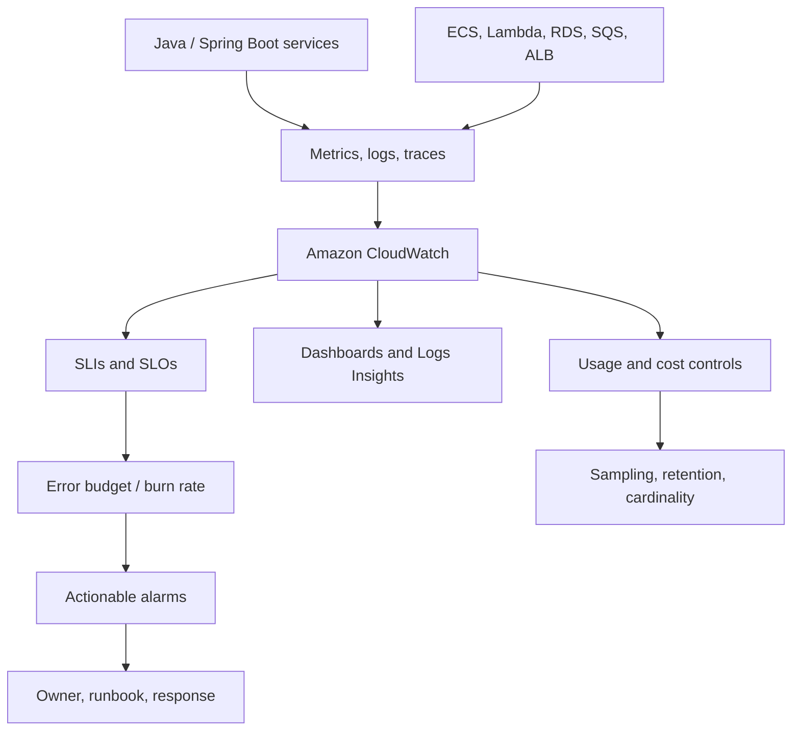
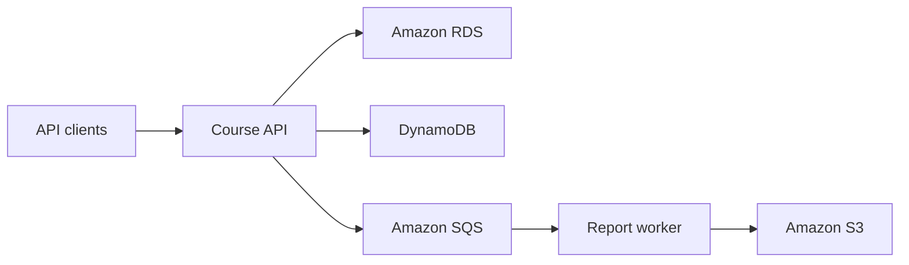
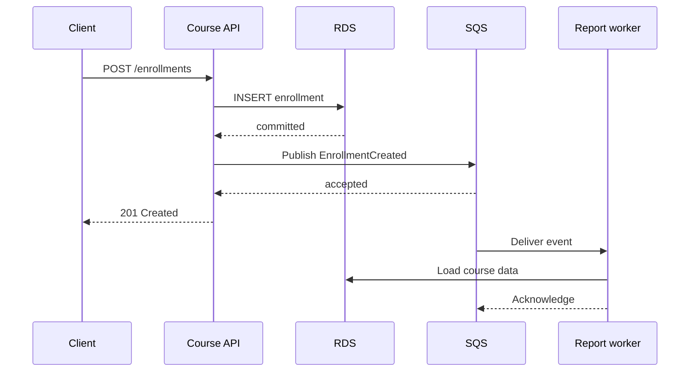
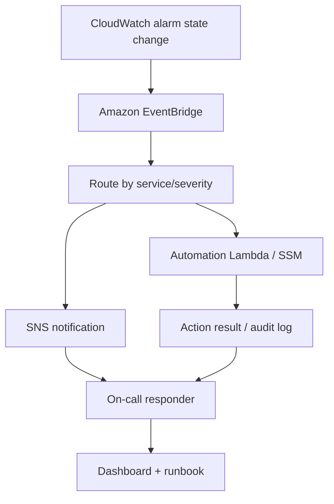

# SLO, cảnh báo có thể xử lý và kiểm soát chi phí telemetry

> **Học phần:** CLOUD_PROVIDERS_AWS  
> **Chương:** Quan sát với CloudWatch  
> **Bài học:** SLO, cảnh báo có thể xử lý và kiểm soát chi phí telemetry  
> **Bối cảnh:** Đội Java/Spring Boot vận hành Course API trên ECS, Lambda và các dịch vụ AWS; cần đo trải nghiệm người dùng, phát hiện sự cố có ý nghĩa và duy trì chi phí quan sát trong ngân sách.

## 1. Từ thu thập telemetry đến quyết định vận hành

Một hệ thống có thể gửi hàng triệu log events, hàng nghìn metrics và traces liên tục nhưng đội vận hành vẫn không biết khi nào cần can thiệp. CPU cao có thể là tải tăng bình thường; một vài exception có thể đã được retry thành công; dashboard có thể xanh trong khi người dùng không tạo được đơn hàng.

Observability có giá trị khi dữ liệu giúp trả lời ba câu hỏi:

1. **Người dùng có đang nhận được dịch vụ đúng chất lượng không?** Đo bằng Service Level Indicators (SLIs) và theo dõi Service Level Objectives (SLOs).
2. **Khi chất lượng suy giảm, ai cần làm gì?** Dùng cảnh báo có owner, ngưỡng, mức độ ưu tiên, runbook và hành động rõ ràng.
3. **Chi phí telemetry có tương xứng với giá trị vận hành không?** Kiểm soát metric cardinality, log volume, retention, query scan và trace sampling.

Amazon CloudWatch cung cấp metrics, logs, alarms, dashboards, Logs Insights và các khả năng application observability. CloudWatch Application Signals bổ sung service-level metrics, service map và SLO tracking cho ứng dụng được instrument bằng OpenTelemetry/AWS Distro for OpenTelemetry (ADOT).



### Mục tiêu học tập

Sau bài học, bạn có thể:

1. Phân biệt SLI, SLO, SLA và error budget.
2. Chọn SLI phản ánh trải nghiệm người dùng cho API, worker và dependency.
3. Tính error budget và burn rate cho một SLO.
4. Tạo SLO period-based hoặc request-based bằng CloudWatch Application Signals.
5. Thiết kế cảnh báo theo mức độ ảnh hưởng và khả năng hành động.
6. Dùng metric alarms, M-out-of-N evaluation, missing-data treatment và composite alarms.
7. Kết hợp metrics, structured logs và distributed traces.
8. Tổ chức dashboard, runbook và quy trình incident response.
9. Kiểm soát chi phí telemetry bằng cardinality, retention, log class, query filters và sampling.
10. Xây dựng kế hoạch đo lường, kiểm thử và tối ưu quan sát cho một workload AWS.

## 2. SLI, SLO, SLA và error budget

Các khái niệm này liên quan nhưng có mục đích khác nhau.

| Khái niệm | Ý nghĩa | Câu hỏi cần trả lời |
|---|---|---|
| SLI | Chỉ số đo chất lượng dịch vụ | Ta đo điều gì? |
| SLO | Mục tiêu nội bộ cho SLI trong một khoảng thời gian | Chất lượng cần đạt mức nào? |
| SLA | Cam kết dịch vụ với khách hàng, thường kèm điều khoản/biện pháp xử lý | Ta đã hứa điều gì với khách hàng? |
| Error budget | Phần chất lượng còn được phép suy giảm mà vẫn đạt SLO | Còn bao nhiêu dư địa cho lỗi? |

Ví dụ Course API đặt SLO availability 99,9% trong cửa sổ 30 ngày. SLI là tỷ lệ request hợp lệ nhận được response thành công theo định nghĩa của sản phẩm. SLA có thể cam kết mức khác, ví dụ 99,5%, và quy định service credit nếu vi phạm. Error budget theo SLO 99,9% là 0,1% request hoặc thời gian trong kỳ được phép không đạt điều kiện thành công.

SLO không nên được chọn chỉ vì một con số tròn đẹp. Mục tiêu cần dựa trên trải nghiệm người dùng, kiến trúc, dependency, chi phí để đạt reliability và kỳ vọng kinh doanh.

### 2.1. Availability SLI

Với request-based SLI:

\[
Availability = \frac{Good\ requests}{Eligible\ requests}\times100\%
\]

Một request được xem là good theo quy tắc của sản phẩm. Ví dụ:

- HTTP 2xx: thường là thành công.
- HTTP 3xx: có thể thành công nếu redirect là hành vi mong đợi.
- HTTP 4xx: có thể là request sai từ client, không nhất thiết là lỗi reliability của dịch vụ.
- HTTP 5xx, timeout hoặc lỗi dependency: thường được tính là bad request.
- Request bị hủy bởi client: cần quy định rõ có nằm trong denominator không.

Không loại bỏ mọi 4xx một cách máy móc. Ví dụ 429 Too Many Requests có thể phản ánh rate-limit behavior mà người dùng thực sự cảm nhận; tùy SLO, nó có thể cần được tính là bad.

### 2.2. Latency SLI

Một latency SLI có thể đo tỷ lệ request hoàn thành dưới một ngưỡng:

\[
Latency\ SLI = \frac{Requests\ under\ threshold}{Eligible\ requests}\times100\%
\]

Ví dụ mục tiêu: 99% request GET course hoàn thành trong 300 ms. Dùng percentile p95/p99 để hiểu phân phối latency, nhưng percentile đơn lẻ không thể thay thế một request-based SLI nếu mục tiêu là tỷ lệ request đạt ngưỡng.

### 2.3. SLI cho worker và batch

| Workload | SLI gợi ý |
|---|---|
| SQS worker | Tỷ lệ message được xử lý thành công trong SLA thời gian |
| Event consumer | Tỷ lệ event được xử lý trước deadline |
| Batch report | Tỷ lệ batch hoàn thành đúng hạn |
| File processing | Tỷ lệ file hợp lệ được xử lý thành công |
| Database dependency | Tỷ lệ query thành công và latency dưới ngưỡng |
| Async workflow | Tỷ lệ workflow hoàn tất trước deadline kinh doanh |

Đối với queue, đo cả queue age/oldest message age và completion rate. Một worker có thể không trả HTTP 5xx nhưng backlog tăng liên tục khiến người dùng nhận kết quả quá muộn.

## 3. Chọn SLI có ý nghĩa với người dùng

Bắt đầu từ journey quan trọng thay vì danh sách metrics có sẵn. Ví dụ Course API có ba luồng:

- Đọc danh sách khóa học.
- Đăng ký khóa học và thanh toán.
- Tạo báo cáo học tập bất đồng bộ.

Mỗi luồng có thể cần SLI/SLO khác nhau. Không nên gộp chúng thành một availability metric toàn hệ thống nếu một luồng có thể lỗi trong khi các luồng khác vẫn hoạt động.

### 3.1. Golden signals và business signals

| Signal | Đo lường | Ví dụ |
|---|---|---|
| Latency | Thời gian phản hồi | p50, p95, p99, tỷ lệ dưới 300 ms |
| Traffic | Nhu cầu hệ thống | Requests/minute, messages/minute |
| Errors | Request/event thất bại | 5xx rate, failed jobs, retry exhaustion |
| Saturation | Mức sử dụng tài nguyên | CPU, memory, thread pool, connection pool |
| Business outcome | Kết quả người dùng quan tâm | Enrollment success rate, payment completion rate |

Golden signals giúp tìm nguyên nhân kỹ thuật; business signals giúp xác nhận dịch vụ có thực sự hoàn thành công việc người dùng cần.

### 3.2. SLO theo service và operation

Một SLO toàn service dễ che khuất operation quan trọng. Cân nhắc tạo SLO riêng cho:

- GET /courses: availability và latency.
- POST /enrollments: transaction success và latency.
- POST /payments: payment authorization success.
- ReportWorker.process: completion within deadline.

Chỉ tạo SLO cho luồng quan trọng và có owner. Quá nhiều SLO không có người theo dõi sẽ tạo thêm dashboard noise và chi phí alarm.

### 3.3. Xác định denominator cẩn thận

Denominator là tập request/event đủ điều kiện để đánh giá. Cần thống nhất:

- Health checks nội bộ có tính vào SLO không?
- Synthetic monitoring có nằm trong request count không?
- Client cancellation và malformed requests được xử lý ra sao?
- Retry nội bộ được tính một lần theo request gốc hay từng attempt?
- Traffic từ một tenant hoặc một vùng có cần SLO riêng không?

Nếu denominator thay đổi giữa các release, SLO attainment có thể tăng/giảm mà không phản ánh chất lượng thực tế. Hãy version hóa định nghĩa SLI như một phần của service contract.

## 4. Tính error budget

Với SLO 99,9%:

\[
Error\ budget = 100\% - 99,9\% = 0,1\%
\]

Nếu tính theo thời gian trong cửa sổ 30 ngày:

\[
30\times24\times60\times0,001 = 43,2\ phút
\]

Nếu tính theo request và có 1.000.000 request đủ điều kiện trong kỳ:

\[
1.000.000\times0,001 = 1.000\ bad\ requests
\]

Hai phép tính dùng hai loại SLI khác nhau. Period-based SLO đánh giá các period đạt/không đạt; request-based SLO đánh giá số request tốt/xấu. Không lấy 43,2 phút để suy ra số request lỗi nếu traffic biến động theo thời gian.

### 4.1. Error budget policy

| Trạng thái budget | Hành động gợi ý |
|---|---|
| Còn nhiều budget, burn rate thấp | Tiếp tục release theo quy trình chuẩn |
| Budget giảm nhanh | Tăng validation, giảm release size, điều tra regression |
| Budget gần cạn | Ưu tiên reliability work, trì hoãn thay đổi rủi ro |
| Budget đã cạn | Theo policy, tạm dừng release không khẩn cấp và phục hồi SLO |

Policy phải được thống nhất giữa product, engineering và operations. Không dùng error budget để phạt team; mục đích là giúp quyết định giữa feature velocity và reliability dựa trên dữ liệu.

## 5. Burn rate: tốc độ tiêu thụ error budget

Burn rate cho biết dịch vụ đang tiêu thụ error budget nhanh hơn hay chậm hơn tốc độ tương ứng với SLO.

\[
Burn\ rate = \frac{Observed\ error\ rate}{Allowed\ error\ rate}
\]

Trong đó:

\[
Allowed\ error\ rate = 1 - SLO\ goal
\]

Ví dụ SLO 99,9% có allowed error rate 0,1%. Nếu error rate thực tế trong look-back window là 1%, burn rate bằng 10. Nếu tốc độ này kéo dài, budget sẽ bị tiêu thụ nhanh gấp 10 lần tốc độ cho phép.

- Burn rate = 1: đang tiêu thụ budget đúng tốc độ tương ứng với mục tiêu.
- Burn rate < 1: đang dùng budget chậm hơn tốc độ cho phép.
- Burn rate > 1: có nguy cơ không đạt SLO nếu tình trạng tiếp diễn.

### 5.1. Chọn burn-rate threshold theo budget muốn tiêu thụ

Một cách đặt threshold là xác định tỷ lệ budget tối đa chấp nhận bị tiêu thụ trong look-back window:

\[
Burn\ rate\ threshold =
\frac{Allowed\ budget\ fraction\times SLO\ interval}
{Lookback\ window}
\]

Ví dụ SLO rolling 28 ngày, team muốn được cảnh báo nếu 2% error budget bị tiêu thụ trong 60 phút:

\[
\frac{0,02\times28\times24\times60}{60}=13,44
\]

Threshold burn rate là 13,44 cho look-back window 60 phút. Đây là một chính sách minh họa; chọn tỷ lệ budget, interval và window theo khả năng phản ứng của đội vận hành.

### 5.2. Dùng nhiều cửa sổ thời gian

Một cửa sổ ngắn phát hiện sự cố tăng đột ngột; cửa sổ dài tránh cảnh báo chỉ vì một spike ngắn. Có thể ghép:

- 1 giờ và 5 phút: phát hiện sự cố nghiêm trọng, đang diễn ra.
- 6 giờ và 30 phút: phát hiện suy giảm kéo dài.
- 3 ngày và 6 giờ: theo dõi mức tiêu thụ budget dài hơn.

Composite alarm có thể yêu cầu cả long-window và short-window alarms cùng ở ALARM trước khi page on-call. Điều này giảm false positive khi một cửa sổ đã hồi phục nhưng cửa sổ còn lại vẫn chứa dữ liệu lỗi cũ.

### 5.3. Phản ứng theo burn rate

| Burn rate | Kênh phản ứng | Hành động |
|---|---|---|
| Thấp hơn 1 | Dashboard | Theo dõi bình thường |
| Tăng vừa, kéo dài | Ticket/chat | Kiểm tra xu hướng và release gần đây |
| Cao trong cửa sổ ngắn và dài | Page on-call | Mở incident, giảm blast radius |
| Rất cao, SLO critical bị ảnh hưởng | Page + incident commander | Rollback/disable feature hoặc failover theo runbook |

Không dùng một threshold cho tất cả services. Payment API có thể cần ngưỡng phản ứng khác batch analytics.

## 6. CloudWatch Application Signals và SLO

CloudWatch Application Signals giúp quan sát service operations và dependencies. Khi ứng dụng được instrument, Application Signals thu thập các application metrics như availability và latency, hiển thị service map và cho phép tạo SLO trên service operation hoặc dependency.

SLO trong Application Signals có thể dùng:

- **Period-based evaluation:** đánh giá các period có đạt điều kiện hay không.
- **Request-based evaluation:** đánh giá tỷ lệ request tốt trong tổng request đủ điều kiện.
- **Standard application metrics:** như Availability và Latency.
- **CloudWatch metric hoặc metric math expression:** khi cần SLI tùy chỉnh.
- **Warning threshold và burn-rate alarms:** cảnh báo trước khi budget cạn hoặc khi tốc độ tiêu thụ tăng.

### 6.1. Quy trình tạo SLO

1. Bật Application Signals cho workload và xác minh service/operation được phát hiện.
2. Chọn service operation hoặc dependency quan trọng.
3. Chọn period-based hoặc request-based evaluation.
4. Chọn SLI metric và threshold, ví dụ availability hoặc latency.
5. Đặt attainment goal, ví dụ 99,9%.
6. Chọn rolling interval hoặc calendar interval phù hợp.
7. Tạo warning threshold để nhận biết budget đang tiến gần ngưỡng.
8. Cấu hình burn-rate windows và alarms.
9. Gắn SNS topic hoặc kênh thông báo phù hợp.
10. Kiểm tra SLO dashboard sau khi có đủ dữ liệu.

Application Signals có thể đề xuất cấu hình dựa trên lịch sử metrics của service. Dùng recommendation làm điểm khởi đầu; điều chỉnh theo business objective và SLO policy.

### 6.2. Instrument Java/Spring Boot

Với Java workload trên ECS/EC2, một lựa chọn tích hợp là ADOT Java auto-instrumentation cùng CloudWatch Agent. Collector/agent thu thập application metrics và traces, đồng thời có thể kết hợp Container Insights và CloudWatch Logs.

Ví dụ cấu hình resource attributes trong môi trường chạy:

```bash
OTEL_SERVICE_NAME=course-api
OTEL_RESOURCE_ATTRIBUTES=service.namespace=learning,service.version=2026.11.20,deployment.environment=production
JAVA_TOOL_OPTIONS=-javaagent:/opt/otel/javaagent.jar
```

Đường dẫn agent là ví dụ; file javaagent.jar cần được mount hoặc copy vào đúng vị trí trong container. Trong ECS task definition, mount/copy agent theo deployment pattern đang dùng; bảo đảm version agent tương thích với Java runtime và framework.

Đối với ECS, có thể chạy CloudWatch Agent/ADOT collector theo sidecar hoặc daemon pattern tùy cluster. Đối với Lambda, chọn instrumentation setup phù hợp với runtime/package. Kiểm tra network egress, IAM permissions và resource attributes để service map hiển thị đúng service name, environment và version.

### 6.3. Service map giúp tìm dependency



Nếu Course API SLO giảm và RDS dependency latency tăng cùng lúc, service map giúp khoanh vùng. Tuy nhiên, correlation không tự chứng minh nguyên nhân gốc; kiểm tra traces, logs, saturation và dependency events trước khi hành động.

## 7. Ba tín hiệu: metrics, logs và traces

| Signal | Trả lời câu hỏi | Dùng tốt nhất cho |
|---|---|---|
| Metrics | Điều gì đang thay đổi và mức độ ra sao? | Trend, SLO, alarms, capacity |
| Logs | Sự kiện cụ thể nào đã xảy ra? | Error detail, audit, business context |
| Traces | Một request đi qua các component nào và chậm ở đâu? | Dependency latency, distributed failures |

Không cần ghi mọi chi tiết vào mọi signal. Metrics cần gọn và ổn định; logs cần đủ context để điều tra; traces cần mô tả đường đi và timing của request.

### 7.1. Metrics

Đặt namespace riêng cho custom metrics, ví dụ CourseAPI/SLI. Dùng metric names rõ ràng như GoodRequests, TotalRequests, EnrollmentFailures, QueueAgeSeconds.

Chọn statistic phù hợp:

- Sum: tổng request, lỗi, message.
- Average: trung bình CPU hoặc duration khi phép đo phù hợp.
- p95, p99: percentile latency.
- Minimum/Maximum: phát hiện giá trị cực trị hoặc health signals.

Không dùng average latency làm đại diện duy nhất vì một nhóm request rất chậm có thể bị che bởi nhiều request nhanh.

### 7.2. Structured logs

Log dưới dạng JSON để CloudWatch Logs Insights tự phát hiện fields. Một event hữu ích thường có:

```json
{
  "timestamp": "2026-11-20T04:30:00.000Z",
  "level": "ERROR",
  "service": "course-api",
  "environment": "production",
  "version": "2026.11.20",
  "traceId": "1-673e0000-0123456789abcdef01234567",
  "spanId": "0123456789abcdef",
  "route": "/v1/enrollments",
  "operation": "createEnrollment",
  "statusCode": 503,
  "durationMs": 812,
  "errorCode": "PAYMENT_DEPENDENCY_TIMEOUT"
}
```

Không log access token, password, card data, session secret hoặc PII không cần thiết. Dùng trace ID/correlation ID để nối log với trace; không dùng các ID này làm metric dimensions.

### 7.3. Distributed traces

Một trace có thể chứa nhiều spans:



Trace giúp phân biệt thời gian nằm ở API code, RDS, SQS hoặc worker. Trace sampling có thể giảm volume nhưng cũng làm mất một số request trong phân tích; hãy giữ metrics/SLO measurement độc lập với trace sampling.

## 8. Thiết kế metrics và kiểm soát cardinality

CloudWatch xác định metric bằng namespace, metric name và tổ hợp dimensions. Mỗi tổ hợp dimensions duy nhất được tính là một metric riêng, kể cả khi metric name giống nhau.

Ví dụ:

- Service=course-api, Environment=prod
- Service=course-api, Environment=staging
- Service=course-api, Environment=prod, Route=/courses

Đây là các metric identity khác nhau.

### 8.1. Cardinality là gì?

Cardinality là số lượng giá trị/tổ hợp giá trị khác nhau của dimensions/labels. Các trường sau có thể làm cardinality tăng rất nhanh:

- requestId
- userId
- sessionId
- orderId
- raw URL chứa path parameter
- exception message tự do
- timestamp hoặc UUID

Ví dụ 100.000 request IDs không nên trở thành 100.000 metric time series. Đưa request ID vào log/trace; giữ metric dimension ổn định như service, environment, operation, status class hoặc bounded tenant tier.

### 8.2. Bounded dimensions

| Dimension | Khuyến nghị | Lý do |
|---|---|---|
| Service | Dùng | Số service có giới hạn |
| Environment | Dùng | dev/staging/prod |
| Operation/route template | Dùng có kiểm soát | /courses/{id} thay vì raw path |
| Status class | Dùng | 2xx/4xx/5xx |
| Region | Dùng khi cần | Số Region có giới hạn |
| Tenant tier | Chỉ dùng nếu số tier nhỏ | Ví dụ free/pro/enterprise |
| User ID/request ID | Không dùng làm metric dimension | Cardinality gần như không giới hạn |

Không cố giảm cardinality bằng cách bỏ mọi dimensions. Mục tiêu là đủ khả năng phân tích theo service/operation/environment mà không tạo một time series cho từng request.

### 8.3. OpenTelemetry metrics và Embedded Metric Format

Hai cách phổ biến để xuất custom metrics:

- **OpenTelemetry metrics (OTLP):** phù hợp cho workload mới, ứng dụng container, PromQL và hệ sinh thái OTel. AWS khuyến nghị lựa chọn này cho nhiều workload mới.
- **Embedded Metric Format (EMF):** ghi metric cùng structured log event. Hữu ích khi muốn giữ chi tiết log gốc và trích xuất metrics từ Lambda/ephemeral workloads mà không cần gọi riêng PutMetricData.

EMF vẫn tạo custom metric cho mỗi tổ hợp dimensions. Không đưa request ID/user ID vào dimensions chỉ vì chúng có trong log. OpenTelemetry hỗ trợ nhiều labels hơn nhưng cũng không phù hợp để tạo series cho các giá trị cực cao như request ID.

Ví dụ một log event EMF ghi tổng request tốt và tổng request đủ điều kiện cho một service. Trường route chỉ nằm trong log event, không được chọn làm metric dimension:

```json
{
  "_aws": {
    "Timestamp": 1795149000000,
    "CloudWatchMetrics": [
      {
        "Namespace": "CourseAPI/SLI",
        "Dimensions": [["Service"]],
        "Metrics": [
          {"Name": "GoodRequests", "Unit": "Count"},
          {"Name": "TotalRequests", "Unit": "Count"}
        ]
      }
    ]
  },
  "Service": "course-api",
  "GoodRequests": 98,
  "TotalRequests": 100,
  "route": "/v1/enrollments",
  "statusClass": "2xx"
}
```

## 9. Log design: nội dung, class và retention

CloudWatch Logs có các log classes với bộ tính năng và chi phí khác nhau. Standard phù hợp cho log cần real-time monitoring và khả năng đầy đủ. Essentials (tên trước đây là Infrequent Access) phù hợp cho log ít truy cập, phân tích ad-hoc/forensic với tập tính năng giới hạn hơn. Log class cần chọn khi tạo log group; không thể đổi class của log group đã tồn tại.

### 9.1. Chọn log group theo workload

```text
/prod/course-api/application
/prod/course-api/access
/prod/course-worker/application
/prod/payment-service/application
/prod/platform/audit
```

Tách log groups theo service, environment và retention policy để quản lý quyền, retention và chi phí. Log streams thường đại diện cho nguồn ghi cụ thể như container/task hoặc instance.

### 9.2. Retention policy

CloudWatch Logs giữ dữ liệu vô thời hạn nếu không cấu hình retention. Thiết lập retention theo mục đích:

| Loại log | Retention gợi ý | Mục đích |
|---|---|---|
| Debug/dev | Ngắn | Chẩn đoán trong quá trình phát triển |
| Application production | Theo nhu cầu vận hành | Điều tra sự cố gần đây |
| Security/audit | Theo policy tổ chức | Điều tra và compliance |
| High-volume access logs | Ngắn hơn hoặc export | Phân tích xu hướng, lưu trữ dài hạn |

Các khoảng retention thực tế phải theo policy pháp lý và tổ chức. Nếu cần lưu trữ dài hạn chi phí thấp, cân nhắc export/subscription sang Amazon S3 và lifecycle policy. Kiểm tra chi phí truy xuất, encryption, quyền truy cập và thời gian restore trước khi chọn S3 làm archive.

### 9.3. Data protection

- Mask hoặc loại bỏ secrets/PII trước khi log.
- Dùng CloudWatch Logs data protection policy khi cần audit/masking dữ liệu nhạy cảm.
- Giới hạn quyền logs:StartQuery, logs:GetQueryResults và quyền đọc log group.
- Mã hóa log group bằng KMS khi yêu cầu bảo mật cần customer-managed key.
- Tránh log toàn bộ request/response body nếu có dữ liệu nhạy cảm hoặc payload lớn.

## 10. Logs Insights và truy vấn có mục tiêu

CloudWatch Logs Insights tính phí phân tích dựa trên lượng dữ liệu log không nén được scan. Giới hạn time range, chọn đúng log groups, lọc sớm và dùng field indexes khi phù hợp để giảm dữ liệu scan.

Ví dụ tìm lỗi của Course API:

```text
fields @timestamp, level, route, statusCode, durationMs, traceId
| filter level = "ERROR"
| stats count(*) as errors,
        pct(durationMs, 95) as p95Duration
  by bin(5m), route
| sort @timestamp desc
| limit 100
```

Ví dụ truy vết một trace:

```text
fields @timestamp, service, level, traceId, message
| filter traceId = "1-673e0000-0123456789abcdef01234567"
| sort @timestamp asc
```

### 10.1. Field indexes

Tạo index cho field được dùng thường xuyên trong filter như trace ID, tenant tier hoặc request category nếu có ích cho truy vấn. filterIndex có thể giúp Logs Insights chỉ scan log groups/events có index phù hợp; khả năng này phụ thuộc log class và câu truy vấn.

Không index mọi field. Index policy cũng là một quyết định vận hành; chọn field ổn định và có tần suất truy vấn đủ cao.

### 10.2. Ví dụ filterIndex

```text
fields @timestamp, traceId, level, message
| filterIndex traceId = "1-673e0000-0123456789abcdef01234567"
| sort @timestamp asc
| limit 100
```

Trước khi dùng, xác nhận log group thuộc Standard class, field index đã được tạo và dữ liệu được ingest sau khi index policy có hiệu lực. Index không hồi tố cho các log events cũ.
## 11. Dashboard theo vai trò và quyết định

Dashboard tốt trả lời một câu hỏi vận hành cụ thể. Không cần nhồi mọi metric vào một trang.

### 11.1. Service health dashboard

Nên có:

- SLO attainment và remaining error budget.
- Burn rate ở các look-back windows.
- Availability, latency p50/p95/p99.
- Request rate và error rate.
- Dependency health/latency.
- Current deployment/version.
- Alarm states và incident links.

### 11.2. Infrastructure dashboard

Cho ECS/Fargate:

- Desired/running task count.
- CPU/memory utilization.
- Task restarts/placement failures.
- ALB healthy/unhealthy targets.
- Network and request metrics.

Cho Lambda:

- Invocations, Errors, Throttles, Duration.
- Concurrent executions.
- Iterator age nếu dùng stream event source.
- Cold start/runtime metrics khi được instrument.

Cho RDS:

- CPU, connections, free storage.
- Read/write latency and IOPS.
- Database load/Performance Insights metrics theo engine và tier.

### 11.3. Dashboard cho incident

Một incident dashboard cần hiển thị đúng time range, release version, service, dependency và alarms liên quan. Giữ link tới Logs Insights queries và runbook để on-call không phải tự tìm từ đầu.

Dashboard không thay thế alarm. Người trực không thể ngồi quan sát dashboard liên tục; sự cố vượt ngưỡng cần phát tín hiệu qua alert channel.

## 12. CloudWatch alarm states và evaluation

Metric alarm có ba trạng thái chính:

| State | Ý nghĩa | Cách diễn giải |
|---|---|---|
| OK | Metric nằm trong điều kiện bình thường | Chưa vượt threshold |
| ALARM | Metric vi phạm threshold | Cần thực hiện hành động đã cấu hình |
| INSUFFICIENT_DATA | Không đủ dữ liệu đánh giá | Có thể do metric chưa phát, ingestion gián đoạn hoặc alarm mới tạo |

INSUFFICIENT_DATA không đồng nghĩa OK. Nếu telemetry pipeline ngừng gửi metrics, alarm có thể không có dữ liệu để phát hiện lỗi ứng dụng.

### 12.1. Period, EvaluationPeriods và DatapointsToAlarm

- **Period:** độ dài mỗi datapoint evaluation, ví dụ 60 giây.
- **EvaluationPeriods (N):** số period gần nhất được xem xét.
- **DatapointsToAlarm (M):** số datapoints trong N period phải breach để chuyển ALARM.

Đây là M-out-of-N alarm. Ví dụ DatapointsToAlarm=3, EvaluationPeriods=5 có nghĩa ít nhất 3 trong 5 datapoints gần nhất phải vi phạm threshold.

M-out-of-N giúp giảm cảnh báo do một spike đơn lẻ. Nhưng nếu M/N quá cao, alarm có thể phản ứng chậm với outage. Chọn theo SLO và thời gian phản ứng tối đa chấp nhận được.

### 12.2. Missing data treatment

CloudWatch cho phép các cách xử lý missing datapoints:

- breaching: coi datapoint thiếu là vi phạm.
- notBreaching: coi datapoint thiếu là không vi phạm.
- ignore: giữ trạng thái hiện tại khi cần xử lý missing data.
- missing: để alarm chuyển INSUFFICIENT_DATA khi không đủ datapoints.

Chọn theo ý nghĩa metric:

| Metric | Treatment gợi ý | Lý do |
|---|---|---|
| Heartbeat/collector expected every minute | breaching | Không có heartbeat là dấu hiệu telemetry bị gián đoạn |
| Request error rate khi service không có traffic | Có thể notBreaching hoặc metric math xử lý no traffic | Không có request không đồng nghĩa có lỗi |
| Sparse business event metric | missing hoặc ignore tùy mục đích | Không có event có thể là bình thường |
| Critical dependency probe | breaching sau khi đã định nghĩa rõ probe cadence | Mất probe là mất khả năng xác nhận dependency |

CloudWatch đánh giá datapoints thực có trước khi dùng treatment cho missing data; không phải mọi missing point đều được thay thế ngay. Vì vậy, hãy kiểm thử trạng thái alarm khi metric ngừng gửi.

## 13. Thiết kế cảnh báo có thể xử lý

Một alert nên giúp người nhận quyết định hành động trong vài phút đầu tiên. Mỗi alert quan trọng cần có:

1. **Impact:** người dùng/operation nào bị ảnh hưởng?
2. **Signal:** metric/SLI nào vượt ngưỡng?
3. **Threshold and window:** vượt bao nhiêu, trong bao lâu?
4. **Owner:** team hoặc on-call rotation chịu trách nhiệm.
5. **Runbook:** bước điều tra đầu tiên và link tới dashboard/query.
6. **Action:** rollback, scale, failover, disable feature hoặc escalate.
7. **Recovery condition:** khi nào được đóng incident?

Ví dụ alert hữu ích:

> Course API enrollment availability SLO burn rate vượt 13,44 trong cửa sổ 1 giờ và 5 phút. Người dùng tạo enrollment đang nhận lỗi. Kiểm tra dashboard Course API, RDS dependency và release version gần nhất; nếu lỗi bắt đầu sau release, thực hiện rollback theo runbook Enrollment API.

Alert không hữu ích:

> CPU > 80%.

CPU 80% có thể là bình thường. Nếu cần cảnh báo saturation, gắn nó với queue depth, latency, request errors hoặc khả năng scale; thêm owner và hành động cụ thể.

### 13.1. Page, ticket và dashboard

| Mức độ | Ví dụ | Kênh phản ứng |
|---|---|---|
| Critical/page | SLO burn nhanh, payment/enrollment unavailable | On-call ngay |
| Warning/ticket | Budget tiêu thụ tăng chậm, storage còn ít nhưng chưa ảnh hưởng | Team backlog/working hours |
| Informational | Deployment completed, autoscaling event | Dashboard/event stream |
| Diagnostic | Một exception đơn lẻ đã retry thành công | Logs/traces, không page |

Không gửi mọi alarm tới cùng một kênh. Tách alert theo mức độ ảnh hưởng và thời gian cần phản ứng.

### 13.2. Alarm actions và state transitions

CloudWatch alarm actions thường được gọi khi alarm chuyển trạng thái. Với nhiều action types, chúng không lặp lại liên tục chỉ vì alarm giữ ALARM trong nhiều giờ. Auto Scaling actions là ngoại lệ có behavior riêng.

Các action có thể bao gồm SNS notifications, Lambda invocation, EC2 actions hoặc Auto Scaling actions tùy loại alarm. Alarm state changes cũng được phát qua EventBridge, cho phép tích hợp với automation/incident workflows.

Không giả định SNS message đã được xử lý hoặc Lambda action đã thành công chỉ vì alarm chuyển state. Theo dõi delivery, retries, DLQ và lỗi của automation.

## 14. Composite alarms giảm alert noise

Composite alarm tổng hợp trạng thái của nhiều metric alarms bằng biểu thức Boolean. Điều này hữu ích khi chỉ một metric breach chưa đủ chứng minh sự cố cần page.

Ví dụ:

- Page khi availability SLO burn rate cao và error rate cao.
- Page khi latency cao và healthy target count thấp.
- Không page CPU saturation trong maintenance/deployment window nếu service health vẫn tốt.

Ví dụ AlarmRule:

```text
ALARM(CourseApiHighErrorRate)
AND ALARM(CourseApiLatencyHigh)
AND NOT ALARM(PlannedMaintenance)
```

Ví dụ này chỉ đưa composite alarm vào ALARM khi error-rate và latency alarms cùng ALARM, đồng thời maintenance alarm không ALARM.

Composite alarm giúp giảm số notification, nhưng không thay thế metric alarms. Vẫn cần underlying alarms để hiển thị tín hiệu cụ thể và điều tra.

Lưu ý: composite alarms hỗ trợ SNS notifications, Systems Manager OpsItems/incident integrations và các hành động được tài liệu CloudWatch hỗ trợ; chúng không thực hiện EC2 hoặc Auto Scaling actions như metric alarms. Kiểm tra action support trước khi thiết kế automation.

## 15. Ví dụ CloudFormation: alarm trên request error rate

Giả sử ứng dụng publish hai custom metrics trong namespace CourseAPI/SLI:

- GoodRequests: tổng request đạt điều kiện SLI.
- TotalRequests: tổng request đủ điều kiện.

Metric math tính error rate theo phần trăm:

\[
Error\ rate = 100\times(1-\frac{GoodRequests}{TotalRequests})
\]

Ví dụ CloudFormation alarm:

```yaml
CourseApiErrorRateAlarm:
  Type: AWS::CloudWatch::Alarm
  Properties:
    AlarmName: course-api-error-rate
    AlarmDescription: "Course API request error rate is above 1 percent"
    ComparisonOperator: GreaterThanThreshold
    Threshold: 1
    EvaluationPeriods: 5
    DatapointsToAlarm: 3
    TreatMissingData: notBreaching
    Metrics:
      - Id: good
        ReturnData: false
        MetricStat:
          Metric:
            Namespace: CourseAPI/SLI
            MetricName: GoodRequests
            Dimensions:
              - Name: Service
                Value: course-api
          Period: 60
          Stat: Sum
      - Id: total
        ReturnData: false
        MetricStat:
          Metric:
            Namespace: CourseAPI/SLI
            MetricName: TotalRequests
            Dimensions:
              - Name: Service
                Value: course-api
          Period: 60
          Stat: Sum
      - Id: error_rate
        Label: Error rate percent
        ReturnData: true
        Expression: "IF(total >= 100, 100 * (1 - good / total))"
```

Ví dụ này chỉ tạo metric alarm trên custom SLI. Trong production, cần cấu hình alarm actions, SNS topic, tags và quyền publish metrics. total >= 100 là điều kiện mẫu để tránh đánh giá tỷ lệ từ sample quá nhỏ; chọn minimum sample theo traffic của service.

TreatMissingData: notBreaching giúp tránh page khi không có request, nhưng có thể che việc telemetry ngừng gửi. Tạo heartbeat/telemetry pipeline alarm riêng với cadence rõ ràng và missing-data treatment phù hợp.

### 15.1. Metric math không phải SLO đầy đủ

Alarm trên error rate không tự quản lý rolling error budget, SLO attainment hay burn-rate windows. Dùng CloudWatch Application Signals SLO khi cần theo dõi attainment/error budget; dùng metric alarms cho các điều kiện vận hành tức thời và composite alarms để tổng hợp.

## 16. Thông báo và tự động hóa có kiểm soát

Một workflow phổ biến:



### 16.1. SNS và EventBridge

- SNS phù hợp cho fan-out notifications tới email, SMS hoặc subscribers.
- EventBridge phù hợp routing alarm state changes theo service, environment, severity và account.
- Lambda/Systems Manager automation có thể thực hiện tác vụ đã định nghĩa.
- Ghi lại automation result, request ID, principal và resource đã thay đổi.

### 16.2. Safe automation

Chỉ tự động hóa hành động có thể kiểm soát và đã thử nghiệm:

- Tạo incident/ticket.
- Thu thập diagnostic snapshot.
- Chạy health probe.
- Scale out trong giới hạn được phê duyệt.
- Rollback một deployment theo release policy đã định nghĩa.

Các hành động như xóa dữ liệu, failover database hoặc thay đổi network policy cần guardrails, approval hoặc rollback plan. Automation phải idempotent, có timeout, retry policy và audit trail.

## 17. Kiểm soát chi phí telemetry

Chi phí CloudWatch phụ thuộc Region, volume và feature được bật. Các nhóm chi phí chính có thể gồm:

| Thành phần | Driver chi phí thường gặp |
|---|---|
| Custom metrics | Số metric identities, resolution và thời gian tồn tại |
| Metric API | Số API requests theo loại operation |
| Alarms | Số metrics/queries được alarm đánh giá và loại alarm |
| Logs ingestion | GB log được ingest |
| Logs storage | GB-month và retention |
| Logs Insights | Lượng log không nén được scan |
| Traces/spans | Ingestion, retention, indexing và analysis |
| Container Insights | Số metrics theo cluster/service/task/container và chế độ enhanced observability |
| Dashboards/queries | Số dashboard, API calls và query workload theo pricing model |

Không dùng một đơn giá USD cố định trong thiết kế dài hạn. Giá thay đổi theo Region, volume tier, log class và tính năng; kiểm tra CloudWatch pricing page và AWS Pricing Calculator trước khi phê duyệt ngân sách.

### 17.1. Chi phí metrics

- Giới hạn dimensions vào các trường bounded.
- Tránh tạo custom metric theo request ID, user ID, order ID hoặc raw URL.
- Dùng standard resolution khi không cần dữ liệu sub-minute.
- Chỉ bật high-resolution metrics cho use case cần phản ứng nhanh.
- Xóa metrics/alarms thử nghiệm không còn dùng.
- Theo dõi số custom metrics mới sau mỗi release.
- Đánh giá số metrics do Container Insights enhanced observability tạo ra trước khi bật rộng.

### 17.2. Chi phí logs

- Log những event phục vụ vận hành/audit; không log debug payload ở production liên tục.
- Chọn retention ngắn cho debug/access logs nếu policy cho phép.
- Export dữ liệu cần giữ lâu sang S3 với lifecycle policy phù hợp.
- Chọn Essentials log class cho log ít truy cập nếu không cần tính năng chỉ có ở Standard.
- Dùng field indexes và time-range filters để giảm scan volume.
- Tránh query toàn bộ log groups trong time range nhiều tháng khi chỉ cần 15 phút.
- Kiểm tra top log groups/usage types trong Cost and Usage Reports hoặc CloudWatch billing analysis.

### 17.3. Chi phí traces

- Giữ sampling policy theo workload và mức độ quan trọng.
- Cân nhắc sampling theo service/environment; production critical flows có thể cần coverage cao hơn.
- Giới hạn span attributes có kích thước lớn hoặc giá trị không giới hạn.
- Không ghi request/response body đầy đủ vào span.
- Dùng trace sampling để điều tra, nhưng giữ SLI metrics độc lập để SLO không bị sai lệch do sample.
- Đánh giá retention và indexing cho trace search.

### 17.4. Chi phí query và dashboards

- Giới hạn time range và log groups trong Logs Insights.
- Dùng field indexes cho các field truy vấn thường xuyên khi feature hỗ trợ.
- Lưu query chuẩn để tránh mỗi incident tạo truy vấn rộng khác nhau.
- Tránh refresh dashboard quá nhanh nếu không cần near-real-time.
- Kiểm tra metric queries, alarm evaluation và API retrieval volume.
- Dọn dashboard trùng lặp hoặc không còn owner.

## 18. Chọn CloudWatch Logs class và nơi lưu trữ

CloudWatch Logs Standard cung cấp bộ tính năng đầy đủ cho real-time monitoring và truy cập thường xuyên. Essentials (trước đây là Infrequent Access) phù hợp log ít truy cập và forensic/ad-hoc analysis với tập tính năng hạn chế hơn.

Một số tính năng như Live Tail, metric filters, subscription filters và field indexing không có trong Essentials. Kiểm tra feature matrix trước khi chọn class; log class không thể đổi sau khi log group được tạo.

### 18.1. CloudWatch hay S3?

| Nhu cầu | Lựa chọn gợi ý |
|---|---|
| Real-time alerting/metric filters | CloudWatch Logs Standard |
| Điều tra gần đây bằng Logs Insights | Standard hoặc Essentials tùy query/features |
| Audit lưu dài hạn, ít truy vấn | S3 với encryption/lifecycle |
| Phân tích batch trên log lớn | S3 + Athena/analytics phù hợp |
| Live tail production incident | Standard |
| Forensic log ít truy cập | Essentials hoặc S3 archive theo policy |

Không chuyển toàn bộ log sang S3 nếu đội vận hành cần alert/query realtime. Có thể dùng subscription/centralization pipeline để vừa giữ log vận hành ở CloudWatch vừa archive dữ liệu cần thiết.

## 19. Multi-account observability và governance

Trong tổ chức có nhiều AWS accounts, monitoring account có thể cung cấp góc nhìn tập trung qua CloudWatch cross-account observability/Observability Access Manager theo cấu hình được hỗ trợ.

Mô hình gợi ý:

- Application accounts: dev, staging, production.
- Monitoring account: dashboards, alarms tổng hợp và cross-account views.
- Security/audit account: log archive và kiểm soát quyền truy cập.
- Central platform team: chuẩn hóa namespaces, retention, alarm naming và cost allocation.

### 19.1. Governance cho telemetry

Đặt conventions:

- Namespace theo domain/service.
- Log group naming theo environment/service.
- Resource attributes có service.name, service.namespace, deployment.environment, service.version.
- Alarm name có service, signal và severity.
- Dashboard có owner và review cadence.
- SLO có business owner, technical owner và policy.
- Retention class/period được quản lý như infrastructure configuration.

### 19.2. Cost allocation

Dùng tags và account-level usage reports để xác định workload tạo chi phí. Theo dõi:

- Log ingestion theo service/account.
- Custom metrics theo namespace.
- Alarms theo team/service.
- Trace volume theo environment.
- Container Insights metrics theo cluster/service.
- Logs Insights scan volume theo team hoặc query workload nếu dữ liệu billing cho phép.

Đừng chỉ xem tổng CloudWatch bill. Phân rã theo usage type, operation, Region và resource để tìm nguồn tăng bất thường.

## 20. Lab: SLO và actionable alarms cho Course API

**Tình huống:** Course API trên ECS Fargate phục vụ endpoint enrollment. Team đặt availability SLO 99,9% trong 30 ngày, muốn cảnh báo khi error budget bị tiêu thụ nhanh và giảm log/metric volume không cần thiết.

### 20.1. Chuẩn bị

1. Có sandbox AWS account/Region.
2. Chạy Course API với structured JSON logs.
3. Bật ADOT/Application Signals theo deployment pattern phù hợp.
4. Xác nhận service name, operation và dependency xuất hiện.
5. Tạo custom metrics GoodRequests và TotalRequests nếu dùng request-based SLI tùy chỉnh.
6. Chọn CloudWatch Logs Standard cho log cần metric filters/field indexes/real-time features.
7. Tạo dashboard cho availability, latency, errors, traffic và dependencies.

### 20.2. Tạo SLO

- Chọn service operation POST /enrollments.
- Chọn request-based availability SLI.
- Định nghĩa request đủ điều kiện và tiêu chí good/bad.
- Đặt attainment goal 99,9%.
- Chọn rolling interval 30 ngày.
- Cấu hình warning threshold khi remaining error budget xuống thấp.
- Tạo burn-rate windows phù hợp.
- Gắn alarm với SNS topic/kênh on-call.
- Xác nhận SLO dashboard hiển thị attainment, remaining budget và burn rate.

### 20.3. Kiểm thử alarm

- Tạo một đợt traffic lỗi có kiểm soát trong sandbox.
- Xác nhận metric error rate tăng và alarm chuyển ALARM sau số datapoints đã cấu hình.
- Dừng phát metric để kiểm tra missing-data behavior.
- Khôi phục traffic bình thường và xác nhận alarm trở về OK.
- Tạo composite alarm yêu cầu cả error-rate và latency alarms cùng ALARM.
- Kiểm tra notification có service, environment, threshold, time window và runbook link.
- Xác nhận action chỉ thực hiện khi state transition phù hợp.

### 20.4. Kiểm thử chi phí telemetry

- Thêm request ID vào log nhưng không thêm vào metric dimensions.
- So sánh số metric identities trước/sau khi thêm dimension bounded.
- Giảm log level debug trong production profile.
- Đặt retention policy cho log group.
- Chạy Logs Insights query với time range 15 phút và 7 ngày; so sánh scanned bytes.
- Thử field index trên Standard log group và dùng filterIndex.
- Kiểm tra log group Essentials không hỗ trợ các tính năng cần Standard.
- So sánh trace volume ở các sampling configurations trong sandbox.

### 20.5. Kết quả cần nộp

Báo cáo lab gồm:

- SLI definition và request eligibility.
- SLO target, interval và remaining error budget.
- Burn-rate windows/thresholds và giải thích cách chọn.
- Alarm configuration: period, M/N, missing-data treatment, action.
- Screenshot/export dashboard và service map.
- Logs Insights queries và scanned bytes.
- Log class, retention và metric dimensions.
- Chi phí ước tính theo Region/pricing page tại thời điểm thực hành.
- Runbook và kết quả kiểm thử rollback/notification.

## 21. Negative tests và câu hỏi tự kiểm tra

### 21.1. Negative tests

| Test | Điều kiện | Kết quả mong đợi |
|---|---|---|
| T1 | SLI tính cả health checks nội bộ | SLO có thể đẹp giả; phát hiện qua denominator review |
| T2 | Loại mọi HTTP 4xx mà không có policy | Có thể bỏ sót 429 hoặc lỗi user-visible; sửa SLI definition |
| T3 | Metric dimensions chứa requestId | Metric identities tăng đột biến; phát hiện qua billing/metric inventory |
| T4 | Logs giữ vô thời hạn ngoài policy | Storage tăng; retention governance phát hiện |
| T5 | Query scan tất cả log groups trong 30 ngày | Scanned bytes và cost tăng; giới hạn time range/log groups |
| T6 | Metric heartbeat ngừng gửi nhưng alarm dùng notBreaching | Telemetry outage không được page; tạo heartbeat alarm riêng |
| T7 | Error-rate alarm dùng missing=breaching khi service không có traffic | False alarm; định nghĩa no-traffic behavior |
| T8 | Composite alarm chỉ có một child alarm | Không đạt mục tiêu giảm noise; bổ sung điều kiện thực sự độc lập |
| T9 | SLO interval thay đổi nhưng policy không cập nhật | Burn-rate threshold sai; tính lại theo interval/window |
| T10 | Trace sampling quá thấp | Thiếu trace để điều tra; tăng sampling cho critical path có kiểm soát |
| T11 | Log Essentials nhưng runbook cần Live Tail/metric filters | Thiếu feature; chọn Standard cho log group cần chức năng đó |
| T12 | Retention ngắn hơn yêu cầu audit | Không đáp ứng policy; thống nhất với security/compliance owner |
| T13 | Alarm action Lambda lỗi nhưng không có DLQ/monitoring | Automation fail âm thầm; thêm retries, DLQ và action telemetry |
| T14 | Dashboard không có owner | Không được duy trì; gán owner và review cadence |

Chỉ chạy negative tests có khả năng tăng volume hoặc tạo alarm trong sandbox. Không cố ý gửi dữ liệu nhạy cảm vào log để thử masking trên production.

### 21.2. Câu hỏi tự kiểm tra

**1. SLI, SLO và SLA khác nhau thế nào?**  
SLI là phép đo; SLO là mục tiêu nội bộ cho phép đo đó; SLA là cam kết với khách hàng và có thể kèm điều khoản xử lý.

**2. Error budget của SLO 99,9% là bao nhiêu?**  
0,1% số request hoặc thời gian đủ điều kiện trong interval, tùy loại SLI.

**3. Burn rate 10 có ý nghĩa gì?**  
Service đang tiêu thụ error budget nhanh gấp 10 lần tốc độ tương ứng với SLO.

**4. Vì sao cần nhiều burn-rate windows?**  
Cửa sổ ngắn phát hiện spike nghiêm trọng; cửa sổ dài xác nhận suy giảm kéo dài và giảm false positives.

**5. Vì sao request-based SLO cần denominator rõ ràng?**  
Vì thay đổi request eligibility có thể làm attainment thay đổi dù chất lượng dịch vụ không đổi.

**6. Khi nào dùng Application Signals?**  
Khi cần service/operation/dependency metrics, service map và SLO tracking trên workload được instrument phù hợp.

**7. Metrics, logs và traces bổ sung nhau ra sao?**  
Metrics chỉ ra xu hướng; logs cho chi tiết sự kiện; traces cho thấy đường đi và latency giữa các components.

**8. Vì sao không dùng requestId làm metric dimension?**  
Mỗi giá trị có thể tạo metric identity riêng, làm cardinality và chi phí tăng mạnh.

**9. M-out-of-N alarm là gì?**  
Alarm chuyển ALARM khi ít nhất M datapoints trong N evaluation periods vi phạm threshold.

**10. INSUFFICIENT_DATA có nghĩa hệ thống khỏe không?**  
Không. Nó chỉ cho biết alarm chưa có đủ dữ liệu để kết luận.

**11. Composite alarm dùng để làm gì?**  
Kết hợp nhiều alarm states bằng Boolean logic để giảm noise và chỉ page khi đủ điều kiện.

**12. Vì sao alarm cần owner và runbook?**  
Để người nhận biết impact, nơi điều tra và hành động cần thực hiện.

**13. Logs Insights tính phí query theo yếu tố nào?**  
Theo lượng log data không nén được scan.

**14. Log retention có tác động gì?**  
Quyết định thời gian lưu và chi phí storage; cần theo vận hành, audit và compliance policy.

**15. Trace sampling có làm sai SLO không?**  
SLO phải dựa trên metric/SLI có định nghĩa rõ; không dùng sampled traces làm denominator nếu sampling không đại diện.

## 22. Tổng kết và tài liệu AWS chính thức

SLO biến reliability thành mục tiêu có thể đo. Error budget và burn rate giúp team quyết định khi nào nên tiếp tục release, khi nào cần giảm tốc độ thay đổi và ưu tiên phục hồi. CloudWatch Application Signals hỗ trợ theo dõi service operations/dependencies và tạo SLO; CloudWatch alarms, composite alarms, dashboards và Logs Insights giúp biến telemetry thành hành động.

Một cảnh báo tốt cần signal có ý nghĩa, threshold/window rõ, owner, runbook, action và recovery condition. Cảnh báo không có người nhận hoặc không có bước xử lý chỉ làm tăng noise.

Chi phí telemetry được kiểm soát bằng metric dimensions có cardinality hữu hạn, log volume/retention hợp lý, log class phù hợp, query có giới hạn, field indexes khi hỗ trợ và trace sampling theo nhu cầu. SLO metrics phải giữ tính đại diện ngay cả khi traces được sample.

### Tài liệu AWS chính thức

- [CloudWatch — Service level objectives (SLOs)](https://docs.aws.amazon.com/AmazonCloudWatch/latest/monitoring/CloudWatch-ServiceLevelObjectives.html)
- [CloudWatch — Application Signals supported instrumentation](https://docs.aws.amazon.com/AmazonCloudWatch/latest/monitoring/Getting-Started-App-Signals.html)
- [CloudWatch — Enable Application Signals on ECS](https://docs.aws.amazon.com/AmazonCloudWatch/latest/monitoring/CloudWatch-Application-Signals-ECS-Daemon.html)
- [CloudWatch — Application map](https://docs.aws.amazon.com/AmazonCloudWatch/latest/monitoring/ServiceMap.html)
- [CloudWatch — Alarm evaluation](https://docs.aws.amazon.com/AmazonCloudWatch/latest/monitoring/alarm-evaluation.html)
- [CloudWatch — Missing data treatment](https://docs.aws.amazon.com/AmazonCloudWatch/latest/monitoring/alarms-and-missing-data.html)
- [CloudWatch — Composite alarms](https://docs.aws.amazon.com/AmazonCloudWatch/latest/monitoring/alarm-combining.html)
- [CloudWatch — Alarm actions](https://docs.aws.amazon.com/AmazonCloudWatch/latest/monitoring/alarm-actions.html)
- [CloudWatch — Metrics concepts and dimensions](https://docs.aws.amazon.com/AmazonCloudWatch/latest/monitoring/cloudwatch_concepts.html)
- [CloudWatch — Embedded Metric Format](https://docs.aws.amazon.com/AmazonCloudWatch/latest/monitoring/CloudWatch_Embedded_Metric_Format.html)
- [CloudWatch Logs — Log classes](https://docs.aws.amazon.com/AmazonCloudWatch/latest/logs/CloudWatch_Logs_Log_Classes.html)
- [CloudWatch Logs — Retention](https://docs.aws.amazon.com/AmazonCloudWatch/latest/logs/Working-with-log-groups-and-streams.html)
- [CloudWatch Logs — Logs Insights query syntax](https://docs.aws.amazon.com/AmazonCloudWatch/latest/logs/CWL_QuerySyntax.html)
- [CloudWatch Logs — Field indexing](https://docs.aws.amazon.com/AmazonCloudWatch/latest/logs/CloudWatchLogs-Field-Indexing.html)
- [CloudWatch — Cost optimization](https://docs.aws.amazon.com/AmazonCloudWatch/latest/monitoring/cloudwatch_billing.html)
- [Amazon CloudWatch pricing](https://aws.amazon.com/cloudwatch/pricing/)

> **Lưu ý thực hành:** SLO targets, request eligibility, alarm thresholds, retention periods, sampling rates và cost budgets trong bài là ví dụ. Chọn theo SLO/SLA thực tế, traffic profile, Region, security/compliance policy và pricing tại thời điểm triển khai.


