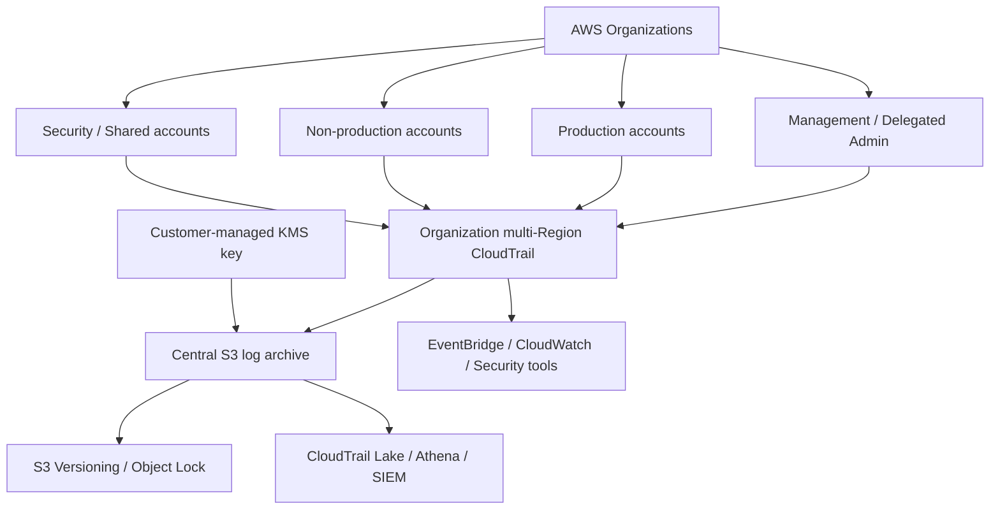

# Organization trail và lưu trữ audit log tập trung

## 1. Vì sao cần audit log tập trung?

Một tổ chức AWS có nhiều tài khoản cho production, staging, development, security và shared services. Khi một security group bất ngờ mở cổng ra Internet, một IAM role bị thay trust policy hoặc một S3 bucket bị đổi policy, đội vận hành cần trả lời nhanh: ai thực hiện, gọi API nào, từ đâu, vào lúc nào, tài khoản nào bị ảnh hưởng và thay đổi có được phê duyệt hay không.

Nếu mỗi tài khoản giữ log riêng, điều tra phải đăng nhập nhiều nơi, dữ liệu có thể bị xóa cùng tài khoản bị xâm nhập và chính sách retention thường không đồng nhất. **Organization trail** của AWS CloudTrail giúp ghi nhận hoạt động trong toàn AWS Organization và tập trung các log files về một vị trí lưu trữ được quản trị riêng.

**Audit log tập trung** là nền tảng cho điều tra sự cố, kiểm soát thay đổi, chứng minh tuân thủ và phát hiện hành vi bất thường. Nó cần được thiết kế như một hệ thống dữ liệu quan trọng: có phân quyền chặt, mã hóa, kiểm tra tính toàn vẹn, retention, backup/replication và quy trình truy cập được audit.

Bài học thuộc chương **Kiểm toán và tuân thủ** của module **CLOUD_PROVIDERS_AWS**. Module khám phá Region/AZ, IAM, VPC, compute, storage, database, integration và serverless; người học cần chọn dịch vụ, thiết kế và triển khai ứng dụng an toàn, có giám sát, khả năng phục hồi và kiểm soát chi phí. Bài học này tập trung vào audit control plane và cách xây dựng kho log tập trung cho nhiều tài khoản.

Sau bài học, bạn sẽ có thể:

- Giải thích CloudTrail trail, organization trail, multi-Region trail và delegated administrator.
- Phân biệt management events, data events, Insights events và log ứng dụng.
- Thiết kế kiến trúc log archive account/S3 bucket tập trung.
- Cấu hình bucket policy, KMS encryption và CloudTrail delivery permissions.
- Bảo vệ log bằng versioning, S3 Object Lock, lifecycle và replication.
- Bật log file integrity validation và kiểm tra digest files.
- Kết hợp CloudWatch Logs, EventBridge và CloudTrail Lake cho điều tra.
- Thiết kế quyền truy cập, retention, monitoring và quy trình audit.

## 2. AWS CloudTrail ghi nhận điều gì?

**AWS CloudTrail** ghi nhận hoạt động tài khoản AWS dưới dạng events. Một event thường mô tả API call hoặc hoạt động liên quan tới tài nguyên, danh tính gọi, thời điểm, nguồn request và kết quả. CloudTrail hỗ trợ điều tra ai đã làm gì với control plane của AWS và, khi được cấu hình, các hoạt động data plane cụ thể.

Ví dụ event có thể ghi nhận:

- Một principal gọi `CreateRole`, `PutRolePolicy` hoặc `AssumeRole`.
- Một operator thay đổi security group ingress rule.
- Một service tạo hoặc xóa S3 bucket.
- Một người dùng thay đổi cấu hình RDS hoặc ECS service.
- Một principal đọc object trong S3 khi S3 data events đã được bật.

CloudTrail không tự ghi lại mọi hoạt động nội bộ của ứng dụng, nội dung mọi request HTTP hoặc mọi lệnh shell trên EC2. Để có audit trail đầy đủ, cần kết hợp CloudTrail với application audit events, OS logs, VPC Flow Logs, load balancer access logs, database audit logs và các nguồn telemetry thích hợp.

### 2.1. Các trường thường gặp trong event

| Trường | Ý nghĩa |
| --- | --- |
| `eventTime` | Thời điểm event |
| `eventSource` | Dịch vụ AWS phát sinh event, ví dụ `iam.amazonaws.com` |
| `eventName` | Tên API/action, ví dụ `CreateRole` |
| `awsRegion` | Region liên quan tới event |
| `sourceIPAddress` | Địa chỉ nguồn hoặc service context |
| `userAgent` | Client/service tạo request |
| `userIdentity` | Danh tính thực hiện request |
| `requestParameters` | Tham số request được ghi nhận, nếu có |
| `responseElements` | Kết quả response được ghi nhận, nếu có |
| `errorCode` / `errorMessage` | Thông tin lỗi khi request thất bại |
| `resources` | Tài nguyên liên quan, nếu có |
| `eventID` | Định danh event |
| `recipientAccountId` | Account nhận event |

Một số trường có thể vắng mặt, bị loại bỏ hoặc có giá trị khác nhau theo API và loại event. Không giả định `requestParameters` luôn chứa đầy đủ payload; CloudTrail không phải bản sao mọi request body.

### 2.2. Đọc userIdentity

`userIdentity` có thể mô tả IAM user, assumed role, federated user, AWS service hoặc identity khác. Khi điều tra role session, chú ý `sessionContext`, `sessionIssuer`, principal/session ARN và `sourceIdentity` nếu tổ chức truyền giá trị này.

Một event có `userIdentity.type` là `AssumedRole` thường cần truy ngược role session về người dùng hoặc workload đã assume role. Kết hợp event `AssumeRole`, identity provider logs, CloudTrail event history và session tags để xác định nguồn gốc. Không kết luận một IAM role ARN là người thực hiện nếu chưa truy vết session.

### 2.3. Event history và trail

CloudTrail Event history cho phép xem management events gần đây trong một Region trong khoảng thời gian được dịch vụ hỗ trợ, thường là 90 ngày. Event history là công cụ tra cứu nhanh; nó không thay thế trail lưu dài hạn vào S3 hoặc CloudTrail Lake event data store với retention được cấu hình.

Trail ghi event theo cấu hình và chuyển log files tới S3, có thể gửi thêm tới CloudWatch Logs. Với điều tra dài hạn hoặc compliance, phải bảo đảm trail và destination đã được bật, log delivery hoạt động và retention đáp ứng policy.

## 3. Phân biệt management events, data events và Insights events

CloudTrail phân loại events theo hoạt động cần ghi nhận. Phân loại này ảnh hưởng tới phạm vi visibility và chi phí.

| Loại event | Ghi nhận | Ví dụ |
| --- | --- | --- |
| Management events | Hoạt động quản lý tài nguyên/control plane | `CreateBucket`, `UpdateFunctionConfiguration`, `AttachRolePolicy` |
| Data events | Hoạt động trên data plane của resource được hỗ trợ | S3 `GetObject`/`PutObject`, Lambda `Invoke` |
| Insights events | Mẫu hoạt động API bất thường theo khả năng CloudTrail Insights | Tăng đột biến API call hoặc API error rate |

### 3.1. Management events

Management events được bật mặc định cho trail theo cấu hình thông thường. Chúng gồm:

- **Read events:** đọc metadata/cấu hình, ví dụ `DescribeInstances`, `GetRole`.
- **Write events:** thay đổi tài nguyên, ví dụ `RunInstances`, `PutBucketPolicy`, `DeleteTrail`.

Có thể chọn ghi cả read/write hoặc chỉ một nhóm theo nhu cầu. Với audit security, thường cần cả hai để thấy ai đọc thông tin nhạy cảm và ai thay đổi cấu hình. Chỉ giữ write events có thể làm thiếu ngữ cảnh điều tra.

### 3.2. Data events

Data events không được ghi mặc định cho mọi resource vì volume có thể rất lớn. Cần chủ động cấu hình event selectors/advanced event selectors cho loại resource và operation cần audit.

Ví dụ:

- S3 object-level API activity cho bucket chứa dữ liệu quan trọng.
- Lambda function invocation để audit việc gọi function.
- DynamoDB item-level activity cho table được hỗ trợ.
- Các resource types khác được CloudTrail hỗ trợ tùy Region/service.

Data events có thể tạo nhiều log records và phát sinh chi phí đáng kể. Chọn bucket/table/function cụ thể, lọc event names hoặc resource ARNs nếu phù hợp. Không bật data events toàn bộ tài khoản mà chưa đánh giá volume, retention và mục tiêu kiểm soát.

### 3.3. CloudTrail Insights

CloudTrail Insights phân tích các management events để phát hiện hoạt động API bất thường, chẳng hạn mức gọi API hoặc tỷ lệ lỗi API thay đổi so với baseline. Insights events được ghi vào trail/event data store khi được bật và có thể hỗ trợ điều tra thay đổi bất thường.

Insights không phải hệ thống phát hiện mọi hành vi độc hại, cũng không thay thế GuardDuty, Security Hub hoặc SIEM. Đây là một nguồn tín hiệu bổ sung; đánh giá phạm vi hỗ trợ, chi phí và cách xử lý finding trước khi bật trên production.

## 4. Trail, multi-Region trail và organization trail

**Trail** là cấu hình CloudTrail thu thập events và giao log files tới S3. Trail có thể áp dụng cho một Region hoặc nhiều Regions, và có thể là organization trail áp dụng cho các accounts trong AWS Organization.

| Khái niệm | Phạm vi |
| --- | --- |
| Single-Region trail | Ghi event của Region được chọn |
| Multi-Region trail | Ghi events từ các AWS Regions được hỗ trợ trong account |
| Organization trail | Ghi events cho các accounts trong AWS Organization |
| Organization multi-Region trail | Mô hình phổ biến để audit tập trung toàn tổ chức và nhiều Regions |

### 4.1. Vì sao nên dùng multi-Region trail?

Workload có thể được tạo ở Region khác với Region đội vận hành thường dùng. Nếu chỉ có trail tại một Region, API activity tại Region khác có thể không nằm trong archive đó. Multi-Region trail giúp thu thập events trên các Regions được hỗ trợ và phát hiện hoạt động ở nơi tổ chức ít quan sát.

Khi triển khai, kiểm tra:

- Multi-Region setting đã bật.
- Global service events được bao gồm theo yêu cầu.
- Event selectors giống nhau trên phạm vi cần audit.
- Region mới được mở trong Organization cũng nằm trong monitoring design.
- Có kiểm thử log delivery và kiểm tra account/Region coverage.

### 4.2. Global service events

Một số dịch vụ AWS có global endpoints hoặc global service events. `IncludeGlobalServiceEvents` điều khiển việc bao gồm các events này trong trail. Với multi-Region trail, CloudTrail xử lý global service events theo cơ chế phân phối của dịch vụ để tránh giả định rằng mỗi Region sẽ có một bản event độc lập.

Không dùng việc bật global events thay cho multi-Region trail; hai cài đặt giải quyết phạm vi khác nhau.

### 4.3. Organization trail

Organization trail là trail được tạo ở management account hoặc delegated administrator account và áp dụng cho các accounts thuộc AWS Organization. Khi account mới được thêm vào Organization, account đó được bao gồm theo phạm vi organization trail mà không cần tạo một trail độc lập trong từng account.

Member accounts có thể xem trail organization theo quyền được cấp nhưng không sở hữu cấu hình organization trail như management/delegated administrator. Thiết kế này giảm nguy cơ mỗi account tự tắt hoặc cấu hình khác nhau, đồng thời giúp log được tập trung về một destination do đội bảo mật quản lý.

### 4.4. Trail và CloudTrail Lake

Trail giao log files tới S3 và có thể tích hợp CloudWatch Logs. CloudTrail Lake dùng event data store để lưu và truy vấn events bằng SQL. Hai mô hình phục vụ nhu cầu khác nhau: S3 archive phù hợp lưu trữ lâu dài, kiểm soát retention/immutability và tích hợp data lake; CloudTrail Lake phù hợp truy vấn và phân tích events trong một managed store với pricing/retention riêng.

## 5. AWS Organizations và delegated administrator cho CloudTrail

AWS Organizations quản lý accounts theo organization, organizational units (OUs) và policies. Organization trail tận dụng trust relationship giữa CloudTrail và Organizations để triển khai audit logging nhất quán.

### 5.1. Management account và security accounts

Kiến trúc thường phân vai:

| Account | Trách nhiệm |
| --- | --- |
| Management account | Quản trị Organization và bật trusted access/ủy quyền |
| Security tooling account | Quản lý detections, integrations và incident workflows |
| Log archive account | Sở hữu S3 bucket tập trung, KMS key và retention |
| Workload accounts | Chạy ứng dụng, phát sinh audit events |

Không nên dùng management account như tài khoản vận hành hằng ngày. Hạn chế người có quyền cao, bật MFA/strong identity controls và dùng delegated administrator khi dịch vụ hỗ trợ.

### 5.2. Trusted access

CloudTrail cần tích hợp với AWS Organizations để tạo và quản lý organization trails. Trusted access cho phép dịch vụ thực hiện các thao tác organization-level cần thiết. Bật trusted access theo quy trình AWS Organizations/CloudTrail; kiểm tra trạng thái integration trước khi tạo trail.

### 5.3. Delegated administrator

Tổ chức có thể đăng ký một account làm delegated administrator cho CloudTrail. Account này được ủy quyền quản lý các tác vụ CloudTrail ở phạm vi tổ chức mà dịch vụ hỗ trợ. Cách này giúp đội security/platform vận hành CloudTrail mà không cần đăng nhập management account cho mọi thay đổi.

Quyền delegated administrator không tự động cấp mọi IAM permissions bên trong account. Vẫn cần IAM roles, permission boundaries, approval và audit cho người vận hành.

### 5.4. Tạo organization trail

Quy trình tổng quát:

1. Xác nhận AWS Organization đã bật all features theo yêu cầu của tích hợp.
2. Bật trusted access cho CloudTrail.
3. Chọn management account hoặc đăng ký delegated administrator.
4. Tạo trail với organization scope.
5. Bật multi-Region và global service events theo baseline.
6. Chọn management/data/Insights events theo risk model.
7. Chỉ định S3 bucket trung tâm, prefix và KMS key nếu dùng SSE-KMS.
8. Bật log file integrity validation.
9. Kiểm tra bucket/KMS policies và log delivery.
10. Theo dõi coverage của accounts/Regions và cảnh báo khi trail bị thay đổi.

Không tạo nhiều organization trails trùng nhau mà không có mục đích; mỗi trail bổ sung có thể tăng chi phí data events và làm phức tạp việc kiểm tra coverage.

## 6. Kiến trúc lưu trữ audit log tập trung

Một mô hình phổ biến dùng log archive account riêng, nơi workload accounts không có quyền xóa hoặc thay đổi dữ liệu audit đã gửi.



### 6.1. Vì sao tách log archive account?

- Workload administrators không thể dễ dàng xóa audit evidence cùng với workload.
- Quyền đọc/xóa log được quản lý bởi một đội độc lập.
- Retention, encryption, Object Lock và replication được cấu hình tập trung.
- Incident response có một nguồn log thống nhất qua nhiều accounts.
- Tổ chức có thể áp dụng controls chặt hơn cho account chứa evidence.

### 6.2. S3 bucket layout

CloudTrail lưu log theo cấu trúc prefix chứa Organization ID (đối với organization trail), account ID, loại log, Region và ngày. Ví dụ dạng đường dẫn:

```text
s3://central-audit-archive/AWSLogs/o-exampleorgid/111122223333/CloudTrail/ap-southeast-1/2026/11/20/
```

Đây là dạng minh họa; prefix thực tế phụ thuộc trail name, S3 key prefix, organization/account IDs và Region. Dùng account ID/organization ID trong path để lọc theo nguồn phát sinh, không dựa vào tên account có thể thay đổi.

### 6.3. Một bucket hay nhiều buckets?

Một bucket tập trung đơn giản hóa policy, lifecycle và inventory; nhiều buckets có thể tách retention/legal hold, data classification hoặc ownership. Quyết định dựa trên volume, query patterns, regulatory retention, isolation requirements và blast radius.

Không gom application logs, security findings và CloudTrail logs vào cùng prefix không có governance. Dùng prefix hoặc bucket riêng, tags và metadata để phân biệt nguồn, retention và owner.

## 7. S3 bucket policy cho CloudTrail delivery

CloudTrail cần quyền ghi log files vào S3 bucket. Bucket policy phải cho phép CloudTrail service principal thực hiện các thao tác cần thiết, giới hạn theo đúng trail/account và bảo đảm bucket owner kiểm soát object.

### 7.1. Nguyên tắc policy

- Cho phép `s3:GetBucketAcl` trên bucket để CloudTrail kiểm tra quyền.
- Cho phép `s3:PutObject` vào prefix `AWSLogs/...`.
- Giới hạn bằng `aws:SourceArn` tương ứng với trail ARN.
- Yêu cầu ACL `bucket-owner-full-control` khi dùng delivery pattern cần ACL.
- Không cấp `s3:PutObject` rộng trên toàn bucket cho mọi principal.
- Tách quyền CloudTrail delivery khỏi quyền đọc/xóa của analyst.

### 7.2. Ví dụ bucket policy

Ví dụ dưới đây minh họa policy cho một organization trail; thay bucket, account ID, Region và trail name bằng giá trị thực:

```json
{
  "Version": "2012-10-17",
  "Statement": [
    {
      "Sid": "AWSCloudTrailAclCheck",
      "Effect": "Allow",
      "Principal": {
        "Service": "cloudtrail.amazonaws.com"
      },
      "Action": "s3:GetBucketAcl",
      "Resource": "arn:aws:s3:::central-audit-archive",
      "Condition": {
        "StringEquals": {
          "aws:SourceArn": "arn:aws:cloudtrail:ap-southeast-1:111122223333:trail/org-audit-trail"
        }
      }
    },
    {
      "Sid": "AWSCloudTrailWrite",
      "Effect": "Allow",
      "Principal": {
        "Service": "cloudtrail.amazonaws.com"
      },
      "Action": "s3:PutObject",
      "Resource": "arn:aws:s3:::central-audit-archive/AWSLogs/o-exampleorgid/*",
      "Condition": {
        "StringEquals": {
          "s3:x-amz-acl": "bucket-owner-full-control",
          "aws:SourceArn": "arn:aws:cloudtrail:ap-southeast-1:111122223333:trail/org-audit-trail"
        }
      }
    }
  ]
}
```

Trong organization trail, CloudTrail ghi object dưới prefix có Organization ID và account ID. Kiểm tra tài liệu bucket policy hiện hành và trail ARN thực tế khi triển khai. Nếu có nhiều trail hoặc delegated administrator, policy phải cho phép đúng các trail cần ghi; không dùng wildcard SourceArn quá rộng nếu có thể chỉ định cụ thể.

### 7.3. S3 Object Ownership và ACL

S3 Object Ownership có chế độ Bucket owner enforced vô hiệu hóa ACLs. Trước khi bật, xác minh tương thích với delivery pattern và yêu cầu ACL của CloudTrail trong cấu hình đang dùng. Nếu policy yêu cầu header `bucket-owner-full-control`, kiểm tra behavior với Object Ownership và thử log delivery trong sandbox. Không thay đổi ownership controls trên bucket đang nhận audit logs nếu chưa xác minh.

### 7.4. Bucket policy không thay IAM

Bucket policy cho phép service ghi log; IAM policies của analyst, automation và administrators quyết định ai có thể đọc, sửa policy, đổi lifecycle hoặc xóa bucket. Dùng explicit deny/guardrails phù hợp để bảo vệ log archive khỏi thao tác ngoài quy trình.

## 8. Mã hóa audit logs bằng AWS KMS

CloudTrail có thể mã hóa log files bằng server-side encryption. S3 mặc định áp dụng SSE-S3 cho object mới nếu không có cấu hình encryption khác; tổ chức có thể chỉ định customer-managed KMS key (SSE-KMS) khi cần kiểm soát key policy, audit key usage hoặc đáp ứng yêu cầu compliance.

### 8.1. Khi nào dùng customer-managed key?

- Cần kiểm soát ai được decrypt audit logs.
- Cần audit key usage và quản lý key rotation theo policy.
- Cần tách quyền key administration khỏi quyền S3 bucket administration.
- Có yêu cầu compliance về key ownership hoặc key lifecycle.

SSE-KMS làm tăng số lượng permissions và dependency. Nếu key bị disable, scheduled for deletion hoặc policy không cho CloudTrail sử dụng, log delivery/encryption hoặc việc đọc log có thể thất bại. Key phải có lifecycle và break-glass recovery được quản lý chặt.

### 8.2. KMS permissions

Khi cấu hình KMS key cho trail, cần kiểm tra key policy cho CloudTrail service principal và quyền của người đọc log. CloudTrail cần các quyền mã hóa phù hợp như kms:GenerateDataKey* và kms:DescribeKey; principal đọc log cần quyền decrypt theo policy. AWS có thể yêu cầu encryption context conditions để giới hạn key use cho đúng trail.

Không thêm kms:* cho mọi principal. Tách:

- Key administrators: quản lý policy/rotation, không mặc nhiên có quyền đọc dữ liệu.
- CloudTrail service: mã hóa log delivery theo trail.
- Audit readers: decrypt khi cần đọc log.
- Break-glass: xử lý key policy/availability trong incident.

### 8.3. Ví dụ khai báo KMS key cho trail

Trong CloudFormation, thuộc tính KMSKeyId của AWS::CloudTrail::Trail trỏ tới KMS key ARN/ID được cấu hình tương thích. Ví dụ:

```yaml
Resources:
  OrganizationTrail:
    Type: AWS::CloudTrail::Trail
    Properties:
      TrailName: organization-audit-trail
      IsOrganizationTrail: true
      IsMultiRegionTrail: true
      IncludeGlobalServiceEvents: true
      EnableLogFileValidation: true
      S3BucketName: central-audit-archive
      KMSKeyId: arn:aws:kms:ap-southeast-1:111122223333:key/11111111-2222-3333-4444-555555555555
```

Đây là một phần cấu hình minh họa; trước khi triển khai phải tạo key policy, bucket policy, organization integration và các selectors tương ứng. Không dùng ARN mẫu này trong account thật.

### 8.4. Key rotation và recovery

Với customer-managed symmetric KMS keys, cân nhắc bật automatic key rotation theo yêu cầu và khả năng của key type. Rotation không thay thế backup key policy hoặc quản lý key deletion. Giữ key enabled trong toàn bộ thời gian log cần đọc; không xóa key chỉ vì trail đã chuyển sang key mới nếu object cũ vẫn được mã hóa bằng key cũ.

## 9. Bảo vệ log bằng versioning, Object Lock và lifecycle

Audit logs là evidence. Người có quyền ghi log không nên có khả năng âm thầm sửa hoặc xóa evidence cũ. S3 cung cấp nhiều lớp bảo vệ; mỗi lớp giải quyết một rủi ro khác nhau.

### 9.1. Versioning

S3 Versioning giữ nhiều versions của một object khi object được ghi đè hoặc xóa bằng delete marker. Versioning giúp khôi phục object bị xóa/ghi đè ngoài ý muốn và hỗ trợ replication. Tuy nhiên, principal có quyền xóa object versions vẫn có thể xóa evidence nếu không có thêm guardrails.

### 9.2. S3 Object Lock

S3 Object Lock dùng mô hình WORM (write once, read many) để bảo vệ object version khỏi bị xóa hoặc ghi đè trong thời gian retention:

| Mode | Đặc điểm |
| --- | --- |
| Governance | Người có quyền đặc biệt s3:BypassGovernanceRetention có thể bypass retention |
| Compliance | Không thể rút ngắn/xóa retention trước hạn, kể cả root user trong account |

Object Lock cần bucket versioning và phải được bật theo yêu cầu khi tạo bucket. Với compliance mode, retention period phải được legal/compliance owner phê duyệt vì không thể tùy tiện rút ngắn sau khi áp dụng.

### 9.3. Default retention và legal hold

Bucket có thể đặt default retention để object mới tự nhận retention period. Legal hold có thể giữ object vô thời hạn cho tới khi được gỡ bởi principal có quyền. Phân biệt retention theo regulation với legal hold phục vụ litigation/incident; ghi nhận ai đặt/gỡ và lý do.

Không bật retention quá dài chỉ để “an toàn”: nó làm tăng storage cost, có thể ảnh hưởng quyền xóa dữ liệu theo privacy obligations và khiến dữ liệu phải được giữ lâu hơn mục đích hợp pháp. Chọn thời hạn theo data classification, contract và regulatory requirement.

### 9.4. Lifecycle và transition

Lifecycle rules có thể chuyển log objects sang storage class tiết kiệm hơn hoặc hết hạn khi retention policy cho phép. Cân nhắc:

- Thời gian cần truy vấn nóng cho incident response.
- Thời gian lưu trữ dài hạn và chi phí retrieval.
- Object Lock retention/legal hold.
- KMS key availability trong suốt thời gian lưu trữ.
- Replication status và khả năng restore.

Lifecycle expiration không thể vượt qua Object Lock retention đang hiệu lực. Đừng đặt lifecycle rule xóa log trước thời hạn compliance hoặc khi legal hold còn tồn tại.

### 9.5. Replication và cross-account backup

S3 replication có thể sao chép audit objects sang bucket ở account/Region khác để tăng khả năng phục hồi. Thiết kế replication phải xét versioning ở cả source/destination, IAM role, bucket policies, KMS permissions và replication metrics. Nếu muốn replicate Object Lock retention/legal-hold metadata, destination bucket cũng phải được cấu hình Object Lock phù hợp. Nếu yêu cầu bảo vệ trước compromise của primary account, destination account phải có access boundary độc lập.

Replication không tự động chứng minh bản sao hợp lệ hoặc đảm bảo mọi object đã được replicate ngay lập tức. Theo dõi replication status, kiểm tra object versions và thực hiện restore drills.

## 10. Log file integrity validation

CloudTrail hỗ trợ **log file integrity validation** để giúp phát hiện log files hoặc digest files bị thay đổi, xóa hoặc thiếu sau khi được CloudTrail giao tới S3. Khi bật validation, CloudTrail tạo digest files theo chu kỳ; digest chứa thông tin hash và chữ ký để kiểm tra tính toàn vẹn của log files.

### 10.1. Hash và digest

CloudTrail dùng hashing và digital signatures để tạo chuỗi digest. Digest tham chiếu các log files trong khoảng thời gian và cho phép xác minh rằng nội dung nhận được khớp với dữ liệu CloudTrail đã ký. Digest files được lưu riêng trong cấu trúc CloudTrail-Digest dưới AWSLogs; cần bảo vệ cả digest lẫn log files. Việc validation giúp phát hiện tampering sau delivery; nó không ngăn người có quyền xóa object, và không thay thế Object Lock hoặc access control.

### 10.2. Bật validation

Trong CloudFormation:

```yaml
Resources:
  OrganizationTrail:
    Type: AWS::CloudTrail::Trail
    Properties:
      TrailName: organization-audit-trail
      IsOrganizationTrail: true
      IsMultiRegionTrail: true
      EnableLogFileValidation: true
      IncludeGlobalServiceEvents: true
      S3BucketName: central-audit-archive
```

Trong AWS CLI, khi tạo trail có thể dùng --enable-log-file-validation; khi cập nhật cấu hình trail, dùng API/CLI phù hợp để bật validation. Bật càng sớm càng tốt: validation không tạo digest retroactive cho log files được giao trước khi bật.

### 10.3. Validate logs bằng AWS CLI

```bash
aws cloudtrail validate-logs \
  --trail-arn arn:aws:cloudtrail:ap-southeast-1:111122223333:trail/organization-audit-trail \
  --start-time 2026-11-01T00:00:00Z \
  --end-time 2026-11-02T00:00:00Z \
  --region ap-southeast-1
```

Lệnh kiểm tra digest/log files trong khoảng thời gian chỉ định. Thay ARN và time range bằng giá trị thật. Nếu validation báo thiếu digest hoặc log file, cần điều tra delivery gap, lifecycle deletion, replication, access changes và trạng thái trail; không tự kết luận ngay rằng dữ liệu bị cố ý sửa.

### 10.4. Quy trình integrity định kỳ

1. Bật validation trên organization trail.
2. Bảo vệ digest files cùng mức với log files.
3. Chạy validation định kỳ hoặc khi có yêu cầu điều tra.
4. Lưu kết quả validation trong evidence store có quyền độc lập.
5. Alert khi validation thất bại hoặc log delivery có gap.
6. Điều tra nguyên nhân và ghi nhận remediation.

## 11. CloudFormation: organization trail và S3 archive

IaC giúp version hóa trail configuration, bucket policy và encryption controls. Ví dụ sau minh họa các thuộc tính chính của organization multi-Region trail; bucket và key phải được tạo/cấu hình trước hoặc được tham chiếu qua resources tương ứng trong template hoàn chỉnh.

```yaml
Parameters:
  AuditBucketName:
    Type: String
  AuditKmsKeyArn:
    Type: String

Resources:
  OrganizationTrail:
    Type: AWS::CloudTrail::Trail
    Properties:
      TrailName: organization-audit-trail
      IsOrganizationTrail: true
      IsMultiRegionTrail: true
      IncludeGlobalServiceEvents: true
      EnableLogFileValidation: true
      S3BucketName: !Ref AuditBucketName
      KMSKeyId: !Ref AuditKmsKeyArn
      IsLogging: true
      EventSelectors:
        - IncludeManagementEvents: true
          ReadWriteType: All
```

Ví dụ thể hiện management events. Data events cần thêm selectors phù hợp resource type/ARN và risk model; CloudTrail Insights cần cấu hình event selectors riêng theo API/resource specification. Trước khi deploy, xác nhận Organization trusted access, caller là management/delegated admin, bucket policy và KMS key policy đã sẵn sàng.

### 11.1. Organization trail và bucket account

Trail được tạo bởi management/delegated administrator account, còn S3 bucket có thể thuộc log archive account nếu bucket policy cho phép CloudTrail delivery. Kiểm tra account IDs trong trail ARN, KMS key ARN và bucket policy để tránh cấp quyền nhầm.

### 11.2. Cập nhật trail an toàn

Thay đổi event selectors có thể làm thay đổi đáng kể volume và chi phí. Thay đổi bucket/prefix/KMS key có thể ảnh hưởng log delivery hoặc quyền đọc log cũ. Review CloudFormation change set và kiểm tra log delivery sau mỗi lần update.

## 12. Tìm kiếm và phân tích log tập trung

S3 là archive bền vững; để truy vấn và phản ứng nhanh, có thể kết hợp các dịch vụ khác.

### 12.1. CloudTrail Event history

Event history hữu ích khi điều tra nhanh một account/Region và khoảng thời gian gần đây. Nó không thay thế archive dài hạn và không hiển thị data events theo cùng cách như trail/event data store đã cấu hình.

### 12.2. CloudWatch Logs

Trail có thể gửi events tới CloudWatch Logs để tạo metric filters, alarms và truy vấn Logs Insights. Đây là lựa chọn phù hợp khi cần cảnh báo nhanh theo API event hoặc tìm kiếm vận hành gần thời gian thực. Cần cấu hình CloudWatch Logs role và log group retention; giới hạn quyền truy cập log group.

### 12.3. EventBridge

CloudTrail events có thể xuất hiện dưới dạng EventBridge events để route theo eventSource, eventName, account, Region hoặc user identity. Ví dụ tạo rule phát hiện ConsoleLogin bất thường, thay đổi IAM policy, tắt trail hoặc sửa S3 bucket policy.

EventBridge phù hợp cho routing/automation gần thời gian thực; archive S3 vẫn cần để lưu trữ và điều tra dài hạn. Automation phải idempotent và có guardrails; một event có thể được giao lại hoặc xử lý nhiều lần.

### 12.4. CloudTrail Lake

CloudTrail Lake lưu events trong event data store và hỗ trợ truy vấn SQL trên dữ liệu được ingest. Phù hợp cho điều tra nhiều account/Region và phân tích xu hướng API activity mà không phải tự dựng toàn bộ query engine. Event data store có selectors, retention và pricing riêng; đánh giá chi phí ingest/query trước khi chọn làm kho phân tích chính.

### 12.5. Athena và data lake

CloudTrail log files trong S3 có thể được truy vấn bằng Athena với schema phù hợp, partitioning và catalog. Với lượng log lớn, tổ chức có thể chuẩn hóa partition theo account/Region/date để giảm scan cost. Cần bảo vệ Glue Data Catalog, Athena workgroups, query results bucket và quyền truy cập dữ liệu.

Không sao chép toàn bộ log sang nhiều nơi mà không có retention/ownership rõ. Dữ liệu audit thường chứa identity, resource names, IP addresses và request metadata; xử lý theo data classification và privacy policy.

## 13. CloudTrail CLI: tạo, kiểm tra và vận hành trail

AWS CLI hữu ích cho automation và kiểm tra trạng thái. Các lệnh phải chạy từ management/delegated administrator account khi thao tác organization trail, với credentials có quyền phù hợp và Region đúng.

### 13.1. Tạo organization trail

```bash
aws cloudtrail create-trail \
  --name organization-audit-trail \
  --s3-bucket-name central-audit-archive \
  --s3-key-prefix organization \
  --is-multi-region-trail \
  --include-global-service-events \
  --is-organization-trail \
  --enable-log-file-validation \
  --kms-key-id arn:aws:kms:ap-southeast-1:111122223333:key/11111111-2222-3333-4444-555555555555 \
  --region ap-southeast-1
```

Lệnh là ví dụ cho một organization trail. Bucket policy và KMS key policy phải cho phép delivery trước khi bật logging. Với tổ chức đã có trail cùng tên, CreateTrail có thể trả lỗi; kiểm tra trạng thái hiện tại trước khi tạo mới.

### 13.2. Bật logging

```bash
aws cloudtrail start-logging \
  --name organization-audit-trail \
  --region ap-southeast-1
```

CreateTrail tạo trail configuration; StartLogging bắt đầu ghi nhận events. Xác minh trạng thái sau khi start và kiểm tra log delivery tới S3.

### 13.3. Kiểm tra trạng thái

```bash
aws cloudtrail get-trail \
  --name organization-audit-trail \
  --region ap-southeast-1

aws cloudtrail get-trail-status \
  --name organization-audit-trail \
  --region ap-southeast-1

aws cloudtrail describe-trails \
  --include-shadow-trails \
  --region ap-southeast-1
```

Kiểm tra các trường như IsOrganizationTrail, IsMultiRegionTrail, IncludeGlobalServiceEvents, LatestDeliveryTime, LatestDeliveryError và IsLogging. Tên field trong response có thể khác giữa API output/CLI formatting; đọc kết quả đầy đủ thay vì chỉ dựa vào một boolean.

### 13.4. Event selectors cho data events

Ví dụ minh họa bật S3 object-level data events cho một bucket cụ thể:

```bash
aws cloudtrail put-event-selectors \
  --trail-name organization-audit-trail \
  --event-selectors '[{"ReadWriteType":"All","IncludeManagementEvents":true,"DataResources":[{"Type":"AWS::S3::Object","Values":["arn:aws:s3:::sensitive-data-bucket/"]}]}]' \
  --region ap-southeast-1
```

Lệnh PutEventSelectors thay thế event selector configuration hiện có của trail. Không chạy trực tiếp trên production nếu chưa export/review selectors hiện tại; cấu hình mới có thể vô tình bỏ các data resources hoặc management-event settings trước đó. Với advanced selectors, dùng API/CLI tương ứng và review field selectors.

### 13.5. Dừng logging có kiểm soát

```bash
aws cloudtrail stop-logging \
  --name organization-audit-trail \
  --region ap-southeast-1
```

Dừng logging làm mất visibility cho các events mới trong khoảng thời gian trail bị dừng. Đây là thao tác nhạy cảm; giới hạn IAM permission, audit CloudTrail management events và tạo cảnh báo khi trail bị stop/update/delete. Chỉ dừng khi có maintenance/incident plan đã được phê duyệt.

## 14. IAM và quyền truy cập audit archive

Audit archive cần separation of duties. Người vận hành workload có thể cần gửi log thông qua service integration nhưng không nên có quyền đọc/xóa archive. Analyst cần đọc log nhưng không nhất thiết có quyền thay bucket policy hoặc retention.

### 14.1. Vai trò nên tách

| Role | Quyền chính |
| --- | --- |
| CloudTrail delivery | Service principal ghi log theo bucket/key policy |
| Log archive administrator | Quản lý bucket, KMS, lifecycle, Object Lock theo approval |
| Security auditor | Đọc log, chạy Athena/CloudTrail Lake queries |
| Incident responder | Đọc log và evidence cần thiết trong incident |
| Workload administrator | Quản trị workload; không có quyền xóa central audit evidence |
| Break-glass administrator | Khôi phục quyền truy cập theo quy trình đặc biệt, có audit |

### 14.2. Least privilege cho readers

Security auditor thường cần S3 list/get trên prefix được phép, KMS decrypt nếu dùng SSE-KMS và quyền query trên Athena/CloudTrail Lake. Giới hạn theo account/OU/data classification nếu policy cho phép. Không cấp s3:DeleteObject, s3:DeleteObjectVersion hoặc quyền sửa bucket policy cho role chỉ đọc.

### 14.3. Bảo vệ trail configuration

Các CloudTrail API nhạy cảm gồm CreateTrail, UpdateTrail, DeleteTrail, StartLogging, StopLogging, PutEventSelectors và PutInsightSelectors. Kiểm soát ai có thể gọi các API này, đặc biệt với organization trail. Tạo alarms/EventBridge rules để phát hiện thay đổi hoặc dừng trail.

### 14.4. SCP và preventive controls

SCP có thể giới hạn quyền của member accounts, nhưng không cấp quyền và không áp dụng cho management account. Dùng SCP/permission boundaries/IAM policies phù hợp để giảm khả năng member account tạo trail khác làm rối governance hoặc tắt controls được quản lý tập trung. Kiểm tra ngoại lệ cho break-glass, delegated administrator và automation trước khi áp dụng.

### 14.5. Audit access tới audit logs

Việc đọc audit logs cũng là hành vi nhạy cảm. Ghi nhận quyền truy cập S3, CloudTrail Lake, Athena và KMS; xem xét S3 data events cho bucket archive, CloudTrail management events và CloudTrail Lake access controls. Người có quyền điều tra không nên tự ý thay đổi evidence hoặc xóa dấu vết truy vấn.

## 15. Monitoring log delivery và trail health

Một trail được cấu hình đúng vẫn có thể ngừng ghi do bucket policy, KMS key, quota hoặc service issue. Không chỉ kiểm tra một lần khi tạo trail; cần monitor liên tục.

### 15.1. Dấu hiệu cần theo dõi

- Trail không còn ở trạng thái logging.
- Latest delivery time quá cũ so với kỳ vọng.
- Latest delivery error có giá trị.
- S3 prefix không có object mới trong khoảng thời gian dự kiến.
- KMS key bị disable hoặc policy bị thay đổi.
- Bucket policy, lifecycle hoặc Object Lock configuration bị sửa.
- Organization account/Region mới không xuất hiện trong archive.
- Integrity validation phát hiện digest/log gap.

### 15.2. CloudTrail delivery metrics/events

CloudTrail cung cấp trạng thái delivery qua API và các metrics/notifications phù hợp. Dùng CloudWatch alarms hoặc EventBridge để giám sát trail health, nhưng nhớ rằng log delivery có độ trễ; không kỳ vọng object xuất hiện tức thời sau mọi API call. Đặt threshold dựa trên delivery cadence và operational requirement.

### 15.3. Kiểm tra S3 inventory/coverage

Có thể dùng S3 Inventory hoặc job định kỳ để xác định log prefix nào không có object trong khoảng thời gian kỳ vọng. Kết hợp organization account inventory với account IDs trong log paths để tìm account chưa có event hoặc chưa nhận log. Phân biệt account im lặng hợp lệ với account bị thiếu telemetry.

### 15.4. Cảnh báo khi trail bị thay đổi

Tạo EventBridge rule hoặc metric/filter dựa trên CloudTrail events cho các API:

- StopLogging hoặc DeleteTrail.
- UpdateTrail thay đổi bucket, KMS key hoặc multi-Region settings.
- PutEventSelectors thay đổi phạm vi events.
- Thay bucket policy, KMS key policy, Object Lock hoặc lifecycle.
- Thay đổi Organizations trusted access/delegated administrator.

Route cảnh báo tới security team và giữ event trong archive độc lập. Nếu automation tự phục hồi trail, cần bảo đảm không ghi đè thay đổi hợp lệ trong maintenance.

## 16. Retention, compliance và evidence lifecycle

Audit logs có thể là bằng chứng phục vụ điều tra, kiểm toán độc lập, legal hold hoặc yêu cầu quản lý. Không có một thời hạn retention chung cho mọi tổ chức; phải xác định theo regulation, contract, data classification, internal policy và mục đích xử lý.

### 16.1. Xây dựng retention policy

Một retention policy nên quy định:

- Loại log và data classification.
- Account/Region/service được bao phủ.
- Thời gian lưu ở hot, warm và archive storage.
- Thời hạn Object Lock retention và legal hold process.
- Khi nào được phép xóa/expire object versions.
- Ai phê duyệt thay đổi retention.
- Cách xử lý privacy requests và legal obligations.
- Evidence cần giữ khi có incident/audit.

Không đặt một lifecycle expiration duy nhất cho mọi prefix nếu các loại logs có retention khác nhau. Có thể tách bucket/prefix theo classification, nhưng phải bảo đảm không tạo đường vòng để workload account xóa log.

### 16.2. Object Lock governance và compliance mode

Governance mode phù hợp khi cần bảo vệ trước thao tác thông thường nhưng vẫn có một nhóm được ủy quyền bypass trong trường hợp hợp lệ. Compliance mode phù hợp với yêu cầu WORM nghiêm ngặt; retention không thể rút ngắn trước hạn. Phải kiểm tra legal, privacy và storage cost trước khi chọn mode.

### 16.3. Evidence package cho audit

Khi auditor cần bằng chứng, chuẩn bị:

1. Organization trail configuration và account/Region coverage.
2. Event selector/Insights configuration.
3. S3 bucket policy, KMS key policy và encryption settings.
4. Versioning/Object Lock/lifecycle/replication settings.
5. Log file integrity validation results.
6. Trail health/delivery evidence.
7. Access control review và danh sách role có quyền đọc/xóa.
8. Retention policy, legal holds và exception approvals.

Evidence package cần có timestamp, owner, source account và version/configuration identifier. Không gửi raw audit logs rộng hơn phạm vi cần thiết; dữ liệu có thể chứa principal names, IP addresses và metadata nội bộ.

### 16.4. Kiểm thử restore và retrieval

Định kỳ kiểm tra khả năng truy xuất logs từ S3 archive, decrypt bằng KMS, query bằng Athena/CloudTrail Lake và restore object từ replication/backup. Một bucket có objects nhưng key đã bị xóa hoặc permissions không còn dùng được thì không phải archive có thể phục hồi.

## 17. Cost management cho audit logging

Audit logging là control bảo mật, nhưng phạm vi thu thập và lưu trữ có thể ảnh hưởng đáng kể tới chi phí. Cost model cần bao gồm ingest, storage, retrieval, query, encryption và replication.

### 17.1. Các nguồn chi phí

| Thành phần | Yếu tố ảnh hưởng |
| --- | --- |
| CloudTrail management events | Trail/management-event delivery theo pricing hiện hành và số bản sao trail |
| Data events | Số lượng events và selectors được bật |
| Insights events | Loại Insights và volume theo pricing |
| S3 storage | Dung lượng, storage class, versions, Object Lock retention |
| S3 requests | PUT, GET, LIST, inventory và lifecycle operations |
| KMS | API requests và key usage |
| Replication | Cross-Region transfer, destination storage và requests |
| CloudWatch Logs | Ingestion, storage và query |
| CloudTrail Lake | Ingestion, retention và query theo pricing |
| Athena | Dữ liệu scan, query frequency và result storage |

### 17.2. Tối ưu mà không mất audit coverage

- Bật management events cho phạm vi tổ chức cần thiết.
- Chọn data events theo resource classification và threat model.
- Dùng advanced event selectors để giới hạn resource/event names khi phù hợp.
- Dùng S3 lifecycle chuyển logs cũ sang storage class phù hợp sau thời gian hot-query.
- Tách query workload và giới hạn scan bằng partitioning/Athena workgroups.
- Theo dõi data event volume, duplicate trails và CloudTrail Lake ingestion.
- Không giảm retention hoặc bỏ event type chỉ để tiết kiệm mà chưa có risk/compliance approval.

### 17.3. Tags và cost allocation

Gắn tags cho buckets, KMS keys, CloudTrail trails, log groups và event data stores theo Application/Owner/Environment/CostCenter/DataClass. Dùng AWS Budgets/Cost Explorer hoặc cost allocation reporting để theo dõi storage, query và data-event growth.

## 18. Case study: centralized audit cho Shop Organization

Một tổ chức có bốn nhóm account: production, non-production, shared services và security. Đội security cần theo dõi IAM changes, network exposure, S3 object access ở bucket chứa hóa đơn và các thao tác có thể tắt audit controls.

### 18.1. Account design

| Account | Trách nhiệm |
| --- | --- |
| Management | AWS Organizations, trusted access và delegated admin registration |
| Security tooling | CloudTrail delegated administrator, detections và incident routing |
| Log archive | Central S3 bucket, KMS key, Object Lock và replication |
| Workload accounts | Ứng dụng Java, ECS, RDS, S3 và các resources khác |

### 18.2. Trail configuration

1. Security account được đăng ký làm CloudTrail delegated administrator.
2. Tạo organization multi-Region trail, bao gồm global service events.
3. Bật management read/write events trên các accounts.
4. Bật S3 data events cho bucket hóa đơn và những data stores nhạy cảm đã được phân loại.
5. Bật CloudTrail Insights cho nhóm management events cần phát hiện API activity bất thường.
6. Chỉ định central S3 bucket ở log archive account và customer-managed KMS key.
7. Bật log file integrity validation.

### 18.3. Archive protection

- S3 versioning và Object Lock theo retention policy đã được phê duyệt.
- Bucket policy chỉ cho phép đúng organization trail ghi vào prefix.
- KMS key policy cho phép CloudTrail encryption và auditor decrypt.
- Workload accounts không có quyền đọc/xóa central archive.
- Replication sang account/Region độc lập cho disaster recovery.
- Lifecycle chuyển logs cũ sang storage class phù hợp sau thời gian điều tra nóng.

### 18.4. Detection và investigation

EventBridge route các events như StopLogging, DeleteTrail, PutEventSelectors, AttachRolePolicy và PutBucketPolicy tới security workflow. CloudWatch Logs hỗ trợ tìm kiếm nhanh; CloudTrail Lake/Athena phục vụ điều tra lịch sử.

Khi có nghi vấn IAM role bị lạm dụng:

1. Tìm event AssumeRole và truy vết source identity/session context.
2. Tìm API calls của session trong cùng khoảng thời gian.
3. Xác định resources bị đọc/thay đổi và account/Region liên quan.
4. Kiểm tra event errors, source IP, user agent và event IDs.
5. Đối chiếu application/OS/network logs để hiểu tác động thực tế.
6. Lưu evidence, digest validation result và incident timeline vào kho riêng.

### 18.5. Một tình huống thiếu log

Một account mới được tạo nhưng log prefix của account đó không xuất hiện. Đội security:

1. Xác nhận account đã gia nhập Organization và thuộc phạm vi organization trail.
2. Kiểm tra trail status, logging status và event delivery errors.
3. Kiểm tra S3 bucket policy có cho phép đúng trail ARN và organization prefix.
4. Kiểm tra KMS key enabled và key policy.
5. Xác minh event phát sinh tại Region dự kiến, không nhầm với account không có hoạt động.
6. Kiểm thử bằng một management API an toàn và xác nhận log xuất hiện.

## 19. Checklist production cho organization trail và audit archive

1. **Organization:** trusted access và delegated administrator được quản lý rõ.
2. **Coverage:** organization trail áp dụng đúng accounts, multi-Region và global events.
3. **Events:** management read/write được chọn; data events/Insights theo risk model.
4. **Trail health:** logging enabled, delivery status và errors được giám sát.
5. **Archive isolation:** log archive account tách khỏi workload/management operations.
6. **S3 policy:** CloudTrail service principal chỉ ghi đúng prefix và đúng trail ARN.
7. **KMS:** key policy cho CloudTrail và readers; key rotation/recovery có owner.
8. **Encryption:** SSE-S3 hoặc SSE-KMS theo data classification.
9. **Immutability:** versioning/Object Lock mode và retention được legal/compliance phê duyệt.
10. **Lifecycle:** expiration/transition không xung đột retention hoặc legal hold.
11. **Replication:** destination account/Region độc lập và replication status được theo dõi.
12. **Integrity:** log file validation bật; digest được bảo vệ và validate định kỳ.
13. **Search:** Event history, CloudWatch Logs, EventBridge, CloudTrail Lake/Athena có mục đích rõ.
14. **IAM:** auditor read-only, archive admin, responder và break-glass roles được tách.
15. **Tamper detection:** cảnh báo StopLogging/DeleteTrail/UpdateTrail/selector changes và bucket/KMS policy changes.
16. **Privacy:** log data được phân loại, giới hạn access và retention đúng nghĩa vụ.
17. **Cost:** data events, Lake, S3, KMS, replication và queries được theo dõi.
18. **Evidence:** audit package gồm coverage, policies, retention, integrity và access review.
19. **Recovery:** thử truy xuất/decrypt/restore logs định kỳ.
20. **Ownership:** mỗi account group, trail, bucket, key và runbook có owner.

## 20. Câu hỏi tự kiểm tra

**Câu 1.** AWS CloudTrail ghi nhận điều gì?

**Gợi ý:** AWS account activity/API events và data-plane events của resource được hỗ trợ khi cấu hình selectors.

**Câu 2.** CloudTrail có thay thế application logs không?

**Gợi ý:** Không. Nó không ghi mọi request/business event hoặc mọi lệnh OS; cần kết hợp log nguồn khác.

**Câu 3.** Management events khác data events thế nào?

**Gợi ý:** Management events mô tả control-plane operations; data events mô tả hoạt động trên dữ liệu/resource được hỗ trợ và phải chọn phạm vi.

**Câu 4.** Vì sao cần organization trail?

**Gợi ý:** Thu thập audit events cho các accounts trong Organization và quản lý cấu hình tập trung.

**Câu 5.** Multi-Region trail giải quyết vấn đề gì?

**Gợi ý:** Thu thập events từ các Regions được hỗ trợ thay vì chỉ Region nơi trail được tạo.

**Câu 6.** Delegated administrator có vai trò gì?

**Gợi ý:** Account được Organization ủy quyền quản lý CloudTrail ở phạm vi tổ chức mà dịch vụ hỗ trợ.

**Câu 7.** Vì sao nên có log archive account riêng?

**Gợi ý:** Tách audit evidence khỏi workload administrators, giảm nguy cơ log bị xóa khi workload account bị compromise.

**Câu 8.** CloudTrail cần quyền S3 nào để delivery?

**Gợi ý:** Thường cần GetBucketAcl và PutObject vào đúng AWSLogs prefix với bucket policy giới hạn theo trail.

**Câu 9.** SSE-KMS mang lại điều gì và thêm rủi ro nào?

**Gợi ý:** Kiểm soát key access/audit; key policy hoặc key availability sai có thể làm delivery/decryption thất bại.

**Câu 10.** S3 Versioning có làm log bất biến không?

**Gợi ý:** Không. Versioning giúp khôi phục versions nhưng principal có quyền xóa versions vẫn có thể xóa evidence.

**Câu 11.** S3 Object Lock khác Versioning thế nào?

**Gợi ý:** Object Lock áp dụng WORM retention/legal hold cho object versions; Versioning giữ các versions nhưng không tự ngăn xóa.

**Câu 12.** Governance mode khác Compliance mode thế nào?

**Gợi ý:** Governance cho principal có quyền bypass retention; Compliance không cho rút ngắn/xóa trước hạn, kể cả root.

**Câu 13.** Log file integrity validation làm gì?

**Gợi ý:** Dùng digest/hash/signature để phát hiện log/digest bị sửa, thiếu hoặc xóa sau delivery; không ngăn việc xóa.

**Câu 14.** Có thể validate các log files được giao trước khi bật validation không?

**Gợi ý:** Không có digest retroactive cho giai đoạn trước khi bật; bật càng sớm càng tốt.

**Câu 15.** CloudWatch Logs và S3 archive phục vụ vai trò gì?

**Gợi ý:** CloudWatch Logs hỗ trợ tìm kiếm/alarms nhanh; S3 archive lưu trữ bền vững dài hạn.

**Câu 16.** CloudTrail Lake khác Athena thế nào?

**Gợi ý:** Lake là managed event data store có SQL; Athena truy vấn dữ liệu CloudTrail được lưu trong S3.

**Câu 17.** Vì sao cần cảnh báo khi StopLogging hoặc DeleteTrail?

**Gợi ý:** Đây là thao tác có thể làm mất audit visibility và cần được phát hiện ngay.

**Câu 18.** Làm thế nào kiểm tra một account mới đã được bao phủ?

**Gợi ý:** Kiểm tra Organization membership, trail scope, delivery status và xác nhận log event thực tế trong prefix account.

**Câu 19.** Vì sao cần audit quyền đọc audit logs?

**Gợi ý:** Log chứa identity/IP/resource metadata nhạy cảm; việc truy cập evidence cũng cần accountability.

**Câu 20.** Retention policy nên dựa trên yếu tố nào?

**Gợi ý:** Regulation, contract, data classification, internal policy, legal hold, privacy obligations và mục đích điều tra.

## 21. Ghi nhớ

**Organization trail** là cách tập trung CloudTrail events trên các accounts trong AWS Organization. Kết hợp multi-Region và global service events để mở rộng coverage; bật management read/write events và lựa chọn data events/Insights theo threat model, volume và chi phí. CloudTrail cung cấp audit cho AWS API activity, còn application/OS/network/database logs vẫn cần nguồn riêng.

**Central S3 log archive** nên nằm trong account độc lập với workload, có bucket policy chỉ cho đúng trail delivery, KMS key policy rõ, IAM separation of duties và monitoring log delivery. Versioning hỗ trợ khôi phục object versions; Object Lock mới cung cấp WORM retention/legal hold. Lifecycle, replication và key lifecycle phải phù hợp regulatory retention và khả năng phục hồi.

**Integrity validation và vận hành liên tục** giúp phát hiện log files/digests bị thiếu hoặc thay đổi sau delivery. Bật validation sớm, giữ digest files, chạy validate định kỳ và lưu kết quả độc lập. Kết hợp EventBridge/CloudWatch Logs cho cảnh báo gần thời gian thực, CloudTrail Lake/Athena cho truy vấn, và runbook/evidence package cho điều tra. Audit archive chỉ có giá trị khi log được giao đầy đủ, có thể đọc lại, giải mã và kiểm chứng trong suốt thời gian retention.

### Tài liệu AWS tham khảo

- [AWS CloudTrail User Guide](https://docs.aws.amazon.com/awscloudtrail/latest/userguide/cloudtrail-user-guide.html)
- [Creating a trail for an organization](https://docs.aws.amazon.com/awscloudtrail/latest/userguide/creating-an-organizational-trail.html)
- [Organization trails](https://docs.aws.amazon.com/awscloudtrail/latest/userguide/creating-an-organizational-trail-prepare.html)
- [CloudTrail event types](https://docs.aws.amazon.com/awscloudtrail/latest/userguide/cloudtrail-events.html)
- [Management events](https://docs.aws.amazon.com/awscloudtrail/latest/userguide/logging-management-events-with-cloudtrail.html)
- [Data events](https://docs.aws.amazon.com/awscloudtrail/latest/userguide/logging-data-events-with-cloudtrail.html)
- [CloudTrail Insights](https://docs.aws.amazon.com/awscloudtrail/latest/userguide/logging-insights-events-with-cloudtrail.html)
- [CloudTrail log file integrity validation](https://docs.aws.amazon.com/awscloudtrail/latest/userguide/cloudtrail-log-file-validation-intro.html)
- [CloudTrail S3 bucket policy](https://docs.aws.amazon.com/awscloudtrail/latest/userguide/create-s3-bucket-policy-for-cloudtrail.html)
- [CloudTrail KMS key policy](https://docs.aws.amazon.com/awscloudtrail/latest/userguide/create-kms-key-policy-for-cloudtrail.html)
- [CloudTrail with CloudWatch Logs](https://docs.aws.amazon.com/awscloudtrail/latest/userguide/send-cloudtrail-events-to-cloudwatch-logs.html)
- [CloudTrail and EventBridge](https://docs.aws.amazon.com/awscloudtrail/latest/userguide/cloudtrail-events-and-eventbridge.html)
- [CloudTrail Lake](https://docs.aws.amazon.com/awscloudtrail/latest/userguide/cloudtrail-lake.html)
- [Amazon S3 Object Lock](https://docs.aws.amazon.com/AmazonS3/latest/userguide/object-lock.html)
- [S3 replication](https://docs.aws.amazon.com/AmazonS3/latest/userguide/replication.html)
- [AWS Organizations trusted access](https://docs.aws.amazon.com/organizations/latest/userguide/orgs_integrate_services.html)
- [AWS CloudTrail pricing](https://aws.amazon.com/cloudtrail/pricing/)
