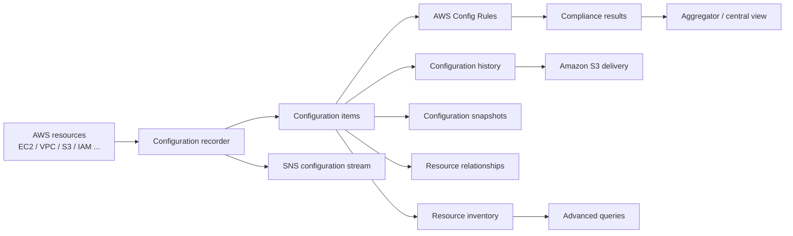
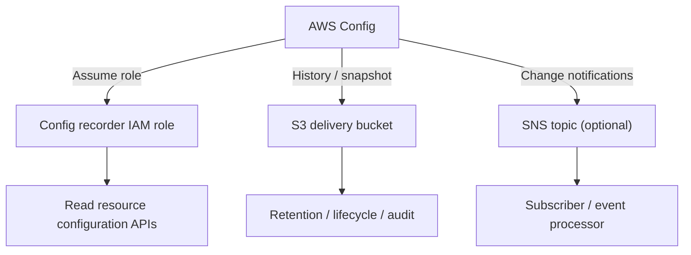
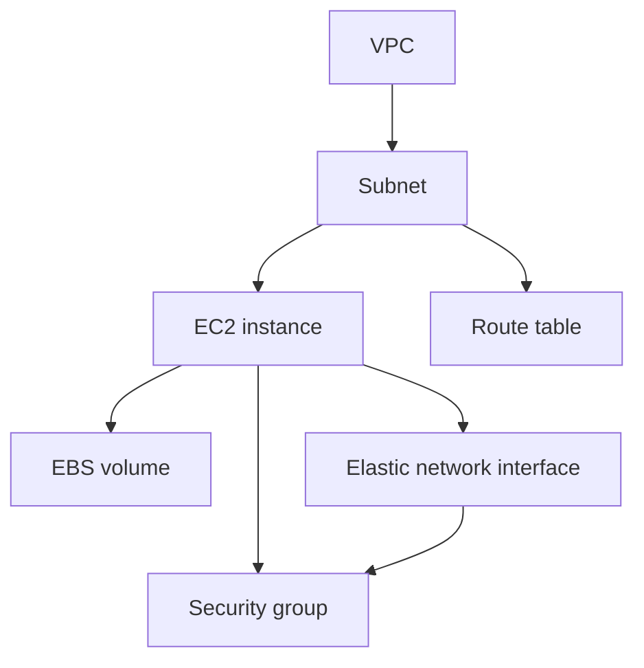
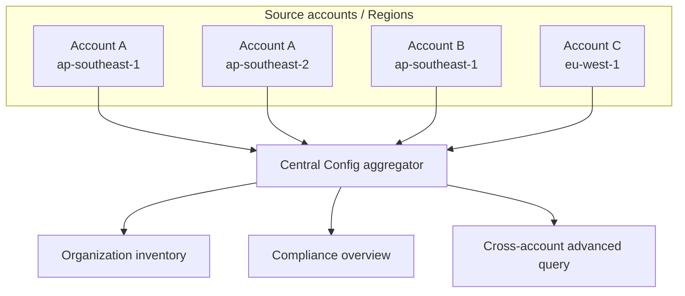
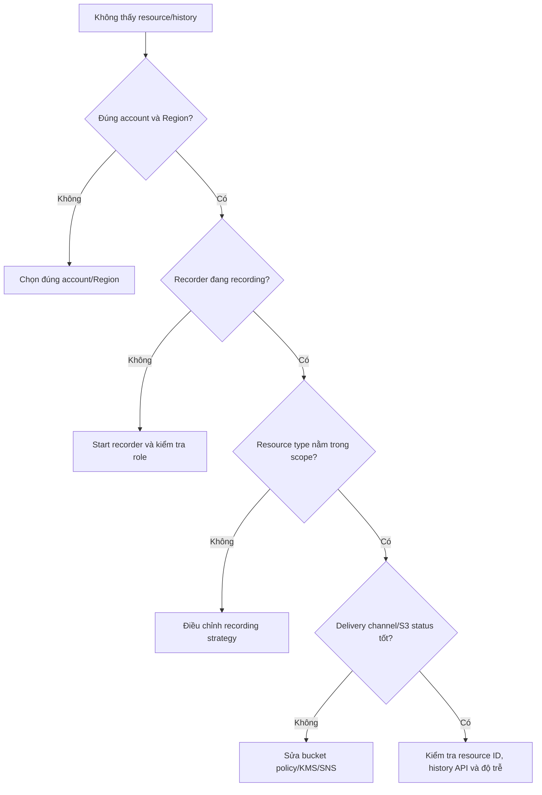

# AWS Config resource inventory và lịch sử cấu hình

## Mục tiêu học tập

Sau bài học, bạn có thể:

1. Giải thích vai trò của AWS Config trong quản lý inventory, cấu hình và quan hệ giữa AWS resources.
2. Phân biệt configuration recorder, configuration item, configuration history, configuration snapshot và delivery channel.
3. Chọn recording strategy và recording frequency phù hợp với phạm vi quản trị, chi phí và yêu cầu audit.
4. Cấu hình AWS Config theo Region với IAM role, S3 delivery bucket và SNS notification topic.
5. Tra cứu resource inventory, cấu hình hiện tại và lịch sử thay đổi bằng Console, AWS CLI và API.
6. Dùng resource timeline và resource relationships để phân tích tác động của thay đổi.
7. Phân biệt AWS Config với CloudTrail và hiểu cách hai dịch vụ bổ sung cho nhau.
8. Dùng AWS Config Rules, conformance packs và remediation để đánh giá cấu hình theo policy.
9. Tập trung inventory và compliance từ nhiều account/Region bằng configuration aggregator.
10. Truy vấn resource metadata bằng AWS Config Advanced Queries và hiểu giới hạn của SQL subset.
11. Bảo vệ dữ liệu Config, kiểm soát quyền truy cập và tối ưu chi phí ghi nhận/evaluation.
12. Thực hành bật recorder, ghi inventory, xem lịch sử cấu hình và truy vấn tài nguyên trong môi trường lab.

## 1. AWS Config giải quyết vấn đề gì?

Một hệ thống AWS có thể gồm hàng trăm VPC, subnet, security group, EC2 instance, EBS volume, S3 bucket, IAM role và database. Những resource này thay đổi theo thời gian: kỹ sư tạo mới, cập nhật cấu hình, gắn thêm tag, thay đổi security group rule hoặc xóa resource.

Nếu chỉ nhìn AWS Console ở thời điểm hiện tại, nhóm vận hành khó trả lời:

- Account hiện có những resource nào?
- Một security group đã thay đổi rule nào và vào thời điểm nào?
- EBS volume này đang gắn với EC2 instance nào?
- S3 bucket có bật versioning và public access block không?
- Cấu hình hiện tại khác cấu hình tuần trước ở điểm nào?
- Một resource có vi phạm policy nội bộ hay yêu cầu compliance không?

**AWS Config** cung cấp inventory và lịch sử cấu hình của các AWS resources được hỗ trợ trong account/Region. Dịch vụ phát hiện resource, ghi lại configuration items, mô tả quan hệ giữa resource và có thể đánh giá cấu hình theo AWS Config Rules.



AWS Config phù hợp với các câu hỏi về **resource đang có cấu hình gì, cấu hình thay đổi ra sao và có đáp ứng policy hay không**.

### 1.1. AWS Config và CloudTrail khác nhau thế nào?

Hai dịch vụ thường được dùng cùng nhau trong auditing:

| Dịch vụ | Tập trung vào | Câu hỏi điển hình |
| --- | --- | --- |
| **AWS Config** | Trạng thái cấu hình resource và lịch sử cấu hình theo thời gian. | Security group hiện có rule nào? VPC đã thay đổi CIDR hay route ra sao? |
| **AWS CloudTrail** | Hoạt động API và identity thực hiện hành động. | Ai gọi AuthorizeSecurityGroupIngress? API được gọi lúc nào và từ đâu? |

Ví dụ: AWS Config cho biết security group đã có ingress rule mới và timeline cho biết cấu hình trước/sau. CloudTrail giúp xác định API call, principal và request context đã tạo thay đổi đó.

AWS Config timeline có thể hiển thị CloudTrail events liên quan để hỗ trợ điều tra. Tuy nhiên, AWS Config không thay thế CloudTrail khi cần audit API activity, identity hoặc management/data events.

### 1.2. Những trường hợp sử dụng

- **Inventory:** liệt kê EC2, VPC, S3 bucket, IAM resources và các loại resource được hỗ trợ.
- **Configuration history:** xác định thay đổi cấu hình theo resource và thời gian.
- **Impact analysis:** xem quan hệ giữa EC2, EBS, security group, subnet và VPC.
- **Compliance:** kiểm tra encryption, public access, required tags, network exposure và các yêu cầu cấu hình khác.
- **Troubleshooting:** tìm cấu hình gần nhất trước khi sự cố xảy ra.
- **Governance:** tổng hợp inventory/compliance của nhiều account và Region.

## 2. Các thành phần cốt lõi của AWS Config

### 2.1. Configuration recorder

**Configuration recorder** theo dõi các loại resource nằm trong recording scope và lưu thay đổi dưới dạng configuration items (CIs).

Các điểm cần nhớ:

- Recorder được cấu hình theo account và Region.
- Mỗi account/Region có tối đa một customer-managed configuration recorder.
- AWS Config cũng có service-linked configuration recorder được gắn với một AWS service; phạm vi resource do service liên kết xác định.
- Customer-managed recorder sử dụng IAM role mà AWS Config có thể assume để đọc cấu hình resource.
- Recorder phải được start thì AWS Config mới bắt đầu ghi nhận thay đổi.

Một recorder không tự ghi tất cả mọi resource AWS. Resource type phải được AWS Config hỗ trợ và phải nằm trong recording strategy đã cấu hình.

### 2.2. Configuration item (CI)

**Configuration item** là ảnh chụp cấu hình tại một thời điểm của một resource được ghi nhận. Một CI thường chứa:

- Resource type, resource ID và ARN nếu có.
- Account ID và Region.
- Thời điểm capture.
- Resource creation time và trạng thái resource.
- Configuration attributes.
- Tags.
- Relationships tới resource khác.
- Metadata và related events theo loại resource.

Ví dụ một CI của EC2 instance có thể cho biết instance type, image ID, subnet, VPC, security groups, IAM profile và trạng thái tại thời điểm capture.

CI là dữ liệu cấu hình theo thời điểm. Nó không phải bản sao đầy đủ của mọi dữ liệu bên trong resource, chẳng hạn nội dung filesystem của EC2 hoặc object body trong S3.

Để phát hiện thay đổi, AWS Config gọi các API Describe/List của dịch vụ tương ứng và lấy cấu hình của resource liên quan. Dịch vụ cũng kiểm tra cấu hình định kỳ để phát hiện một số thay đổi không bắt nguồn trực tiếp từ API call.

### 2.3. Configuration history

**Configuration history** là tập hợp các configuration items của một resource theo thời gian. Nó giúp trả lời:

- Resource được phát hiện lần đầu khi nào?
- Thuộc tính nào thay đổi giữa hai thời điểm?
- Resource đã được cấu hình như thế nào trước một lần deploy?
- Resource bị xóa vào khoảng thời gian nào?

AWS Config tạo history file theo resource type và gửi tới S3 bucket được cấu hình trong delivery channel. Các history files thường được gửi theo chu kỳ khoảng sáu giờ; thời gian giao nhận thực tế có thể thay đổi vì việc delivery hoạt động theo best effort.

Lịch sử chỉ bắt đầu từ lúc recorder bắt đầu ghi. AWS Config không thể tự tạo lại đầy đủ lịch sử cấu hình trước khi recorder được bật.

### 2.4. Configuration snapshot

**Configuration snapshot** là tập hợp configuration items của các resource được ghi nhận và tồn tại trong account/Region tại thời điểm snapshot được tạo.

Snapshot hữu ích để:

- Kiểm tra inventory tại một thời điểm.
- Xuất dữ liệu để phân tích hoặc lưu trữ.
- Đối chiếu cấu hình giữa các mốc thời gian.
- Phục vụ quy trình kiểm toán hoặc kiểm tra định kỳ.

Snapshot khác history: snapshot là bức tranh tổng thể tại một thời điểm; history là chuỗi trạng thái của từng resource qua thời gian.

### 2.5. Configuration stream và delivery channel

Configuration stream là luồng thông báo về các configuration items mới. AWS Config có thể gửi notification tới SNS topic để hệ thống khác xử lý thay đổi.

**Delivery channel** định nghĩa đích gửi configuration history và snapshot:

- S3 bucket để lưu history files và snapshots.
- S3 key prefix tùy chọn để tổ chức dữ liệu.
- KMS key tùy chọn để mã hóa dữ liệu bằng customer managed key.
- SNS topic tùy chọn để nhận configuration stream notifications.

Mỗi account/Region chỉ có một delivery channel và delivery channel là thành phần bắt buộc khi cấu hình AWS Config.

## 3. Chọn resource types và recording frequency

### 3.1. Recording strategies

AWS Config hỗ trợ ba chiến lược chính:

| Strategy | Cách hoạt động | Khi nào cân nhắc |
| --- | --- | --- |
| **All supported resource types** | Ghi các resource types hiện được hỗ trợ và tự động nhận resource types mới khi AWS Config bổ sung hỗ trợ. | Cần inventory rộng, muốn giảm rủi ro bỏ sót loại resource mới. |
| **Inclusion by resource types** | Chỉ ghi các resource types được liệt kê rõ. | Có phạm vi kiểm soát nhỏ, cần giới hạn dữ liệu/evaluation/cost. |
| **Exclusion by resource types** | Ghi các resource types được hỗ trợ, trừ các loại bị loại trừ. | Muốn coverage rộng nhưng loại bỏ một số loại resource có volume/chi phí không phù hợp. |

Ví dụ resource types có thể chọn:

```text
AWS::EC2::Instance
AWS::EC2::SecurityGroup
AWS::EC2::VPC
AWS::EC2::Subnet
AWS::EC2::Volume
AWS::S3::Bucket
AWS::RDS::DBInstance
AWS::IAM::Role
```

Danh sách trên chỉ là ví dụ. Trước khi cấu hình, kiểm tra AWS Config Supported Resource Types và resource coverage theo Region. Không phải mọi loại resource đều được hỗ trợ trong mọi Region.

### 3.2. Global resource types

Một số resource types có phạm vi global, ví dụ một số IAM resource types. Việc ghi nhận global resources phụ thuộc recording strategy và Region nơi AWS Config hỗ trợ chúng.

Với chiến lược all-supported, AWS Config mặc định loại trừ một số global IAM resource types trừ khi cấu hình bao gồm chúng và Region hỗ trợ cách ghi đó. Với exclusion strategy, cần đọc kỹ semantics vì resource types mới được hỗ trợ có thể tự động được ghi; không giả định includeGlobalResourceTypes=false luôn loại bỏ mọi global resource.

Các global IAM resource types thường được nhắc tới gồm AWS::IAM::Group, AWS::IAM::Policy, AWS::IAM::Role và AWS::IAM::User. Khả năng record các loại này phụ thuộc Region và recording strategy; kiểm tra tài liệu global resources trước khi thiết kế coverage.

Ví dụ recording group chỉ ghi một số resource types:

```json
{
  "allSupported": false,
  "includeGlobalResourceTypes": false,
  "recordingStrategy": {
    "useOnly": "INCLUSION_BY_RESOURCE_TYPES"
  },
  "resourceTypes": [
    "AWS::EC2::Instance",
    "AWS::EC2::SecurityGroup",
    "AWS::S3::Bucket"
  ]
}
```

Ví dụ recording group ghi tất cả resource types được hỗ trợ ngoại trừ một số loại:

```json
{
  "allSupported": false,
  "includeGlobalResourceTypes": false,
  "exclusionByResourceTypes": {
    "resourceTypes": [
      "AWS::Redshift::ClusterSnapshot",
      "AWS::RDS::DBClusterSnapshot"
    ]
  },
  "recordingStrategy": {
    "useOnly": "EXCLUSION_BY_RESOURCE_TYPES"
  }
}
```

Với EXCLUSION_BY_RESOURCE_TYPES, exclusionByResourceTypes là phần xác định các loại bị loại khỏi recording; hãy kiểm tra quy tắc global resource types trước khi dùng strategy này.

Nếu cần inventory IAM toàn tổ chức, chọn Region/strategy phù hợp theo tài liệu coverage hiện hành và tránh vô tình tạo bản ghi trùng lặp hoặc bỏ sót.

### 3.3. Continuous và daily recording

AWS Config hỗ trợ hai recording frequencies:

| Frequency | Cách hoạt động | Đánh đổi |
| --- | --- | --- |
| **Continuous** | Ghi nhận configuration change khi thay đổi được phát hiện. | Lịch sử chi tiết hơn và phù hợp phát hiện thay đổi nhanh; có thể tạo nhiều CIs hơn. |
| **Daily** | Ghi CI thể hiện trạng thái gần nhất trong chu kỳ 24 giờ nếu khác CI trước. | Giảm số lần ghi cho resource ít cần lịch sử tức thời; không phù hợp điều tra thay đổi trong ngày. |

Có thể đặt default frequency và override cho một số resource types. AWS Firewall Manager phụ thuộc continuous recording để giám sát resource; nếu sử dụng Firewall Manager, nên giữ continuous recording theo hướng dẫn AWS.

Một số resource types như AWS::Config::ResourceCompliance, AWS::Config::ConformancePackCompliance và AWS::Config::ConfigurationRecorder không hỗ trợ daily recording. AWS Config giữ chúng ở continuous recording trong các recording strategies áp dụng.

### 3.4. Chọn scope theo nhu cầu

Một quyết định recording nên cân nhắc:

1. Resource types nào thuộc phạm vi audit/compliance?
2. Region nào triển khai các resource đó?
3. Có cần lịch sử gần thời gian thực hay daily là đủ?
4. Workload có nhiều ephemeral resources tạo/xóa liên tục không?
5. Có cần compliance history cho resource/rules không?
6. Chi phí configuration items và rule evaluations có phù hợp không?

Không nên chỉ chọn một số resource types vì chúng phổ biến. Hãy liên hệ scope với control objectives, kiến trúc ứng dụng và yêu cầu kiểm toán.

## 4. Thiết lập AWS Config: recorder, IAM, S3 và SNS

### 4.1. Kiến trúc triển khai



AWS Config cần một IAM role để đọc cấu hình resource. Delivery channel cần S3 bucket; SNS topic là tùy chọn nếu muốn nhận configuration stream notifications.

### 4.2. IAM role cho AWS Config

Role cần trust policy cho service principal config.amazonaws.com:

```json
{
  "Version": "2012-10-17",
  "Statement": [
    {
      "Sid": "AllowAWSConfigAssumeRole",
      "Effect": "Allow",
      "Principal": {
        "Service": "config.amazonaws.com"
      },
      "Action": "sts:AssumeRole"
    }
  ]
}
```

Role cần permissions để AWS Config đọc cấu hình resource được ghi nhận và giao dữ liệu tới các đích đã cấu hình. Có thể bắt đầu từ AWS managed policy AWS_ConfigRole hoặc role được tạo qua AWS Config console, sau đó bổ sung quyền S3/KMS/SNS phù hợp với delivery design. Kiểm tra policy hiện hành trước khi dùng trong production.

Không cấp quyền quản trị toàn account cho recorder chỉ để tránh lỗi AccessDenied. Scope IAM permissions theo resource coverage, S3 bucket, KMS key và SNS topic thực tế.

### 4.3. S3 bucket nhận history và snapshots

Bucket delivery nên:

- Chặn public access.
- Dùng encryption at rest (SSE-S3 mặc định hoặc SSE-KMS nếu có yêu cầu).
- Có bucket policy cho phép role/service AWS Config ghi object đúng prefix.
- Có lifecycle/retention policy phù hợp với yêu cầu audit và legal hold.
- Dùng CloudTrail data events nếu tổ chức cần audit việc đọc/ghi object trong bucket.
- Không chia sẻ quyền đọc rộng vì history/snapshot có thể tiết lộ kiến trúc, resource identifiers, tags, network settings và cấu hình nhạy cảm.

Nếu dùng bucket hiện có hoặc bucket cross-account, phải cấu hình bucket policy để AWS Config có thể xác minh bucket và ghi object. Khi dùng service-linked role, AWS Config có thể ghi qua service principal config.amazonaws.com; khi dùng recorder role, delivery có thể dùng role đó. Thiết kế policy theo đúng mô hình role và tài liệu S3 bucket permissions của AWS Config.

AWS Config hỗ trợ mã hóa S3 delivery bằng KMS key được chỉ định. KMS key policy phải cho phép principal/service phù hợp. AWS Config không hỗ trợ delivery channel tới bucket có S3 Object Lock bật với default retention enabled; kiểm tra compatibility trước khi áp dụng Object Lock cho bucket này.

### 4.4. SNS topic cho configuration stream

SNS topic tùy chọn giúp gửi notifications khi configuration items hoặc compliance state thay đổi. Topic phải ở cùng Region với AWS Config delivery channel.

Có thể subscribe:

- Lambda để kích hoạt workflow.
- SQS để xử lý bất đồng bộ.
- HTTPS endpoint để tích hợp hệ thống nội bộ.
- Email cho thông báo vận hành phù hợp.

Giữ notification handler idempotent vì subscriber có thể nhận thông báo lặp hoặc xử lý lại message. Với notification quá lớn so với giới hạn SNS, payload có thể chỉ chứa summary và tham chiếu tới S3 object; subscriber cần xử lý trường hợp này.

### 4.5. Một delivery channel cho mỗi Region

AWS Config chỉ cho phép một delivery channel trên mỗi account/Region. Vì vậy cần thiết kế bucket/prefix và topic đủ rõ cho các recorder/resource scopes trong Region. Nếu muốn đưa dữ liệu từ nhiều Region về cùng bucket, có thể dùng cùng bucket với prefix phân tách theo account/Region.

## 5. Resource inventory và quan hệ giữa resources

### 5.1. Inventory hiện tại

Khi recorder bắt đầu hoạt động, AWS Config khám phá các supported resources trong scope và tạo configuration items ban đầu. Resource inventory trong console cho phép lọc theo:

- Resource category/type.
- Resource ID hoặc resource name.
- Compliance status khi có Config Rules.
- Deleted resources nếu bật tùy chọn hiển thị phù hợp.

Inventory chỉ phản ánh resource types và Regions mà AWS Config đang ghi. Nếu recorder không bao gồm AWS::RDS::DBInstance, không thể kết luận inventory không có RDS chỉ vì truy vấn không trả về kết quả.

### 5.2. Resource relationships

AWS Config có thể ghi các quan hệ giữa resources. Ví dụ:



Quan hệ giúp phân tích impact:

- Thay đổi security group có thể ảnh hưởng instance nào?
- EBS volume đang attach vào instance nào?
- Subnet thuộc VPC nào và dùng route table nào?
- Một network interface đang gắn với resource nào?

Quan hệ phụ thuộc loại resource và khả năng AWS Config hỗ trợ. Không giả định mọi quan hệ nghiệp vụ hoặc dependency logic của ứng dụng đều được biểu diễn.

### 5.3. Resource timeline

Từ Resource inventory, chọn một resource để mở detail page. Trang này có thể hiển thị:

- Cấu hình hiện tại.
- Relationships.
- Số lần thay đổi.
- Resource timeline.

Timeline có thể lọc theo configuration events, compliance events hoặc CloudTrail events. Điều này giúp đặt cấu hình thay đổi cạnh compliance status và API activity liên quan.

## 6. Configuration history, snapshot và truy vấn lịch sử

### 6.1. Xem history trong Console

Quy trình:

1. Mở AWS Config trong đúng Region.
2. Chọn Resources/Resource inventory.
3. Tìm resource theo type hoặc ID.
4. Mở resource details.
5. Chọn Resource timeline.
6. Chọn mốc thời gian và loại event cần xem.
7. So sánh configuration items trước/sau thay đổi.

Nếu resource đã bị xóa, bật tùy chọn Include deleted resources khi tìm inventory nếu cần xem history còn được giữ.

### 6.2. Lấy cấu hình hiện tại bằng AWS CLI

Dùng get-resource-config để đọc configuration item hiện tại:

```bash
aws configservice get-resource-config \
  --resource-type AWS::EC2::SecurityGroup \
  --resource-id sg-0123456789abcdef0
```

Lệnh trả về configuration item của resource nếu AWS Config đã discover và ghi resource type đó. Thay resource type/ID bằng giá trị thực trong account lab.

### 6.3. Lấy configuration history

Dùng get-resource-config-history:

```bash
aws configservice get-resource-config-history \
  --resource-type AWS::EC2::SecurityGroup \
  --resource-id sg-0123456789abcdef0 \
  --chronological-order Reverse \
  --limit 10
```

Tham số:

- resource-type: loại resource theo AWS Config resource type name.
- resource-id: ID của resource.
- Chronological-order Reverse: trả về các CI mới hơn trước.
- limit: giới hạn số CI trong một response; dùng pagination token nếu còn dữ liệu.

API có thể trả về nhiều configuration items. Dùng configurationItemCaptureTime để sắp xếp và so sánh thay đổi. Nếu resource type không được recorder ghi, history có thể không có dữ liệu mong muốn.

### 6.4. Configuration snapshot

Có thể yêu cầu AWS Config tạo snapshot và gửi qua delivery channel:

```bash
aws configservice deliver-config-snapshot \
  --delivery-channel-name default
```

Kiểm tra snapshot delivery status:

```bash
aws configservice describe-delivery-channel-status
```

Snapshot được lưu vào S3 theo bucket/prefix của delivery channel. Đường dẫn object phụ thuộc account, Region và delivery configuration; không hard-code path trong automation nếu chưa kiểm tra cấu trúc object thực tế.

### 6.5. Lịch sử trong S3

AWS Config gửi configuration history files theo resource type tới bucket đã chỉ định. Các file có thể dùng cho:

- Phân tích offline.
- Data lake hoặc Athena workflow.
- Evidence cho audit.
- So sánh inventory qua các kỳ.
- Lưu trữ dài hạn theo policy.

History files thường được delivery khoảng mỗi sáu giờ, nhưng thời gian thực tế là best effort. Nếu cần phản ứng gần thời gian thực, dùng SNS configuration stream hoặc event-driven workflow phù hợp; không polling S3 history files với kỳ vọng chúng được cập nhật từng giây.

### 6.6. Phân biệt lịch sử cấu hình và lịch sử compliance

Resource configuration history cho biết thuộc tính resource đã thay đổi. Compliance history cho biết kết quả đánh giá của Config Rules thay đổi theo thời gian.

Nếu cần xem compliance changes trong resource timeline, AWS Config có các resource types lịch sử compliance như AWS::Config::ResourceCompliance và AWS::Config::ConformancePackCompliance. Việc record các resource types này phục vụ lịch sử compliance timeline; chúng không phải điều kiện để Config Rules đánh giá compliance hiện tại. Một số compliance history types yêu cầu continuous recording.

## 7. Advanced Queries: truy vấn inventory bằng SQL subset

### 7.1. Advanced Queries dùng để làm gì?

AWS Config Advanced Queries cho phép truy vấn metadata cấu hình hiện tại của supported resources bằng một SQL subset. Bạn không cần gọi từng service-specific Describe API để lấy inventory cơ bản.

Ví dụ câu hỏi:

- Liệt kê tất cả EC2 instances.
- Tìm S3 buckets hoặc resource theo Region.
- Đếm resources theo account/type.
- Tìm các resource có cấu hình cụ thể nếu property đó nằm trong Config schema.
- Truy vấn aggregator để tổng hợp nhiều account/Region.

### 7.2. Ví dụ truy vấn

Liệt kê EC2 instances:

```sql
SELECT
  accountId,
  awsRegion,
  resourceId,
  resourceName
WHERE
  resourceType = 'AWS::EC2::Instance'
```

Đếm resource theo type:

```sql
SELECT
  resourceType,
  COUNT(*)
GROUP BY
  resourceType
```

Liệt kê S3 buckets:

```sql
SELECT
  accountId,
  awsRegion,
  resourceId,
  resourceName
WHERE
  resourceType = 'AWS::S3::Bucket'
```

Các property có thể truy vấn phụ thuộc resource schema của AWS Config. Tra cứu property names/types từ danh sách schema hiện hành trước khi viết query theo trường configuration cụ thể.

### 7.3. Chạy query bằng CLI

```bash
aws configservice select-resource-config \
  --expression "SELECT accountId, awsRegion, resourceId WHERE resourceType = 'AWS::EC2::Instance'"
```

Khi có nhiều kết quả, xử lý NextToken để lấy trang tiếp theo. Với aggregator, có thể dùng API tương ứng để truy vấn aggregate resource configuration từ account trung tâm.

### 7.4. Giới hạn của SQL subset

Advanced Queries không phải SQL engine đầy đủ:

- Chỉ truy vấn current configuration state, không thay thế configuration history.
- Không truy vấn resource types chưa được recorder ghi.
- Không hỗ trợ JOIN, UNION, HAVING, DISTINCT, FROM hoặc AS như SQL thông thường.
- Không hỗ trợ NULL queries và một số nested structures, ví dụ unpack tags theo cách SQL database thường làm.
- SELECT * chỉ trả về các top-level scalar properties được hỗ trợ, không phải toàn bộ configuration object.
- Không hỗ trợ truy vấn deleted resources qua Advanced Queries.
- Wildcard có giới hạn và chỉ áp dụng cho property values theo quy tắc của AWS Config.

Khi cần lịch sử, dùng resource history APIs hoặc S3 history files. Khi cần truy vấn sâu cấu trúc lồng nhau, xem configuration item JSON hoặc dùng hệ thống phân tích dữ liệu phù hợp.

## 8. AWS Config Rules và compliance

### 8.1. AWS Config Rule

Config Rule là một compliance check đánh giá resource configuration theo điều kiện mong muốn.

Ví dụ:

- S3 bucket không được public read/write.
- EBS volume phải được mã hóa.
- EC2 instance phải có required tags.
- RDS database không được public accessible.
- Security group không được mở SSH tới toàn Internet.
- CloudTrail phải được bật theo yêu cầu governance.

Rule đánh giá resource types và phạm vi được cấu hình. Nếu recorder không ghi resource type cần thiết, rule không có đủ configuration data để đánh giá chính xác.

### 8.2. Managed rules và custom rules

| Loại | Mô tả | Ví dụ |
| --- | --- | --- |
| AWS managed rule | Rule dựng sẵn do AWS cung cấp; có thể cấu hình parameters. | S3_BUCKET_PUBLIC_READ_PROHIBITED. |
| Custom Lambda rule | Logic đánh giá do tổ chức viết bằng Lambda. | Kiểm tra tên resource theo convention nội bộ. |
| Custom policy rule | Viết policy bằng AWS Config Guard. | Kiểm tra một tập thuộc tính cấu hình theo policy. |

Ưu tiên managed rule khi đã có rule đáp ứng control objective. Custom rule phù hợp khi yêu cầu nội bộ không được rule có sẵn bao phủ.

### 8.3. Evaluation triggers

AWS Config Rules có thể được đánh giá:

- **Configuration change:** resource thay đổi và khớp scope của rule.
- **Periodic:** theo lịch, ví dụ mỗi 24 giờ.
- **Hybrid:** kết hợp configuration change và periodic tùy rule.

Configuration-change trigger phù hợp với thay đổi cần phát hiện sớm. Periodic evaluation hữu ích cho điều kiện cần đánh giá lại định kỳ hoặc resource state có thể thay đổi theo cách rule cần kiểm tra lại.

### 8.4. Detective và proactive evaluation

| Mode | Mục đích | Thời điểm |
| --- | --- | --- |
| Detective | Đánh giá cấu hình resource đã triển khai. | Sau khi resource tồn tại/thay đổi hoặc theo lịch. |
| Proactive | Đánh giá properties dự kiến trước khi triển khai resource. | Trước khi resource được tạo/cập nhật. |

Proactive evaluation giúp phát hiện cấu hình dự kiến không đạt policy. Nó không tự chặn deployment và không tự remediation resource bị đánh dấu NON_COMPLIANT. Việc chặn triển khai cần tích hợp với pipeline hoặc preventive controls phù hợp.

### 8.5. Compliance statuses

Đối với kết quả đánh giá của Config Rule, các trạng thái chính gồm:

| Trạng thái | Ý nghĩa |
| --- | --- |
| COMPLIANT | Resource đáp ứng điều kiện rule. |
| NON_COMPLIANT | Resource không đáp ứng điều kiện rule. |
| NOT_APPLICABLE | Rule không áp dụng cho resource đó. |
| ERROR | Evaluation gặp lỗi, chẳng hạn parameter không hợp lệ hoặc sai kiểu dữ liệu. |

Ở cấp compliance summary, AWS Config có thể trả INSUFFICIENT_DATA khi chưa có evaluation results cho resource hoặc rule. Một số conformance pack summaries cũng dùng trạng thái này khi không có rule nào có thể được đánh giá do thiếu dữ liệu.

Không coi INSUFFICIENT_DATA hoặc ERROR là COMPLIANT. Dashboard compliance nên phân biệt resource không đạt policy với rule chưa thể đánh giá hoặc evaluation bị lỗi.

## 9. Conformance packs và remediation

### 9.1. Conformance pack

Conformance pack là tập hợp AWS Config Rules và remediation actions được triển khai/giám sát như một đơn vị.

Ví dụ một baseline có thể gồm:

- S3 bucket public access bị cấm.
- EBS volume encryption phải bật.
- Required tags phải có.
- RDS backup retention đạt mức tối thiểu.
- Security group không mở các management ports tới toàn Internet.

Conformance pack được định nghĩa bằng YAML template và có thể triển khai vào account/Region hoặc toàn AWS Organization. Trước khi triển khai, bật AWS Config recording và bảo đảm resource types cần đánh giá được ghi.

Ví dụ template tối giản:

```yaml
Resources:
  S3BucketPublicReadProhibited:
    Type: AWS::Config::ConfigRule
    Properties:
      ConfigRuleName: s3-bucket-public-read-prohibited
      Source:
        Owner: AWS
        SourceIdentifier: S3_BUCKET_PUBLIC_READ_PROHIBITED
```

Deploy từ template file:

```bash
aws configservice put-conformance-pack \
  --conformance-pack-name security-baseline \
  --template-body file://security-baseline.yaml
```

Đây là ví dụ tối giản. Template thực tế cần kiểm tra tên rule, parameters, Region support và các prerequisites của từng rule.

### 9.2. Remediation

Khi rule báo NON_COMPLIANT, tổ chức có thể:

- Gửi thông báo để nhóm vận hành xử lý thủ công.
- Chạy SSM Automation document để sửa cấu hình.
- Dùng remediation action có sẵn hoặc custom SSM document.
- Ghi nhận exception nếu có lý do nghiệp vụ và thời hạn được phê duyệt.

Automatic remediation cần được thiết kế cẩn thận:

1. Chỉ chọn hành động có thể dự đoán và đảo ngược.
2. Dùng automation role với least privilege.
3. Thử nghiệm trên resource lab trước.
4. Kiểm tra tham số resource ID và account/Region.
5. Có retry limit, logging và thông báo lỗi.
6. Có cơ chế exception/manual approval cho resource nhạy cảm.

AWS Config auto-remediation dựa trên compliance data snapshot định kỳ. Trong một số trường hợp, resource vừa được sửa cho compliant vẫn có thể được xử lý theo snapshot cũ. Vì vậy remediation tự động có thể tác động vào resource đã đổi trạng thái gần thời điểm chạy; thiết kế automation phải idempotent, có precondition checks và không thực hiện hành động phá hủy.

## 10. Multi-account và multi-Region aggregator

### 10.1. Aggregator là gì?

Configuration aggregator tập hợp AWS Config configuration data và compliance data từ nhiều source accounts/Regions về một account/Region trung tâm.



Aggregator phù hợp cho:

- Central security/compliance team.
- Organization-wide resource inventory.
- So sánh compliance giữa accounts/Regions.
- Truy vấn tài nguyên toàn tổ chức.
- Theo dõi resource relationships ở phạm vi rộng.

### 10.2. Source accounts và authorization

Có thể aggregate:

- Danh sách account IDs được chỉ định.
- Các account thuộc AWS Organizations.
- Nhiều Regions hoặc tất cả Regions được hỗ trợ.

Với account nguồn được chỉ định riêng, owner cần cấp aggregation authorization cho aggregator account/Region. Khi aggregate các account trong AWS Organizations, AWS Config có cơ chế authorization dựa trên organization setup.

Nguồn phải bật AWS Config và có dữ liệu cần ghi. Aggregator không tự bật recorder trong source account.

### 10.3. Aggregator là read-only view

Aggregator sao chép configuration/compliance data được cấp quyền để hiển thị tập trung. Nó không cấp quyền thay đổi resource trong source account, không triển khai Config Rules thay source account và không đẩy snapshot files về source account.

Triển khai rules/conformance packs vẫn cần cơ chế organization deployment hoặc thao tác tại account/Region nguồn.

AWS Config documentation nêu aggregator không phát sinh chi phí bổ sung riêng cho hoạt động aggregation; chi phí ghi resource, rule evaluations, S3, SNS và remediation ở các nguồn vẫn áp dụng.

## 11. Bảo mật, vận hành và tối ưu chi phí

### 11.1. Bảo vệ configuration history

History và snapshots có thể tiết lộ:

- Resource IDs/ARNs và tên nội bộ.
- Network topology, subnet, route và security group rules.
- Tags có thể chứa thông tin môi trường/ứng dụng.
- Một số thuộc tính cấu hình nhạy cảm theo resource type.

Thực hành:

- Chặn public access trên S3 bucket.
- Dùng encryption at rest và TLS.
- Giới hạn S3 GetObject/ListBucket theo account, Region và prefix.
- Giới hạn KMS decrypt cho nhóm cần đọc evidence.
- Bật audit cho quyền đọc/ghi bucket nếu yêu cầu.
- Thiết lập retention/lifecycle phù hợp với policy.
- Tách quyền quản trị recorder, đọc evidence và remediation.

### 11.2. Theo dõi trạng thái recorder và delivery

Các API hữu ích:

```bash
aws configservice describe-configuration-recorders
aws configservice describe-configuration-recorder-status
aws configservice describe-delivery-channels
aws configservice describe-delivery-channel-status
```

Kiểm tra:

- Recorder có tồn tại và đang recording không?
- Role ARN có đúng và assume được không?
- Recording group có chứa resource types cần thiết không?
- Delivery channel trỏ đúng bucket/prefix/topic không?
- S3 delivery status có lỗi AccessDenied không?
- SNS topic policy có cho phép AWS Config publish không?

### 11.3. Tối ưu chi phí

Chi phí AWS Config thường chịu ảnh hưởng bởi:

- Số configuration items được ghi.
- Tần suất thay đổi resource.
- Số resource types và số Regions/accounts bật recorder.
- Số lần AWS Config Rules được đánh giá.
- Conformance packs và rule evaluations bên trong.
- S3 storage/requests và SNS notifications.
- SSM Automation executions khi remediation.

Workload ephemeral như autoscaling/containers/resources tạo xóa liên tục có thể làm số configuration items tăng nhanh. Đánh giá recording frequency và resource scope dựa trên yêu cầu audit thực tế.

Một số cách kiểm soát:

- Dùng daily recording cho resource types phù hợp nếu không cần continuous history.
- Chọn inclusion/exclusion strategy có chủ đích.
- Tránh deploy duplicate rules/conformance packs giữa nhiều layers.
- Theo dõi Config usage metrics và billing dimensions.
- Đặt S3 lifecycle cho history data theo retention requirements.
- Giới hạn remediation retries.

Không loại resource khỏi recorder chỉ để giảm cost nếu resource đó thuộc security/compliance control bắt buộc.

### 11.4. Giới hạn và độ trễ

- Resource type coverage khác nhau theo Region.
- Inventory ban đầu có thể cần thời gian để được discover.
- Configuration changes được record theo best effort; không xem Config là event bus real-time tuyệt đối.
- History files tới S3 thường theo chu kỳ khoảng sáu giờ.
- Advanced Queries chỉ query current recorded configuration data.
- Aggregator data replication và compliance evaluation có thể cần thời gian trước khi hiển thị đầy đủ.

## 12. Lab: bật AWS Config và kiểm tra inventory/history

Lab sử dụng AWS CLI trong một account sandbox. Chuẩn bị trước:

- AWS CLI đã cấu hình credentials.
- IAM role cho AWS Config có trust policy và permissions phù hợp.
- S3 bucket riêng cho Config delivery.
- SNS topic cùng Region nếu muốn nhận notification.
- Quyền thực thi lệnh Config service trong account.

> Không dùng bucket chứa dữ liệu ứng dụng hoặc production state làm bucket lab. Dùng bucket riêng, private và đã cấu hình policy cho AWS Config.

### 12.1. Xác minh account và Region

```bash
aws sts get-caller-identity
aws configure get region
```

Đặt biến theo môi trường của bạn:

```bash
export AWS_REGION=ap-southeast-1
export ACCOUNT_ID=123456789012
export CONFIG_BUCKET=company-config-lab-123456789012
export CONFIG_ROLE_ARN=arn:aws:iam::123456789012:role/AWSConfigRecorderRole
```

Thay account ID, bucket và role ARN bằng giá trị sandbox thật. Kiểm tra bucket tồn tại và role trust policy cho phép config.amazonaws.com assume.

### 12.2. Tạo configuration recorder file

Tạo file configuration-recorder.json:

```json
{
  "name": "default",
  "roleARN": "arn:aws:iam::123456789012:role/AWSConfigRecorderRole",
  "recordingMode": {
    "recordingFrequency": "CONTINUOUS"
  }
}
```

Tạo file recording-group.json:

```json
{
  "allSupported": true,
  "includeGlobalResourceTypes": false,
  "recordingStrategy": {
    "useOnly": "ALL_SUPPORTED_RESOURCE_TYPES"
  }
}
```

Ví dụ này ghi all supported resource types trong Region và không yêu cầu ghi global IAM resource types. Nếu cần IAM global resource coverage, xác minh hỗ trợ của Region và chọn recording strategy phù hợp.

### 12.3. Tạo recorder và delivery channel

Tạo recorder:

```bash
aws configservice put-configuration-recorder \
  --configuration-recorder file://configuration-recorder.json \
  --recording-group file://recording-group.json \
  --region "$AWS_REGION"
```

Tạo delivery channel:

```bash
aws configservice put-delivery-channel \
  --delivery-channel "name=default,s3BucketName=$CONFIG_BUCKET,s3KeyPrefix=config/$AWS_REGION" \
  --region "$AWS_REGION"
```

Nếu dùng KMS key, cấu hình s3KmsKeyArn trong delivery channel và cập nhật KMS key policy. Nếu muốn notification, thêm snsTopicARN tới SNS topic cùng Region.

Start recorder:

```bash
aws configservice start-configuration-recorder \
  --configuration-recorder-name default \
  --region "$AWS_REGION"
```

### 12.4. Xác minh recorder và delivery

```bash
aws configservice describe-configuration-recorders \
  --region "$AWS_REGION"

aws configservice describe-configuration-recorder-status \
  --region "$AWS_REGION"

aws configservice describe-delivery-channels \
  --region "$AWS_REGION"

aws configservice describe-delivery-channel-status \
  --region "$AWS_REGION"
```

Chờ AWS Config discover resources. Việc inventory hiển thị không nhất thiết tức thời; kiểm tra status và các lỗi delivery nếu sau một khoảng thời gian vẫn chưa có dữ liệu.

### 12.5. Liệt kê resources đã discover

```bash
aws configservice list-discovered-resources \
  --resource-type AWS::EC2::Instance \
  --region "$AWS_REGION"
```

Nếu account chưa có EC2 instance hoặc resource type chưa được recorder ghi, kết quả có thể rỗng. Có thể thay bằng resource type đang tồn tại trong lab.

### 12.6. Xem resource hiện tại và lịch sử

Sau khi lấy được resource ID từ bước trước, truy vấn:

```bash
aws configservice get-resource-config \
  --resource-type AWS::EC2::Instance \
  --resource-id i-0123456789abcdef0 \
  --region "$AWS_REGION"

aws configservice get-resource-config-history \
  --resource-type AWS::EC2::Instance \
  --resource-id i-0123456789abcdef0 \
  --chronological-order Reverse \
  --limit 10 \
  --region "$AWS_REGION"
```

Thay instance ID bằng resource ID thật. Nếu resource chưa từng được ghi nhận, các lệnh không thể cung cấp history trước thời điểm recorder bắt đầu.

### 12.7. Chạy Advanced Query

```bash
aws configservice select-resource-config \
  --expression "SELECT accountId, awsRegion, resourceId WHERE resourceType = 'AWS::EC2::Instance'" \
  --region "$AWS_REGION"
```

Mở AWS Config console, vào Advanced queries để xem query result và lưu query nếu cần tái sử dụng. Đối chiếu kết quả với resource inventory.

### 12.8. Tạo configuration snapshot

```bash
aws configservice deliver-config-snapshot \
  --delivery-channel-name default \
  --region "$AWS_REGION"

aws configservice describe-delivery-channel-status \
  --region "$AWS_REGION"
```

Kiểm tra S3 prefix config/$AWS_REGION để xác minh snapshot/history files được delivery. Thời điểm xuất hiện phụ thuộc delivery processing.

### 12.9. Cleanup

Nếu lab account được phép tắt AWS Config sau khi thực hành:

1. Lưu lại evidence cần thiết.
2. Dừng recorder.
3. Xóa delivery channel.
4. Xóa configuration recorder.
5. Xử lý S3 history/snapshot data theo retention policy.
6. Chỉ xóa IAM role, S3 bucket hoặc SNS topic nếu chúng được tạo riêng cho lab và không còn được dùng.

Các lệnh dừng và xóa:

```bash
aws configservice stop-configuration-recorder \
  --configuration-recorder-name default \
  --region "$AWS_REGION"

aws configservice delete-delivery-channel \
  --delivery-channel-name default \
  --region "$AWS_REGION"

aws configservice delete-configuration-recorder \
  --configuration-recorder-name default \
  --region "$AWS_REGION"
```

Không xóa recorder hoặc delivery channel của account dùng chung/production. Việc dừng AWS Config làm mất khả năng ghi nhận thay đổi mới trong Region đó.

## 13. Troubleshooting

| Triệu chứng | Nguyên nhân thường gặp | Hướng kiểm tra |
| --- | --- | --- |
| Inventory rỗng | Recorder chưa start, sai Region hoặc resource type không được ghi. | Kiểm tra recorder status, recording group và resource coverage. |
| Không có history trước một ngày nhất định | Recorder chỉ bắt đầu ghi từ ngày đó. | Xác nhận thời điểm start; Config không tái tạo history trước đó. |
| Recorder không start | IAM role ARN sai hoặc trust/permissions không đủ. | Kiểm tra trust principal config.amazonaws.com và role policies. |
| S3 delivery AccessDenied | Bucket policy thiếu quyền hoặc role không được phép HeadBucket/PutObject. | Kiểm tra IAM role, bucket policy, prefix, SourceAccount/SourceArn và encryption key. |
| SNS không nhận notification | Topic khác Region hoặc topic policy không cho AWS Config publish. | Kiểm tra SNS topic ARN, Region và topic policy. |
| Delivery channel không tạo được | Channel đã tồn tại hoặc bucket name/permissions sai. | Chỉ có một channel mỗi account/Region; kiểm tra describe-delivery-channels. |
| Resource type không có dữ liệu | Type không hỗ trợ ở Region hoặc không nằm trong recorder scope. | Kiểm tra Supported Resource Types và recording strategy. |
| IAM global resources bị thiếu | Recording strategy/Region không ghi global IAM types. | Xác minh coverage và includeGlobalResourceTypes/recording strategy. |
| Advanced Query trả ít kết quả | Resource type chưa được ghi hoặc query dùng property sai. | Kiểm tra recorder, schema và giới hạn query language. |
| Compliance chưa có kết quả | Rule chưa evaluate hoặc resource thiếu configuration item. | Kiểm tra rule scope, trigger, recorder và evaluation status. |
| Aggregator không có source data | Source Config chưa bật hoặc authorization/organization setup chưa đúng. | Kiểm tra source recorder, Region list và aggregator source status. |
| Auto-remediation tác động sai resource | Compliance snapshot có thể cũ hoặc automation thiếu precondition. | Thêm validation trong SSM document, giới hạn scope/retry và ưu tiên manual remediation. |

### 13.1. Checklist điều tra nhanh



## 14. Những ngộ nhận thường gặp

**Ngộ nhận 1: “AWS Config ghi lại mọi resource AWS.”**

Không. Chỉ resource types được hỗ trợ và nằm trong recording scope mới được ghi.

**Ngộ nhận 2: “Bật AWS Config hôm nay sẽ có lịch sử cấu hình từ tháng trước.”**

Không. History bắt đầu từ khi recorder bắt đầu ghi.

**Ngộ nhận 3: “Configuration snapshot và configuration history là một.”**

Không. Snapshot là tập cấu hình tại một thời điểm; history là chuỗi configuration items của resource qua thời gian.

**Ngộ nhận 4: “AWS Config cho biết chính xác ai gọi API.”**

Không. CloudTrail là nguồn audit API activity/identity; Config cho biết trạng thái cấu hình và lịch sử resource.

**Ngộ nhận 5: “Delivery channel có thể tạo nhiều cái trong cùng Region.”**

Không. Chỉ có một delivery channel cho mỗi account/Region.

**Ngộ nhận 6: “Advanced Queries truy vấn được mọi field và toàn bộ history.”**

Không. Advanced Queries dùng SQL subset trên current recorded configuration metadata và có giới hạn cú pháp/schema.

**Ngộ nhận 7: “Aggregator có quyền sửa resource trong source accounts.”**

Không. Aggregator chỉ cung cấp read-only aggregated view.

**Ngộ nhận 8: “Proactive Config Rule tự chặn resource không compliant.”**

Không. Proactive evaluation chỉ đánh giá cấu hình dự kiến; muốn chặn deployment cần tích hợp preventive controls/pipeline.

**Ngộ nhận 9: “NON_COMPLIANT có nghĩa resource bị AWS Config tự sửa.”**

Không. Remediation cần được cấu hình riêng, thường qua SSM Automation hoặc quy trình thủ công.

**Ngộ nhận 10: “Không có compliance history thì Config Rules không hoạt động.”**

Không. Compliance history resource types phục vụ timeline lịch sử; việc đánh giá compliance hiện tại vẫn có thể hoạt động mà không record chúng.

## 15. Câu hỏi tự kiểm tra

**Câu 1.** AWS Config giải quyết vấn đề gì?

**Đáp án:** Theo dõi inventory, cấu hình, quan hệ và lịch sử thay đổi của AWS resources được hỗ trợ/được ghi.

**Câu 2.** Configuration recorder có nhiệm vụ gì?

**Đáp án:** Ghi các thay đổi cấu hình của resource types trong recording scope thành configuration items.

**Câu 3.** Configuration item là gì?

**Đáp án:** Ảnh chụp thuộc tính và metadata của một resource tại một thời điểm.

**Câu 4.** Snapshot khác history thế nào?

**Đáp án:** Snapshot là bức tranh inventory tại một thời điểm; history là chuỗi configuration items của resource qua thời gian.

**Câu 5.** AWS Config delivery channel cần đích nào?

**Đáp án:** S3 bucket để gửi history/snapshot; SNS topic là tùy chọn cho configuration stream notifications.

**Câu 6.** Có bao nhiêu customer-managed configuration recorder và delivery channel tối đa trong một account/Region?

**Đáp án:** Mỗi loại tối đa một customer-managed recorder và một delivery channel cho mỗi account/Region.

**Câu 7.** Continuous và daily recording khác nhau ra sao?

**Đáp án:** Continuous ghi thay đổi khi phát hiện; daily ghi trạng thái gần nhất trong chu kỳ 24 giờ nếu khác CI trước.

**Câu 8.** Resource history bắt đầu từ khi nào?

**Đáp án:** Từ khi configuration recorder bắt đầu ghi resource type đó.

**Câu 9.** CloudTrail bổ sung AWS Config như thế nào?

**Đáp án:** CloudTrail cung cấp API event/identity; Config cho biết cấu hình resource trước/sau và history.

**Câu 10.** Advanced Queries có truy vấn lịch sử không?

**Đáp án:** Không. Nó truy vấn current configuration state; dùng history APIs/S3 history files cho dữ liệu lịch sử.

**Câu 11.** AWS Config Rule có những loại nào?

**Đáp án:** AWS managed rules và custom rules (Lambda hoặc policy/Guard).

**Câu 12.** Detective và proactive evaluation khác nhau thế nào?

**Đáp án:** Detective đánh giá resource đã triển khai; proactive đánh giá properties dự kiến trước triển khai.

**Câu 13.** Conformance pack là gì?

**Đáp án:** Bộ AWS Config Rules và remediation actions được triển khai, quản lý như một đơn vị.

**Câu 14.** Aggregator có quyền thay đổi source account không?

**Đáp án:** Không. Aggregator chỉ cung cấp read-only aggregated view.

**Câu 15.** Vì sao auto-remediation cần precondition và idempotency?

**Đáp án:** Compliance snapshot có thể cũ; automation cần xác minh trạng thái hiện tại và tránh tác động sai hoặc lặp hành động phá hủy.

## Tài liệu chính thức

- [What Is AWS Config?](https://docs.aws.amazon.com/config/latest/developerguide/WhatIsConfig.html)
- [AWS Config terminology and concepts](https://docs.aws.amazon.com/config/latest/developerguide/config-concepts.html)
- [How AWS Config works](https://docs.aws.amazon.com/config/latest/developerguide/how-does-config-work.html)
- [Recording AWS resources](https://docs.aws.amazon.com/config/latest/developerguide/select-resources.html)
- [Supported resource types](https://docs.aws.amazon.com/config/latest/developerguide/resource-config-reference.html)
- [Working with the configuration recorder](https://docs.aws.amazon.com/config/latest/developerguide/stop-start-recorder.html)
- [Recording frequency](https://docs.aws.amazon.com/config/latest/APIReference/API_RecordingMode.html)
- [Working with the delivery channel](https://docs.aws.amazon.com/config/latest/developerguide/manage-delivery-channel.html)
- [S3 bucket permissions for AWS Config](https://docs.aws.amazon.com/config/latest/developerguide/s3-bucket-policy.html)
- [Viewing resource configuration and history](https://docs.aws.amazon.com/config/latest/developerguide/view-manage-resource-console.html)
- [AWS Config Advanced Queries](https://docs.aws.amazon.com/config/latest/developerguide/querying-AWS-resources.html)
- [AWS Config Rules and evaluation modes](https://docs.aws.amazon.com/config/latest/developerguide/config-concepts.html)
- [AWS Config rule evaluation results](https://docs.aws.amazon.com/config/latest/developerguide/evaluate-config_components.html)
- [Conformance packs prerequisites](https://docs.aws.amazon.com/config/latest/developerguide/cpack-prerequisites.html)
- [Setting up auto remediation](https://docs.aws.amazon.com/config/latest/developerguide/setup-autoremediation.html)
- [Multi-account, multi-Region aggregation](https://docs.aws.amazon.com/config/latest/developerguide/aggregate-data.html)
- [Creating configuration aggregators](https://docs.aws.amazon.com/config/latest/developerguide/aggregated-create.html)
- [AWS Config service limits](https://docs.aws.amazon.com/config/latest/developerguide/configlimits.html)
- [AWS Config API Reference](https://docs.aws.amazon.com/config/latest/APIReference/Welcome.html)

**Ghi nhớ:** AWS Config ghi inventory và configuration history của resource types được recorder chọn. Recorder xác định scope/frequency; delivery channel gửi history/snapshots tới S3 và có thể phát notifications qua SNS. Dùng resource timeline, history APIs và Advanced Queries để điều tra cấu hình; dùng Config Rules/conformance packs để đánh giá compliance; dùng aggregator để xem tập trung nhiều account/Region. Kết hợp CloudTrail khi cần biết API nào và principal nào tạo thay đổi.
