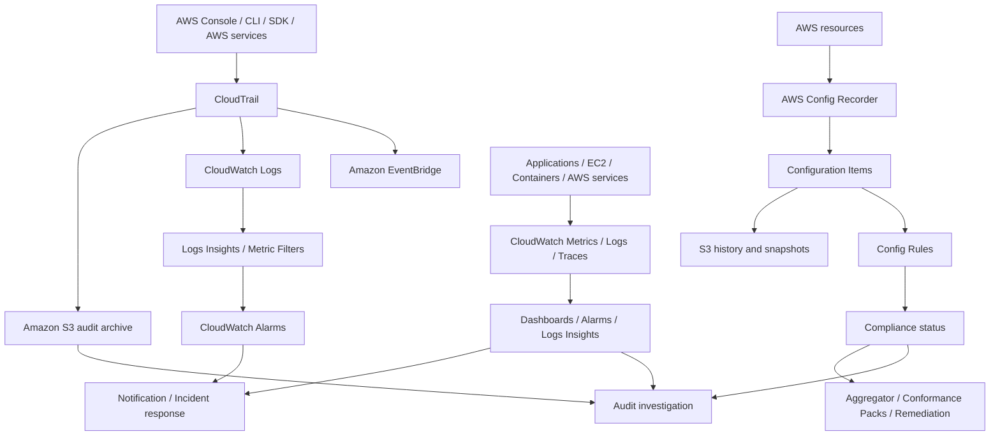
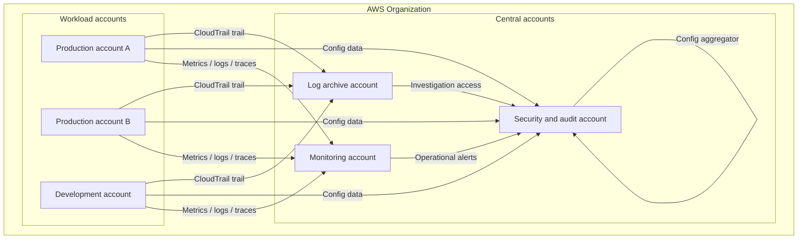

# Phân biệt CloudTrail, CloudWatch và AWS Config

## 1. Vì sao cần phân biệt ba dịch vụ?

Trong một hệ thống AWS, cùng một sự cố có thể tạo ra ba loại câu hỏi khác nhau:

- Ai đã thay đổi Security Group và gọi API nào?
- Vì sao độ trễ của ứng dụng tăng, CPU cao hoặc số lỗi HTTP tăng?
- Security Group hiện có cấu hình gì, thay đổi từ lúc nào và có vi phạm chính sách bảo mật không?

Ba câu hỏi này liên quan đến nhau nhưng cần ba góc nhìn khác nhau:

- **AWS CloudTrail** ghi nhận hoạt động trong tài khoản AWS, đặc biệt là các thao tác API và hoạt động của danh tính. Nó giúp điều tra *ai đã làm gì, khi nào, ở đâu và thông qua phương thức nào*.
- **Amazon CloudWatch** thu thập và phân tích telemetry để theo dõi tình trạng vận hành. Nó giúp trả lời *hệ thống đang hoạt động ra sao, có chậm hoặc lỗi không, và khi nào cần cảnh báo*.
- **AWS Config** ghi nhận cấu hình của tài nguyên được hỗ trợ theo thời gian và đánh giá cấu hình đó theo các quy tắc. Nó giúp trả lời *tài nguyên được cấu hình thế nào, cấu hình đã thay đổi ra sao và có tuân thủ yêu cầu không*.

Một tổ chức thường cần cả ba dịch vụ. CloudTrail cung cấp dấu vết hoạt động, CloudWatch cung cấp khả năng quan sát và cảnh báo, còn AWS Config cung cấp lịch sử trạng thái tài nguyên và đánh giá tuân thủ. Dùng đúng dịch vụ giúp điều tra nhanh hơn, lưu bằng chứng phù hợp và tránh nhầm lẫn giữa một sự kiện API với trạng thái cấu hình hoặc sức khỏe của ứng dụng.

Bài học thuộc module **CLOUD_PROVIDERS_AWS**, nơi người học khám phá hệ sinh thái AWS, rèn khả năng lựa chọn dịch vụ và thiết kế hệ thống an toàn, có thể giám sát, phục hồi và kiểm soát chi phí.

## 2. Mục tiêu học tập

Sau bài học, người học có thể:

1. Giải thích mục đích, dữ liệu đầu vào và đầu ra chính của CloudTrail, CloudWatch và AWS Config.
2. Phân biệt management events, data events và telemetry vận hành.
3. Giải thích Event history, trail, configuration item, configuration recorder, metric, log group và alarm.
4. Chọn dịch vụ phù hợp với một câu hỏi kiểm toán, vận hành hoặc tuân thủ.
5. Kết hợp ba dịch vụ để truy tìm người thực hiện thay đổi, xác định cấu hình trước/sau và đánh giá ảnh hưởng vận hành.
6. Sử dụng AWS Management Console, AWS CLI và CloudWatch Logs Insights để kiểm tra dữ liệu.
7. Nhận biết giới hạn ghi nhận, thời gian lưu, quyền truy cập và các yếu tố chi phí của từng dịch vụ.

## 3. Mô hình tư duy: ba câu hỏi khác nhau

Hãy bắt đầu bằng câu hỏi mà nhóm vận hành cần trả lời.

| Câu hỏi cần trả lời | Dịch vụ chính | Dữ liệu cần tìm |
|---|---|---|
| Ai gọi API, gọi hành động nào, vào lúc nào, từ địa chỉ nào? | AWS CloudTrail | Event record, danh tính, API name, thời gian, Region, nguồn yêu cầu |
| Ứng dụng hoặc hạ tầng đang hoạt động thế nào? | Amazon CloudWatch | Metrics, logs, traces, alarms, dashboards |
| Tài nguyên đang có cấu hình gì, lịch sử cấu hình ra sao, có tuân thủ quy tắc không? | AWS Config | Configuration items, configuration history, Config rules, compliance status |

Có thể ghi nhớ bằng ba câu ngắn:

- **CloudTrail: hành động.**
- **CloudWatch: vận hành.**
- **AWS Config: trạng thái cấu hình và tuân thủ.**

Đây là cách phân loại theo mục đích chính. Một nguồn dữ liệu có thể được chuyển tiếp hoặc phân tích trong dịch vụ khác. Ví dụ, CloudTrail có thể gửi log đến CloudWatch Logs; khi đó CloudTrail vẫn là nguồn ghi nhận hoạt động API, còn CloudWatch Logs là nơi tập trung, truy vấn và tạo cảnh báo từ log đó.

### 3.1. Ví dụ trực quan

Giả sử một kỹ sư thay đổi Security Group của máy chủ web:

- CloudTrail có thể cho biết danh tính nào đã gọi API AuthorizeSecurityGroupIngress, thời điểm gọi, địa chỉ nguồn, Region và tham số của yêu cầu.
- AWS Config có thể cho biết Security Group có thêm quy tắc ingress nào, cấu hình hiện tại ra sao và quy tắc có vi phạm chính sách hay không.
- CloudWatch có thể cho biết sau thay đổi, số kết nối, lưu lượng, độ trễ hoặc tỷ lệ lỗi của ứng dụng có thay đổi không. Nếu CloudTrail được gửi đến CloudWatch Logs, CloudWatch còn có thể phát cảnh báo khi xuất hiện loại API event đã định nghĩa.

Không dịch vụ nào trong ba dịch vụ tự mình trả lời đầy đủ cả ba nhóm câu hỏi.

## 4. Bảng so sánh tổng quan

| Tiêu chí | AWS CloudTrail | Amazon CloudWatch | AWS Config |
|---|---|---|---|
| Mục tiêu chính | Kiểm toán hoạt động tài khoản và điều tra hành động | Quan sát hiệu năng, tình trạng và hành vi hệ thống | Theo dõi cấu hình tài nguyên và đánh giá tuân thủ |
| Đơn vị dữ liệu tiêu biểu | Event | Metric datum, log event, trace, alarm state | Configuration item (CI), compliance evaluation |
| Câu hỏi điển hình | Ai đã gọi API nào? | Hệ thống có chậm hoặc lỗi không? | Cấu hình tài nguyên có đúng chính sách không? |
| Nguồn dữ liệu | AWS Management Console, CLI, SDK/API và hoạt động dịch vụ được CloudTrail hỗ trợ | AWS services, ứng dụng, máy chủ, agent và OpenTelemetry | Cấu hình của các loại tài nguyên AWS được hỗ trợ |
| Góc nhìn thời gian | Dòng sự kiện hoạt động | Dòng telemetry và chuỗi số liệu theo thời gian | Các mốc trạng thái cấu hình |
| Phân tích | Event History, trails, CloudTrail Lake cho khách hàng hiện hữu đủ điều kiện | Metrics, Logs Insights, dashboards, metric math, alarms | Resource timeline/history, Config rules, conformance packs, advanced queries |
| Cảnh báo | Có thể tích hợp EventBridge, CloudWatch Logs/alarms và công cụ bảo mật | Alarm trên metrics; cảnh báo từ log/metric filters và các tính năng giám sát | Trạng thái compliance, SNS và quy trình remediation |
| Lưu trữ điển hình | S3 qua trail; Event history có giới hạn 90 ngày | CloudWatch Metrics và CloudWatch Logs; retention tùy cấu hình | Lịch sử cấu hình và snapshot, thường phân phối đến S3 |
| Ví dụ kiểm toán | Tìm người thay đổi IAM policy | Theo dõi CPU, latency, error rate và log ứng dụng | Kiểm tra bucket có bật encryption hoặc public access không |
| Điều không nên kỳ vọng | Không phải hệ thống đo CPU hay đánh giá mọi cấu hình tài nguyên | Không phải sổ cái đầy đủ về mọi hành động API | Không phải kho lưu mọi API request hay log hiệu năng |

## 5. AWS CloudTrail: ghi nhận hoạt động tài khoản

### 5.1. CloudTrail ghi nhận điều gì?

AWS CloudTrail cung cấp lịch sử hoạt động trong tài khoản AWS. Một event thường mô tả một hoạt động được thực hiện bởi IAM user, assumed role, root identity, AWS service hoặc một danh tính khác mà CloudTrail có thể ghi nhận.

Thông tin thường quan tâm trong một event:

- **eventTime**: thời điểm sự kiện.
- **eventSource**: dịch vụ AWS phát sinh sự kiện, ví dụ ec2.amazonaws.com.
- **eventName**: tên thao tác, ví dụ RunInstances hoặc AuthorizeSecurityGroupIngress.
- **awsRegion**: Region nơi hoạt động được ghi nhận.
- **userIdentity**: thông tin danh tính gọi hành động.
- **sourceIPAddress**: địa chỉ nguồn của yêu cầu, khi có.
- **userAgent**: công cụ hoặc client thực hiện yêu cầu, khi có.
- **requestParameters**: tham số yêu cầu mà CloudTrail ghi nhận.
- **responseElements**: một phần thông tin phản hồi, nếu có.
- **errorCode** và **errorMessage**: thông tin lỗi nếu yêu cầu thất bại.
- **resources**: tài nguyên liên quan, nếu được cung cấp.
- **readOnly**: phân loại thao tác đọc hay ghi trong event record khi trường này có mặt.

Event record là bằng chứng về một hoạt động được ghi nhận. Nó không nhất thiết chứa toàn bộ dữ liệu nghiệp vụ của request, nội dung object, payload ứng dụng hoặc mọi thông tin nhạy cảm. Cần xem tài liệu CloudTrail của từng AWS service để biết chính xác trường nào được ghi nhận.

### 5.2. Các loại CloudTrail event

CloudTrail có nhiều loại event. Khi cấu hình trail hoặc event data store, cần chọn đúng loại hoạt động muốn ghi nhận.

| Loại event | Ý nghĩa | Ví dụ |
|---|---|---|
| Management events | Thao tác control plane quản lý tài nguyên và cấu hình dịch vụ | CreateBucket, RunInstances, AttachRolePolicy, CreateTrail |
| Data events | Hoạt động data plane trên hoặc bên trong tài nguyên; thường có lưu lượng lớn | S3 GetObject/PutObject, Lambda Invoke, SNS Publish |
| Network activity events | Hoạt động mạng được CloudTrail hỗ trợ ghi nhận, thường liên quan đến VPC endpoint và chính sách mạng | Hoạt động bị từ chối theo endpoint policy |
| Insights events | Phát hiện mẫu hoạt động API bất thường so với baseline, ví dụ thay đổi tốc độ ghi hoặc tỷ lệ lỗi API | Tăng đột biến hoạt động ghi hoặc lỗi API |

Một số nguyên tắc quan trọng:

- Trail và event data store mặc định ghi management events theo cấu hình mặc định.
- Data events, network activity events và Insights events cần được chọn rõ ràng khi cấu hình. Không nên giả định rằng mọi hoạt động đọc object hoặc gọi Lambda đều đã được ghi.
- Data events thường có lưu lượng lớn. Chọn resource type và phạm vi tài nguyên có chủ đích để kiểm soát chi phí.
- Insights cần được bật rõ ràng và có chi phí riêng.
- Một số sự kiện không phải API call, chẳng hạn sự kiện đăng nhập console, cũng có thể được CloudTrail ghi nhận.

### 5.3. Event history

Khi tạo AWS account, người dùng có thể truy cập CloudTrail Event history mà không cần tạo trail trước.

Event history có các đặc điểm:

- Cung cấp lịch sử management events trong 90 ngày gần nhất cho một Region.
- Có thể xem, lọc, tìm kiếm và tải event.
- Có thể truy vấn bằng AWS CLI với lệnh aws cloudtrail lookup-events.
- Không hiển thị data events, Insights events hoặc network activity events.
- Tìm kiếm Event history chỉ áp dụng trong một account và một Region tại một thời điểm, với khả năng lọc hạn chế hơn trail hoặc công cụ phân tích chuyên dụng.
- Event history tách biệt với trail và event data store. Thay đổi cấu hình trail không làm thay đổi Event history.
- Event history không thay thế chiến lược lưu trữ dài hạn.

Nếu cần lưu hoạt động liên tục lâu hơn 90 ngày, hãy cấu hình trail ghi event vào Amazon S3 và thiết kế retention phù hợp. Có thể cấu hình thêm đích CloudWatch Logs hoặc EventBridge để phục vụ giám sát và tự động hóa.

### 5.4. Trail và tổ chức nhiều account

Một **trail** là cấu hình ghi nhận và phân phối CloudTrail events. Trail có thể:

- Ghi management events và các loại event được chọn.
- Ghi từ một Region hoặc nhiều Region.
- Phân phối log file đến Amazon S3.
- Gửi event đến CloudWatch Logs để truy vấn hoặc tạo cảnh báo.
- Tích hợp với EventBridge để kích hoạt quy trình phản ứng.
- Dùng AWS KMS để mã hóa log file trong S3.
- Bật log file integrity validation để hỗ trợ phát hiện log bị thay đổi hoặc bị xóa sau khi CloudTrail phân phối.

Khi gửi event đến CloudWatch Logs, CloudTrail thường phân phối trong khoảng trung bình năm phút sau API call, nhưng thời gian này không được bảo đảm. Khi điều tra, phân biệt thời điểm phát sinh trong trường eventTime với thời điểm log được chuyển đến log group.

Trong môi trường AWS Organizations, tổ chức có thể triển khai organization trail để thu thập hoạt động của các account thành viên. Một mô hình thường gặp là:

1. Account workload chạy ứng dụng.
2. Account security/monitoring thực hiện giám sát tập trung.
3. Account log archive lưu trữ log kiểm toán.
4. Organization trail gửi log từ các account và Region về kho lưu trữ trung tâm.

Cấu hình tập trung giúp giảm rủi ro mỗi account tự quản lý log theo một cách khác nhau. Quyền truy cập vào bucket lưu trữ phải được giới hạn để workload administrator không thể tùy tiện xóa hoặc sửa bằng chứng kiểm toán.

### 5.5. Tính toàn vẹn log

CloudTrail hỗ trợ **log file integrity validation**. Khi bật tính năng này, CloudTrail tạo hash cho log file và digest file có chữ ký số để người vận hành kiểm tra log file có bị thay đổi hoặc xóa sau khi được phân phối hay không.

Cần hiểu đúng phạm vi:

- Bật validation cho phép CloudTrail phân phối digest file; người vận hành vẫn cần thực hiện quy trình xác minh.
- Validation hỗ trợ phát hiện thay đổi sau khi phân phối, không ngăn một danh tính có quyền cao thay đổi cấu hình logging trước đó.
- Nên kết hợp với S3 bucket policy chặt chẽ, mã hóa, versioning, retention, Object Lock khi yêu cầu lưu trữ bất biến, và tách quyền quản trị log khỏi quyền quản trị workload.
- Không nên coi việc bật một checkbox là đã hoàn thành toàn bộ chiến lược bảo toàn bằng chứng.

### 5.6. Lưu ý về CloudTrail Lake

Tài liệu AWS hiện hành nêu CloudTrail Lake không mở cho khách hàng mới kể từ ngày 31-05-2026; khách hàng hiện hữu có thể tiếp tục sử dụng theo điều kiện AWS công bố. Vì vậy, khi thiết kế hệ thống mới, không nên mặc định CloudTrail Lake là lựa chọn có thể đăng ký. Hãy kiểm tra thông báo availability mới nhất của AWS và đánh giá phương án lưu trữ/phân tích phù hợp. Các khái niệm Event history và trail đến S3 vẫn là nền tảng quan trọng của CloudTrail.

### 5.7. Khi nào chọn CloudTrail?

Chọn CloudTrail làm nguồn chính khi cần:

- Điều tra ai tạo, sửa hoặc xóa tài nguyên.
- Tìm lịch sử thay đổi IAM policy, role, trust policy hoặc access key.
- Kiểm tra hoạt động console, CLI, SDK và API.
- Theo dõi truy cập dữ liệu ở mức object hoặc invoke nếu đã bật data events tương ứng.
- Kiểm toán hoạt động trên nhiều account/Region.
- Xây dựng bằng chứng hoạt động cho kiểm toán bảo mật và tuân thủ.
- Phát hiện hành vi API bất thường khi cấu hình Insights phù hợp.

Không dùng riêng CloudTrail để kết luận CPU, latency, dung lượng đĩa, tỷ lệ lỗi HTTP hoặc trạng thái compliance hiện tại của mọi tài nguyên.

## 6. Amazon CloudWatch: quan sát vận hành hệ thống

### 6.1. CloudWatch trả lời điều gì?

Amazon CloudWatch giám sát tài nguyên AWS và ứng dụng chạy trên AWS. Dịch vụ tập trung vào telemetry: số liệu, log, trace và tín hiệu vận hành theo thời gian.

Các thành phần thường gặp:

- **CloudWatch Metrics**: số liệu có timestamp, namespace, metric name và dimensions.
- **CloudWatch Logs**: thu thập, lưu trữ, tìm kiếm và truy vấn log.
- **CloudWatch Alarms**: đánh giá metric theo ngưỡng hoặc điều kiện và chuyển trạng thái alarm.
- **Dashboards**: hiển thị metrics và logs trên cùng một màn hình.
- **Logs Insights**: truy vấn log theo cú pháp chuyên dụng.
- **Metric filters**: trích xuất số liệu từ log để tạo metric.
- **Application Signals, Synthetics và RUM**: hỗ trợ theo dõi hiệu năng ứng dụng, kiểm tra chủ động và dữ liệu từ phiên người dùng.
- **CloudWatch Agent và OpenTelemetry**: thu thập telemetry từ máy chủ, ứng dụng và môi trường hybrid.

Nhiều AWS service tự động gửi metrics cơ bản đến CloudWatch. Đối với ứng dụng, nhóm phát triển có thể phát custom metrics, structured logs và traces để theo dõi hành vi nghiệp vụ.

### 6.2. Metrics

Metric là chuỗi số liệu theo thời gian. Ví dụ:

- CPUUtilization của EC2.
- NetworkIn và NetworkOut.
- Số request, số lỗi và độ trễ của API.
- Số message còn tồn trong SQS queue.
- Số invocation, error và duration của Lambda.
- Số kết nối hoặc hiệu năng của database.

Một metric được xác định bởi namespace, tên metric và tập dimensions. Dimensions giúp phân biệt metric theo resource hoặc thuộc tính như InstanceId, FunctionName, LoadBalancer hay QueueName.

CloudWatch có thể dùng metric để:

- Hiển thị xu hướng trên dashboard.
- Tạo alarm khi giá trị vượt ngưỡng.
- Tính metric mới bằng metric math.
- Kết hợp nhiều metric để đánh giá sức khỏe dịch vụ.
- Phát hiện bất thường bằng các tính năng phù hợp.

Không nên tạo dimensions có cardinality quá cao một cách tùy tiện. Nếu mỗi request hoặc mỗi user ID tạo ra một dimension mới, số lượng metric và chi phí có thể tăng nhanh.

### 6.3. Logs

CloudWatch Logs tập trung log từ nhiều nguồn, chẳng hạn:

- Ứng dụng chạy trên EC2, ECS, EKS hoặc Lambda.
- AWS CloudTrail.
- VPC Flow Logs và các log AWS service được hỗ trợ.
- Hệ điều hành, web server, database proxy hoặc ứng dụng tự ghi log.

Cấu trúc thường dùng:

- **Log group**: nhóm log theo ứng dụng, workload hoặc nguồn.
- **Log stream**: luồng log cụ thể bên trong log group.
- **Log event**: bản ghi có timestamp và message.

CloudWatch Logs hỗ trợ tìm kiếm, filter, Logs Insights, metric filters, subscription filters, data protection policies và cấu hình retention. Log group có log class khác nhau; cần kiểm tra tính năng cần dùng và mức giá của từng class trước khi chọn.

Retention mặc định của log group là lưu vô thời hạn cho đến khi có chính sách retention. Vì vậy, cần cấu hình thời gian lưu có chủ đích cho log vận hành, log bảo mật và log có dữ liệu nhạy cảm.

### 6.4. Alarms và dashboards

CloudWatch Alarm theo dõi metric hoặc biểu thức metric theo chu kỳ đánh giá. Khi điều kiện được thỏa mãn, alarm chuyển trạng thái như OK, ALARM hoặc INSUFFICIENT_DATA.

Ví dụ:

- CPUUtilization trung bình vượt 80% trong một số chu kỳ.
- Tỷ lệ lỗi 5xx tăng vượt ngưỡng.
- SQS ApproximateAgeOfOldestMessage tăng cao.
- Lambda Errors tăng bất thường.
- Số lần đăng nhập thất bại được trích xuất từ log vượt ngưỡng.

Một alarm tốt cần xác định:

1. Metric có phản ánh đúng rủi ro cần phát hiện không?
2. Statistic và period có phù hợp không?
3. Ngưỡng và số chu kỳ đánh giá có giảm false positive không?
4. Cách xử lý khi thiếu dữ liệu là gì?
5. Alarm sẽ gửi notification hoặc kích hoạt hành động nào?
6. Ai là người nhận và runbook nằm ở đâu?

Dashboard giúp đội vận hành nhìn nhanh tình trạng hệ thống. Nên nhóm widget theo dịch vụ hoặc hành trình request, ví dụ request rate, latency, error rate, saturation và dependency health.

### 6.5. CloudTrail và CloudWatch Logs phối hợp

CloudTrail ghi event; CloudWatch Logs có thể nhận event từ trail. Sau khi nhận, người vận hành có thể:

- Tìm kiếm event theo tên API, danh tính, Region hoặc tài nguyên.
- Dùng Logs Insights để truy vấn event.
- Tạo metric filter cho một loại event.
- Tạo alarm dựa trên metric được tạo từ log.
- Gửi notification hoặc tích hợp quy trình xử lý.

Ví dụ: nhóm bảo mật muốn được cảnh báo khi có hoạt động thay đổi IAM policy. CloudTrail là nguồn ghi nhận API event; CloudWatch Logs là nơi truy vấn log và metric filter tạo metric; CloudWatch Alarm phát cảnh báo khi metric đạt điều kiện.

CloudWatch không tự động biến mọi CloudTrail event thành metric. Cần cấu hình đường phân phối log, log group, filter và alarm tương ứng.

### 6.6. Khi nào chọn CloudWatch?

Chọn CloudWatch làm công cụ chính khi cần:

- Theo dõi hiệu năng và độ sẵn sàng.
- Giám sát CPU, memory, disk, network, request rate, latency hoặc error rate.
- Tập trung log ứng dụng và log hạ tầng.
- Tạo cảnh báo và dashboard.
- Truy vấn log để tìm nguyên nhân sự cố vận hành.
- Theo dõi telemetry từ EC2, containers, Lambda, database hoặc ứng dụng hybrid.
- Theo dõi API event đã được chuyển đến CloudWatch Logs.

Không dùng riêng CloudWatch để xác nhận đầy đủ danh tính và request parameters của mọi hành động API, hoặc thay thế lịch sử cấu hình và compliance evaluation của AWS Config.

## 7. AWS Config: lịch sử cấu hình và tuân thủ

### 7.1. AWS Config ghi nhận điều gì?

AWS Config theo dõi cấu hình của các loại tài nguyên AWS được hỗ trợ. Khi tài nguyên được ghi nhận thay đổi, AWS Config tạo **configuration item (CI)** thể hiện trạng thái của tài nguyên tại một thời điểm.

Một CI có thể bao gồm:

- Metadata và identifier của tài nguyên.
- Resource type, ARN, tag và các thuộc tính.
- Cấu hình hiện tại được AWS Config thu thập.
- Quan hệ giữa tài nguyên với các tài nguyên khác.
- Trạng thái và thông tin thời điểm ghi nhận.
- Thông tin liên quan đến sự kiện khi trường đó được cung cấp.

Ví dụ, một CI của EC2 Security Group có thể mô tả VPC liên quan, inbound rules, outbound rules và các thuộc tính khác mà AWS Config hỗ trợ ghi nhận cho loại tài nguyên đó.

AWS Config không phải bản sao toàn bộ control plane API log. CI mô tả trạng thái cấu hình, trong khi CloudTrail mô tả hoạt động tạo ra hoặc tác động đến trạng thái đó.

### 7.2. Configuration recorder

**Configuration recorder** xác định loại tài nguyên nào AWS Config sẽ ghi nhận và tần suất ghi nhận.

Các điểm cần chú ý:

- Configuration recorder hoạt động theo account và Region.
- Phạm vi tài nguyên có thể được cấu hình theo chiến lược ghi nhận và loại resource.
- AWS Config chỉ ghi nhận những resource type được hỗ trợ và nằm trong phạm vi recorder.
- Có thể chọn continuous recording hoặc daily recording cho các loại tài nguyên hỗ trợ.
- Continuous recording ghi nhận thay đổi cấu hình liên tục khi thay đổi được phát hiện.
- Daily recording tạo CI đại diện trạng thái mới nhất trong khoảng 24 giờ nếu trạng thái khác với CI trước đó.
- Một số loại resource hoặc dịch vụ có yêu cầu riêng; cần kiểm tra danh sách supported resource types và recording frequency.

AWS Config ghi nhận theo cơ chế best effort. CI thường được tạo sau khi phát hiện thay đổi hoặc theo recording frequency đã chọn, nhưng một số resource type có thể mất nhiều thời gian hơn. Không xem continuous recording là cam kết cập nhật tức thời theo thời gian thực.

Nếu một loại tài nguyên không nằm trong phạm vi recorder, không thể kỳ vọng AWS Config có lịch sử đầy đủ cho loại đó.

### 7.3. Delivery channel

Delivery channel điều khiển cách AWS Config phân phối dữ liệu cấu hình. Cấu hình thường liên quan đến:

- Amazon S3 bucket để lưu configuration history và configuration snapshots.
- Amazon SNS topic để gửi notification về thay đổi hoặc trạng thái tuân thủ theo cấu hình.
- Quyền truy cập cần thiết để AWS Config ghi dữ liệu đến các đích này.

Cần phân biệt ba khái niệm:

- Recorder quyết định loại tài nguyên và tần suất ghi nhận.
- Configuration item là dữ liệu mô tả trạng thái tài nguyên.
- Delivery channel quyết định nơi và cách dữ liệu được phân phối.

### 7.4. Configuration history và snapshot

AWS Config cung cấp lịch sử cấu hình của tài nguyên và khả năng tạo snapshot cấu hình tại một thời điểm.

- **Configuration history** giúp xem các CI đã ghi nhận của một resource theo thời gian.
- **Configuration snapshot** là ảnh chụp cấu hình của các resource được ghi nhận trong account/Region tại thời điểm tạo snapshot.
- **Resource timeline** giúp người vận hành xem các mốc thay đổi cấu hình và điều tra trạng thái theo thời gian.
- Dữ liệu được phân phối đến S3 có thể được lưu trữ theo chính sách retention của tổ chức.

Khi cần trả lời "Security Group đã có rule nào trước khi sự cố xảy ra?", hãy xem lịch sử cấu hình. Khi cần trả lời "Ai đã thêm rule đó?", hãy tra CloudTrail tương ứng.

### 7.5. Config Rules

AWS Config Rules đánh giá tài nguyên theo yêu cầu cấu hình. Một rule có thể là:

- **AWS managed rule**: rule được AWS cung cấp sẵn.
- **Custom rule**: rule do tổ chức tự xây dựng, thường dùng Lambda hoặc Guard để biểu diễn logic đánh giá phù hợp.

Một số ví dụ rule thường gặp:

| Nhu cầu | Ví dụ managed rule identifier |
|---|---|
| Chặn S3 bucket cho phép public read | S3_BUCKET_PUBLIC_READ_PROHIBITED |
| Chặn S3 bucket cho phép public write | S3_BUCKET_PUBLIC_WRITE_PROHIBITED |
| Kiểm tra EBS volume được mã hóa | ENCRYPTED_VOLUMES |
| Kiểm tra Security Group không mở SSH từ mọi địa chỉ | INCOMING_SSH_DISABLED |
| Kiểm tra CloudTrail được bật | CLOUD_TRAIL_ENABLED |

Tên rule, resource scope và tham số phải được xác minh trong tài liệu AWS Config tại thời điểm triển khai. Không phải mọi rule đều áp dụng cho mọi loại tài nguyên hoặc mọi kiến trúc.

Kết quả đánh giá thường có trạng thái như COMPLIANT, NON_COMPLIANT, NOT_APPLICABLE hoặc trạng thái đánh giá chưa xác định. NON_COMPLIANT nghĩa là tài nguyên vi phạm điều kiện của rule, không tự động chứng minh có hành vi tấn công.

### 7.6. Conformance packs

Conformance pack là tập hợp Config rules và remediation actions được triển khai như một đơn vị. Nó giúp áp dụng một bộ yêu cầu nhất quán cho account/Region hoặc trên phạm vi tổ chức.

Một conformance pack có thể biểu diễn các yêu cầu như:

- Mã hóa dữ liệu lưu trữ.
- Giới hạn truy cập công khai.
- Bật logging và audit.
- Yêu cầu cấu hình mạng an toàn.
- Quy tắc quản trị tài nguyên theo chuẩn nội bộ.

Conformance pack không thay thế quy trình quản trị thay đổi. Trước khi bật remediation tự động, cần hiểu chính xác hành động remediation, quyền IAM cần cấp và ảnh hưởng của hành động đối với workload.

### 7.7. Aggregator và remediation

- **Aggregator** thu thập dữ liệu cấu hình và compliance từ nhiều account/Region để tạo góc nhìn tập trung.
- **Remediation** cho phép khắc phục tài nguyên noncompliant bằng hành động được cấu hình, thường phối hợp với Systems Manager Automation hoặc cơ chế remediation được hỗ trợ.

Aggregator tập trung dữ liệu để quan sát; nó không đồng nghĩa với việc recorder đã bật đầy đủ ở mọi account/Region. Cần kiểm tra nguồn dữ liệu, phạm vi resource và trạng thái recorder ở từng nơi.

Remediation tự động cần có guardrail. Ví dụ, tự động xóa một Security Group rule có thể gây gián đoạn dịch vụ nếu rule đó đang phục vụ luồng nghiệp vụ hợp lệ. Nên phân loại mức độ rủi ro, thử nghiệm, phê duyệt và có phương án rollback.

### 7.8. Khi nào chọn AWS Config?

Chọn AWS Config làm công cụ chính khi cần:

- Xem cấu hình tài nguyên hiện tại và lịch sử thay đổi.
- Kiểm tra tài nguyên có tuân thủ baseline không.
- Theo dõi tài nguyên mới được tạo hoặc cấu hình thay đổi.
- Tập trung compliance nhiều account/Region.
- Phát hiện cấu hình lệch chuẩn.
- Tạo báo cáo cấu hình theo thời gian.
- Kích hoạt quy trình remediation có kiểm soát.

Không dùng riêng AWS Config để xác định đầy đủ danh tính gọi API, request payload, địa chỉ IP nguồn hoặc hiệu năng ứng dụng.

## 8. Phân biệt bằng tình huống thực tế

### 8.1. Tình huống A: Security Group mở SSH ra Internet

Một Security Group bất ngờ có inbound rule TCP/22 từ 0.0.0.0/0.

| Bước điều tra | Dịch vụ | Câu hỏi |
|---|---|---|
| 1 | AWS Config | Security Group hiện có rule nào? Khi nào cấu hình thay đổi? |
| 2 | AWS Config Rules | Rule INCOMING_SSH_DISABLED có đánh giá resource là noncompliant không? |
| 3 | CloudTrail | Ai gọi AuthorizeSecurityGroupIngress hoặc thao tác liên quan? Request có tham số nào? |
| 4 | CloudWatch Logs | Nếu trail đã gửi log đến CloudWatch, tìm event và tạo cảnh báo cho hoạt động tương tự |
| 5 | CloudWatch Metrics/Logs | Có dấu hiệu bất thường về network, request, error hoặc hành vi ứng dụng sau thay đổi không? |
| 6 | Quy trình phản ứng | Thu hồi quyền hoặc sửa rule theo runbook; lưu lại bằng chứng và kiểm tra compliance sau khắc phục |

CloudTrail cho biết hoạt động; AWS Config cho biết cấu hình và kết quả đánh giá; CloudWatch giúp theo dõi ảnh hưởng vận hành và cảnh báo.

### 8.2. Tình huống B: S3 bucket trở thành public

Một bucket chứa dữ liệu nội bộ bị mở public ngoài dự kiến.

- AWS Config có thể ghi nhận cấu hình bucket và đánh giá bằng rule phù hợp về public access.
- CloudTrail có thể ghi nhận các thao tác thay đổi bucket policy, public access block hoặc các API quản lý liên quan.
- Nếu cần kiểm toán truy cập object, phải bật data events cho S3 object phù hợp. Management event về cấu hình bucket không thay thế object-level data event.
- CloudWatch có thể truy vấn log CloudTrail được chuyển đến CloudWatch Logs và phát cảnh báo khi có API event đáng quan tâm.
- CloudWatch Logs cũng có thể chứa application log hoặc log truy cập khác, nhưng không tự động là bằng chứng đầy đủ về mọi lần đọc object.

Điểm dễ nhầm: PutBucketPolicy là hoạt động quản lý cấu hình bucket; GetObject là hoạt động truy cập object. Cần chọn event type tương ứng với mục tiêu điều tra.

### 8.3. Tình huống C: API chậm và tỷ lệ lỗi tăng

Một ứng dụng Spring Boot chạy trên ECS có latency tăng, error rate cao và queue bắt đầu tồn đọng.

- CloudWatch Metrics theo dõi request rate, latency, CPU, memory, số task, số lỗi và queue depth.
- CloudWatch Logs tập trung application logs, container logs và các log liên quan.
- CloudWatch Application Signals hoặc OpenTelemetry tracing hỗ trợ phân tích request và dependency.
- CloudTrail giúp kiểm tra có ai thay đổi service, task definition, security group, IAM role hoặc cấu hình hạ tầng trước thời điểm sự cố không.
- AWS Config giúp so sánh cấu hình tài nguyên và phát hiện thay đổi làm lệch baseline.

Trong tình huống này, CloudWatch thường là nơi bắt đầu vì triệu chứng là vấn đề vận hành. Sau khi xác định khoảng thời gian và tài nguyên bị ảnh hưởng, dùng CloudTrail và AWS Config để tìm thay đổi có liên quan.

### 8.4. Tình huống D: Kiểm toán quyền truy cập IAM

Kiểm toán viên muốn biết một role có bị cấp thêm quyền quản trị không.

- CloudTrail tìm event AttachRolePolicy, PutRolePolicy, CreatePolicyVersion, SetDefaultPolicyVersion hoặc các API liên quan.
- AWS Config có thể ghi nhận cấu hình IAM resource nếu loại tài nguyên đó nằm trong phạm vi và được hỗ trợ; kiểm tra lịch sử cấu hình để hiểu trạng thái.
- CloudWatch có thể tạo cảnh báo khi log CloudTrail xuất hiện API event thuộc nhóm nhạy cảm.
- IAM Access Analyzer, IAM policy simulator và các công cụ IAM chuyên biệt có thể hỗ trợ đánh giá quyền hiệu lực. Ba dịch vụ trong bài không thay thế các công cụ đánh giá quyền này.

## 9. Cách ba dịch vụ bổ sung cho nhau

Một luồng điều tra điển hình:

1. CloudWatch Alarm phát hiện tỷ lệ lỗi tăng hoặc một metric vượt ngưỡng.
2. Nhóm vận hành xác định thời điểm bắt đầu sự cố và các resource bị ảnh hưởng.
3. AWS Config hiển thị lịch sử cấu hình của các resource trong khoảng thời gian đó.
4. CloudTrail truy vấn event để tìm danh tính và API đã thay đổi cấu hình.
5. Nhóm bảo mật đối chiếu event với quy trình phê duyệt, change ticket và quyền IAM.
6. Nhóm vận hành khắc phục, kiểm tra metrics/logs và xác nhận Config rule trở lại compliant.
7. Log và bằng chứng được lưu theo chính sách retention, quyền truy cập và yêu cầu kiểm toán.

Sơ đồ luồng dữ liệu khái quát:



Sơ đồ cho thấy ba dịch vụ có thể cùng tham gia một quy trình nhưng dữ liệu và vai trò của chúng khác nhau. EventBridge là dịch vụ tích hợp sự kiện riêng; CloudWatch Alarms và CloudWatch Logs là các thành phần thuộc CloudWatch.

## 10. Kiến trúc tham khảo cho môi trường nhiều account

Một tổ chức có nhiều AWS account nên thiết kế ba lớp dữ liệu:

### 10.1. Lớp audit

- Triển khai organization trail hoặc cấu hình trail phù hợp để thu thập event từ account và Region cần kiểm toán.
- Lưu log file vào S3 bucket trong account log archive.
- Bật log file integrity validation.
- Mã hóa bằng KMS key và giới hạn quyền decrypt.
- Dùng bucket policy, versioning và Object Lock khi yêu cầu lưu trữ bất biến.
- Thiết lập S3 lifecycle theo yêu cầu retention và chi phí.
- Giới hạn quyền xóa hoặc thay đổi trail, bucket policy và KMS key.

### 10.2. Lớp configuration/compliance

- Bật AWS Config recorder ở các account/Region cần theo dõi.
- Chọn resource types và recording frequency theo yêu cầu.
- Cấu hình delivery channel.
- Triển khai managed rules hoặc custom rules.
- Dùng conformance packs để chuẩn hóa baseline.
- Cấu hình aggregator ở account trung tâm.
- Xác định quy trình xử lý noncompliant và quyền remediation.

### 10.3. Lớp observability

- Chuẩn hóa namespace, metric names, dimensions và log group naming.
- Thu thập application logs và infrastructure metrics.
- Cấu hình CloudWatch alarms gắn với runbook và owner.
- Dùng CloudWatch cross-account observability khi cần xem telemetry tập trung.
- Chọn retention và log class theo mục đích truy cập.
- Dùng OpenTelemetry khi cần chuẩn hóa instrumentation hoặc gửi telemetry đến nhiều backend.

Sơ đồ tổ chức tham khảo:



Sơ đồ chỉ mô tả ranh giới trách nhiệm. Việc triển khai thực tế cần xác định delegated administrator, service-linked role, resource policy, KMS key policy, organization policy và đường mạng theo kiến trúc tổ chức.

## 11. Thực hành truy vấn CloudTrail bằng AWS CLI

### 11.1. Tìm event theo tên API

Ví dụ tìm các event AuthorizeSecurityGroupIngress trong Region ap-southeast-1:

```bash
aws cloudtrail lookup-events --lookup-attributes AttributeKey=EventName,AttributeValue=AuthorizeSecurityGroupIngress --max-results 20 --region ap-southeast-1
```

Lệnh trên truy vấn Event history. Nó chỉ trả về dữ liệu có trong phạm vi Event history, chủ yếu là management events của 90 ngày gần nhất ở Region được chọn.

### 11.2. Kiểm tra trail

```bash
aws cloudtrail describe-trails --include-shadow-trails --region ap-southeast-1

aws cloudtrail get-trail-status --name org-audit-trail --region ap-southeast-1
```

Khi kiểm tra, chú ý trail có multi-Region không, S3 bucket đích, trạng thái logging, thời điểm phân phối gần nhất và lỗi phân phối nếu có. Tên trail trong ví dụ cần được thay bằng tên thực tế.

### 11.3. Đọc event record

Ví dụ rút gọn một event minh họa. Giá trị dưới đây là dữ liệu giả lập, không phải event thật:

```json
{
  "eventVersion": "1.09",
  "eventTime": "2026-11-20T04:15:00Z",
  "eventSource": "ec2.amazonaws.com",
  "eventName": "AuthorizeSecurityGroupIngress",
  "awsRegion": "ap-southeast-1",
  "sourceIPAddress": "203.0.113.25",
  "userAgent": "console.amazonaws.com",
  "userIdentity": {
    "type": "AssumedRole",
    "arn": "arn:aws:sts::111122223333:assumed-role/NetworkAdmin/session-123"
  },
  "requestParameters": {
    "groupId": "sg-0123456789abcdef0",
    "ipPermissions": [
      {
        "ipProtocol": "tcp",
        "fromPort": 22,
        "toPort": 22,
        "ipRanges": [
          {
            "cidrIp": "0.0.0.0/0"
          }
        ]
      }
    ]
  },
  "readOnly": false,
  "eventCategory": "Management"
}
```

Cách đọc:

- eventName cho biết API được gọi.
- userIdentity giúp xác định danh tính hoặc role session.
- eventTime và awsRegion xác định thời điểm và nơi hoạt động.
- sourceIPAddress và userAgent hỗ trợ phân tích nguồn yêu cầu.
- requestParameters cho thấy tham số mà event record ghi nhận.
- readOnly false biểu thị thao tác không phải chỉ đọc.

Không nên chỉ dựa vào tên session để kết luận người thật đã thao tác. Với assumed role, cần truy ngược quá trình assume role và đối chiếu danh tính gốc, session context, hệ thống đăng nhập và quy trình phê duyệt.

## 12. Thực hành kiểm tra AWS Config bằng AWS CLI

### 12.1. Kiểm tra recorder

```bash
aws configservice describe-configuration-recorders --region ap-southeast-1

aws configservice describe-configuration-recorder-status --region ap-southeast-1
```

Xác nhận recorder tồn tại, phạm vi resource types và trạng thái recording. Nếu recorder chưa hoạt động hoặc không bao gồm resource type cần kiểm tra, lịch sử cấu hình có thể không đầy đủ.

### 12.2. Xem lịch sử cấu hình của resource

Ví dụ truy vấn lịch sử Security Group:

```bash
aws configservice get-resource-config-history --resource-type AWS::EC2::SecurityGroup --resource-id sg-0123456789abcdef0 --limit 10 --region ap-southeast-1
```

Thay resource ID bằng ID thực tế. Kiểm tra configurationItemCaptureTime, trạng thái resource và phần cấu hình. Lệnh chỉ trả về lịch sử đã được AWS Config ghi nhận trong phạm vi recorder.

### 12.3. Xem trạng thái compliance

```bash
aws configservice describe-compliance-by-config-rule --region ap-southeast-1

aws configservice describe-compliance-by-resource --resource-type AWS::EC2::SecurityGroup --resource-id sg-0123456789abcdef0 --region ap-southeast-1
```

Kết quả cho biết rule và resource có trạng thái compliance nào. Nếu rule chưa được đánh giá, kết quả có thể chưa phản ánh trạng thái mới nhất. Kiểm tra thời điểm đánh giá và phạm vi resource của rule trước khi kết luận.

## 13. Thực hành CloudWatch

### 13.1. Kiểm tra alarm đang ở trạng thái ALARM

```bash
aws cloudwatch describe-alarms --state-value ALARM --region ap-southeast-1
```

Đọc metric name, dimensions, threshold, period, evaluation periods, trạng thái hiện tại và actions được cấu hình.

### 13.2. Lấy metric EC2

Ví dụ truy vấn CPUUtilization trong một khoảng thời gian:

```bash
aws cloudwatch get-metric-statistics --namespace AWS/EC2 --metric-name CPUUtilization --dimensions Name=InstanceId,Value=i-0123456789abcdef0 --start-time 2026-11-20T04:00:00Z --end-time 2026-11-20T05:00:00Z --period 300 --statistics Average Maximum --region ap-southeast-1
```

Thay instance ID và khoảng thời gian theo sự cố thực tế. Khoảng thời gian cần ở định dạng timestamp hợp lệ. Metric có thể không có datapoint nếu service/resource không phát metric trong khoảng truy vấn hoặc dimensions không khớp.

### 13.3. Truy vấn CloudTrail log trong CloudWatch Logs Insights

Nếu trail đã được cấu hình gửi log đến CloudWatch Logs và log group chứa CloudTrail event, có thể truy vấn các thao tác EC2 gần đây:

```text
fields @timestamp, eventName, userIdentity.arn, sourceIPAddress, awsRegion, errorCode
| filter eventSource = "ec2.amazonaws.com"
| sort @timestamp desc
| limit 50
```

Tìm các lần thêm inbound rule:

```text
fields @timestamp, eventName, userIdentity.arn, requestParameters, sourceIPAddress
| filter eventName = "AuthorizeSecurityGroupIngress"
| sort @timestamp desc
| limit 100
```

Cú pháp truy vấn và tên field có thể cần điều chỉnh theo cấu trúc log thực tế. Trước tiên hãy mở một log event để xác nhận field được ingest và tự động phát hiện như mong đợi.

## 14. IAM và bảo mật khi triển khai

Ba dịch vụ có thể thu thập dữ liệu nhạy cảm về hoạt động, cấu hình và hệ thống. Cần quản lý quyền theo nguyên tắc least privilege.

### 14.1. Quyền đọc và quyền quản trị

Tách các nhóm quyền:

- Người vận hành ứng dụng có quyền xem metrics/logs liên quan đến workload.
- Nhóm bảo mật có quyền truy vấn audit events và compliance.
- Nhóm platform quản trị recorder, trail, log group, bucket, KMS key và cấu hình trung tâm.
- Nhóm auditor có quyền đọc bằng chứng theo phạm vi cần thiết nhưng không có quyền sửa/xóa log.

Không cấp quyền quản trị CloudTrail, S3 log archive, AWS Config recorder hoặc KMS key rộng rãi cho mọi developer.

### 14.2. Bảo vệ dữ liệu log

Log có thể chứa ARN, IP address, resource ID, username, request parameter hoặc thông tin ứng dụng. Vì vậy:

- Tránh ghi password, access token, secret, session cookie hoặc dữ liệu cá nhân không cần thiết vào application log.
- Giới hạn quyền logs:GetLogEvents, logs:StartQuery, s3:GetObject, kms:Decrypt theo nhóm.
- Dùng mã hóa at rest và in transit.
- Đặt retention phù hợp và xóa dữ liệu theo chính sách.
- Dùng CloudWatch Logs data protection để hỗ trợ audit/masking khi phù hợp.
- Theo dõi cả các API thay đổi chính sách logging và quyền truy cập kho log.
- Bảo vệ bucket policy và KMS key policy khỏi thay đổi trái phép.
- Kiểm tra quyền cross-account và resource policy định kỳ.

### 14.3. Bảo vệ audit archive

Đối với log CloudTrail lưu trong S3:

- Dùng bucket riêng cho audit archive.
- Chặn public access.
- Giới hạn principal được ghi và đọc.
- Dùng KMS key có key policy phù hợp.
- Bật log file integrity validation.
- Cân nhắc S3 versioning và Object Lock theo yêu cầu bằng chứng.
- Dùng lifecycle để chuyển lớp lưu trữ hoặc hết hạn khi chính sách cho phép.
- Theo dõi API thay đổi bucket, lifecycle, policy, encryption và logging.

Không đặt quyền xóa log archive trong cùng vai trò quản trị workload thông thường. Quy trình break-glass phải được kiểm soát và ghi nhận.

## 15. Retention, bằng chứng và giới hạn dữ liệu

| Dữ liệu | Cách lưu thường gặp | Điều cần kiểm soát |
|---|---|---|
| CloudTrail Event history | Lịch sử quản lý 90 ngày theo Region | Không phải lưu trữ dài hạn; không chứa mọi event type |
| CloudTrail trail logs | Amazon S3 | Bucket policy, KMS, validation, lifecycle, Object Lock nếu cần |
| CloudWatch Logs | Log groups/streams | Retention, log class, encryption, masking, quyền truy vấn |
| CloudWatch Metrics | Metric store | Cardinality, retention theo loại metric, số metric và alarm |
| AWS Config history | Configuration history và S3 delivery | Recorder scope, recording frequency, S3 retention, quyền đọc |
| AWS Config compliance | Kết quả đánh giá rule/pack | Phạm vi resource, thời điểm đánh giá, trạng thái remediation |

Một số giới hạn quan trọng:

- CloudTrail Event history chỉ giữ 90 ngày management events trong một Region.
- CloudTrail không ghi mọi data event nếu chưa bật selector phù hợp.
- AWS Config không ghi mọi loại tài nguyên AWS; cần kiểm tra supported resource types và phạm vi recorder.
- AWS Config không đo CPU, latency hay số request của ứng dụng.
- CloudWatch không tự động bảo đảm một bản ghi audit bất biến. Nếu cần bằng chứng pháp lý hoặc kiểm toán, hãy thiết kế nơi lưu trữ, retention, quyền và integrity riêng.
- Logs Insights chỉ phân tích dữ liệu đã được gửi đến log group và còn trong thời gian lưu.
- Dữ liệu thiếu do recorder, trail hoặc agent chưa được bật không thể được khôi phục đầy đủ chỉ bằng truy vấn sau sự cố.

## 16. Chi phí và tối ưu

Không có một mức giá cố định phù hợp cho mọi workload. Cần xem bảng giá AWS theo Region, loại event, lượng dữ liệu và tính năng bật.

### 16.1. CloudTrail

Các yếu tố chi phí thường gồm:

- Data events và các loại event tính phí.
- Insights events.
- Lưu trữ log trong S3 và request liên quan.
- CloudWatch Logs ingestion/storage nếu gửi event sang CloudWatch.
- Truy vấn và phân tích trên hệ thống downstream.
- KMS request và các dịch vụ bảo vệ/lưu trữ bổ sung.

Event history có thể xem miễn phí trong giới hạn tính năng của nó; không nên suy ra rằng mọi hình thức ghi nhận và phân tích CloudTrail đều miễn phí.

### 16.2. CloudWatch

Các yếu tố chi phí thường gồm:

- Custom metrics và metric cardinality.
- Logs ingestion, storage và data scanned khi query.
- Số lượng alarm, dashboard và các tính năng nâng cao.
- Application Signals, Synthetics, RUM, agent hoặc các tính năng observability khác.
- Cross-account log centralization và luồng dữ liệu liên quan.

Tối ưu bằng cách chọn log cần thu thập, đặt retention, chuẩn hóa log level, tránh dimension không giới hạn, dùng field indexes khi phù hợp và truy vấn theo time range hẹp.

### 16.3. AWS Config

Các yếu tố chi phí thường gồm:

- Số lượng configuration items được ghi nhận.
- Số lượng rule evaluations.
- Conformance packs và các đánh giá liên quan.
- Aggregation, remediation và dịch vụ tích hợp.
- S3 storage và các request khi phân phối/lưu lịch sử.

Tối ưu bằng cách xác định resource types cần theo dõi, chọn recording frequency phù hợp và tránh triển khai rule trùng lặp hoặc không có owner. Không loại bỏ resource khỏi recorder chỉ để giảm chi phí nếu điều đó làm mất yêu cầu kiểm toán.

### 16.4. Quy trình quản lý chi phí

1. Xác định yêu cầu audit, compliance và operational monitoring.
2. Phân loại dữ liệu bắt buộc, dữ liệu hữu ích và dữ liệu có thể bỏ.
3. Ước lượng event volume, metric count, log ingestion và rule evaluations.
4. Chọn retention theo mục đích và yêu cầu pháp lý.
5. Dùng AWS Pricing Calculator và bảng giá chính thức.
6. Theo dõi chi phí thực tế bằng AWS Cost Explorer và billing reports.
7. Đánh giá lại selector, dimensions, retention và rule scope định kỳ.

## 17. Những nhầm lẫn thường gặp

| Nhầm lẫn | Cách hiểu đúng |
|---|---|
| CloudTrail ghi mọi hoạt động dữ liệu mặc định | Event type và selector phải được cấu hình; data events thường cần bật rõ ràng |
| Event history lưu mọi event vô thời hạn | Event history chỉ hiển thị management events trong 90 ngày theo Region |
| CloudWatch Logs là CloudTrail | CloudTrail là nguồn audit event; CloudWatch Logs có thể nhận và phân tích event |
| CloudWatch Alarm cho biết ai sửa tài nguyên | Alarm cho biết metric đạt điều kiện; cần truy vấn CloudTrail để tìm actor/API |
| AWS Config ghi mọi API call | AWS Config ghi trạng thái cấu hình của resource type được hỗ trợ |
| AWS Config rule phát hiện mọi cuộc tấn công | Rule đánh giá điều kiện cấu hình; không thay thế phát hiện hành vi hoặc threat detection |
| Config COMPLIANT nghĩa là hệ thống an toàn tuyệt đối | Chỉ có nghĩa resource đạt điều kiện của rule tại thời điểm đánh giá |
| Không cần bật AWS Config recorder nếu đã có CloudTrail | Hai dịch vụ ghi dữ liệu khác nhau và bổ sung cho nhau |
| CloudWatch tự thu thập mọi log ứng dụng | Ứng dụng/agent/integration phải gửi log đến CloudWatch |
| Bật CloudTrail là đã có audit archive bất biến | Cần S3 policy, KMS, integrity validation, retention và kiểm soát quyền |
| CloudWatch Events và CloudWatch Metrics là cùng một thứ | CloudWatch Events là tên cũ của EventBridge; EventBridge là dịch vụ riêng |
| Có aggregator nghĩa là mọi account đã được ghi nhận | Aggregator tổng hợp dữ liệu nguồn; recorder và quyền ở từng account/Region vẫn cần đúng |

## 18. Quy trình lựa chọn dịch vụ theo câu hỏi

Dùng bảng quyết định sau khi nhận một yêu cầu vận hành hoặc kiểm toán:

| Nếu yêu cầu bắt đầu bằng... | Bắt đầu ở... | Sau đó có thể phối hợp với... |
|---|---|---|
| "Ai đã..." | CloudTrail | AWS Config để xem trạng thái cấu hình; CloudWatch để cảnh báo |
| "API nào đã..." | CloudTrail | CloudWatch Logs Insights hoặc SIEM để truy vấn |
| "Khi nào tài nguyên đổi cấu hình?" | AWS Config | CloudTrail để tìm actor và request |
| "Tài nguyên có vi phạm baseline không?" | AWS Config | CloudTrail để điều tra thay đổi; CloudWatch để cảnh báo |
| "Vì sao ứng dụng chậm/lỗi?" | CloudWatch | CloudTrail để kiểm tra thay đổi; Config để so sánh cấu hình |
| "Có bao nhiêu lỗi hoặc request?" | CloudWatch | CloudTrail nếu cần điều tra API quản trị liên quan |
| "Ai truy cập object nào?" | CloudTrail data events nếu đã bật | Công cụ log phân tích; kiểm tra selector và phạm vi object |
| "Tập trung bằng chứng cho nhiều account?" | CloudTrail organization trail và AWS Config aggregator | CloudWatch cross-account observability |

Một câu hỏi có thể cần nhiều dịch vụ. Hãy bắt đầu bằng dịch vụ có dữ liệu gốc phù hợp nhất, rồi dùng hai dịch vụ còn lại để bổ sung bằng chứng.

## 19. Runbook điều tra thay đổi cấu hình bất thường

Khi phát hiện một thay đổi cấu hình có rủi ro, có thể dùng quy trình sau:

1. **Xác định phạm vi:** ghi lại account, Region, resource type, resource ID và thời điểm phát hiện.
2. **Kiểm tra trạng thái hiện tại:** dùng AWS Config hoặc API của service để xác nhận cấu hình hiện tại.
3. **Xem lịch sử:** truy vấn AWS Config history để xác định thời điểm CI thay đổi và khác biệt cấu hình.
4. **Tìm hoạt động:** truy vấn CloudTrail theo event name, resource, time range và Region.
5. **Xác định danh tính:** phân tích userIdentity, session, source IP, user agent và request parameters.
6. **Đối chiếu phê duyệt:** kiểm tra change request, pipeline deployment, automation và lịch bảo trì.
7. **Đánh giá ảnh hưởng:** dùng CloudWatch metrics, logs và traces để xác định tác động lên workload.
8. **Khắc phục:** thực hiện theo runbook và quy trình phê duyệt; không tự động xóa cấu hình khi chưa hiểu dependency.
9. **Xác minh:** kiểm tra Config compliance, CloudWatch alarm và hoạt động ứng dụng sau thay đổi.
10. **Bảo toàn bằng chứng:** lưu event, CI, query result và incident timeline theo retention policy.
11. **Cải thiện:** bổ sung rule, alarm, selector hoặc guardrail nếu phát hiện khoảng trống.

Không thay đổi resource trước khi ghi lại trạng thái và bằng chứng ban đầu, trừ khi quy trình ứng phó khẩn cấp yêu cầu ưu tiên ngăn chặn thiệt hại. Mọi hành động khẩn cấp cũng cần được ghi nhận.

## 20. Khắc phục sự cố thường gặp

### 20.1. Không tìm thấy event trong CloudTrail

Kiểm tra:

- Đang truy vấn đúng account và Region chưa?
- Event có nằm ngoài khoảng 90 ngày của Event history không?
- Event là data event nhưng trail chưa bật selector tương ứng?
- Trail có đang logging và phân phối đến S3/CloudWatch Logs không?
- Event source, event name và resource filter có đúng không?
- Thời gian có bị lệch timezone khi truy vấn không?
- Event có được service hỗ trợ ghi nhận hay không?

Nếu event nằm ngoài Event history, hãy kiểm tra trail archive hoặc hệ thống phân tích đã nhận dữ liệu.

### 20.2. Không thấy cấu hình trong AWS Config

Kiểm tra:

- Configuration recorder đã được bật chưa?
- Đúng account và Region chưa?
- Resource type có được AWS Config hỗ trợ không?
- Resource type có nằm trong recording scope không?
- Recording frequency có phù hợp với thời điểm thay đổi không?
- Recorder có lỗi permission hoặc delivery channel không?
- Resource đã tồn tại trước khi recorder được bật hay chưa?

AWS Config không thể tạo lại lịch sử trước thời điểm bắt đầu ghi nhận nếu dữ liệu đó chưa được lưu ở nơi khác.

### 20.3. Config rule không đánh giá resource

Kiểm tra:

- Rule có hỗ trợ resource type không?
- Resource có nằm trong phạm vi evaluation không?
- Rule có tham số bắt buộc chưa?
- Recorder đã ghi resource chưa?
- Rule dùng trigger configuration nào?
- Lambda permission hoặc role thực thi custom rule có hợp lệ không?
- Lần evaluation gần nhất là khi nào?

Đừng xem trạng thái chưa có kết quả là COMPLIANT.

### 20.4. Không có metric hoặc alarm ở CloudWatch

Kiểm tra:

- Namespace, metric name và dimensions có khớp không?
- Service có phát metric trong khoảng thời gian truy vấn không?
- Metric custom có được publish thành công không?
- Agent có hoạt động và có quyền cần thiết không?
- Alarm đang dùng statistic, period và evaluation periods nào?
- Alarm xử lý missing data ra sao?
- Notification action có được cấu hình và được phép thực thi không?

### 20.5. CloudTrail log không xuất hiện trong CloudWatch Logs

Kiểm tra:

- Trail có cấu hình CloudWatch Logs destination không?
- Log group và IAM role được chỉ định có đúng không?
- Role có quyền ghi log cần thiết không?
- Trail có đang logging không?
- Có lỗi delivery trong trail status không?
- Đang xem đúng Region và log group không?

CloudTrail có thể ghi log vào S3 trong khi cấu hình gửi CloudWatch Logs bị lỗi. Kiểm tra từng destination riêng.

## 21. Bài thực hành: truy tìm thay đổi Security Group

### 21.1. Mục tiêu

Thực hành kết hợp CloudTrail, AWS Config và CloudWatch để trả lời:

- Security Group đã thay đổi như thế nào?
- Ai thực hiện API thay đổi?
- Cấu hình mới có vi phạm rule không?
- Có thể tạo cảnh báo cho lần thay đổi tương tự không?

### 21.2. Điều kiện chuẩn bị

- Một AWS account thử nghiệm và Region được chọn.
- Một VPC và Security Group không phục vụ workload production.
- AWS Config đã bật recorder và ghi nhận AWS::EC2::SecurityGroup.
- CloudTrail Event history có sẵn; nếu muốn phân tích dài hạn, cấu hình trail đến S3.
- Nếu muốn thử Logs Insights/Alarm, cấu hình trail gửi log đến CloudWatch Logs.
- IAM principal có quyền đọc dữ liệu cần thiết và quyền thay đổi Security Group trong môi trường lab.

Không chạy lab trên Security Group production hoặc mở cổng SSH ra Internet trên hệ thống thật.

### 21.3. Các bước

1. Ghi lại ID Security Group và cấu hình ingress ban đầu.
2. Xác nhận AWS Config recorder đang ghi nhận loại resource tương ứng.
3. Truy vấn AWS Config history và lưu lại CI ban đầu.
4. Trong môi trường lab, thêm một ingress rule có phạm vi hẹp, ví dụ chỉ cho phép một IP thử nghiệm.
5. Chờ recorder cập nhật CI theo recording mode.
6. Truy vấn CloudTrail Event history theo AuthorizeSecurityGroupIngress.
7. Đọc event record và xác định event time, identity, source IP, user agent và request parameters.
8. Kiểm tra Config rule phù hợp với chính sách Security Group.
9. Nếu đã cấu hình CloudTrail-to-CloudWatch Logs, chạy Logs Insights query để tìm event.
10. Tạo metric filter/alarm trong môi trường lab nếu muốn thử cảnh báo.
11. Xóa rule thử nghiệm và xác nhận Config history có trạng thái mới.
12. Ghi lại timeline và giải thích dữ liệu nào đến từ dịch vụ nào.

### 21.4. Tiêu chí hoàn thành

- Tìm được CloudTrail event tương ứng.
- Xác định đúng API và danh tính được ghi nhận.
- Xem được CI trước/sau thay đổi nếu recorder đã thu thập đầy đủ.
- Đọc được compliance status của Config rule.
- Phân biệt được dữ liệu audit với dữ liệu cấu hình.
- Nếu tạo alarm, chứng minh được đường đi từ CloudTrail event đến CloudWatch Logs, metric filter và alarm.

## 22. Câu hỏi tự kiểm tra

### Câu 1

Một kỹ sư muốn biết ai đã gọi DeleteBucket. Nên bắt đầu ở đâu?

**Đáp án:** CloudTrail. Truy vấn event theo DeleteBucket, kiểm tra userIdentity, eventTime, sourceIPAddress, awsRegion và request context.

### Câu 2

Nhóm vận hành muốn biết CPU EC2 tăng đột biến lúc 10:15. Nên dùng dịch vụ nào?

**Đáp án:** CloudWatch Metrics và Alarm. CloudTrail có thể được dùng bổ sung để kiểm tra thay đổi quản trị gần thời điểm đó.

### Câu 3

Một S3 bucket có bật public access block hay không? Dịch vụ nào giúp xem lịch sử cấu hình và đánh giá rule?

**Đáp án:** AWS Config, nếu S3 bucket được hỗ trợ và nằm trong phạm vi recorder. CloudTrail giúp tìm API thay đổi cấu hình.

### Câu 4

Event history có hiển thị mọi S3 GetObject không?

**Đáp án:** Không. Event history chỉ hiển thị management events. Muốn audit object-level activity, cần cấu hình CloudTrail data events cho resource phù hợp.

### Câu 5

CloudWatch Logs có phải nguồn gốc của event PutRolePolicy không?

**Đáp án:** Không nhất thiết. CloudTrail ghi nhận hoạt động API; CloudWatch Logs có thể nhận event từ trail để truy vấn và tạo cảnh báo.

### Câu 6

AWS Config rule trả về NON_COMPLIANT. Có thể kết luận tài khoản đã bị xâm nhập không?

**Đáp án:** Không. Kết quả chỉ cho biết resource không đạt điều kiện của rule. Cần điều tra CloudTrail, log bảo mật và các nguồn threat detection khác.

### Câu 7

Một organization có 20 account và muốn xem compliance tập trung. Thành phần nào phù hợp?

**Đáp án:** AWS Config aggregator, kết hợp recorder/rules phù hợp ở các account/Region nguồn. Aggregator không tự bật recorder thay cho từng nguồn.

### Câu 8

Một trail chỉ ghi management events. Có thể kết luận mọi lần đọc object S3 đều được audit không?

**Đáp án:** Không. Cần bật data events với selector phù hợp cho S3 object và kiểm tra phạm vi tài nguyên.

### Câu 9

CloudTrail Event history có lưu event quá 90 ngày không?

**Đáp án:** Không. Muốn lưu dài hạn cần trail đến S3 và chính sách retention; event history không phải kho lưu trữ dài hạn.

### Câu 10

CloudWatch Alarm chuyển sang ALARM. Nó có tự cho biết ai thay đổi cấu hình không?

**Đáp án:** Không. Alarm phản ánh metric hoặc điều kiện được theo dõi. Dùng CloudTrail để tìm danh tính và API event, AWS Config để xem trạng thái cấu hình.

### Câu 11

AWS Config không có CI của một resource. Có thể kết luận resource chưa từng thay đổi không?

**Đáp án:** Không. Có thể recorder chưa bật, resource type không được hỗ trợ, resource nằm ngoài scope hoặc có vấn đề permission/delivery.

### Câu 12

Một sự cố có latency tăng sau khi deploy. Nên bắt đầu ở đâu?

**Đáp án:** Bắt đầu với CloudWatch metrics/logs/traces để xác định thời điểm, service và dependency bị ảnh hưởng. Sau đó kiểm tra CloudTrail để tìm hoạt động thay đổi và AWS Config để so sánh cấu hình.

## 23. Checklist triển khai production

### CloudTrail

- [ ] Xác định account/Region và event types cần audit.
- [ ] Bật organization trail hoặc trail phù hợp cho workload.
- [ ] Chọn management events, data events và network activity events theo yêu cầu.
- [ ] Bật Insights khi có use case và ngân sách phù hợp.
- [ ] Gửi log đến S3 archive; cấu hình CloudWatch Logs/EventBridge nếu cần.
- [ ] Bật log file integrity validation.
- [ ] Cấu hình KMS, bucket policy, versioning, retention và Object Lock nếu cần.
- [ ] Giới hạn quyền thay đổi/xóa trail và audit archive.
- [ ] Kiểm tra delivery status và quy trình truy vấn log.

### CloudWatch

- [ ] Chuẩn hóa metric namespace, dimensions và log group naming.
- [ ] Xác định metric quan trọng theo workload.
- [ ] Thu thập application logs và infrastructure metrics.
- [ ] Cấu hình retention cho từng log group.
- [ ] Tạo alarms có owner, threshold và runbook.
- [ ] Kiểm tra missing data, notification và alarm actions.
- [ ] Cân nhắc dashboard, Logs Insights, Application Signals và OpenTelemetry.
- [ ] Kiểm soát log ingestion, metric cardinality và query cost.
- [ ] Kiểm tra cross-account observability khi cần.

### AWS Config

- [ ] Xác định resource types phải ghi nhận.
- [ ] Bật recorder ở đúng account/Region.
- [ ] Chọn continuous hoặc daily recording theo yêu cầu.
- [ ] Cấu hình delivery channel, S3 và SNS.
- [ ] Triển khai managed/custom rules phù hợp.
- [ ] Dùng conformance packs để chuẩn hóa baseline khi cần.
- [ ] Cấu hình aggregator cho nhiều account/Region.
- [ ] Xác định owner và quy trình xử lý noncompliant.
- [ ] Thử nghiệm remediation và rollback trước production.
- [ ] Theo dõi recorder status, rule evaluation và chi phí.

### Tích hợp và vận hành

- [ ] Có runbook nối CloudTrail event, Config history và CloudWatch telemetry.
- [ ] Đồng bộ cách ghi nhận timestamp và timezone trong báo cáo.
- [ ] Xác định quyền đọc bằng chứng và quyền quản trị dữ liệu.
- [ ] Bảo vệ log khỏi truy cập trái phép và thay đổi ngoài quy trình.
- [ ] Kiểm tra alert path định kỳ bằng sự kiện thử nghiệm an toàn.
- [ ] Thực hiện diễn tập điều tra và lưu lại kết quả.
- [ ] Rà soát retention, chi phí và yêu cầu compliance theo chu kỳ.

## 24. Kết luận

CloudTrail, CloudWatch và AWS Config giải quyết ba phần khác nhau của bài toán quản trị AWS:

- CloudTrail ghi lại hoạt động và hỗ trợ truy tìm danh tính/API.
- CloudWatch quan sát telemetry, phát hiện vấn đề vận hành và phát cảnh báo.
- AWS Config theo dõi trạng thái cấu hình, lịch sử resource và đánh giá compliance.

Khi xảy ra sự cố, hãy dùng CloudWatch để hiểu ảnh hưởng vận hành, AWS Config để xác định cấu hình đã thay đổi thế nào, và CloudTrail để tìm hoạt động đã tạo ra thay đổi đó. Kết hợp ba góc nhìn giúp nhóm vận hành và bảo mật có bằng chứng rõ ràng hơn, giảm thời gian điều tra và xây dựng guardrail phù hợp.

## 25. Tài liệu tham khảo chính thức

Các trang dưới đây là tài liệu AWS cần kiểm tra lại khi triển khai vì phạm vi hỗ trợ, tên tính năng, giới hạn và giá có thể thay đổi theo thời gian.

### AWS CloudTrail

- [What is AWS CloudTrail?](https://docs.aws.amazon.com/awscloudtrail/latest/userguide/whatisawscloudtrail.html)
- [Understanding CloudTrail events](https://docs.aws.amazon.com/awscloudtrail/latest/userguide/cloudtrail-events.html)
- [Working with CloudTrail event history](https://docs.aws.amazon.com/awscloudtrail/latest/userguide/view-cloudtrail-events.html)
- [How CloudTrail works](https://docs.aws.amazon.com/awscloudtrail/latest/userguide/how-cloudtrail-works.html)
- [CloudTrail Lake availability change](https://docs.aws.amazon.com/awscloudtrail/latest/userguide/cloudtrail-lake-service-availability-change.html)
- [Logging management events](https://docs.aws.amazon.com/awscloudtrail/latest/userguide/logging-management-events-with-cloudtrail.html)
- [Validating CloudTrail log file integrity](https://docs.aws.amazon.com/awscloudtrail/latest/userguide/cloudtrail-log-file-validation-intro.html)
- [Sending CloudTrail events to CloudWatch Logs](https://docs.aws.amazon.com/awscloudtrail/latest/userguide/send-cloudtrail-events-to-cloudwatch-logs.html)
- [AWS CloudTrail pricing](https://aws.amazon.com/cloudtrail/pricing/)

### Amazon CloudWatch

- [What is Amazon CloudWatch?](https://docs.aws.amazon.com/AmazonCloudWatch/latest/monitoring/WhatIsCloudWatch.html)
- [What is Amazon CloudWatch Logs?](https://docs.aws.amazon.com/AmazonCloudWatch/latest/logs/WhatIsCloudWatchLogs.html)
- [CloudWatch Logs Insights](https://docs.aws.amazon.com/AmazonCloudWatch/latest/logs/AnalyzingLogData.html)
- [CloudWatch alarms](https://docs.aws.amazon.com/AmazonCloudWatch/latest/monitoring/AlarmThatSendsEmail.html)
- [CloudWatch billing and costs](https://docs.aws.amazon.com/AmazonCloudWatch/latest/monitoring/cloudwatch_billing.html)
- [Amazon CloudWatch pricing](https://aws.amazon.com/cloudwatch/pricing/)

### AWS Config

- [What is AWS Config?](https://docs.aws.amazon.com/config/latest/developerguide/WhatIsConfig.html)
- [AWS Config terminology and concepts](https://docs.aws.amazon.com/config/latest/developerguide/config-concepts.html)
- [Working with the configuration recorder](https://docs.aws.amazon.com/config/latest/developerguide/stop-start-recorder.html)
- [Recording AWS resources with AWS Config](https://docs.aws.amazon.com/config/latest/developerguide/select-resources.html)
- [How AWS Config works](https://docs.aws.amazon.com/config/latest/developerguide/how-does-config-work.html)
- [AWS Config rules and conformance packs](https://docs.aws.amazon.com/config/latest/developerguide/evaluate-config.html)
- [AWS Config pricing](https://aws.amazon.com/config/pricing/)

### Dịch vụ liên quan

- [Amazon EventBridge](https://docs.aws.amazon.com/eventbridge/latest/userguide/eb-what-is.html)
- [AWS Identity and Access Management](https://docs.aws.amazon.com/IAM/latest/UserGuide/introduction.html)
- [Amazon S3 Object Lock](https://docs.aws.amazon.com/AmazonS3/latest/userguide/object-lock.html)
- [AWS Organizations](https://docs.aws.amazon.com/organizations/latest/userguide/orgs_introduction.html)

