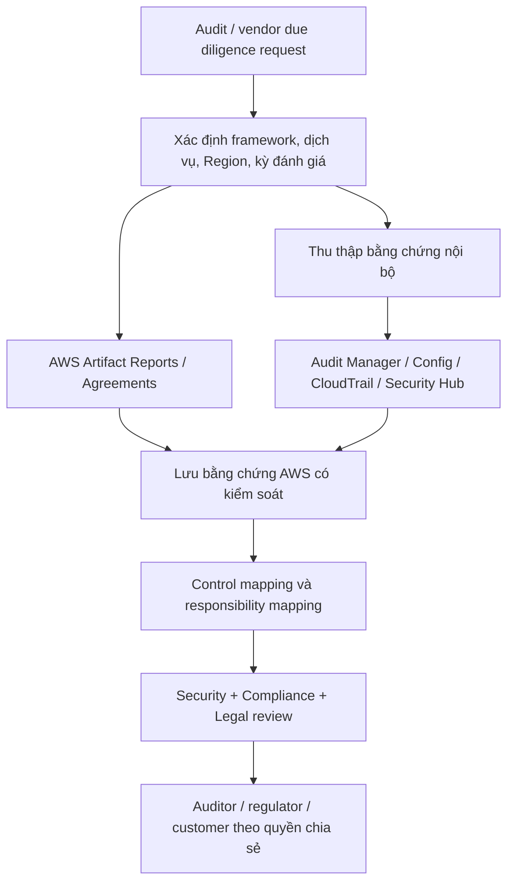
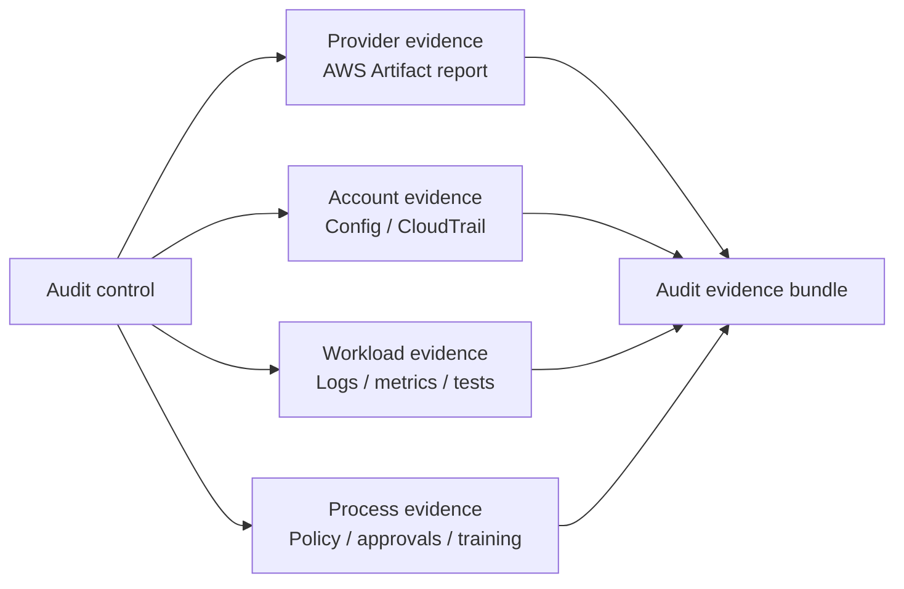

# AWS Artifact và tài liệu tuân thủ của nhà cung cấp

**AWS Artifact** là cổng tự phục vụ để truy cập tài liệu bảo mật và tuân thủ của AWS, xem và quản lý các thỏa thuận pháp lý với AWS, đồng thời hỗ trợ chuẩn bị câu trả lời cho đánh giá tuân thủ. Tổ chức có thể tải các báo cáo như SOC, PCI, ISO hoặc tài liệu chứng nhận liên quan, xem điều khoản như Business Associate Addendum (BAA), và dùng những tài liệu đó làm bằng chứng về các kiểm soát thuộc phạm vi AWS.

AWS Artifact giúp đội bảo mật, pháp chế, kiểm toán và quản trị rủi ro thu thập bằng chứng từ nhà cung cấp cloud. Tài liệu của AWS mô tả cách AWS vận hành các kiểm soát và phạm vi dịch vụ nằm trong chương trình tuân thủ. Tổ chức vẫn phải chứng minh cách mình cấu hình tài khoản, bảo vệ dữ liệu, vận hành ứng dụng và thực hiện các kiểm soát nội bộ.

Bài thuộc chương **Kiểm toán và tuân thủ** của mô-đun **CLOUD_PROVIDERS_AWS**. Nội dung kết nối AWS Artifact Reports, Agreements, AWS Organizations, Assurance Assistant, IAM, CloudTrail, AWS User Notifications, AWS Audit Manager và mô hình trách nhiệm chia sẻ.

> **Nguyên tắc:** Chọn đúng báo cáo và đúng phiên bản theo phạm vi kiểm toán; bảo vệ tài liệu mật sau khi tải; xem xét pháp lý trước khi chấp nhận thỏa thuận; ánh xạ từng bằng chứng AWS với trách nhiệm thực tế của tổ chức.

## 1. Mục tiêu học tập

Sau bài học, bạn có thể:

1. Giải thích AWS Artifact và các nhóm chức năng Reports, Agreements, Assurance Assistant.
2. Phân biệt báo cáo tuân thủ của AWS với báo cáo của nhà cung cấp phần mềm bên thứ ba.
3. Tìm báo cáo SOC, PCI, ISO, C5 và các tài liệu chứng nhận phù hợp.
4. Đọc phạm vi, kỳ đánh giá, phiên bản, ngoại lệ và tài liệu đính kèm trong báo cáo.
5. Tải báo cáo, chấp nhận điều khoản tải xuống và bảo vệ bản tài liệu có watermark.
6. Phân biệt account agreements với organization agreements.
7. Hiểu vai trò của AWS Organizations management account khi chấp nhận thỏa thuận cho tổ chức.
8. Quản lý thỏa thuận BAA, NDA và các điều khoản liên quan với quy trình pháp lý phù hợp.
9. Cấp IAM permissions theo nhiệm vụ và giới hạn quyền xem báo cáo theo category/series.
10. Dùng CloudTrail để audit hoạt động truy cập và quản lý tài liệu Artifact.
11. Thiết lập thông báo khi báo cáo hoặc thỏa thuận có cập nhật.
12. Dùng Assurance Assistant để hỗ trợ questionnaire và kiểm tra các câu trả lời có trích dẫn.
13. Áp dụng shared responsibility model để phân biệt kiểm soát của AWS và của khách hàng.
14. Kết hợp tài liệu Artifact với AWS Audit Manager, CloudTrail, AWS Config và bằng chứng nội bộ.
15. Xây dựng quy trình vendor due diligence và audit evidence có thể truy xuất.

## 2. AWS Artifact là gì?

AWS Artifact là dịch vụ cung cấp tài liệu bảo mật và tuân thủ của AWS theo yêu cầu. Bạn truy cập qua AWS Management Console, không cần cài agent hoặc triển khai resource trong VPC.

Các tài liệu có thể bao gồm:

- Báo cáo kiểm toán độc lập như SOC 1, SOC 2 và SOC 3.
- Báo cáo và tài liệu liên quan tới PCI DSS.
- Chứng nhận từ tổ chức công nhận theo các tiêu chuẩn ISO.
- Báo cáo theo các chương trình tuân thủ theo khu vực/ngành, ví dụ C5 hoặc chương trình khác tùy phạm vi dịch vụ.
- Tài liệu về kiểm soát bảo mật, quy trình vận hành và chứng nhận của AWS.
- Báo cáo tuân thủ của một số independent software vendors (ISVs) cung cấp sản phẩm trên AWS Marketplace.

AWS Artifact cũng có các chức năng quản lý thỏa thuận giữa khách hàng và AWS, cùng Assurance Assistant hỗ trợ trả lời câu hỏi về kiểm soát bảo mật và tuân thủ của AWS.

### 2.1. Ba nhóm chức năng chính

| Nhóm | Nội dung | Kết quả sử dụng |
| --- | --- | --- |
| **Reports** | Tìm, xem metadata và tải báo cáo/chứng nhận | Bằng chứng về kiểm soát và phạm vi tuân thủ của AWS hoặc ISV |
| **Agreements** | Xem, chấp nhận, theo dõi và chấm dứt thỏa thuận đủ điều kiện | Trạng thái và điều khoản pháp lý áp dụng cho account hoặc organization |
| **Assurance Assistant** | Hỗ trợ trả lời câu hỏi và questionnaire về kiểm soát của AWS | Bản nháp câu trả lời có nguồn trích dẫn để con người xác minh |

### 2.2. AWS Artifact không phải là chứng nhận cho workload của bạn

Ví dụ, AWS có thể có báo cáo SOC 2 cho các dịch vụ nằm trong phạm vi một kỳ đánh giá. Điều đó không có nghĩa ứng dụng Orders API của bạn tự động đạt SOC 2.

Tổ chức vẫn phải chứng minh các nội dung thuộc trách nhiệm của mình, như:

- IAM users, roles, policies và MFA.
- Network segmentation, security groups và VPC routing.
- Mã hóa dữ liệu, quản lý khóa và secrets.
- Phân loại dữ liệu, retention, backup và khôi phục.
- Logging, monitoring, incident response và change management.
- Quy trình tuyển dụng, đào tạo, phê duyệt và kiểm soát truy cập.
- Cấu hình các dịch vụ AWS được dùng trong workload.
- Kiểm soát đối với nhà cung cấp phụ và ứng dụng tích hợp.

Tài liệu Artifact là bằng chứng về nhà cung cấp AWS và các kiểm soát thuộc phạm vi tài liệu. Nó là một phần trong bộ bằng chứng của khách hàng.

## 3. AWS Artifact trong hệ sinh thái kiểm toán

Artifact thường được dùng cùng những dịch vụ khác. Mỗi dịch vụ trả lời một loại câu hỏi riêng.

| Công cụ | Câu hỏi chính | Loại bằng chứng |
| --- | --- | --- |
| **AWS Artifact** | AWS chứng minh các kiểm soát của nhà cung cấp bằng tài liệu nào? | Báo cáo kiểm toán, chứng nhận, thỏa thuận |
| **AWS Audit Manager** | Tài khoản/workload của tổ chức đang đáp ứng các kiểm soát nào? | Evidence tự động và thủ công được gom theo assessment |
| **AWS CloudTrail** | Ai đã gọi API nào, vào thời điểm nào? | Event history và trail logs |
| **AWS Config** | Resource có tuân thủ các rule cấu hình đã chọn không? | Configuration history, snapshots và compliance evaluations |
| **AWS Security Hub** | Những phát hiện bảo mật nào đang tồn tại trên môi trường? | Findings, standards checks và security posture |
| **IAM Access Analyzer** | Resource/policy có quyền truy cập ngoài dự kiến không? | Policy findings và access analysis |
| **AWS Organizations / SCP** | Guardrails nào được áp dụng cho các member accounts? | Cấu hình organization và policy |

Không nên dùng một công cụ để thay thế mọi loại bằng chứng. Ví dụ, Artifact có thể chứng minh AWS có quy trình kiểm soát vật lý trung tâm dữ liệu, trong khi CloudTrail của khách hàng mới cho thấy ai đã thay đổi security group trong account của khách hàng.

### 3.1. Quy trình tổng thể



Quy trình này tách bằng chứng của AWS khỏi bằng chứng của tổ chức, sau đó ánh xạ cả hai vào yêu cầu kiểm toán.

## 4. Reports: các loại tài liệu tuân thủ

Trong AWS Artifact, trang Reports thường có các tab riêng:

- **AWS reports:** báo cáo và chứng nhận do AWS cung cấp.
- **Third-party reports:** báo cáo từ một số ISVs bán sản phẩm trên AWS Marketplace.

### 4.1. SOC reports

SOC là nhóm báo cáo kiểm soát dịch vụ được thực hiện theo chuẩn của AICPA.

| Báo cáo | Mục tiêu thường gặp | Cách dùng |
| --- | --- | --- |
| **SOC 1** | Kiểm soát liên quan tới báo cáo tài chính của khách hàng | Đánh giá ảnh hưởng của dịch vụ tới kiểm soát báo cáo tài chính |
| **SOC 2** | Kiểm soát theo Trust Services Criteria | Đánh giá bảo mật, availability, processing integrity, confidentiality và privacy theo phạm vi báo cáo |
| **SOC 3** | Tóm tắt công khai về kiểm soát theo SOC 2 | Tài liệu tổng quan có thể chia sẻ rộng hơn theo điều kiện công bố |

SOC 1/2 thường là báo cáo chi tiết dành cho người nhận được phép. SOC 3 thường là báo cáo tổng quan công khai. Luôn kiểm tra đúng report period, loại Type I/Type II nếu có và phạm vi dịch vụ được nêu trong tài liệu.

### 4.2. ISO certifications

ISO là nhóm tiêu chuẩn được dùng trong nhiều hệ thống quản lý. AWS có thể cung cấp chứng nhận và tài liệu đánh giá theo các tiêu chuẩn ISO phù hợp.

Khi xem một chứng nhận ISO, kiểm tra:

- Tiêu chuẩn và phiên bản tiêu chuẩn.
- Pháp nhân/tổ chức được chứng nhận.
- Phạm vi hoạt động và địa điểm.
- Thời hạn hiệu lực.
- Tổ chức chứng nhận.
- Phụ lục hoặc scope statement đính kèm.

Không suy luận rằng mọi AWS service, mọi Region và mọi hoạt động của khách hàng đều nằm trong cùng phạm vi chứng nhận.

### 4.3. PCI DSS

PCI DSS liên quan đến môi trường xử lý, lưu trữ hoặc truyền dữ liệu thẻ thanh toán. Báo cáo của AWS giúp đánh giá phần hạ tầng/dịch vụ thuộc phạm vi AWS.

Khách hàng vẫn phải xác định phạm vi cardholder data environment (CDE), segmentation, encryption, access control, logging và các kiểm soát của ứng dụng theo vai trò của mình. Dùng tài liệu AWS cùng hướng dẫn PCI hiện hành và đánh giá của QSA khi cần.

### 4.4. Các chương trình khác

Tùy dịch vụ, Region, pháp nhân và kỳ đánh giá, AWS Artifact có thể cung cấp các tài liệu khác như:

- C5.
- FedRAMP.
- HIPAA-related documentation.
- CSA STAR hoặc tài liệu liên quan tới cloud assurance.
- Các chứng nhận và attestations theo ngành hoặc khu vực.

Danh mục thực tế thay đổi theo chương trình và phạm vi. Tra cứu trong AWS Artifact và AWS Compliance Programs thay vì giả định một danh sách cố định.

## 5. Chọn đúng báo cáo

Một báo cáo chỉ hữu ích nếu nó áp dụng đúng đối tượng và khoảng thời gian cần đánh giá.

Trước khi tải, xác định:

1. **Framework:** yêu cầu là SOC 2, ISO 27001, PCI DSS hay framework khác?
2. **Service:** AWS services nào đang được workload sử dụng?
3. **Region:** dịch vụ được triển khai ở Region nào?
4. **Period:** audit cần chứng minh giai đoạn nào?
5. **Entity/scope:** pháp nhân và hoạt động nào được báo cáo bao phủ?
6. **Report type:** cần report đầy đủ, certificate, attestation hay bridge letter nếu có?
7. **Version:** phiên bản mới nhất hay phiên bản lịch sử cho kỳ kiểm toán?
8. **Terms:** tài liệu có yêu cầu chấp nhận điều khoản trước khi tải không?

### 5.1. Kiểm tra service in scope

Không phải mọi dịch vụ AWS đều nằm trong mọi chương trình tuân thủ. Một service có thể:

- Nằm trong phạm vi chương trình ở một thời điểm.
- Chỉ được bao phủ ở một số Regions.
- Được thêm vào hoặc thay đổi phạm vi giữa các kỳ đánh giá.
- Có giới hạn về tính năng hoặc cách sử dụng.

Mở tài liệu **AWS Services in Scope by Compliance Program** và đối chiếu với report period. Nếu service/Region không nằm trong phạm vi tài liệu, không đưa ra kết luận rằng workload đó được chứng nhận dựa trên báo cáo khác.

### 5.2. Kiểm tra kỳ đánh giá

Ví dụ, auditor yêu cầu SOC 2 Type II cho khoảng thời gian từ tháng 1 đến tháng 6. Báo cáo hiện tại có thể có kỳ đánh giá khác. Hãy kiểm tra:

- Ngày bắt đầu và kết thúc kỳ kiểm toán.
- Ý kiến của auditor.
- Các ngoại lệ hoặc findings.
- Management response nếu có.
- Bridge letter hoặc thông tin bổ sung cho khoảng thời gian nằm ngoài report period, nếu AWS cung cấp.

Bridge letter không tự động kéo dài ý kiến kiểm toán hoặc biến khoảng trống thời gian thành một kỳ audit mới. Đọc chính xác điều khoản và giới hạn trong tài liệu.

### 5.3. Kiểm tra phiên bản cũ

Trang chi tiết report có thể hiển thị Previous versions. Dùng phiên bản cũ khi auditor cần đối chiếu kỳ lịch sử hoặc đánh giá tại thời điểm cụ thể.

Không thay thế tài liệu của kỳ trước bằng report mới mà không ghi lại phiên bản và thời gian. Evidence register cần lưu cả report ID/tên, version, period và ngày tải.

## 6. Tải báo cáo từ AWS Artifact

Quy trình cơ bản trong AWS Console:

1. Đăng nhập bằng IAM role/user được cấp quyền.
2. Mở AWS Artifact Console.
3. Chọn **View reports**.
4. Chọn tab **AWS reports** hoặc **Third-party reports**.
5. Tìm theo tên, category, series hoặc description.
6. Mở report details để xem metadata và previous versions.
7. Chọn report/version phù hợp.
8. Chấp nhận Terms and Conditions nếu được yêu cầu.
9. Chọn Download report.
10. Lưu tài liệu vào kho evidence bảo mật.
11. Ghi lại report version, ngày tải, người tải và mục đích sử dụng.

### 6.1. Kiểm tra PDF attachments

Một số PDF có chứa attachments bổ sung. Sau khi tải:

- Mở PDF bằng viewer hỗ trợ attachments.
- Kiểm tra biểu tượng attachment/sidebar.
- Mở và lưu các phụ lục cần thiết theo chính sách.
- Đối chiếu tên và nội dung phụ lục với phần tham chiếu trong báo cáo.
- Lưu cùng evidence index và giữ nguyên mối liên hệ giữa report với attachment.

Chỉ đọc trang đầu PDF có thể bỏ sót tài liệu hỗ trợ quan trọng.

### 6.2. Báo cáo có watermark riêng

Mỗi lần tải report từ Artifact, AWS tạo bản tài liệu có watermark duy nhất có thể truy vết. Vì vậy:

- Không đăng report lên website hoặc kho chia sẻ công khai.
- Không gửi report mật dưới dạng email attachment.
- Chỉ chia sẻ theo điều kiện được phép, ví dụ trong công ty, với auditor hoặc regulator.
- Dùng secure document sharing service khi cần chia sẻ.
- Không xóa watermark hoặc chỉnh sửa tài liệu để thay đổi nguồn gốc.
- Giới hạn quyền truy cập và theo dõi người tải/xem.

AWS bảo vệ tài liệu khi còn ở trong AWS Cloud. Sau khi tải xuống, khách hàng chịu trách nhiệm bảo vệ bản sao của mình.

## 7. Bảo vệ và quản lý tài liệu đã tải

Báo cáo Artifact có thể chứa chi tiết về kiểm soát bảo mật, kiến trúc, quy trình vận hành hoặc thông tin nhạy cảm khác.

Một kho evidence nên có:

- Encryption at rest và in transit.
- Access control theo nhóm audit, compliance, legal và security.
- MFA/SSO và quyền truy cập theo vai trò.
- Audit log cho việc tải, xem, chia sẻ và xóa.
- Retention policy phù hợp với hợp đồng và yêu cầu kiểm toán.
- Versioning hoặc immutable storage nếu quy định yêu cầu.
- Quy trình thu hồi quyền khi auditor/nhà thầu kết thúc hợp đồng.
- Cơ chế secure sharing và expiration link nếu nền tảng hỗ trợ.

### 7.1. Evidence register mẫu

| Trường | Ví dụ |
| --- | --- |
| Evidence ID | AWS-SOC2-2026-H1 |
| Provider | AWS |
| Document | SOC 2 Type II |
| Report period | 2026-01-01 đến 2026-06-30 |
| Version | Version hiển thị trong Artifact |
| Download date | 2026-11-20 |
| Downloaded by | Compliance role |
| Applicable services | Các service đã đối chiếu trong scope list |
| Control mapping | Vendor controls / control IDs |
| Storage location | Kho evidence hạn chế truy cập |
| Review owner | Compliance lead |
| Review status | Pending / Reviewed / Accepted |
| Next review | Theo lịch vendor review |

Đây là mẫu quản trị nội bộ, không phải định dạng bắt buộc của AWS.

## 8. Agreements: thỏa thuận với AWS

AWS Artifact Agreements cho phép xem và quản lý một số thỏa thuận giữa khách hàng với AWS.

Ví dụ thường gặp:

- **Business Associate Addendum (BAA):** liên quan tới việc xử lý Protected Health Information (PHI) trong bối cảnh HIPAA khi đáp ứng các điều kiện áp dụng.
- **Nondisclosure Agreement (NDA):** điều khoản bảo mật liên quan tới việc truy cập/chia sẻ tài liệu.
- Các thỏa thuận hoặc điều khoản khác được cung cấp trong Artifact theo account/organization.

Artifact hiển thị trạng thái thỏa thuận và cho phép xem lại nội dung đã chấp nhận. Danh mục và khả năng chấp nhận có thể thay đổi theo loại account, organization và điều khoản hiện hành.

### 8.1. Agreements khác Reports

| Reports | Agreements |
| --- | --- |
| Tài liệu chứng minh/diễn giải kiểm soát của nhà cung cấp | Điều khoản pháp lý giữa khách hàng và AWS |
| Có report period, version, audit scope | Có phạm vi account/organization, hiệu lực và nghĩa vụ hợp đồng |
| Dùng làm audit artifacts | Xác định quyền, nghĩa vụ và điều kiện sử dụng |
| Download, review, secure store | Review, accept, track, terminate khi được phép |

### 8.2. Vì sao cần xem xét pháp lý trước khi accept?

Chấp nhận thỏa thuận có thể tạo ra nghĩa vụ pháp lý cho account hoặc toàn bộ organization. Trước khi accept:

- Xác định pháp nhân ký kết.
- Xác định account hoặc organization được bao phủ.
- Đọc định nghĩa, nghĩa vụ, điều kiện và ngoại lệ.
- Đánh giá loại dữ liệu và workload dự kiến.
- Xác định yêu cầu privacy, retention và incident notification.
- Tham khảo legal, privacy và compliance teams.
- Lưu bằng chứng về người phê duyệt và thời điểm chấp nhận.

Không coi thao tác Accept trên Console là một bước cấu hình kỹ thuật thông thường.

## 9. Account agreements

Account agreement được chấp nhận cho một AWS account cụ thể.

Quy trình tổng quát:

1. Mở AWS Artifact.
2. Chọn Agreements.
3. Mở tab Account agreements.
4. Chọn thỏa thuận.
5. Download agreement.
6. Đọc và chấp nhận AWS Artifact NDA nếu được yêu cầu để tải bản thỏa thuận.
7. Đọc kỹ PDF của thỏa thuận.
8. Chọn Accept agreement.
9. Xác nhận chấp nhận các điều khoản.
10. Kiểm tra trạng thái agreement sau khi hoàn tất.

### 9.1. Quyền cần có

Theo mặc định, việc chấp nhận thỏa thuận thường yêu cầu quyền quản trị phù hợp. IAM/federated users có thể được cấp quyền cụ thể để xem, tải và quản lý agreement.

Nên tách các vai trò:

- Người xem/tải agreement.
- Người đánh giá pháp lý.
- Người phê duyệt.
- Người có quyền thực hiện Accept/Terminate.

Một người cần tải tài liệu không nhất thiết phải có quyền chấp nhận thỏa thuận.

## 10. Organization agreements với AWS Organizations

Nếu sử dụng AWS Organizations, management account có thể chấp nhận các organization agreements đủ điều kiện thay mặt các member accounts.

Điều kiện quan trọng:

- Organization phải bật **All features**, không chỉ consolidated billing.
- Người thực hiện phải đăng nhập management account.
- Người đó cần AWS Artifact permissions phù hợp.
- Việc chấp nhận phải được xem xét bởi legal/privacy/compliance teams.

### 10.1. Phạm vi áp dụng

Khi management account chấp nhận một organization agreement, thỏa thuận áp dụng cho các member accounts hiện tại và các account được thêm vào organization sau đó theo điều kiện của agreement.

Member account users có quyền **organizations:DescribeOrganization** có thể xem organization agreements được chấp nhận thay mặt họ.

Nếu một member account bị remove khỏi organization hoặc rời organization, account đó không còn được bao phủ bởi organization agreements đã chấp nhận thay mặt organization. Trước khi di chuyển account, cần đánh giá liệu account có phải thiết lập thỏa thuận riêng hay không.

### 10.2. Quy trình accept organization agreement

1. Đăng nhập management account.
2. Xác nhận organization đang bật All features.
3. Mở AWS Artifact → Agreements.
4. Chọn tab Organization agreements.
5. Chọn agreement phù hợp.
6. Tải và đọc nội dung thỏa thuận.
7. Chấp nhận AWS Artifact NDA nếu được yêu cầu để tải agreement.
8. Đọc điều khoản và xác nhận với bộ phận pháp lý.
9. Chọn Accept agreement và xác nhận phạm vi toàn organization.
10. Kiểm tra agreement xuất hiện với trạng thái phù hợp trong danh sách Organization agreements.
11. Thông báo cho owners của member accounts về phạm vi và nghĩa vụ.

### 10.3. BAA và dữ liệu PHI

Ví dụ, tổ chức xử lý dữ liệu y tế có thể cần BAA với AWS trước khi sử dụng AWS services cho workload có PHI.

BAA không tự động làm cho mọi workload đạt HIPAA. Tổ chức vẫn phải:

- Dùng dịch vụ nằm trong phạm vi áp dụng.
- Cấu hình account, IAM và network phù hợp.
- Mã hóa và kiểm soát truy cập dữ liệu.
- Bảo vệ logs, backups và keys.
- Thực hiện chính sách nội bộ và quy trình xử lý sự cố.
- Đảm bảo các vendor/subprocessor khác đáp ứng yêu cầu.
- Duy trì bằng chứng về việc thực hiện các kiểm soát.

### 10.4. Terminate organization agreement

Management account có thể terminate agreement đã được chấp nhận online thay mặt organization, nếu thỏa thuận cho phép quy trình đó.

Trước khi terminate:

- Đánh giá workload/account nào còn phụ thuộc agreement.
- Tham vấn legal/privacy/compliance.
- Xác định ngày hiệu lực và nghĩa vụ còn lại.
- Xác nhận có thỏa thuận thay thế nếu cần.
- Thông báo cho owners của các member accounts.
- Lưu quyết định và bằng chứng termination.

Đừng terminate agreement chỉ để dọn danh sách trong Console.

## 11. Offline agreements

Một số thỏa thuận được chấp nhận qua quy trình offline. AWS Artifact có thể hiển thị agreement offline đã được chấp nhận, ví dụ Offline BAA, với trạng thái Active.

Đối với offline agreement:

- Đọc điều khoản và hướng dẫn termination trong chính tài liệu.
- Không giả định có thể terminate bằng nút Terminate agreement như online agreement.
- Lưu bản ký, ngày hiệu lực và pháp nhân liên quan.
- Đồng bộ trạng thái với kho hợp đồng nội bộ.
- Khi account/organization thay đổi, kiểm tra phạm vi agreement theo điều khoản thực tế.

## 12. IAM và kiểm soát truy cập AWS Artifact

AWS Artifact hỗ trợ IAM để kiểm soát ai có thể:

- Liệt kê reports.
- Xem metadata.
- Tải report.
- Liệt kê và tải agreements.
- Chấp nhận hoặc terminate agreements.
- Quản lý notification settings.
- Tạo, xem và export compliance inquiries trong Assurance Assistant.

Không nên cấp quyền rộng cho tất cả developer. Chia vai trò theo trách nhiệm công việc.

### 12.1. Managed policies thường gặp

Một số AWS managed policies có thể dùng làm điểm khởi đầu:

| Policy | Mục đích |
| --- | --- |
| **AWSArtifactReportsReadOnlyAccess** | Liệt kê, xem và tải AWS Artifact reports |
| **AWSArtifactAgreementsReadOnlyAccess** | Xem và tải agreements ở chế độ read-only |
| **AWSArtifactAgreementsFullAccess** | Quản lý agreements, bao gồm accept/terminate |
| **AWSArtifactComplianceInquiriesFullAccess** | Tạo, xem, export và gửi feedback cho Assurance Assistant inquiries |

Tên và nội dung policy có thể được AWS cập nhật. Kiểm tra policy JSON hiện hành trước khi gắn vào IAM principal. AWS managed policy tiện để bắt đầu, nhưng không mặc nhiên là least privilege cho mọi tổ chức.

### 12.2. Phân tách nhiệm vụ

Một mô hình quyền tham khảo:

| Vai trò | Quyền phù hợp |
| --- | --- |
| Auditor viewer | List/view/download report được phép |
| Compliance analyst | Xem report, metadata, previous versions và inquiry responses |
| Legal reviewer | Xem/tải agreement và review terms |
| Agreement approver | Accept/terminate sau phê duyệt nội bộ |
| Notification administrator | Cấu hình User Notifications và Artifact notification settings |
| Assurance Assistant user | Tạo, xem, export inquiry theo policy được cấp |

Dùng IAM Identity Center/federation hoặc cơ chế danh tính doanh nghiệp để cấp quyền theo nhóm. Không dùng root credentials cho công việc thường ngày.

## 13. Fine-grained access cho Reports

AWS Artifact hỗ trợ condition keys để giới hạn quyền theo report category và series.

Các condition keys quan trọng:

- **artifact:ReportCategory**
- **artifact:ReportSeries**

Ví dụ, chỉ cho phép xem các báo cáo thuộc series SOC trong category Certifications and Attestations:

```json
{
  "Version": "2012-10-17",
  "Statement": [
    {
      "Sid": "ListReports",
      "Effect": "Allow",
      "Action": [
        "artifact:ListReports"
      ],
      "Resource": "*"
    },
    {
      "Sid": "ReadSocReports",
      "Effect": "Allow",
      "Action": [
        "artifact:GetReport",
        "artifact:GetReportMetadata",
        "artifact:GetTermForReport",
        "artifact:ListReportVersions"
      ],
      "Resource": "*",
      "Condition": {
        "StringEquals": {
          "artifact:ReportSeries": "SOC",
          "artifact:ReportCategory": "Certifications and Attestations"
        }
      }
    }
  ]
}
```

Policy này là ví dụ theo IAM condition keys trong AWS Artifact. Trước khi dùng, kiểm tra category/series thực tế của report, actions cần thiết cho workflow và policy hiện hành ở partition của account.

### 13.1. Vì sao ListReports có Resource *

API liệt kê reports cần quyền list trên resource wildcard theo ví dụ AWS. Quyền lấy nội dung/metadata được giới hạn bằng condition keys. Đừng xóa điều kiện lọc khỏi statement chỉ vì thao tác list vẫn hoạt động.

### 13.2. Commercial Regions và GovCloud

Ví dụ IAM policy cho commercial Regions và AWS GovCloud (US) có thể khác nhau về partition ARN và một số permission. Không copy nguyên policy commercial sang GovCloud hoặc ngược lại. Dùng đúng tài liệu IAM policy cho partition đang sử dụng.

## 14. CloudTrail audit cho hoạt động Artifact

AWS Artifact tích hợp với AWS CloudTrail. Các API calls từ Console hoặc API có thể được ghi nhận thành CloudTrail events.

Một số event names có thể gặp:

- ListReports.
- GetReportMetadata.
- GetReport.
- GetTermForReport.
- ListAgreements.
- GetAgreement.
- GetCustomerAgreement.
- AcceptNdaForAgreement.
- AcceptAgreement.
- TerminateAgreement.
- GetAccountSettings và PutAccountSettings.

Event source của AWS Artifact là **artifact.amazonaws.com**.

### 14.1. Xem Event history

Trong CloudTrail Console, mở Event history và lọc theo Event source hoặc Event name. Có thể kiểm tra:

- Ai thực hiện thao tác.
- Role/session hoặc IAM principal nào được sử dụng.
- Thời gian và Region của event.
- Source IP và user agent.
- API operation.
- Error code/error message nếu request thất bại.

CloudTrail Event history cung cấp các management events gần đây theo thời hạn lưu của dịch vụ. Để lưu giữ lâu dài, tạo trail và gửi log tới S3, sau đó áp dụng retention/immutability theo chính sách audit.

### 14.2. AWS CLI truy vấn Artifact events

Ví dụ truy vấn các event gần đây:

```bash
aws cloudtrail lookup-events \
  --lookup-attributes AttributeKey=EventSource,AttributeValue=artifact.amazonaws.com \
  --max-results 50 \
  --region us-east-1
```

Thay Region theo nơi cần truy vấn và kiểm tra quyền CloudTrail. Kết quả có thể chứa nhiều loại Artifact API calls; lọc tiếp theo EventName hoặc thời gian trong công cụ phân tích.

### 14.3. Những gì CloudTrail không chứng minh

CloudTrail ghi nhận hoạt động API như ai đã tải report hoặc chấp nhận agreement. Nó không thay thế việc đọc nội dung báo cáo, đánh giá điều khoản hoặc chứng minh rằng khách hàng thực hiện đầy đủ các kiểm soát trong workload.

## 15. Notifications khi có tài liệu mới

AWS Artifact hỗ trợ email notifications cho cập nhật report và agreement thông qua AWS User Notifications.

Tài liệu hiện hành mô tả chức năng này cho commercial AWS Regions; chức năng notification settings này không áp dụng cho AWS GovCloud (US) Regions.

### 15.1. Điều kiện ban đầu

1. Mở AWS User Notifications.
2. Chọn notification hubs tại các Regions muốn lưu trữ notification data.
3. Lưu cấu hình notification hubs.
4. Mở AWS Artifact → Notification settings.
5. Tạo notification configuration.
6. Chọn cập nhật AWS Agreements, AWS Reports hoặc cả hai.
7. Chọn tất cả reports hoặc một subset category/series.
8. Thêm recipients email.
9. Tạo configuration.
10. Người nhận xác minh email để nhận thông báo.

### 15.2. Chọn subset

Nếu chỉ theo dõi SOC/ISO, có thể chọn các categories/series liên quan thay vì nhận mọi report update. Điều này giúp thông báo tập trung vào tài liệu thực sự ảnh hưởng tới audit scope.

### 15.3. Notification không thay thế review

Khi có email thông báo:

- Mở AWS Artifact để kiểm tra report/term mới.
- Xác định version và report period.
- Đánh giá có thay đổi scope hoặc điều khoản không.
- Cập nhật evidence register.
- Thông báo cho control owners nếu cần.
- Lưu kết quả review.

Email chỉ báo có thay đổi; nó không tự quyết định tài liệu mới có phù hợp với workload hoặc hợp đồng hay không.

## 16. Assurance Assistant trong AWS Artifact

**Assurance Assistant** là tính năng AI trong AWS Artifact tạo câu trả lời có trích dẫn cho câu hỏi về kiểm soát bảo mật, compliance posture và operational practices của AWS.

Nó giúp đội vendor risk, security, compliance và legal xử lý questionnaire hoặc due diligence request nhanh hơn bằng cách:

1. Nhận câu hỏi hoặc questionnaire.
2. Ánh xạ câu hỏi tới các kiểm soát AWS liên quan.
3. Tìm kiếm trong tài liệu tuân thủ đã được xác minh của AWS.
4. Tạo câu trả lời kèm citations.
5. Cho phép người dùng xem nguồn và export câu trả lời.

### 16.1. Định dạng questionnaire

Assurance Assistant được tối ưu cho:

- Consensus Assessments Initiative Questionnaire (CAIQ).
- Standardized Information Gathering questionnaire (SIG).
- Due diligence questionnaire (DDQ) tự thiết kế ở định dạng CSV.
- Excel XLSX.
- Word DOCX.
- PDF.

### 16.2. Phạm vi câu hỏi

Assurance Assistant trả lời về trách nhiệm của AWS: các kiểm soát bảo mật, trạng thái tuân thủ và thực hành vận hành của AWS.

Nó có thể không trả lời câu hỏi:

- Thiếu bối cảnh hoặc không rõ nội dung.
- Không liên quan tới compliance.
- Không phù hợp với phạm vi của công cụ.
- Hỏi về cách khách hàng cấu hình workload của chính mình.

Ví dụ, câu hỏi “AWS bảo vệ trung tâm dữ liệu vật lý như thế nào?” phù hợp hơn câu hỏi “Security group của account chúng tôi có mở port 22 ra Internet không?”. Câu thứ hai cần bằng chứng từ môi trường khách hàng.

### 16.3. Chi phí

Theo tài liệu AWS hiện hành, Assurance Assistant có thể sử dụng trong AWS Artifact Console mà không tính phí riêng. Các dịch vụ liên quan hoặc quy trình lưu trữ bằng chứng của tổ chức có thể có chi phí riêng.

## 17. Viết câu hỏi tốt cho Assurance Assistant

Mỗi câu hỏi nên độc lập, có ngữ cảnh đầy đủ và dùng thuật ngữ compliance rõ ràng.

Ví dụ câu hỏi tốt:

- “What physical security controls protect AWS data centers for services in the SOC 2 report?”
- “Which AWS services are included in the ISO 27001 certification scope for the current report period?”
- “How does AWS manage vulnerability remediation for the infrastructure layer?”
- “What evidence describes AWS access control and personnel security controls?”

Câu hỏi kém rõ:

- “How is security handled?”
- “Is this compliant?”
- “What about encryption?”
- “Can you confirm our application is safe?”

### 17.1. Một câu hỏi nên có một mục tiêu

Đối với bulk uploads:

- CSV/XLSX: một câu hỏi đầy đủ cho mỗi row.
- Word/PDF: tách mỗi câu hỏi thành một mục rõ ràng.
- Nêu tên service, framework hoặc control area.
- Không phụ thuộc câu hỏi trước đó; mỗi câu hỏi được xử lý độc lập.
- Tránh câu hỏi ghép nhiều yêu cầu không liên quan.

### 17.2. Ví dụ mapping câu hỏi

| Control area | Câu hỏi mẫu | Bằng chứng cần kiểm tra |
| --- | --- | --- |
| Physical security | AWS kiểm soát quyền ra vào cơ sở hạ tầng vật lý như thế nào? | SOC/ISO report và citations |
| Personnel security | AWS kiểm tra và đào tạo nhân sự theo quy trình nào? | Report section về personnel controls |
| Vulnerability management | AWS quản lý lỗ hổng của hạ tầng do AWS vận hành ra sao? | Security operations evidence |
| Availability | AWS đánh giá và kiểm thử khả năng phục hồi hạ tầng như thế nào? | Availability/resilience controls |
| Encryption | Tài liệu AWS mô tả kiểm soát mã hóa nào ở lớp dịch vụ? | Service-specific docs và report scope |

Câu trả lời cần được đối chiếu với nguồn trích dẫn và yêu cầu thực tế của auditor.

## 18. Review và export câu trả lời Assurance Assistant

Mỗi câu hỏi trong questionnaire có thể ở trạng thái đang tạo câu trả lời hoặc đã được tạo tự động và sẵn sàng review.

Một response có:

- Câu trả lời do AI tạo.
- Citations trỏ tới tài liệu AWS.
- Trạng thái xử lý.
- Tùy chọn export.

Có thể:

- Export selected: tải câu trả lời đã chọn.
- Export all: tải tất cả câu trả lời của questionnaire.
- Bao gồm source citations trong file export.

### 18.1. Quy trình human review

Với từng câu trả lời:

1. Đọc toàn bộ câu trả lời.
2. Mở từng citation.
3. Kiểm tra tài liệu gốc và report period.
4. Xác định câu trả lời đang nói về AWS hay customer responsibility.
5. Đối chiếu với câu hỏi của auditor.
6. Đánh dấu nội dung còn thiếu hoặc chưa được chứng minh.
7. Chỉnh sửa wording nếu cần.
8. Xin phê duyệt từ compliance/security owner.
9. Chỉ export bản đã review để gửi vào questionnaire chính thức.

### 18.2. AI answer không phải kết luận pháp lý

Câu trả lời của Assurance Assistant được tạo bằng AI và dựa trên tài liệu AWS có sẵn tại thời điểm tạo. Citation giúp kiểm chứng, nhưng người dùng vẫn phải xem nguồn gốc, bối cảnh, phạm vi và yêu cầu riêng của audit.

Không copy nguyên văn câu trả lời tự động vào hợp đồng, attestation hoặc chứng nhận của doanh nghiệp khi chưa được người có thẩm quyền review.

### 18.3. Lưu bản export

Lưu lại:

- Questionnaire gốc.
- Response export.
- Citations.
- Thời điểm tạo câu trả lời.
- Người review.
- Phiên bản câu trả lời đã chỉnh sửa.
- Approval record.
- Trạng thái cuối cùng của từng câu hỏi.

## 19. Assurance Assistant IAM và notifications

AWS có managed policy **AWSArtifactComplianceInquiriesFullAccess** cho phép tạo, liệt kê, xem, export và gửi feedback đối với compliance inquiries.

Policy này cũng có thể cho phép chọn notification configuration đã tồn tại khi tạo inquiry. Nó không thay thế quy trình thiết lập AWS User Notifications và không tự tạo notification configuration mới.

Theo tài liệu cập nhật của AWS, policy này đã được mở rộng quyền notifications/notifications-contacts để hỗ trợ chọn cấu hình thông báo, và có permission gửi feedback cho inquiry responses. Kiểm tra JSON policy mới nhất trước khi gắn.

### 19.1. Tách quyền notification administrator

Người cấu hình email recipients và notification hubs cần quyền AWS User Notifications phù hợp. Có thể tách nhiệm vụ:

- Artifact inquiry user: làm việc với questionnaire.
- Notification administrator: tạo notification hubs/configurations.
- Email recipient: xác minh địa chỉ nhận thông báo.
- Compliance reviewer: xem và phê duyệt nội dung.

Điều này giúp tránh cấp quyền quản lý notifications rộng cho mọi người chỉ cần dùng Assurance Assistant.

## 20. Shared Responsibility Model và ý nghĩa đối với audit

AWS chia trách nhiệm bảo mật thành hai phần:

- **Security of the Cloud:** AWS chịu trách nhiệm bảo vệ hạ tầng cloud mà AWS vận hành, như cơ sở vật lý, phần cứng, lớp virtualization và một số thành phần dịch vụ.
- **Security in the Cloud:** khách hàng chịu trách nhiệm cấu hình và bảo vệ workload, dữ liệu, danh tính, ứng dụng và các thành phần theo loại dịch vụ đã chọn.

Phạm vi chính xác thay đổi theo dịch vụ. Với EC2, khách hàng quản lý guest OS, patching, application software và security groups. Với dịch vụ trừu tượng hơn như S3/DynamoDB, AWS quản lý nhiều thành phần hạ tầng bên dưới, còn khách hàng vẫn quản lý dữ liệu, IAM, encryption options, backup, versioning và permissions.

### 20.1. Responsibility matrix ví dụ

| Control | AWS | Customer |
| --- | --- | --- |
| Bảo vệ trung tâm dữ liệu | Vận hành physical security controls | Xem báo cáo và đánh giá vendor |
| Hypervisor/physical infrastructure | Quản lý lớp hạ tầng theo service model | Chọn dịch vụ và cấu hình workload |
| IAM user/role permissions trong account | Cung cấp IAM platform | Thiết kế least privilege, MFA và access reviews |
| EC2 guest OS patching | Cung cấp hạ tầng EC2 | Patch OS và application trên instance |
| S3 service infrastructure | Vận hành hạ tầng dịch vụ | Cấu hình bucket policy, encryption, lifecycle và data access |
| Application code | Không chịu trách nhiệm code của khách hàng | Secure coding, review và vulnerability management |
| Data classification | Không phân loại dữ liệu thay khách hàng | Phân loại, retention, encryption và access controls |
| Incident response của workload | Xử lý sự cố thuộc AWS theo cam kết dịch vụ | Phát hiện, phản ứng và thông báo theo quy trình của tổ chức |

### 20.2. Dùng report để xác định control boundary

Khi đọc SOC/ISO report:

1. Tìm mô tả hệ thống và phạm vi.
2. Đọc control objective/criteria.
3. Xác định AWS control owner.
4. Đọc complementary user entity controls hoặc customer responsibilities nếu có.
5. Ghi nhận những việc khách hàng phải thực hiện để control của AWS có hiệu lực.
6. Ánh xạ phần còn lại vào quy trình và evidence nội bộ.

Đừng chỉ ghi “AWS đã được SOC 2” vào control matrix. Hãy chỉ rõ kiểm soát nào của AWS được báo cáo, và khách hàng cần thực hiện phần nào.

## 21. AWS Artifact và AWS Audit Manager

Hai dịch vụ thường được dùng cùng nhau nhưng có vai trò khác nhau.

**AWS Artifact** cung cấp tài liệu của AWS và quản lý thỏa thuận với AWS.

**AWS Audit Manager** hỗ trợ khách hàng liên tục thu thập và tổ chức bằng chứng về việc sử dụng AWS theo framework/assessment đã chọn.

Ví dụ:

- Artifact: tải SOC 2 report của AWS.
- Audit Manager: thu thập evidence về encryption, IAM, logging và cấu hình tài khoản của tổ chức.
- CloudTrail: chứng minh principal nào thay đổi resource.
- AWS Config: chứng minh resource có đáp ứng configuration rule hay không.
- Internal evidence: policy, training records, incident runbooks, access review và phê duyệt.

Artifact không tự động tạo Audit Manager assessment cho workload. Khách hàng phải chọn framework, xác định controls và cấu hình evidence sources.

### 21.1. Bản đồ bằng chứng



Bằng chứng từ nhiều nguồn phải được liên kết bằng control ID, thời gian và owner để auditor có thể truy xuất.

## 22. Xây dựng control mapping

Một control mapping tốt giúp giải thích bằng chứng AWS liên quan tới yêu cầu nào và phần nào thuộc trách nhiệm của khách hàng.

Ví dụ control “Privileged access is restricted and reviewed”:

| Thành phần | Bằng chứng |
| --- | --- |
| AWS provider control | SOC/ISO report section liên quan đến quản lý quyền truy cập nội bộ của AWS |
| Customer IAM design | IAM policies, Identity Center permission sets, MFA settings |
| Access review | Danh sách principals, approval records và review cadence |
| Privileged activity | CloudTrail events, alert history |
| Exceptions | Ticket, risk acceptance và remediation plan |
| Owner | IAM/security control owner |

Ví dụ control “Data is encrypted at rest”:

| Thành phần | Bằng chứng |
| --- | --- |
| AWS provider control | Tài liệu về encryption capabilities của dịch vụ |
| Service scope | Xác minh service/Region nằm trong report scope |
| Customer configuration | KMS key policies, S3 bucket encryption, database encryption settings |
| Key lifecycle | Rotation, access review và key deletion controls |
| Evidence date | Ngày export Config/IAM evidence |
| Owner | Data protection owner |

### 22.1. Không ánh xạ chỉ bằng tên dịch vụ

Một control “backup and recovery” không được chứng minh chỉ vì AWS cung cấp S3 hoặc RDS. Cần bằng chứng rằng khách hàng đã cấu hình backup, retention, restore test, recovery objective và quyền truy cập phù hợp.

## 23. Third-party reports và vendor due diligence

AWS Artifact có thể cung cấp report của một số independent software vendors (ISVs) bán sản phẩm trên AWS Marketplace.

Khi đánh giá vendor:

- Xác định chính xác vendor/legal entity.
- Kiểm tra report do vendor nào phát hành.
- Xem kỳ đánh giá và phạm vi sản phẩm/dịch vụ.
- Xác định hosting model và các thành phần phụ thuộc.
- Đọc exceptions/findings và management response.
- Kiểm tra ngày phát hành, version và thời hạn hiệu lực.
- Đối chiếu report với hợp đồng, DPA/BAA và security questionnaire.
- Xác định các control mà khách hàng vẫn phải cấu hình.

Không nhầm báo cáo của AWS với báo cáo của ISV. Việc một vendor bán sản phẩm trên AWS Marketplace không làm cho sản phẩm đó tự động nằm trong báo cáo SOC/ISO của AWS.

### 23.1. Vendor assessment matrix

| Tiêu chí | Câu hỏi đánh giá |
| --- | --- |
| Identity | Nhà cung cấp và pháp nhân nào chịu trách nhiệm? |
| Service scope | Báo cáo bao phủ sản phẩm/phiên bản nào? |
| Audit period | Report có bao phủ thời gian hợp đồng không? |
| Security controls | IAM, encryption, vulnerability management, logging? |
| Data processing | Dữ liệu nào được xử lý, lưu ở đâu, retention bao lâu? |
| Subprocessors | Có bên phụ nào tham gia không? |
| Incident handling | Thông báo và phản ứng sự cố theo điều khoản nào? |
| Contract | Có DPA/BAA/security addendum phù hợp không? |
| Findings | Exceptions nào còn mở và kế hoạch xử lý? |
| Exit | Cách export/xóa dữ liệu khi kết thúc dịch vụ? |

## 24. Notifications và lịch review tài liệu

Tài liệu compliance có thể thay đổi khi AWS phát hành report version mới, cập nhật phạm vi dịch vụ hoặc thay đổi điều khoản.

Tổ chức nên xác định:

- Ai nhận notifications.
- Ai chịu trách nhiệm review report mới.
- Ai kiểm tra scope và report period.
- Ai đánh giá tác động tới control mapping.
- Ai cập nhật auditor evidence package.
- Ai xem xét legal agreements và renewal.
- Ai phê duyệt việc chia sẻ tài liệu.

### 24.1. Lịch review tham khảo

| Tần suất | Hoạt động |
| --- | --- |
| Khi có notification | Kiểm tra report/agreement mới hoặc thay đổi |
| Hàng quý | Review danh sách report đang dùng và service scope |
| Hàng năm | Vendor risk assessment và review legal agreements |
| Trước audit | Kiểm tra report period, version, attachments và evidence index |
| Khi thêm AWS service/Region | Đối chiếu compliance scope và customer controls |
| Khi account rời organization | Kiểm tra organization agreement coverage |

Tần suất thực tế cần phù hợp với hợp đồng, framework và risk appetite của tổ chức.

## 25. Pricing và giới hạn

AWS cung cấp AWS Artifact documents và agreements miễn phí. Assurance Assistant cũng được AWS mô tả là không tính phí riêng trong Artifact Console.

Chi phí có thể phát sinh từ các hoạt động liên quan của khách hàng, ví dụ:

- Lưu tài liệu trong kho evidence riêng.
- Dùng AWS services để phân tích hoặc giữ CloudTrail logs.
- Dùng AWS Audit Manager hoặc các dịch vụ khác theo pricing của từng dịch vụ.
- Sử dụng công cụ secure sharing, GRC hoặc vendor risk management bên ngoài.

AWS Artifact là cổng tài liệu và quản lý thỏa thuận. Không giả định mọi dịch vụ compliance khác cũng miễn phí.

## 26. Troubleshooting

| Triệu chứng | Nguyên nhân có thể | Cách xử lý |
| --- | --- | --- |
| Không thấy report | IAM permissions, filter hoặc partition khác | Kiểm tra category/series, account và policy |
| Download report bị AccessDenied | Thiếu GetReport/metadata/terms permission | Kiểm tra managed/customer policy và SCP |
| Không thấy previous version | Report không có version cũ trong Artifact | Kiểm tra details page và report availability |
| PDF thiếu phụ lục | PDF viewer không hiển thị attachments | Dùng viewer hỗ trợ PDF attachments |
| Report không đúng kỳ | Chọn report version không phù hợp | Kiểm tra report period và previous versions |
| Không thể chia sẻ report | Tài liệu được đánh dấu confidential | Xem terms và dùng secure sharing được phép |
| Không thấy Organization agreements | Organization chưa bật All features hoặc thiếu quyền | Kiểm tra Organizations feature set và management account |
| Không thể accept agreement | Thiếu Artifact permissions hoặc chưa review terms | Kiểm tra IAM và quy trình phê duyệt |
| Member account không thấy agreement | Thiếu organizations:DescribeOrganization hoặc không còn trong org | Kiểm tra membership và permissions |
| Agreement offline không terminate được | Agreement chấp nhận qua quy trình offline | Theo hướng dẫn termination trong agreement |
| Notification không gửi email | Chưa chọn notification hub hoặc email chưa verify | Kiểm tra User Notifications và recipients |
| Notification setting không khả dụng ở GovCloud | Tính năng hiện chỉ áp dụng commercial Regions | Dùng quy trình theo partition và hướng dẫn hiện hành |
| Assurance Assistant không trả lời | Câu hỏi thiếu context hoặc ngoài phạm vi AWS controls | Viết câu hỏi độc lập, nêu service/framework/control |
| Citation không chứng minh toàn bộ câu trả lời | Nguồn chỉ bao phủ một phần nội dung | Mở source document và bổ sung evidence |
| Không export questionnaire | Inquiry chưa sẵn sàng hoặc policy thiếu quyền | Kiểm tra status và compliance inquiries permissions |
| CloudTrail không thấy event cũ | Event history có thời hạn lưu giới hạn | Kiểm tra trail S3 hoặc CloudTrail Lake nếu đã cấu hình |

### 26.1. Runbook khi auditor yêu cầu SOC/ISO report

1. Xác nhận framework và control IDs.
2. Xác định AWS services/Regions trong workload.
3. Kiểm tra service scope theo compliance program.
4. Mở Artifact Reports và chọn report phù hợp.
5. Kiểm tra report period và version.
6. Tải report cùng attachments cần thiết.
7. Đọc exceptions và customer complementary controls.
8. Lưu bản tài liệu có watermark trong kho evidence.
9. Ghi evidence register và control mapping.
10. Review bởi security/compliance.
11. Chia sẻ bằng secure sharing theo đúng điều khoản.
12. Lưu lại người nhận, thời điểm và approval.

### 26.2. Runbook khi cần BAA cho organization

1. Xác định account/workload nào xử lý PHI.
2. Xác minh AWS services dự kiến sử dụng nằm trong phạm vi chương trình phù hợp.
3. Xác định organization có bật All features không.
4. Đọc BAA và các điều khoản liên quan.
5. Legal/privacy/compliance review.
6. Phê duyệt pháp nhân và phạm vi organization.
7. Management account thực hiện accept theo quy trình.
8. Xác minh trạng thái agreement.
9. Kiểm tra member accounts được bao phủ.
10. Cấu hình workload và vận hành theo nghĩa vụ BAA/HIPAA.
11. Lưu bản agreement, approval và evidence.

## 27. Bài thực hành: chuẩn bị bộ bằng chứng AWS cho vendor audit

### 27.1. Bối cảnh

Một doanh nghiệp sử dụng:

- Amazon EC2 cho Java/Spring Boot API.
- Amazon S3 để lưu tài liệu.
- Amazon RDS cho dữ liệu giao dịch.
- IAM Identity Center để quản lý nhân sự.
- CloudTrail và AWS Config để audit cấu hình.
- AWS Organizations để tách development, staging và production accounts.

Auditor yêu cầu bằng chứng về SOC 2 của AWS, encryption, privileged access, logging và data retention.

### 27.2. Nhiệm vụ A — Xác định scope

Ghi lại:

- Framework yêu cầu.
- Kỳ audit.
- AWS accounts.
- Regions.
- Các AWS services đang dùng.
- Dữ liệu nhạy cảm và phân loại.
- Các controls thuộc AWS.
- Các controls thuộc khách hàng.

### 27.3. Nhiệm vụ B — Lấy tài liệu Artifact

1. Mở AWS Artifact Reports.
2. Tìm SOC 2 report phù hợp.
3. Xem metadata và report period.
4. Kiểm tra service scope.
5. Tải report và attachments.
6. Ghi version/download date vào evidence register.
7. Lưu trong kho evidence hạn chế truy cập.
8. Ghi nhận terms và giới hạn chia sẻ.

### 27.4. Nhiệm vụ C — Thu thập bằng chứng của khách hàng

Thu thập các evidence nội bộ:

- IAM Identity Center permission sets và MFA.
- IAM policy review.
- CloudTrail management events.
- AWS Config compliance results.
- S3 bucket encryption/versioning/public access.
- RDS encryption, backup retention và restore test.
- EC2 patch management và AMI process.
- Incident response plan.
- Access review records.
- Change management approvals.

Không đưa secret, credentials hoặc dữ liệu cá nhân không cần thiết vào audit package.

### 27.5. Nhiệm vụ D — Mapping controls

Tạo mapping:

| Audit requirement | AWS Artifact evidence | Customer evidence | Owner |
| --- | --- | --- | --- |
| Provider physical security | SOC/ISO report section | N/A hoặc vendor review | Vendor risk |
| Privileged access | AWS provider access controls | IAM Identity Center, MFA, CloudTrail | IAM team |
| Data encryption | AWS service controls/docs | S3/RDS/KMS configuration | Platform team |
| Logging | AWS service capabilities | CloudTrail, log retention, access review | Security operations |
| Backup and recovery | AWS service availability docs | RDS backup policy và restore test | Database team |
| Incident response | AWS provider incident controls | Customer IR plan và incident records | Security team |

### 27.6. Nhiệm vụ E — Dùng Assurance Assistant

1. Chuẩn bị questionnaire CAIQ/SIG hoặc DDQ.
2. Mỗi row/section chứa một câu hỏi độc lập.
3. Nêu rõ AWS service và control area.
4. Upload questionnaire vào Assurance Assistant.
5. Review từng câu trả lời và citation.
6. Đánh dấu các câu hỏi nằm ngoài phạm vi AWS responsibility.
7. Export selected/all answers kèm citations.
8. Security/compliance reviewer xác nhận trước khi dùng.

### 27.7. Nhiệm vụ F — Audit access và document handling

1. Cấp quyền report read-only cho nhóm compliance.
2. Giới hạn report access theo series/category nếu cần.
3. Chỉ cấp agreement accept/terminate cho người được phê duyệt.
4. Kiểm tra CloudTrail events cho Artifact API activity.
5. Bật notification settings ở commercial Region nếu phù hợp.
6. Xác minh email recipients.
7. Lập danh sách người được phép truy cập evidence store.
8. Kiểm tra secure sharing trước khi gửi auditor.

### 27.8. Nhiệm vụ G — Hoàn thiện evidence package

Bộ evidence cuối cùng gồm:

- Audit request và control list.
- AWS Artifact report và attachments.
- Agreement status/document nếu có liên quan.
- Assurance Assistant response export đã review.
- Customer-side configuration evidence.
- CloudTrail/AWS Config/Audit Manager evidence.
- Control mapping và responsibility matrix.
- Evidence register, owner và review date.
- Approval/sharing record.

## 28. Câu hỏi tự kiểm tra

1. AWS Artifact giải quyết nhu cầu nào?
2. Reports và Agreements khác nhau thế nào?
3. Assurance Assistant hỗ trợ công việc gì?
4. Vì sao report AWS không chứng minh workload của khách hàng tự động compliant?
5. SOC 1, SOC 2 và SOC 3 phục vụ các mục tiêu nào?
6. ISO certification cần kiểm tra scope và validity ra sao?
7. Vì sao phải kiểm tra report period?
8. AWS Services in Scope by Compliance Program dùng để làm gì?
9. Tại sao không được giả định mọi AWS service nằm trong mọi compliance program?
10. Artifact Reports có những tab chính nào?
11. Third-party reports khác AWS reports thế nào?
12. Vì sao report download có watermark?
13. Tổ chức nên lưu report đã tải ở đâu?
14. Vì sao không gửi tài liệu confidential bằng email attachment?
15. PDF attachments có thể chứa loại thông tin nào?
16. Account agreement khác organization agreement thế nào?
17. Ai có thể accept organization agreement?
18. Vì sao AWS Organizations cần All features?
19. Điều gì xảy ra với agreement coverage khi member account rời organization?
20. BAA có ý nghĩa gì với workload xử lý PHI?
21. Vì sao cần legal/privacy/compliance review trước khi accept agreement?
22. Offline agreement khác online agreement thế nào?
23. AWS Artifact hỗ trợ IAM permissions theo những hoạt động nào?
24. artifact:ReportCategory và artifact:ReportSeries dùng để làm gì?
25. Vì sao ListReports và GetReport permissions có thể được cấp riêng?
26. CloudTrail ghi lại những hoạt động Artifact nào?
27. CloudTrail Event history khác trail lưu S3 thế nào?
28. AWS Artifact notifications phụ thuộc dịch vụ nào?
29. Vì sao notification recipients phải xác minh email?
30. Assurance Assistant hỗ trợ CAIQ và SIG như thế nào?
31. Các định dạng DDQ nào được hỗ trợ?
32. Vì sao mỗi câu hỏi trong bulk questionnaire nên độc lập?
33. Làm thế nào review citation của Assurance Assistant?
34. Vì sao AI-generated answer không nên được xem là kết luận pháp lý?
35. Shared responsibility phân chia Security of the Cloud và Security in the Cloud ra sao?
36. AWS Artifact khác AWS Audit Manager thế nào?
37. Vì sao phải kết hợp Artifact với CloudTrail, Config và bằng chứng nội bộ?
38. Làm thế nào ánh xạ một control giữa AWS evidence và customer evidence?
39. Cần kiểm tra gì khi dùng third-party ISV report?
40. Một evidence register tốt cần lưu những trường nào?

## 29. Tài liệu AWS chính thức

1. [What is AWS Artifact?](https://docs.aws.amazon.com/artifact/latest/ug/what-is-aws-artifact.html).
2. [Getting started with AWS Artifact](https://docs.aws.amazon.com/artifact/latest/ug/getting-started.html).
3. [Downloading reports in AWS Artifact](https://docs.aws.amazon.com/artifact/latest/ug/downloading-documents.html).
4. [Managing agreements in AWS Artifact](https://docs.aws.amazon.com/artifact/latest/ug/managing-agreements.html).
5. [Accepting agreements for your AWS account](https://docs.aws.amazon.com/artifact/latest/ug/accept-single-agreement.html).
6. [Accepting agreements for your organization](https://docs.aws.amazon.com/artifact/latest/ug/accept-org-agreement.html).
7. [Terminating account agreements](https://docs.aws.amazon.com/artifact/latest/ug/terminate-single-agreement.html).
8. [Terminating organization agreements](https://docs.aws.amazon.com/artifact/latest/ug/terminate-org-agreement.html).
9. [Offline agreements](https://docs.aws.amazon.com/artifact/latest/ug/manage-offline-agreement.html).
10. [Identity and access management in AWS Artifact](https://docs.aws.amazon.com/artifact/latest/ug/security-iam.html).
11. [Example IAM policies for AWS Artifact](https://docs.aws.amazon.com/artifact/latest/ug/example-iam-policies.html).
12. [Using IAM condition keys for Artifact reports](https://docs.aws.amazon.com/artifact/latest/ug/using-condition-keys.html).
13. [AWS managed policies for AWS Artifact](https://docs.aws.amazon.com/artifact/latest/ug/security-iam-awsmanpol.html).
14. [Logging AWS Artifact API calls with CloudTrail](https://docs.aws.amazon.com/artifact/latest/ug/cloudtrail-logging.html).
15. [AWS Artifact and AWS Organizations](https://docs.aws.amazon.com/organizations/latest/userguide/services-that-can-integrate-artifact.html).
16. [Configuring email notifications in AWS Artifact](https://docs.aws.amazon.com/artifact/latest/ug/managing-notifications.html).
17. [Creating Artifact notification settings](https://docs.aws.amazon.com/artifact/latest/ug/notifications-configuration-create.html).
18. [Using Assurance Assistant in AWS Artifact](https://docs.aws.amazon.com/artifact/latest/ug/managing-compliance-inquiries.html).
19. [Best practices for Assurance Assistant questions](https://docs.aws.amazon.com/artifact/latest/ug/assurance-assistant-best-practices.html).
20. [Reviewing and exporting Assurance Assistant responses](https://docs.aws.amazon.com/artifact/latest/ug/assurance-assistant-reviewing-exporting.html).
21. [AWS Shared Responsibility Model](https://docs.aws.amazon.com/wellarchitected/latest/framework/sec-shared-responsibility.html).
22. [AWS Compliance Programs](https://aws.amazon.com/compliance/programs/).
23. [AWS Services in Scope by Compliance Program](https://aws.amazon.com/compliance/services-in-scope/).
24. [AWS Audit Manager User Guide](https://docs.aws.amazon.com/audit-manager/latest/userguide/what-is.html).
25. [AWS CloudTrail User Guide](https://docs.aws.amazon.com/awscloudtrail/latest/userguide/cloudtrail-user-guide.html).

> **Ghi nhớ:** AWS Artifact cung cấp tài liệu và trạng thái thỏa thuận của nhà cung cấp. Dùng Reports để chứng minh phần kiểm soát của AWS, Agreements để quản lý nghĩa vụ hợp đồng, và Assurance Assistant để hỗ trợ questionnaire có trích dẫn. Kết hợp chúng với bằng chứng từ account/workload của khách hàng, control mapping và quy trình bảo vệ tài liệu để tạo một bộ hồ sơ kiểm toán đáng tin cậy.
