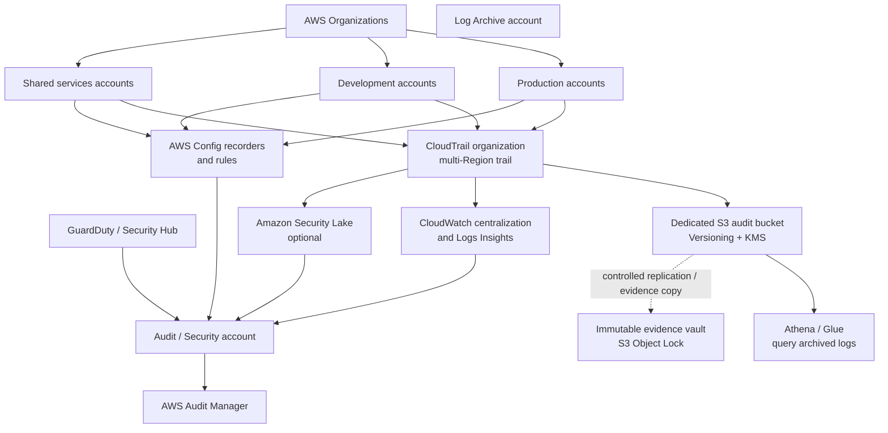

# Bảo vệ audit log và xây dựng cơ chế truy xuất bằng chứng trên AWS

> **Chương:** Kiểm toán và tuân thủ  
> **Module:** CLOUD_PROVIDERS_AWS  
> **Mục tiêu:** thiết kế hệ thống ghi nhận hoạt động AWS có độ bao phủ phù hợp, bảo vệ tính toàn vẹn và khả năng lưu giữ của audit log, phân quyền truy cập độc lập, và truy xuất bằng chứng có thể kiểm chứng khi kiểm toán hoặc điều tra sự cố.
>
> **Phạm vi:** AWS CloudTrail, AWS Organizations, Amazon S3, AWS KMS, Amazon CloudWatch, AWS Config, AWS Security Hub CSPM, Amazon GuardDuty, Amazon Security Lake và AWS Audit Manager. Các tính năng, Region, pricing và giới hạn có thể thay đổi; cần xác minh cấu hình hỗ trợ ở thời điểm triển khai.

## 1. Bài toán: khi xảy ra sự cố, tổ chức cần chứng minh điều gì?

Một doanh nghiệp vận hành nền tảng bán hàng trên nhiều AWS accounts:

- Account production chạy ECS, Lambda, RDS, S3 và API Gateway.
- Account development chứa môi trường thử nghiệm.
- Account shared services quản lý networking, DNS và CI/CD.
- Account security/audit nhận logs và findings tập trung.
- Account log archive chỉ lưu trữ audit records và bằng chứng dài hạn.

Một ngày, một S3 bucket chứa dữ liệu hóa đơn bị thay đổi policy và một số objects bị xóa. Đội bảo mật cần trả lời:

1. **Ai thực hiện hành động?** IAM user, assumed role, AWS service hay federated identity?
2. **Hành động nào đã xảy ra?** API event, request parameters, error, resource ARN.
3. **Khi nào và ở đâu?** UTC timestamp, account, Region, source IP, user agent.
4. **Trạng thái tài nguyên trước và sau thay đổi là gì?** Policy, encryption, public access, versioning.
5. **Log có bị sửa hoặc xóa sau khi thu thập không?**
6. **Bằng chứng được lưu giữ ở đâu, ai truy cập, truy vấn nào tạo ra kết quả?**
7. **Có thể tái lập kết luận cho auditor hoặc incident responder không?**

Một hệ thống audit tốt cần ba lớp:

- **Capture:** ghi lại hoạt động và trạng thái cấu hình cần theo dõi.
- **Protect:** bảo vệ log khỏi sửa/xóa trái phép, mã hóa, phân quyền và giữ đúng thời hạn.
- **Prove:** truy vấn, kiểm tra integrity, lưu metadata và bảo toàn chuỗi quản lý bằng chứng.

Audit log là dữ liệu đầu vào. Evidence là tập hợp các bản ghi, snapshot, findings, kết quả kiểm soát và metadata được chọn để chứng minh một nhận định cụ thể. Có log không đồng nghĩa đã có bằng chứng hoàn chỉnh; cần chỉ rõ nguồn, thời gian, phạm vi, tính toàn vẹn và phương pháp thu thập.

## 2. Phân biệt audit log, configuration history, security finding và evidence

| Loại dữ liệu | Câu hỏi được trả lời | Dịch vụ thường dùng |
|---|---|---|
| **API audit event** | Ai gọi API nào, ở account/Region nào, kết quả ra sao? | AWS CloudTrail |
| **Resource access log** | Request đến S3/ALB/VPC endpoint diễn ra thế nào? | S3 server access logging, ALB access logs, VPC Flow Logs |
| **Configuration history** | Cấu hình tài nguyên đã thay đổi ra sao theo thời gian? | AWS Config |
| **Security finding** | Có hành vi hoặc cấu hình đáng ngờ nào được phát hiện? | GuardDuty, Security Hub CSPM |
| **Centralized security data** | Làm sao chuẩn hóa và phân tích logs/findings từ nhiều nguồn? | Amazon Security Lake, CloudWatch |
| **Compliance evidence** | Bằng chứng nào hỗ trợ đánh giá một control? | AWS Audit Manager và evidence repository |

Ví dụ:

- CloudTrail cho biết principal gọi PutBucketPolicy vào một thời điểm.
- AWS Config có thể cho biết bucket policy/configuration thay đổi và kết quả rule evaluation.
- Security Hub có thể phát hiện bucket vi phạm một security control.
- Audit Manager có thể thu thập user activity/configuration evidence cho control được hỗ trợ.
- S3 Object Lock có thể bảo vệ một object version khỏi bị xóa trong retention period.

Các dịch vụ bổ trợ cho nhau; không dịch vụ nào tự động chứng minh mọi yêu cầu pháp lý hoặc kiểm soát nội bộ.

## 3. Kiến trúc audit và evidence tập trung

Mô hình tham khảo cho tổ chức nhiều accounts:



### 3.1. Tách account theo trust boundary

Một thiết kế phổ biến có:

- **Management account:** quản lý AWS Organization; quyền sử dụng rất hạn chế.
- **Log Archive account:** nhận và lưu raw logs, digest files, snapshots và immutable copies.
- **Security Tooling/Audit account:** chạy Security Hub delegated administrator, GuardDuty administration, Config aggregators, dashboards và evidence review.
- **Workload accounts:** nơi chạy production, development và shared services.

Không nên để workload administrators có quyền xóa audit archive. Tách log archive account giúp giảm rủi ro khi một production account bị compromise.

### 3.2. Luồng dữ liệu và trách nhiệm

| Thành phần | Trách nhiệm chính |
|---|---|
| CloudTrail organization trail | Thu thập API activity trên accounts/Regions được bao phủ |
| S3 log archive | Lưu raw CloudTrail log files và digest files |
| CloudWatch | Tìm kiếm, cảnh báo và phân tích vận hành/an ninh |
| AWS Config | Lưu configuration history và đánh giá rules |
| Security Hub / GuardDuty | Tổng hợp posture và phát hiện threats |
| Security Lake | Chuẩn hóa security data theo OCSF để phân tích |
| Audit Manager | Thu thập, tổ chức và review evidence cho assessments |
| Evidence vault | Lưu bản evidence đã chọn theo retention/legal hold |

Tách raw source logs khỏi evidence package đã được chọn cho một audit case. Không sửa raw log để làm báo cáo dễ đọc; hãy tạo bản trích xuất/biên tập riêng và giữ liên kết về nguồn gốc.

## 4. AWS CloudTrail ghi nhận những gì?

AWS CloudTrail ghi lại hoạt động API của AWS accounts, gồm thao tác qua Console, AWS CLI, SDKs và một số hoạt động do AWS services thực hiện.

### 4.1. Management events

Management events (control plane events) mô tả thao tác quản lý tài nguyên, ví dụ:

- Tạo, sửa, xóa EC2 instances hoặc security groups.
- Thay đổi IAM users, roles, policies và access keys.
- Thay đổi S3 bucket policies, encryption, versioning hoặc public access block.
- Tạo, sửa hoặc xóa CloudTrail trails.
- Thay đổi VPC, route tables, network ACLs.
- Thay đổi RDS configuration, KMS keys và service settings.

CloudTrail Event history ghi management events mặc định trong 90 ngày theo từng Region. Event history không thay thế trail lưu trữ dài hạn.

### 4.2. Data events

Data events mô tả thao tác trên data plane hoặc tài nguyên cụ thể. Ví dụ:

- S3 object-level operations: GetObject, PutObject, DeleteObject.
- Lambda function invocations.
- DynamoDB item-level API activity.
- Một số loại data events khác tùy dịch vụ.

Data events **không được bật mặc định trong trail**. Phải chọn resource và event selectors/advanced event selectors phù hợp. Chúng có thể tạo volume lớn và phát sinh phí, nên ưu tiên các buckets, functions, tables hoặc prefix nhạy cảm.

Ví dụ: ghi nhận đọc/xóa object trong bucket lưu hóa đơn, thay vì bật toàn bộ data events cho mọi bucket không cần thiết.

### 4.3. Insights events

CloudTrail Insights phân tích baseline activity và phát hiện một số dạng bất thường như tăng đột biến API call/error rate theo loại Insights được hỗ trợ. Insights là lớp phát hiện bất thường bổ sung; nó không thay thế việc ghi management/data events.

### 4.4. Những gì CloudTrail không chứng minh một mình

- Event record không tự cho biết toàn bộ trạng thái tài nguyên trước và sau thay đổi.
- CloudTrail không phải application audit log; nghiệp vụ như “nhân viên duyệt hoàn tiền” cần log trong ứng dụng.
- CloudTrail không ghi request thất bại do credentials không hợp lệ ở lớp authentication. S3 server access logging có thể bổ sung một số request-level records, nhưng delivery là best-effort.
- Event history không bao gồm data events, Insights events hoặc organization-wide aggregation.
- Log delivery có độ trễ; không dùng nó như một transaction ledger đồng bộ.

### 4.5. Đọc một CloudTrail event

Một event có thể chứa các trường:

| Trường | Ý nghĩa |
|---|---|
| eventTime | Thời điểm event theo UTC |
| eventSource | AWS service phát sinh event |
| eventName | API/action name |
| awsRegion | Region xử lý event |
| recipientAccountId | Account nhận event |
| userIdentity | Principal, role, session và identity context |
| sourceIPAddress | IP nguồn nếu có |
| userAgent | Client/SDK/tool context |
| requestParameters | Tham số request, nếu service cung cấp |
| responseElements | Response data, nếu có |
| errorCode / errorMessage | Kết quả lỗi nếu request thất bại |
| resources | Resource references liên quan |
| eventID / requestID | Định danh event/request |
| readOnly / managementEvent | Một số metadata về loại hoạt động |

Không phải event nào cũng có đủ tất cả trường. Một số request parameters/response fields có thể bị loại bỏ hoặc chứa dữ liệu nhạy cảm; cần kiểm soát quyền đọc logs.

## 5. Tạo organization trail trên nhiều accounts và Regions

### 5.1. Vì sao dùng organization trail?

Nếu mỗi account tự cấu hình trail, một administrator trong account có thể vô tình hoặc cố ý tắt logging. Organization trail do management account hoặc delegated administrator quản lý và áp dụng cho member accounts.

Lợi ích:

- Thu thập activity của management account và member accounts.
- Dùng một cấu hình thống nhất trên nhiều Regions được bật.
- Khi account mới gia nhập Organization, trail được áp dụng tự động.
- Member account users có thể xem organization trail nhưng không thể sửa/xóa trail hoặc tắt logging.
- Log archive có thể tập trung trong một S3 bucket thuộc account riêng.

### 5.2. Multi-Region trail

Best practice là ghi hoạt động trên mọi AWS Regions được bật trong account:

- Dùng multi-Region trail.
- Bao gồm global service events.
- Kiểm tra các opt-in Regions; account phải bật Region tương ứng để hoạt động được gửi.
- Chọn home Region không phải opt-in Region nếu phù hợp với chiến lược tổ chức.
- Theo dõi các Region mới được bật và xác nhận trail replica hoạt động.

Nếu chỉ tạo single-Region trail, activity ở Region khác không được ghi vào trail đó.

### 5.3. Management account và delegated administrator

- Organization trail phải được tạo bởi management account hoặc delegated administrator có quyền phù hợp.
- Chỉ management account hoặc delegated administrator có quyền thay đổi/xóa organization trail.
- Member accounts không thể sửa cấu hình organization trail.
- Mặc định, management account có quyền truy cập S3 bucket chứa logs; member accounts không tự động được đọc logs đó.
- Nếu resource validation thất bại (bucket policy, KMS key policy, CloudWatch Logs permission), trail vẫn có thể xuất hiện trong member accounts nhưng việc delivery lỗi. Cần kiểm tra trail status.

### 5.4. Event history không phải organization-wide console

CloudTrail Event history hiển thị management events của account đang đăng nhập, trong một Region và trong 90 ngày. Để tập trung events của organization, cần organization trail hoặc organization event data store (nếu tổ chức đã có quyền sử dụng CloudTrail Lake).

## 6. Lưu CloudTrail logs trong S3 log archive

### 6.1. Dùng dedicated bucket

Một bucket chuyên lưu CloudTrail logs nên:

- Thuộc Log Archive account.
- Block Public Access bật ở account và bucket level.
- Bucket policy chỉ cho phép CloudTrail service principal ghi đúng prefix/account/organization.
- Dùng Bucket owner enforced Object Ownership khi phù hợp.
- Mã hóa server-side và kiểm soát KMS key policy.
- Không bật Requester Pays.
- Bật versioning và theo dõi thay đổi cấu hình.
- Tách quyền write của CloudTrail khỏi quyền read/query của auditor.

Không dùng cùng bucket với website assets, application uploads hoặc dữ liệu người dùng. Dedicated bucket giúp IAM policy, retention, inventory và cost allocation rõ ràng hơn.

### 6.2. Cấu trúc key

Organization trail thường tạo cấu trúc gần như:

```text
s3://central-audit-bucket/
  AWSLogs/
    o-exampleorgid/
      111122223333/
        CloudTrail/
          ap-southeast-1/
            2026/11/20/
              <log-file>.json.gz
        CloudTrail-Digest/
          ap-southeast-1/
            2026/11/20/
              <digest-file>.json.gz
      444455556666/
        CloudTrail/
          ...
```

Prefix thực tế phụ thuộc cấu hình trail và loại log. Không hard-code một prefix giả định cho mọi account; hãy kiểm tra object keys thực tế và organization ID.

### 6.3. Bucket policy và SourceArn

Bucket policy nên:

- Cho service principal **cloudtrail.amazonaws.com** gọi **s3:GetBucketAcl** theo yêu cầu.
- Cho phép **s3:PutObject** vào đúng **AWSLogs/...** prefix.
- Kiểm tra **s3:x-amz-acl** nếu policy yêu cầu **bucket-owner-full-control**.
- Dùng condition **aws:SourceArn** để chỉ trail ARN được phép ghi.
- Với organization trail, cho phép prefix chứa organization ID và management account trail ARN đúng tài liệu AWS.
- Tránh wildcard rộng cho mọi principal hoặc mọi bucket path.

Ưu tiên tạo bucket/trail qua Console, CloudFormation hoặc IaC và để AWS tạo policy chuẩn, sau đó review policy thực tế. Không sao chép một policy single-account rồi áp vào organization trail mà chưa cập nhật organization path.

### 6.4. KMS encryption

CloudTrail log files và digest files có thể dùng SSE-S3 hoặc SSE-KMS theo cấu hình trail. Nếu chọn customer-managed KMS key:

- Key policy phải cho phép CloudTrail sử dụng key để mã hóa log files.
- CloudTrail cần các quyền KMS tương ứng, gồm **GenerateDataKey** và **DescribeKey** theo cấu hình hỗ trợ.
- Auditor/query role cần quyền decrypt khi đọc object.
- Tách key administrators khỏi log readers.
- Bật rotation theo policy của tổ chức khi key type hỗ trợ.
- Không disable/delete key trong khi logs cần được giải mã hoặc retention chưa kết thúc.

Mã hóa at rest không thay thế bucket policy, IAM least privilege hoặc immutability.

## 7. Bảo vệ log khỏi sửa/xóa: Versioning, Object Lock và replication

### 7.1. Ba cơ chế có vai trò khác nhau

| Cơ chế | Bảo vệ điều gì? | Giới hạn |
|---|---|---|
| S3 Versioning | Giữ nhiều versions khi object bị ghi đè/xóa bằng delete marker | Principal đủ quyền vẫn có thể xóa version |
| S3 Object Lock | WORM protection cho object version trong retention period hoặc legal hold | Không tự bảo đảm log được ghi đầy đủ hoặc digest hợp lệ |
| S3 Replication | Sao chép objects sang bucket/account/Region khác | Asynchronous; không thay thế retention và access control |

Một log archive có thể kết hợp các cơ chế này, nhưng cần thiết kế đúng thứ tự và thử nghiệm delivery/replication trước production.

### 7.2. Object Lock modes

- **Governance mode:** phần lớn principals không thể xóa/ghi đè object version trong thời gian retention. Principal có **s3:BypassGovernanceRetention** và chủ động gửi bypass request có thể vượt qua governance retention.
- **Compliance mode:** object version không thể bị xóa hoặc rút ngắn retention trước ngày hết hạn, kể cả bởi root user của account.
- **Legal hold:** bảo vệ object version không có ngày hết hạn cố định; giữ đến khi một principal được phép gỡ hold.

Object Lock cần S3 Versioning. Sau khi bật Object Lock cho bucket, không thể tắt Object Lock hoặc suspend versioning. Cần xác định retention/legal requirements trước khi bật Compliance mode.

### 7.3. Thiết kế immutable evidence vault

Một pattern có thể cân nhắc:

1. CloudTrail ghi raw logs vào dedicated log archive bucket.
2. Một replication pipeline có quyền giới hạn sao chép log objects sang evidence vault ở account riêng.
3. Evidence vault bật Versioning và Object Lock với retention được Legal/Compliance phê duyệt.
4. Quyền xóa/bypass governance được giữ riêng cho custodians; Compliance mode không có bypass trong retention period.
5. Theo dõi replication status và cảnh báo object không được replicate.
6. Giữ log file digest và các metadata cần thiết để xác minh nguồn.

S3 Replication yêu cầu bật Versioning ở cả source và destination buckets. Nếu source bucket đã bật Object Lock, destination bucket cũng phải bật Object Lock. Replication role cần các quyền đọc retention/legal hold metadata như **s3:GetObjectRetention** và **s3:GetObjectLegalHold**. Test exact bucket/KMS configuration và replication rules trước khi dùng làm bằng chứng chính thức.

### 7.4. Phân biệt CloudTrail và S3 server access logging

S3 server access logging có giới hạn delivery riêng:

- Destination bucket cho server access logs không được bật Object Lock.
- Destination bucket phải cùng account và Region với source bucket nếu dùng direct S3 delivery.
- Delivery là best-effort và có thể mất vài giờ.
- Direct S3 server access log delivery và CloudTrail log delivery là hai luồng khác nhau.

Nếu cần S3 server access logs, dùng destination bucket phù hợp; không trỏ luồng này vào Object Lock bucket. Có thể chọn delivery server access logs sang CloudWatch Logs cho structured querying/cross-account aggregation rồi xuất sang nơi lưu trữ phù hợp.
## 8. CloudTrail log file integrity validation

### 8.1. Hash và digest chain

Khi bật log file integrity validation:

1. CloudTrail tính hash cho mỗi log file được giao.
2. Theo chu kỳ khoảng một giờ, CloudTrail tạo digest file tham chiếu các log files trong khoảng thời gian tương ứng.
3. Digest file chứa hash của log files và được ký số bằng private key của CloudTrail.
4. Digest file kế tiếp tham chiếu chữ ký digest trước đó, tạo thành chuỗi có thể kiểm tra.
5. Auditor/incident responder dùng public key và AWS CLI để xác minh digest chain.

Cơ chế này dùng SHA-256 cho hashing và SHA-256 with RSA cho digital signatures. Nếu log file bị sửa, bị xóa hoặc digest chain bị đứt, quá trình validation có thể phát hiện vấn đề.

### 8.2. Integrity validation không đồng nghĩa immutability

- **Log file integrity validation** giúp phát hiện thay đổi sau khi CloudTrail giao log.
- **S3 Object Lock** ngăn sửa/xóa object version trong retention period.
- **Versioning** giữ các versions nhưng không tự ngăn xóa versions.
- **KMS** mã hóa dữ liệu và kiểm soát khả năng decrypt; key deletion có thể làm mất khả năng đọc dữ liệu.

Nên kết hợp digest validation với storage protection và separation of duties. Một file có digest hợp lệ vẫn có thể bị xóa nếu bucket permissions cho phép; Object Lock có thể giữ file nhưng không chứng minh event source đã ghi đủ mọi hoạt động.

### 8.3. Bật log file validation

Với trail hiện hữu:

```bash
aws cloudtrail update-trail \
  --name arn:aws:cloudtrail:ap-southeast-1:111122223333:trail/org-audit \
  --enable-log-file-validation
```

Sau khi bật, CloudTrail bắt đầu giao digest files; việc bật feature **không tự chạy validation**. Cần thiết lập lịch xác minh và lưu kết quả validation như một evidence artifact.

### 8.4. Xác minh log files bằng AWS CLI

```bash
aws cloudtrail validate-logs \
  --region ap-southeast-1 \
  --trail-arn arn:aws:cloudtrail:ap-southeast-1:111122223333:trail/org-audit \
  --account-id 111122223333 \
  --start-time 2026-11-19T00:00:00Z \
  --end-time 2026-11-20T00:00:00Z \
  --verbose
```

Đọc output:

- **valid**: digest signature hợp lệ hoặc log file không bị thay đổi sau delivery.
- **INVALID: not found**: digest/log file không tìm thấy ở vị trí được tham chiếu.
- **INVALID: signature verification failed**: chữ ký digest không hợp lệ.
- **INVALID: hash value doesn't match**: nội dung log file khác hash được ghi trong digest.
- Các thông báo **INVALID** khác có thể chỉ ra digest bị di chuyển hoặc sai định dạng.

Với organization trail, CLI yêu cầu thêm **--account-id** để chỉ định account có log files cần validate. Validation là Region-specific; chạy riêng cho từng account/Region cần kiểm tra. Lưu nguyên output, CLI version, trail ARN, time range, account/Region và timestamp thực hiện kiểm tra.

AWS CLI chỉ validate log files được digest tham chiếu và phải ở đúng S3 location ban đầu. Nếu đã chuyển logs sang archive bucket/path khác, giữ source objects để validate bằng CLI hoặc dùng custom validator hỗ trợ location mới.

### 8.5. Lập lịch kiểm tra

- Chạy validation định kỳ cho các khoảng thời gian đã hoàn tất.
- Khi có incident, validate đúng time range và Region liên quan.
- Nếu có missing/invalid digest, giữ nguyên bucket, versions và metadata để điều tra.
- Không xóa/re-upload log để “sửa” validation.
- Tạo ticket/security finding và giữ kết quả validation trong evidence case.

## 9. Phân quyền truy cập và separation of duties

### 9.1. Phân vai

| Vai trò | Quyền nên có | Quyền cần hạn chế |
|---|---|---|
| CloudTrail delivery | Ghi log files/digest vào prefix được chỉ định | Không đọc/xóa logs |
| Log archive operator | Quản lý bucket policy, lifecycle, replication theo change process | Không tự đọc/biên tập evidence nếu không cần |
| Security analyst | Query/search logs, đọc findings | Không sửa trail hoặc xóa raw logs |
| Auditor | Read-only access vào evidence package được cấp | Không truy cập workload secrets hoặc thay retention |
| Compliance custodian | Quản lý retention/legal hold theo approval | Không thay đổi trail coverage |
| Platform administrator | Quản lý account/Region/platform | Không có quyền xóa archive mặc định |
| Break-glass role | Khôi phục khi có sự cố nghiêm trọng, có MFA/approval | Không dùng cho công việc hằng ngày |

### 9.2. Tách control plane và data plane

CloudTrail control-plane permissions như CreateTrail, UpdateTrail, DeleteTrail, StartLogging và StopLogging nên thuộc security/platform roles được kiểm soát.

Data-plane access tới log objects là quyền S3 riêng:

- **s3:ListBucket** chỉ cho prefix cần thiết.
- **s3:GetObject**/**s3:GetObjectVersion** cho nhóm cần query.
- **s3:GetObjectRetention**/**s3:GetObjectLegalHold** cho custodian cần kiểm tra Object Lock.
- Không cấp **s3:DeleteObjectVersion** cho analyst/auditor.
- Không cấp **s3:BypassGovernanceRetention** cho role thông thường.

### 9.3. Bảo vệ CloudTrail configuration

Dùng SCP/permission boundaries và IAM policies để hạn chế principals có thể tắt hoặc sửa audit trail. Cần thiết kế exception rõ ràng cho management/delegated administrator và break-glass role; một SCP deny quá rộng có thể ngăn cả security team sửa cấu hình hợp lệ.

Theo dõi và cảnh báo khi xuất hiện:

- StopLogging, DeleteTrail, UpdateTrail.
- PutEventSelectors hoặc PutInsightSelectors.
- Thay đổi S3 bucket policy/versioning/Object Lock/lifecycle.
- DisableKey, ScheduleKeyDeletion, PutKeyPolicy.
- Thay đổi Organization, SCP, delegated administrator hoặc security service settings.
- Disable AWS Config recorder hoặc delivery channel.

### 9.4. MFA và break-glass

- Bảo vệ management account bằng MFA mạnh và ít người được phép sử dụng.
- Dùng IAM Identity Center/federated access và temporary credentials.
- Break-glass role phải có owner, approval, time-bound access và audit trail.
- Kiểm tra định kỳ access keys dài hạn và stale roles.
- Ghi lại ai phê duyệt việc đọc/export evidence nhạy cảm.

## 10. EventBridge và CloudWatch: cảnh báo khi audit pipeline bị thay đổi

CloudTrail có thể gửi API events tới EventBridge để kích hoạt phản ứng. Ví dụ, tạo rule khi ai đó dừng hoặc xóa trail:

```json
{
  "source": ["aws.cloudtrail"],
  "detail-type": ["AWS API Call via CloudTrail"],
  "detail": {
    "eventSource": ["cloudtrail.amazonaws.com"],
    "eventName": [
      "StopLogging",
      "DeleteTrail",
      "UpdateTrail",
      "PutEventSelectors"
    ]
  }
}
```

Có thể route event tới:

- Amazon SNS để thông báo cho security/on-call.
- Amazon SQS để lưu hàng đợi điều tra.
- AWS Lambda để enrich event và tạo incident ticket.
- EventBridge cross-account bus để gửi về security account.
- CloudWatch metrics/alarms để theo dõi số lần xảy ra.

### 10.1. Không chỉ cảnh báo khi trail bị tắt

Cũng nên theo dõi:

- **PutBucketPolicy**, **DeleteBucketPolicy**, **PutBucketAcl**.
- **PutBucketVersioning**, **PutBucketObjectLockConfiguration**.
- **PutBucketLifecycle**, **DeleteObject**, **DeleteObjects**.
- **DisableKey**, **ScheduleKeyDeletion**, **PutKeyPolicy**.
- **StopConfigurationRecorder**, **DeleteConfigurationRecorder**.
- Thay đổi Security Hub, GuardDuty hoặc Security Lake settings.

Với S3 object-level API events như DeleteObject, phải bật CloudTrail data events cho bucket/prefix liên quan. Management events không tự ghi mọi object operations.

### 10.2. Alarm delivery health

Không chỉ theo dõi security actions; phải theo dõi audit pipeline:

- CloudTrail **IsLogging** và **LatestDeliveryError**.
- **LatestDeliveryTime** và **LatestDigestDeliveryTime**.
- S3 replication status/failure events nếu có immutable replica.
- KMS key state và policy changes.
- CloudWatch log ingestion/retention.
- AWS Config recorder status và resource coverage.
- Security Hub/GuardDuty/Security Lake source status.

Một dashboard không có dữ liệu mới có thể là dấu hiệu collector bị tắt, policy sai, Region mới chưa được bật hoặc workload không phát sinh events. Không coi “không có finding” là bằng chứng rằng logging hoạt động tốt.

## 11. AWS Config: lịch sử cấu hình và đánh giá compliance

### 11.1. CloudTrail và AWS Config khác nhau

| CloudTrail | AWS Config |
|---|---|
| Ghi lại API activity và actor | Ghi nhận cấu hình tài nguyên và thay đổi cấu hình |
| Trả lời “ai gọi API nào?” | Trả lời “resource configuration đã thay đổi thế nào?” |
| Event record theo hành động | Configuration item/timeline theo resource |
| Data events cần bật selectors | Recorder cần bật resource types cần theo dõi |
| Có thể lưu trail logs dài hạn trong S3 | Có thể giữ configuration history/snapshots và đánh giá rules |

Khi điều tra một S3 bucket bị mở public:

- CloudTrail cho biết ai gọi PutBucketPolicy hoặc PutPublicAccessBlock.
- AWS Config có thể cho biết policy/configuration trước và sau.
- Security Hub/Config rule có thể đánh giá trạng thái public access.
- S3 access logs/CloudTrail data events hỗ trợ xác định request tới objects.

### 11.2. Bật recorder và chọn resource coverage

AWS Config không tự ghi mọi resource nếu recorder chưa được bật/cấu hình. Cần xác định:

- Resource types phải record trong từng Region.
- Include global resource types nếu cần và theo cách AWS Config hỗ trợ.
- Delivery channel/S3 bucket và SNS nếu cần notification.
- Configuration history retention.
- IAM role/service-linked role cho Config.
- AWS Config rules hoặc conformance packs phù hợp.

Không giả định một Region có recorder nghĩa là mọi Region đều đã được bao phủ.

### 11.3. Aggregator nhiều accounts và Regions

AWS Config aggregator thu thập configuration/compliance data từ nhiều accounts/Regions hoặc toàn Organization vào một account trung tâm.

Aggregator:

- Cho phép xem tổng quan compliance và resource relationships.
- Là read-only view của dữ liệu đã được authorize.
- Không deploy rules hoặc sửa source account qua aggregator.
- Không tự bật Config recorder trong source accounts.
- Không phát sinh phí aggregator riêng, nhưng recorder, rules và các dịch vụ liên quan có thể phát sinh chi phí.

### 11.4. Conformance packs

Conformance pack gom AWS Config rules và remediation actions thành một gói kiểm soát có thể deploy theo account/Region hoặc Organization trong các Region hỗ trợ.

Ví dụ controls:

- S3 buckets phải block public access.
- EBS/RDS resources phải mã hóa.
- CloudTrail phải bật multi-Region logging.
- Security groups không mở các ports nhạy cảm cho toàn Internet.
- Required tags và backup settings phải hiện diện.

Một rule **NON_COMPLIANT** là tín hiệu cần điều tra; cần xác minh scope, parameters, exception và thời điểm đánh giá trước khi kết luận vi phạm.

## 12. Security Hub, GuardDuty và Security Lake

### 12.1. AWS Security Hub CSPM

Security Hub CSPM tập trung security findings và posture checks:

- Bật security standards phù hợp.
- Dùng central configuration để quản lý policies qua accounts/Regions.
- Chọn controls cần enable/disable và customize parameters khi được hỗ trợ.
- Tổng hợp findings từ Security Hub controls và integrated services.
- Route findings qua EventBridge hoặc workflow tới ticketing/incident response.

Security Hub CSPM cần AWS Config được bật và record các resource types cần thiết cho nhiều controls. Bật Security Hub không tự động đảm bảo mọi AWS Config recorder/recording scope đã đúng.

### 12.2. Amazon GuardDuty

GuardDuty phân tích threat signals từ các nguồn dữ liệu hỗ trợ để phát hiện hành vi đáng ngờ như credential misuse, anomalous API activity, malware hoặc network threats tùy protection plan.

GuardDuty là threat detection service; findings không thay thế raw audit logs. Khi có finding:

1. Lưu finding ID, severity, type, account, Region và timestamps.
2. Lấy CloudTrail events liên quan.
3. Lấy Config timeline/resource state.
4. Thu thập network/application logs nếu cần.
5. Lưu evidence artifacts và giữ nguyên source records.

### 12.3. Amazon Security Lake

Security Lake tập trung security data từ AWS và nguồn tích hợp, chuẩn hóa dữ liệu theo Open Cybersecurity Schema Framework (OCSF).

Với CloudTrail, Security Lake có thể thu thập các nguồn riêng biệt:

- CloudTrail management events.
- S3 data events.
- Lambda data events.

Security Lake tiêu thụ stream event từ CloudTrail theo cấu hình của nó; việc bật Security Lake không tự thay đổi hoặc quản lý CloudTrail trail. Vẫn cần quản lý coverage, retention và access của CloudTrail bằng CloudTrail APIs/console.

### 12.4. Khi nào dùng Security Lake?

Phù hợp khi tổ chức muốn:

- Chuẩn hóa nhiều security data sources theo OCSF.
- Phân tích tập trung giữa accounts/Regions.
- Dùng công cụ query/analytics tương thích.
- Chia sẻ security telemetry với SIEM/SOC tooling.

Không nên bật mọi data source với scope không giới hạn trước khi tính ingestion volume, retention, query costs và quyền truy cập.
## 13. AWS Audit Manager: tổ chức evidence theo control

### 13.1. Audit Manager làm gì?

AWS Audit Manager giúp chuẩn bị, thu thập, tổ chức và review evidence cho assessments. Evidence có thể là:

- **Compliance check evidence:** kết quả từ AWS Config hoặc Security Hub CSPM.
- **User activity evidence:** hoạt động thay đổi tài nguyên được thu thập từ CloudTrail.
- **Configuration data evidence:** snapshot cấu hình từ AWS API calls.
- **Manual evidence:** tài liệu, screenshots, approvals hoặc artifacts do người phụ trách tải lên.

Audit Manager có thể thu thập automated evidence từ CloudTrail, Security Hub CSPM, AWS Config và các AWS API calls được hỗ trợ.

### 13.2. Assessment không tự chứng nhận tuân thủ

Audit Manager giúp tổ chức evidence theo framework/control, nhưng:

- Không tự quyết định doanh nghiệp tuân thủ toàn bộ một đạo luật hoặc tiêu chuẩn.
- Một control có thể cần evidence ngoài AWS như quy trình nhân sự, hợp đồng, đào tạo hoặc phê duyệt.
- Không phải mọi AWS API hoặc security control đều có automated evidence source.
- Người phụ trách vẫn phải review evidence, xác nhận scope, exception và kết luận.
- Auditor độc lập có thể yêu cầu thêm tài liệu hoặc kiểm tra ngoài hệ thống.

### 13.3. Quy trình evidence trong Audit Manager

1. Chọn framework hoặc tạo custom assessment phù hợp.
2. Xác định accounts, Regions và services nằm trong scope.
3. Mapping controls với evidence sources được hỗ trợ.
4. Bật AWS Config/Security Hub/CloudTrail và recorder/event selectors cần thiết.
5. Theo dõi evidence collection status.
6. Review evidence folders, xác nhận timestamps và resources.
7. Đính kèm manual evidence còn thiếu.
8. Tạo assessment report và lưu trong repository có retention/access controls.

### 13.4. Kiểm tra evidence collection

Nếu evidence không xuất hiện:

- Kiểm tra CloudTrail đã ghi event cần thiết chưa.
- Kiểm tra AWS Config recorder có record resource type liên quan không.
- Kiểm tra Security Hub control có enabled và đã đánh giá chưa.
- Kiểm tra assessment scope và Region.
- Kiểm tra IAM permissions/service-linked roles.
- Kiểm tra evidence collection frequency; một số compliance checks được cập nhật theo lịch, không phải ngay sau từng API call.

## 14. CloudTrail Lake và lựa chọn truy vấn hiện hành

### 14.1. Trạng thái dịch vụ cần biết

AWS CloudTrail Lake **đóng với khách hàng mới từ ngày 31/05/2026**. CloudTrail Trails, CloudTrail Insights và Aggregated Events vẫn được hỗ trợ; chỉ CloudTrail Lake không tiếp nhận khách hàng mới.
AWS nêu CloudTrail Lake sẽ chỉ nhận critical bug fixes và security updates; điều này không áp dụng cho CloudTrail Trails, Insights hoặc Aggregated Events.

Đối với khách hàng đã có CloudTrail Lake:

- Existing event data stores có thể tiếp tục hoạt động theo chính sách AWS công bố.
- Organization event data store tiếp tục bao phủ member accounts mới được thêm vào Organization và mở rộng Regions.
- Account-level event data stores hiện hữu tiếp tục cho các accounts đã có, nhưng không tự ingest accounts mới được thêm vào Organization.
- AWS khuyến nghị chuyển dữ liệu CloudTrail Lake sang Amazon CloudWatch.

Với triển khai mới, không xây kiến trúc phụ thuộc vào khả năng tạo CloudTrail Lake event data store mới. Đánh giá CloudWatch unified data management, CloudTrail trails lưu S3 và Amazon Athena theo yêu cầu truy vấn/retention.

### 14.2. CloudWatch thay thế những phần nào?

CloudWatch có thể hỗ trợ:

- Thu thập và tập trung security/operational/compliance logs.
- Cross-account/cross-Region log centralization.
- Query bằng CloudWatch Logs Insights, SQL/PPL trên các nguồn/kiến trúc hỗ trợ.
- Alerting, metrics và dashboard.
- Chuẩn hóa dữ liệu theo OCSF/OTel trong các pipeline được hỗ trợ.
- Subscription filters để đưa logs tới Kinesis, Firehose, Lambda hoặc hệ thống khác.

Một số khác biệt cần lưu ý:

- Cross-account/cross-Region ingestion enablement có thể cần cấu hình riêng theo Region.
- CloudWatch không thay thế mọi tính năng event selectors của CloudTrail; khả năng selector/query tùy data source.
- CloudTrail Network Activity và Insights Events có giới hạn khác với CloudTrail management/data event ingestion vào CloudWatch.
- Query language và semantics không hoàn toàn giống CloudTrail Lake SQL.
- Phải tính ingestion, storage, query, OpenSearch và data export costs.

### 14.3. S3 + Athena vẫn là đường truy vấn archive

CloudTrail trail có thể giao JSON log files vào S3. Với AWS Glue Data Catalog/Athena table phù hợp:

- Truy vấn logs trực tiếp trên archive.
- Dùng partition theo account, Region, năm/tháng/ngày để giảm scan.
- Dùng lifecycle để chuyển storage class theo retention.
- Dùng workgroup encryption/query result location và IAM controls.
- Lưu query text, execution ID, result location và time range vào evidence manifest.

Athena phù hợp cho điều tra lịch sử và truy vấn có thể tái lập; CloudWatch phù hợp hơn cho tìm kiếm vận hành/cảnh báo gần thời gian thực theo pipeline đã cấu hình.

## 15. Thu thập S3 access evidence

### 15.1. CloudTrail data events cho S3

CloudTrail data events có thể ghi nhận object-level operations như:

- GetObject.
- PutObject.
- DeleteObject.
- Một số API object operations khác được hỗ trợ.

Dùng advanced event selectors để giới hạn scope:

```json
[
  {
    "Name": "Audit sensitive invoice objects",
    "FieldSelectors": [
      {
        "Field": "eventCategory",
        "Equals": ["Data"]
      },
      {
        "Field": "resources.type",
        "Equals": ["AWS::S3::Object"]
      },
      {
        "Field": "resources.ARN",
        "StartsWith": [
          "arn:aws:s3:::prod-invoices/"
        ]
      }
    ]
  }
]
```

Đây là ví dụ selector minh họa. Khi triển khai, kiểm tra supported fields/resource ARN format và combine selectors đúng cú pháp của CloudTrail API. Chọn prefix nhạy cảm giúp kiểm soát volume/cost.

### 15.2. S3 server access logging bổ sung gì?

S3 server access logging ghi chi tiết request tới bucket. Nó có thể bổ sung thông tin về một số request authentication failures mà CloudTrail không ghi lại.

Có hai delivery paths:

- **Direct to S3:** log text dạng space-delimited, destination bucket cùng account/Region, delivery best-effort và thường có độ trễ vài giờ.
- **To CloudWatch Logs:** structured JSON, hỗ trợ Logs Insights, cross-account/cross-Region centralization, KMS encryption và forwarding sang S3/Firehose theo cấu hình.

S3 server access logging không đảm bảo mọi record được giao hoặc giao đúng thời gian. Dùng nó như một nguồn bổ sung; không coi nó là realtime alerting system hoặc bằng chứng duy nhất cho mọi request.

### 15.3. CloudTrail và S3 server access logs

| Tiêu chí | CloudTrail data events | S3 server access logs |
|---|---|---|
| API identity/context | Có userIdentity và event context | Có request details theo access log format |
| Object-level operations | Có, nếu selector được bật | Có request records |
| Authentication failure | Không ghi invalid credentials ở lớp authentication | Có thể có record tương ứng |
| Integrity digest | Có log file validation | Không có CloudTrail digest chain |
| Delivery | Gần thời gian thực hơn nhưng không đồng bộ; data events theo chu kỳ delivery | Best-effort, có thể vài giờ |
| Cost | Data event charges và storage | Direct S3 delivery không tính phí delivery; storage vẫn tính phí |
| Use case | Attribution, API audit, data access | Request-level troubleshooting và access audit bổ sung |

CloudTrail không ghi mọi request thất bại do credentials sai. Không dùng một nguồn duy nhất để kết luận “không có truy cập trái phép” nếu threat model yêu cầu nhiều lớp telemetry.

## 16. Truy vấn audit logs

### 16.1. Tìm sự kiện gần đây bằng Event history

Event history có sẵn cho mỗi account/Region, giữ 90 ngày management events và không cần trail để xem. Nó phù hợp cho tra cứu nhanh, nhưng không query được data events và không aggregate toàn organization.

AWS CLI:

```bash
aws cloudtrail lookup-events \
  --region ap-southeast-1 \
  --lookup-attributes AttributeKey=EventName,AttributeValue=StopLogging \
  --start-time 2026-11-19T00:00:00Z \
  --end-time 2026-11-20T00:00:00Z \
  --max-results 50
```

### 16.2. Query CloudTrail logs trong Athena

Ví dụ query để tìm các thay đổi IAM nhạy cảm trong một khoảng thời gian:

```sql
SELECT
    eventtime,
    eventsource,
    eventname,
    awsregion,
    sourceipaddress,
    useridentity.arn AS actor_arn,
    useridentity.sessioncontext.sessionissuer.arn AS role_arn,
    errorcode,
    requestparameters,
    eventid
FROM cloudtrail_logs
WHERE eventsource = 'iam.amazonaws.com'
  AND eventname IN (
      'CreateAccessKey',
      'CreateLoginProfile',
      'AttachUserPolicy',
      'PutUserPolicy',
      'CreatePolicyVersion',
      'SetDefaultPolicyVersion'
  )
  AND eventtime >= '2026-11-19T00:00:00Z'
  AND eventtime <  '2026-11-20T00:00:00Z'
ORDER BY eventtime DESC;
```

Table name, partition columns, field types và nested struct names phụ thuộc Glue/Athena table definition của tổ chức. Kiểm tra schema thực tế trước khi dùng trong production runbook. Không SELECT toàn bộ request parameters vào report nếu có thể chứa sensitive values.

### 16.3. Query trong CloudWatch Logs Insights

Nếu CloudTrail JSON events được gửi tới CloudWatch Logs:

```text
fields @timestamp,
       eventSource,
       eventName,
       awsRegion,
       sourceIPAddress,
       userIdentity.arn,
       errorCode,
       eventID
| filter eventSource = "cloudtrail.amazonaws.com"
    or eventSource = "iam.amazonaws.com"
| filter eventName in ["StopLogging", "DeleteTrail", "CreateAccessKey"]
| sort @timestamp desc
| limit 100
```

Field paths phụ thuộc JSON structure của log group. Với CloudWatch pipeline/OCSF transformation, field names có thể đã được chuẩn hóa; dùng schema/field discovery của đúng log group.

### 16.4. Query theo principal và assumed role

Khi điều tra assumed role:

- Xem userIdentity.type, arn, principalId và sessionContext.
- Xem sessionIssuer.arn để biết IAM role gốc.
- Đối chiếu STS AssumeRole events và externalId/session tags nếu có.
- Đối chiếu sourceIPAddress, userAgent, accessKeyId và time window.
- Xác định principal là human federation, CI/CD role, service role hay AWS service.
- Không kết luận danh tính cá nhân chỉ từ role ARN; cần mapping tới identity provider/session logs.

### 16.5. Query theo resource

Dùng resource ARN và account/Region để giới hạn:

- S3 bucket/object ARN.
- IAM role/user/policy ARN.
- EC2 instance/security group/VPC ARN hoặc resource ID.
- KMS key ARN.
- RDS DB instance/cluster ARN.
- Lambda function ARN.

Khi resource bị xóa, event có thể còn resource name/ARN trong log dù API Describe không còn trả resource đó. Vì vậy cần giữ raw logs và configuration history.
## 17. Chuỗi quản lý bằng chứng (chain of custody)

### 17.1. Evidence cần metadata có thể tái lập

Một evidence item nên lưu tối thiểu:

| Metadata | Ví dụ / ý nghĩa |
|---|---|
| Case ID | Incident/audit case duy nhất |
| Control ID | Control hoặc yêu cầu đang được chứng minh |
| Evidence ID | ID duy nhất của artifact |
| Source service | CloudTrail, Config, Security Hub, GuardDuty, S3... |
| Source account / Region | Account ID và Region nơi event/resource phát sinh |
| Resource ARN | Tài nguyên liên quan |
| Event IDs | CloudTrail eventID/requestID hoặc finding ID |
| Time range | Start/end theo UTC |
| Source location | S3 bucket/key/version ID hoặc CloudWatch log group/stream |
| Query | Query text, parameters, table/schema và execution ID |
| Integrity result | CloudTrail digest validation, SHA-256 của export |
| Collector | IAM role/principal và thời điểm thu thập |
| Reviewer | Người review và approval |
| Retention | Retain-until date hoặc legal hold status |

### 17.2. Ví dụ evidence manifest

```yaml
case_id: SEC-2026-0042
evidence_id: EV-0007
control_id: AUDIT-LOG-RETENTION-01
source:
  service: cloudtrail
  account_id: "111122223333"
  region: ap-southeast-1
  trail_arn: arn:aws:cloudtrail:ap-southeast-1:111122223333:trail/org-audit
  s3_bucket: central-audit-bucket
  s3_key: AWSLogs/o-exampleorgid/111122223333/CloudTrail/ap-southeast-1/2026/11/20/example.json.gz
  s3_version_id: "3HL4kqtJlcpXroDTDmJ..."
time_range_utc:
  start: "2026-11-19T00:00:00Z"
  end: "2026-11-20T00:00:00Z"
collection:
  collected_at: "2026-11-20T08:30:00Z"
  collector_role: arn:aws:iam::555566667777:role/AuditEvidenceReadOnly
  query_id: "athena-query-id"
integrity:
  cloudtrail_digest_validation: valid
  sha256: "replace-with-computed-sha256"
review:
  reviewer: "security-reviewer"
  reviewed_at: "2026-11-20T10:00:00Z"
retention:
  object_version: "s3-version-id"
  legal_hold: false
  retain_until: "2033-11-20T00:00:00Z"
```

Đây là mẫu cấu trúc, không phải bằng chứng thực tế. Không điền dữ liệu giả vào audit report; thay placeholders bằng values được đọc từ hệ thống và lưu query/output tương ứng.

### 17.3. Giữ raw evidence và derived evidence riêng biệt

- Raw CloudTrail log/digest files được giữ nguyên theo source path/version.
- Query result, CSV, screenshots và báo cáo là derived evidence.
- Ghi query text, parameters, timestamp, workgroup và execution ID.
- Nếu phải redact PII/secret, tạo bản redacted mới, ghi lý do và giữ bản raw theo quyền truy cập hạn chế.
- Không sửa JSON gốc để thêm chú thích hoặc chuẩn hóa field.
- Hash export artifacts bằng SHA-256 và ghi hash vào manifest.
- Giữ version ID và source URI để người review có thể truy ngược.

### 17.4. Tương quan thời gian

Dùng UTC thống nhất giữa AWS events, application logs và evidence manifest:

- CloudTrail eventTime là thời điểm event theo UTC.
- CloudWatch @timestamp có thể là ingestion/event timestamp tùy pipeline.
- Application logs nên có timestamp UTC, requestId và traceId.
- Ghi rõ event time, collection time và export time; chúng không phải cùng một mốc.
- Nếu hệ thống nguồn có clock skew, ghi nhận độ lệch và nguồn thời gian.

### 17.5. Bằng chứng cho hành động nghiệp vụ

CloudTrail chỉ ghi AWS API activity. Ứng dụng Spring Boot cần audit events cho nghiệp vụ quan trọng, ví dụ:

- Actor/customer/staff identity đã được xác thực.
- Action, target entity và tenant scope.
- Business reason/approval reference.
- Before/after state hoặc change summary đã được lọc dữ liệu nhạy cảm.
- Outcome, timestamp UTC, requestId và traceId.
- Application version/environment.

Không log passwords, session tokens, payment card data, secret values hoặc toàn bộ request payload có PII không cần thiết.

## 18. Retention, legal hold và lifecycle

### 18.1. Không chọn retention bằng cảm tính

Retention phải dựa trên:

- Luật/quy định áp dụng tại jurisdiction của doanh nghiệp và khách hàng.
- Hợp đồng, policy nội bộ và yêu cầu auditor.
- Data classification và sensitivity.
- Thời gian điều tra/khôi phục cần thiết.
- Legal hold, litigation hoặc incident response requirements.
- Chi phí storage, query, retrieval và key management.

Không có một retention period phù hợp cho mọi loại log. Một application debug log, CloudTrail management event và evidence cho financial transaction có thể có yêu cầu lưu trữ khác nhau.

### 18.2. Phân tầng lưu trữ

| Tier | Ví dụ mục tiêu | Lựa chọn |
|---|---|---|
| Searchable hot data | Điều tra vận hành gần đây | CloudWatch Logs |
| Raw audit archive | Lưu log gốc để query lại | S3 Standard/Intelligent-Tiering theo access pattern |
| Long-term archive | Dữ liệu ít truy cập, cần giữ lâu | S3 Glacier storage classes theo retrieval SLA |
| Immutable evidence | Evidence cần WORM/legal hold | S3 Object Lock |
| Query-ready dataset | Phân tích nhiều tháng/nhiều accounts | S3 + Glue/Athena hoặc CloudWatch analytics |

Chuyển sang Glacier class có thể cần restore trước khi đọc; phải tính retrieval time/cost vào incident runbook. Lifecycle transition không thay thế retention/legal hold policy.

### 18.3. Legal hold và expiration

- Legal hold không có ngày hết hạn; chỉ gỡ khi principal được phép thực hiện.
- Retention period bảo vệ object version đến retain-until date.
- Lifecycle expiration không thể xóa object version đang bị Object Lock bảo vệ.
- Legal hold có thể tiếp tục giữ object sau khi retention period hết hạn.
- Kiểm tra version ID cụ thể; lock áp dụng cho object version, không chỉ object key.
- Lưu phê duyệt khi đặt/gỡ legal hold.

### 18.4. Kiểm tra khả năng giải mã sau nhiều năm

Một log archive có thể còn object nhưng không đọc được nếu KMS key bị disable/deleted hoặc policy không còn cho phép decrypt. Quản trị key là một phần của evidence retention:

- Dùng customer-managed KMS key có owner/backup plan rõ ràng nếu policy yêu cầu.
- Không schedule key deletion khi còn data cần đọc.
- Giữ key policy/role access được review và version-controlled.
- Có quy trình khôi phục key permissions trong incident.
- Test đọc một sample object từ archive định kỳ.

## 19. Quy trình truy xuất evidence cho một audit/incident case

Một quy trình có thể chuẩn hóa thành các bước:

1. **Define question:** ghi rõ control/incident cần chứng minh và khoảng thời gian.
2. **Scope:** xác định account, Region, resource ARN, actor/principal và service.
3. **Identify sources:** CloudTrail, Config, application logs, VPC Flow Logs, S3 access logs, GuardDuty/Security Hub.
4. **Preserve source:** ghi nhận S3 object versions/digest files hoặc log group/time range trước khi query.
5. **Validate integrity:** chạy CloudTrail validate-logs cho time range liên quan; giữ output.
6. **Query:** dùng Athena/CloudWatch Logs Insights hoặc console/API phù hợp.
7. **Correlate:** nối eventID/requestID, resource ARN, principal/session, timestamp, traceId.
8. **Export:** tạo derived evidence với query, parameters, execution ID và export timestamp.
9. **Hash and manifest:** tính SHA-256, ghi source/version/collector/reviewer vào manifest.
10. **Protect:** lưu evidence package trong bucket/case folder có IAM least privilege, retention và legal hold khi cần.
11. **Review:** reviewer độc lập kiểm tra nguồn, scope, integrity và kết luận.
12. **Close:** ghi findings, exceptions, remediation, approval và retention schedule.

### 19.1. Evidence package đề xuất

```text
SEC-2026-0042/
  00-case-metadata/
    scope.yaml
    approvals.pdf
  01-raw-references/
    cloudtrail-source-objects.csv
    config-resource-timeline.json
    security-findings.json
  02-integrity/
    cloudtrail-validate-logs.txt
    sha256-manifest.txt
  03-queries/
    athena-query.sql
    query-parameters.json
    execution-metadata.json
  04-derived-evidence/
    cloudtrail-events.csv
    config-snapshot.json
    timeline.pdf
  05-review/
    reviewer-notes.md
    final-evidence-index.yaml
```

Không nhất thiết copy mọi raw log vào mỗi case; có thể tham chiếu S3 bucket/key/version ID trong central archive để tránh duplicate data. Nếu auditor cần package độc lập, copy theo quy trình có versioning/Object Lock và manifest.

## 20. Runbook: điều tra thay đổi trái phép trên S3 bucket

Tình huống: bucket invoices có policy bị thay đổi và object bị xóa.

### Bước 1 — Bảo toàn hiện trạng

- Ghi case ID, account ID, Region, bucket ARN và time window.
- Ghi nhận current bucket policy, public access block, versioning, Object Lock và encryption.
- Không vội xóa objects, rotate keys hoặc sửa log archive.
- Nếu cần containment, thực hiện theo incident response approval và ghi lại từng action.

### Bước 2 — Tìm CloudTrail management events

Tìm PutBucketPolicy, DeleteBucketPolicy, PutPublicAccessBlock, PutBucketVersioning và các event liên quan trong CloudTrail.

### Bước 3 — Tìm S3 data events

Nếu đã bật data event selectors, tìm DeleteObject, GetObject và PutObject cho bucket/prefix. Nếu chưa bật, không giả định Event history sẽ chứa các object events cũ.

### Bước 4 — Đối chiếu identity

- Xác định userIdentity.type, ARN, session issuer và principalId.
- Tìm STS AssumeRole event liên quan.
- Kiểm tra sourceIPAddress, userAgent, accessKeyId và MFA context nếu được ghi.
- Đối chiếu identity provider/SSO sign-in logs khi cần xác định người dùng.

### Bước 5 — Đối chiếu configuration history

Dùng AWS Config timeline để xác định thời điểm policy/public access/versioning thay đổi và các resource configuration items trước/sau.

### Bước 6 — Đối chiếu object-level request

Dùng CloudTrail data events và S3 server access logs nếu đã cấu hình. Kiểm tra S3 Versioning, delete markers, object versions, replication và backup để xác định khả năng phục hồi.

### Bước 7 — Validate và bảo toàn

- Chạy CloudTrail validate-logs cho thời gian liên quan.
- Giữ digest files, source object versions và query results.
- Tạo evidence manifest và SHA-256.
- Nếu cần, đặt legal hold lên evidence versions theo phê duyệt.
- Tách kết luận đã xác minh khỏi giả thuyết chưa có bằng chứng.
## 21. AWS CLI: kiểm tra audit pipeline và truy xuất bằng chứng

> Các lệnh dưới đây là **read-only**, ngoại trừ chúng có thể tạo output/query records hoặc phát sinh chi phí truy vấn. Dùng AWS CLI v2, Region và IAM permissions đúng. Thay placeholders bằng tài nguyên thật; không đưa account IDs, ARNs hoặc output nhạy cảm lên public issue.

### 21.1. Liệt kê trails

```bash
aws cloudtrail describe-trails \
  --region ap-southeast-1 \
  --include-shadow-trails \
  --query 'trailList[*].{Name:Name,Arn:TrailARN,MultiRegion:IsMultiRegionTrail,Organization:IsOrganizationTrail,Validation:LogFileValidationEnabled,S3Bucket:S3BucketName,KmsKey:KmsKeyId,HomeRegion:HomeRegion}' \
  --output table
```

Kiểm tra organization trail, multi-Region, log file validation, bucket và KMS key. Shadow trails là các bản trail được tạo trong Regions khác của multi-Region trail.

### 21.2. Kiểm tra trạng thái logging và delivery

```bash
aws cloudtrail get-trail-status \
  --region ap-southeast-1 \
  --name arn:aws:cloudtrail:ap-southeast-1:111122223333:trail/org-audit \
  --query '{IsLogging:IsLogging,LatestDeliveryTime:LatestDeliveryTime,LatestDeliveryError:LatestDeliveryError,LatestDigestDeliveryTime:LatestDigestDeliveryTime,LatestDigestDeliveryError:LatestDigestDeliveryError,StartLoggingTime:StartLoggingTime,StopLoggingTime:StopLoggingTime}' \
  --output json
```

Nếu LatestDeliveryError hoặc LatestDigestDeliveryError có giá trị, điều tra bucket policy, KMS key policy, service permissions và Region coverage. Không kết luận pipeline khỏe chỉ từ IsLogging=true.

### 21.3. Tìm management event trong 90 ngày

```bash
aws cloudtrail lookup-events \
  --region ap-southeast-1 \
  --lookup-attributes AttributeKey=EventName,AttributeValue=PutBucketPolicy \
  --start-time 2026-11-19T00:00:00Z \
  --end-time 2026-11-20T00:00:00Z \
  --max-results 50 \
  --output json
```

LookupEvents chỉ tìm Event history management events theo account/Region và thời gian giới hạn. Để query organization-wide hoặc data events, dùng trail archive/query pipeline.

### 21.4. Kiểm tra Config aggregators

```bash
aws configservice describe-configuration-aggregators \
  --region ap-southeast-1 \
  --query 'ConfigurationAggregators[*].{Name:ConfigurationAggregatorName,Arn:ConfigurationAggregatorArn,Organization:OrganizationAggregationSource,Accounts:AccountAggregationSources,Regions:Region}' \
  --output json
```

Xác minh source accounts/Regions và Organization aggregation source. Aggregator chỉ hiển thị dữ liệu từ accounts/Regions đã bật AWS Config và được phép aggregate.

### 21.5. Kiểm tra Config compliance

```bash
aws configservice describe-compliance-by-config-rule \
  --region ap-southeast-1 \
  --query 'ComplianceByConfigRules[*].{Rule:ConfigRuleName,Compliance:Compliance.ComplianceType,NonCompliant:Compliance.ComplianceContributorCount.CappedCount}' \
  --output table
```

Kết quả compliance là snapshot evaluation tại thời điểm Config đánh giá. Lưu evaluation time, rule parameters, resource scope và exceptions khi dùng làm evidence.

### 21.6. Xem S3 Object Lock retention

```bash
aws s3api get-object-retention \
  --bucket immutable-evidence-vault \
  --key SEC-2026-0042/02-integrity/sha256-manifest.txt \
  --version-id EXAMPLE_VERSION_ID
```

Lệnh đọc retention của một object version cụ thể. Dùng get-object-legal-hold để xem legal hold status; cần permissions tương ứng.

### 21.7. Xem Security Hub findings

```bash
aws securityhub get-findings \
  --region ap-southeast-1 \
  --filters '{"SeverityLabel":[{"Value":"HIGH","Comparison":"EQUALS"},{"Value":"CRITICAL","Comparison":"EQUALS"}],"RecordState":[{"Value":"ACTIVE","Comparison":"EQUALS"}]}' \
  --max-results 20 \
  --output json
```

Kết quả phụ thuộc delegated administrator, Region, standards và integrations đã bật. Giữ finding ID, workflow status, first/last observed time và resource ARN trong evidence manifest.

### 21.8. Lấy CloudWatch Logs Insights query

```bash
aws logs start-query \
  --region ap-southeast-1 \
  --log-group-name /aws/cloudtrail/organization \
  --start-time 1795046400 \
  --end-time 1795132800 \
  --query-string 'fields @timestamp, eventSource, eventName, userIdentity.arn, sourceIPAddress, errorCode | filter eventName = "StopLogging" or eventName = "DeleteTrail" | sort @timestamp desc | limit 100'
```

Start-query tạo query execution record. Lưu query ID và lấy kết quả bằng get-query-results; thời gian start/end là Unix epoch seconds, cần chuyển từ UTC range của case.

### 21.9. Lấy trạng thái replication

Dùng head-object với version ID hoặc S3 Inventory/replication metrics để kiểm tra replication status của object. Với versioned bucket, phân biệt object version gốc và replica version. Không coi rule Enabled là bằng chứng mọi object đã replicate thành công.


## 22. Infrastructure as Code: organization trail mẫu

Đoạn CloudFormation sau minh họa một organization multi-Region trail có log file validation và ghi nhận S3 object data events cho bucket nhạy cảm. Đây là **resource mẫu**, không phải stack hoàn chỉnh.

```yaml
Resources:
  OrganizationAuditTrail:
    Type: AWS::CloudTrail::Trail
    Properties:
      TrailName: org-audit
      IsLogging: true
      IsOrganizationTrail: true
      IsMultiRegionTrail: true
      IncludeGlobalServiceEvents: true
      EnableLogFileValidation: true
      S3BucketName: !Ref LogArchiveBucket
      S3KeyPrefix: organization-audit
      KMSKeyId: !GetAtt AuditLogKey.Arn
      AdvancedEventSelectors:
        - Name: All management events
          FieldSelectors:
            - Field: eventCategory
              Equals:
                - Management
        - Name: Sensitive S3 object activity
          FieldSelectors:
            - Field: eventCategory
              Equals:
                - Data
            - Field: resources.type
              Equals:
                - AWS::S3::Object
            - Field: resources.ARN
              StartsWith:
                - arn:aws:s3:::prod-invoices/
```

Trước khi deploy:

- Stack phải chạy trong management/delegated administrator account với quyền tạo organization trail.
- S3 bucket policy phải cho phép đúng organization trail ghi vào đúng prefix.
- KMS key policy phải cho phép CloudTrail encrypt log files/digest files và reader roles decrypt.
- Bucket cần được tạo trước hoặc được tham chiếu trong stack, có Block Public Access và encryption.
- Advanced event selectors được định nghĩa tường minh cho cả Management events và S3 Data events; nếu bỏ selector Management, trail có thể không còn ghi management events như dự kiến.
- Kiểm tra Region support, Organizations all features và opt-in Regions.
- Không tạo cùng lúc EventSelectors và AdvancedEventSelectors trong một trail resource.

### 22.1. S3 archive bucket policy

Với organization trail, bucket policy phải cho phép CloudTrail ghi cả organization path và management-account path theo mẫu chính thức. Nên để Console/CloudFormation tạo policy, rồi review:

- Principal là CloudTrail service principal.
- Resource ARN giới hạn đúng bucket và prefix.
- Condition aws:SourceArn giới hạn đúng management-account trail ARN.
- Không mở s3:PutObject cho mọi principals.
- Không vô tình chặn CloudTrail bằng explicit Deny, SCP hoặc KMS key policy.

### 22.2. Immutable vault cần cấu hình riêng

Nếu cần evidence vault với Object Lock:

- Tạo bucket mới, bật Versioning và Object Lock ngay từ đầu.
- Xác định Governance/Compliance mode, default retention và legal hold workflow.
- Thiết kế replication role, KMS permissions và destination bucket policy.
- Theo dõi replication failure/replication latency.
- Thử nghiệm delete marker, retention expiry và legal hold trong môi trường riêng.
- Không dùng Object Lock destination làm S3 server access logging destination.

## 23. Chi phí audit và evidence

| Thành phần | Yếu tố chi phí |
|---|---|
| CloudTrail management events | Bản sao đầu tiên của management events được giao qua trail có thể miễn phí theo pricing; copies bổ sung có thể tính phí |
| CloudTrail data events | Tính theo volume/selector và pricing hiện hành |
| CloudTrail Insights | Phí theo loại Insights events |
| S3 archive | Storage class, requests, retrieval, lifecycle và replication |
| AWS KMS | Key, API requests và cross-account usage |
| CloudWatch Logs | Ingestion, storage, query, pipelines và subscriptions |
| Athena | Dữ liệu scan theo query; partitioning giúp giảm scan |
| AWS Config | Configuration items, rules, conformance packs và recorder scope |
| GuardDuty / Security Hub | Phí theo data sources, resource coverage và service pricing |
| Security Lake | Ingestion, storage, query và data processing |
| AWS Audit Manager | Pricing theo service/assessment usage hiện hành |

### 23.1. Kiểm soát chi phí mà vẫn giữ coverage

- Bật data events cho resources/prefix nhạy cảm thay vì mọi resource nếu không cần.
- Dùng advanced event selectors để lọc event category, resource type, ARN và read/write scope.
- Theo dõi event volume trước khi bật data events diện rộng.
- Partition Athena table theo account/Region/date.
- Đặt CloudWatch log retention và sampling phù hợp; raw archive retention theo policy.
- Chuyển logs ít truy cập sang storage class phù hợp nhưng tính restore time.
- Review duplicate trails/duplicate delivery; tránh nhiều trails cùng ghi một event set mà không có mục đích.
- Dùng AWS Cost Explorer/CUR để phân bổ chi phí theo account, service, Region và tags.

Không giảm coverage của audit controls chỉ vì một dashboard cost tăng; trước hết xác định nguồn volume, selector và retention đang tạo chi phí.
## 24. Troubleshooting audit pipeline

| Triệu chứng | Nguyên nhân có thể | Hướng kiểm tra |
|---|---|---|
| Trail tồn tại nhưng không có log mới | IsLogging=false, Region chưa bật, chưa có activity | get-trail-status, Region opt-in và event history |
| LatestDeliveryError xuất hiện | Bucket policy, prefix, KMS hoặc service permissions | S3 bucket policy, aws:SourceArn, KMS key policy |
| Digest files không xuất hiện | Validation chưa bật hoặc delivery lỗi | LogFileValidationEnabled, LatestDigestDeliveryError |
| validate-logs báo missing | Object bị xóa, delivery gap hoặc sai time range | Digest chain, S3 versions, lifecycle, replication |
| Organization member không có events | Trail home Region là opt-in Region chưa bật ở member | Organization trail configuration và Region enablement |
| S3 DeleteObject không tìm thấy | Data events chưa bật hoặc selector không match | Advanced event selectors, bucket/prefix ARN |
| Event history không thấy object API | Event history chỉ có management events | S3 data events trong trail/archive |
| CloudWatch Logs không có data | Subscription/centralization/ingestion chưa cấu hình | Log group, subscription filter, destination permissions |
| Athena không thấy partition mới | Glue table/partition projection chưa đúng | S3 key layout, table schema, partitions |
| Config aggregator thiếu accounts | Config chưa bật hoặc authorization/service access lỗi | Recorder, Organizations trusted access, aggregator source |
| Security Hub control không có result | AWS Config recording scope thiếu resource types | Config recorder và control prerequisites |
| Audit Manager evidence trống | Source service chưa bật hoặc event/control chưa được hỗ trợ | Assessment scope, data source, collection frequency |
| Replication status FAILED | IAM role, KMS, versioning hoặc destination Object Lock mismatch | Replication role, bucket/key policies, versioning |
| Auditor không decrypt được object | KMS key policy/Grant thiếu hoặc key disabled | KMS key state, key policy, decrypt permission |
| Object không xóa được | Object Lock retention/legal hold | Version ID, retain-until date, legal hold |
| CloudTrail Lake không tạo được EDS | Account chưa có quyền sử dụng CloudTrail Lake | Dùng CloudWatch/S3+Athena; existing customers kiểm tra EDS scope |
## 25. Lịch vận hành định kỳ và kiểm tra tính đầy đủ của evidence

Audit pipeline cần được vận hành như một control production. Một lần triển khai thành công không bảo đảm trail, recorder, event selectors, KMS key và archive permissions sẽ tiếp tục đúng khi Organization thay đổi.

### 25.1. Kiểm tra hằng ngày

- Kiểm tra CloudTrail IsLogging, LatestDeliveryError và LatestDigestDeliveryError.
- Kiểm tra có object/digest mới ở các account/Region dự kiến.
- Kiểm tra EventBridge alerts về StopLogging, DeleteTrail, bucket policy và KMS changes.
- Kiểm tra Security Hub/GuardDuty findings mới và workflow status.
- Kiểm tra AWS Config recorder và delivery channel của các workload accounts.
- Kiểm tra replication failures và object versions chưa có replica nếu có vault.

### 25.2. Kiểm tra hằng tuần

- Chạy validate-logs cho một hoặc nhiều time windows đã hoàn tất.
- Chọn một evidence package mẫu và thử mở raw source object/version.
- Xác minh query có thể chạy lại với cùng parameters và schema.
- Kiểm tra KMS decrypt permissions bằng role auditor được phê duyệt.
- Kiểm tra log groups, subscriptions, retention và ingestion gaps.
- Review accounts/Regions mới được thêm vào Organization.

### 25.3. Kiểm tra hằng tháng

- So sánh danh sách accounts/Regions trong AWS Organizations với CloudTrail/Config coverage inventory.
- Review advanced event selectors cho S3, Lambda, DynamoDB và các tài nguyên nhạy cảm.
- Review IAM access vào archive, KMS keys, Object Lock bypass và legal hold permissions.
- Kiểm tra bucket policy, versioning, lifecycle, Object Lock và replication configuration drift.
- Review CloudWatch/Athena/Security Lake/S3 costs và event volume.
- Xác minh Audit Manager assessments đang thu thập evidence theo đúng scope.

### 25.4. Kiểm tra hằng quý

- Thực hiện restore/readability test cho một mẫu archive cũ.
- Diễn tập một incident truy xuất từ EventBridge alert đến CloudTrail, Config và evidence manifest.
- Kiểm tra legal hold workflow và approval trail.
- Review retention schedule với Legal/Compliance và data owners.
- Thực hiện access recertification cho auditor, analysts, archive operators và custodians.
- Kiểm tra account closure/member account removal để bảo đảm archive cũ vẫn được giữ theo policy.

### 25.5. Khi có thay đổi hệ thống

Thực hiện coverage review khi:

- Tạo account hoặc OU mới.
- Bật Region mới hoặc thay đổi Region opt-in.
- Tạo bucket/table/function nhạy cảm mới.
- Thay đổi data event selectors.
- Thay đổi trail, bucket prefix, KMS key hoặc archive account.
- Bật/tắt Security Hub, GuardDuty, Security Lake hoặc AWS Config.
- Thay đổi retention, lifecycle, replication hoặc Object Lock.
- Thay đổi identity provider, CI/CD roles hoặc break-glass access.

### 25.6. Chỉ số vận hành nên có

| Metric / signal | Ý nghĩa |
|---|---|
| Last successful CloudTrail delivery | Thời điểm cuối cùng trail giao log thành công |
| Latest digest delivery | Digest chain có tiếp tục được tạo không |
| Delivery error count | Lỗi bucket/KMS/permission |
| Expected account/Region coverage | Tỷ lệ accounts/Regions có audit source |
| Data event selector coverage | Tài nguyên nhạy cảm có được selector bao phủ |
| Validation result | Số validation runs hợp lệ/invalid/missing |
| S3 replication failures | Evidence vault có nhận đủ objects |
| Config recorder status | Resource configuration history có được ghi |
| KMS key state | Logs có thể decrypt trong retention period |
| Evidence collection status | Controls có evidence mới và đúng scope |

Đặt thresholds theo baseline, expected event cadence và SLO của tổ chức. Không đặt một con số chung cho mọi Region/workload; quan trọng là phát hiện được khoảng trống logging trước khi cần dùng bằng chứng.

### 25.7. Tiêu chí hoàn tất một kỳ review

Một kỳ review chỉ được đóng khi:

- Coverage inventory đã đối chiếu với Organization.
- Delivery errors và missing digest đã được xử lý hoặc có exception được phê duyệt.
- Một mẫu raw log đã được integrity-validated.
- Một evidence package đã được tái lập từ source/query.
- Retention và KMS decryptability đã được kiểm tra.
- Access review có reviewer/approval và action items có owner/due date.
## 26. Bài tập tình huống và đáp án

### Bài 1 — Event history

Auditor cần API management events của một account trong 60 ngày gần nhất. Có cần tạo trail mới không?

**Đáp án:** Không nhất thiết. CloudTrail Event history có sẵn management events trong 90 ngày theo Region. Nếu cần lưu lâu hơn, organization-wide hoặc data events, cần trail/archive hoặc giải pháp tương ứng.

### Bài 2 — Data events

Ứng dụng cần biết ai đã gọi GetObject/DeleteObject trong bucket invoices. Vì sao Event history không đủ?

**Đáp án:** Event history chỉ hiển thị management events. Cần bật CloudTrail S3 data events cho bucket/prefix phù hợp; cân nhắc chi phí và volume.

### Bài 3 — Organization trail

Một member account administrator có thể tắt organization trail không?

**Đáp án:** Không. Member account users có thể xem trail nhưng không thể sửa/xóa organization trail hoặc tắt logging. Chỉ management/delegated administrator có quyền thay đổi theo cấu hình.

### Bài 4 — Multi-Region

Trail multi-Region đặt home Region là opt-in Region nhưng nhiều member accounts chưa bật Region đó. Rủi ro gì?

**Đáp án:** Member accounts chưa opt-in Region home có thể không gửi activity vào organization trail. Chọn home Region phù hợp và kiểm tra opt-in Region coverage.

### Bài 5 — Hash vs Object Lock

CloudTrail digest validation có thay thế S3 Object Lock không?

**Đáp án:** Không. Digest validation phát hiện log files bị sửa/xóa sau delivery; Object Lock bảo vệ object version khỏi sửa/xóa trong retention. Hai cơ chế bổ trợ nhau.

### Bài 6 — Governance vs Compliance

Một tổ chức muốn một số custodians có thể bypass retention khi có phê duyệt. Chọn mode nào?

**Đáp án:** Governance mode, giới hạn chặt quyền **s3:BypassGovernanceRetention** và yêu cầu bypass rõ ràng. Nếu không ai được phép xóa/rút ngắn retention trước hạn, đánh giá Compliance mode sau legal review.

### Bài 7 — Legal hold

Retention period đã hết nhưng auditor yêu cầu giữ object thêm cho cuộc điều tra. Dùng gì?

**Đáp án:** Legal hold trên object version cụ thể, có approval và custodian workflow. Gỡ hold chỉ sau khi điều tra/legal owner cho phép.

### Bài 8 — S3 server access logs

Có thể gửi S3 server access logs trực tiếp vào bucket đã bật Object Lock không?

**Đáp án:** Không. S3 server access logging không hỗ trợ destination bucket bật Object Lock. Dùng destination bucket phù hợp hoặc CloudWatch Logs delivery rồi thiết kế archive riêng.

### Bài 9 — CloudTrail Lake

Một AWS account mới muốn tạo CloudTrail Lake event data store vào tháng 11/2026. Hướng phù hợp?

**Đáp án:** CloudTrail Lake đã đóng cho khách hàng mới từ 31/05/2026. Đánh giá Amazon CloudWatch theo hướng AWS khuyến nghị, hoặc CloudTrail trails + S3 + Athena tùy yêu cầu.

### Bài 10 — Config aggregator

Aggregator hiển thị một account không có resources/compliance data. Tạo aggregator đã đủ chưa?

**Đáp án:** Chưa. AWS Config phải được bật/record trong source account/Region và organization access/authorization phải đúng. Aggregator chỉ tổng hợp dữ liệu đã có.

### Bài 11 — Security Hub

Security Hub CSPM bật nhưng nhiều resource controls không có result. Kiểm tra gì?

**Đáp án:** AWS Config recorder và resource types cần record, control prerequisites, Region/standards enablement và thời điểm đánh giá.

### Bài 12 — GuardDuty finding

GuardDuty phát hiện credential bất thường. Finding có thay thế CloudTrail event logs không?

**Đáp án:** Không. Finding là detection signal. Dùng CloudTrail, identity/session logs, Config và network/application logs để điều tra timeline và attribution.

### Bài 13 — Chain of custody

Một CSV export được gửi qua email mà không có source URI, query và hash. Vì sao chưa đủ tốt?

**Đáp án:** Không thể tái lập nguồn/query và khó kiểm chứng file có bị thay đổi. Cần manifest gồm source object/version, query, parameters, execution ID, collector, timestamps, SHA-256 và reviewer.

### Bài 14 — Data event costs

Một bucket chứa hàng tỷ object operations mỗi ngày. Có nên bật data events cho toàn bucket mà không thử nghiệm?

**Đáp án:** Không. Ước lượng event volume/cost, dùng advanced selectors giới hạn prefix hoặc event types, chạy pilot và kiểm tra coverage.

### Bài 15 — Key deletion

S3 archive objects vẫn còn nhưng KMS key đã bị xóa. Có thể đọc logs không?

**Đáp án:** Có thể không. Key lifecycle và decrypt permissions là một phần của evidence retention; không xóa/disable key khi dữ liệu còn cần truy xuất.

### Bài 16 — Log delivery

get-trail-status cho thấy IsLogging=true nhưng LatestDeliveryError có giá trị. Có thể kết luận audit pipeline hoạt động tốt?

**Đáp án:** Không. Logging state không đồng nghĩa delivery thành công. Phải xử lý bucket policy, prefix, KMS permissions và kiểm tra object/digest delivery.

### Bài 17 — EventBridge tampering alert

Muốn cảnh báo khi ai đó StopLogging hoặc DeleteTrail. Nên dùng gì?

**Đáp án:** EventBridge rule lọc source aws.cloudtrail, detail-type AWS API Call via CloudTrail và eventSource cloudtrail.amazonaws.com với eventName tương ứng; route tới SNS/SQS/Lambda/security account.

### Bài 18 — AWS Config và CloudTrail

CloudTrail cho thấy PutBucketPolicy thành công. Vì sao vẫn cần AWS Config?

**Đáp án:** CloudTrail cho biết actor/action; Config timeline giúp đối chiếu resource configuration và compliance state trước/sau thay đổi.

### Bài 19 — Replication

S3 replication rule Enabled nhưng evidence object chưa xuất hiện ở vault. Cần kiểm tra gì?

**Đáp án:** Versioning hai buckets, replication status trên object version, IAM replication role, KMS permissions, destination policy và Object Lock compatibility. Rule Enabled không đảm bảo mọi object đã replicate.

### Bài 20 — Application audit

CloudTrail cho thấy Spring Boot task gọi UpdateItem trong DynamoDB. Có thể biết nhân viên nào duyệt đơn hàng không?

**Đáp án:** Không nhất thiết. Cần application audit event ghi authenticated business actor, action, order ID, approval reason, outcome, timestamp và request/trace ID.

### Bài 21 — Evidence retention

Một control yêu cầu lưu evidence 7 năm nhưng team chỉ giữ CloudTrail Event history. Đủ không?

**Đáp án:** Không. Event history chỉ 90 ngày management events. Cần trail/archive, retention/lifecycle, Object Lock/legal hold nếu phù hợp và bảo đảm KMS key còn khả năng decrypt.

### Bài 22 — S3 object delete

CloudTrail data event ghi DeleteObject nhưng object không mất. Có thể xảy ra không?

**Đáp án:** Có. Versioning có thể tạo delete marker; cần kiểm tra object versions, delete markers, replication và application behavior trước khi kết luận data đã bị xóa vĩnh viễn.

### Bài 23 — CloudTrail validation

Bật log file validation nhưng chưa chạy validate-logs. Có thể báo auditor rằng log integrity đã được kiểm tra?

**Đáp án:** Không. Bật feature chỉ tạo digest files. Phải thực hiện validation bằng CLI/custom validator và lưu kết quả/time range.

### Bài 24 — CloudTrail Lake existing account-level EDS

Một Organization đã có account-level event data stores trước ngày đóng dịch vụ và thêm member account mới sau đó. EDS hiện hữu có tự ingest account mới không?

**Đáp án:** Không. Account-level EDS tiếp tục cho accounts hiện có nhưng không ingest member accounts mới. Organization-level EDS có thể bao phủ accounts mới theo chính sách AWS; hoặc migrate sang CloudWatch.

### Bài 25 — Audit evidence quality

Một evidence package có query output nhưng thiếu event time, account ID và source Region. Điều gì cần bổ sung?

**Đáp án:** Bổ sung case/control ID, source service, account/Region, resource ARN, event IDs, UTC time range, source object/version, query metadata, collector, integrity hash và reviewer.

## 27. Checklist trước khi đưa audit/evidence pipeline vào production

1. **Organization coverage:** management account, member accounts, delegated admin và account onboarding đã được kiểm tra?
2. **Region coverage:** multi-Region trail, global service events và opt-in Regions đã được xác minh?
3. **Event coverage:** management events, data events và Insights selectors phù hợp threat model?
4. **Trail health:** IsLogging, LatestDeliveryError và LatestDigestDeliveryError được monitor?
5. **Log archive:** dedicated account/bucket, Block Public Access, bucket policy và SourceArn conditions?
6. **Encryption:** SSE-S3/SSE-KMS theo policy; KMS key policy và decrypt role được test?
7. **Integrity:** log file validation bật và có lịch validate-logs?
8. **Immutability:** versioning, Object Lock mode, retention/legal hold và replication đã được thử nghiệm?
9. **IAM separation:** delivery, archive operator, analyst, auditor và custodian có roles riêng?
10. **Tamper detection:** EventBridge alerts cho StopLogging/DeleteTrail/bucket policy/KMS/Config changes?
11. **Config coverage:** recorder resource types, delivery channel, rules, conformance packs và aggregators?
12. **Security findings:** GuardDuty/Security Hub delegated administration và routing?
13. **Security Lake:** sources, OCSF schema, retention, query permissions và ingestion costs?
14. **CloudWatch:** centralization, log groups, retention, Logs Insights và subscriptions?
15. **CloudTrail Lake lifecycle:** account mới không phụ thuộc tạo EDS; existing EDS scope đã được review?
16. **S3 data events:** selectors giới hạn bucket/prefix nhạy cảm; cost/volume đã pilot?
17. **Application audit:** business actor, action, outcome, trace/request IDs và data minimization?
18. **Evidence manifest:** source URI/version, event IDs, query, parameters, timestamps, collector, hash và reviewer?
19. **Retention:** thời hạn theo Legal/Compliance, lifecycle, Glacier restore và key lifecycle?
20. **Access review:** quyền GetObject, decrypt, delete version, bypass governance và legal hold được rà soát?
21. **Incident runbook:** log delivery failure, missing digest, invalid signature, key deletion và replication failure?
22. **Restore test:** auditor có thể truy xuất/decrypt một sample evidence cũ?
23. **Cost monitoring:** CloudTrail data events, CloudWatch ingestion, Athena scans, Security Lake và S3 storage?
24. **Change control:** trail, bucket, KMS, Config và security service changes có approval và audit?
25. **Evidence review:** có người review độc lập trước khi phát hành audit report?

**Ghi nhớ cuối bài:** audit log chỉ có giá trị khi tổ chức ghi đúng hoạt động, giữ được tính toàn vẹn, bảo vệ quyền truy cập và truy xuất lại được nguồn bằng chứng. CloudTrail ghi nhận API activity; AWS Config cung cấp lịch sử cấu hình; Security Hub/GuardDuty phát hiện posture/threats; CloudWatch và Athena hỗ trợ tìm kiếm; S3 Versioning/Object Lock/KMS bảo vệ lưu trữ; Audit Manager tổ chức evidence theo controls. Kết hợp các lớp này với manifest, digest validation, separation of duties và retention policy đã được phê duyệt để tạo evidence có thể kiểm chứng.

## Tài liệu AWS chính thức

- [AWS CloudTrail User Guide](https://docs.aws.amazon.com/awscloudtrail/latest/userguide/)
- [Logging management events with CloudTrail](https://docs.aws.amazon.com/awscloudtrail/latest/userguide/logging-management-events-with-cloudtrail.html)
- [Filtering data events with advanced event selectors](https://docs.aws.amazon.com/awscloudtrail/latest/userguide/filtering-data-events.html)
- [Creating a trail for an organization](https://docs.aws.amazon.com/awscloudtrail/latest/userguide/creating-trail-organization.html)
- [Multi-Region trails and opt-in Regions](https://docs.aws.amazon.com/awscloudtrail/latest/userguide/cloudtrail-multi-region-trails.html)
- [CloudTrail log file integrity validation](https://docs.aws.amazon.com/awscloudtrail/latest/userguide/cloudtrail-log-file-validation-intro.html)
- [Validate CloudTrail log file integrity with the AWS CLI](https://docs.aws.amazon.com/awscloudtrail/latest/userguide/cloudtrail-log-file-validation-cli.html)
- [Amazon S3 bucket policy for CloudTrail](https://docs.aws.amazon.com/awscloudtrail/latest/userguide/create-s3-bucket-policy-for-cloudtrail.html)
- [Encrypting CloudTrail logs with AWS KMS](https://docs.aws.amazon.com/awscloudtrail/latest/userguide/encrypting-cloudtrail-log-files-with-aws-kms.html)
- [CloudTrail data events for S3](https://docs.aws.amazon.com/AmazonS3/latest/userguide/enable-cloudtrail-logging-for-s3.html)
- [CloudTrail Lake availability change](https://docs.aws.amazon.com/awscloudtrail/latest/userguide/cloudtrail-lake-service-availability-change.html)
- [CloudWatch Logs centralization and subscription filters](https://docs.aws.amazon.com/AmazonCloudWatch/latest/logs/Subscriptions.html)
- [Amazon S3 Object Lock](https://docs.aws.amazon.com/AmazonS3/latest/userguide/object-lock.html)
- [Configuring S3 Object Lock](https://docs.aws.amazon.com/AmazonS3/latest/userguide/object-lock-configure.html)
- [Object Lock with S3 Replication](https://docs.aws.amazon.com/AmazonS3/latest/userguide/object-lock-managing.html)
- [S3 replication requirements and considerations](https://docs.aws.amazon.com/AmazonS3/latest/userguide/replication-requirements.html)
- [AWS Config multi-account multi-Region aggregation](https://docs.aws.amazon.com/config/latest/developerguide/aggregate-data.html)
- [AWS Config Conformance Packs](https://docs.aws.amazon.com/config/latest/developerguide/conformance-packs.html)
- [Security Hub CSPM configuration policies](https://docs.aws.amazon.com/securityhub/latest/userguide/configuration-policies-overview.html)
- [CloudTrail event logs in Amazon Security Lake](https://docs.aws.amazon.com/security-lake/latest/userguide/cloudtrail-event-logs.html)
- [AWS Audit Manager evidence sources](https://docs.aws.amazon.com/audit-manager/latest/userguide/control-data-sources.html)
- [AWS Audit Manager concepts](https://docs.aws.amazon.com/audit-manager/latest/userguide/concepts.html)
- [Amazon S3 logging options](https://docs.aws.amazon.com/AmazonS3/latest/userguide/logging-with-S3.html)
- [S3 server access logging to CloudWatch Logs](https://docs.aws.amazon.com/AmazonS3/latest/userguide/ServerLogs.html)
- [AWS CloudTrail pricing](https://aws.amazon.com/cloudtrail/pricing/)
- [Amazon CloudWatch pricing](https://aws.amazon.com/cloudwatch/pricing/)
- [AWS Pricing Calculator](https://calculator.aws/)


