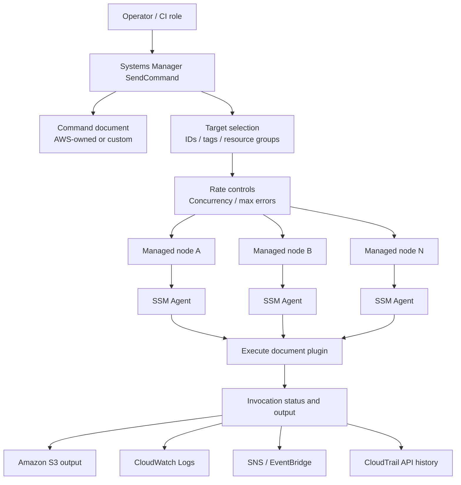

# Run Command và thực thi tác vụ trên nhiều máy chủ

**AWS Systems Manager Run Command** cho phép quản trị viên gửi lệnh từ xa tới các managed nodes mà không cần mở phiên SSH/RDP hoặc đăng nhập thủ công vào từng máy chủ. Một lệnh có thể nhắm tới một instance, một danh sách node, hoặc cả fleet được xác định bằng tags và AWS Resource Groups. Systems Manager phân phối lệnh qua **SSM Agent**, kiểm soát số node chạy đồng thời, dừng mở rộng khi lỗi vượt ngưỡng và thu thập kết quả theo từng node.

Run Command phù hợp với các tác vụ quản trị một lần hoặc theo đợt như kiểm tra trạng thái service, thu thập thông tin hệ thống, khởi động lại ứng dụng, cập nhật cấu hình và chạy script vận hành. Với fleet lớn, cần kết hợp target chính xác, giới hạn concurrency, error threshold, timeout, logging và quyền IAM phù hợp để tránh một lệnh sai ảnh hưởng toàn bộ hệ thống.

Bài thuộc chương **Vận hành với Systems Manager** của mô-đun **CLOUD_PROVIDERS_AWS**. Nội dung kết nối EC2, hybrid managed nodes, SSM Agent, IAM, Systems Manager documents, Parameter Store, S3, CloudWatch Logs, SNS, EventBridge, AWS CLI và vận hành Java/Spring Boot trên nhiều máy chủ.

> **Nguyên tắc vận hành:** xác minh fleet trước khi gửi lệnh; thử trên một node hoặc nhóm canary; giới hạn concurrency và max errors; dùng document version đã review; lưu output đủ để điều tra; ghi lại người gửi, target, tham số, command ID và kết quả từng node.

## 1. Mục tiêu học tập

Sau bài học, bạn có thể:

1. Giải thích Run Command và vị trí của nó trong AWS Systems Manager.
2. Phân biệt managed node, SSM Agent, Systems Manager document, command và command invocation.
3. Chuẩn bị EC2 và máy chủ hybrid để trở thành managed nodes.
4. Cấu hình IAM instance profile hoặc Default Host Management Configuration.
5. Kiểm tra SSM Agent, trạng thái Online và network connectivity.
6. Chọn target bằng instance IDs, tags hoặc AWS Resource Groups.
7. Thiết kế Systems Manager Command document cho Linux và Windows.
8. Sử dụng AWS-RunShellScript và AWS-RunPowerShellScript.
9. Điều khiển concurrency, max errors, timeout và exit codes.
10. Gửi lệnh tới nhiều máy chủ bằng AWS Console và AWS CLI.
11. Thu thập command output vào S3 hoặc CloudWatch Logs.
12. Theo dõi command status và invocation status theo từng node.
13. Gửi SNS notifications và tích hợp EventBridge.
14. Bảo vệ tham số, secrets, output và quyền thực thi bằng IAM.
15. Phân biệt Run Command với State Manager, Automation và Maintenance Windows.
16. Xử lý các lỗi agent, IAM, target, document, network và command execution.
17. Thiết kế một workflow vận hành an toàn cho fleet EC2 chạy Java/Spring Boot.

## 2. Run Command trong AWS Systems Manager

Run Command là khả năng thực thi lệnh từ xa trên các managed nodes được Systems Manager quản lý. Quản trị viên gửi yêu cầu từ Console, AWS CLI, AWS Tools for PowerShell hoặc AWS SDK. Systems Manager xác định node đích, phân phối yêu cầu và nhận kết quả từ SSM Agent.

Các tác vụ phổ biến:

- Kiểm tra CPU, memory, disk, process và service status.
- Khởi động lại một service sau khi cập nhật cấu hình.
- Thu thập log hoặc file chẩn đoán.
- Cài đặt hoặc cấu hình phần mềm.
- Cập nhật SSM Agent.
- Chạy health checks sau deployment.
- Thực hiện tác vụ bảo trì trên một nhóm EC2.
- Chạy script trên máy chủ hybrid được đăng ký với Systems Manager.

Run Command không cần inbound SSH/RDP từ quản trị viên. SSM Agent chủ động liên hệ các endpoint Systems Manager qua kết nối outbound HTTPS. Nhờ vậy, máy chủ trong private subnet có thể được quản trị mà không cần mở cổng quản trị công khai, nếu network và IAM đã được cấu hình đúng.

### 2.1. Run Command không phải công cụ build/deploy ứng dụng hoàn chỉnh

Run Command có thể gọi script để triển khai hoặc restart ứng dụng, nhưng nó không thay thế pipeline build, kiểm thử và quản lý release. Với ứng dụng Java/Spring Boot:

- Maven/Gradle build artifact.
- CI pipeline kiểm thử và lưu artifact.
- CodeDeploy hoặc cơ chế deployment phù hợp quản lý release lifecycle.
- Run Command có thể thực hiện tác vụ vận hành có kiểm soát như kiểm tra service, thu thập diagnostics hoặc restart theo kế hoạch.

Nếu cần một quy trình nhiều bước có approval, branching, rollback và tích hợp dịch vụ AWS, cân nhắc Systems Manager Automation hoặc CI/CD pipeline thay vì nhồi toàn bộ logic vào một shell command.

### 2.2. Run Command và chi phí

Theo tài liệu AWS, Run Command được cung cấp không tính thêm phí khi sử dụng trên Amazon EC2 managed nodes. Với hybrid và multicloud managed nodes, cần kiểm tra AWS Systems Manager pricing và các tính năng được sử dụng. Các dịch vụ đi kèm như S3, CloudWatch Logs, SNS, KMS hoặc data transfer vẫn có thể phát sinh chi phí riêng.

## 3. Kiến trúc thực thi

Một lệnh chạy trên nhiều máy chủ có luồng tổng quát:



Các bước chính:

1. Operator gửi API SendCommand cùng document, parameters và targets.
2. Systems Manager xác thực IAM permissions và xác định node phù hợp.
3. Rate controls giới hạn số node được nhận lệnh cùng lúc và ngưỡng lỗi.
4. SSM Agent trên từng node nhận document và thực thi plugin.
5. Agent gửi status, exit code và output về Systems Manager.
6. Output có thể được lưu thêm vào S3 hoặc CloudWatch Logs.
7. SNS/EventBridge có thể phát thông báo khi trạng thái thay đổi.
8. CloudTrail ghi nhận API activity để phục vụ audit.

### 3.1. Những khái niệm cần phân biệt

| Khái niệm | Ý nghĩa |
| --- | --- |
| Managed node | EC2 instance hoặc máy chủ hybrid/multicloud đã cấu hình để Systems Manager quản lý |
| SSM Agent | Phần mềm chạy trên node, liên hệ Systems Manager và thực thi document |
| Systems Manager document | Định nghĩa thao tác, parameters và các plugin/steps được thực thi |
| Command | Một yêu cầu SendCommand, có một command ID |
| Command invocation | Một bản thực thi của command trên một managed node |
| Plugin | Khối thực thi bên trong document, ví dụ aws:runShellScript |
| Command output | stdout/stderr hoặc dữ liệu kết quả của plugin |
| Target | Node được chọn theo ID, tag hoặc Resource Group |

Nếu gửi một command tới 20 instances, hệ thống tạo một command ID và tối đa 20 command invocations. Mỗi invocation có status riêng. Trạng thái tổng hợp của command có thể khác trạng thái của một invocation riêng lẻ.

## 4. Managed nodes và SSM Agent

Run Command chỉ hoạt động trên các node được Systems Manager quản lý và có trạng thái phù hợp. EC2 instance chạy bình thường trong EC2 Console chưa chắc đã là managed node.

### 4.1. Điều kiện cơ bản cho EC2

Một EC2 instance thường cần:

- SSM Agent được cài đặt và đang chạy.
- IAM instance profile có quyền Systems Manager phù hợp, hoặc được quản lý qua Default Host Management Configuration.
- Kết nối outbound HTTPS tới các Systems Manager endpoints cần thiết.
- Đang ở đúng AWS Region với nơi quản trị viên thao tác.
- Hệ điều hành được Systems Manager hỗ trợ.
- Đồng hồ hệ thống, DNS và proxy được cấu hình đúng nếu môi trường có yêu cầu riêng.

Nhiều Amazon Linux AMIs và Windows Server AMIs do AWS cung cấp đã cài sẵn SSM Agent, nhưng cần kiểm tra version và trạng thái service. Custom AMI hoặc máy chủ cũ có thể cần cài đặt/cập nhật agent.

### 4.2. Kiểm tra SSM Agent trên Linux

Trên Amazon Linux, tên service thường là amazon-ssm-agent:

```bash
sudo systemctl status amazon-ssm-agent
sudo systemctl enable amazon-ssm-agent
sudo systemctl start amazon-ssm-agent

amazon-ssm-agent -version
```

Một số bản Ubuntu cài agent bằng Snap có tên service khác, ví dụ snap.amazon-ssm-agent.amazon-ssm-agent. Kiểm tra cách cài đặt thực tế của AMI trước khi dùng lệnh systemctl.

### 4.3. Kiểm tra SSM Agent trên Windows Server

Mở PowerShell với quyền quản trị:

```powershell
Get-Service AmazonSSMAgent
Get-Service AmazonSSMAgent | Start-Service
Get-Service AmazonSSMAgent | Set-Service -StartupType Automatic
```

Có thể kiểm tra version của executable trong thư mục cài đặt SSM Agent theo hướng dẫn AWS dành cho Windows.

### 4.4. Xác minh trong Systems Manager

Mở Systems Manager Console → Fleet Manager → Managed nodes. Kiểm tra:

- Node ID.
- Platform name/version.
- Ping status.
- Agent version.
- IAM role/profile nếu được hiển thị.
- Last ping time.
- AWS Region.

Node cần xuất hiện là managed node và có ping status **Online** để nhận command bình thường. Nếu node không xuất hiện, bắt đầu bằng kiểm tra agent, IAM và network trước khi gửi lại lệnh.

## 5. IAM cho managed nodes

SSM Agent cần credentials để gọi Systems Manager APIs. Với EC2, cách phổ biến là gắn IAM instance profile vào instance.

### 5.1. AmazonSSMManagedInstanceCore

AWS managed policy **AmazonSSMManagedInstanceCore** cung cấp nhóm quyền cần thiết để EC2 instance giao tiếp với Systems Manager. Đây là điểm bắt đầu thường dùng cho instance profile.

Một role EC2 có thể được tạo theo luồng:

1. Mở IAM → Roles.
2. Chọn trusted entity là AWS service.
3. Chọn EC2.
4. Gắn policy AmazonSSMManagedInstanceCore.
5. Đặt tên role theo workload.
6. Tạo instance profile nếu quy trình yêu cầu.
7. Gắn instance profile vào EC2 instance hoặc launch template.
8. Đợi agent reconnect và kiểm tra Fleet Manager.

Không gắn quyền quản trị AWS rộng cho instance chỉ để làm cho Run Command hoạt động.

### 5.2. Default Host Management Configuration

**Default Host Management Configuration (DHMC)** cho phép Systems Manager tự quản lý EC2 instances trong một account/Region bằng một role quản lý mặc định, giảm nhu cầu gắn instance profile riêng cho từng instance.

Các điều kiện quan trọng theo tài liệu AWS hiện hành:

- Instance phải dùng IMDSv2.
- SSM Agent phải ở version 3.2.582.0 hoặc mới hơn.
- Default Host Management Configuration phải được kích hoạt trong account/Region.
- Role mặc định và service setting phải được cấu hình với permissions phù hợp.

DHMC không phải cơ chế tự động bật cho mọi account/Region. Khi quản trị nhiều accounts, có thể dùng Systems Manager Quick Setup để cấu hình theo AWS Organizations nếu đáp ứng điều kiện.

### 5.3. Instance profile và DHMC

Chọn cách cấp credentials phù hợp với mô hình quản trị. Nếu dùng DHMC, kiểm tra role/default service setting và agent prerequisites. Nếu dùng instance profile, kiểm tra role được gắn đúng vào instance hoặc launch template. Khi node có nhiều nguồn credentials, cần hiểu cơ chế credential selection để tránh agent dùng nhầm identity hoặc thiếu permissions.

### 5.4. Hybrid managed nodes

Máy chủ on-premises hoặc máy chủ ở cloud khác có thể được đăng ký thành hybrid managed nodes bằng hybrid activation:

- Tạo activation trong Systems Manager.
- Nhận activation code và activation ID.
- Cài SSM Agent.
- Đăng ký node bằng activation.
- Gán IAM service role cho hybrid activation.
- Xác minh node ID và trạng thái Online.

Hybrid node thường có ID bắt đầu bằng mi-, khác EC2 instance ID bắt đầu bằng i-. Bảo vệ activation code/ID vì chúng dùng trong quy trình đăng ký node mới.

## 6. Network connectivity và VPC endpoints

SSM Agent chủ động mở kết nối outbound HTTPS tới các endpoint Systems Manager theo Region. Không cần mở inbound SSH port cho Run Command.

### 6.1. Public subnet

Trong public subnet, instance có thể truy cập các endpoint AWS qua Internet Gateway nếu route, DNS và security policy cho phép. Public IP không phải yêu cầu bắt buộc nếu có egress path khác.

### 6.2. Private subnet

Với EC2 trong private subnet, có thể dùng NAT Gateway hoặc VPC interface endpoints để kết nối private tới các dịch vụ AWS được hỗ trợ.

Các endpoint thường cần xem xét:

- Systems Manager endpoint: com.amazonaws.<region>.ssm.
- Systems Manager Messages endpoint: com.amazonaws.<region>.ssmmessages.
- EC2 Messages endpoint: com.amazonaws.<region>.ec2messages, khi cần theo Region/agent compatibility.
- S3 gateway endpoint nếu node cần tải package/script hoặc ghi output vào S3.
- CloudWatch Logs endpoint nếu gửi command output qua private network tới Logs.

Endpoint availability và nhu cầu ec2messages phụ thuộc Region và phiên bản agent. Kiểm tra tài liệu endpoint mới nhất cho Region đang triển khai.

### 6.3. Security groups và DNS

- Interface endpoint security group phải cho phép inbound TCP 443 từ security group/subnet của managed nodes.
- Managed node cần outbound TCP 443.
- Bật VPC DNS resolution và DNS hostnames phù hợp.
- Kiểm tra private DNS cho interface endpoints.
- Kiểm tra route tables, NACL và proxy configuration.
- Kiểm tra endpoint policy không chặn các API cần thiết.
- Nếu S3 bucket ở account khác, kiểm tra cả bucket policy và endpoint policy.

Không mở toàn bộ inbound ports từ Internet để sửa lỗi SSM Agent. Tìm đúng endpoint và đường kết nối cần thiết.

## 7. Systems Manager documents

Run Command thực thi một Systems Manager document có loại **Command**. Document mô tả parameters, thứ tự steps và plugin cần chạy.

Có hai nhóm document thường gặp:

- AWS-owned documents: do AWS cung cấp và duy trì.
- Custom documents: do tổ chức tạo để chuẩn hóa tác vụ nội bộ.

### 7.1. AWS-RunShellScript

Dùng document **AWS-RunShellScript** để chạy shell commands trên Linux managed nodes.

Ví dụ tác vụ:

```bash
set -e
hostname
date -u
df -h
free -m
systemctl is-active orders-api
```

### 7.2. AWS-RunPowerShellScript

Dùng document **AWS-RunPowerShellScript** để chạy PowerShell trên Windows Server managed nodes.

```powershell
$ErrorActionPreference = "Stop"

$env:COMPUTERNAME
Get-Date -AsUTC
Get-Volume
Get-Service -Name "W3SVC"
```

Không gửi lệnh Linux tới Windows node hoặc PowerShell command tới Linux node. Khi chọn target bằng tags, bảo đảm fleet không trộn OS nếu document không có precondition xử lý riêng.

### 7.3. Command document schema

Với custom Command documents mới, AWS khuyến nghị schema version 2.2 trở lên. Document có thể chứa:

- schemaVersion.
- description.
- parameters.
- mainSteps.
- action/plugin.
- inputs.
- precondition để giới hạn platform.
- timeout và error handling.

Custom document giúp chuẩn hóa một tác vụ để nhiều operator chạy theo cùng một giao diện parameters và cùng cách xử lý lỗi.

## 8. Tạo custom Command document

Ví dụ document Linux dùng để kiểm tra trạng thái và restart một systemd service theo parameter.

File **RestartLinuxService.yml**:

```yaml
---
schemaVersion: "2.2"
description: "Check or restart an approved Linux systemd service"
parameters:
  ServiceName:
    type: String
    description: "Systemd service name"
    default: "orders-api"
    allowedPattern: "^[a-zA-Z0-9_.@-]+$"
    interpolationType: ENV_VAR
  Operation:
    type: String
    description: "Operation to perform"
    default: "status"
    allowedValues:
      - "status"
      - "restart"
mainSteps:
  - action: aws:runShellScript
    name: manageService
    precondition:
      StringEquals:
        - platformType
        - Linux
    inputs:
      timeoutSeconds: "120"
      runCommand:
        - |
          set -euo pipefail
          SERVICE="$SSM_ServiceName"
          ACTION="{{Operation}}"

          if ! systemctl list-unit-files "$SERVICE.service" --no-legend | grep -q "$SERVICE.service"; then
            echo "Service is not installed: $SERVICE" >&2
            exit 2
          fi

          case "$ACTION" in
            status)
              systemctl status "$SERVICE.service" --no-pager
              ;;
            restart)
              systemctl restart "$SERVICE.service"
              systemctl is-active --quiet "$SERVICE.service"
              ;;
            *)
              echo "Unsupported operation" >&2
              exit 3
              ;;
          esac
```

Document này có các đặc điểm:

- Chỉ chạy trên Linux.
- ServiceName được kiểm tra bằng allowedPattern.
- ServiceName dùng environment variable interpolation.
- Operation chỉ nhận status hoặc restart.
- Script bật error handling và trả exit code khác 0 nếu service không hợp lệ hoặc thao tác thất bại.

### 8.1. ENV_VAR interpolation

Với parameter kiểu String được dùng trong command, dùng interpolationType: ENV_VAR để SSM Agent tạo biến môi trường có prefix SSM_. Ví dụ parameter ServiceName trở thành biến SSM_ServiceName.

Tính năng này yêu cầu SSM Agent version 3.3.2746.0 trở lên. Cần kiểm tra agent version trên toàn fleet trước khi triển khai document dùng ENV_VAR. Luôn quote biến shell và xác thực input; ENV_VAR không thay thế escaping hoặc validation.

### 8.2. Không dùng parameter để ghép shell tùy ý

Không cho người dùng truyền cả một chuỗi shell tùy ý vào document production nếu không có cơ chế phê duyệt và kiểm soát. Tốt hơn là expose một tập parameter nhỏ với allowedValues/allowedPattern rõ ràng và ánh xạ sang các hành động được phép.

### 8.3. Tạo và kiểm tra document

Có thể tạo custom document qua Console hoặc CLI:

```bash
aws ssm create-document \
  --name RestartLinuxService \
  --document-type Command \
  --document-format YAML \
  --content file://RestartLinuxService.yml \
  --region ap-southeast-1
```

Sau khi tạo, xem document:

```bash
aws ssm describe-document \
  --name RestartLinuxService \
  --region ap-southeast-1
```

Đọc document content và kiểm thử trên một node staging trước khi dùng cho fleet rộng hơn. Khi cập nhật, tạo version mới và quản lý default version theo quy trình review.

## 9. Chọn target cho một command

Run Command hỗ trợ chọn managed nodes theo một số cách:

1. Instance/managed node IDs cụ thể.
2. EC2 tags hoặc managed-node tags.
3. AWS Resource Groups.
4. Danh sách target phù hợp theo loại tài nguyên được API hỗ trợ.

### 9.1. Target bằng instance IDs

Dùng khi cần kiểm tra hoặc sửa một vài node đã biết:

```bash
aws ssm send-command \
  --document-name "AWS-RunShellScript" \
  --instance-ids "i-0123456789abcdef0" \
  --parameters '{"commands":["hostname","systemctl is-active orders-api"]}' \
  --region ap-southeast-1
```

Cách này rõ ràng nhưng không thuận tiện khi fleet thay đổi thường xuyên.

### 9.2. Target bằng tags

Gắn tags theo môi trường, ứng dụng và vai trò:

| Tag key | Ví dụ | Ý nghĩa |
| --- | --- | --- |
| Environment | staging | Môi trường |
| Application | orders-api | Ứng dụng |
| Role | web | Vai trò của node |
| Owner | platform-team | Nhóm chịu trách nhiệm |
| MaintenanceWindow | weekly | Nhóm bảo trì |

Ví dụ muốn chạy trên web nodes thuộc staging và ứng dụng Orders:

```text
Environment = staging
Application = orders-api
Role = web
```

Khi gửi nhiều target criteria, thiết kế bộ tag nhất quán và kiểm tra trước số lượng node khớp. Thực hiện dry run bằng cách liệt kê node/tag trước khi gửi command; đừng dựa vào tên tag mà giả định fleet đã được gắn đúng.

### 9.3. Target bằng AWS Resource Groups

Resource Group cho phép gom resources theo tag hoặc tiêu chí nhóm đã định nghĩa. Run Command có thể dùng Resource Group làm target khi loại tài nguyên và cấu hình được hỗ trợ.

Cách này hữu ích khi nhiều nhóm vận hành cùng dùng một tập resource đã được quản lý tập trung.

### 9.4. Tránh target quá rộng

Không dùng tag chung như Environment=production nếu tag đó gắn cho database, web, worker và bastion cùng lúc nhưng document chỉ dành cho một loại node. Hãy thêm Application/Role hoặc tách target theo resource group.

Trước khi chạy lệnh có tác động, ghi nhận:

- Số managed nodes dự kiến.
- Danh sách node thực tế.
- Region/account.
- OS/platform.
- Mục tiêu thao tác.
- Người phê duyệt nếu cần.

## 10. Rate controls: concurrency và max errors

Run Command có hai cơ chế chính để kiểm soát tác động khi chạy trên nhiều node:

- **Max concurrency:** số lượng hoặc tỷ lệ managed nodes được xử lý đồng thời.
- **Max errors:** số lỗi cho phép trước khi Systems Manager ngừng gửi command tới các node tiếp theo.

Hai tham số này đặc biệt quan trọng khi target bằng tags hoặc Resource Groups vì số lượng node có thể thay đổi theo thời gian.

### 10.1. Max concurrency

Có thể đặt bằng số tuyệt đối hoặc phần trăm target set:

| Giá trị | Ý nghĩa |
| --- | --- |
| 1 | Mỗi thời điểm xử lý một node |
| 5 | Tối đa năm node đồng thời |
| 10% | Tối đa khoảng 10% target set đồng thời |
| 50% | Tối đa khoảng một nửa target set đồng thời |

Nếu không chỉ định, mặc định max-concurrency của Run Command là 50.

Ví dụ fleet 100 instances:

- 1: triển khai tuần tự, dễ quan sát nhưng chậm.
- 10: tối đa 10 nodes cùng lúc.
- 10%: tối đa khoảng 10 nodes cùng lúc.
- 50%: có thể tác động một nửa fleet trong cùng thời điểm.

Khi số target chưa chắc chắn, dùng phần trăm để concurrency tự điều chỉnh theo quy mô target set.

### 10.2. Max errors

Max errors xác định số invocation failure được phép trước khi ngừng gửi lệnh tới các node tiếp theo. Nếu không chỉ định, max-errors mặc định là 0: hệ thống ngừng gửi command tới node mới sau lỗi đầu tiên.

Ví dụ:

| Max errors | Hành vi |
| --- | --- |
| 0 | Dừng gửi command tới node mới sau lỗi đầu tiên |
| 1 | Dừng sau khi nhận lỗi thứ hai |
| 3 | Dừng sau khi nhận lỗi thứ tư |
| 5% | Dừng khi số lỗi vượt ngưỡng phần trăm đã chọn |

Nếu một command đang chạy trên các node khác khi ngưỡng lỗi bị vượt, những invocation đã bắt đầu vẫn có thể hoàn tất và cũng có thể thất bại. Rate control không phải transaction rollback cho toàn fleet.

### 10.3. Ví dụ rollout an toàn

Với fleet production 40 nodes:

1. Chạy thử trên một instance canary.
2. Chạy trên 10% fleet với max errors bằng 0 hoặc 1.
3. Kiểm tra health, logs và metrics.
4. Mở rộng lên 25%.
5. Sau khi xác minh, chạy phần fleet còn lại.
6. Dừng rollout nếu error rate hoặc service health xấu đi.

Giá trị cụ thể cần dựa trên capacity, blast radius, SLO và khả năng rollback của tác vụ.

## 11. Timeout và exit codes

Run Command có các khái niệm timeout khác nhau. Không nên gộp chúng thành một con số duy nhất.

### 11.1. Command timeout

Tham số Timeout seconds khi gửi command xác định khoảng thời gian tổng thể để Systems Manager chờ command được phân phối theo cơ chế timeout của Run Command. Nếu node không nhận được command trước khi hết thời gian, invocation có thể thành DeliveryTimedOut.

### 11.2. Plugin execution timeout

Trong SSM document, plugin có thể đặt timeoutSeconds. Khi script đã bắt đầu chạy trên node nhưng không hoàn tất trước thời hạn, invocation có thể thành ExecutionTimedOut.

Ví dụ:

```yaml
mainSteps:
  - action: aws:runShellScript
    name: checkService
    inputs:
      timeoutSeconds: "120"
      runCommand:
        - "systemctl is-active orders-api"
```

Với AWS-RunShellScript, document có parameter executionTimeout và mặc định phổ biến là 3600 giây. Tổng thời gian timeout được tính theo quy tắc của document và command timeout; kiểm tra giá trị mặc định của document/version đang sử dụng.

### 11.3. Exit code

- Exit code 0 thường được xem là thành công của plugin.
- Exit code khác 0 thể hiện lỗi.
- Shell script nên bật error handling, ví dụ set -euo pipefail.
- Không che lỗi bằng cách thêm || true vào toàn bộ script.
- Nếu một lệnh có thể thất bại có chủ đích, kiểm tra exit code và xử lý rõ ràng.

Command có thể báo Success nếu script trả exit code 0 dù script không thực hiện đúng nghiệp vụ do lỗi logic. Vì vậy, script cần xác minh kết quả sau hành động, ví dụ restart xong phải kiểm tra service active hoặc endpoint health.

## 12. Hiểu command status và invocation status

Systems Manager hiển thị trạng thái ở nhiều cấp:

- Plugin status: trạng thái của từng step/plugin.
- Invocation status: kết quả trên một managed node.
- Command status: trạng thái tổng hợp của toàn bộ yêu cầu.

### 12.1. Các trạng thái invocation thường gặp

| Status | Ý nghĩa |
| --- | --- |
| Pending | Command chưa được gửi hoặc agent chưa nhận |
| InProgress | Đang gửi hoặc đang thực thi |
| Delayed | Gửi chưa thành công, hệ thống sẽ thử lại |
| Success | Plugin hoàn thành với exit code 0 |
| Failed | Plugin hoặc invocation thất bại |
| DeliveryTimedOut | Không phân phối được command trước timeout |
| ExecutionTimedOut | Script đã bắt đầu nhưng vượt execution timeout |
| Undeliverable | Không thể gửi tới node |
| InvalidPlatform | Document không phù hợp OS/platform |
| AccessDenied | Principal gửi lệnh không có quyền với target |
| Terminated | Invocation bị dừng do max errors của command |
| Cancelled | Command bị hủy trước khi hoàn tất |

### 12.2. Command status tổng hợp

Một số trạng thái command:

- Pending.
- InProgress.
- Success.
- Failed.
- Incomplete.
- DeliveryTimedOut.
- Cancelled.
- RateExceeded.
- NoInstancesInTag.

Điểm cần nhớ: command tổng hợp có thể là Success trong khi một số invocation đã timeout hoặc lỗi, nếu số lỗi chưa vượt max-errors theo logic trạng thái của Run Command. Một command target bằng tag không tìm thấy instance cũng có trạng thái riêng.

**Đừng chỉ kiểm tra command status.** Với tác vụ quan trọng, kiểm tra ListCommandInvocations và xác nhận mọi node bắt buộc đều có kết quả thành công.

## 13. Chạy Run Command từ Console

Quy trình thực hiện:

1. Mở AWS Systems Manager Console.
2. Chọn Run Command trong navigation.
3. Chọn Run command.
4. Chọn Systems Manager document, ví dụ AWS-RunShellScript.
5. Nhập parameters.
6. Chọn managed nodes bằng IDs, tags hoặc Resource Groups.
7. Nhập comment để giải thích mục đích.
8. Đặt Timeout seconds.
9. Cấu hình Max concurrency và Max errors.
10. Cấu hình S3/CloudWatch output nếu cần.
11. Cấu hình SNS notifications nếu cần.
12. Review target count và command parameters.
13. Chọn Run.
14. Mở Command ID để theo dõi trạng thái.
15. Xem output theo từng managed node.

### 13.1. Comment hữu ích

Comment nên ghi:

- Ticket/change request ID.
- Mục đích.
- Môi trường.
- Người hoặc team chịu trách nhiệm.
- Thời gian/maintenance window nếu liên quan.

Ví dụ: CHG-2026-042 - kiểm tra trạng thái Orders API trên staging sau deployment.

Không ghi password, token hoặc thông tin bí mật vào comment.

## 14. Chạy lệnh trên nhiều máy chủ bằng AWS CLI

Ví dụ sau chạy kiểm tra trạng thái service Orders API trên tất cả Linux nodes có tag Environment=staging và Application=orders-api.

Chạy từ Bash shell:

```bash
aws ssm send-command \
  --document-name "AWS-RunShellScript" \
  --document-version '$DEFAULT' \
  --targets \
    "Key=tag:Environment,Values=staging" \
    "Key=tag:Application,Values=orders-api" \
  --parameters '{"commands":["set -euo pipefail","hostname","systemctl is-active orders-api"]}' \
  --comment "CHG-2026-042: verify Orders API on staging" \
  --timeout-seconds 600 \
  --max-concurrency "10%" \
  --max-errors "1" \
  --cloud-watch-output-config '{"CloudWatchOutputEnabled":true,"CloudWatchLogGroupName":"/aws/ssm/run-command"}' \
  --region ap-southeast-1
```

API trả về CommandId. Lưu CommandId vào change record để tra cứu.

### 14.1. Kiểm tra command

Liệt kê thông tin tổng quan:

```bash
aws ssm list-commands \
  --command-id "COMMAND_ID" \
  --region ap-southeast-1
```

Liệt kê invocation và chi tiết:

```bash
aws ssm list-command-invocations \
  --command-id "COMMAND_ID" \
  --details \
  --region ap-southeast-1
```

Lấy output của một instance:

```bash
aws ssm get-command-invocation \
  --command-id "COMMAND_ID" \
  --instance-id "i-0123456789abcdef0" \
  --region ap-southeast-1
```

Thay placeholder bằng command ID và instance ID thực tế. Với managed hybrid node, dùng managed node ID tương ứng.

### 14.2. Hủy command

Nếu cần dừng một command:

```bash
aws ssm cancel-command \
  --command-id "COMMAND_ID" \
  --region ap-southeast-1
```

Cancel không phải cơ chế rollback. Một số invocation đã chạy hoặc đã hoàn tất trước khi yêu cầu cancel được xử lý. Sau khi hủy, kiểm tra trạng thái từng node và khôi phục ứng dụng theo runbook nếu cần.

## 15. Lưu output vào Amazon S3

Theo mặc định, Systems Manager trả output trực tiếp cho Console/API với giới hạn kích thước. GetCommandInvocation trả về tối đa 24.000 ký tự output. Nếu cần toàn bộ output hoặc lưu lâu dài, cấu hình S3 output.

Ví dụ CLI:

```bash
aws ssm send-command \
  --document-name "AWS-RunShellScript" \
  --targets "Key=tag:Environment,Values=staging" \
  --parameters '{"commands":["hostname","journalctl -u orders-api -n 200 --no-pager"]}' \
  --output-s3-bucket-name "company-ssm-output" \
  --output-s3-key-prefix "run-command/orders-api" \
  --max-concurrency "10%" \
  --max-errors "1" \
  --region ap-southeast-1
```

### 15.1. Quyền ghi S3 thuộc về managed node

Quyền ghi output vào S3 là quyền của instance profile trên EC2 hoặc IAM service role của hybrid managed node, không phải chỉ quyền của operator gọi SendCommand.

Cần kiểm tra:

- s3:PutObject tới đúng bucket/prefix.
- Bucket policy.
- KMS key policy nếu dùng SSE-KMS.
- S3 endpoint policy nếu node truy cập qua VPC endpoint.
- Cross-account permissions nếu output bucket nằm ở account khác.

### 15.2. Bảo vệ output bucket

Output có thể chứa hostname, IP, package list, process arguments, log lines hoặc dữ liệu nhạy cảm. Nên:

- Bật encryption.
- Chặn public access.
- Giới hạn bucket/prefix permissions.
- Bật versioning hoặc Object Lock khi yêu cầu audit cần thiết.
- Thiết lập lifecycle/retention.
- Kiểm soát quyền đọc và download.
- Không ghi secret vào stdout/stderr.

## 16. Lưu output vào CloudWatch Logs

Run Command có thể gửi stdout/stderr tới CloudWatch Logs theo thời gian gần thực. Điều này giúp tìm kiếm log, so sánh lỗi giữa nodes và tạo metric filters/alarms.

Ví dụ:

```bash
aws ssm send-command \
  --document-name "AWS-RunShellScript" \
  --targets "Key=tag:Application,Values=orders-api" \
  --parameters '{"commands":["hostname","systemctl status orders-api --no-pager"]}' \
  --cloud-watch-output-config '{"CloudWatchOutputEnabled":true,"CloudWatchLogGroupName":"/aws/ssm/orders-api"}' \
  --max-concurrency "10%" \
  --max-errors "1" \
  --region ap-southeast-1
```

Nếu không chỉ định log group, Systems Manager có thể tạo log group theo tên document theo quy tắc dịch vụ.

### 16.1. IAM permissions cho CloudWatch Logs

Managed node cần quyền gửi logs tới CloudWatch Logs. Có thể sử dụng policy phù hợp như CloudWatchAgentServerPolicy cùng permissions Systems Manager hoặc policy tối thiểu được tổ chức phê duyệt.

Đảm bảo role có các actions cần thiết như CreateLogStream, DescribeLogStreams và PutLogEvents trên đúng log group. Nếu bật encryption bằng KMS, kiểm tra key policy.

### 16.2. Log retention

CloudWatch Logs retention phải được cấu hình rõ. Không để log vận hành chứa dữ liệu nhạy cảm tồn tại vô thời hạn chỉ vì chưa đặt retention. Dùng log group riêng theo ứng dụng/môi trường để phân quyền và quản lý vòng đời dễ hơn.

## 17. Notifications bằng SNS và EventBridge

Run Command có thể gửi trạng thái command/invocation tới Amazon SNS. Operator hoặc hệ thống incident có thể nhận thông báo khi command bắt đầu, thành công, thất bại, timeout hoặc bị hủy theo cấu hình.

### 17.1. SNS notifications

Khi cấu hình SNS:

- Chọn SNS topic.
- Chọn loại sự kiện cần thông báo.
- Chọn thông báo theo command hoặc invocation.
- Cấp IAM role phù hợp để Systems Manager publish.
- Xác minh subscription/endpoint nhận thông báo.

Notification không chứa toàn bộ output của từng command. Dùng Command ID để truy vấn status và output chi tiết.

### 17.2. EventBridge

Systems Manager phát sự kiện trạng thái command. EventBridge rule có thể phản ứng với các thay đổi như command status hoặc invocation status, sau đó:

- Gửi thông báo.
- Gọi Lambda để cập nhật ticket.
- Ghi nhận deployment/change record.
- Khởi động workflow Automation tiếp theo.
- Chuyển sự kiện tới event bus tập trung.

Thiết kế rule với filter theo document, account, Region, target hoặc status phù hợp. Tránh tự động retry một command phá hủy mà không có điều kiện idempotency và giới hạn retry.

## 18. Tham số và Parameter Store

Run Command hỗ trợ truyền parameters trực tiếp vào document hoặc tham chiếu giá trị từ Systems Manager Parameter Store.

Ví dụ một String parameter không nhạy cảm:

```bash
aws ssm send-command \
  --document-name "AWS-RunShellScript" \
  --instance-ids "i-0123456789abcdef0" \
  --parameters '{"commands":["echo {{ssm:/orders/staging/banner}}"]}' \
  --region ap-southeast-1
```

Cách này hữu ích với cấu hình không bí mật, chẳng hạn endpoint, tên môi trường hoặc version.

### 18.1. SecureString không được tham chiếu trực tiếp như String

SSM documents không hỗ trợ tham chiếu SecureString theo cùng cách tham chiếu String parameter. Nếu cần secret:

1. Không truyền secret dạng plaintext trong SendCommand parameters.
2. Cấp cho managed node role quyền đọc đúng SecureString parameter.
3. Cấp kms:Decrypt trên key tương ứng nếu cần.
4. Script lấy secret trên node bằng AWS CLI/SDK với temporary credentials của instance.
5. Không echo secret hoặc ghi vào output/logs.
6. Xóa biến tạm sau khi sử dụng khi phù hợp.

Ví dụ minh họa lấy secret và chỉ kiểm tra có giá trị:

```bash
SECRET_VALUE=$(aws ssm get-parameter \
  --name "/orders/staging/api-token" \
  --with-decryption \
  --query "Parameter.Value" \
  --output text)

if [ -z "$SECRET_VALUE" ]; then
  echo "Required parameter is empty" >&2
  exit 1
fi

unset SECRET_VALUE
```

Trong ứng dụng thực tế, truyền secret trực tiếp vào tiến trình cần dùng thay vì lưu lâu trong shell environment hoặc ghi ra file không được bảo vệ. Đảm bảo instance role chỉ đọc đúng parameter path.

### 18.2. Không gửi secret trong command line

AWS Systems Manager API activity được ghi trong CloudTrail. Parameter values được gửi trong SendCommand có thể xuất hiện trong audit trail hoặc nơi lưu trữ khác. Vì vậy, không truyền password, token, private key hoặc connection string nhạy cảm dưới dạng plaintext trong command parameters.

## 19. IAM least privilege cho người gửi lệnh

Run Command có thể thực thi lệnh với quyền rất cao trên node. Theo mặc định, lệnh trên Linux thường chạy dưới root và trên Windows thường chạy dưới SYSTEM. Vì vậy, quyền ssm:SendCommand tương đương một quyền quản trị từ xa mạnh.

### 19.1. Tách quyền document và target

IAM policy cho SendCommand cần xem xét cả:

- Systems Manager document được phép gọi.
- Managed nodes được phép nhắm tới.

Không chỉ giới hạn document nhưng để target là mọi EC2 instances. Cũng không chỉ giới hạn target mà cho phép gọi mọi document tùy ý.

### 19.2. Restrict bằng tags

AWS hỗ trợ condition key ssm:resourceTag/ để giới hạn SendCommand theo tags trên managed nodes. Ví dụ, nhóm staging operator chỉ được chạy command trên node có Environment=staging.

Ví dụ policy minh họa theo mô hình AWS:

```json
{
  "Version": "2012-10-17",
  "Statement": [
    {
      "Sid": "AllowApprovedDocument",
      "Effect": "Allow",
      "Action": "ssm:SendCommand",
      "Resource": "arn:aws:ssm:*:*:document/AWS-RunShellScript"
    },
    {
      "Sid": "AllowStagingNodes",
      "Effect": "Allow",
      "Action": "ssm:SendCommand",
      "Resource": "arn:aws:ec2:*:*:instance/*",
      "Condition": {
        "StringEquals": {
          "ssm:resourceTag/Environment": "staging"
        }
      }
    },
    {
      "Sid": "ReadCommandStatus",
      "Effect": "Allow",
      "Action": [
        "ssm:ListCommands",
        "ssm:ListCommandInvocations",
        "ssm:GetCommandInvocation",
        "ssm:DescribeInstanceInformation"
      ],
      "Resource": "*"
    }
  ]
}
```

Đây là ví dụ định hướng. ARN document, partition, Region, account, actions và điều kiện phải được kiểm tra với IAM Service Authorization Reference và tài liệu Restricting Run Command access based on tags. Với custom documents, giới hạn document ARN theo tên và account cụ thể.

### 19.3. Phân quyền theo môi trường

Một mô hình tham khảo:

| Vai trò | Phạm vi |
| --- | --- |
| Developer | Đọc trạng thái, chạy document kiểm tra trên dev |
| Staging operator | Chạy document đã duyệt trên staging |
| Production operator | Chạy command production theo change approval |
| Platform administrator | Quản lý documents, managed nodes và IAM integration |
| Auditor | Đọc command history, CloudTrail và output được phép |

Không cấp quyền production cho tất cả developer chỉ vì họ cần xem trạng thái một command.

### 19.4. Guardrails

- Hạn chế document có thể gọi.
- Dùng custom document với parameters allowlist.
- Giới hạn target bằng tags.
- Dùng SCP/permissions boundary nếu tổ chức có guardrails.
- Tách role gửi command khỏi role trên EC2.
- Bật CloudTrail và log output.
- Yêu cầu change approval cho thao tác restart/stop/patch trên production.
- Review quyền định kỳ.

## 20. Bảo vệ Systems Manager documents

Document là mã thực thi từ xa, vì vậy quyền tạo và sửa document cũng nhạy cảm.

Các biện pháp:

- Chỉ nhóm platform được phép tạo/sửa custom documents production.
- Review nội dung document như review source code.
- Tạo version mới thay vì thay đổi không kiểm soát.
- Chỉ định default version sau khi kiểm thử.
- Dùng document tags để phân quyền theo owner/environment.
- Giới hạn parameters bằng allowedValues/allowedPattern.
- Dùng ENV_VAR interpolation cho string parameters phù hợp.
- Không hard-code credentials hoặc secrets.
- Theo dõi API CreateDocument, UpdateDocument, UpdateDocumentDefaultVersion và SendCommand trong CloudTrail.

Khi gửi lệnh production, pin document version đã review nếu quy trình cần tính tái lập. Không để cùng một release run với document version thay đổi giữa các lần thực thi.

## 21. Run Command với Java/Spring Boot fleet

Giả sử ứng dụng Orders API chạy trên nhiều EC2 instances dưới systemd service orders-api.

Các tác vụ phù hợp với Run Command:

- Kiểm tra service status.
- Kiểm tra JVM process và port.
- Thu thập journal logs.
- Xác nhận version đang chạy.
- Restart service theo maintenance window.
- Chạy health check sau deployment.
- Thu thập diagnostics trước khi terminate instance.

### 21.1. Kiểm tra fleet

```bash
hostname
java -version
systemctl is-active orders-api
systemctl show orders-api --property=ActiveState,SubState,MainPID
curl --fail --silent http://127.0.0.1:8080/actuator/health
```

Nếu health endpoint có authentication, cấu hình cách kiểm tra an toàn và không đưa token vào command parameters dạng plaintext.

### 21.2. Restart theo nhóm nhỏ

Dùng target tags Environment=staging và Application=orders-api, concurrency 1 hoặc 10%, max errors 0 hoặc 1. Sau mỗi đợt, kiểm tra ALB target health và error rate trước khi mở rộng.

Không restart toàn bộ web fleet cùng lúc nếu hệ thống cần duy trì capacity liên tục.

### 21.3. Không dùng Run Command làm deployment coordinator thiếu kiểm soát

Nếu cần deploy một version mới tới nhiều nodes, quản lý release artifact, drain traffic, health validation và rollback bằng CodeDeploy hoặc pipeline phù hợp. Run Command có thể hỗ trợ các bước vận hành bổ trợ nhưng cần tránh tạo một hệ thống deployment tùy biến khó audit.

## 22. Theo dõi trạng thái và kết quả

Theo dõi Run Command bằng Console, CLI, SDK, EventBridge hoặc SNS.

### 22.1. Command ID

Mỗi SendCommand trả về CommandId. Ghi CommandId cùng:

- Change ticket.
- Document name/version.
- Parameters đã dùng (không bao gồm secret).
- Target filters.
- Max concurrency/max errors.
- Operator identity.
- Thời gian bắt đầu/kết thúc.
- Kết quả từng node.

### 22.2. Invocation details

Khi một command chạy trên nhiều nodes, mở từng invocation để xem:

- Instance ID/managed node ID.
- Status.
- Plugin name.
- Response code.
- Standard output.
- Standard error.
- Execution start/end time.
- S3/CloudWatch output location nếu cấu hình.

### 22.3. Eventual consistency

Run Command API tuân theo mô hình eventual consistency. Sau khi gửi command hoặc thay đổi trạng thái, kết quả có thể chưa xuất hiện ngay trong lệnh list tiếp theo. Nếu vừa gửi SendCommand mà ListCommandInvocations chưa thấy kết quả, đợi một khoảng ngắn rồi truy vấn lại theo command ID; không gửi lặp command chỉ vì kết quả chưa hiện tức thì.

### 22.4. Command history

Run Command command history được lưu tối đa 30 ngày trong Systems Manager. Nếu cần lưu lâu hơn, xuất output sang S3/CloudWatch Logs và dùng CloudTrail trail để lưu API audit events theo retention policy.

## 23. Kết hợp Run Command với các tính năng Systems Manager khác

Không phải mọi tác vụ vận hành đều nên chạy bằng một lệnh shell.

| Tính năng | Mục đích | Khi sử dụng |
| --- | --- | --- |
| Run Command | Thực thi command một lần trên một hoặc nhiều nodes | Kiểm tra, restart, thu thập diagnostics |
| State Manager | Duy trì cấu hình mong muốn bằng associations | Đảm bảo agent/configuration/package ở trạng thái định kỳ |
| Automation | Điều phối runbook nhiều bước trên AWS resources | Quy trình có branching, approval, remediation |
| Maintenance Windows | Lập lịch tác vụ trong cửa sổ bảo trì | Patch/restart định kỳ theo khung giờ |
| Patch Manager | Quản lý scan/install OS patches | Patch baseline và compliance |
| Distributor | Phân phối package/phần mềm tới managed nodes | Cài agent hoặc package được quản lý |
| Session Manager | Phiên shell tương tác qua Systems Manager | Troubleshooting trực tiếp khi cần tương tác |

### 23.1. Run Command và State Manager

Run Command gửi lệnh một lần. State Manager dùng association để duy trì trạng thái mong muốn hoặc chạy document theo lịch.

Ví dụ: nếu cần bảo đảm CloudWatch Agent luôn được cài trên mọi instance, State Manager association phù hợp hơn việc gửi một command cài agent thủ công mỗi tuần.

### 23.2. Run Command và Automation

Automation dùng runbooks để điều phối nhiều bước, có thể gọi Run Command qua action aws:runCommand. Ví dụ workflow:

1. Kiểm tra tag và trạng thái instance.
2. Chạy health check.
3. Chụp snapshot hoặc kiểm tra backup.
4. Gửi command restart.
5. Chờ service healthy.
6. Ghi kết quả và thông báo.

Khi cần nhiều bước có điều kiện và trạng thái, dùng Automation thay vì nhồi logic vào một script dài.

### 23.3. Maintenance Windows

Maintenance Windows cho phép lập lịch các tác vụ trong thời gian bảo trì. Một maintenance window có thể có targets và tasks như Run Command hoặc Automation. Kết hợp schedule, task priority, concurrency và error threshold để tránh các tác vụ bảo trì xung đột.

## 24. Tác vụ định kỳ và sự kiện

Run Command thường được dùng cho tác vụ on-demand. Nếu muốn chạy định kỳ hoặc theo sự kiện, có thể kết hợp:

- Maintenance Windows cho maintenance schedule.
- State Manager cho configuration enforcement.
- EventBridge cho sự kiện AWS.
- Automation cho workflow nhiều bước.
- CodePipeline cho release/deployment lifecycle.

Ví dụ: khi EC2 instance mới được tạo, EventBridge có thể kích hoạt workflow để xác minh tags, trạng thái managed node và chạy một lệnh bootstrap đã được duyệt. Cần thiết kế idempotency vì event có thể được gửi lại.

## 25. Troubleshooting

| Triệu chứng | Nguyên nhân có thể | Cách kiểm tra |
| --- | --- | --- |
| Instance không xuất hiện trong Fleet Manager | Agent chưa cài/chạy hoặc thiếu IAM role | Kiểm tra SSM Agent, instance profile, DHMC |
| Ping status ConnectionLost/Offline | Agent không liên hệ được endpoint | Kiểm tra DNS, HTTPS 443, routes, proxy |
| SendCommand AccessDenied | Operator thiếu quyền document hoặc target | Kiểm tra IAM policy, SCP, resource tags |
| Invocation Undeliverable | Node không tồn tại/không phản hồi | Kiểm tra node state, agent và Region |
| DeliveryTimedOut | Command không được gửi trước timeout | Kiểm tra agent connectivity và timeout |
| ExecutionTimedOut | Script chạy quá thời hạn | Kiểm tra timeoutSeconds, process và logs |
| InvalidPlatform | Document không hỗ trợ OS target | Tách Linux/Windows targets hoặc dùng precondition |
| NoInstancesInTag | Không node nào khớp target tags | Kiểm tra tag key/value và Region |
| RateExceeded | Vượt quota pending invocations | Chia fleet thành đợt hoặc kiểm tra quota |
| Command status Success nhưng node chưa đúng | Exit code 0 hoặc aggregated status che lỗi invocation | Kiểm tra từng invocation và health thực tế |
| S3 output AccessDenied | Instance profile thiếu PutObject hoặc bucket policy chặn | Kiểm tra role, prefix, KMS và endpoint policy |
| CloudWatch Logs output thiếu | Node role thiếu Logs permissions | Kiểm tra log group, role và endpoint |
| SNS notification không đến | Topic policy/subscription/role sai | Kiểm tra SNS permissions và subscription |
| Custom document không chạy | YAML/schema/plugin/parameter sai | Validate document content và version |
| Parameter interpolation không hoạt động | Agent cũ hoặc interpolationType sai | Kiểm tra agent version và SSM_ variable |
| Service restart thành công nhưng app unhealthy | Script chỉ kiểm tra systemctl, không kiểm tra endpoint | Thêm post-action health validation |
| Command chạy lặp | Operator retry do eventual consistency | Tra command ID trước khi gửi lại |
| Node không truy cập Parameter Store | Instance role thiếu ssm:GetParameter hoặc kms:Decrypt | Kiểm tra parameter ARN, key policy và Region |

### 25.1. Agent logs trên Linux

Các log thường dùng:

```text
/var/log/amazon/ssm/amazon-ssm-agent.log
/var/log/amazon/ssm/errors.log
/var/log/amazon/ssm/audits/amazon-ssm-agent-audit.log
```

Tên/path có thể khác theo OS và phương thức cài đặt. Trên Windows Server, logs thường nằm dưới:

```text
C:\ProgramData\Amazon\SSM\Logs\
```

### 25.2. Runbook điều tra command thất bại

1. Ghi CommandId, Region, account, document và target filters.
2. Mở command summary và invocation list.
3. Xác định node đầu tiên thất bại và plugin status.
4. Kiểm tra managed node ping status và agent version.
5. Kiểm tra instance profile hoặc DHMC role.
6. Kiểm tra SSM/ssmmessages/ec2messages connectivity.
7. Đọc agent logs và command output.
8. Kiểm tra document version, parameters, platform preconditions và timeout.
9. Kiểm tra exit code, shell syntax và quyền filesystem.
10. Kiểm tra S3/CloudWatch/SNS permissions nếu output/notification thiếu.
11. Xác định command có chạy trên một phần fleet trước khi thất bại không.
12. Khôi phục từng node theo runbook; chỉ gửi command mới sau khi hiểu trạng thái command trước.

## 26. Bảo mật và vận hành tốt

### 26.1. Run Command là quyền thực thi từ xa

Vì command thường chạy dưới root/SYSTEM, quyền gửi command phải được xem như quyền quản trị máy chủ. Chỉ cấp cho principals đáng tin cậy và giới hạn theo document, tags, account và Region.

### 26.2. Không đưa secrets vào plaintext

- Không truyền password/token/private key trong SendCommand parameters.
- Không đặt secret trong comment hoặc document description.
- Dùng Parameter Store SecureString hoặc Secrets Manager.
- Cho node lấy secret bằng IAM role riêng.
- Không echo secret.
- Hạn chế stdout/stderr chứa dữ liệu nhạy cảm.
- Bảo vệ CloudTrail, S3 output và CloudWatch Logs.

### 26.3. Canary và blast radius

- Test trên một node trước.
- Dùng concurrency thấp khi chưa biết tác động.
- Chọn max errors phù hợp.
- Kiểm tra target count.
- Không chạy restart/reboot trên toàn fleet đồng thời nếu cần availability.
- Dùng maintenance window cho tác vụ disruptive.
- Có health check và rollback plan.

### 26.4. Idempotency

Command có thể bị gửi lại do retry, operator thao tác nhầm hoặc eventual consistency. Thiết kế script để chạy lặp lại an toàn:

- Kiểm tra trạng thái trước khi thay đổi.
- Không tạo duplicate resources.
- Không append config không giới hạn.
- Dùng atomic file replacement khi cập nhật cấu hình.
- Có lock cho tác vụ chỉ được chạy một lần.
- Ghi trạng thái trước/sau.
- Không giả định command chỉ chạy một lần trên một node.

### 26.5. Audit trail

Lưu thông tin:

- Principal gửi command.
- Document/version.
- Parameters không nhạy cảm.
- Target filters và danh sách node thực tế.
- Command ID.
- Start/end time.
- Invocation status.
- Output location.
- Change/ticket ID.
- Approval record nếu cần.

CloudTrail ghi nhận API activity; S3/CloudWatch Logs lưu output; change management lưu lý do và phê duyệt. Kết hợp ba nguồn để có bằng chứng đầy đủ.

## 27. Chi phí, quotas và giới hạn

Run Command có các giới hạn cần tính đến:

- Max concurrency ảnh hưởng tốc độ phân phối command.
- Max errors ảnh hưởng lúc dừng gửi tới node tiếp theo.
- Pending command/invocation quotas có thể gây RateExceeded.
- Output trực tiếp qua API có giới hạn kích thước.
- Command history trong Systems Manager có thời hạn lưu.
- Runtime/timeout của plugin giới hạn thời gian script.
- Service quotas và API throttling có thể ảnh hưởng fleet rất lớn.

Không hard-code quota vào runbook dài hạn vì quota có thể thay đổi theo account/Region. Kiểm tra Service Quotas và AWS Systems Manager quotas hiện hành trước khi triển khai quy mô lớn.

### 27.1. Tối ưu chi phí

- Dùng Run Command trên EC2 cho tác vụ on-demand.
- Không gửi command lặp quá thường xuyên nếu State Manager/maintenance schedule phù hợp hơn.
- Chỉ bật CloudWatch Logs khi cần quan sát lâu dài.
- Dùng S3 lifecycle để quản lý output retention.
- Tránh lưu stdout quá chi tiết hoặc chứa dữ liệu không cần thiết.
- Chọn retention phù hợp audit policy.
- Theo dõi chi phí S3, CloudWatch Logs, SNS, KMS và data transfer liên quan.

## 28. Bài thực hành: kiểm tra và restart Orders API trên fleet staging

### 28.1. Bối cảnh

Một hệ thống Orders API chạy trên 6 EC2 instances trong một Auto Scaling Group. Mỗi instance có tag:

```text
Environment = staging
Application = orders-api
Role = web
```

Ứng dụng chạy dưới systemd service orders-api và expose health endpoint nội bộ tại port 8080.

Mục tiêu: kiểm tra trạng thái fleet, restart service theo đợt nhỏ và lưu kết quả vào CloudWatch Logs.

### 28.2. Nhiệm vụ A — Chuẩn bị managed nodes

1. Xác minh SSM Agent đã cài trên cả 6 instances.
2. Xác minh agent service đang chạy.
3. Gắn AmazonSSMManagedInstanceCore vào instance profile hoặc cấu hình DHMC đủ điều kiện.
4. Kiểm tra outbound HTTPS 443 tới Systems Manager endpoints.
5. Mở Fleet Manager và xác nhận cả 6 nodes Online.
6. Xác nhận tags trên từng node.
7. Ghi lại instance IDs và AZs.

### 28.3. Nhiệm vụ B — Gửi health check

Chạy trên một node trước:

```bash
aws ssm send-command \
  --document-name "AWS-RunShellScript" \
  --instance-ids "i-0123456789abcdef0" \
  --parameters '{"commands":["set -euo pipefail","hostname","systemctl is-active orders-api","curl --fail --silent http://127.0.0.1:8080/actuator/health"]}' \
  --max-concurrency "1" \
  --max-errors "0" \
  --region ap-southeast-1
```

Kiểm tra command ID và invocation output. Chỉ mở rộng nếu node canary cho kết quả mong đợi.

### 28.4. Nhiệm vụ C — Kiểm tra cả staging fleet

```bash
aws ssm send-command \
  --document-name "AWS-RunShellScript" \
  --targets \
    "Key=tag:Environment,Values=staging" \
    "Key=tag:Application,Values=orders-api" \
    "Key=tag:Role,Values=web" \
  --parameters '{"commands":["set -euo pipefail","hostname","systemctl is-active orders-api","curl --fail --silent http://127.0.0.1:8080/actuator/health"]}' \
  --max-concurrency "50%" \
  --max-errors "1" \
  --cloud-watch-output-config '{"CloudWatchOutputEnabled":true,"CloudWatchLogGroupName":"/aws/ssm/orders-api-lab"}' \
  --comment "LAB-SSM-001: verify staging fleet" \
  --region ap-southeast-1
```

Xác nhận số target thực tế và status từng invocation. Nếu có node không khớp target hoặc Offline, ghi nhận rõ thay vì giả định cả 6 đã được kiểm tra.

### 28.5. Nhiệm vụ D — Restart theo nhóm nhỏ

Sau khi có approval trong môi trường lab, chạy document RestartLinuxService với concurrency 1 và max errors 0. Thực hiện restart từng node, xác minh service active và health endpoint trả kết quả mong đợi trước khi chuyển sang node tiếp theo.

Không restart tất cả nodes cùng lúc. Trong môi trường thật, phối hợp với ALB target health và capacity của ASG.

### 28.6. Nhiệm vụ E — Lưu và review output

1. Mở CloudWatch Logs group /aws/ssm/orders-api-lab.
2. Tìm stream theo command/node.
3. Đối chiếu hostname và instance ID.
4. Xác minh service active và health endpoint thành công.
5. Ghi command ID vào lab record.
6. Xác nhận không có secret trong output.
7. Đặt retention cho log group.

### 28.7. Nhiệm vụ F — Thử lỗi có kiểm soát

Trong một node lab riêng:

- Gửi document sai platform.
- Gửi command kiểm tra một service không tồn tại.
- Đặt execution timeout quá thấp cho một lệnh sleep.
- Thử target bằng tag không khớp node.
- Thử max errors bằng 0 trên nhóm thử nghiệm có một lệnh cố ý thất bại.

Quan sát status như InvalidPlatform, Failed, ExecutionTimedOut, NoInstancesInTag hoặc Terminated. Ghi lại khác biệt giữa invocation status và command status tổng hợp.

### 28.8. Nhiệm vụ G — Hoàn thiện runbook

Tạo runbook nội bộ có:

- Document name/version.
- Target tag schema.
- IAM role cần thiết.
- Network endpoints.
- Max concurrency/max errors mặc định.
- Timeout.
- Output destination.
- Health validation.
- Cancellation procedure.
- Rollback/recovery steps.
- Owner và approval requirements.

## 29. Câu hỏi tự kiểm tra

1. AWS Systems Manager Run Command giải quyết vấn đề nào?
2. Run Command khác SSH/RDP quản trị máy chủ ra sao?
3. Managed node là gì?
4. SSM Agent làm nhiệm vụ gì?
5. Command khác command invocation thế nào?
6. Systems Manager document định nghĩa những thành phần nào?
7. Vì sao EC2 instance đang Running chưa chắc là managed node?
8. AmazonSSMManagedInstanceCore cung cấp quyền gì?
9. Default Host Management Configuration là gì?
10. DHMC yêu cầu IMDSv2 và agent version nào theo tài liệu hiện hành?
11. Hybrid managed node được đăng ký bằng cách nào?
12. Vì sao SSM Agent cần outbound HTTPS 443?
13. Những VPC endpoints nào cần xem xét cho private subnet?
14. AWS-RunShellScript dùng cho hệ điều hành nào?
15. AWS-RunPowerShellScript dùng cho nền tảng nào?
16. Schema version nào được khuyến nghị cho Command documents mới?
17. Vì sao nên tạo custom document thay vì gửi shell command tùy ý?
18. Target có thể chọn bằng những cách nào?
19. Tags giúp giới hạn blast radius như thế nào?
20. Max concurrency khác max errors thế nào?
21. Max-concurrency mặc định của Run Command là bao nhiêu?
22. Max-errors bằng 0 có ý nghĩa gì?
23. Vì sao invocation đã chạy vẫn có thể lỗi sau khi max-errors bị vượt?
24. DeliveryTimedOut khác ExecutionTimedOut thế nào?
25. Vì sao cần kiểm tra exit code?
26. Vì sao command status tổng hợp Success chưa đủ chứng minh mọi node thành công?
27. Làm thế nào truy vấn output theo command ID và instance ID?
28. Vì sao GetCommandInvocation output có giới hạn?
29. Quyền ghi S3 output thuộc IAM principal nào?
30. Làm thế nào gửi command output tới CloudWatch Logs?
31. SNS và EventBridge bổ sung điều gì cho monitoring?
32. Vì sao không truyền secret plaintext trong SendCommand parameters?
33. SecureString được sử dụng với Run Command theo cách nào?
34. interpolationType ENV_VAR tạo biến môi trường nào?
35. Vì sao SendCommand là quyền quản trị từ xa nhạy cảm?
36. Làm thế nào giới hạn Run Command theo document và tags?
37. Run Command khác State Manager thế nào?
38. Khi nào nên dùng Automation hoặc Maintenance Windows?
39. Làm thế nào điều tra node không Online?
40. Một runbook Run Command production cần lưu những thông tin nào?

## 30. Tài liệu AWS chính thức

1. [AWS Systems Manager Run Command](https://docs.aws.amazon.com/systems-manager/latest/userguide/run-command.html).
2. [Setting up Run Command](https://docs.aws.amazon.com/systems-manager/latest/userguide/run-command-setting-up.html).
3. [Setting up managed nodes](https://docs.aws.amazon.com/systems-manager/latest/userguide/managed_instances.html).
4. [Troubleshooting managed node availability](https://docs.aws.amazon.com/systems-manager/latest/userguide/fleet-manager-troubleshooting-managed-nodes.html).
5. [Installing and updating SSM Agent](https://docs.aws.amazon.com/systems-manager/latest/userguide/ssm-agent.html).
6. [Default Host Management Configuration](https://docs.aws.amazon.com/systems-manager/latest/userguide/fleet-manager-default-host-management-configuration.html).
7. [Set up Default Host Management Configuration with Quick Setup](https://docs.aws.amazon.com/systems-manager/latest/userguide/quick-setup-default-host-management-configuration.html).
8. [Run commands at scale](https://docs.aws.amazon.com/systems-manager/latest/userguide/send-commands-multiple.html).
9. [Running commands from the Console](https://docs.aws.amazon.com/systems-manager/latest/userguide/running-commands-console.html).
10. [Command document schemas and features](https://docs.aws.amazon.com/systems-manager/latest/userguide/documents-schemas-features.html).
11. [Command document plugin reference](https://docs.aws.amazon.com/systems-manager/latest/userguide/documents-command-ssm-plugin-reference.html).
12. [Document parameters and data elements](https://docs.aws.amazon.com/systems-manager/latest/userguide/documents-syntax-data-elements-parameters.html).
13. [Secure parameter handling in SSM documents](https://docs.aws.amazon.com/systems-manager/latest/userguide/documents-schemas-features.html).
14. [Working with Parameter Store parameters in Run Command](https://docs.aws.amazon.com/systems-manager/latest/userguide/sysman-param-runcommand.html).
15. [Understanding command statuses and timeouts](https://docs.aws.amazon.com/systems-manager/latest/userguide/monitor-commands.html).
16. [Configuring Amazon S3 output for Run Command](https://docs.aws.amazon.com/systems-manager/latest/userguide/integration-s3.html).
17. [Configuring CloudWatch Logs for Run Command](https://docs.aws.amazon.com/systems-manager/latest/userguide/sysman-rc-setting-up-cwlogs.html).
18. [SNS notifications for Run Command](https://docs.aws.amazon.com/systems-manager/latest/userguide/monitoring-sns-rc-send.html).
19. [EventBridge events for Systems Manager](https://docs.aws.amazon.com/systems-manager/latest/userguide/reference-eventbridge-events.html).
20. [Restricting Run Command access based on tags](https://docs.aws.amazon.com/systems-manager/latest/userguide/run-command-setting-up.html).
21. [IAM identity-based policy examples for Systems Manager](https://docs.aws.amazon.com/systems-manager/latest/userguide/security_iam_id-based-policy-examples.html).
22. [Systems Manager IAM service authorization reference](https://docs.aws.amazon.com/service-authorization/latest/reference/list_awssystemsmanager.html).
23. [Systems Manager VPC endpoint configuration](https://docs.aws.amazon.com/systems-manager/latest/userguide/setup-create-vpc.html).
24. [Systems Manager State Manager](https://docs.aws.amazon.com/systems-manager/latest/userguide/systems-manager-state.html).
25. [Systems Manager Automation](https://docs.aws.amazon.com/systems-manager/latest/userguide/systems-manager-automation.html).
26. [Systems Manager Maintenance Windows](https://docs.aws.amazon.com/systems-manager/latest/userguide/systems-manager-maintenance.html).
27. [AWS Systems Manager pricing](https://aws.amazon.com/systems-manager/pricing/).

> **Ghi nhớ:** Run Command gửi một document tới các managed nodes thông qua SSM Agent. Chọn đúng target, dùng IAM least privilege, kiểm soát concurrency và max errors, đặt timeout rõ ràng, kiểm tra invocation trên từng node và lưu output có kiểm soát. Với tác vụ định kỳ hoặc workflow nhiều bước, kết hợp State Manager, Maintenance Windows hoặc Automation để vận hành nhất quán hơn.
