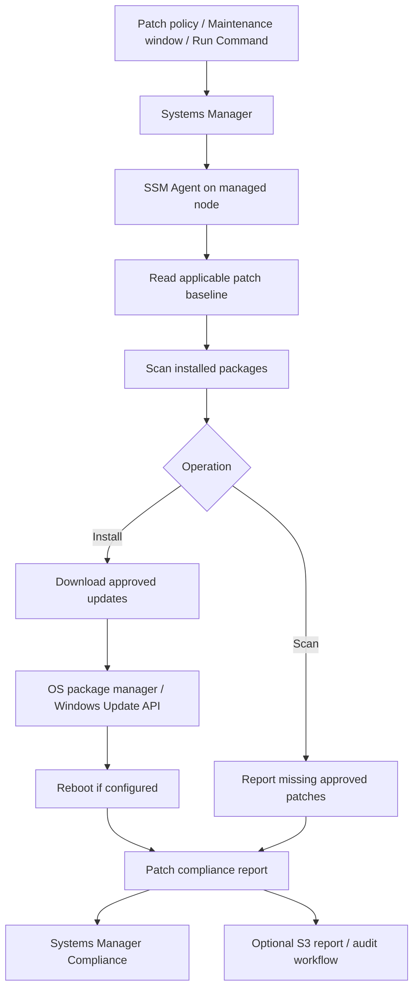

# Patch Manager và chiến lược cập nhật hệ điều hành

## 1. Bài toán cập nhật hệ điều hành trong môi trường AWS

Máy chủ cần được cập nhật thường xuyên để sửa lỗ hổng bảo mật, khắc phục lỗi, duy trì khả năng tương thích và đáp ứng yêu cầu kiểm toán. Tuy nhiên, cập nhật hệ điều hành trên một fleet lớn có thể làm gián đoạn ứng dụng nếu triển khai không đúng thời điểm hoặc không kiểm soát được quá trình khởi động lại.

Một chiến lược cập nhật phải trả lời được các câu hỏi:

- Những máy chủ nào đang được quản lý và đủ điều kiện nhận bản vá?
- Bản vá nào được phép cài đặt, bản vá nào cần trì hoãn hoặc chặn?
- Khi nào hệ thống quét bản vá và khi nào cài đặt?
- Có thể thử nghiệm trên một nhóm nhỏ trước khi triển khai toàn bộ không?
- Điều gì xảy ra khi cài đặt lỗi, máy chủ cần reboot hoặc ứng dụng không khỏe trở lại?
- Làm sao chứng minh máy chủ đã cập nhật đúng baseline tại một thời điểm cụ thể?

**AWS Systems Manager Patch Manager** hỗ trợ tự động quét, cài đặt và báo cáo trạng thái bản vá cho các managed nodes. Dịch vụ này có thể quản lý EC2, máy chủ tại chỗ và máy ảo được đăng ký vào Systems Manager, tùy hệ điều hành và phiên bản được hỗ trợ.

Patch Manager không tự quyết định chính sách cập nhật phù hợp cho doanh nghiệp. Tổ chức cần xác định baseline, lịch triển khai, phạm vi máy chủ, cửa sổ bảo trì, cách xử lý reboot và tiêu chí compliance. Phần chiến lược đó quyết định mức độ an toàn của hoạt động patching.

## 2. Mục tiêu học tập

Sau bài học, người học có thể:

1. Giải thích vai trò của Patch Manager, SSM Agent, managed node, patch baseline và patch policy.
2. Phân biệt thao tác Scan với Install và biết cách đọc kết quả patch compliance.
3. Xây dựng patch baseline dựa trên hệ điều hành, classification, severity, thời gian phê duyệt và danh sách allow/deny.
4. Chọn patch policy trong Quick Setup, maintenance window hoặc Run Command cho từng quy mô triển khai.
5. Thiết kế rollout theo từng nhóm máy chủ để giảm rủi ro gián đoạn.
6. Kiểm soát concurrency, error threshold, reboot và lifecycle hooks.
7. Chuẩn bị IAM, mạng, repository và quyền S3 cần thiết để patching hoạt động.
8. Dùng AWS CLI và Systems Manager Compliance để quét, cài đặt và xác minh bản vá.
9. Điều tra các lỗi thường gặp và xây dựng checklist vận hành định kỳ.

## 3. Mô hình tư duy: chính sách, lịch chạy và trạng thái thực tế

Một quy trình patching có thể chia thành năm lớp:

| Lớp | Thành phần | Câu hỏi cần trả lời |
|---|---|---|
| Phạm vi | Managed nodes, tags, OUs, accounts, Regions | Máy chủ nào thuộc chính sách? |
| Quy tắc | Patch baseline | Bản vá nào được phê duyệt hoặc từ chối? |
| Lịch | Patch policy, maintenance window, Run Command | Khi nào quét và khi nào cài đặt? |
| Thực thi | SSM Agent, tài liệu SSM, package manager | Máy chủ tải và cài bản vá bằng cách nào? |
| Xác minh | Systems Manager Compliance, S3 report, AWS Config | Máy chủ đang ở trạng thái nào và dữ liệu được ghi lúc nào? |

Patch baseline định nghĩa trạng thái mong muốn. Patch policy hoặc lịch bảo trì quyết định thời điểm chạy. SSM Agent thực thi lệnh trên máy chủ. Compliance report phản ánh kết quả của lần chạy gần nhất đã thành công.

Có thể nhớ bằng một câu: **baseline nói điều gì được phép cài, policy nói khi nào và ở đâu, compliance cho biết kết quả lần đánh giá gần nhất.**

## 4. Các thành phần chính của Patch Manager

### 4.1. Managed node

Managed node là máy chủ được Systems Manager nhận diện và có thể điều khiển. Một managed node có thể là:

- EC2 instance trong AWS account.
- Máy chủ tại chỗ hoặc máy ảo trong môi trường hybrid/multicloud đã được kích hoạt để Systems Manager quản lý.
- Thiết bị edge được hỗ trợ.
- Một số môi trường macOS chạy trên EC2, với giới hạn riêng về cập nhật hệ điều hành.

Máy chủ phải có SSM Agent, quyền IAM phù hợp và kết nối tới các endpoint cần thiết. Một EC2 instance đang chạy không đồng nghĩa nó đã sẵn sàng để Patch Manager quản lý.

### 4.2. SSM Agent

SSM Agent nhận lệnh từ Systems Manager, thực thi các bước trên máy chủ và gửi kết quả trở lại dịch vụ. Với tài liệu AWS-RunPatchBaseline, AWS yêu cầu SSM Agent phiên bản 2.0.834.0 trở lên; nên duy trì agent ở phiên bản mới được hỗ trợ để nhận sửa lỗi và tính năng mới.

Một số tài liệu SSM nâng cao có yêu cầu agent mới hơn. Ví dụ, AWS-RunPatchBaselineWithHooks yêu cầu SSM Agent 3.0.502 trở lên.

### 4.3. Patch baseline

Patch baseline là tập quy tắc xác định bản vá nào được chấp nhận, bản vá nào bị từ chối và cách đánh giá compliance. Baseline gắn với một loại hệ điều hành được hỗ trợ.

### 4.4. Patch policy

Patch policy là cấu hình trong Systems Manager Quick Setup để điều phối lịch quét, lịch cài đặt, baseline và nhóm node mục tiêu. AWS khuyến nghị dùng patch policy để quản lý patching, đặc biệt trong môi trường nhiều account và Region.

### 4.5. Maintenance window

Maintenance window là cửa sổ thời gian cho phép chạy các tác vụ có thể ảnh hưởng đến máy chủ, chẳng hạn cài bản vá, reboot, cập nhật agent hoặc chạy script kiểm tra.

### 4.6. Systems Manager Compliance

Systems Manager Compliance tổng hợp trạng thái bản vá và trạng thái của các State Manager association. Dữ liệu compliance là ảnh chụp tại thời điểm một hoạt động quét hoặc cài đặt thành công; nó không phải phép đo liên tục theo từng giây.

## 5. Kiến trúc hoạt động

Luồng patching tổng quát:



Các bước chính:

1. Người quản trị xác định node mục tiêu và baseline.
2. Patch policy, maintenance window hoặc Run Command khởi chạy tài liệu SSM.
3. SSM Agent nhận lệnh và lấy snapshot baseline phù hợp.
4. Node đối chiếu các bản vá đã cài với các bản vá được phê duyệt.
5. Nếu là Scan, node chỉ báo cáo bản vá còn thiếu.
6. Nếu là Install, node tải và cài các bản vá được phê duyệt, còn thiếu và áp dụng được.
7. Máy chủ reboot theo cấu hình của tài liệu SSM.
8. Patch Manager gửi dữ liệu compliance về Systems Manager.

Patch Manager dùng package manager và nguồn repository của hệ điều hành. Vì vậy, agent có thể liên lạc được với Systems Manager nhưng patching vẫn thất bại nếu máy chủ không truy cập được repository cập nhật.

## 6. Điều kiện tiên quyết trước khi patch

### 6.1. Hệ điều hành được hỗ trợ

Patch Manager hỗ trợ nhiều phiên bản Linux, Windows Server và một số phiên bản macOS. Danh sách hệ điều hành/phiên bản được hỗ trợ thay đổi theo thời gian. Hãy kiểm tra trang Patch Manager prerequisites trước khi chuẩn hóa fleet.

Một số điểm cần lưu ý:

- Patch Manager không hỗ trợ nâng cấp major version của hệ điều hành, ví dụ Windows Server 2016 lên 2019 hoặc RHEL 7 lên RHEL 8.
- Với macOS, Patch Manager không thực hiện nâng cấp phiên bản hệ điều hành. Có thể quản lý một số cập nhật ứng dụng thông qua Homebrew trên EC2 Mac được hỗ trợ.
- Trên Windows Server, cập nhật ứng dụng được giới hạn ở ứng dụng do Microsoft phát hành.
- Hệ điều hành đã hết vòng đời hỗ trợ (EOL) có thể không còn nhận bản vá từ nhà cung cấp. Nếu không có bản cập nhật mới, máy chủ EOL thậm chí có thể được báo Compliant theo baseline, dù nền tảng vẫn có rủi ro bảo mật.
- AWS không kiểm thử từng bản vá trước khi bản vá đó xuất hiện trong Patch Manager.

Vì vậy, hãy quản lý vòng đời hệ điều hành song song với patching. Patch Manager không thay thế kế hoạch nâng cấp nền tảng hoặc di chuyển workload khỏi hệ điều hành EOL.

### 6.2. SSM Agent và IAM

Đối với EC2, instance profile thường cần policy AmazonSSMManagedInstanceCore để cho phép Systems Manager quản lý node. Máy chủ hybrid dùng service role theo quy trình kích hoạt managed node.

Kiểm tra:

- SSM Agent đang chạy và đủ phiên bản.
- Instance profile/service role được gắn đúng.
- IAM policy cho phép các thao tác Systems Manager cần thiết.
- Người vận hành có quyền gọi Run Command, xem command invocation và đọc compliance.
- Nếu dùng Quick Setup patch policy với IAM profile tự quản lý, profile còn cần quyền đọc S3 bucket do Quick Setup tạo cho patch policy.
- Nếu dùng S3 VPC endpoint, endpoint policy phải cho phép truy cập bucket cấu hình patch policy.

Không cấp quyền administrator rộng chỉ để cài bản vá. Tách quyền quản trị policy, quyền thực thi trên node và quyền xem báo cáo theo trách nhiệm.

### 6.3. Kết nối mạng và repository

Máy chủ phải kết nối được:

- Các endpoint Systems Manager mà SSM Agent cần dùng trong Region.
- Các S3 bucket AWS quản lý cần thiết cho quá trình Systems Manager và patching.
- Repository của Linux distribution hoặc mirror nội bộ.
- Windows Update Catalog hoặc WSUS nếu Windows Server dùng WSUS.
- Nguồn cập nhật ứng dụng nếu baseline bao gồm cập nhật ứng dụng.

Với node trong private subnet, có thể dùng VPC endpoints cho Systems Manager và S3. Tuy nhiên, VPC endpoint tới Systems Manager không tự động cung cấp đường truy cập tới repository Linux hoặc WSUS. Cần thiết kế NAT, proxy, firewall rule hoặc mirror nội bộ phù hợp.

### 6.4. Công cụ và quyền cục bộ

Patch Manager dùng tài khoản Administrator trên Windows Server và root trên Linux để cài đặt bản vá. Một số nền tảng yêu cầu Python hoặc tiện ích hệ thống bổ sung. Ví dụ, các hệ điều hành dùng DNF có thể cần zstd, xz và unzip.

Kiểm tra prerequisite theo đúng distro/version. Không áp dụng máy móc cấu hình package manager của Amazon Linux 2 cho Amazon Linux 2023 hoặc của RHEL 7 cho RHEL 8 trở lên.

## 7. Thiết kế patch baseline

### 7.1. AWS managed baseline và custom baseline

Patch Manager cung cấp baseline dựng sẵn cho các hệ điều hành được hỗ trợ. Có thể dùng baseline dựng sẵn hoặc tạo custom baseline.

AWS mô tả các baseline dựng sẵn như cấu hình mẫu; chúng không phải tiêu chuẩn bảo mật tối ưu cho mọi tổ chức. AWS khuyến nghị tạo custom baseline để kiểm soát chính xác tiêu chí compliance của fleet.

Custom baseline giúp tổ chức quyết định:

- Sản phẩm/hệ điều hành nào thuộc phạm vi.
- Classification nào được duyệt, ví dụ Security, CriticalUpdates hoặc Bugfix.
- Severity nào được duyệt, ví dụ Critical và Important.
- Chờ bao nhiêu ngày sau khi bản vá phát hành mới tự động duyệt.
- Patch ID nào được duyệt rõ ràng hoặc bị từ chối.
- Có cho phép cập nhật non-security hay không.
- Compliance severity nào được gán khi bản vá được duyệt nhưng vẫn thiếu.

### 7.2. Approval rules

Approval rule thường kết hợp các điều kiện:

| Thuộc tính | Ý nghĩa | Ví dụ |
|---|---|---|
| Product | Phiên bản/dòng sản phẩm OS | Amazon Linux 2023, Windows Server |
| Classification | Nhóm bản vá | Security, Bugfix, CriticalUpdates |
| Severity | Mức độ nghiêm trọng do nguồn cập nhật cung cấp | Critical, Important |
| ApproveAfterDays | Số ngày chờ trước khi tự động phê duyệt | 7 ngày |
| ApproveUntilDate | Mốc ngày giới hạn bản vá được tự động phê duyệt | Chỉ duyệt bản vá phát hành trước ngày đã chọn |
| ComplianceLevel | Mức độ compliance nếu bản vá được duyệt nhưng còn thiếu | HIGH hoặc CRITICAL |

Không phải mọi hệ điều hành đều có metadata phát hành giống nhau. Ví dụ, Ubuntu Server không hỗ trợ auto-approval delay theo cách dựa trên ngày phát hành vì repository không cung cấp ngày phát hành đáng tin cậy cho cơ chế này. Một số baseline mặc định có thể phê duyệt security updates của Ubuntu ngay lập tức.

Đối với Linux, severity thường dựa trên thông tin nhà phát hành phần mềm. Patch Manager không tự tính severity từ CVSS hoặc NVD. Nếu tổ chức dùng CVSS làm tiêu chí ưu tiên, cần kết hợp nguồn đánh giá lỗ hổng riêng.

### 7.3. Approved và rejected patch lists

Ngoài approval rules, baseline có thể chứa:

- **Approved patches**: các patch ID được duyệt rõ ràng.
- **Rejected patches**: các patch ID không được phép cài.
- **Global filters**: giới hạn tập bản vá được xét trước khi áp dụng approval rules.
- **Rejected patches action**: cách xử lý package bị từ chối nhưng lại là dependency của package được duyệt trên nền tảng hỗ trợ.

Danh sách rõ ràng hữu ích khi cần chặn một bản vá gây lỗi tương thích hoặc buộc phải triển khai một bản vá cụ thể. Tuy nhiên, danh sách patch ID cần có owner và quy trình rà soát. Nếu để lại ngoại lệ quá lâu, baseline có thể không còn phản ánh chính sách bảo mật hiện tại.

### 7.4. Ví dụ custom baseline cho Linux

Ví dụ dưới đây minh họa một rule duyệt các security update có severity Critical hoặc Important sau 7 ngày. Đây là cấu hình mẫu để thảo luận; phải xác nhận classification/severity mà repository của distro cung cấp trước khi dùng production.

Tạo file approval-rules.json:

```json
{
  "PatchRules": [
    {
      "PatchFilterGroup": {
        "PatchFilters": [
          {
            "Key": "CLASSIFICATION",
            "Values": ["Security"]
          },
          {
            "Key": "SEVERITY",
            "Values": ["Critical", "Important"]
          }
        ]
      },
      "ApproveAfterDays": 7,
      "ComplianceLevel": "HIGH",
      "EnableNonSecurity": false
    }
  ]
}
```

Có thể tạo baseline bằng AWS CLI:

```bash
aws ssm create-patch-baseline \
  --name "Org-Linux-Security-Baseline" \
  --operating-system AMAZON_LINUX_2023 \
  --approval-rules file://approval-rules.json \
  --description "Approve critical and important security patches after a test delay" \
  --region ap-southeast-1
```

Lệnh trả về BaselineId. Trong môi trường dùng patch policy, chọn baseline này cho hệ điều hành tương ứng trong Quick Setup. Nếu đang dùng mô hình patch group cũ, baseline cần được liên kết với patch group.

### 7.5. Xác định độ trễ phê duyệt

Độ trễ phê duyệt là một phần của chiến lược rollout:

- Độ trễ ngắn giúp triển khai bản vá nhanh hơn nhưng giảm thời gian kiểm thử.
- Độ trễ dài giúp quan sát lỗi tương thích nhưng kéo dài thời gian máy chủ chưa được vá.
- Bản vá khẩn cấp có thể cần quy trình ngoại lệ với thời hạn và phê duyệt riêng.
- Không nên dùng cùng một delay cho mọi workload nếu mức độ rủi ro và khả năng phục hồi khác nhau.

Một mô hình tham khảo là kiểm thử bản vá trên nhóm canary trước, sau đó mới mở rộng đến nhóm production. Approval delay có thể tạo khoảng đệm, nhưng không thay thế kiểm thử thực tế.

## 8. Patch policy trong Systems Manager Quick Setup

### 8.1. Vì sao AWS khuyến nghị patch policy?

Patch policy là cách cấu hình patching được AWS khuyến nghị. Một policy có thể áp dụng cho toàn bộ Organization, một số Organizational Units (OU), các account/Region được chọn hoặc một cặp account-Region.

Các lợi ích chính:

- Cấu hình lịch và baseline trong một workflow.
- Hỗ trợ nhiều account và Region qua AWS Organizations.
- Tách lịch Scan và Install.
- Chọn AWS managed baseline hoặc custom baseline cho từng hệ điều hành.
- Target managed nodes theo tag hoặc phạm vi tổ chức.
- Kiểm soát concurrency và error threshold.
- Lưu log patching vào S3 nếu cần.

Trong cấu hình cho toàn Organization, policy được thiết lập từ management account. AWS hiện không cho tạo organization patch policy từ delegated administrator hoặc member account. Hãy kiểm tra Region hỗ trợ Quick Setup trước khi thiết kế triển khai.

Một patch policy có thể áp dụng trên nhiều account và Region, nhưng compliance vẫn được báo cáo riêng cho từng cặp account-Region. Do đó, báo cáo tập trung cần tổng hợp kết quả từ từng nguồn thay vì coi toàn Organization là một bản ghi compliance duy nhất.

### 8.2. Lịch quét và cài đặt

Quick Setup cho phép đặt lịch Scan và Install độc lập.

Ví dụ:

- Scan hằng ngày để phát hiện patch còn thiếu.
- Install hằng tuần trong maintenance window của ứng dụng.
- Với bản vá khẩn cấp, dùng lịch triển khai riêng sau khi đã đánh giá rủi ro.
- Dùng CRON hoặc Rate expression để tùy chỉnh lịch.

Tại thời điểm tài liệu được đối chiếu, cấu hình khuyến nghị mặc định của patch policy quét hằng ngày lúc 01:00 UTC và cài bản vá hằng tuần lúc 02:00 UTC Chủ nhật. Đây là giá trị mặc định của wizard, không phải lịch phù hợp cho mọi tổ chức. Hãy xác định múi giờ vận hành và cửa sổ bảo trì của workload trước khi chọn lịch.

Một tùy chọn cho phép chờ đến lần CRON đầu tiên trước khi quét node mới được target. Đối với cài đặt, mặc định policy chờ lịch cài đặt đầu tiên. Điều này giúp tránh việc một node vừa được gắn tag đã lập tức nhận bản vá ngoài dự kiến.

### 8.3. Target account, Region và node

Patch policy có thể target:

- Entire organization.
- Một số OU và Region được chọn.
- Current account với một hoặc nhiều Region.
- All managed nodes trong phạm vi.
- Node theo tag.
- Resource Group trong cấu hình single-account được hỗ trợ.
- Danh sách node thủ công trong giới hạn của giao diện.

Dùng tag có quy ước rõ ràng, ví dụ:

| Tag | Giá trị | Ý nghĩa |
|---|---|---|
| Environment | dev, test, staging, prod | Môi trường |
| PatchRing | canary, wave-1, wave-2 | Đợt rollout |
| PatchWindow | sun-0200-utc | Cửa sổ bảo trì |
| Application | orders-api | Nhóm ứng dụng |
| Owner | platform-team | Nhóm chịu trách nhiệm |

Tránh dùng tag không nhất quán hoặc thay đổi tùy tiện. Một tag target sai có thể khiến node production nhận bản vá trong lịch của nhóm thử nghiệm.

### 8.4. Rate control

Quick Setup cho phép thiết lập:

- **Concurrency**: số lượng hoặc tỷ lệ managed nodes chạy đồng thời.
- **Error threshold**: số lượng hoặc tỷ lệ lỗi tối đa trước khi operation bị đánh dấu thất bại.

Ví dụ, với 100 node, concurrency 10% cho phép tối đa khoảng 10 node xử lý cùng lúc. Nếu ngưỡng lỗi đặt quá thấp, một lỗi mạng thoáng qua có thể dừng rollout; nếu đặt quá cao, lỗi hàng loạt có thể lan rộng trước khi dừng.

Hãy chọn giá trị theo năng lực chịu lỗi, mức dự phòng và khả năng phục hồi của ứng dụng.

### 8.5. S3 log và quyền IAM của patch policy

Quick Setup tạo S3 bucket riêng chứa baseline_overrides.json để lưu thông tin baseline được policy sử dụng. Nếu dùng instance profile/service role tự quản lý thay vì để Quick Setup thêm policy, cần bảo đảm role có:

- AmazonSSMManagedInstanceCore hoặc quyền Systems Manager tương đương theo kiến trúc.
- Quyền s3:GetObject tới bucket patch policy cụ thể.
- Tag IAM theo định dạng QSConfigId-<configuration-id> với value là configuration ID theo hướng dẫn Quick Setup.
- VPC endpoint policy cho S3 cho phép truy cập bucket này nếu dùng S3 endpoint.

Khi ghi patching output vào S3 bucket do tổ chức chọn, các account target cần quyền ghi, còn management account cần quyền đọc để xem báo cáo. Phải cấu hình bucket policy cross-account phù hợp.

Nếu cập nhật custom patch baseline đang được Quick Setup sử dụng, thay đổi được đồng bộ với cấu hình patch policy theo chu kỳ khoảng một giờ. Nếu xóa baseline đang được tham chiếu, các operation patching tiếp theo có thể thất bại cho đến khi policy được chỉnh sửa để chọn baseline còn tồn tại.

## 9. Patch groups: cơ chế tagging cũ

Patch group là cơ chế cũ để liên kết managed nodes với một patch baseline. Node được gắn tag Patch Group hoặc PatchGroup; giá trị tag được đăng ký với baseline.

Ví dụ:

```bash
aws ec2 create-tags \
  --resources i-0123456789abcdef0 \
  --tags Key=PatchGroup,Value=Staging

aws ssm register-patch-baseline-for-patch-group \
  --baseline-id pb-0123456789abcdef0 \
  --patch-group Staging \
  --region ap-southeast-1
```

Lưu ý:

- Patch group không được dùng trong hoạt động patching dựa trên patch policy.
- Nếu bật Allow tags in instance metadata trên EC2, tag key không được chứa khoảng trắng; dùng PatchGroup.
- Một số account-Region đã dùng patch groups trước khi patch policy ra mắt vẫn có thể tiếp tục dùng chức năng này.
- Với triển khai mới, nên ưu tiên patch policy trong Quick Setup theo khuyến nghị AWS.

Không nên trộn patch group và patch policy mà không xác định rõ cơ chế chọn baseline của từng operation.

## 10. Scan và Install với AWS-RunPatchBaseline

### 10.1. Scan

AWS-RunPatchBaseline với Operation=Scan:

- Đối chiếu các bản vá đã cài với baseline hiện hành.
- Xác định bản vá được duyệt và áp dụng nhưng còn thiếu.
- Gửi patch compliance về Systems Manager.
- Không cài bản vá và không yêu cầu reboot node.

Scan là bước phù hợp để kiểm tra phạm vi, đánh giá rủi ro và lập kế hoạch trước khi cài đặt.

### 10.2. Install

AWS-RunPatchBaseline với Operation=Install:

- Tìm bản vá được duyệt, áp dụng và còn thiếu.
- Tải bản vá từ repository hoặc nguồn cập nhật phù hợp.
- Cài đặt thông qua package manager hoặc Windows Update API.
- Gửi kết quả compliance.
- Reboot node theo RebootOption.

Patch Manager không tự cài tất cả mọi bản cập nhật đang có. Baseline quyết định bản vá nào được phép cài.

### 10.3. Snapshot ID và tính nhất quán

Khi một lệnh patching áp dụng cho nhiều node, cần đảm bảo các node dùng cùng một snapshot baseline để tránh trường hợp node này lấy tập bản vá khác node kia do baseline thay đổi giữa chừng.

- Khi chạy AWS-RunPatchBaseline trong maintenance window, để Systems Manager tự tạo Snapshot ID.
- Khi chạy trực tiếp ngoài maintenance window trên nhiều node, AWS khuyến nghị tạo một GUID Snapshot ID chung cho cùng operation/baseline.
- Nếu mỗi node nhận một Snapshot ID riêng, các node có thể được đánh giá trên những snapshot baseline khác nhau.

Điểm này đặc biệt quan trọng trong rollout theo wave, khi muốn so sánh kết quả giữa các node cùng một đợt.

### 10.4. Tài liệu SSM nên dùng

Các tài liệu SSM được AWS khuyến nghị cho patching gồm:

- AWS-RunPatchBaseline: tài liệu chính để Scan và Install trên Linux, macOS và Windows Server được hỗ trợ.
- AWS-RunPatchBaselineAssociation: phục vụ một số workflow State Manager association/Quick Setup.
- AWS-RunPatchBaselineWithHooks: hỗ trợ lifecycle hooks trên Linux và Windows Server.
- AWS-ConfigureWindowsUpdate và AWS-InstallWindowsUpdates: các workflow Windows đơn giản khi không cần patch compliance theo baseline.

Tài liệu cũ AWS-ApplyPatchBaseline chỉ hỗ trợ Windows Server và không còn được khuyến nghị. Với workflow mới, hãy ưu tiên tài liệu thay thế được AWS duy trì.

## 11. Khác biệt theo hệ điều hành

### 11.1. Linux

Patch Manager sử dụng package manager phù hợp với distro/version, thường gồm:

| Hệ điều hành/dòng phiên bản | Package manager thường dùng |
|---|---|
| Amazon Linux 2, RHEL 7, Oracle Linux 7 | YUM |
| Amazon Linux 2023 | DNF |
| RHEL 8 trở lên, Oracle Linux 8 trở lên, Rocky Linux, AlmaLinux | DNF |
| Debian, Ubuntu Server | APT |
| SUSE Linux Enterprise Server | Zypper |

Repository cần được cấu hình và có thể truy cập. Một số distro cần Python hoặc tiện ích nén/giải nén. Nếu package manager bị khóa bởi tiến trình cập nhật khác, Patch Manager có thể thất bại vì không thể cài package.

Với Amazon Linux 2023, có thể dùng versioned repository để triển khai deterministic upgrades. Cần xác định cách tổ chức muốn kiểm soát phiên bản repository thay vì để mỗi node cập nhật theo nguồn thay đổi ngoài quy trình.

### 11.2. Windows Server

Trên Windows Server, Patch Manager lấy danh sách bản vá được baseline phê duyệt và chuyển cho Windows Update API xử lý. Node cần truy cập Windows Update Catalog hoặc WSUS theo cấu hình.

Một số lưu ý:

- Có thể dùng Microsoft KB ID để phê duyệt/từ chối bản vá cụ thể.
- Windows Server application patching trong Patch Manager giới hạn ở ứng dụng Microsoft.
- Windows Server có thể cần nhiều lần reboot để hoàn tất cập nhật.
- WSUS phải đồng bộ và có chính sách phù hợp với baseline.
- Nếu node không truy cập được WSUS hoặc Windows Update Catalog, operation có thể thất bại dù SSM Agent vẫn online.

### 11.3. macOS

Patch Manager hỗ trợ macOS trên Amazon EC2 Mac trong các Region và phiên bản được liệt kê trong prerequisites. Với Homebrew, Patch Manager có thể quản lý một số ứng dụng/package.

Patch Manager không hỗ trợ cập nhật/nâng cấp phiên bản hệ điều hành macOS, ví dụ từ 13.1 lên 13.2. Dùng cơ chế quản trị cập nhật hệ điều hành của Apple cho công việc đó.

AWS-RunPatchBaselineWithHooks cũng không hỗ trợ macOS.

## 12. Chiến lược rollout theo từng nhóm

Không nên cài bản vá đồng loạt lên toàn bộ production fleet nếu workload có yêu cầu sẵn sàng cao. Hãy chia máy chủ thành các nhóm có mức độ ảnh hưởng khác nhau.

Một mô hình rollout tham khảo:

| Ring | Phạm vi | Mục tiêu | Điều kiện chuyển bước |
|---|---|---|---|
| Ring 0 | Dev hoặc máy thử nghiệm | Kiểm tra package và tương thích cơ bản | Cài đặt và smoke test thành công |
| Ring 1 | Staging/canary | Kiểm tra gần giống production | Application health, log và latency ổn định |
| Ring 2 | Một phần production | Phát hiện lỗi dưới tải thật | Không vượt error threshold, có đủ capacity |
| Ring 3 | Phần production còn lại | Hoàn tất rollout | Compliance và service health đạt tiêu chí |

### 12.1. Chuẩn bị trước rollout

Trước khi cài đặt:

1. Kiểm kê hệ điều hành, version, package manager và repository.
2. Phân loại node theo application, environment, criticality và owner.
3. Xác định patch SLA theo mức độ rủi ro.
4. Tạo custom baseline và kiểm tra danh sách patch được duyệt/từ chối.
5. Chạy Scan để biết số node và số bản vá bị thiếu.
6. Xác định maintenance window và yêu cầu reboot.
7. Kiểm tra backup, snapshot, AMI hoặc phương án khôi phục phù hợp.
8. Chuẩn bị smoke test và health check sau patch.

### 12.2. Triển khai canary

Bắt đầu bằng một số node nhỏ có thể chịu được gián đoạn. Với ứng dụng nhiều instance sau load balancer:

- Drain node khỏi target group hoặc ngừng nhận traffic.
- Xác nhận capacity còn lại đủ phục vụ tải.
- Cài bản vá.
- Reboot theo kế hoạch.
- Kiểm tra service, application health và dependency.
- Đưa node trở lại phục vụ khi đạt tiêu chí.

Có thể dùng lifecycle hook hoặc Automation workflow để điều phối các bước này. Nếu không có hook, hãy thiết kế task riêng trong maintenance window và kiểm soát thứ tự thực hiện.

### 12.3. Dừng rollout khi nào?

Dừng hoặc hoãn wave tiếp theo khi:

- Tỷ lệ command failure vượt error threshold.
- Node không khởi động lại hoặc SSM Agent không online.
- Application health check thất bại.
- Latency, error rate hoặc queue backlog tăng bất thường.
- Bản vá gây lỗi tương thích hoặc package dependency.
- Backup/restore hoặc phương án rollback chưa sẵn sàng.

Không tự động tiếp tục wave tiếp theo chỉ vì lệnh cài đặt đã trả về trạng thái hoàn thành. Cần xác minh workload sau reboot.

## 13. Maintenance Windows và các phương thức điều phối

### 13.1. Maintenance window

Maintenance window cho phép lên lịch task trong khoảng thời gian đã định. Với patching, task thường chạy Run Command và gọi AWS-RunPatchBaseline.

Một maintenance window có thể:

- Xác định schedule theo cron/rate.
- Target node bằng tag hoặc resource group phù hợp.
- Chạy Scan hoặc Install.
- Giới hạn concurrency và error threshold.
- Chạy Automation, Lambda hoặc Step Functions để phối hợp các bước bổ sung.

Maintenance window hữu ích khi cần điều phối trong một account-Region hoặc một quy trình chuyên biệt. Với nhiều account và Region, patch policy trong Quick Setup cung cấp cách cấu hình tập trung hơn.

### 13.2. Patch policy, maintenance window và Patch now

| Phương thức | Trường hợp phù hợp | Điểm cần nhớ |
|---|---|---|
| Patch policy trong Quick Setup | Quản lý tập trung, nhiều account/Region, lịch Scan và Install riêng | Phương thức AWS khuyến nghị |
| Maintenance window | Workflow theo cửa sổ bảo trì hoặc cần phối hợp task khác | Cần cấu hình theo phạm vi account-Region |
| Run Command | Quét/cài đặt một lần hoặc xử lý node cụ thể | Cần quản lý target, concurrency và snapshot |
| Patch now | Xử lý on-demand trong một account-Region | Không thay thế lịch patch định kỳ |

Dùng một phương thức chính để quản lý compliance cho một nhóm node. Nếu nhiều phương thức Scan dùng baseline khác nhau cùng chạy trên một node, kết quả compliance mới nhất có thể ghi đè dữ liệu từ lần scan trước.

## 14. Reboot và lifecycle hooks

### 14.1. RebootOption

AWS-RunPatchBaseline hỗ trợ hai giá trị:

| Giá trị | Hành vi |
|---|---|
| RebootIfNeeded | Giá trị mặc định. Nếu Install áp dụng một hoặc nhiều bản vá, node được reboot để bảo đảm cập nhật hoạt động. |
| NoReboot | Không reboot node sau khi cài, cho phép tổ chức tự kiểm soát thời điểm reboot. |

Một điểm quan trọng: RebootIfNeeded không có nghĩa Patch Manager phân tích từng package để xác định nó có bắt buộc reboot hay không. Nếu operation cài một hoặc nhiều bản vá, node có thể reboot ngay cả khi package không yêu cầu reboot.

Nếu dùng NoReboot, bản vá có thể ở trạng thái INSTALLED_PENDING_REBOOT; node được báo Non-Compliant cho đến khi reboot và chạy Scan để xác nhận lại. NoReboot cũng không ngăn một package tự restart service phụ thuộc trong quá trình cập nhật.

Đối với hệ thống cluster hoặc workload có quy trình reboot riêng, phải kiểm tra tài liệu dịch vụ trước khi dùng Patch Manager. AWS không khuyến nghị dùng Patch Manager để patch các cluster instance của Amazon EMR; đặc biệt không chọn RebootIfNeeded.

### 14.2. Lifecycle hooks với AWS-RunPatchBaselineWithHooks

AWS-RunPatchBaselineWithHooks cho phép gọi SSM document tại ba thời điểm:

1. PreInstallHookDocName: trước khi cài đặt.
2. PostInstallHookDocName: sau khi cài đặt với NoReboot, trước bước reboot.
3. OnExitHookDocName: sau khi hoàn tất bước reboot hoặc kết thúc operation.

Ứng dụng có thể dùng hook để:

- Drain node khỏi load balancer.
- Dừng service hoặc đưa workload vào maintenance mode.
- Chụp trạng thái, ghi nhận phiên bản package hoặc chạy script kiểm tra.
- Khởi động lại service và chạy health check sau reboot.
- Đưa node trở lại target group khi service hoạt động ổn định.

Tài liệu này yêu cầu SSM Agent 3.0.502 trở lên, chỉ hỗ trợ Linux và Windows Server, không hỗ trợ macOS và không hỗ trợ InstallOverrideList.

Ví dụ tham số:

```json
{
  "Operation": ["Install"],
  "RebootOption": ["RebootIfNeeded"],
  "PreInstallHookDocName": ["DrainFromLoadBalancer"],
  "PostInstallHookDocName": ["ValidatePackageState"],
  "OnExitHookDocName": ["RestoreTrafficAndHealthCheck"]
}
```

Tên hook document trong ví dụ là SSM document do tổ chức tạo. Cần kiểm tra quyền thực thi, timeout và cách xử lý khi một hook thất bại.

## 15. Đọc patch compliance đúng cách

### 15.1. Các trạng thái thường gặp

| Patch state | Ý nghĩa | Compliance thường gặp |
|---|---|---|
| INSTALLED | Bản vá được baseline duyệt và đã cài | Compliant |
| INSTALLED_OTHER | Package đã cài nhưng không nằm trong baseline hoặc được cài như dependency/qua override theo quy tắc nền tảng | Thường Compliant |
| MISSING | Bản vá được duyệt và áp dụng nhưng chưa cài | Non-Compliant |
| FAILED | Bản vá được duyệt nhưng cài đặt thất bại | Non-Compliant |
| INSTALLED_PENDING_REBOOT | Đã cài nhưng node chưa reboot kể từ lần cài | Non-Compliant |
| INSTALLED_REJECTED | Bản vá đang cài nhưng hiện nằm trong danh sách bị từ chối | Non-Compliant |
| NOT_APPLICABLE | Bản vá không áp dụng cho cấu hình/tính năng trên Windows Server hoặc đã được thay thế | Not applicable |

Chi tiết trạng thái có khác biệt giữa Windows Server, Debian/Ubuntu và các hệ điều hành khác. Hãy xem tài liệu Patch compliance state values khi diễn giải một kết quả cụ thể.

### 15.2. Compliance là ảnh chụp tại thời điểm

Patch compliance report phản ánh lần patching operation thành công gần nhất. Báo cáo có capture time để biết dữ liệu được tính vào lúc nào.

Nếu một node đã Scan tuần trước nhưng không được Scan lại sau khi baseline thay đổi, trạng thái compliance có thể không phản ánh baseline mới. Nếu nhiều phương thức scan chạy trên cùng node, dữ liệu compliance trước đó có thể bị ghi đè bởi kết quả scan mới nhất.

Không nên kết luận một node compliant chỉ từ báo cáo cũ. Cần kiểm tra capture time, baseline ID được dùng, operation type và lịch sử command execution.

### 15.3. Compliant không đồng nghĩa an toàn tuyệt đối

Compliant chỉ có nghĩa các bản vá được baseline phê duyệt và hiện có đã được cài theo kết quả đánh giá. Trạng thái này không chứng minh:

- Hệ điều hành còn trong vòng đời hỗ trợ.
- Không còn lỗ hổng chưa có bản vá.
- Ứng dụng không có lỗ hổng dependency.
- Cấu hình IAM, network và host firewall an toàn.
- Không có malware hoặc hành vi xâm nhập.
- Không có bản vá bị loại khỏi baseline do ngoại lệ.

Cần kết hợp patch compliance với vulnerability management, cấu hình bảo mật, EDR, logging và kiểm soát thay đổi.

### 15.4. Tích hợp AWS Config để lưu lịch sử compliance

Systems Manager Compliance hiển thị trạng thái hiện tại. Nếu cần xem lịch sử và change tracking của patch compliance, có thể bật AWS Config recording cho resource type:

- SSM:PatchCompliance
- SSM:AssociationCompliance

AWS Config giúp theo dõi các mốc thay đổi của compliance resource theo thời gian. Đây là cấu hình bổ sung, cần đánh giá recording scope và chi phí AWS Config.

## 16. Bảo mật và quản trị quyền

### 16.1. Tách vai trò

Có thể chia trách nhiệm thành:

- **Patch policy administrator**: tạo baseline, policy và lịch.
- **Node administrator**: duy trì SSM Agent, instance profile, repository và cấu hình OS.
- **Operations team**: theo dõi maintenance window, command status, reboot và health check.
- **Security/compliance team**: xem compliance report, phê duyệt ngoại lệ và theo dõi SLA.
- **Application owner**: xác nhận tương thích và smoke test.

Không cấp quyền sửa baseline, thay đổi IAM instance profile và xóa log cho cùng một role vận hành nếu không có nhu cầu rõ ràng.

### 16.2. Bảo vệ nguồn cập nhật

- Dùng repository chính thức hoặc mirror nội bộ được quản lý.
- Bảo đảm repository có metadata và chữ ký package phù hợp với distro.
- Không thêm repository không tin cậy chỉ để khắc phục lỗi tải package.
- Quản lý thay đổi repository bằng quy trình version control/configuration management.
- Theo dõi việc bật/tắt repository và thay đổi source list.
- Xác minh quyền truy cập mạng tới nguồn cập nhật trong private subnet.

### 16.3. Bảo vệ log và bằng chứng

Có thể lưu output của patch operation vào S3 để phục vụ điều tra. Bucket cần:

- Block Public Access.
- Bucket policy giới hạn principal được ghi/đọc.
- Encryption phù hợp.
- Lifecycle/retention theo yêu cầu.
- Quyền cross-account chính xác nếu nhiều account gửi log.
- CloudTrail theo dõi thao tác quản trị bucket và IAM.

Không ghi secret hoặc token vào script/hook output. Hạn chế log chứa thông tin nhạy cảm của hệ điều hành hoặc ứng dụng.

## 17. AWS CLI: quét, cài đặt và kiểm tra kết quả

### 17.1. Kiểm tra managed node

Liệt kê managed nodes trong Region:

```bash
aws ssm describe-instance-information \
  --region ap-southeast-1 \
  --query "InstanceInformationList[].{Id:InstanceId,Platform:PlatformName,Version:PlatformVersion,Ping:PingStatus,Agent:AgentVersion}"
```

Chỉ gửi lệnh patch đến node có trạng thái quản lý phù hợp và agent online. Nếu node không xuất hiện, kiểm tra IAM role, SSM Agent, Region và kết nối mạng trước.

### 17.2. Scan một nhóm staging

Ví dụ quét tất cả EC2 có tag Environment=Staging:

```bash
aws ssm send-command \
  --document-name "AWS-RunPatchBaseline" \
  --targets "Key=tag:Environment,Values=Staging" \
  --parameters '{"Operation":["Scan"]}' \
  --max-concurrency "10%" \
  --max-errors "1" \
  --region ap-southeast-1
```

Lệnh trả về CommandId. Có thể dùng command ID để xem trạng thái và output của từng node. Scan không cài patch và không reboot.

### 17.3. Install trong cửa sổ bảo trì

Ví dụ cài các bản vá được baseline duyệt trên nhóm staging:

```bash
aws ssm send-command \
  --document-name "AWS-RunPatchBaseline" \
  --targets "Key=tag:Environment,Values=Staging" \
  --parameters '{"Operation":["Install"],"RebootOption":["NoReboot"]}' \
  --max-concurrency "10%" \
  --max-errors "1" \
  --region ap-southeast-1
```

Ví dụ này chọn NoReboot để minh họa việc kiểm soát thời điểm restart. Sau khi cài, cần thực hiện reboot theo lịch đã phê duyệt, sau đó chạy Scan để xác nhận trạng thái compliance.

Nếu dùng RebootIfNeeded, node có thể reboot ngay trong operation. Hãy bảo đảm ứng dụng đã được drain và còn đủ capacity.

### 17.4. Kiểm tra command invocation

```bash
aws ssm list-command-invocations \
  --command-id "00000000-0000-0000-0000-000000000000" \
  --details \
  --region ap-southeast-1
```

Thay command ID bằng giá trị trả về từ send-command. Xem status, response code, output và lỗi của từng node.

### 17.5. Xem patch state của một instance

```bash
aws ssm describe-instance-patch-states \
  --instance-ids i-0123456789abcdef0 \
  --region ap-southeast-1

aws ssm describe-instance-patches \
  --instance-id i-0123456789abcdef0 \
  --filters Key=State,Values=Missing \
  --region ap-southeast-1
```

Lệnh thứ nhất trả về trạng thái tổng hợp của node. Lệnh thứ hai giúp xem các patch thuộc trạng thái Missing. Có thể thay filter để xem các trạng thái khác theo tài liệu AWS CLI.

### 17.6. Xuất compliance report ra S3

Trong Patch Manager console, chọn Compliance reporting và dùng Export to S3. Có thể tạo báo cáo theo lịch hoặc theo yêu cầu.

Báo cáo cho một node có thể chứa chi tiết patch ID/KB, state, severity, classification và capture time. Báo cáo tổng hợp cho toàn fleet chủ yếu cung cấp thông tin summary; nếu cần danh sách patch chi tiết, hãy xuất báo cáo cho từng node hoặc dùng API phù hợp.

## 18. Giám sát và kiểm toán hoạt động patching

Một quy trình vận hành nên theo dõi ít nhất:

- Số managed nodes được target và số node online.
- Số node đã Scan, số node có patch missing và số node chưa có compliance mới.
- Command success/failure theo account, Region, OS và application.
- Số node đang pending reboot.
- Thời gian từ khi patch được phát hành đến khi được cài.
- Số ngoại lệ và thời hạn xử lý.
- Số node EOL hoặc không còn nhận được cập nhật từ vendor.

Các nguồn dữ liệu:

- Systems Manager Patch Manager và Compliance: trạng thái patch.
- Run Command/maintenance window execution: tiến trình và output.
- Amazon S3: log hoặc compliance report được xuất.
- AWS CloudTrail: ai tạo/sửa policy, baseline, maintenance window hoặc gửi command.
- Amazon CloudWatch: log/metric ứng dụng để xác nhận tác động vận hành.
- AWS Config: lịch sử patch compliance nếu đã bật các resource type liên quan.

Không chỉ giám sát số node đã hoàn tất lệnh. Cần kết hợp compliance và health check của ứng dụng để xác nhận kết quả.

## 19. Chi phí và tối ưu

Chi phí patching phụ thuộc vào quy mô fleet, dịch vụ tích hợp, thời gian chạy và cách lưu bằng chứng. Các yếu tố cần đánh giá gồm:

- Chi phí EC2 trong thời gian bảo trì, bao gồm node dự phòng nếu cần.
- Dung lượng S3 lưu patch logs và compliance reports.
- Data transfer khi node tải package từ Internet, mirror hoặc Region khác.
- KMS request và chi phí mã hóa/lưu trữ nếu dùng.
- Snapshot/AMI/backup trước patch và thời gian lưu.
- Mức giá Systems Manager/managed node tier hoặc tính năng nâng cao nếu workload sử dụng.
- Chi phí vận hành do reboot, downtime hoặc giảm capacity.

Tối ưu bằng cách:

1. Dùng baseline theo OS và nhu cầu thực tế.
2. Tránh scan trùng lặp bằng nhiều policy/association không cần thiết.
3. Đặt lịch phù hợp với tần suất cập nhật của vendor.
4. Giới hạn log retention theo yêu cầu kiểm toán.
5. Dùng mirror nội bộ khi phù hợp để giảm tải repository và chi phí truyền dữ liệu.
6. Dùng concurrency vừa đủ để hoàn tất trong maintenance window mà vẫn giữ capacity.
7. Rà soát node EOL, node offline và ngoại lệ patching định kỳ.

Không giảm chi phí bằng cách loại bỏ bản vá bắt buộc khỏi baseline hoặc tắt compliance mà không có đánh giá rủi ro và phê duyệt.

## 20. Khắc phục sự cố thường gặp

### 20.1. Node không xuất hiện trong Patch Manager

Kiểm tra:

- SSM Agent đã cài và đang chạy chưa?
- Node có nằm trong đúng account và Region không?
- IAM instance profile/service role có quyền Systems Manager chưa?
- Node có kết nối được endpoint Systems Manager và S3 không?
- Managed node đã đăng ký thành công chưa?
- Hệ điều hành/phiên bản có được Patch Manager hỗ trợ không?

### 20.2. Command thất bại do không truy cập repository

Kiểm tra:

- Linux repository URL và DNS có truy cập được không?
- Private subnet có NAT/proxy hoặc route đến mirror không?
- Windows node có truy cập WSUS hoặc Windows Update Catalog không?
- Firewall có chặn endpoint cập nhật không?
- Metadata repository có hợp lệ và đồng bộ không?
- Package manager có bị lock bởi unattended update hoặc tiến trình khác không?

### 20.3. Baseline không chọn bản vá mong muốn

Kiểm tra:

- Operating system/product filter có đúng không?
- Classification và severity có trùng metadata của vendor không?
- Auto-approval delay/cutoff date có làm bản vá chưa đủ điều kiện không?
- Có rejected patch hoặc global filter loại bản vá không?
- Ubuntu có dùng cơ chế auto-approval delay không được hỗ trợ không?
- Repository có phát metadata cho package không?

Đừng giả định severity của vendor tương đương CVSS. Hãy kiểm tra metadata thực tế.

### 20.4. Node ở trạng thái INSTALLED_PENDING_REBOOT

Kiểm tra:

- Operation trước đó có dùng NoReboot không?
- Có bản vá được cài thủ công hoặc bởi công cụ khác kể từ lần reboot gần nhất không?
- Maintenance window đã có task reboot chưa?
- Sau reboot, đã chạy Scan lại chưa?

Không xóa hoặc chỉnh sửa file tracking patch trên node. Nếu file tracking bị xóa hoặc hỏng, dữ liệu compliance có thể không chính xác; cần làm theo hướng dẫn AWS để phục hồi trạng thái, thường gồm reboot và chạy Scan.

### 20.5. Scan mới ghi đè compliance cũ

Kiểm tra xem có nhiều patch scan method đang chạy trên cùng node không, ví dụ Quick Setup Host Management, patch policy, State Manager association và maintenance window. Mỗi lần scan thành công có thể cập nhật dữ liệu compliance gần nhất. Chuẩn hóa một phương thức chính cho từng nhóm node và lưu báo cáo lịch sử ra S3/AWS Config nếu cần.

### 20.6. Operation báo lỗi sau reboot ngoài dự kiến

Một số cập nhật có thể kích hoạt reboot ở cấp hệ điều hành trong lúc document đang chạy. SSM Agent có thể không tiếp tục được execution state và báo thất bại dù package đã được cài. Chạy Scan sau khi node online để xác nhận patch state thay vì kết luận chỉ dựa trên command status.

## 21. Bài thực hành: xây dựng quy trình patch cho nhóm staging

### 21.1. Mục tiêu

Tạo quy trình kiểm soát cập nhật cho một nhóm EC2 staging chạy Linux:

- Xác nhận managed node và SSM Agent.
- Tạo baseline phù hợp.
- Scan trước khi cài.
- Install trong maintenance window.
- Kiểm soát reboot.
- Đọc compliance và ghi nhận kết quả.

### 21.2. Điều kiện chuẩn bị

- Một AWS account thử nghiệm.
- Một EC2 instance không phục vụ production.
- Hệ điều hành nằm trong danh sách Patch Manager hỗ trợ.
- Instance profile có quyền Systems Manager phù hợp.
- Node online trong Fleet Manager.
- Repository cập nhật có thể truy cập.
- Tag Environment=Staging.

Không thực hiện lab trên fleet production hoặc thay đổi repository của hệ thống đang chạy nghiệp vụ.

### 21.3. Các bước thực hành

1. Mở Systems Manager Fleet Manager và xác nhận instance xuất hiện ở trạng thái online.
2. Kiểm tra phiên bản SSM Agent.
3. Mở Patch Manager và xác nhận baseline áp dụng cho OS.
4. Chạy Scan cho tag Environment=Staging.
5. Ghi lại số lượng patch missing và patch severity.
6. Xem command invocation để xác nhận node đã hoàn thành Scan.
7. Tạo hoặc chọn maintenance window thử nghiệm.
8. Đăng ký task Run Command dùng AWS-RunPatchBaseline với Operation Install.
9. Chọn RebootOption phù hợp với lab.
10. Chờ operation hoàn tất; nếu dùng NoReboot, reboot node theo lịch đã chọn.
11. Chạy Scan lần nữa.
12. Kiểm tra describe-instance-patch-states và báo cáo compliance.
13. Lưu lại thời điểm scan, baseline, command ID và kết quả.

### 21.4. Tiêu chí hoàn thành

- Node được Systems Manager nhận diện và online.
- Scan xác định được patch missing.
- Install chỉ áp dụng patch được baseline duyệt.
- Reboot diễn ra theo cấu hình.
- Scan sau cùng cập nhật compliance.
- Người học giải thích được patch nào đã cài, patch nào còn thiếu và vì sao.

## 22. Những nhầm lẫn thường gặp

| Nhầm lẫn | Cách hiểu đúng |
|---|---|
| Patch Manager tự cài mọi bản cập nhật | Baseline quyết định bản vá nào được phê duyệt |
| Scan đồng nghĩa với Install | Scan chỉ đánh giá và báo cáo, không cài |
| Compliant nghĩa là máy chủ hoàn toàn an toàn | Compliant chỉ phản ánh baseline và dữ liệu ở lần đánh giá gần nhất |
| Patch group là bắt buộc cho patch policy | Patch policy không sử dụng patch group |
| Có VPC endpoint Systems Manager là đủ | Node vẫn cần S3 và repository cập nhật |
| RebootIfNeeded chỉ reboot khi package yêu cầu | Khi Install cài một hoặc nhiều patch, node có thể reboot dù patch không yêu cầu |
| NoReboot giữ node Compliant | Patch có thể ở trạng thái pending reboot và node Non-Compliant |
| AWS managed baseline là chuẩn tốt nhất cho mọi doanh nghiệp | AWS xem chúng là cấu hình mẫu; nên xây custom baseline theo yêu cầu |
| Patch Manager nâng cấp major OS version | Major version upgrade cần quy trình nâng cấp hệ điều hành riêng |
| Patch compliance là trạng thái realtime | Báo cáo là ảnh chụp của lần operation thành công gần nhất |
| macOS có thể nâng cấp OS bằng Patch Manager | Patch Manager không hỗ trợ OS version updates trên macOS |
| Một command failure luôn có nghĩa package chưa cài | Reboot ngoài dự kiến có thể làm execution thất bại dù package đã cài; cần Scan xác minh |

## 23. Câu hỏi tự kiểm tra

### Câu 1

Một nhóm vận hành muốn biết các EC2 còn thiếu security updates nhưng chưa muốn cài. Chọn Operation nào?

**Đáp án:** Scan. Operation này đánh giá patch compliance và báo cáo patch missing, không cài đặt hoặc reboot node.

### Câu 2

Thành phần nào xác định bản vá nào được phép cài?

**Đáp án:** Patch baseline. Lịch chạy được cấu hình bằng patch policy, maintenance window hoặc Run Command.

### Câu 3

AWS khuyến nghị dùng phương thức nào để cấu hình patching tập trung cho nhiều account và Region?

**Đáp án:** Patch policy trong Systems Manager Quick Setup.

### Câu 4

Patch policy có sử dụng patch groups không?

**Đáp án:** Không. Patch groups là cơ chế cũ; patch policy chọn baseline trực tiếp theo hệ điều hành và phạm vi target.

### Câu 5

Một node được báo Compliant nhưng đang chạy OS EOL. Có thể kết luận node an toàn không?

**Đáp án:** Không. Nếu repository không còn bản cập nhật, node có thể được báo Compliant theo baseline dù OS đã hết vòng đời hỗ trợ.

### Câu 6

NoReboot có tác động gì đến compliance?

**Đáp án:** Nếu patch đã cài mà node chưa reboot, patch có thể ở trạng thái INSTALLED_PENDING_REBOOT và node được báo Non-Compliant cho đến khi reboot và Scan lại.

### Câu 7

Patch Manager có thể nâng cấp RHEL 7 lên RHEL 8 không?

**Đáp án:** Không. Major version OS upgrade cần quy trình nâng cấp riêng.

### Câu 8

Một EC2 private subnet có SSM Agent online nhưng không patch được Linux package. Nên kiểm tra gì?

**Đáp án:** Kiểm tra quyền truy cập S3 bucket cần thiết và kết nối tới Linux package repository/mirror, DNS, route, proxy và firewall.

### Câu 9

Một tổ chức muốn drain node khỏi load balancer trước patch và health check sau reboot. Có thể dùng tài liệu nào?

**Đáp án:** AWS-RunPatchBaselineWithHooks, với PreInstallHookDocName, PostInstallHookDocName và OnExitHookDocName. Tài liệu này yêu cầu SSM Agent 3.0.502 trở lên và không hỗ trợ macOS.

### Câu 10

Hai cơ chế Scan khác nhau cùng chạy trên một node và dùng baseline khác nhau. Điều gì có thể xảy ra?

**Đáp án:** Compliance report mới nhất có thể ghi đè dữ liệu của lần Scan trước. Nên chuẩn hóa một phương thức Scan chính và lưu báo cáo lịch sử riêng.

### Câu 11

Một lệnh Install trả về failed sau khi node reboot ngoài dự kiến. Có thể kết luận bản vá chưa được cài không?

**Đáp án:** Chưa thể kết luận. Khi node online, chạy Scan và kiểm tra patch compliance để xác nhận trạng thái package.

### Câu 12

Patch Manager có hỗ trợ cập nhật phiên bản macOS từ 13.1 lên 13.2 không?

**Đáp án:** Không. Patch Manager không hỗ trợ cập nhật/nâng cấp phiên bản hệ điều hành macOS; dùng cơ chế cập nhật của Apple.

## 24. Checklist vận hành production

### Phạm vi và điều kiện

- [ ] Có inventory managed nodes, OS version, owner và application.
- [ ] Xác nhận OS/version còn được Patch Manager hỗ trợ.
- [ ] SSM Agent đang chạy và đủ phiên bản.
- [ ] IAM instance profile/service role có quyền least privilege.
- [ ] Node kết nối được Systems Manager, S3 và patch repositories.
- [ ] Có quy trình xử lý OS EOL và major version upgrade.

### Baseline và policy

- [ ] Có custom baseline cho từng OS type theo chính sách tổ chức.
- [ ] Approval rules dựa trên classification, severity và release delay.
- [ ] Approved/rejected patch lists có owner và ngày rà soát.
- [ ] Đã kiểm tra metadata repository và đặc thù distro.
- [ ] Patch policy có target OU/account/Region/tag chính xác.
- [ ] Scan schedule và Install schedule được tách biệt.
- [ ] Concurrency và error threshold phù hợp với capacity.
- [ ] Không có nhiều scan method cạnh tranh trên cùng node.

### Rollout và phục hồi

- [ ] Có canary ring và các wave rollout.
- [ ] Đã chạy Scan trước khi Install.
- [ ] Có maintenance window và owner trực trong thời gian patch.
- [ ] Backup/snapshot hoặc phương án restore đã được kiểm tra.
- [ ] RebootOption được chọn theo yêu cầu workload.
- [ ] Có lifecycle hook hoặc Automation cho workload cần drain/health check.
- [ ] Có tiêu chí dừng rollout và rollback.

### Compliance và audit

- [ ] Compliance report có capture time mới.
- [ ] Kiểm tra patch missing, failed và pending reboot.
- [ ] Có S3 export hoặc hệ thống lưu lịch sử cần thiết.
- [ ] CloudTrail ghi nhận thay đổi baseline/policy và thao tác quản trị.
- [ ] AWS Config được bật cho SSM patch compliance nếu cần lịch sử.
- [ ] Có SLA và quy trình ngoại lệ cho patch chưa thể cài.
- [ ] Báo cáo EOL và node offline được rà soát định kỳ.

## 25. Tài liệu tham khảo chính thức

Các trang AWS dưới đây là nguồn tham khảo cho thiết kế và vận hành. Danh sách hệ điều hành, Region hỗ trợ, yêu cầu agent và giao diện Quick Setup có thể thay đổi; hãy kiểm tra lại trước khi triển khai.

### AWS Systems Manager Patch Manager

- [AWS Systems Manager Patch Manager](https://docs.aws.amazon.com/systems-manager/latest/userguide/patch-manager.html)
- [Patch Manager prerequisites](https://docs.aws.amazon.com/systems-manager/latest/userguide/patch-manager-prerequisites.html)
- [Patch policy configurations in Quick Setup](https://docs.aws.amazon.com/systems-manager/latest/userguide/patch-manager-policies.html)
- [Configure patching using a Quick Setup patch policy](https://docs.aws.amazon.com/systems-manager/latest/userguide/quick-setup-patch-manager.html)
- [Predefined and custom patch baselines](https://docs.aws.amazon.com/systems-manager/latest/userguide/patch-manager-predefined-and-custom-patch-baselines.html)
- [Creating and managing patch groups](https://docs.aws.amazon.com/systems-manager/latest/userguide/patch-manager-tag-a-patch-group.html)
- [How patches are installed](https://docs.aws.amazon.com/systems-manager/latest/userguide/patch-manager-installing-patches.html)

### SSM documents và scheduling

- [AWS-RunPatchBaseline](https://docs.aws.amazon.com/systems-manager/latest/userguide/patch-manager-aws-runpatchbaseline.html)
- [AWS-RunPatchBaselineWithHooks](https://docs.aws.amazon.com/systems-manager/latest/userguide/patch-manager-aws-runpatchbaselinewithhooks.html)
- [SSM command documents for patching managed nodes](https://docs.aws.amazon.com/systems-manager/latest/userguide/patch-manager-ssm-documents.html)
- [Patching schedules using maintenance windows](https://docs.aws.amazon.com/systems-manager/latest/userguide/sysman-patch-scheduletasks.html)
- [AWS Systems Manager Maintenance Windows](https://docs.aws.amazon.com/systems-manager/latest/userguide/maintenance-windows.html)

### Compliance và báo cáo

- [Patch compliance state values](https://docs.aws.amazon.com/systems-manager/latest/userguide/patch-manager-compliance-states.html)
- [Working with patch compliance reports](https://docs.aws.amazon.com/systems-manager/latest/userguide/patch-manager-compliance-reports.html)
- [Generating CSV patch compliance reports in S3](https://docs.aws.amazon.com/systems-manager/latest/userguide/patch-manager-store-compliance-results-in-s3.html)
- [Viewing patch compliance results](https://docs.aws.amazon.com/systems-manager/latest/userguide/patch-manager-view-compliance-results.html)
- [AWS Systems Manager Compliance](https://docs.aws.amazon.com/systems-manager/latest/userguide/compliance-about.html)

### Dịch vụ liên quan

- [AWS Systems Manager Run Command](https://docs.aws.amazon.com/systems-manager/latest/userguide/run-command.html)
- [AWS Systems Manager Quick Setup](https://docs.aws.amazon.com/systems-manager/latest/userguide/quick-setup.html)
- [AWS Systems Manager pricing](https://aws.amazon.com/systems-manager/pricing/)
- [AWS Systems Manager service endpoints](https://docs.aws.amazon.com/general/latest/gr/ssm.html)
- [Amazon EC2 VPC endpoints](https://docs.aws.amazon.com/vpc/latest/privatelink/vpc-endpoints.html)

