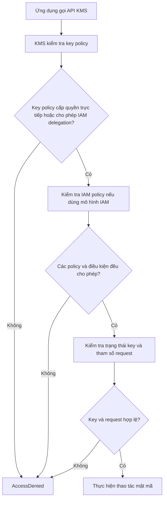

# KMS key, key policy và quyền IAM

AWS Key Management Service (AWS KMS) là dịch vụ quản lý khóa mã hóa tập trung trong hệ sinh thái AWS. Khi thiết kế ứng dụng trên AWS, ta thường dùng KMS để bảo vệ dữ liệu lưu ở Amazon S3, EBS, RDS, DynamoDB, Secrets Manager hoặc dữ liệu do ứng dụng tự mã hóa. Để sử dụng KMS an toàn, cần hiểu ba khái niệm gắn chặt với nhau: **KMS key** xác định khóa và mục đích mật mã; **key policy** quy định ai được phép thao tác với khóa; **IAM policy** cấp quyền cho danh tính AWS như user hoặc role.

Trong phạm vi module `CLOUD_PROVIDERS_AWS`, bài học đặt KMS vào bức tranh hạ tầng AWS rộng hơn: ứng dụng chạy bằng IAM role, dữ liệu được lưu ở dịch vụ lưu trữ hoặc cơ sở dữ liệu, còn KMS kiểm soát việc sử dụng khóa để mã hóa và giải mã. Một thiết kế tốt phải giới hạn đúng người và dịch vụ được dùng khóa, tách quyền quản trị khỏi quyền sử dụng khóa, đồng thời giữ khả năng vận hành và khôi phục dữ liệu.

Sau bài học, bạn có thể:

- Phân biệt AWS managed key, customer managed key và AWS owned key.
- Giải thích vai trò của key policy và mối quan hệ giữa key policy với IAM policy.
- Thiết kế quyền quản trị khóa và quyền sử dụng khóa theo nguyên tắc đặc quyền tối thiểu.
- Đọc policy mẫu, nhận biết quyền mã hóa/giải mã và quyền quản lý khóa.
- Phân tích lỗi `AccessDenied` khi ứng dụng hoặc dịch vụ AWS gọi KMS.

## 1. KMS key là gì?

KMS key là tài nguyên logic đại diện cho khóa mật mã trong AWS KMS. Tài nguyên này có metadata, trạng thái, cấu hình thuật toán, mục đích sử dụng và chính sách truy cập. KMS thực hiện các thao tác mật mã trong dịch vụ; ứng dụng thường chỉ nhận kết quả mã hóa, giải mã hoặc dữ liệu khóa được tạo theo yêu cầu.

Một KMS key có các thông tin nhận diện thường gặp:

- **Key ID**: mã định danh của khóa trong một Region.
- **Key ARN**: ARN đầy đủ, bao gồm partition, Region, account ID và key ID. Khi cấp quyền trong IAM policy, nên tham chiếu ARN cụ thể.
- **Alias**: tên dễ nhớ trỏ tới một KMS key, ví dụ `alias/orders-data`. Alias giúp ứng dụng và người vận hành dễ chọn khóa, nhưng bản thân alias không cấp quyền sử dụng khóa.
- **Key state**: trạng thái như Enabled, Disabled hoặc Pending deletion. Khóa bị vô hiệu hóa hoặc đang chờ xóa không thể phục vụ các thao tác mật mã thông thường.

KMS key có phạm vi theo Region. Một key ARN ở `ap-southeast-1` là tài nguyên khác với key ở `ap-southeast-2`. Khi cấu hình ứng dụng, cần kiểm tra Region của key trùng với Region mà ứng dụng hoặc dịch vụ đang sử dụng, trừ trường hợp chủ động thiết kế với multi-Region keys.

### 1.1. Các loại khóa theo quyền sở hữu và quản lý

| Loại khóa | Ai quản lý policy? | Mức kiểm soát | Trường hợp sử dụng |
|---|---|---|---|
| AWS owned key | AWS quản lý; khách hàng không xem hoặc chỉnh sửa policy | Thấp | Một số dịch vụ AWS dùng khóa do AWS sở hữu để bảo vệ dữ liệu |
| AWS managed key | AWS quản lý policy và vòng đời | Giới hạn; khách hàng không chỉnh sửa key policy | Dùng khóa mặc định do dịch vụ AWS tạo và quản lý trong tài khoản |
| Customer managed key | Khách hàng quản lý cấu hình, key policy, quyền IAM liên quan và vòng đời | Cao | Khi cần kiểm soát người dùng khóa, audit, chia sẻ giữa tài khoản hoặc chính sách riêng |

Customer managed key phù hợp khi tổ chức cần kiểm soát rõ ai được giải mã dữ liệu, ai được thay đổi policy, ai được vô hiệu hóa hoặc lên lịch xóa khóa. Mức kiểm soát cao cũng đồng nghĩa nhóm vận hành phải quản lý policy cẩn thận: nếu thu hồi quyền sai, ứng dụng có thể mất khả năng đọc dữ liệu đã mã hóa.

### 1.2. Key spec và mục đích sử dụng

Khi tạo khóa, cần chọn cấu hình phù hợp với thao tác mật mã:

- **Symmetric encryption key** thường dùng để mã hóa và giải mã dữ liệu ứng dụng, cũng như tích hợp với nhiều dịch vụ AWS.
- **Asymmetric key** có cặp khóa công khai và riêng tư, phù hợp với các thao tác như encrypt/decrypt hoặc sign/verify tùy cấu hình.
- **HMAC key** dùng để tạo và xác minh mã xác thực thông điệp.

Không phải mọi loại khóa đều hỗ trợ cùng một tập hành động IAM. Ví dụ, `kms:Sign` và `kms:Verify` chỉ phù hợp với khóa có mục đích ký/xác minh tương ứng; `kms:GenerateDataKey` thường gắn với quy trình mã hóa đối xứng. Hãy chọn key spec và key usage theo yêu cầu ứng dụng trước khi viết policy.

KMS key cũng không phải nơi lưu mọi secret dạng văn bản. Với mật khẩu cơ sở dữ liệu, token API hoặc thông tin kết nối, hãy dùng dịch vụ quản lý secret phù hợp như AWS Secrets Manager hoặc Systems Manager Parameter Store; KMS có thể bảo vệ dữ liệu của các dịch vụ đó bằng khóa mã hóa.

### 1.3. KMS và envelope encryption

KMS phù hợp để quản lý khóa và thực hiện thao tác mật mã, nhưng ứng dụng thường không gửi toàn bộ dữ liệu lớn tới KMS để mã hóa trực tiếp. Với dữ liệu lớn, mô hình phổ biến là **envelope encryption**:

1. Ứng dụng yêu cầu KMS tạo data key bằng `GenerateDataKey`.
2. KMS trả về data key dạng plaintext và một bản data key đã được mã hóa bằng KMS key.
3. Ứng dụng dùng plaintext data key để mã hóa dữ liệu ngay trong tiến trình của mình.
4. Ứng dụng lưu ciphertext cùng encrypted data key; plaintext data key cần được loại khỏi bộ nhớ khi không còn dùng.
5. Khi cần đọc, ứng dụng gửi encrypted data key tới KMS bằng `Decrypt`, nhận lại plaintext data key và giải mã dữ liệu.

Cách này giúp KMS bảo vệ data key gốc, còn ứng dụng xử lý khối dữ liệu lớn bằng thư viện mã hóa cục bộ. Với API `Encrypt` của KMS, giới hạn plaintext cho khóa đối xứng là 4 KiB; dữ liệu lớn nên dùng data key hoặc cơ chế mã hóa phía dịch vụ lưu trữ.

## 2. Key policy là lớp kiểm soát truy cập gốc của KMS

Key policy là resource-based policy gắn trực tiếp với một KMS key. Mỗi KMS key cần có key policy. Đây là điểm khác biệt quan trọng khi so sánh KMS với nhiều dịch vụ AWS khác: **IAM policy gắn vào user hoặc role không tự động cấp quyền sử dụng một KMS key**.

Key policy có thể:

- Cấp quyền trực tiếp cho một IAM principal cụ thể.
- Cho phép tài khoản sở hữu khóa sử dụng IAM policy để phân quyền cho các principal trong cùng tài khoản.
- Cho phép principal ở tài khoản khác sử dụng khóa, nếu cấu hình chia sẻ cross-account phù hợp.
- Giới hạn quyền bằng điều kiện, ví dụ yêu cầu request đi qua một dịch vụ AWS cụ thể hoặc có encryption context phù hợp.

Trong policy, trường `Principal` xác định danh tính được cấp quyền, `Action` xác định thao tác, `Effect` là Allow hoặc Deny, `Resource` xác định tài nguyên và `Condition` bổ sung điều kiện. Với key policy gắn trực tiếp vào một key, giá trị `"Resource": "*"` trong statement thường có nghĩa là chính KMS key đang mang policy đó.

### 2.1. Statement cho phép tài khoản sử dụng IAM policy

Key policy mặc định do AWS KMS tạo thường có statement tương tự:

```json
{
  "Sid": "EnableAccountIamPermissions",
  "Effect": "Allow",
  "Principal": {
    "AWS": "arn:aws:iam::111122223333:root"
  },
  "Action": "kms:*",
  "Resource": "*"
}
```

ARN có phần `root` ở đây đại diện cho **principal của tài khoản AWS**, không chỉ riêng người dùng root đăng nhập. Statement này cho phép tài khoản sở hữu khóa dùng IAM policy để phân quyền cho các IAM principal trong tài khoản. Nó không có nghĩa mọi user và role trong tài khoản tự động được gọi mọi API KMS; mỗi principal vẫn cần được cấp quyền phù hợp qua IAM policy và còn chịu các lớp kiểm soát khác.

Nếu xóa statement cho phép IAM delegation, một IAM policy mới gắn vào role có thể không đủ để cấp quyền trên key. Khi đó cần một statement key policy cấp quyền trực tiếp cho principal, hoặc khôi phục cơ chế delegation thích hợp.

### 2.2. Cấp quyền trực tiếp trong key policy

Có thể khai báo role cụ thể trong trường `Principal` của key policy. Cách này hữu ích khi muốn policy của key thể hiện rõ danh tính được phép thao tác. Ví dụ:

```json
{
  "Sid": "AllowOrderServiceToDecrypt",
  "Effect": "Allow",
  "Principal": {
    "AWS": "arn:aws:iam::111122223333:role/OrderService"
  },
  "Action": [
    "kms:Decrypt",
    "kms:DescribeKey"
  ],
  "Resource": "*"
}
```

Khi key policy cấp quyền trực tiếp cho role, không nhất thiết phải có một IAM Allow tương ứng cho cùng thao tác đó. Tuy vậy, request vẫn có thể bị chặn bởi explicit Deny hoặc các ràng buộc khác như service control policy (SCP), permissions boundary, session policy hay policy của VPC endpoint trong trường hợp áp dụng.

Cần cân nhắc cách quản lý danh tính khi tham chiếu principal trực tiếp. Nếu role bị xóa rồi tạo lại, ARN hoặc principal identity có thể thay đổi theo cách ảnh hưởng tới policy. Với hệ thống lớn, hãy quản lý thay đổi role và key policy cùng quy trình triển khai hạ tầng.

## 3. IAM policy phối hợp với key policy như thế nào?

IAM policy là identity-based policy, gắn vào IAM user, group hoặc role. Policy này mô tả những hành động mà danh tính được phép thực hiện trên tài nguyên. Với KMS, IAM policy phát huy tác dụng khi key policy cho phép tài khoản sở hữu khóa ủy quyền quyền quyết định cho IAM, hoặc khi key policy có cấu hình tương ứng cho principal.

Có hai mô hình phổ biến:

| Mô hình | Key policy | IAM policy | Đặc điểm |
|---|---|---|---|
| Ủy quyền qua IAM | Cho phép tài khoản dùng IAM policy để phân quyền | Cấp hành động cụ thể cho role/user trên key ARN | Quản lý quyền theo danh tính tập trung, thuận tiện khi có nhiều ứng dụng |
| Cấp quyền trực tiếp | Nêu principal và hành động được phép ngay trong key policy | Có thể không cần Allow trùng lặp cho thao tác đó | Quyền sử dụng khóa được thể hiện trực tiếp trên tài nguyên |

Trong cùng tài khoản, mô hình ủy quyền qua IAM thường dễ mở rộng: key policy thiết lập ranh giới ủy quyền, còn IAM policy quyết định role nào được dùng khóa và dùng hành động nào. Với các hệ thống cần policy tập trung theo từng khóa, có thể chọn cấp quyền trực tiếp hoặc kết hợp hai mô hình một cách có chủ đích.

### 3.1. Ví dụ IAM policy cho ứng dụng

Giả sử tài khoản `111122223333` có role `OrderService` và customer managed key tại Region `ap-southeast-1`. Key policy đã có statement cho phép tài khoản sử dụng IAM policy. IAM policy gắn vào role có thể cấp quyền như sau:

```json
{
  "Version": "2012-10-17",
  "Statement": [
    {
      "Sid": "UseOrdersDataKey",
      "Effect": "Allow",
      "Action": [
        "kms:Decrypt",
        "kms:Encrypt",
        "kms:GenerateDataKey",
        "kms:DescribeKey"
      ],
      "Resource": "arn:aws:kms:ap-southeast-1:111122223333:key/12345678-1234-1234-1234-123456789012"
    }
  ]
}
```

Policy này cấp các thao tác thường gặp cho một ứng dụng mã hóa và giải mã dữ liệu. Trong môi trường thực tế, chỉ giữ lại những hành động ứng dụng thực sự cần. Nếu ứng dụng chỉ đọc dữ liệu đã mã hóa, có thể chỉ cần `kms:Decrypt` và quyền mô tả khóa nếu thư viện hoặc quy trình triển khai cần tra cứu metadata. Nếu ứng dụng ghi dữ liệu bằng envelope encryption, cần thêm quyền tạo data key.

Dùng ARN của key cụ thể giúp giới hạn phạm vi. Tránh cấp `kms:*` hoặc dùng wildcard cho mọi khóa trong tài khoản nếu ứng dụng chỉ cần một khóa. Alias hữu ích trong cấu hình ứng dụng, nhưng khi viết IAM policy cho quyền sử dụng khóa, hãy kiểm tra resource ARN và cách API KMS đánh giá tài nguyên.

### 3.2. Những lớp kiểm soát khác vẫn có thể chặn request

Một Allow trong key policy hoặc IAM policy không đảm bảo request chắc chắn thành công. Quyền hiệu lực còn chịu tác động của các lớp kiểm soát liên quan:

- **Explicit Deny** trong bất kỳ policy áp dụng nào sẽ chặn request.
- **SCP** có thể giới hạn hành động tối đa mà principal trong AWS Organizations được phép thực hiện.
- **Permissions boundary** giới hạn quyền tối đa mà IAM principal có thể nhận.
- **Session policy** có thể thu hẹp quyền của phiên role.
- **VPC endpoint policy** có thể giới hạn request đi qua endpoint tương ứng.
- **Key state và key usage** phải phù hợp với thao tác. Ví dụ, key bị Disabled không thể giải mã dữ liệu trong khi đang vô hiệu hóa.
- **Condition** trong policy phải khớp với request, chẳng hạn encryption context hoặc `kms:ViaService`.

Có thể hình dung request đi qua các lớp kiểm tra như sau:



Sơ đồ mô tả luồng khái quát. Khi key policy cấp quyền trực tiếp, IAM Allow không nhất thiết phải lặp lại; các explicit Deny và ràng buộc khác vẫn có thể ngăn request.

## 4. Tách quyền quản trị khóa và quyền sử dụng khóa

Một lỗi thiết kế phổ biến là cấp cùng một quyền rộng cho cả người quản trị KMS và ứng dụng. Hai nhóm có mục đích khác nhau:

- **Key administrator** quản lý cấu hình, policy, trạng thái, tag, rotation và lịch xóa khóa.
- **Key user** thực hiện thao tác mật mã như Encrypt, Decrypt hoặc GenerateDataKey.
- **Application role** chỉ nên có quyền tối thiểu cần thiết cho chức năng của ứng dụng.
- **Security auditor** có thể cần quyền đọc metadata hoặc xem log, nhưng không cần quyền giải mã dữ liệu.

Người có quyền quản trị policy có thể thay đổi ai được sử dụng khóa. Vì vậy, quyền quản trị khóa có ảnh hưởng bảo mật lớn ngay cả khi principal đó không trực tiếp gọi `kms:Decrypt`. Hãy hạn chế số lượng key administrator, yêu cầu phê duyệt cho thay đổi policy quan trọng và ghi nhận hoạt động qua AWS CloudTrail.

### 4.1. Ví dụ key policy có phân tách vai trò

Ví dụ sau minh họa một customer managed key trong tài khoản `111122223333`. Key policy cho phép tài khoản ủy quyền qua IAM và cấp quyền quản trị cho role riêng. Role ứng dụng sẽ được cấp quyền sử dụng bằng IAM policy ở phần trước.

```json
{
  "Version": "2012-10-17",
  "Id": "key-policy-orders",
  "Statement": [
    {
      "Sid": "EnableAccountIamPermissions",
      "Effect": "Allow",
      "Principal": {
        "AWS": "arn:aws:iam::111122223333:root"
      },
      "Action": "kms:*",
      "Resource": "*"
    },
    {
      "Sid": "AllowKeyAdministrators",
      "Effect": "Allow",
      "Principal": {
        "AWS": "arn:aws:iam::111122223333:role/KMSKeyAdmin"
      },
      "Action": [
        "kms:Describe*",
        "kms:Enable*",
        "kms:Disable*",
        "kms:Get*",
        "kms:List*",
        "kms:Put*",
        "kms:Update*",
        "kms:TagResource",
        "kms:UntagResource",
        "kms:ScheduleKeyDeletion",
        "kms:CancelKeyDeletion",
        "kms:CreateGrant",
        "kms:RevokeGrant"
      ],
      "Resource": "*"
    }
  ]
}
```

Đây là ví dụ để học cách phân vai, không phải policy hoàn chỉnh cho mọi tổ chức. Hãy xác minh từng hành động theo nhiệm vụ vận hành thực tế. Một số thao tác quản lý alias có phạm vi tài nguyên alias; một số tích hợp dịch vụ cần grant hoặc statement riêng. Không cấp quyền quản trị rộng cho role chạy workload chỉ để xử lý một lỗi giải mã.

### 4.2. Quyền nào dành cho thao tác nào?

| Hành động KMS | Mục đích | Nhóm thường cần |
|---|---|---|
| `kms:Encrypt` | Mã hóa plaintext bằng key | Ứng dụng ghi dữ liệu hoặc thành phần mã hóa |
| `kms:Decrypt` | Giải mã ciphertext hoặc encrypted data key | Ứng dụng đọc dữ liệu |
| `kms:GenerateDataKey` | Tạo data key cho envelope encryption | Ứng dụng mã hóa dữ liệu lớn, dịch vụ tích hợp |
| `kms:ReEncryptFrom`, `kms:ReEncryptTo` | Mã hóa lại ciphertext từ key này sang key khác mà không cần trả plaintext cho caller | Quy trình chuyển đổi hoặc tái mã hóa |
| `kms:DescribeKey` | Đọc metadata của key | Ứng dụng hoặc công cụ vận hành cần kiểm tra key |
| `kms:PutKeyPolicy` | Thay đổi key policy | Key administrator |
| `kms:EnableKey`, `kms:DisableKey` | Bật hoặc tắt key | Key administrator |
| `kms:ScheduleKeyDeletion`, `kms:CancelKeyDeletion` | Lên lịch hoặc hủy lịch xóa key | Key administrator theo quy trình kiểm soát |
| `kms:CreateGrant` | Tạo grant để ủy quyền sử dụng key trong một số tích hợp | Principal được phép cấp grant theo thiết kế |

Đừng suy ra rằng một ứng dụng cần toàn bộ nhóm hành động chỉ vì một SDK hỗ trợ chúng. Hãy dựa trên luồng nghiệp vụ thật: ứng dụng ghi hay đọc, tự gọi KMS hay thông qua dịch vụ AWS, dùng symmetric hay asymmetric key, có cần tạo grant hay không.

## 5. Điều kiện policy giúp giới hạn cách sử dụng khóa

Sau khi xác định principal và action, có thể dùng `Condition` để ràng buộc ngữ cảnh của request.

### 5.1. Giới hạn request đi qua dịch vụ AWS

Ví dụ, một role chỉ được dùng khóa thông qua Amazon S3 tại Region `ap-southeast-1` có thể dùng điều kiện `kms:ViaService` trong IAM policy:

```json
{
  "Version": "2012-10-17",
  "Statement": [
    {
      "Sid": "DecryptOnlyThroughS3",
      "Effect": "Allow",
      "Action": [
        "kms:Decrypt",
        "kms:GenerateDataKey"
      ],
      "Resource": "arn:aws:kms:ap-southeast-1:111122223333:key/12345678-1234-1234-1234-123456789012",
      "Condition": {
        "StringEquals": {
          "kms:ViaService": "s3.ap-southeast-1.amazonaws.com"
        }
      }
    }
  ]
}
```

Điều kiện này giới hạn request KMS đi qua S3 trong Region đã nêu. Nó không phù hợp nếu ứng dụng cần gọi KMS trực tiếp ngoài S3. Tên dịch vụ trong điều kiện phải khớp dịch vụ và Region thực tế. Khi dùng tích hợp khác như EBS hoặc RDS, hãy chọn đúng service principal path và kiểm tra tài liệu tích hợp tương ứng.

### 5.2. Encryption context

Encryption context là tập cặp key-value không bí mật được đưa vào một số thao tác mã hóa đối xứng của KMS. Context được ràng buộc với ciphertext: khi giải mã, request phải cung cấp context tương ứng. Ứng dụng có thể dùng context để gắn dữ liệu mã hóa với mục đích hoặc bản ghi, ví dụ:

```json
{
  "application": "orders",
  "environment": "production",
  "record-type": "payment"
}
```

Policy có thể kiểm tra encryption context bằng các condition key như `kms:EncryptionContext:application`. Cách này giúp giới hạn khóa theo ngữ cảnh nghiệp vụ, nhưng cần thiết kế nhất quán giữa luồng Encrypt/GenerateDataKey và Decrypt. Encryption context không phải nơi đặt mật khẩu, token hay dữ liệu nhạy cảm vì giá trị này không được xem là bí mật.

### 5.3. Grant và tích hợp dịch vụ

Grant là cơ chế ủy quyền riêng của KMS. Một principal có quyền tạo grant có thể cấp một tập quyền giới hạn cho principal khác, thường phục vụ tích hợp AWS service hoặc quy trình cần ủy quyền tạm thời. Grant có thể kèm constraint, chẳng hạn yêu cầu encryption context phù hợp.

Trong môi trường tích hợp, một dịch vụ AWS có thể cần tạo hoặc sử dụng grant để thay mặt workload thao tác với key. Vì vậy, khi gặp lỗi KMS từ S3, EBS, RDS hoặc dịch vụ khác, hãy kiểm tra hướng dẫn tích hợp của dịch vụ và CloudTrail để xác định principal thực tế cùng thao tác bị từ chối. Không giải quyết lỗi bằng cách cấp `kms:*` cho role ứng dụng.

## 6. Chia sẻ KMS key giữa các tài khoản

Một tình huống thường gặp trong kiến trúc nhiều tài khoản là dữ liệu được mã hóa bằng key ở tài khoản bảo mật hoặc tài khoản dữ liệu, trong khi workload chạy ở tài khoản ứng dụng.

Để principal ở tài khoản khác dùng customer managed key, thường cần hai phía cùng cho phép:

1. Key policy ở tài khoản sở hữu key cho phép principal hoặc tài khoản bên ngoài thực hiện hành động cần thiết.
2. IAM policy ở tài khoản của principal cấp quyền tương ứng trên ARN của key.

Ví dụ, key thuộc tài khoản `111122223333`, còn ứng dụng chạy bằng role `arn:aws:iam::444455556666:role/ReportingService`. Key policy ở tài khoản sở hữu có thể thêm statement:

```json
{
  "Sid": "AllowReportingAccountRoleToDecrypt",
  "Effect": "Allow",
  "Principal": {
    "AWS": "arn:aws:iam::444455556666:role/ReportingService"
  },
  "Action": [
    "kms:Decrypt",
    "kms:DescribeKey"
  ],
  "Resource": "*"
}
```

Role ở tài khoản `444455556666` cũng cần IAM policy cho phép `kms:Decrypt` trên key ARN đầy đủ thuộc tài khoản `111122223333`. Nếu thiếu một trong hai phía, request cross-account có thể bị từ chối. AWS managed key không phải lựa chọn để chia sẻ cross-account theo mô hình này; hãy dùng customer managed key khi cần kiểm soát quyền chia sẻ.

Khi chia sẻ key, nên ưu tiên principal cụ thể và hành động tối thiểu. Việc cho phép cả tài khoản bên ngoài có thể khiến phạm vi ủy quyền rộng hơn dự kiến nếu tài khoản đó cấp IAM policy cho nhiều role. Cần phối hợp với nhóm quản trị tài khoản nhận, xác định owner, thời hạn và quy trình thu hồi quyền.

## 7. Cập nhật key policy an toàn

Key policy có thể được thay đổi bằng AWS Management Console, AWS CLI, SDK hoặc API. Khi cập nhật, hãy bảo đảm policy mới vẫn giữ một đường quản trị hợp lệ. Nếu vô tình xóa quyền của mọi principal có thể sửa policy, đội vận hành có thể bị khóa khỏi thao tác quản lý key.

Ví dụ, cập nhật policy mặc định bằng AWS CLI sau khi lưu nội dung policy vào file JSON:

```bash
aws kms put-key-policy \
  --key-id 12345678-1234-1234-1234-123456789012 \
  --policy-name default \
  --policy file://key-policy.json \
  --region ap-southeast-1
```

Trước khi chạy lệnh:

1. Xác minh đúng account, Region và key ID.
2. Đọc policy hiện tại bằng `get-key-policy` và lưu bản sao phục vụ rollback.
3. Kiểm tra policy mới còn statement quản trị hợp lệ.
4. Kiểm tra principal, action, resource và condition bằng review độc lập.
5. Thử quyền với role đại diện trong môi trường kiểm thử.
6. Ghi nhận thay đổi và người phê duyệt.

AWS KMS có kiểm tra an toàn để hạn chế việc cập nhật policy khiến caller mất quyền quản lý key. Không tắt cơ chế bảo vệ này như một cách xử lý nhanh khi lệnh bị từ chối; hãy tìm nguyên nhân và điều chỉnh policy theo quy trình quản trị.

Một số thao tác như tạo hoặc xóa alias dùng tài nguyên alias và quyền tương ứng, không nhất thiết nằm trong key policy statement quản trị key ở ví dụ trên. Khi viết policy production, hãy đối chiếu action với loại tài nguyên mà API yêu cầu.

## 8. Rotation, trạng thái và vòng đời khóa

Key policy và IAM policy quyết định ai được phép thao tác; vòng đời key quyết định key có thể thực hiện thao tác đó ở thời điểm hiện tại hay không.

- **Enabled**: key sẵn sàng cho các thao tác được phép.
- **Disabled**: thao tác mật mã bị ngăn cho đến khi key được bật lại.
- **Pending deletion**: key đã được lên lịch xóa và đang trong thời gian chờ; cần hủy lịch nếu quyết định xóa thay đổi.
- **Pending import** hoặc các trạng thái đặc thù khác có thể xuất hiện tùy cấu hình key material.

Automatic key rotation giúp thay đổi key material theo chu kỳ đối với các loại customer managed key được hỗ trợ. Với symmetric encryption key dùng key material do AWS KMS tạo, có thể bật automatic rotation. Các loại asymmetric key và HMAC key không hỗ trợ automatic rotation theo cùng cơ chế; key dùng imported material cũng có giới hạn riêng. Cần xác định loại key trước khi xây dựng chính sách rotation.

Rotation không đồng nghĩa phải mã hóa lại toàn bộ ciphertext ngay lập tức. KMS giữ các phiên bản key material cần thiết để giải mã dữ liệu đã được mã hóa trước đó bằng cùng logical key. Ứng dụng tiếp tục tham chiếu key ID hoặc ARN ổn định, trong khi KMS quản lý phiên bản material bên dưới.

Lên lịch xóa key là thao tác có tác động lớn: khi key bị xóa vĩnh viễn, dữ liệu chỉ có thể giải mã bằng key đó có thể trở thành không thể khôi phục. Hãy áp dụng thời gian chờ, yêu cầu phê duyệt, kiểm tra phụ thuộc dữ liệu và xác nhận backup trước khi xóa. Không cấp quyền `kms:ScheduleKeyDeletion` cho role ứng dụng.

## 9. Tình huống thực tế: mã hóa dữ liệu đơn hàng trên S3

Một hệ thống thương mại điện tử lưu hóa đơn và bản xuất dữ liệu đơn hàng trong S3. Nhóm nền tảng tạo customer managed key `alias/orders-data` ở Region `ap-southeast-1`. Ứng dụng ghi dữ liệu bằng IAM role `OrderService`, còn nhóm bảo mật quản trị key bằng role `KMSKeyAdmin`.

Thiết kế quyền:

- Key policy giữ statement cho phép tài khoản dùng IAM policy để phân quyền.
- Key policy cấp quyền quản trị key cho `KMSKeyAdmin`.
- IAM policy của `OrderService` chỉ cấp các hành động KMS cần cho luồng ghi/đọc.
- Bucket policy và IAM policy của S3 giới hạn đối tượng mà ứng dụng được đọc hoặc ghi.
- Nếu muốn bắt buộc mọi thao tác KMS đi qua S3, policy có thể thêm điều kiện `kms:ViaService` phù hợp.
- CloudTrail ghi nhận hoạt động quản lý key và các API KMS để phục vụ điều tra.

Khi `OrderService` ghi object bằng SSE-KMS, S3 cần quyền KMS phù hợp để tạo data key. Khi đọc object, S3 cần quyền giải mã. Nếu role có quyền S3 nhưng thiếu quyền KMS, request vẫn có thể thất bại. Ngược lại, có quyền KMS không có nghĩa role được đọc object trong bucket; S3 và KMS là hai lớp quyền riêng biệt.

Cần phân biệt ai là principal thực hiện thao tác KMS trong luồng tích hợp cụ thể. Một số dịch vụ gọi KMS thay mặt caller và có thể dùng grant; policy phải phản ánh cách tích hợp đó. Kiểm tra CloudTrail sẽ giúp xác nhận principal, key ARN, API và điều kiện request khi sự cố xảy ra.

## 10. Quy trình phân tích lỗi AccessDenied

Khi ứng dụng báo lỗi `AccessDeniedException` hoặc một dịch vụ AWS không thể dùng KMS key, hãy điều tra theo thứ tự:

1. **Xác định principal thực tế**: role nào đang chạy? Có phải role trong cấu hình mong đợi hay một role khác do compute service assume?
2. **Xác định key và Region**: key ID/ARN có đúng tài khoản, đúng Region và đúng môi trường không?
3. **Kiểm tra trạng thái key**: key có Enabled không, có đang Pending deletion không, key usage có phù hợp thao tác không?
4. **Kiểm tra key policy**: policy có statement cấp quyền trực tiếp cho principal hoặc cho phép IAM delegation không? Principal ARN có chính xác không?
5. **Kiểm tra IAM policy**: role có Allow đúng action trên đúng key ARN không? Có policy nào gắn vào role hoặc group bị thiếu không?
6. **Kiểm tra explicit Deny và guardrail**: SCP, permissions boundary, session policy, VPC endpoint policy hoặc condition có chặn request không?
7. **Kiểm tra điều kiện request**: encryption context có khớp không? Request có đi qua đúng `kms:ViaService` không?
8. **Kiểm tra grant và tích hợp**: dịch vụ có cần grant không? Grant còn hiệu lực và có constraint phù hợp không?
9. **Đối chiếu CloudTrail**: tìm event KMS tương ứng để biết API, principal, key, thời điểm và thông tin lỗi.

Ví dụ, role có `s3:GetObject` nhưng thiếu `kms:Decrypt` vẫn có thể bị từ chối khi đọc object được mã hóa bằng SSE-KMS. Nếu role có `kms:Decrypt` nhưng thiếu `s3:GetObject`, KMS không tự cấp quyền đọc object. Hai quyền cần được kiểm soát độc lập.

Không nên sửa lỗi bằng cách thêm `kms:*` cho mọi principal hoặc thay key policy bằng policy mặc định rộng mà chưa hiểu nguyên nhân. Cách sửa đúng là xác định API bị từ chối, principal thực tế, lớp policy đang chặn và quyền nhỏ nhất cần bổ sung.

## 11. Nguyên tắc thiết kế policy cho production

Khi triển khai KMS trong môi trường thật, hãy áp dụng các nguyên tắc sau:

- **Tách admin và user**: role quản trị policy không nên là role chạy ứng dụng hằng ngày.
- **Đặc quyền tối thiểu**: cấp đúng action, đúng key ARN và đúng principal.
- **Giữ đường quản trị**: trước khi cập nhật key policy, xác minh vẫn có principal đáng tin cậy quản lý được key.
- **Hạn chế quyền xóa**: kiểm soát `kms:ScheduleKeyDeletion` và quy trình hủy lịch xóa.
- **Dùng condition khi phù hợp**: giới hạn theo service, encryption context hoặc tài khoản gọi.
- **Quản lý cross-account rõ ràng**: có owner, principal cụ thể, thời hạn và quy trình thu hồi.
- **Theo dõi bằng CloudTrail**: giám sát thay đổi policy, grant, trạng thái key và thao tác mật mã nhạy cảm.
- **Kiểm thử theo luồng nghiệp vụ**: xác minh cả ghi và đọc dữ liệu; kiểm tra quyền của role thật trong môi trường gần production.
- **Lập kế hoạch rotation và backup**: hiểu tác động của rotation, disable và deletion đối với khả năng đọc dữ liệu.
- **Quản lý policy như mã nguồn**: review thay đổi, lưu lịch sử, triển khai có kiểm soát và tránh chỉnh sửa thủ công không được ghi nhận.

Policy tốt phải dễ giải thích: role nào được dùng key nào, dùng để làm gì, trong điều kiện nào và ai có thể thay đổi quyền đó. Nếu không thể trả lời rõ các câu hỏi này, thiết kế quyền cần được rà soát trước khi đưa vào production.

## 12. Những nhầm lẫn cần tránh

| Nhầm lẫn | Cách hiểu đúng |
|---|---|
| Gắn IAM policy Allow là role chắc chắn dùng được KMS key | Key policy phải cho phép IAM delegation hoặc cấp quyền trực tiếp; explicit Deny và guardrail vẫn có thể chặn |
| ARN `root` trong key policy chỉ cấp quyền cho người dùng root | ARN này đại diện principal của tài khoản AWS trong cơ chế delegation |
| Alias là quyền truy cập vào key | Alias chỉ là tên tham chiếu; quyền vẫn được đánh giá trên KMS key và policy |
| Có `kms:Decrypt` là đọc được object S3 | Còn cần quyền S3 và các điều kiện của object/bucket |
| Key administrator luôn cần `kms:Decrypt` | Quản trị key và sử dụng key là hai nhiệm vụ riêng; chỉ cấp decrypt khi có nhu cầu vận hành rõ ràng |
| Rotation làm ciphertext cũ không giải mã được | KMS quản lý các phiên bản key material để tiếp tục giải mã dữ liệu đã mã hóa bằng logical key |
| Có thể xóa key rồi khôi phục dữ liệu từ ciphertext | Khi key bị xóa vĩnh viễn, ciphertext phụ thuộc vào key đó có thể không còn giải mã được |

## 13. Tóm tắt kiến thức

KMS key là tài nguyên mật mã mà ứng dụng và dịch vụ AWS dùng để bảo vệ dữ liệu. Key policy là lớp policy gốc gắn với key và quyết định principal nào được cấp quyền hoặc tài khoản có thể ủy quyền qua IAM. IAM policy cấp quyền cho user hoặc role trong phạm vi mà key policy cho phép. Các lớp kiểm soát khác như explicit Deny, SCP, permissions boundary, session policy, condition và grant tiếp tục ảnh hưởng tới kết quả cuối cùng.

Khi thiết kế, hãy chọn customer managed key nếu cần kiểm soát policy và vòng đời; giữ quyền quản trị key trong role riêng; cấp cho ứng dụng đúng các thao tác mật mã cần thiết; giới hạn key ARN; và theo dõi thay đổi bằng CloudTrail. Khi xử lý lỗi, bắt đầu từ principal, key ARN, Region và API bị từ chối, sau đó kiểm tra lần lượt key policy, IAM policy, guardrail, condition và grant.

## Tài liệu tham khảo

- [AWS KMS key policies](https://docs.aws.amazon.com/kms/latest/developerguide/key-policies.html)
- [Default key policy](https://docs.aws.amazon.com/kms/latest/developerguide/key-policy-default.html)
- [IAM policies for AWS KMS](https://docs.aws.amazon.com/kms/latest/developerguide/iam-policies.html)
- [Allowing users in other accounts to use a KMS key](https://docs.aws.amazon.com/kms/latest/developerguide/key-policy-modifying-external-accounts.html)
- [Rotating AWS KMS keys](https://docs.aws.amazon.com/kms/latest/developerguide/rotate-keys.html)

