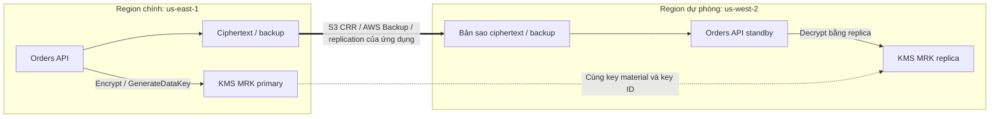
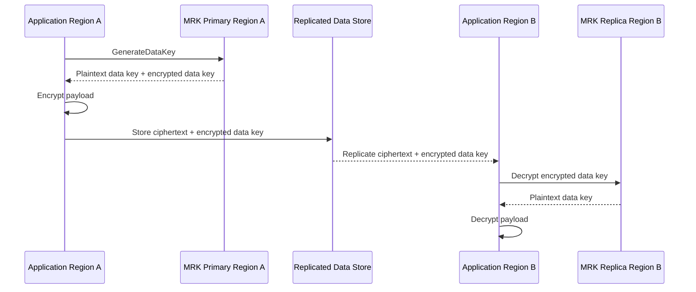

# Multi-Region KMS key và yêu cầu khôi phục dữ liệu

> **Chương:** Mã hóa, secret và chứng chỉ  
> **Module:** CLOUD_PROVIDERS_AWS  
> **Phạm vi:** Thiết kế, tạo, quản lý và sử dụng AWS KMS Multi-Region keys trong kiến trúc backup, disaster recovery và ứng dụng đa Region. Bài học tập trung vào quan hệ primary/replica, đồng bộ key material, quyền truy cập theo Region, mã hóa envelope, sao chép dữ liệu, luân chuyển khóa và kiểm thử khôi phục.

## Mục tiêu học tập

Sau bài học, người học có thể:

1. Giải thích Multi-Region KMS key (MRK) và phân biệt primary key với replica key.
2. Xác định thuộc tính được AWS KMS đồng bộ và thuộc tính phải quản lý riêng tại từng Region.
3. Đánh giá khi nào MRK phù hợp và khi nào single-Region KMS key là lựa chọn an toàn hơn.
4. Tạo primary key, tạo replica và xác minh trạng thái bằng AWS Console hoặc AWS CLI.
5. Thiết kế key policy, IAM policy, grant và alias cho ứng dụng chạy ở nhiều Region.
6. Giải thích cách mã hóa ở Region nguồn và giải mã tại Region đích bằng cùng một bộ key material.
7. Kết hợp MRK với envelope encryption và AWS Encryption SDK.
8. Phân biệt sao chép khóa với sao chép ciphertext, snapshot, backup và cấu hình ứng dụng.
9. Xây dựng yêu cầu RPO/RTO và quy trình khôi phục dữ liệu được mã hóa.
10. Quản lý automatic rotation, on-demand rotation và imported key material trong bộ MRK.
11. Chuyển primary Region khi cần và hiểu tác động của việc xóa primary/replica.
12. Kiểm thử khả năng giải mã, quyền truy cập và phục hồi trong Region dự phòng.
13. Kiểm soát rủi ro về data residency, tenant isolation, audit và chi phí.

## 1. Bài toán khôi phục dữ liệu được mã hóa giữa các Region

Một ứng dụng có thể lưu dữ liệu tại Region chính và duy trì bản sao tại Region dự phòng. Khi Region chính gặp sự cố, ứng dụng cần đọc được dữ liệu đã sao chép và tiếp tục ghi dữ liệu mới.

Để khôi phục được, hệ thống cần đồng thời có:

- Bản sao dữ liệu hoặc backup đã được chuyển tới Region dự phòng.
- Khóa có thể giải mã ciphertext tại Region dự phòng.
- IAM role, key policy và grant cho phép workload khôi phục gọi KMS.
- Secret, cấu hình ứng dụng, network, DNS và các dependency cần thiết.
- Runbook đã được kiểm thử để khởi động dịch vụ trong thời gian mục tiêu.

Nếu chỉ sao chép dữ liệu mà không chuẩn bị khóa, ứng dụng có thể có đầy đủ ciphertext nhưng không thể giải mã. Ngược lại, nếu chỉ tạo replica KMS key mà chưa sao chép dữ liệu, Region dự phòng có khóa nhưng không có dữ liệu để phục hồi.

### 1.1 Ví dụ kiến trúc

Một dịch vụ Orders chạy tại hai Region:

- Region chính: us-east-1.
- Region dự phòng: us-west-2.
- Ứng dụng mã hóa dữ liệu tại Region chính.
- Dữ liệu được sao chép sang Region dự phòng.
- Một MRK primary tại us-east-1 có replica tương ứng tại us-west-2.
- Khi cần khôi phục, ứng dụng ở us-west-2 dùng replica key tại chính Region đó để giải mã dữ liệu.



Đường nối giữa hai KMS keys biểu thị quan hệ MRK và sự đồng bộ các thuộc tính được chia sẻ. Đường sao chép dữ liệu là một luồng riêng do S3, AWS Backup, database service hoặc ứng dụng thực hiện.

### 1.2 Yêu cầu khôi phục cần định lượng

Trước khi chọn MRK, hãy xác định:

| Yêu cầu | Câu hỏi cần trả lời |
|---|---|
| RPO | Có thể mất tối đa bao nhiêu dữ liệu khi chuyển Region? |
| RTO | Dịch vụ phải hoạt động trở lại trong bao lâu? |
| Data replication | Dữ liệu được sao chép liên tục, theo lịch hay theo snapshot? |
| Key availability | Replica key đã tồn tại và ở trạng thái Enabled chưa? |
| Access recovery | IAM role và key policy tại Region đích đã sẵn sàng chưa? |
| Application recovery | Secret, parameter, certificate, DNS và dependency đã có chưa? |
| Compliance | Dữ liệu có được phép giải mã tại Region đích không? |
| Test cadence | Bao lâu thực hiện một lần kiểm thử khôi phục toàn bộ? |

MRK hỗ trợ một phần quan trọng của quy trình khôi phục: khả năng sử dụng key material tương thích tại nhiều Region. Nó không tự bảo đảm RPO, RTO hay khả năng phục hồi toàn bộ ứng dụng.

## 2. Multi-Region KMS key là gì?

AWS KMS Multi-Region keys là một tập hợp KMS keys có cùng key ID và key material tại nhiều AWS Regions. Các key liên quan có thể được dùng thay thế cho nhau trong các thao tác mật mã phù hợp.

Một bộ MRK có:

- Một primary key tại một Region.
- Không hoặc nhiều replica keys tại các Region khác.
- Cùng key ID, thường có tiền tố mrk-.
- Cùng key material và các thuộc tính được AWS KMS định nghĩa là shared properties.
- ARN riêng cho từng Region.

Ví dụ key ID và ARN minh họa:

```text
Key ID:
mrk-1234abcd12ab34cd56ef1234567890ab

Primary ARN:
arn:aws:kms:us-east-1:111122223333:key/mrk-1234abcd12ab34cd56ef1234567890ab

Replica ARN:
arn:aws:kms:us-west-2:111122223333:key/mrk-1234abcd12ab34cd56ef1234567890ab
```

Key ID giống nhau nhưng ARN khác nhau ở trường Region. Khi workload chạy tại us-west-2, ứng dụng nên gọi replica ARN ở us-west-2 để sử dụng KMS endpoint cục bộ.

### 2.1 Primary key

Primary key là nguồn của các shared properties trong bộ MRK.

Primary key có các vai trò:

- Được dùng trực tiếp trong các thao tác mã hóa, giải mã, ký hoặc xác thực MAC tùy key type.
- Là key duy nhất có thể tạo thêm replica.
- Là nơi quản trị automatic key rotation.
- Là nguồn để AWS KMS đồng bộ shared properties sang các replica.

### 2.2 Replica key

Replica key là một KMS key hoàn chỉnh tại Region đích.

Replica:

- Có cùng key ID và key material với primary.
- Có thể thực hiện các thao tác mật mã như một KMS key độc lập.
- Có ARN và key policy riêng.
- Có thể được enable hoặc disable độc lập.
- Có alias, tags, description và grants riêng.
- Có thể được dùng để giải mã ciphertext tạo bởi primary hoặc bởi một replica liên quan.

Replica không phải bản sao chỉ đọc. Ứng dụng tại Region đích có thể sử dụng replica key để mã hóa dữ liệu mới và giải mã dữ liệu đã được mã hóa bởi các key liên quan.

### 2.3 MRK không phải một global key

MRK không tự động xuất hiện ở mọi Region.

Người quản trị phải:

1. Tạo primary key.
2. Chọn từng Region cần có key.
3. Tạo replica tại từng Region.
4. Thiết lập quyền và alias tại từng Region.
5. Theo dõi trạng thái và chính sách của từng key.

Các Region phải thuộc cùng AWS partition. Ví dụ, Region trong partition aws không thể replicate MRK sang partition aws-cn. Region đích cũng phải được bật cho tài khoản nếu Region đó yêu cầu enablement.

Không thể chuyển một single-Region KMS key đã tồn tại thành MRK. Muốn chuyển workload, cần tạo bộ MRK mới rồi mã hóa lại dữ liệu hoặc tạo chữ ký mới theo thiết kế tương ứng.

## 3. Shared properties và independent properties

Điểm quan trọng nhất khi vận hành MRK là phân biệt thuộc tính được đồng bộ với thuộc tính phải quản lý riêng.

### 3.1 Thuộc tính được chia sẻ

AWS KMS đồng bộ các thuộc tính chính sau giữa primary và replicas:

| Shared property | Ý nghĩa |
|---|---|
| Key ID | Các key liên quan có cùng key ID |
| Key material | Dùng cùng vật liệu mật mã |
| Key spec | Cùng loại key, ví dụ SYMMETRIC_DEFAULT hoặc RSA_2048 |
| Key usage | Cùng mục đích, ví dụ ENCRYPT_DECRYPT hoặc SIGN_VERIFY |
| Origin | Cùng nguồn key material, ví dụ AWS_KMS hoặc EXTERNAL |
| Automatic rotation status | Trạng thái/cấu hình automatic rotation được chia sẻ với các replica |
| Primary/replica relationship | AWS KMS duy trì quan hệ giữa primary và các replica |

Khi một shared property thay đổi theo thao tác được hỗ trợ, AWS KMS đồng bộ thay đổi sang các key liên quan. Quá trình đồng bộ có thể có độ trễ ngắn.

### 3.2 Thuộc tính độc lập

Các thuộc tính dưới đây phải được quản lý riêng cho từng key:

| Independent property | Hệ quả vận hành |
|---|---|
| Key policy | Sửa policy ở primary không tự cập nhật replica |
| Grants | Mỗi grant áp dụng cho một key tại một Region |
| Aliases | Tạo alias riêng trong từng Region |
| Tags | Phải duy trì riêng |
| Description | Không tự đồng bộ |
| Enabled/Disabled state | Enable hoặc disable một key không thay đổi trạng thái key liên quan |
| Key ARN | Mỗi key có ARN riêng theo Region |

Ví dụ, nếu key policy ở us-east-1 cho phép role OrdersApiRole gọi Decrypt nhưng key policy ở us-west-2 không cho phép, ứng dụng DR vẫn bị AccessDenied khi gọi replica tại us-west-2.

Không nên giả định rằng tạo replica đồng nghĩa với việc sao chép toàn bộ quyền truy cập của primary.

### 3.3 Đồng bộ và kiểm toán

AWS KMS thực hiện đồng bộ shared properties. Người vận hành không có API để yêu cầu đồng bộ thủ công theo ý muốn.

Có thể theo dõi hoạt động đồng bộ bằng sự kiện CloudTrail:

```text
eventSource: kms.amazonaws.com
eventName: SynchronizeMultiRegionKey
```

Nên thu thập CloudTrail từ tất cả Region liên quan và tập trung log về một nơi để đối chiếu. Việc audit chỉ một Region sẽ không phản ánh đầy đủ hoạt động sử dụng các replica keys.

## 4. Khi nào nên dùng MRK?

### 4.1 Trường hợp phù hợp

MRK có ích khi workload cần cùng key material tại nhiều Region.

Ví dụ:

- Client-side encryption: ứng dụng mã hóa dữ liệu ở Region này và giải mã ở Region khác.
- Backup recovery: ciphertext được sao chép sang Region dự phòng và cần giải mã tại đó.
- Active-active: nhiều Region cùng mã hóa và giải mã dữ liệu có thể di chuyển giữa các Region.
- Distributed signing: ứng dụng cần tạo chữ ký tương thích bằng asymmetric MRK ở nhiều Region.
- Global data workflow: dữ liệu mã hóa cần được xử lý tại các Region khác nhau mà không phải gọi KMS từ xa.

AWS Encryption SDK và AWS Database Encryption SDK là các lựa chọn cần xem xét cho những luồng client-side encryption tương ứng.

### 4.2 Khi nào không nên dùng?

Single-Region KMS key thường phù hợp hơn nếu:

- Dữ liệu chỉ tồn tại và được xử lý trong một Region.
- Yêu cầu data residency đòi hỏi key material và khả năng giải mã bị giới hạn trong một Region.
- AWS service đã có cơ chế mã hóa và sao chép riêng theo Region.
- Không có nhu cầu giải mã ciphertext bằng key ở Region khác.
- Tổ chức muốn giữ ranh giới bảo mật độc lập giữa các Region.

MRK làm tăng phạm vi địa lý nơi cùng key material có thể được sử dụng. Nếu một principal ở Region khác có quyền dùng replica, principal đó có thể giải mã dữ liệu được bảo vệ bằng key liên quan. Vì vậy, MRK cần đánh giá kỹ tenant isolation, data residency và access boundary.

### 4.3 Phân biệt khả năng KMS với cách AWS service tích hợp KMS

Không phải mọi AWS service đều xử lý MRK theo cách giống ứng dụng client-side.

Một số service coi MRK như KMS key đơn Region và vẫn thực hiện quy trình decrypt/re-encrypt data key tại Region đích. Một số tính năng có thể hỗ trợ MRK resolution riêng.

Ví dụ với Amazon S3:

- S3 Replication có thể hỗ trợ Multi-Region key resolution.
- Cần bật replication cho SSE-KMS encrypted objects.
- Cần cấu hình UseSourceMultiRegionKey trong encryption configuration của replication rule.
- Destination replica phải tồn tại, ở trạng thái hợp lệ và có quyền KMS phù hợp.

Nếu không bật tính năng MRK resolution, S3 có thể thực hiện quy trình mã hóa lại data key tại Region đích theo hành vi replication của service.

Với AWS Backup, cách mã hóa bản copy phụ thuộc loại resource và destination backup vault. Cần kiểm tra hướng dẫn mã hóa cho đúng resource type. Không suy ra rằng mọi backup copy đều tự động dùng cùng MRK chỉ vì primary và replica tồn tại.

## 5. Kiến trúc mã hóa envelope với MRK

Trong envelope encryption, ứng dụng dùng data key để mã hóa dữ liệu. KMS bảo vệ data key thay vì trực tiếp mã hóa toàn bộ file hoặc payload lớn.

Luồng cơ bản:

1. Ứng dụng gọi GenerateDataKey trên MRK tại Region hiện tại.
2. KMS trả về plaintext data key và bản data key đã mã hóa.
3. Ứng dụng dùng plaintext data key để mã hóa payload.
4. Ứng dụng lưu ciphertext cùng encrypted data key và metadata cần thiết.
5. Ứng dụng xóa plaintext data key khỏi bộ nhớ khi không còn cần.
6. Khi giải mã ở Region khác, ứng dụng gọi Decrypt bằng replica MRK tại Region đích.
7. KMS trả lại plaintext data key.
8. Ứng dụng dùng data key để giải mã payload.



### 5.1 Điều gì được KMS bảo vệ?

KMS bảo vệ data key bằng key material của MRK. KMS không lưu payload ứng dụng, không sao chép file và không thay thế cơ chế backup.

Dữ liệu cần được sao chép bằng dịch vụ phù hợp hoặc cơ chế replication của ứng dụng. Khi khôi phục, ứng dụng phải có cả encrypted data key và ciphertext tương ứng.

### 5.2 Vì sao không cần gọi KMS ở Region nguồn?

Vì primary và replica có cùng key ID và key material, replica tại Region đích có thể giải mã encrypted data key được tạo bởi primary.

Nếu ứng dụng gọi đúng replica key ARN tại Region đích, thao tác Decrypt được thực hiện tại Region đó. Điều này tránh phụ thuộc vào KMS endpoint của Region nguồn trong luồng khôi phục.

### 5.3 Encryption context

Với symmetric encryption KMS key, ứng dụng có thể sử dụng encryption context để gắn metadata không bí mật vào thao tác mã hóa.

Ví dụ:

```json
{
  "application": "orders",
  "environment": "production",
  "record-type": "order"
}
```

Encryption context:

- Được dùng như additional authenticated data.
- Được gắn mật mã với ciphertext.
- Phải cung cấp chính xác context tương ứng khi giải mã.
- Không được xem là secret.
- Có thể xuất hiện dưới dạng plaintext trong CloudTrail.

Không đưa password, token, thông tin cá nhân hoặc secret vào encryption context.

Nếu key policy hoặc grant có điều kiện theo encryption context, cần duy trì chính sách tương thích ở tất cả Region. Ứng dụng DR phải gửi cùng context đã dùng lúc mã hóa.

Asymmetric KMS keys và HMAC KMS keys không sử dụng encryption context.

## 6. Tạo primary key và replica key

### 6.1 Chọn loại key

Với bài toán mã hóa dữ liệu ứng dụng, lựa chọn phổ biến là:

| Thuộc tính | Giá trị minh họa |
|---|---|
| Key type | Symmetric |
| Key spec | SYMMETRIC_DEFAULT |
| Key usage | ENCRYPT_DECRYPT |
| Origin | AWS_KMS |
| Multi-Region | Enabled |
| Primary Region | us-east-1 |
| Replica Region | us-west-2 |

Lựa chọn thực tế phải dựa trên thuật toán, ứng dụng và yêu cầu bảo mật. MRK cũng hỗ trợ asymmetric keys, HMAC keys và imported key material.

Không thể tạo MRK trong custom key store.

### 6.2 Tạo primary key bằng AWS CLI

Ví dụ tạo primary key trong us-east-1:

```bash
aws kms create-key \
  --description "Orders application multi-region encryption key" \
  --key-spec SYMMETRIC_DEFAULT \
  --key-usage ENCRYPT_DECRYPT \
  --origin AWS_KMS \
  --multi-region \
  --region us-east-1
```

Response chứa KeyId và Arn. Lưu ARN của primary vào inventory quản lý khóa.

Ví dụ kết quả rút gọn:

```json
{
  "KeyMetadata": {
    "KeyId": "mrk-1234abcd12ab34cd56ef1234567890ab",
    "Arn": "arn:aws:kms:us-east-1:111122223333:key/mrk-1234abcd12ab34cd56ef1234567890ab",
    "KeyState": "Enabled",
    "KeyUsage": "ENCRYPT_DECRYPT",
    "KeySpec": "SYMMETRIC_DEFAULT",
    "Origin": "AWS_KMS",
    "MultiRegion": true
  }
}
```

Đây là dữ liệu minh họa. Không dùng ARN hoặc account ID giả trong production.

### 6.3 Tạo replica key

Dùng ReplicateKey để tạo replica trong Region đích:

```bash
aws kms replicate-key \
  --key-id arn:aws:kms:us-east-1:111122223333:key/mrk-1234abcd12ab34cd56ef1234567890ab \
  --replica-region us-west-2 \
  --region us-east-1
```

Không dùng CreateKey để tạo replica. ReplicateKey lấy shared properties từ primary và tạo key tại Region đích.

### 6.4 Kiểm tra trạng thái replica

Ngay sau khi tạo, replica có thể ở trạng thái Creating. Khi hoàn tất, key thường chuyển sang Enabled. Với imported key material, replica có thể ở PendingImport cho tới khi import material hoàn tất.

Kiểm tra bằng:

```bash
aws kms describe-key \
  --key-id mrk-1234abcd12ab34cd56ef1234567890ab \
  --region us-west-2
```

Chỉ đưa replica vào luồng mã hóa/giải mã sau khi xác nhận key state phù hợp, key policy đúng và quyền truy cập đã sẵn sàng.

### 6.5 Tạo alias riêng tại từng Region

Alias không được tự đồng bộ giữa primary và replica.

Tạo alias ở Region chính:

```bash
aws kms create-alias \
  --alias-name alias/orders-data \
  --target-key-id mrk-1234abcd12ab34cd56ef1234567890ab \
  --region us-east-1
```

Tạo alias cùng tên tại Region dự phòng:

```bash
aws kms create-alias \
  --alias-name alias/orders-data \
  --target-key-id mrk-1234abcd12ab34cd56ef1234567890ab \
  --region us-west-2
```

Alias có cùng tên nhưng là hai tài nguyên độc lập trong hai Region. Kiểm tra alias target sau khi tạo và tránh tái sử dụng alias đã trỏ tới key khác.

### 6.6 Tạo replica thứ hai

Muốn thêm Region khác, gọi ReplicateKey trên primary. Replica không thể tạo thêm replica.

Mỗi Region chỉ có một key trong cùng một bộ MRK. Các Region phải thuộc cùng AWS partition và phải được bật cho tài khoản.

## 7. Quản lý IAM và key policy ở nhiều Region

MRK không tự đồng bộ quyền truy cập. Đây là một trong những nguyên nhân phổ biến khiến DR test thất bại dù replica key đã tồn tại.

### 7.1 Ba lớp kiểm soát

| Cơ chế | Phạm vi |
|---|---|
| Key policy | Chính sách gắn trực tiếp với từng KMS key |
| IAM policy | Quyền của IAM principal, cần key policy cho phép IAM policy có hiệu lực |
| KMS grant | Cấp quyền cho một principal đối với một key cụ thể |

Mỗi primary/replica có key policy riêng. Grant cũng mang tính Regional và chỉ cho phép thao tác trên một key.

### 7.2 Quyền tối thiểu cho ứng dụng

Một ứng dụng envelope encryption thường cần một số quyền như:

- kms:GenerateDataKey
- kms:Decrypt
- kms:DescribeKey

Ứng dụng chỉ đọc ciphertext có thể chỉ cần Decrypt và DescribeKey tùy cách triển khai. Ứng dụng tạo ciphertext mới có thể cần GenerateDataKey hoặc Encrypt.

Chỉ cấp các hành động thực sự cần. Không dùng kms:* hoặc AdministratorAccess cho application role.

### 7.3 Quyền quản trị và replication

Principal tạo primary key cần quyền tạo KMS key và quyền tạo service-linked role cần thiết. AWS KMS sử dụng service-linked role AWSServiceRoleForKeyManagementServiceMultiRegionKeys để đồng bộ shared properties.

Principal tạo replica cần quyền phù hợp cho ReplicateKey và quyền quản trị KMS tại Region nguồn/đích theo thao tác thực hiện.

### 7.4 Giới hạn Region được phép replicate

Có thể dùng condition key kms:ReplicaRegion để chỉ cho phép tạo replica tại các Region được phê duyệt.

Ví dụ policy rút gọn:

```json
{
  "Version": "2012-10-17",
  "Statement": [
    {
      "Sid": "ReplicateOnlyToApprovedRegion",
      "Effect": "Allow",
      "Action": "kms:ReplicateKey",
      "Resource": "arn:aws:kms:us-east-1:111122223333:key/mrk-1234abcd12ab34cd56ef1234567890ab",
      "Condition": {
        "StringEquals": {
          "kms:ReplicaRegion": "us-west-2"
        }
      }
    }
  ]
}
```

Policy minh họa cần được tích hợp với key policy, IAM policy và permission boundary thực tế. Không sao chép nguyên mẫu mà chưa thay ARN và principal.

### 7.5 Kiểm soát multi-Region key creation

Tổ chức có thể dùng điều kiện kms:MultiRegion và kms:MultiRegionKeyType để giới hạn ai được tạo primary/replica keys.

Có thể dùng aws:RequestedRegion để kiểm soát Region được phép thực hiện thao tác.

Không cho phép mọi developer tự tạo MRK ở mọi Region. MRK làm key material có thể được sử dụng tại nhiều vị trí địa lý và cần được quản trị theo data classification.

### 7.6 Rà soát policy drift

Tạo quy trình so sánh định kỳ giữa:

- Key policy của primary và từng replica.
- IAM policy của application roles.
- Grants được tạo bởi AWS services.
- Alias target.
- Enabled/Disabled state.
- Tags phục vụ inventory và compliance.

Nếu policy ở primary thay đổi, cần đánh giá và cập nhật policy ở replica theo cùng một change process. Không chờ AWS KMS tự đồng bộ vì key policy là independent property.

## 8. Luân chuyển key material trong bộ MRK

Rotation thay đổi key material được dùng cho thao tác mã hóa mới. Nó không tự mã hóa lại dữ liệu đã tồn tại.

### 8.1 Automatic rotation

Automatic rotation được hỗ trợ cho symmetric encryption KMS keys có origin AWS_KMS.

Với MRK:

- Bật hoặc tắt automatic rotation tại primary.
- Không bật/tắt độc lập ở replica.
- AWS KMS đồng bộ trạng thái rotation tới các replica.
- Khi key material được rotate, key material mới được đồng bộ tới các replica.
- Các phiên bản key material cũ vẫn được giữ để giải mã ciphertext đã tạo trước đó.

Mặc định, automatic rotation tạo key material mới mỗi năm. AWS KMS cũng hỗ trợ cấu hình rotation period theo giới hạn được công bố trong tài liệu hiện hành.

Ví dụ bật automatic rotation trên primary:

```bash
aws kms enable-key-rotation \
  --key-id mrk-1234abcd12ab34cd56ef1234567890ab \
  --region us-east-1
```

Kiểm tra trạng thái:

```bash
aws kms get-key-rotation-status \
  --key-id mrk-1234abcd12ab34cd56ef1234567890ab \
  --region us-east-1
```

Không thực hiện enable-key-rotation trên replica. Quản trị rotation tại primary và xác minh trạng thái trên các replica.

### 8.2 On-demand rotation

On-demand rotation cho phép yêu cầu thay đổi key material ngay khi cần, không phụ thuộc lịch automatic rotation.

Với MRK:

- Chỉ gọi RotateKeyOnDemand tại primary.
- Chỉ hỗ trợ symmetric encryption keys.
- Với origin AWS_KMS, AWS KMS đồng bộ key material mới sang replicas.
- Theo dõi trạng thái rotation để bảo đảm quá trình hoàn tất.

On-demand rotation có giới hạn số lần theo từng key. Kiểm tra quota và trạng thái rotation trước khi sử dụng.

### 8.3 Imported key material

Với MRK có origin EXTERNAL:

- AWS KMS không tự tạo hoặc tự sao chép imported key material giống như origin AWS_KMS.
- Phải import cùng key material vào primary và từng replica.
- Khi cần on-demand rotation, import material mới vào tất cả key liên quan trước.
- Chỉ khởi tạo rotation từ primary sau khi material mới đã có ở mọi Region.
- Mỗi imported key material có thể có trạng thái và expiration riêng theo key.

Nếu chỉ import material mới vào primary mà chưa import vào replica, không thể giả định các Region đã sẵn sàng dùng material mới.

Tổ chức phải duy trì bản sao an toàn của imported key material bên ngoài AWS KMS theo quy trình quản lý khóa. AWS KMS không cho xuất lại material đã import.

### 8.4 Asymmetric và HMAC keys

Automatic rotation không được hỗ trợ cho asymmetric KMS keys và HMAC KMS keys. On-demand rotation cũng không áp dụng cho các key type này.

Khi cần thay key material cho asymmetric/HMAC key, thường phải tạo key mới, cập nhật ứng dụng và thực hiện chuyển đổi theo kế hoạch. Với signing key, cần quản lý vòng đời public key, certificate, trust store và chữ ký cũ.

### 8.5 Rotation không thay thế re-encryption

Rotation của KMS key:

- Không rotate data key mà ứng dụng đã tạo.
- Không tự mã hóa lại ciphertext.
- Không khắc phục việc plaintext data key bị lộ.
- Không thay thế quy trình thay secret, token hoặc certificate.

Nếu cần thay đổi key identity hoặc thuật toán, cần thiết kế migration và re-encryption riêng.

## 9. Chuyển primary Region

Một bộ MRK luôn có đúng một primary key. Có thể chuyển vai trò primary sang một replica hiện có bằng UpdatePrimaryRegion.

### 9.1 Khi nào cần chuyển?

Ví dụ:

- Muốn đặt primary gần nhóm quản trị khóa.
- Cần xóa primary tại Region hiện tại nhưng vẫn giữ các replica.
- Muốn chuyển quyền quản trị replication sang Region khác sau thay đổi kiến trúc.

Không cần chuyển primary chỉ để replica có thể giải mã ciphertext trong DR. Replica vốn đã là KMS key hoạt động đầy đủ.

### 9.2 Điều kiện

- Primary hiện tại phải ở trạng thái Enabled.
- Replica được chọn làm primary mới phải ở trạng thái Enabled.
- Principal cần quyền kms:UpdatePrimaryRegion phù hợp ở cả hai Region.
- Sau thao tác, AWS KMS có thể mất thêm vài giây để hoàn tất đồng bộ vai trò.

Trong thời gian Updating, một số thao tác quản trị bị hạn chế. Hãy chờ các key trở lại Enabled trước khi tiếp tục thay đổi cấu hình.

### 9.3 Ví dụ AWS CLI

Ví dụ chuyển primary từ us-east-1 sang replica us-west-2:

```bash
aws kms update-primary-region \
  --key-id arn:aws:kms:us-east-1:111122223333:key/mrk-1234abcd12ab34cd56ef1234567890ab \
  --primary-region us-west-2 \
  --region us-east-1
```

Sau khi hoàn tất:

- Key ở us-west-2 trở thành primary.
- Key ở us-east-1 trở thành replica.
- Các replica khác vẫn thuộc cùng bộ MRK.
- Key ARN của từng Region không thay đổi.
- Key policy, grants, alias, tags và trạng thái enablement vẫn độc lập.

Kiểm tra DescribeKey ở từng Region để xác nhận MultiRegionConfiguration và MultiRegionKeyType.

## 10. Yêu cầu khôi phục dữ liệu giữa các Region

Một DR design hoàn chỉnh phải kiểm tra nhiều lớp. MRK chỉ giải quyết lớp key interoperability.

### 10.1 Dữ liệu phải được sao chép riêng

Chọn cơ chế sao chép theo loại dữ liệu:

| Dữ liệu | Cơ chế có thể dùng |
|---|---|
| Object trong S3 | S3 Cross-Region Replication |
| EBS snapshots | Snapshot copy hoặc AWS Backup |
| RDS/Aurora | Cross-Region snapshot/backup hoặc tính năng replication phù hợp |
| File/application data | Replication hoặc backup do ứng dụng/managed service hỗ trợ |
| Database logical data | Native replication hoặc backup/restore |
| Application artifacts | CI/CD artifact replication hoặc deployment pipeline |

Kiểm tra service-specific encryption behavior. Không phải mọi service đều dùng MRK như một client-side application.

### 10.2 Khóa tại Region đích

Trước khi chạy DR, xác minh:

- Replica key tồn tại tại Region đích.
- Key state là Enabled.
- Key policy cho phép application role hoặc service role.
- Grant cần thiết đã tồn tại tại Region đích.
- Alias hoặc key ARN trong cấu hình ứng dụng trỏ đúng replica.
- KMS endpoint và network path có thể truy cập.
- Các điều kiện encryption context khớp dữ liệu được khôi phục.

Nếu replica key bị Disabled hoặc PendingDeletion, ứng dụng có thể không giải mã được dù dữ liệu đã được sao chép hoàn tất.

### 10.3 Ứng dụng và dependency

Cần chuẩn bị:

- IAM roles và policies tại Region dự phòng.
- Secret và parameter cần cho ứng dụng.
- Certificate và trust chain.
- Network, security groups, VPC endpoints và DNS.
- Database endpoints và connection settings.
- Queue, event bus và object storage.
- Monitoring, alerting và audit trail.
- Quotas và capacity của dịch vụ ở Region đích.

Không lưu plaintext secret trong key description, alias, tags hoặc log.

### 10.4 RPO và RTO có thể khác nhau

MRK có thể sẵn sàng nhưng data replication vẫn trễ. Ví dụ, key đã được tạo trước nhiều ngày nhưng snapshot gần nhất mới hơn dữ liệu ở primary vài giờ.

Vì vậy:

- RPO phụ thuộc cơ chế sao chép dữ liệu.
- RTO phụ thuộc thời gian phát hiện sự cố, restore, khởi động ứng dụng và xác minh dữ liệu.
- KMS key availability là một điều kiện cần, không phải toàn bộ thời gian khôi phục.

## 11. Runbook khôi phục khi Region chính không khả dụng

Ví dụ Region chính us-east-1 không khả dụng, ứng dụng cần hoạt động ở us-west-2.

### 11.1 Trước khi có sự cố

1. Tạo primary MRK tại us-east-1.
2. Tạo replica MRK tại us-west-2.
3. Thiết lập key policy và application IAM role ở cả hai Region.
4. Tạo alias cùng tên ở mỗi Region nếu ứng dụng dùng alias.
5. Thiết lập replication hoặc backup cho dữ liệu.
6. Kiểm tra encryption context và metadata được lưu cùng ciphertext.
7. Chuẩn bị hạ tầng ứng dụng ở Region dự phòng.
8. Kiểm thử giải mã bằng replica key.
9. Ghi lại key ARN, alias, policy owner và recovery runbook.
10. Theo dõi key state, policy drift và CloudTrail.

### 11.2 Khi Region chính gặp sự cố

1. Xác nhận sự cố và quyết định kích hoạt DR theo quy trình tổ chức.
2. Chuyển traffic hoặc khởi động workload tại Region dự phòng.
3. Xác minh bản sao dữ liệu hoặc backup đã sẵn sàng.
4. Kiểm tra replica key tại Region đích đang Enabled.
5. Kiểm tra role của ứng dụng có quyền Decrypt/GenerateDataKey phù hợp.
6. Kiểm tra alias hoặc ARN đang trỏ tới replica tại Region đích.
7. Giải mã một tập dữ liệu kiểm thử trước khi mở traffic.
8. Khôi phục database/application state theo thứ tự dependency.
9. Kiểm tra tính toàn vẹn dữ liệu và các luồng ghi mới.
10. Mở traffic theo từng giai đoạn và theo dõi lỗi KMS, latency, application errors.

### 11.3 Có cần promote replica không?

Không cần promote replica chỉ để tiếp tục Encrypt/Decrypt. Replica đã có thể thực hiện các thao tác mật mã độc lập.

Chỉ cân nhắc UpdatePrimaryRegion nếu cần thay đổi nơi quản lý primary hoặc cần tiếp tục tạo replica mới từ Region khác. Việc promotion cần được thực hiện có chủ đích, có quyền ở hai Region và có bước xác minh sau khi chuyển.

### 11.4 Khi Region chính phục hồi

1. Xác định dữ liệu mới phát sinh tại Region DR.
2. Quyết định hướng đồng bộ dữ liệu và xử lý conflict.
3. Kiểm tra trạng thái primary/replica và key policy.
4. Không ghi đè dữ liệu chỉ dựa vào timestamp nếu ứng dụng cần conflict resolution.
5. Kiểm thử giải mã ở cả hai Region.
6. Chuyển traffic về theo kế hoạch failback.
7. Giữ bản sao và log cần thiết cho tới khi hoàn tất kiểm tra.

MRK cho phép key material dùng chung nhưng không giải quyết conflict dữ liệu hoặc đồng bộ trạng thái ứng dụng.

## 12. Ví dụ S3 Cross-Region Replication với MRK

S3 có tính năng Multi-Region key resolution để dùng replica MRK tại destination Region khi sao chép object được mã hóa bằng MRK.

Luồng khái quát:

1. Source bucket bật versioning.
2. Destination bucket bật versioning.
3. Tạo MRK primary và replica tương ứng tại hai Region.
4. Bật replication cho SSE-KMS encrypted objects.
5. Cấu hình UseSourceMultiRegionKey trong encryption configuration.
6. Cấp kms:Decrypt cho source key.
7. Cấp kms:Encrypt và kms:GenerateDataKey cho replica key ở destination.
8. Kiểm tra object replica có thể đọc tại Region đích.

Ví dụ fragment replication configuration:

```xml
<SourceSelectionCriteria>
  <SseKmsEncryptedObjects>
    <Status>Enabled</Status>
  </SseKmsEncryptedObjects>
</SourceSelectionCriteria>
<Destination>
  <Bucket>arn:aws:s3:::orders-dr-bucket</Bucket>
  <EncryptionConfiguration>
    <UseSourceMultiRegionKey>
      <Status>Enabled</Status>
    </UseSourceMultiRegionKey>
  </EncryptionConfiguration>
</Destination>
```

Đây là fragment minh họa, không phải cấu hình hoàn chỉnh. Cần ghép với Rule, Filter, Role, Destination và các phần tử replication khác theo schema S3.

Nếu source object được mã hóa bằng single-Region KMS key, cần cấu hình destination key phù hợp theo yêu cầu replication. Không giả định UseSourceMultiRegionKey có thể chuyển một single-Region key thành MRK.

## 13. AWS Backup và bản sao backup mã hóa

AWS Backup có thể sao chép recovery point sang Region khác nếu resource type và Region hỗ trợ.

Khi copy:

- Destination backup vault có encryption key riêng.
- Cách mã hóa bản copy phụ thuộc resource có được AWS Backup quản lý đầy đủ hay không.
- Với một số resource, destination vault key được dùng cho bản copy.
- Với resource khác như EC2/EBS, hành vi phụ thuộc loại resource và key của destination vault.
- Cross-account copy có yêu cầu riêng về customer managed key và key policy.

Vì vậy, cần kiểm tra encryption guide cho resource cụ thể. Nếu thiết kế dựa trên MRK, hãy xác nhận AWS Backup có thực sự dùng related replica key theo cách mong đợi hay không.

### 13.1 Kiểm tra backup recovery point

Một bản backup chỉ được xem là phục hồi được khi:

- Recovery point tồn tại ở Region đích.
- Resource type hỗ trợ restore tại Region đó.
- KMS key cần thiết đang hoạt động.
- IAM principal có quyền restore và sử dụng KMS key.
- Các dependency như subnet, security group, option group, parameter group và secret đã được chuẩn bị.
- Có thể khởi động ứng dụng và xác minh dữ liệu sau restore.

Không đánh giá thành công DR chỉ bằng trạng thái Copy job = Completed.

## 14. Imported key material và yêu cầu DR

Imported key material có thể được dùng với MRK nhưng yêu cầu vận hành cao hơn origin AWS_KMS.

### 14.1 Tạo bộ MRK với imported material

Quy trình khái quát:

1. Tạo primary key với Origin EXTERNAL.
2. Import key material vào primary.
3. Tạo replica tại Region đích.
4. Import cùng key material vào từng replica.
5. Kiểm tra trạng thái key tại mỗi Region.
6. Thử Encrypt/Decrypt bằng primary và replica.

Replica có thể ở trạng thái PendingImport cho tới khi material được import.

### 14.2 Rotation với imported material

Khi cần thay material:

- Chuẩn bị material mới và quy trình phân phối an toàn.
- Import material mới vào primary.
- Import cùng material mới vào từng replica.
- Kiểm tra trạng thái material tại từng key.
- Chỉ thực hiện on-demand rotation tại primary khi toàn bộ related keys đã có material cần thiết.
- Theo dõi hoàn tất rotation trước khi sử dụng trong production.

### 14.3 Rủi ro mất imported material

AWS KMS không thể xuất lại material đã import. Nếu bản sao external key material bị mất và material trong KMS bị xóa hoặc hết hạn, dữ liệu có thể không giải mã được.

DR plan phải bảo vệ cả:

- Bản sao imported key material.
- Quy trình import lại.
- Quyền và công cụ thực hiện import.
- Expiration alarms.
- HSM hoặc hệ thống quản lý khóa bên ngoài.
- Bản ghi key material ID và trạng thái tại từng Region.

Không lưu imported key material trong source code, object storage không bảo vệ hoặc ticket hỗ trợ.

## 15. Xóa và thay thế primary/replica

Xóa KMS key là thao tác có thể làm dữ liệu không thể khôi phục.

### 15.1 Xóa replica

Có thể schedule deletion của replica độc lập với primary. Khi replica bước vào PendingDeletion, key không thể dùng trong các thao tác mật mã.

Nếu replica bị xóa nhưng primary vẫn còn, có thể tạo lại replica từ primary trong cùng Region sau khi key cũ đã được xóa hoàn tất. Việc tạo lại không tự phục hồi alias, policy, grants, tags hay description tùy chỉnh; phải tái cấu hình các thuộc tính độc lập.

### 15.2 Xóa primary

AWS KMS không xóa primary khi vẫn còn replica keys.

Nếu schedule deletion primary khi replicas còn tồn tại:

- Primary chuyển sang PendingReplicaDeletion.
- Primary không thể dùng cho cryptographic operations.
- Trạng thái này tiếp tục cho tới khi tất cả replica được xóa hoàn tất.
- Thời gian chờ xóa primary bắt đầu sau khi replica cuối cùng đã được xóa.

### 15.3 Biện pháp bảo vệ

- Không cấp quyền ScheduleKeyDeletion rộng cho application roles.
- Yêu cầu approval cho thay đổi key lifecycle.
- Dùng DisableKey nếu mục tiêu chỉ là ngăn sử dụng tạm thời.
- Kiểm tra ciphertext/backup còn phụ thuộc key trước khi xóa.
- Duy trì inventory các key ARN và Region.
- Kiểm tra CloudTrail cho ScheduleKeyDeletion và CancelKeyDeletion.
- Không xóa toàn bộ related MRKs khi chưa chứng minh dữ liệu không còn cần giải mã.

## 16. Audit, monitoring và kiểm soát chi phí

### 16.1 Audit nhiều Region

Bật CloudTrail multi-Region trail hoặc cơ chế tập trung log tương đương để thu thập:

- Encrypt, Decrypt và GenerateDataKey.
- ReplicateKey.
- UpdatePrimaryRegion.
- EnableKeyRotation và RotateKeyOnDemand.
- PutKeyPolicy và CreateGrant.
- DisableKey, EnableKey.
- ScheduleKeyDeletion và CancelKeyDeletion.
- SynchronizeMultiRegionKey.

Theo dõi caller identity, Region, key ARN, encryption context và thời điểm thao tác. Encryption context không bí mật và có thể xuất hiện trong CloudTrail, do đó không chứa secret.

### 16.2 Monitoring

Các tín hiệu cần theo dõi:

| Tín hiệu | Ý nghĩa |
|---|---|
| KMS AccessDenied | Key policy, IAM hoặc grant thiếu quyền |
| Replica key state | Key chưa sẵn sàng hoặc đã bị disable |
| PendingImport | Imported material chưa được import |
| PendingDeletion | Key sắp bị xóa và không thể dùng |
| CloudTrail policy change | Thay đổi quyền hoặc quản trị key |
| SynchronizeMultiRegionKey | AWS KMS đồng bộ shared properties |
| Backup copy status | Dữ liệu đã tới Region đích hay chưa |
| Restore test result | Dữ liệu thực sự có thể phục hồi hay không |

Không dùng mỗi trạng thái Enabled để kết luận toàn bộ quy trình DR hoạt động. Cần kiểm tra ứng dụng có thể gọi KMS và giải mã dữ liệu thật.

### 16.3 Chi phí

Chi phí cần đánh giá:

- Mỗi primary/replica key được tính trong pricing và quotas của Region tương ứng.
- KMS API requests ở mỗi Region.
- Số lượng key và replica được duy trì.
- AWS Backup, S3 replication và storage.
- CloudTrail, log aggregation và monitoring.
- Chi phí compute/network của DR environment.

MRK không tự làm mọi thao tác rẻ hơn. Lợi ích chính là khả năng interoperable key material giữa các Region, giúp một số workload tránh re-encrypt hoặc cross-Region KMS call.

### 16.4 Tác động đến data residency

MRK cho phép key material có mặt trong KMS tại nhiều Region. Điều này có thể xung đột với chính sách yêu cầu dữ liệu chỉ được giải mã trong một địa lý nhất định.

Nếu dữ liệu có phân loại theo quốc gia, tenant hoặc business unit:

- Xác định Region nào được phép chứa key replica.
- Hạn chế ai được gọi Decrypt tại mỗi Region.
- Dùng encryption context và policy condition phù hợp.
- Kiểm tra service role và grant do AWS service tạo.
- Thu thập audit từ tất cả Region.
- Không dùng chung MRK giữa các tenant nếu làm mất ranh giới bảo mật.

## 17. Troubleshooting

| Triệu chứng | Nguyên nhân có thể | Cách kiểm tra |
|---|---|---|
| ReplicateKey thất bại | Region khác partition hoặc đã có replica | Kiểm tra partition, Region và DescribeKey |
| Replica ở Creating | Quá trình tạo chưa hoàn tất | Gọi DescribeKey và retry khi Enabled |
| Replica ở PendingImport | Chưa import material | Import cùng material vào replica |
| Decrypt AccessDenied ở DR | Key policy/IAM/grant tại replica thiếu quyền | Kiểm tra principal và policy tại Region đích |
| Decrypt InvalidCiphertext | Ciphertext hỏng hoặc encryption context sai | Kiểm tra bytes và context gốc |
| KMS key không tìm thấy | App gọi ARN/alias ở Region sai | Kiểm tra Region và alias target |
| Primary policy đổi nhưng DR vẫn lỗi | Key policy không được đồng bộ | Cập nhật policy độc lập trên replica |
| Alias không tồn tại ở DR | Alias là thuộc tính độc lập | Tạo alias tại Region đích |
| Rotation status không giống kỳ vọng | Thao tác ở replica hoặc chưa đồng bộ | Kiểm tra primary và GetKeyRotationStatus |
| S3 replication thất bại | Chưa bật SSE-KMS replication hoặc thiếu quyền | Kiểm tra rule, destination key và role |
| Backup restore thất bại | Destination vault key hoặc resource dependency sai | Kiểm tra encryption và restore prerequisites |
| Primary PendingReplicaDeletion | Đang schedule xóa primary khi còn replicas | Hủy deletion nếu cần hoặc hoàn tất lifecycle theo kế hoạch |
| CloudTrail không có event mong đợi | Chưa thu thập Region hoặc sai trail selector | Kiểm tra multi-Region trail và event history |

### 17.1 Runbook khi Decrypt bị AccessDenied

1. Xác định key ARN thực tế mà ứng dụng gọi.
2. Xác nhận Region của ARN trùng Region của KMS client.
3. Kiểm tra key state.
4. Kiểm tra key policy của replica.
5. Kiểm tra IAM policy của application role.
6. Kiểm tra grants và grant constraints.
7. Kiểm tra permission boundary, SCP và explicit Deny.
8. Kiểm tra encryption context condition.
9. Kiểm tra VPC endpoint policy nếu dùng KMS interface endpoint.
10. Xem CloudTrail event để xác định principal, Region và key ARN.

### 17.2 Runbook khi Decrypt trả InvalidCiphertextException

1. Xác nhận ciphertext được đọc đầy đủ, không bị cắt hoặc đổi encoding.
2. Kiểm tra ứng dụng có nhầm plaintext và encrypted data key không.
3. Kiểm tra encryption context có khớp chính xác hay không.
4. Kiểm tra key ID thuộc cùng bộ MRK.
5. Kiểm tra key spec và key usage phù hợp.
6. Nếu dùng imported key material, xác minh material hiện có và không hết hạn.
7. Thử giải mã một ciphertext kiểm thử đã lưu cùng metadata ban đầu.

Không khắc phục InvalidCiphertext bằng cách tạo một key mới cùng tên. Key mới không có cùng key material và không giải mã được ciphertext cũ.

## 18. Bài lab: kiểm chứng giải mã giữa hai Region

**Mục tiêu:** Tạo một MRK primary/replica, mã hóa một file tại Region chính và giải mã ciphertext tại Region dự phòng.

**Môi trường:**

- AWS account dùng cho lab.
- AWS CLI đã cấu hình profile có quyền KMS phù hợp.
- Hai Region được bật trong tài khoản.
- Không dùng dữ liệu production hoặc key production.
- Ví dụ Region: us-east-1 và us-west-2.

### 18.1 Tạo primary key

```bash
aws kms create-key \
  --description "Lab multi-region recovery key" \
  --key-spec SYMMETRIC_DEFAULT \
  --key-usage ENCRYPT_DECRYPT \
  --origin AWS_KMS \
  --multi-region \
  --region us-east-1
```

Ghi lại KeyId và ARN trả về.

### 18.2 Tạo replica

Thay ARN ví dụ bằng primary ARN vừa tạo:

```bash
aws kms replicate-key \
  --key-id arn:aws:kms:us-east-1:111122223333:key/mrk-1234abcd12ab34cd56ef1234567890ab \
  --replica-region us-west-2 \
  --region us-east-1
```

Kiểm tra trạng thái:

```bash
aws kms describe-key \
  --key-id mrk-1234abcd12ab34cd56ef1234567890ab \
  --region us-west-2
```

Chỉ tiếp tục khi replica ở trạng thái Enabled.

### 18.3 Tạo plaintext kiểm thử

Tạo file plaintext.txt có nội dung không nhạy cảm:

```text
orders recovery lab - sample payload
```

### 18.4 Mã hóa tại Region chính

Lệnh Encrypt nhận plaintext file và trả CiphertextBlob dạng Base64. Giải mã Base64 thành file nhị phân để lưu ciphertext:

```bash
aws kms encrypt \
  --key-id arn:aws:kms:us-east-1:111122223333:key/mrk-1234abcd12ab34cd56ef1234567890ab \
  --plaintext fileb://plaintext.txt \
  --encryption-context purpose=dr-lab \
  --region us-east-1 \
  --query CiphertextBlob \
  --output text | base64 --decode > ciphertext.bin
```

Giữ ciphertext.bin để mô phỏng bản backup được chuyển sang Region đích.

### 18.5 Chuyển ciphertext sang Region đích

Trong lab, có thể copy ciphertext.bin bằng file transfer hoặc object storage. Trong production, dùng cơ chế replication/backup phù hợp với dữ liệu thật.

Không cần copy key material bằng tay khi MRK dùng origin AWS_KMS. AWS KMS quản lý việc đồng bộ key material của bộ MRK.

### 18.6 Giải mã bằng replica

```bash
aws kms decrypt \
  --key-id arn:aws:kms:us-west-2:111122223333:key/mrk-1234abcd12ab34cd56ef1234567890ab \
  --ciphertext-blob fileb://ciphertext.bin \
  --encryption-context purpose=dr-lab \
  --region us-west-2 \
  --query Plaintext \
  --output text | base64 --decode > recovered.txt
```

So sánh recovered.txt với plaintext.txt:

```bash
cmp plaintext.txt recovered.txt
```

Nếu lệnh cmp không trả nội dung và exit code bằng 0, hai file giống nhau.

### 18.7 Kiểm tra key policy và alias

Thử tạo alias cùng tên ở cả hai Region và gọi DescribeKey bằng alias tại từng Region.

Kiểm tra rằng application role tại Region đích có quyền Decrypt trên replica key. Nếu dùng role khác nhau giữa hai Region, policy phải cho phép đúng principal của từng workload.

### 18.8 Kiểm tra kết quả

| Kiểm tra | Kết quả mong đợi |
|---|---|
| Primary key | MultiRegion = true |
| Replica key | Cùng key ID, Region khác |
| Replica state | Enabled |
| Encryption | Thành công ở us-east-1 |
| Ciphertext transfer | File được chuyển nguyên vẹn |
| Decryption | Thành công bằng replica ở us-west-2 |
| Encryption context | Cùng giá trị lúc Encrypt và Decrypt |
| File comparison | plaintext.txt và recovered.txt giống nhau |
| IAM | Role ở Region đích có quyền cần thiết |

### 18.9 Dọn dẹp lab

Chỉ thực hiện sau khi đã xác nhận không còn cần dữ liệu và key.

1. Xóa file kiểm thử cục bộ theo quy trình của môi trường lab.
2. Gỡ alias ở từng Region nếu đã tạo.
3. Schedule deletion replica key.
4. Chờ replica được xóa hoàn tất.
5. Schedule deletion primary key.
6. Kiểm tra trạng thái và CloudTrail.

Không dùng quy trình cleanup này với key có dữ liệu cần lưu giữ.

## 19. Bài tập tự kiểm tra

**Bài 1 — Khái niệm.** MRK khác single-Region KMS key ở những thuộc tính nào?

**Bài 2 — Primary/replica.** Vì sao replica key vẫn có thể thực hiện Encrypt và Decrypt độc lập?

**Bài 3 — Key identity.** Vì sao các ARN của một bộ MRK khác nhau nhưng key ID giống nhau?

**Bài 4 — Region.** Có thể replicate MRK từ partition aws sang aws-cn không? Giải thích.

**Bài 5 — Shared properties.** Kể tên ít nhất bốn thuộc tính được AWS KMS đồng bộ.

**Bài 6 — Independent properties.** Vì sao phải cập nhật key policy ở cả primary và replica?

**Bài 7 — Data recovery.** Vì sao tạo replica key chưa đủ để khôi phục ứng dụng?

**Bài 8 — Envelope encryption.** Vai trò của encrypted data key trong quá trình khôi phục là gì?

**Bài 9 — Encryption context.** Vì sao ứng dụng phải gửi đúng encryption context khi Decrypt?

**Bài 10 — Rotation.** Automatic rotation của MRK được bật tại key nào?

**Bài 11 — Imported material.** Vì sao imported key material phải được import riêng tại từng replica?

**Bài 12 — Primary Region.** Có bắt buộc promote replica khi Region chính bị outage để giải mã dữ liệu không?

**Bài 13 — S3.** Cần kiểm tra điều gì khi dùng MRK với S3 Cross-Region Replication?

**Bài 14 — Deletion.** Điều gì xảy ra khi schedule deletion primary trong lúc vẫn còn replicas?

**Bài 15 — Audit.** Sự kiện CloudTrail nào có thể dùng để theo dõi đồng bộ shared properties?

**Bài 16 — Security.** Vì sao MRK có thể làm yêu cầu data residency phức tạp hơn?

**Bài 17 — DR.** Phân biệt RPO, RTO và vai trò của MRK trong từng mục tiêu.

**Bài 18 — Troubleshooting.** Replica Enabled nhưng ứng dụng vẫn nhận AccessDenied. Cần kiểm tra những lớp quyền nào?

<details>
<summary>Gợi ý đáp án</summary>

1. MRK có cùng key ID và key material ở nhiều Region; single-Region key chỉ có một bản key tại Region của nó.
2. Replica là KMS key đầy đủ, có thể thực hiện cryptographic operations độc lập.
3. ARN chứa Region cụ thể; các key liên quan dùng chung key ID và key material.
4. Không. Các Region phải thuộc cùng AWS partition.
5. Key ID, key material, key spec, key usage, origin và automatic rotation status.
6. Key policy là independent property và không tự đồng bộ.
7. Còn cần ciphertext/backup, IAM, key policy, ứng dụng, secret và dependency.
8. Encrypted data key được KMS giải mã bằng replica để ứng dụng lấy lại plaintext data key và giải mã payload.
9. Encryption context được ràng buộc mật mã với ciphertext và phải khớp.
10. Chỉ tại primary key; trạng thái rotation được đồng bộ tới replicas.
11. AWS KMS không tự phân phối imported material cho replicas; người vận hành phải import cùng material tại mỗi Region.
12. Không. Replica có thể giải mã độc lập; promotion chỉ cần cho thay đổi vai trò quản trị/replication.
13. Bật replication cho SSE-KMS objects, MRK resolution, destination replica và quyền KMS.
14. Primary chuyển PendingReplicaDeletion và không dùng được cho cryptographic operations cho tới khi replicas bị xóa hoàn tất.
15. SynchronizeMultiRegionKey.
16. Cùng key material có thể được sử dụng ở nhiều Region, làm mở rộng phạm vi địa lý có thể giải mã.
17. RPO là lượng dữ liệu có thể mất; RTO là thời gian khôi phục. MRK hỗ trợ khả năng giải mã tại Region dự phòng nhưng không sao chép dữ liệu.
18. Key policy, IAM policy, grant, permission boundary, SCP, VPC endpoint policy và encryption context conditions.

</details>

## 20. Checklist production

### Kiến trúc và data recovery

- [ ] Có lý do rõ ràng để dùng MRK thay cho single-Region key.
- [ ] Primary và replicas được tạo ở đúng partition/Region.
- [ ] Replica key đã ở trạng thái Enabled.
- [ ] Dữ liệu hoặc backup được sao chép riêng tới Region dự phòng.
- [ ] Đã xác định RPO và RTO.
- [ ] Đã kiểm tra hành vi mã hóa của từng AWS service.
- [ ] Ứng dụng sử dụng replica ARN hoặc alias tại Region đích.
- [ ] Đã kiểm thử decrypt dữ liệu thật sau khi copy/restore.

### IAM và key lifecycle

- [ ] Key policy được cấu hình riêng cho từng Region.
- [ ] IAM role chỉ có quyền KMS cần thiết.
- [ ] Grants được kiểm tra ở cả hai Region.
- [ ] Quyền ReplicateKey chỉ cho phép Region được phê duyệt.
- [ ] Service-linked role cần thiết đã được tạo.
- [ ] Alias, tags và description được quản lý riêng.
- [ ] Có quy trình approval cho DisableKey và ScheduleKeyDeletion.
- [ ] Không xóa key khi chưa xác định đầy đủ ciphertext/backup còn phụ thuộc.

### Rotation và imported material

- [ ] Rotation được quản lý tại primary.
- [ ] Trạng thái rotation được kiểm tra ở các replica.
- [ ] Imported key material được import tại mọi Region cần dùng.
- [ ] Có bản sao an toàn của imported material bên ngoài KMS.
- [ ] Có cảnh báo cho imported material expiration.
- [ ] Không nhầm rotation với re-encryption dữ liệu.

### Audit và DR exercise

- [ ] CloudTrail thu thập hoạt động ở tất cả Region liên quan.
- [ ] Có giám sát SynchronizeMultiRegionKey.
- [ ] Có cảnh báo AccessDenied và key state bất thường.
- [ ] Có runbook failover và failback.
- [ ] Có lịch kiểm thử restore.
- [ ] Kiểm thử xác nhận dữ liệu có thể giải mã, ứng dụng hoạt động và quyền đúng.
- [ ] Có owner cho key inventory, policy và DR procedure.

## 21. Tài liệu AWS chính thức

### AWS KMS Multi-Region keys

- [Multi-Region keys in AWS KMS](https://docs.aws.amazon.com/kms/latest/developerguide/multi-region-keys-overview.html)
- [How multi-Region keys work](https://docs.aws.amazon.com/kms/latest/developerguide/mrk-how-it-works.html)
- [Create multi-Region primary keys](https://docs.aws.amazon.com/kms/latest/developerguide/create-primary-keys.html)
- [Create multi-Region replica keys](https://docs.aws.amazon.com/kms/latest/developerguide/multi-region-keys-replicate.html)
- [Control access to multi-Region keys](https://docs.aws.amazon.com/kms/latest/developerguide/multi-region-keys-auth.html)
- [Change the primary key in a set of multi-Region keys](https://docs.aws.amazon.com/kms/latest/developerguide/multi-region-update.html)
- [Security considerations for multi-Region keys](https://docs.aws.amazon.com/kms/latest/developerguide/mrk-when-to-use.html)
- [Rotate AWS KMS keys](https://docs.aws.amazon.com/kms/latest/developerguide/rotate-keys.html)
- [SynchronizeMultiRegionKey CloudTrail event](https://docs.aws.amazon.com/kms/latest/developerguide/ct-synchronize-multi-region-key.html)

### Mã hóa và khôi phục

- [Encryption context](https://docs.aws.amazon.com/kms/latest/developerguide/encrypt_context.html)
- [Using multi-Region keys with AWS Encryption SDK](https://docs.aws.amazon.com/encryption-sdk/latest/developer-guide/configure.html)
- [Encryption for backups in AWS Backup](https://docs.aws.amazon.com/aws-backup/latest/devguide/encryption.html)
- [Creating backup copies across AWS Regions](https://docs.aws.amazon.com/aws-backup/latest/devguide/cross-region-backup.html)
- [Replicating encrypted S3 objects](https://docs.aws.amazon.com/AmazonS3/latest/userguide/replication-config-for-kms-objects.html)

## Tổng kết

AWS KMS Multi-Region keys cho phép các KMS keys tại nhiều Region dùng chung key ID và key material. Ứng dụng có thể mã hóa tại Region này và giải mã tại Region khác bằng key liên quan, giúp giảm phụ thuộc vào KMS endpoint của Region nguồn trong các kịch bản client-side encryption và disaster recovery.

Khi thiết kế cần nhớ:

1. Tạo primary trước, sau đó tạo replica ở từng Region cần thiết.
2. MRK không phải global key và không tự sao chép dữ liệu.
3. Key policy, grants, aliases, tags, description và trạng thái enablement phải được quản lý riêng tại từng Region.
4. Automatic rotation được cấu hình ở primary; imported material cần được import riêng tại từng replica.
5. Replica có thể thực hiện Encrypt/Decrypt mà không cần promote thành primary.
6. Promotion chỉ thay đổi vai trò quản trị primary/replica, không thay đổi key material hoặc ARN.
7. Backup, ciphertext, application configuration, IAM và dependency phải được chuẩn bị riêng.
8. Kiểm thử khôi phục phải chứng minh dữ liệu thực sự giải mã được và ứng dụng hoạt động tại Region dự phòng.

**Nguyên tắc cốt lõi:** Khôi phục dữ liệu mã hóa thành công khi cả dữ liệu, key material, quyền truy cập và ứng dụng đều sẵn sàng tại Region đích. MRK giải quyết khả năng tương thích của khóa giữa các Region; quy trình sao chép và khôi phục dữ liệu vẫn cần được thiết kế và kiểm thử độc lập.

