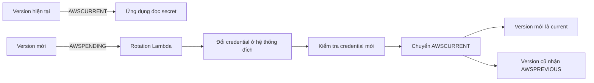
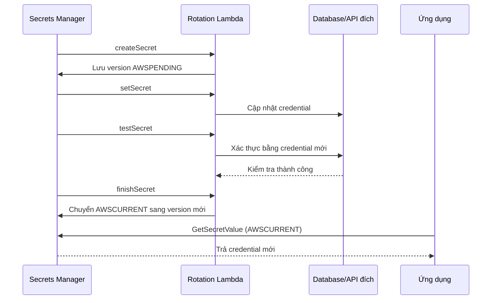
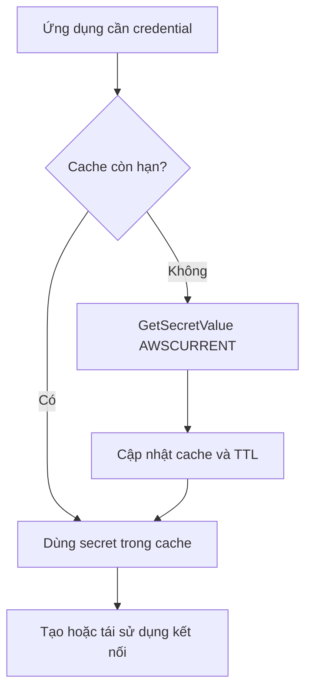

# Rotation secret, đồng bộ credential và cache secret

Trong một hệ thống AWS, secret thường chứa mật khẩu cơ sở dữ liệu, API key, token hoặc thông tin xác thực mà ứng dụng cần để kết nối đến dịch vụ khác. Lưu secret an toàn mới chỉ giải quyết một phần bài toán. Tổ chức còn phải thay credential định kỳ, đồng bộ giá trị mới đến nơi sử dụng và bảo đảm ứng dụng không tiếp tục dùng một giá trị đã hết hiệu lực.

AWS Secrets Manager hỗ trợ lưu trữ, mã hóa, quản lý phiên bản và tự động rotation secret. Dịch vụ có thể phối hợp với AWS Lambda để cập nhật credential ở hệ thống đích. Ứng dụng có thể lấy secret qua AWS SDK hoặc caching client. Khi kết hợp các thành phần này, cần thiết kế rõ nguồn dữ liệu chuẩn, thứ tự cập nhật, thời gian cache và cách phục hồi khi một bước rotation thất bại.

## Mục tiêu học tập

Sau bài học, bạn có thể:

- Giải thích vì sao cần rotation và cách Secrets Manager quản lý các phiên bản secret.
- Mô tả quy trình rotation bốn bước và vai trò của `AWSCURRENT`, `AWSPREVIOUS`, `AWSPENDING`.
- Phân biệt rotation một người dùng và rotation luân phiên hai người dùng cho cơ sở dữ liệu.
- Thiết kế đồng bộ credential cho ứng dụng, container, nhiều Region và dịch vụ bên ngoài.
- Chọn TTL cache phù hợp, xử lý secret cũ sau rotation và tránh làm gián đoạn kết nối.
- Giám sát, kiểm thử và khôi phục quy trình rotation an toàn.

## 1. Vì sao phải rotation secret?

Credential tồn tại lâu làm tăng thời gian mà kẻ tấn công có thể khai thác nếu mật khẩu hoặc token bị lộ. Rotation thay credential hiện tại bằng một credential mới theo lịch hoặc theo sự kiện. Rotation có thể giảm rủi ro từ credential bị lộ, hỗ trợ yêu cầu kiểm soát nội bộ và giúp tổ chức thu hồi quyền truy cập cũ có kế hoạch.

Rotation không tự động bảo đảm an toàn nếu ứng dụng vẫn dùng credential cũ, nếu credential mới không được cập nhật vào hệ thống đích, hoặc nếu một bản secret cũ còn được lưu trong log hay file cấu hình. Một quy trình hoàn chỉnh phải phối hợp ít nhất ba nơi:

1. **Secret store**: nơi lưu giá trị credential chuẩn mà ứng dụng sẽ đọc.
2. **Hệ thống xác thực đích**: ví dụ database hoặc API provider, nơi credential phải được tạo, thay đổi hoặc thu hồi.
3. **Consumer**: ứng dụng, Lambda, container hoặc job sử dụng credential để kết nối.

Mục tiêu là cập nhật cả hệ thống đích và secret store theo một trình tự có thể kiểm tra, sau đó giúp consumer chuyển sang credential mới trước khi credential cũ bị vô hiệu hóa.

### Thành phần thường tham gia

| Thành phần | Vai trò |
|---|---|
| AWS Secrets Manager | Lưu secret, mã hóa bằng AWS KMS, quản lý version và staging label |
| AWS Lambda | Thực thi logic rotation tùy chỉnh hoặc template rotation |
| AWS IAM | Cấp quyền tối thiểu cho rotation function và ứng dụng |
| AWS KMS | Bảo vệ secret khi lưu trữ và kiểm soát quyền giải mã |
| Amazon EventBridge | Nhận sự kiện vòng đời/rotation để kích hoạt xử lý tiếp theo |
| Amazon CloudWatch | Lưu log, metric và cảnh báo lỗi rotation |
| AWS CloudTrail | Ghi nhận hoạt động API quản trị và truy cập Secrets Manager |
| Ứng dụng hoặc dịch vụ đích | Xác thực bằng credential và chuyển sang giá trị mới |

## 2. Version và staging label trong Secrets Manager

Mỗi lần lưu một giá trị secret mới, Secrets Manager tạo một version. Version được định danh bằng version ID và có thể được gắn một hoặc nhiều staging label để chỉ ra vai trò của nó trong vòng đời secret.

Ba staging label quan trọng nhất là:

- `AWSCURRENT`: version hiện được xem là credential hiện hành. Nếu ứng dụng gọi `GetSecretValue` mà không chỉ định version, Secrets Manager trả về version mang label này.
- `AWSPREVIOUS`: version từng là current trước lần chuyển đổi gần nhất. Có thể hữu ích cho điều tra hoặc rollback có kiểm soát, nhưng không có nghĩa credential cũ vẫn được hệ thống đích chấp nhận.
- `AWSPENDING`: version đang được chuẩn bị trong một lần rotation. Ứng dụng thông thường không nên đọc version này.

Khi rotation hoàn tất, label `AWSCURRENT` được chuyển sang version mới; version current trước đó thường nhận label `AWSPREVIOUS`. Label là con trỏ đến version, không phải bản thân secret value.



Việc quản lý label giúp rotation có thể chạy qua nhiều lần gọi Lambda mà vẫn xác định được version đang chờ. Hàm rotation cần kiểm tra version ID và label trước khi thực hiện thao tác để tránh xử lý nhầm một lần rotation khác.

## 3. Quy trình rotation bốn bước

Rotation do Secrets Manager điều phối thường sử dụng một AWS Lambda rotation function. Secrets Manager gọi function theo bốn bước với cùng một `ClientRequestToken` đại diện cho version đang được xử lý.

### Bước 1: `createSecret`

Hàm tạo credential mới và lưu nó thành version có label `AWSPENDING`.

Với database, function có thể tạo mật khẩu ngẫu nhiên bằng API phù hợp, sau đó lưu mật khẩu mới cùng metadata cần thiết như engine, host, port, database name và username. Nếu version `AWSPENDING` cho token hiện tại đã tồn tại, function cần kiểm tra và tái sử dụng version đó thay vì tạo một giá trị mới mỗi lần retry.

### Bước 2: `setSecret`

Hàm dùng credential hiện tại để xác thực với hệ thống đích, sau đó thay đổi hoặc tạo credential mới tại hệ thống đó.

Ví dụ với database, function kết nối bằng tài khoản hiện hành rồi đổi mật khẩu của user mục tiêu. Với API bên ngoài, function có thể gọi API quản trị để tạo key mới hoặc cập nhật token. Trước khi thay đổi, cần xác minh secret thuộc đúng tài nguyên đích để tránh gửi credential đến nhầm database hoặc endpoint.

### Bước 3: `testSecret`

Hàm xác thực bằng credential trong `AWSPENDING` và thực hiện thao tác kiểm tra tối thiểu. Ví dụ, kết nối database, chạy một truy vấn không thay đổi dữ liệu hoặc gọi endpoint kiểm tra quyền. Bước này chứng minh credential mới thực sự hoạt động trước khi Secrets Manager công bố nó là current.

### Bước 4: `finishSecret`

Hàm chuyển `AWSCURRENT` sang version mới. Version hiện tại trước đó được chuyển thành `AWSPREVIOUS` theo cơ chế staging label. Sau bước này, các consumer lấy secret mới mà không cần chỉ định version ID.



Thứ tự này giúp tránh công bố một credential chưa được hệ thống đích chấp nhận. Rotation function phải có tính idempotent: nếu một bước được gọi lại sau timeout hoặc lỗi mạng, function nhận biết trạng thái đã thực hiện và tiếp tục an toàn.

## 4. Rotation tự động và rotation tùy chỉnh

### Rotation do dịch vụ quản lý

Với một số dịch vụ AWS, Secrets Manager cung cấp tích hợp hoặc template rotation được hỗ trợ. Các ví dụ phổ biến gồm Amazon RDS, Amazon Aurora, Amazon Redshift và Amazon DocumentDB. Tùy engine, phiên bản và cấu hình, dịch vụ có thể hỗ trợ rotation một người dùng hoặc luân phiên hai người dùng.

Khi dùng managed rotation, hãy kiểm tra các điều kiện của dịch vụ: loại database, secret JSON format, quyền IAM, network path, security group, VPC subnet và vai trò của Lambda. Việc bật rotation thành công trên secret không bảo đảm Lambda có thể kết nối đến database nếu cấu hình mạng sai.

### Rotation tùy chỉnh

Với API key của nhà cung cấp SaaS, token của hệ thống nội bộ hoặc credential không có template tương ứng, tổ chức có thể viết Lambda rotation function. Function cần biết cách tạo credential mới, cài đặt credential vào hệ thống đích, kiểm tra quyền và thu hồi credential cũ.

Một rotation function an toàn cần:

- Kiểm tra `ClientRequestToken`, version và staging label trước mỗi thao tác.
- Xác minh hostname, resource ID hoặc định danh đích từ secret metadata trước khi thay đổi credential.
- Không ghi secret, password, token hoặc response chứa bí mật vào log.
- Dùng TLS khi kết nối database/API và xác minh chứng chỉ máy chủ.
- Có timeout hợp lý, retry có giới hạn và xử lý lỗi rõ ràng.
- Chỉ cấp IAM permissions cần thiết cho secret cụ thể, KMS key và tài nguyên đích.
- Có thể chạy lại sau lỗi mà không tạo nhiều credential ngoài dự kiến.

### Lên lịch rotation

Secrets Manager cho phép cấu hình rotation theo số ngày hoặc biểu thức lịch. Có thể xác định khoảng thời gian rotation để tránh giờ cao điểm. Tần suất cần dựa trên yêu cầu bảo mật, giới hạn của hệ thống đích và khả năng xử lý credential mới của ứng dụng.

Không nên đặt lịch quá dày nếu hệ thống đích giới hạn số lần tạo credential hoặc consumer không thể làm mới kết nối đủ nhanh. Ngược lại, chu kỳ quá dài làm tăng thời gian phơi nhiễm khi secret bị lộ. Hãy thử lịch trong môi trường kiểm thử và giám sát thời gian hoàn thành thực tế.

Ví dụ bật rotation định kỳ cho một secret đã có rotation Lambda phù hợp:

```bash
aws secretsmanager rotate-secret \
  --secret-id prod/orders/database \
  --rotation-lambda-arn arn:aws:lambda:us-east-1:111122223333:function:rotate-orders-db \
  --rotation-rules '{"AutomaticallyAfterDays":30,"Duration":"2h"}' \
  --no-rotate-immediately
```

Thay ARN bằng Lambda rotation function và account/Region thực tế. Lệnh trên cấu hình lịch; hãy xác minh rotation function đã được triển khai, có quyền truy cập secret và có network access đến hệ thống đích trước khi bật trên production.

## 5. Rotation database: một user và hai user luân phiên

### Single-user rotation

Single-user rotation thay mật khẩu của cùng một database user. Cách này đơn giản, ít tài khoản và dễ hiểu. Tuy nhiên, khi mật khẩu ở database đã đổi mà ứng dụng vẫn giữ mật khẩu cũ trong cache hoặc connection pool, các kết nối mới có thể bị từ chối.

Các kết nối database đã được xác thực và đang mở có thể tiếp tục hoạt động tùy engine và cấu hình. Nhưng khi connection pool cần tạo kết nối mới bằng credential cũ, ứng dụng có thể gặp lỗi. Do đó cần có cơ chế làm mới secret và tái tạo kết nối.

### Alternating-users rotation

Alternating-users rotation sử dụng hai database user có quyền tương đương, thường được gọi là user A và user B. Khi một user đang là current, rotation cập nhật credential của user còn lại, kiểm tra user đó, rồi chuyển secret current sang user mới. Lần rotation tiếp theo sẽ luân phiên trở lại.

Ưu điểm là ứng dụng có thể chuyển sang user mới trong khi user trước vẫn còn tồn tại để hỗ trợ các kết nối đang hoạt động hoặc quá trình chuyển đổi. Hai user cần có quyền tương đương và phải được quản lý chặt chẽ; nếu quyền của hai user lệch nhau, hành vi ứng dụng có thể khác nhau sau rotation.

| Tiêu chí | Single-user | Alternating-users |
|---|---|---|
| Số user | Một | Hai user luân phiên |
| Độ phức tạp | Thấp hơn | Cao hơn |
| Khả năng chuyển đổi | Có thể có khoảng thời gian ứng dụng dùng mật khẩu cũ | Có thể giảm gián đoạn khi chuyển sang user mới |
| Yêu cầu quyền | Quản lý quyền cho một user | Hai user phải có quyền tương đương |
| Phù hợp | Hệ thống có thể refresh connection nhanh hoặc chấp nhận reconnect | Workload cần giảm rủi ro gián đoạn trong lúc đổi credential |

Alternating-users không thay thế việc refresh connection pool. Ứng dụng vẫn phải lấy secret mới, tạo kết nối bằng username/password mới và đóng dần các kết nối cũ theo chính sách phù hợp.

## 6. Đồng bộ credential giữa secret store và consumer

Secrets Manager nên là nguồn dữ liệu chuẩn cho secret được quản lý. Các consumer cần lấy credential từ nguồn này theo một chiến lược phù hợp với cách triển khai ứng dụng.

### Ứng dụng lấy secret lúc chạy

Ứng dụng gọi AWS SDK `GetSecretValue` khi cần credential hoặc dùng caching client để giảm số request. IAM role của workload chỉ nên có quyền đọc secret cụ thể và quyền giải mã KMS cần thiết. Cách này giúp ứng dụng chủ động làm mới secret mà không cần nhúng giá trị vào image hoặc file cấu hình.

### ECS và container environment variable

Amazon ECS có thể lấy secret từ Secrets Manager và đưa vào container dưới dạng environment variable khi task khởi chạy. Giá trị environment variable là snapshot tại thời điểm khởi chạy container. Khi secret rotation hoàn tất, container đang chạy không tự nhận environment variable mới.

Để cập nhật giá trị, có thể triển khai task mới hoặc buộc ECS service deployment để task mới lấy secret current. Nếu ứng dụng cần phản ứng nhanh với rotation mà không restart task, hãy để ứng dụng truy cập Secrets Manager ở runtime và quản lý cache/connection pool.

### Lambda

Lambda function có thể gọi Secrets Manager qua SDK hoặc dùng AWS Parameters and Secrets Lambda Extension để lấy secret và cache trong execution environment. Execution environment được tái sử dụng giữa nhiều lần invoke, vì vậy cache có thể giữ giá trị cũ cho đến khi hết TTL hoặc được làm mới. Thiết kế TTL và xử lý lỗi xác thực phải tính đến hành vi này.

Không nên đặt password thay đổi định kỳ trực tiếp trong Lambda environment variable nếu cần rotation tự động. Hãy dùng secret reference/runtime retrieval để ứng dụng có thể lấy phiên bản hiện hành.

### EKS và Kubernetes

Trên Amazon EKS, workload có thể lấy secret qua AWS SDK, AWS Secrets and Configuration Provider (ASCP) với Secrets Store CSI Driver, hoặc một giải pháp đồng bộ như External Secrets Operator. Mỗi cách có cơ chế cập nhật khác nhau:

- SDK runtime: ứng dụng tự gọi Secrets Manager và quản lý cache.
- CSI mounted file: nội dung file có thể được đồng bộ theo cấu hình rotation của driver; ứng dụng cần đọc lại file để nhận giá trị mới.
- Kubernetes Secret/environment variable: pod thường giữ giá trị đã nạp khi khởi chạy; consumer có thể cần rollout/restart để nhận giá trị cập nhật.

Hãy kiểm tra phiên bản driver, rotation reconciler và cấu hình đồng bộ đang dùng. Không giả định mọi secret mount hoặc environment variable tự cập nhật ngay khi Secrets Manager rotation hoàn tất.

### EC2 và ứng dụng chạy trực tiếp

Ứng dụng trên EC2 có thể dùng instance profile để gọi Secrets Manager qua SDK. Tránh lưu secret trong AMI, user data, source code hoặc file cấu hình được bake vào image. Nếu buộc phải ghi credential xuống file tạm, giới hạn quyền truy cập file, thời gian tồn tại và cơ chế xóa; ưu tiên giữ secret trong bộ nhớ của process.

## 7. Đồng bộ đến dịch vụ bên ngoài và nhiều Region

### Credential của API/SaaS bên ngoài

Nhiều API provider cho phép tồn tại đồng thời hai API key trong một khoảng thời gian. Quy trình an toàn thường là:

1. Tạo key mới ở provider.
2. Lưu key mới thành `AWSPENDING`.
3. Cập nhật consumer hoặc cấu hình đích để dùng key mới.
4. Kiểm tra một request thực tế bằng key mới.
5. Chuyển `AWSCURRENT` sang version mới.
6. Chỉ thu hồi key cũ sau khi các consumer đã chuyển đổi và không còn request hợp lệ dùng key cũ.

Nếu provider chỉ cho phép một key hoạt động tại một thời điểm, rotation có thể gây gián đoạn. Cần phối hợp cửa sổ bảo trì, rollout consumer và quy trình khôi phục. Không thu hồi credential cũ trước khi biết tất cả consumer đã chuyển sang credential mới.

### Đồng bộ bằng sự kiện

Sau khi rotation thành công, EventBridge có thể nhận sự kiện rotation để kích hoạt Lambda hoặc workflow cập nhật hệ thống phụ thuộc. Consumer của sự kiện nên đọc version `AWSCURRENT` từ Secrets Manager thay vì truyền secret value trong event payload.

Event-driven synchronization là bất đồng bộ. Cần xử lý retry, sự kiện trùng lặp, thứ tự sự kiện và tình trạng một hệ thống đích cập nhật chậm. Hãy thiết kế thao tác cập nhật có tính idempotent, theo dõi trạng thái từng consumer và có cơ chế reconciliation để phát hiện nơi chưa nhận credential mới.

### Replication giữa Region

Secrets Manager hỗ trợ replicate secret sang các Region khác. Secret ở Region chính có thể được dùng làm nguồn để cập nhật các replica; ứng dụng ở Region phụ có thể đọc bản replica gần workload hơn. Việc replicate secret giúp phân phối giá trị và hỗ trợ khả năng phục hồi, nhưng không thay thế kiểm thử failover hoặc bảo đảm mọi consumer đổi credential cùng một thời điểm.

Khi triển khai multi-Region, cần xác định Region nào là nơi quản trị secret chính, KMS key nào mã hóa secret ở từng Region, ứng dụng đọc replica nào và cách xử lý khi replication bị chậm hoặc Region chính không khả dụng. Không để mỗi Region tự rotation độc lập cho cùng một credential nếu hệ thống đích chỉ có một trạng thái credential dùng chung.

## 8. Cache secret: giảm độ trễ và chi phí

Mỗi lần gọi `GetSecretValue` đều phát sinh request đến Secrets Manager và có độ trễ mạng. Cache giữ secret trong bộ nhớ của ứng dụng trong một khoảng thời gian để giảm request, giảm latency và tăng khả năng tiếp tục hoạt động khi dịch vụ secret tạm thời gặp sự cố.

Cache tạo ra một đánh đổi: ứng dụng có thể tiếp tục dùng credential cũ sau khi rotation đã hoàn tất. Vì vậy, TTL phải được chọn theo yêu cầu chấp nhận độ cũ của secret và lịch rotation.

### Chọn TTL

TTL là khoảng thời gian tối đa một giá trị cache được xem là còn hợp lệ trước khi cần refresh. Không có một TTL phù hợp cho mọi ứng dụng.

- TTL ngắn giúp ứng dụng nhận secret mới nhanh hơn, nhưng tăng request và phụ thuộc vào Secrets Manager nhiều hơn.
- TTL dài giảm request và latency, nhưng kéo dài khoảng thời gian ứng dụng có thể dùng credential cũ.
- TTL cần nhỏ hơn khoảng thời gian chuyển đổi mà workload có thể chấp nhận. Phải tính cả thời gian rotation, replication, rollout và thời gian sống của connection pool.
- Với workload có nhiều instance, thêm jitter vào thời điểm refresh để tránh tất cả instance gọi Secrets Manager cùng lúc.

AWS cung cấp caching client cho một số ngôn ngữ và runtime. Có thể dùng thư viện được AWS hỗ trợ hoặc triển khai cache riêng có kiểm soát. Hãy xác minh tính năng, TTL mặc định và cách invalidation của phiên bản thư viện đang dùng; không dựa vào giá trị mặc định mà chưa kiểm tra.

### Luồng cache cơ bản



Cache nên được đặt ở phạm vi phù hợp, thường là process hoặc execution environment. Tránh cache dùng chung qua một hệ thống lưu trữ không được bảo vệ. Secret trong cache vẫn là dữ liệu nhạy cảm: giới hạn quyền truy cập process, tránh dump bộ nhớ không cần thiết, không log giá trị và không ghi plaintext xuống disk.

### Cache và connection pool là hai lớp khác nhau

Làm mới secret cache không tự động thay đổi credential đã được dùng để mở connection. Connection pool có thể tiếp tục giữ các kết nối được xác thực bằng user/password cũ. Khi cần tạo connection mới, pool phải dùng secret mới.

Ứng dụng nên có một luồng refresh rõ ràng: lấy secret current, tạo connection mới và kiểm tra, đưa connection mới vào pool, rồi đóng dần connection cũ. Với một số database, kết nối cũ có thể vẫn hoạt động trong khi mật khẩu user đã đổi; điều này không bảo đảm các kết nối mới dùng credential cũ sẽ thành công.

### Xử lý lỗi xác thực sau rotation

Nếu connection hoặc API call thất bại do lỗi xác thực:

1. Xác định đây có phải lỗi xác thực hay lỗi mạng/quyền khác; không refresh secret cho mọi loại lỗi.
2. Invalidate cache hoặc yêu cầu refresh secret `AWSCURRENT`.
3. Tạo lại connection/client bằng credential mới.
4. Retry một lần hoặc số lần giới hạn với backoff và jitter.
5. Nếu vẫn thất bại, phát metric/cảnh báo và trả lỗi có thể quan sát được.

Không retry vô hạn vì có thể tạo tải lớn lên database hoặc Secrets Manager. Không tiếp tục dùng secret cũ mãi như một fallback mặc định, vì credential cũ có thể đã bị thu hồi.

### Pseudocode cache có TTL

Đoạn sau minh họa ý tưởng; đây là pseudocode, cần điều chỉnh theo SDK, runtime và thư viện cache của ứng dụng:

```text
function getCurrentSecret(secretId):
    if cache.contains(secretId) and cache[secretId].expiresAt > now():
        return cache[secretId].value

    response = secretsManager.getSecretValue(
        SecretId = secretId,
        VersionStage = "AWSCURRENT"
    )

    value = parse(response.SecretString)
    cache[secretId] = {
        value: value,
        expiresAt: now() + ttlWithJitter()
    }
    return value

function connectWithRefresh(secretId):
    secret = getCurrentSecret(secretId)
    try:
        return connect(secret.username, secret.password)
    catch AuthenticationError:
        cache.invalidate(secretId)
        latest = getCurrentSecret(secretId)
        return connectOnce(latest.username, latest.password)
```

Pseudocode chỉ thể hiện luồng. Trong triển khai thật, cần phân biệt lỗi xác thực với lỗi kết nối, bảo vệ cấu trúc cache khi nhiều thread truy cập, giới hạn retry và bảo đảm không ghi secret vào log hoặc exception message.

## 9. IAM, KMS và bảo vệ rotation function

Rotation function thường cần quyền đọc secret hiện tại, ghi version pending, chuyển staging label, tạo credential ngẫu nhiên và gọi hệ thống đích. Chỉ cấp các action cần thiết cho secret cụ thể. Nếu secret dùng customer managed KMS key, role cần quyền KMS phù hợp và key policy phải cho phép.

Với database trong private subnet, Lambda rotation function cần chạy trong VPC có route và security group cho phép kết nối đến database. Nếu Lambda không có NAT hoặc đường ra phù hợp, cần cấu hình interface VPC endpoint cho Secrets Manager để function vẫn đọc/ghi secret được. Security group của database nên chỉ nhận traffic từ security group của Lambda hoặc nguồn được xác định. Không mở database ra Internet chỉ để Lambda rotation kết nối.

Một số điểm cần rà soát:

- Role của Lambda không có quyền đọc mọi secret trong account nếu chỉ cần một secret.
- Lambda chỉ có quyền gọi API cần thiết của database hoặc provider.
- KMS key policy và IAM policy cùng cho phép đúng principal.
- Network, DNS, route table, subnet và security group được kiểm thử từ môi trường Lambda.
- Log không chứa password, token, secret JSON hoặc request body nhạy cảm.
- CloudTrail, CloudWatch Logs và cảnh báo được bật theo chính sách lưu trữ phù hợp.
- Secret resource policy được rà soát nếu có truy cập cross-account.

## 10. Giám sát và xử lý sự cố

Rotation là một quy trình có nhiều bước và có thể thất bại giữa chừng. Cần theo dõi trạng thái rotation, Lambda error, timeout, throttling, lỗi kết nối database, lỗi xác thực và thời gian secret chưa được làm mới ở consumer.

Các cảnh báo hữu ích gồm:

- Rotation thất bại hoặc không hoàn tất trong cửa sổ dự kiến.
- Secret không được rotation trong thời gian tối đa theo chính sách.
- Lambda rotation tăng lỗi, timeout hoặc duration bất thường.
- Consumer có tỷ lệ authentication failure tăng sau rotation.
- Một số consumer vẫn đang dùng version cũ quá thời hạn cho phép.
- Secrets Manager hoặc KMS trả về AccessDenied, throttling hoặc lỗi dịch vụ.

### Khi rotation thất bại ở từng bước

| Điểm lỗi | Nguyên nhân thường gặp | Hướng xử lý |
|---|---|---|
| `createSecret` | Thiếu quyền ghi version, lỗi tạo password, token trùng hoặc version state không hợp lệ | Kiểm tra IAM, KMS, token và label; bảo đảm retry idempotent |
| `setSecret` | Lambda không đến được database/API, credential hiện tại sai, resource metadata không khớp | Kiểm tra VPC/security group, endpoint, user và xác minh đúng tài nguyên đích |
| `testSecret` | Credential mới thiếu quyền hoặc chưa được hệ thống đích chấp nhận | Kiểm tra quyền user mới và thao tác test; giữ `AWSCURRENT` hiện tại cho đến khi test thành công |
| `finishSecret` | Lỗi cập nhật staging label hoặc version state thay đổi | Kiểm tra version ID và label; chạy lại bước an toàn sau khi xác minh trạng thái đích |
| Consumer | Cache cũ, task/pod chưa rollout, connection pool giữ kết nối cũ | Refresh secret, tạo connection mới hoặc triển khai lại workload theo cơ chế đã chọn |

Nếu rotation thất bại sau khi hệ thống đích đã đổi credential nhưng trước khi `AWSCURRENT` được chuyển, secret store và hệ thống đích có thể tạm thời không đồng bộ. Không xóa version pending hoặc đổi label thủ công khi chưa hiểu trạng thái database/API. Trước tiên xác định credential nào đang được hệ thống đích chấp nhận, kiểm tra version current/pending, sau đó tiếp tục hoặc khôi phục theo runbook đã thử nghiệm.

## 11. Tình huống thiết kế

### Tình huống A: ứng dụng đơn khối kết nối Amazon RDS

Ứng dụng chạy trên EC2 và kết nối RDS bằng một database user. Secrets Manager lưu JSON chứa username, password, host, port và database name. Rotation Lambda chạy trong VPC, đổi mật khẩu database, kiểm tra kết nối bằng `AWSPENDING`, rồi chuyển `AWSCURRENT`.

Ứng dụng dùng AWS SDK và cache secret với TTL ngắn hơn khoảng thời gian chuyển đổi được chấp nhận. Khi connection pool gặp lỗi xác thực, ứng dụng refresh secret, tạo connection mới và retry có giới hạn. Nhóm vận hành giám sát lỗi rotation và tỷ lệ lỗi kết nối sau mỗi lần đổi mật khẩu.

### Tình huống B: ECS service cần không gián đoạn

ECS task nhận secret dưới dạng environment variable lúc khởi chạy. Khi rotation xong, task hiện tại vẫn giữ giá trị cũ. Nhóm cấu hình EventBridge nhận sự kiện rotation thành công, sau đó workflow kiểm tra trạng thái và khởi tạo ECS deployment để task mới lấy `AWSCURRENT`. Deployment dùng health check và minimum healthy percent phù hợp để duy trì capacity. Chỉ đánh dấu hoàn tất sau khi task mới hoạt động ổn định.

### Tình huống C: SaaS API chỉ cho phép hai key đồng thời

Rotation function tạo key thứ hai, ghi thành `AWSPENDING`, cập nhật consumer, gửi request kiểm tra và chuyển label current. Sau khi xác nhận mọi consumer đã chuyển sang key mới, function hoặc workflow tiếp theo thu hồi key cũ. Nếu cập nhật consumer thất bại, key cũ vẫn còn hiệu lực để có thể tiếp tục phục vụ.

### Tình huống D: workload triển khai ở hai Region

Secret được quản trị tại Region chính và replicate sang Region dự phòng. Workload mỗi Region đọc replica gần nhất. Runbook DR xác minh replication đã hoàn tất, KMS key của Region dự phòng còn khả dụng, IAM role có thể đọc secret và credential ở hệ thống đích vẫn hợp lệ. Ứng dụng không tự tạo một lịch rotation độc lập tại Region phụ cho cùng một tài khoản database.

## 12. Checklist triển khai

Trước khi bật rotation trên production, hãy xác nhận:

- [ ] Secret có owner, mục đích, hệ thống đích và consumer được ghi nhận.
- [ ] `AWSCURRENT`, `AWSPREVIOUS` và `AWSPENDING` được hiểu đúng trong runbook.
- [ ] Rotation function có thể chạy lặp an toàn và xử lý timeout giữa các bước.
- [ ] Function xác minh đúng tài nguyên đích trước khi thay đổi credential.
- [ ] IAM, KMS, VPC, DNS, route và security group đã được kiểm thử.
- [ ] Credential mới được test trước khi chuyển `AWSCURRENT`.
- [ ] Có kế hoạch chuyển đổi consumer và connection pool sau rotation.
- [ ] TTL cache phù hợp với lịch rotation, thời gian rollout và yêu cầu chấp nhận độ cũ.
- [ ] ECS/EKS/Lambda/EC2 được cấu hình theo đúng cơ chế cập nhật secret của runtime.
- [ ] Credential cũ chỉ bị thu hồi sau khi consumer đã chuyển đổi an toàn.
- [ ] Có cảnh báo rotation failure, authentication failure và consumer chưa đồng bộ.
- [ ] Đã thử nghiệm lỗi ở từng bước và có runbook khôi phục.
- [ ] Secret và credential không xuất hiện trong log, source code, image hoặc file cấu hình không bảo vệ.

## Kết luận

Rotation secret là quy trình phối hợp giữa Secrets Manager, hệ thống xác thực đích và consumer. Bốn bước `createSecret`, `setSecret`, `testSecret` và `finishSecret` giúp chuẩn bị credential mới, cài đặt, xác minh rồi mới công bố version current. Việc đồng bộ đến ECS, EKS, Lambda, EC2, API provider hoặc Region khác cần tính đến cơ chế cập nhật của từng runtime.

Cache giúp giảm độ trễ và số request, nhưng làm tăng khả năng ứng dụng tiếp tục dùng credential cũ. Chọn TTL theo yêu cầu của workload, refresh cache khi có lỗi xác thực, cập nhật connection pool và giám sát consumer sau rotation. Một thiết kế tốt phải có khả năng retry an toàn, quan sát được trạng thái và khôi phục khi secret store cùng hệ thống đích tạm thời không đồng bộ.

## Tài liệu tham khảo

- [AWS Secrets Manager User Guide](https://docs.aws.amazon.com/secretsmanager/latest/userguide/intro.html)
- [Rotate AWS Secrets Manager secrets](https://docs.aws.amazon.com/secretsmanager/latest/userguide/rotating-secrets.html)
- [Rotation schedules](https://docs.aws.amazon.com/secretsmanager/latest/userguide/rotate-secrets_schedule.html)
- [Rotation function four steps](https://docs.aws.amazon.com/secretsmanager/latest/userguide/rotate-secrets_lambda-functions.html)
- [Secret versions](https://docs.aws.amazon.com/secretsmanager/latest/userguide/whats-in-a-secret.html)
- [Caching secrets](https://docs.aws.amazon.com/secretsmanager/latest/userguide/retrieving-secrets_cache.html)
- [Replicate secrets across Regions](https://docs.aws.amazon.com/secretsmanager/latest/userguide/replicate-secrets.html)
- [AWS Parameters and Secrets Lambda Extension](https://docs.aws.amazon.com/secretsmanager/latest/userguide/retrieving-secrets_lambda.html)
- [Amazon ECS secrets](https://docs.aws.amazon.com/AmazonECS/latest/developerguide/secrets-envvar-secrets-manager.html)
- [Amazon EKS Secrets Store CSI Driver provider](https://docs.aws.amazon.com/secretsmanager/latest/userguide/integrating_csi_driver.html)
