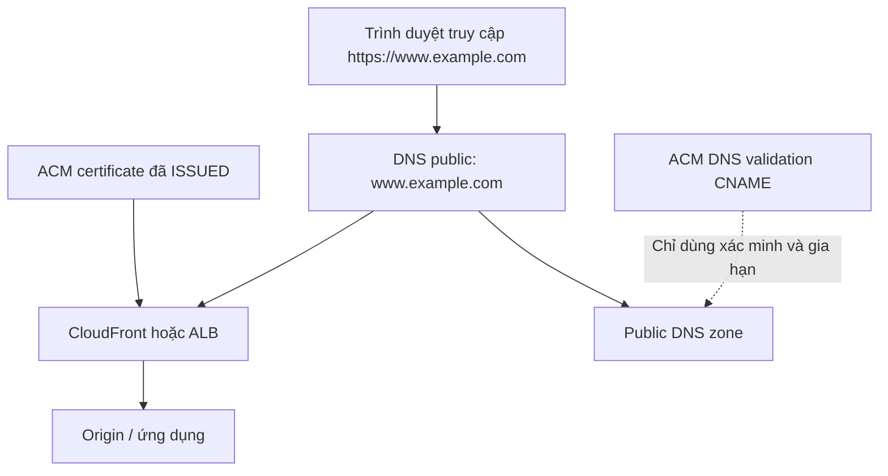

# ACM, xác minh tên miền và tự động gia hạn chứng chỉ

AWS Certificate Manager (ACM) giúp yêu cầu, quản lý và triển khai chứng chỉ TLS/SSL cho các dịch vụ AWS. Khi một website hoặc API dùng tên miền riêng, chứng chỉ TLS giúp trình duyệt và client xác minh danh tính máy chủ, đồng thời mã hóa dữ liệu trong quá trình truyền. Để ACM cấp chứng chỉ công khai, chủ thể yêu cầu phải chứng minh quyền kiểm soát các tên miền được đưa vào chứng chỉ. Sau khi cấp, chứng chỉ cũng cần được gia hạn trước ngày hết hạn để kết nối HTTPS không bị gián đoạn.

Trong module `CLOUD_PROVIDERS_AWS`, ACM liên kết trực tiếp với DNS, IAM, mạng và các dịch vụ triển khai ứng dụng. Route 53 có thể lưu bản ghi xác minh DNS; IAM kiểm soát ai được yêu cầu hoặc gắn chứng chỉ; Application Load Balancer, CloudFront và API Gateway sử dụng chứng chỉ để phục vụ HTTPS. Việc xác minh tên miền, triển khai chứng chỉ và định tuyến lưu lượng là các bước riêng cần phối hợp chính xác.

Sau bài học, bạn có thể:

- Giải thích vai trò của ACM và sự khác nhau giữa chứng chỉ công khai, chứng chỉ riêng và chứng chỉ import.
- Chọn phương thức xác minh tên miền phù hợp, ưu tiên DNS validation.
- Tạo và duy trì CNAME validation record để ACM cấp và tự động gia hạn chứng chỉ.
- Kiểm tra điều kiện gia hạn, trạng thái chứng chỉ và sự kiện cảnh báo.
- Xử lý lỗi `PENDING_VALIDATION`, `VALIDATION_TIMED_OUT` và gia hạn không thành công.
- Chọn đúng Region và gắn chứng chỉ vào dịch vụ AWS cần HTTPS.

## 1. Vai trò của AWS Certificate Manager

Chứng chỉ số TLS là một cấu trúc dữ liệu được CA (Certificate Authority) ký, liên kết public key với một hoặc nhiều tên miền. Khi trình duyệt kết nối HTTPS, máy chủ trình bày chứng chỉ và chứng minh đang sở hữu private key tương ứng. Trình duyệt kiểm tra chữ ký CA, thời hạn, chuỗi tin cậy và tên miền trong chứng chỉ trước khi thiết lập kết nối TLS.

ACM cung cấp các khả năng chính:

- Yêu cầu chứng chỉ công khai được CA công khai tin cậy cấp.
- Yêu cầu chứng chỉ riêng từ AWS Private Certificate Authority (AWS Private CA) khi tài khoản có cấu hình CA phù hợp.
- Import chứng chỉ do CA bên ngoài cấp.
- Quản lý trạng thái, thông tin tên miền, thời hạn và quá trình gia hạn của các chứng chỉ đủ điều kiện.
- Tích hợp chứng chỉ với các dịch vụ AWS như Elastic Load Balancing, Amazon CloudFront và Amazon API Gateway.

ACM giảm công việc tạo CSR, phân phối private key và cài đặt chứng chỉ thủ công khi dùng quy trình cấp chứng chỉ do ACM quản lý. Với chứng chỉ công khai do ACM cấp, ACM quản lý private key theo quy trình dịch vụ; quyền xem thông tin chứng chỉ và quyền sử dụng chứng chỉ được kiểm soát riêng.

### 1.1. Phân biệt các loại chứng chỉ

| Loại chứng chỉ | Nguồn cấp | Phạm vi tin cậy | Trách nhiệm gia hạn |
|---|---|---|---|
| Public certificate do ACM cấp | CA công khai thông qua ACM | Trình duyệt và client công khai tin cậy | ACM managed renewal nếu đáp ứng điều kiện |
| Private certificate do ACM cấp qua AWS Private CA | Private CA của tổ chức | Chỉ client tin cậy CA riêng | Có thể được ACM managed renewal nếu đáp ứng điều kiện |
| Imported certificate | CA bên ngoài hoặc PKI riêng | Theo CA phát hành và trust store của client | Chủ sở hữu theo dõi, gia hạn và import lại |

Chứng chỉ công khai phù hợp với website và API có thể truy cập từ Internet. Chứng chỉ riêng phù hợp với dịch vụ nội bộ, workload trong VPC hoặc hệ thống mà tổ chức quản lý trust store. Chứng chỉ import hữu ích khi doanh nghiệp đã có CA hoặc quy trình PKI riêng, nhưng việc theo dõi ngày hết hạn và cập nhật chứng chỉ mới thuộc trách nhiệm của đội vận hành.

Không nên nhầm việc ACM lưu một chứng chỉ với việc ACM tự động gia hạn chứng chỉ đó. Chứng chỉ import không đủ điều kiện cho ACM managed renewal; khi CA bên ngoài phát hành bản mới, tổ chức phải import lại trước khi chứng chỉ hiện tại hết hạn.

### 1.2. ACM certificate là tài nguyên theo Region

Chứng chỉ ACM là tài nguyên có phạm vi Region. Nếu một Application Load Balancer chạy ở `ap-southeast-1`, chứng chỉ gắn vào listener của ALB phải có sẵn trong cùng Region. API Gateway với custom domain kiểu Regional cũng cần chứng chỉ ở Region của API.

CloudFront là ngoại lệ quan trọng: chứng chỉ ACM dùng cho HTTPS giữa người dùng và CloudFront distribution phải được yêu cầu hoặc import ở Region `us-east-1` (US East, N. Virginia), bất kể người dùng và origin ở đâu.

| Nơi sử dụng | Region của chứng chỉ ACM |
|---|---|
| Application Load Balancer hoặc Network Load Balancer | Cùng Region với load balancer |
| API Gateway Regional custom domain | Cùng Region với API |
| API Gateway Edge-optimized custom domain | `us-east-1` |
| CloudFront viewer certificate | `us-east-1` |

Nếu cần dùng cùng một tên miền cho nhiều Region, có thể yêu cầu các chứng chỉ riêng tại từng Region. Với DNS validation, ACM có thể tái sử dụng validation token cho cùng FQDN và cùng tài khoản ở nhiều Region nếu CNAME tương ứng vẫn còn trong DNS.

## 2. Tên miền trong chứng chỉ và phạm vi xác minh

Khi yêu cầu chứng chỉ, bạn chỉ định một tên miền chính (fully qualified domain name - FQDN) và có thể thêm các tên miền khác trong Subject Alternative Name (SAN).

Ví dụ, một chứng chỉ có thể chứa:

- `example.com`: tên miền gốc.
- `www.example.com`: tên miền website.
- `api.example.com`: tên miền API.
- `*.example.com`: wildcard cho các tên miền con cấp một.

Wildcard `*.example.com` có thể bao phủ `www.example.com` hoặc `api.example.com`, nhưng không bao phủ `example.com` và cũng không bao phủ tên miền nhiều cấp như `v2.api.example.com`. Nếu cần cả tên miền gốc và wildcard, hãy đưa cả hai tên vào chứng chỉ.

ACM yêu cầu xác minh quyền kiểm soát tất cả tên miền trong yêu cầu chứng chỉ công khai. Mỗi tên miền SAN có thể cần một validation record riêng. Với tên miền gốc và wildcard tương ứng, ACM có thể dùng chung một cặp CNAME validation record; hãy dùng chính xác các giá trị ACM trả về thay vì tự tạo token.

Xác minh tên miền chứng minh người yêu cầu kiểm soát DNS hoặc kênh email của tên miền. Nó không chứng minh website đã trỏ tới đúng máy chủ, cũng không tự cấu hình HTTPS cho ứng dụng. Sau khi chứng chỉ được cấp, vẫn cần gắn chứng chỉ vào dịch vụ và cấu hình DNS lưu lượng tới endpoint tương ứng.

## 3. Các phương thức xác minh tên miền

ACM có các phương thức xác minh cho chứng chỉ công khai. DNS validation là lựa chọn được khuyến nghị cho phần lớn hệ thống vì dễ tự động hóa và hỗ trợ gia hạn tự động. Email validation vẫn có thể gặp trong hệ thống hiện hữu, còn HTTP validation dành cho trường hợp CloudFront được hỗ trợ.

| Phương thức | Cách chứng minh quyền kiểm soát | Điểm mạnh | Điều cần lưu ý |
|---|---|---|---|
| DNS validation | Thêm CNAME do ACM cung cấp vào DNS công khai | Tự động hóa tốt; hỗ trợ managed renewal | Phải giữ CNAME trong DNS và tên miền phải phân giải công khai |
| Email validation | Nhận email tại địa chỉ quản trị và bấm liên kết xác minh | Không cần sửa DNS | Cần người nhận xử lý email; gia hạn cần xác minh lại |
| HTTP validation | Cấu hình redirect/challenge HTTP theo hướng dẫn ACM | Có thể tự động hóa với CloudFront | Chỉ áp dụng cho chứng chỉ dùng với CloudFront theo phạm vi hỗ trợ |

AWS thông báo sẽ ngừng email validation trong năm 2027 đối với chứng chỉ công khai mới và các lần gia hạn. Vì vậy, khi thiết kế hệ thống mới, nên chọn DNS validation; với chứng chỉ đang dùng email validation, cần lập kế hoạch chuyển đổi theo hướng dẫn ACM trước khi phương thức này bị ngừng hỗ trợ.

## 4. DNS validation hoạt động như thế nào?

Khi chọn DNS validation, ACM tạo một hoặc nhiều cặp giá trị CNAME. Mỗi cặp là bằng chứng rằng người yêu cầu có quyền chỉnh sửa DNS của tên miền. Bản ghi thường có dạng:

```text
Record name:  _token.example.com
Record type:  CNAME
Record value: _another-token.acm-validations.aws
```

Các chuỗi `token` là ví dụ minh họa. Khi triển khai thật, hãy sao chép nguyên văn Record name và Record value từ ACM console, API hoặc AWS CLI.

Quy trình xác minh:

1. Người vận hành yêu cầu chứng chỉ và chọn DNS validation.
2. ACM tạo CNAME validation record cho từng tên miền cần xác minh.
3. Người có quyền quản lý DNS công khai thêm các CNAME record vào zone có thẩm quyền.
4. ACM truy vấn DNS công khai để tìm đúng cặp tên và giá trị.
5. Khi mọi tên miền đã được xác minh, ACM phát hành chứng chỉ và chuyển trạng thái sang `ISSUED`.

Nếu sử dụng Route 53 làm DNS provider và tài khoản có quyền ghi vào public hosted zone tương ứng, ACM console có thể cung cấp nút tạo record trực tiếp. Nếu dùng nhà cung cấp DNS khác, hãy thêm record theo giao diện hoặc API của nhà cung cấp đó.

### 4.1. Thêm CNAME vào DNS công khai

Giả sử ACM cung cấp:

```text
Name:  _a1b2c3.example.com
Type:  CNAME
Value: _d4e5f6.acm-validations.aws
```

Người quản trị cần tạo một CNAME có đúng name và value ở authoritative public DNS zone của `example.com`.

Một số nhà cung cấp DNS tự động nối tên zone vào phần Name. Nếu nhập toàn bộ FQDN trong giao diện tự nối suffix, record có thể bị tạo thành `_a1b2c3.example.com.example.com`. Hãy đọc quy tắc của DNS provider để xác định cần nhập tên đầy đủ hay chỉ phần nhãn.

Các yêu cầu quan trọng:

- Record phải tồn tại trong DNS công khai có thẩm quyền của tên miền.
- Record name và value phải khớp chính xác dữ liệu ACM cung cấp.
- Không thay CNAME thành A, TXT hoặc loại record khác.
- Không xóa hoặc đổi CNAME khi còn muốn ACM tự động gia hạn chứng chỉ.
- Nếu DNS provider có proxy cho record, hãy bảo đảm truy vấn CNAME validation được phân giải công khai đúng theo giá trị ACM cung cấp.
- Không đặt quá tám CNAME liên tiếp trong chuỗi phân giải; ACM không thể xác minh nếu chuỗi CNAME vượt giới hạn này.

Một private hosted zone trong VPC không đủ để xác minh public certificate. ACM phải truy vấn được record qua public DNS. Tên miền nội bộ hoặc tên miền không được công khai cần cân nhắc chứng chỉ private từ AWS Private CA.

### 4.2. Tái sử dụng DNS validation record

CNAME validation record không chỉ phục vụ lần cấp chứng chỉ đầu tiên. Khi record còn tồn tại, ACM có thể dùng lại token để:

- Gia hạn chứng chỉ DNS-validated đủ điều kiện.
- Yêu cầu chứng chỉ mới cho cùng FQDN.
- Tạo chứng chỉ thay thế sau khi xóa chứng chỉ cũ.
- Yêu cầu chứng chỉ cho cùng tên miền ở Region khác trong cùng tài khoản.

Tên miền gốc và wildcard tương ứng có thể dùng chung record. Các SAN khác như `www.example.com` thường có record riêng. Nếu chứng chỉ chứa nhiều SAN, hãy kiểm tra đủ tất cả record ACM yêu cầu; thiếu một record có thể khiến quá trình cấp hoặc gia hạn không hoàn tất.

CNAME validation không phải record định tuyến website. Record này chỉ chứng minh quyền kiểm soát tên miền. Để đưa người dùng tới ứng dụng, DNS zone vẫn cần record định tuyến riêng như Alias/A/AAAA tới ALB hoặc CloudFront, tùy kiến trúc.

## 5. Email validation và giới hạn của phương thức này

Với email validation, ACM gửi thông điệp xác minh tới các địa chỉ quản trị phổ biến của tên miền, gồm:

- `admin@example.com`
- `administrator@example.com`
- `hostmaster@example.com`
- `postmaster@example.com`
- `webmaster@example.com`

Người quản lý tên miền mở email và bấm liên kết xác minh. Mỗi tên miền trong chứng chỉ cần được xác minh theo yêu cầu của ACM. Email validation đòi hỏi các hộp thư hoạt động, có người chịu trách nhiệm và không chặn email từ ACM.

Liên kết xác minh có thời hạn; token trong email ban đầu hết hạn sau 72 giờ. Nếu email bị thất lạc hoặc token hết hạn, có thể gửi lại email xác minh từ ACM console hoặc API phù hợp. Với hệ thống đang vận hành, cần lưu lại địa chỉ nhận email và quy trình xử lý để tránh chứng chỉ bị treo ở trạng thái chờ.

Email validation cũng ảnh hưởng tới gia hạn. ACM gửi thông báo gia hạn khoảng 45 ngày trước khi chứng chỉ hết hạn; chủ thể tên miền phải bấm liên kết trong email để xác minh lại các tên miền. Nếu không hoàn tất xác minh, ACM không thể gia hạn chứng chỉ. AWS đã thông báo lộ trình ngừng email validation trong năm 2027, do đó DNS validation là phương án phù hợp hơn cho hệ thống mới.

## 6. HTTP validation cho CloudFront

ACM hỗ trợ HTTP validation cho chứng chỉ dùng với CloudFront. Phương thức này sử dụng cơ chế HTTP redirect/challenge để chứng minh quyền kiểm soát tên miền. Nó có thể hỗ trợ quy trình xác minh và gia hạn tự động khi cấu hình redirect đáp ứng yêu cầu của ACM.

HTTP validation chỉ phù hợp trong phạm vi dịch vụ và điều kiện được AWS hỗ trợ. Nếu hệ thống đang dùng DNS validation, không cần chuyển sang HTTP chỉ để tự động hóa; DNS validation thường đơn giản hơn khi tổ chức kiểm soát được public DNS. Khi chọn HTTP validation, hãy làm theo chính xác thông tin challenge và redirect mà ACM cung cấp, đồng thời theo dõi các thay đổi ở CDN, origin và quy tắc redirect để challenge luôn truy cập được.

## 7. Yêu cầu và xác minh chứng chỉ bằng AWS CLI

Ví dụ sau yêu cầu một public certificate cho tên miền gốc và hai SAN. Chứng chỉ được tạo ở Region `ap-southeast-1` và dùng DNS validation:

```bash
aws acm request-certificate \
  --domain-name example.com \
  --subject-alternative-names www.example.com api.example.com \
  --validation-method DNS \
  --region ap-southeast-1
```

Lệnh trả về ARN của certificate request. Sau khi gửi yêu cầu, dùng ARN để kiểm tra thông tin:

```bash
aws acm describe-certificate \
  --certificate-arn arn:aws:acm:ap-southeast-1:111122223333:certificate/12345678-1234-1234-1234-123456789012 \
  --region ap-southeast-1
```

Trong kết quả, chú ý các trường:

- `Status`: trạng thái cấp chứng chỉ, chẳng hạn `PENDING_VALIDATION` hoặc `ISSUED`.
- `DomainValidationOptions`: từng tên miền và trạng thái xác minh.
- `ResourceRecord`: CNAME name, type và value cần thêm vào DNS.
- `NotBefore`, `NotAfter`: thời điểm bắt đầu và kết thúc hiệu lực.
- `RenewalSummary`: trạng thái của quá trình managed renewal khi có thông tin.

Có thể lọc thông tin quan trọng bằng query:

```bash
aws acm describe-certificate \
  --certificate-arn arn:aws:acm:ap-southeast-1:111122223333:certificate/12345678-1234-1234-1234-123456789012 \
  --region ap-southeast-1 \
  --query "Certificate.{Status:Status,Domains:DomainValidationOptions,Renewal:RenewalSummary,NotAfter:NotAfter}"
```

Để kiểm tra CNAME đã được public DNS phân giải hay chưa, dùng `dig` hoặc `nslookup`:

```bash
dig +short CNAME _a1b2c3.example.com
```

Kết quả cần trỏ tới đúng target `_another-token.acm-validations.aws` mà ACM cung cấp. Nếu truy vấn không trả về record, hãy kiểm tra authoritative nameserver, public hosted zone, tên record và việc DNS provider có tự nối suffix hay không.

## 8. Trạng thái chứng chỉ và trạng thái gia hạn

Cần phân biệt trạng thái cấp chứng chỉ với trạng thái managed renewal. Chứng chỉ có thể đang `ISSUED` nhưng quá trình gia hạn vẫn chờ xác minh hoặc gặp lỗi.

### 8.1. Trạng thái cấp chứng chỉ

| Trạng thái | Ý nghĩa | Hướng xử lý |
|---|---|---|
| `PENDING_VALIDATION` | ACM đang chờ xác minh các tên miền | Thêm DNS CNAME, xử lý email hoặc HTTP challenge theo phương thức đã chọn |
| `ISSUED` | Chứng chỉ đã được cấp | Gắn vào dịch vụ AWS và kiểm tra HTTPS |
| `INACTIVE` | Chứng chỉ chưa ở trạng thái có thể sử dụng trong cấu hình hiện tại | Kiểm tra quy trình cấp, import hoặc trạng thái liên quan |
| `VALIDATION_TIMED_OUT` | ACM không xác minh được trong thời hạn chờ | Sửa DNS/email/challenge rồi yêu cầu chứng chỉ mới |
| `FAILED` | Yêu cầu cấp chứng chỉ thất bại | Đọc lý do và điều chỉnh cấu hình trước khi gửi yêu cầu mới |
| `EXPIRED` | Chứng chỉ đã hết hạn | Cấp hoặc gia hạn chứng chỉ hợp lệ, cập nhật dịch vụ |
| `REVOKED` | Chứng chỉ đã bị thu hồi | Xác định nguyên nhân, cấp chứng chỉ thay thế và triển khai |

ACM thường thử xác minh trong tối đa 72 giờ. Nếu hết thời gian mà không xác minh được, yêu cầu chuyển sang `VALIDATION_TIMED_OUT`. Sau khi sửa lỗi DNS hoặc email, cần tạo yêu cầu chứng chỉ mới theo quy trình được ACM hướng dẫn.

### 8.2. Trạng thái RenewalSummary

| Trạng thái gia hạn | Ý nghĩa | Hành động |
|---|---|---|
| `PENDING_AUTO_RENEWAL` | ACM đang thực hiện quy trình xác minh tự động | Theo dõi tiến trình; kiểm tra điều kiện nếu trạng thái kéo dài |
| `PENDING_VALIDATION` | ACM không thể tự xác minh một hoặc nhiều tên miền | Khôi phục CNAME hoặc hoàn tất xác minh email/HTTP |
| `SUCCESS` | Chứng chỉ đã được gia hạn | Xác nhận dịch vụ đã nhận chứng chỉ mới |
| `FAILED` | Không xác minh được trước hạn và chứng chỉ không được gia hạn | Yêu cầu chứng chỉ mới, khắc phục nguyên nhân và cập nhật dịch vụ |

Quá trình gia hạn là bất đồng bộ. Sau khi tất cả tên miền được xác minh, ACM có thể cần thêm thời gian để phát hành bản mới và các dịch vụ tích hợp cập nhật chứng chỉ. Thay đổi trạng thái có thể mất vài giờ mới xuất hiện đầy đủ.

## 9. Điều kiện để ACM tự động gia hạn

Managed renewal áp dụng cho chứng chỉ do ACM phát hành và đủ điều kiện. Với public certificate DNS-validated, ACM kiểm tra các điều kiện chính trước khi gia hạn:

1. Chứng chỉ vẫn đang được một dịch vụ AWS tích hợp sử dụng, hoặc đã được export kể từ lần phát hành/gia hạn gần nhất trong trường hợp chứng chỉ hỗ trợ export.
2. Tất cả CNAME validation record cần thiết vẫn tồn tại và truy cập được qua public DNS.
3. Các tên miền trong chứng chỉ vẫn được xác minh theo phương thức đã chọn.
4. Chứng chỉ chưa hết hạn và không thuộc loại bị loại khỏi managed renewal.

Với chứng chỉ DNS-validated có thời hạn 198 ngày, ACM kiểm tra điều kiện gia hạn khoảng 45 ngày trước ngày hết hạn. Các chứng chỉ cũ có thời hạn 395 ngày có lịch gia hạn khác; không nên áp dụng mốc cũ cho chứng chỉ mới. Với email validation, ACM gửi thông báo gia hạn 45 ngày trước ngày hết hạn và cần người nhận thực hiện xác minh. HTTP validation dùng quy trình challenge tương ứng cho CloudFront.

Chứng chỉ import không được ACM managed renewal. Chứng chỉ private được cấp trực tiếp bằng API AWS Private CA `IssueCertificate` cũng không đủ điều kiện cho quy trình managed renewal của ACM. Hãy phân biệt nguồn cấp và cách cấp trước khi thiết kế lịch vận hành.

### 9.1. Điều gì xảy ra khi ACM gia hạn thành công?

Khi ACM gia hạn chứng chỉ, ARN của chứng chỉ giữ nguyên. Dịch vụ AWS tích hợp có thể phát hiện bản gia hạn và cập nhật chứng chỉ được sử dụng. Đội vận hành vẫn nên theo dõi trạng thái gia hạn, kiểm tra cấu hình listener/distribution và xác nhận HTTPS hoạt động sau khi quá trình phân phối hoàn tất.

Nếu một chứng chỉ được dùng ở nhiều nơi, cần xác minh từng dịch vụ có tham chiếu đúng ARN và trạng thái triển khai. Với các chứng chỉ ở nhiều Region, mỗi bản chứng chỉ là tài nguyên riêng và được gia hạn độc lập.

### 9.2. Những thay đổi có thể làm mất khả năng tự động gia hạn

Các hành động sau có thể khiến ACM không thể gia hạn:

- Xóa CNAME validation record hoặc đổi value.
- Chuyển authoritative nameserver sang DNS provider mới nhưng quên sao chép CNAME validation.
- Xóa chứng chỉ khỏi dịch vụ AWS tích hợp và không export chứng chỉ trong điều kiện được hỗ trợ.
- Xóa hoặc thay đổi redirect challenge khi dùng HTTP validation.
- Không xử lý email xác minh khi chứng chỉ dùng email validation.
- Để chứng chỉ hết hạn hoặc dùng chứng chỉ import nhưng không có quy trình reimport.

Vì vậy, validation record nên được quản lý như cấu hình hạ tầng quan trọng. Khi di chuyển DNS, thay nhà cung cấp DNS hoặc tái cấu trúc hosted zone, hãy kiểm tra toàn bộ record ACM trước khi hoàn tất thay đổi.

## 10. Gắn chứng chỉ vào dịch vụ AWS

Cấp chứng chỉ thành công chưa có nghĩa ứng dụng đã dùng HTTPS. Cần gắn chứng chỉ vào dịch vụ kết thúc TLS:

- **Application Load Balancer**: chọn chứng chỉ trong HTTPS listener. ALB giải mã TLS ở lớp load balancer rồi chuyển request tới target group theo cấu hình.
- **CloudFront**: gắn chứng chỉ vào distribution và khai báo alternate domain names (CNAMEs) tương ứng. Viewer certificate phải nằm ở `us-east-1`.
- **API Gateway**: tạo custom domain và chọn certificate ARN phù hợp với endpoint type và Region.
- **Các dịch vụ AWS tích hợp khác**: làm theo hướng dẫn của dịch vụ về loại chứng chỉ, Region và cách association.

Ví dụ kiến trúc website:



Sơ đồ cho thấy hai mục đích DNS khác nhau. Record định tuyến đưa người dùng đến endpoint; CNAME validation chứng minh quyền kiểm soát tên miền và hỗ trợ gia hạn. Không thay record định tuyến bằng CNAME validation hoặc ngược lại.

### 10.1. Kiểm tra TLS sau khi gắn chứng chỉ

Sau khi association và deployment hoàn tất, hãy kiểm tra:

- Tên miền người dùng truy cập nằm trong SAN của chứng chỉ.
- Chứng chỉ đang có hiệu lực, chưa hết hạn và được trình duyệt tin cậy.
- Endpoint trả về đúng chứng chỉ mới.
- Chuỗi chứng chỉ trung gian đầy đủ và client có thể xác minh.
- DNS lưu lượng trỏ đến endpoint mong muốn.
- Listener hoặc distribution đang dùng đúng certificate ARN.

Có thể dùng trình duyệt hoặc công cụ TLS như `openssl s_client` để kiểm tra chứng chỉ mà endpoint thực sự trình bày. Chỉ nhìn trạng thái `ISSUED` trong ACM chưa đủ để kết luận HTTPS trên website đã hoạt động.

## 11. Theo dõi gia hạn và cảnh báo

Không nên đợi người dùng báo lỗi chứng chỉ hết hạn. Hãy theo dõi trạng thái gia hạn và các sự kiện AWS Health/EventBridge để đội vận hành xử lý trước ngày hết hạn.

Với chứng chỉ DNS-validated, nếu ACM không thể tự xác minh khi tới thời điểm gia hạn, AWS có thể phát sự kiện nhắc ở các mốc 30, 15, 7, 3 và 1 ngày trước ngày hết hạn. Các sự kiện này giúp tạo cảnh báo, ticket hoặc quy trình khắc phục tự động.

Một quy trình giám sát nên gồm:

1. Liệt kê chứng chỉ ACM theo từng Region và tài khoản.
2. Lưu ý `NotAfter`, trạng thái chứng chỉ, SAN và dịch vụ đang sử dụng.
3. Theo dõi `RenewalSummary.RenewalStatus` khi trường này xuất hiện.
4. Tạo EventBridge rule hoặc dùng AWS Health để nhận sự kiện gia hạn không thành công.
5. Gửi cảnh báo tới nhóm sở hữu DNS, nhóm ứng dụng và nhóm nền tảng.
6. Sau khi sửa, kiểm tra trạng thái gia hạn và endpoint HTTPS thực tế.

Với chứng chỉ import, cần có lịch theo dõi riêng dựa trên `NotAfter`, vì ACM không tự gia hạn thay CA bên ngoài. Có thể dùng EventBridge hoặc công cụ quản lý tài sản chứng chỉ để cảnh báo trước thời hạn, sau đó yêu cầu CA cấp mới và import lại.

## 12. Tình huống thực tế: triển khai HTTPS cho website bán hàng

Một hệ thống thương mại điện tử có tên miền `shop.example.com`, `www.example.com` và `api.example.com`. Website phân phối nội dung qua CloudFront, API chạy sau Application Load Balancer ở Region `ap-southeast-1`.

Nhóm nền tảng triển khai như sau:

1. Yêu cầu chứng chỉ chứa các SAN cần thiết bằng DNS validation.
2. Vì CloudFront phục vụ viewer HTTPS, yêu cầu một chứng chỉ ở `us-east-1`.
3. Nếu ALB kết thúc TLS cho API, yêu cầu một chứng chỉ khác ở `ap-southeast-1`.
4. Thêm các CNAME validation record do ACM tạo vào public DNS zone.
5. Chờ cả hai yêu cầu chứng chỉ chuyển sang `ISSUED`.
6. Gắn chứng chỉ `us-east-1` vào CloudFront và chứng chỉ `ap-southeast-1` vào HTTPS listener của ALB.
7. Cấu hình DNS lưu lượng cho `shop.example.com`, `www.example.com` và `api.example.com` trỏ đến đúng endpoint.
8. Thiết lập cảnh báo EventBridge/AWS Health và đưa CNAME validation vào quy trình quản lý DNS.

Khi đội mạng di chuyển DNS provider, họ phải sao chép cả record định tuyến và CNAME validation. Nếu chỉ chuyển record định tuyến, website vẫn có thể truy cập nhưng ACM có thể không gia hạn được chứng chỉ. Đây là lỗi vận hành nguy hiểm vì hệ thống có thể hoạt động bình thường trong thời gian dài trước khi chứng chỉ gần hết hạn.

## 13. Xử lý các lỗi thường gặp

| Triệu chứng | Nguyên nhân có thể | Cách kiểm tra và xử lý |
|---|---|---|
| Chứng chỉ ở `PENDING_VALIDATION` | CNAME chưa tồn tại, sai tên/value hoặc DNS chưa truyền bá | Dùng `dig` kiểm tra public DNS; so sánh với `ResourceRecord` từ ACM |
| `VALIDATION_TIMED_OUT` | Không xác minh được trong 72 giờ | Sửa DNS/challenge, sau đó tạo yêu cầu chứng chỉ mới |
| Route 53 không có nút tạo record | Sai account, thiếu IAM permission, zone không phải public hoặc tên miền không khớp | Kiểm tra hosted zone, account và quyền ghi Route 53 |
| DNS record bị nhân đôi tên miền | Nhà cung cấp tự nối suffix zone | Chỉ nhập phần nhãn nếu giao diện tự nối domain |
| Record có trong private hosted zone nhưng ACM không thấy | ACM public validation truy vấn public DNS | Thêm record vào authoritative public zone |
| DNS đúng nhưng phát hành vẫn bị chặn | CAA record không cho phép CA của Amazon | Kiểm tra CAA và cho phép CA phù hợp theo tài liệu AWS |
| Gia hạn ở `PENDING_VALIDATION` | CNAME bị xóa hoặc thay đổi; chứng chỉ không còn đủ điều kiện | Khôi phục record, kiểm tra association/export và theo dõi lại |
| Gia hạn email chưa hoàn tất | Không ai xử lý email hoặc liên kết đã hết hạn | Gửi lại email và xác minh từng tên miền |
| HTTPS vẫn trả chứng chỉ cũ | Association hoặc phân phối cấu hình chưa hoàn tất | Kiểm tra ARN gắn vào listener/distribution và chờ propagation |
| Chứng chỉ CloudFront không xuất hiện để chọn | Chứng chỉ nằm sai Region | Yêu cầu hoặc import chứng chỉ ở `us-east-1` |

Nếu CAA record tồn tại trong DNS, nó có thể giới hạn CA được phép phát hành chứng chỉ cho tên miền. Khi ACM không phát hành dù CNAME đã đúng, hãy kiểm tra CAA và cấu hình cho phép CA của Amazon theo hướng dẫn hiện hành. CAA kiểm soát CA được phép cấp chứng chỉ; nó không thay thế bước chứng minh quyền kiểm soát tên miền.

## 14. Nguyên tắc vận hành an toàn

Khi triển khai ACM trong production, hãy áp dụng các nguyên tắc sau:

- Ưu tiên DNS validation cho chứng chỉ công khai mới; duy trì CNAME trong suốt vòng đời chứng chỉ.
- Quản lý CNAME validation bằng Infrastructure as Code hoặc quy trình thay đổi DNS có review.
- Phân quyền IAM riêng cho yêu cầu chứng chỉ, sửa DNS, gắn chứng chỉ và xóa chứng chỉ.
- Theo dõi chứng chỉ theo Region; nhớ ngoại lệ `us-east-1` của CloudFront.
- Dùng đúng chứng chỉ cho đúng SAN, endpoint và môi trường.
- Không xóa chứng chỉ đang được dịch vụ sử dụng; trước khi xóa, gỡ association hoặc thay bằng chứng chỉ khác.
- Theo dõi `NotAfter` và RenewalSummary, kể cả khi ACM được kỳ vọng tự động gia hạn.
- Thiết lập cảnh báo AWS Health/EventBridge và chỉ định nhóm chịu trách nhiệm xử lý.
- Với chứng chỉ import, tự quản lý lịch cấp mới, import lại và kiểm tra triển khai.
- Khi chuyển DNS provider, kiểm tra cả record định tuyến lẫn CNAME validation.
- Kiểm tra HTTPS từ góc nhìn client sau khi cấp hoặc gia hạn, không chỉ dựa trên trạng thái trong ACM.

Một quy trình tốt cần xác định rõ ai sở hữu tên miền, ai quản lý DNS, ai quản lý chứng chỉ và ai vận hành dịch vụ. Khi có thay đổi ở một nhóm, các nhóm còn lại phải biết tác động tới validation và renewal.

## 15. Những nhầm lẫn cần tránh

| Nhầm lẫn | Cách hiểu đúng |
|---|---|
| Chứng chỉ `ISSUED` đồng nghĩa website đã bật HTTPS | Phải gắn chứng chỉ vào listener/distribution/API và cấu hình DNS lưu lượng |
| CNAME validation là record đưa người dùng tới website | Đây là record chứng minh quyền kiểm soát tên miền và hỗ trợ gia hạn |
| Có thể xóa CNAME sau khi ACM cấp chứng chỉ | Xóa CNAME có thể làm ACM không xác minh được ở lần gia hạn |
| Chứng chỉ ACM có thể dùng ở mọi Region | Chứng chỉ là tài nguyên theo Region; CloudFront viewer certificate phải ở `us-east-1` |
| ACM tự gia hạn mọi chứng chỉ lưu trong ACM | Chỉ chứng chỉ đủ điều kiện; chứng chỉ import cần chủ sở hữu gia hạn và import lại |
| Wildcard bao phủ mọi cấp tên miền | `*.example.com` không bao phủ `example.com` hoặc `a.b.example.com` |
| Chuyển DNS provider chỉ cần sao chép record A/CNAME định tuyến | Cần sao chép cả CNAME validation để duy trì managed renewal |
| Email validation là lựa chọn lâu dài tương đương DNS | AWS có kế hoạch ngừng email validation trong năm 2027; nên chuyển sang DNS validation |

## 16. Tóm tắt kiến thức

ACM quản lý vòng đời chứng chỉ TLS cho các dịch vụ AWS. Để cấp public certificate, ACM cần xác minh quyền kiểm soát từng tên miền trong chứng chỉ. DNS validation sử dụng CNAME do ACM tạo, hỗ trợ tự động hóa và là phương án nên chọn cho hệ thống mới. Email validation yêu cầu người quản lý xử lý email và liên kết xác minh; phương thức này sẽ được ngừng trong năm 2027. HTTP validation có phạm vi hỗ trợ cho CloudFront.

Managed renewal chỉ hoạt động khi chứng chỉ đáp ứng điều kiện của ACM, chẳng hạn chứng chỉ vẫn được dịch vụ AWS tích hợp sử dụng hoặc đã export theo điều kiện được hỗ trợ, cùng với validation record/challenge còn hiệu lực. Với DNS validation, CNAME phải được giữ trong public DNS. Chứng chỉ import không được ACM tự gia hạn.

Khi vận hành, hãy kiểm tra SAN, Region, trạng thái cấp, trạng thái renewal, CNAME và dịch vụ đang sử dụng chứng chỉ. Theo dõi sự kiện AWS Health/EventBridge, xử lý cảnh báo trước ngày hết hạn và kiểm tra HTTPS thực tế sau khi gia hạn. Điều này giúp duy trì kết nối TLS ổn định và tránh sự cố chứng chỉ hết hạn.

## Tài liệu tham khảo

- [AWS Certificate Manager DNS validation](https://docs.aws.amazon.com/acm/latest/userguide/dns-validation.html)
- [Validate domain ownership for ACM public certificates](https://docs.aws.amazon.com/acm/latest/userguide/domain-ownership-validation.html)
- [AWS Certificate Manager email validation](https://docs.aws.amazon.com/acm/latest/userguide/email-validation.html)
- [Managed certificate renewal in AWS Certificate Manager](https://docs.aws.amazon.com/acm/latest/userguide/managed-renewal.html)
- [Renewal for domains validated by DNS](https://docs.aws.amazon.com/acm/latest/userguide/dns-renewal-validation.html)
- [Check a certificate's renewal status](https://docs.aws.amazon.com/acm/latest/userguide/check-certificate-renewal-status.html)
- [Troubleshoot DNS validation problems](https://docs.aws.amazon.com/acm/latest/userguide/troubleshooting-DNS-validation.html)
- [Requirements for using SSL/TLS certificates with CloudFront](https://docs.aws.amazon.com/AmazonCloudFront/latest/DeveloperGuide/cnames-and-https-requirements.html)

