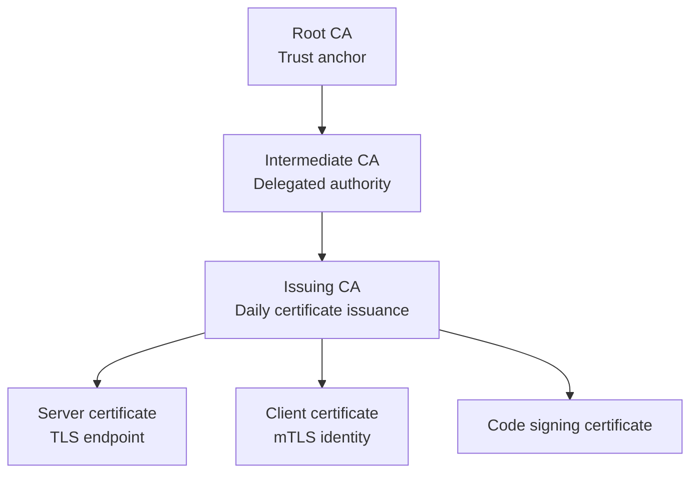
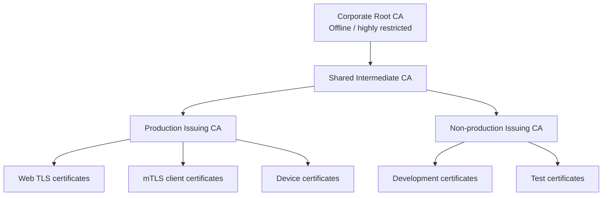
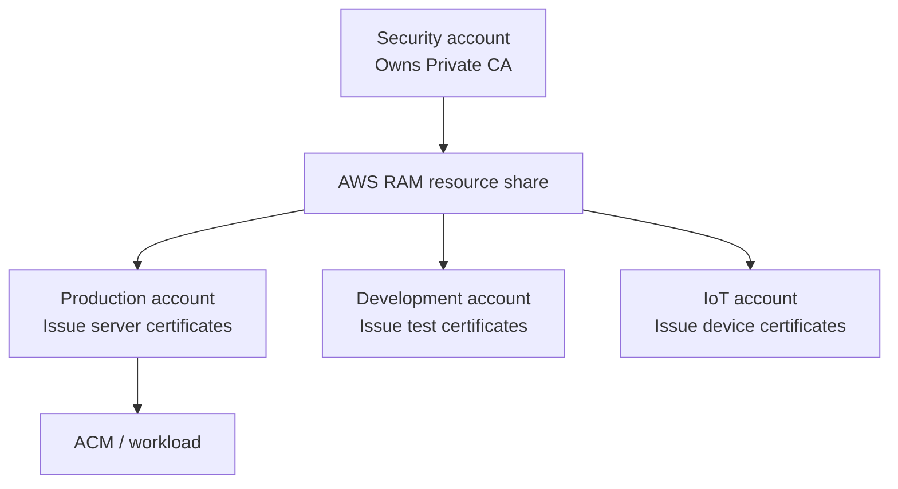
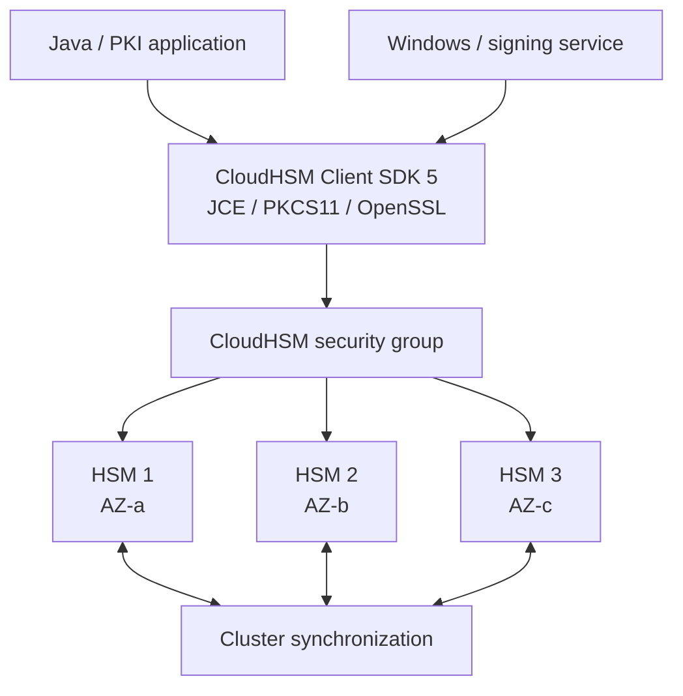
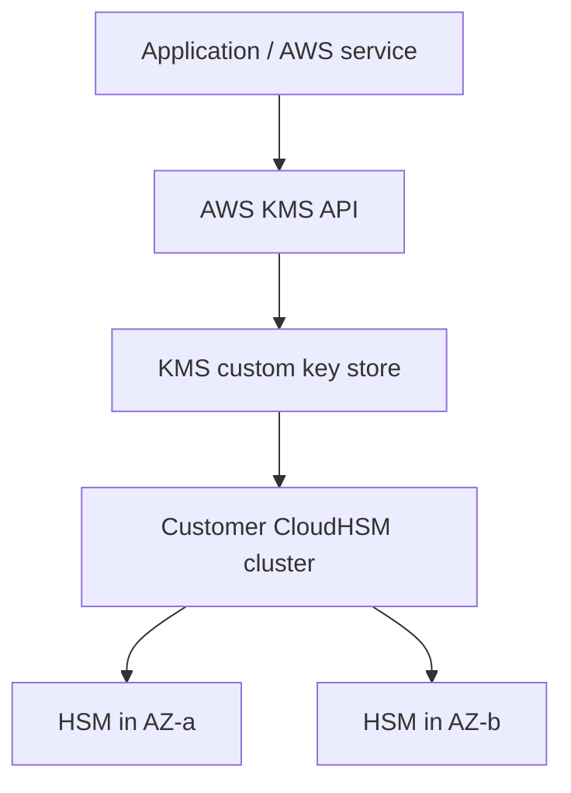
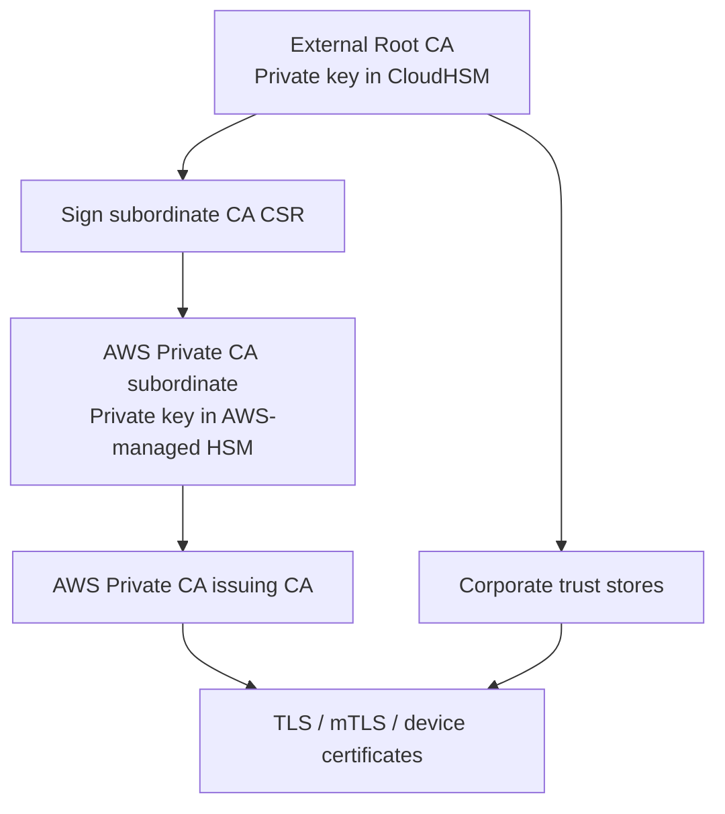

# AWS Private CA, CloudHSM và nhu cầu quản lý khóa chuyên biệt

**AWS Private Certificate Authority (AWS Private CA)** và **AWS CloudHSM** giải quyết hai bài toán bảo mật liên quan nhưng khác nhau. Private CA cung cấp hạ tầng PKI được quản lý để tạo CA hierarchy, phát hành và thu hồi chứng chỉ X.509 cho hệ thống nội bộ. CloudHSM cung cấp các hardware security modules (HSMs) đơn tenant trong VPC để tổ chức trực tiếp quản lý HSM users, keys, policies và thực hiện phép toán mật mã qua các giao diện như PKCS #11, Java Cryptography Extension (JCE), OpenSSL và Windows KSP.

AWS Private CA bảo vệ private keys của CA trong AWS-managed HSMs. CloudHSM dành cho trường hợp ứng dụng hoặc hệ thống CA cần quyền kiểm soát trực tiếp đối với HSM chuyên biệt. Khi tổ chức cần giữ root CA key trong CloudHSM nhưng vẫn muốn dùng Private CA cho hoạt động phát hành chứng chỉ thường ngày, có thể vận hành một external parent CA trong CloudHSM để ký CSR của subordinate CA do AWS Private CA quản lý.

Bài thuộc chương **Mã hóa, secret và chứng chỉ** của mô-đun **CLOUD_PROVIDERS_AWS**. Nội dung kết nối PKI, X.509, AWS Private CA, AWS Certificate Manager (ACM), AWS CloudHSM, AWS KMS, KMS custom key store, IAM, AWS RAM, CloudTrail, VPC và ứng dụng Java.

> **Nguyên tắc thiết kế:** Chọn đúng dịch vụ theo quyền kiểm soát khóa và mô hình tích hợp cần thiết. Tách root CA khỏi issuing CA, bảo vệ HSM users độc lập với IAM, phân quyền phát hành/thu hồi, kiểm thử khôi phục và lập kế hoạch vòng đời chứng chỉ trước khi đưa PKI vào production.

## 1. Mục tiêu học tập

Sau bài học, bạn có thể:

1. Phân biệt PKI, CA, certificate, CSR, public key và private key.
2. Giải thích vai trò của AWS Private CA trong một private PKI.
3. Thiết kế root, intermediate và issuing CA theo ranh giới quản trị.
4. Chọn general-purpose hoặc short-lived certificate mode.
5. Chọn certificate template cho TLS server, TLS client, code signing và CA certificates.
6. Phát hành chứng chỉ qua AWS Private CA API/CLI hoặc ACM.
7. Quản lý renewal, revocation, CRL và OCSP.
8. Chia sẻ private CA giữa các AWS accounts bằng AWS RAM.
9. Giải thích private CA keys được bảo vệ trong AWS-managed HSMs.
10. Mô tả AWS CloudHSM cluster, HSM types, FIPS modes và network architecture.
11. Phân biệt IAM permissions với HSM user credentials.
12. Quản lý key ownership, backup, synchronization và quorum authorization.
13. Tích hợp CloudHSM vào ứng dụng Java bằng JCE provider.
14. Phân biệt CloudHSM trực tiếp với KMS custom key store.
15. Kết hợp external parent CA trong CloudHSM với subordinate CA trong AWS Private CA.
16. Xây dựng quy trình bảo vệ khóa, kiểm toán và phục hồi PKI.
17. Đánh giá chi phí, availability, latency và giới hạn trước khi triển khai.

## 2. Nền tảng PKI và HSM

### 2.1. PKI là gì?

Public Key Infrastructure (PKI) là hệ thống chính sách, quy trình, phần mềm và phần cứng dùng để tạo, phân phối, xác minh và thu hồi chứng chỉ số.

Một chứng chỉ X.509 thường chứa:

- Subject: danh tính của chủ thể.
- Subject Alternative Name (SAN): tên DNS, địa chỉ hoặc định danh bổ sung.
- Public key của chủ thể.
- Issuer: CA đã ký chứng chỉ.
- Serial number.
- Validity: Not Before và Not After.
- Key Usage và Extended Key Usage.
- Signature của CA.
- Các extension liên quan tới CRL hoặc OCSP nếu được cấu hình.

Private key tương ứng phải được bảo vệ. Bất kỳ ai có private key đều có thể thực hiện các thao tác mật mã được key đó cho phép, ví dụ ký dữ liệu hoặc chứng minh danh tính TLS.

### 2.2. CA và certificate chain

Certificate Authority (CA) là thực thể có quyền ký chứng chỉ. Một chứng chỉ được tin cậy khi client xây dựng được certificate chain từ chứng chỉ đầu cuối qua các intermediate CAs tới một root CA đã được cài trong trust store.



Root CA thường có quyền lực cao nhất và cần được sử dụng rất ít. Intermediate/issuing CAs giới hạn phạm vi ảnh hưởng nếu một CA cấp thấp bị lộ hoặc cần thay thế.

### 2.3. CSR và key ownership

Certificate Signing Request (CSR) chứa public key cùng thông tin subject/SAN và chữ ký tạo bằng private key tương ứng.

Luồng thông thường:

1. Chủ thể tạo key pair trong môi trường mà private key sẽ được bảo vệ.
2. Chủ thể tạo CSR chứa public key.
3. CSR được gửi tới CA.
4. CA xác thực request theo policy và ký certificate.
5. Chủ thể nhận certificate và chain.
6. Chủ thể cài certificate cùng private key tương ứng vào service.

CA chỉ cần public key trong CSR để cấp chứng chỉ. Private key của server/client không cần được gửi cho CA.

### 2.4. HSM là gì?

Hardware Security Module là thiết bị mật mã chuyên dụng để tạo, lưu và sử dụng key material trong một ranh giới phần cứng được bảo vệ. HSM có thể thực hiện sign, verify, encrypt, decrypt, key generation và key wrapping theo cơ chế hỗ trợ.

HSM giúp giảm nguy cơ private key bị trích xuất khỏi thiết bị, nhưng không tự thay thế:

- IAM và HSM user access control.
- Key lifecycle và rotation policy.
- Backup/restore và disaster recovery.
- Quản lý ứng dụng được phép gọi HSM.
- Audit, approval và separation of duties.
- Thiết kế availability và capacity.

## 3. Chọn dịch vụ phù hợp

AWS có nhiều lựa chọn cho quản lý khóa và chứng chỉ. Không nên chọn CloudHSM chỉ vì workload có yêu cầu encryption.

| Dịch vụ | Vai trò chính | Khi phù hợp |
| --- | --- | --- |
| **AWS Certificate Manager (ACM)** | Quản lý public/private certificates và tích hợp dịch vụ AWS | TLS certificates cho ALB, CloudFront, API Gateway và dịch vụ tích hợp |
| **AWS Private CA** | Vận hành private certificate authority và cấp chứng chỉ X.509 | Internal PKI, mTLS, device identity, code signing |
| **AWS KMS** | Quản lý KMS keys và cung cấp cryptographic APIs | Mã hóa dữ liệu, envelope encryption, signing và tích hợp AWS services |
| **AWS CloudHSM** | Cung cấp HSM đơn tenant mà khách hàng quản lý users/keys | Ứng dụng cần PKCS #11/JCE/OpenSSL/KSP, CA key hoặc HSM control chuyên biệt |
| **KMS custom key store backed by CloudHSM** | Dùng KMS API với key material nằm trong CloudHSM cluster của khách hàng | Tích hợp dịch vụ hỗ trợ KMS customer-managed keys khi có yêu cầu HSM riêng |
| **KMS external key store (XKS)** | KMS chuyển thao tác tới external key manager qua proxy | Yêu cầu bắt buộc giữ key material ngoài AWS |

### 3.1. Câu hỏi quyết định

- Cần phát hành chứng chỉ private TLS cho hàng nghìn service? Bắt đầu với AWS Private CA và ACM.
- Cần mã hóa S3, EBS, RDS hoặc secrets? Thường dùng AWS KMS.
- Ứng dụng Java cần gọi HSM bằng JCE và giữ signing key trong HSM riêng? Đánh giá CloudHSM.
- Quy định yêu cầu CA root key do tổ chức trực tiếp quản lý trong HSM? Dùng external parent CA, có thể đặt trong CloudHSM, rồi ký subordinate CSR của AWS Private CA.
- Dịch vụ AWS cần KMS interface nhưng key material phải nằm trong CloudHSM? Đánh giá KMS custom key store, đồng thời kiểm tra hạn chế throughput và tính năng.

## 4. AWS Private CA hoạt động như thế nào?

AWS Private CA cho phép tạo và vận hành private CA hierarchy mà không cần tự quản lý toàn bộ hạ tầng CA. Dịch vụ cung cấp API, Console và CLI để tạo CA, phát hành chứng chỉ, quản lý revocation và tích hợp với ACM.

Các thành phần:

| Thành phần | Trách nhiệm |
| --- | --- |
| Private CA | Thực thể ký certificate và quản lý CA configuration |
| CA certificate | Chứng chỉ xác lập public key và quyền ký của CA |
| CA private key | Key dùng để ký certificate, CRL và OCSP responses |
| Certificate template | Xác định loại certificate và các extension/usage |
| CSR | Yêu cầu cấp chứng chỉ có public key của subject |
| Certificate | Danh tính số được CA ký |
| CRL | Danh sách certificate đã bị thu hồi |
| OCSP responder | Trả trạng thái revocation cho certificate |
| ACM | Tích hợp yêu cầu, triển khai và managed renewal cho certificates đủ điều kiện |

Private CA là tài nguyên **Regional**. Muốn triển khai private PKI ở nhiều Regions, cần tạo CA hierarchy phù hợp tại từng Region; không thể copy một private CA resource từ Region này sang Region khác.

### 4.1. Bảo vệ private key của CA

Private keys của AWS Private CA được lưu trong AWS-managed HSMs tuân thủ FIPS PUB 140-3 Level 3. AWS quản lý hạ tầng HSM, backup và vận hành bảo vệ key theo dịch vụ.

Khách hàng không truy cập HSM user hoặc export CA private key của AWS Private CA. Khách hàng quản lý quyền gọi API, cấu hình CA, certificate policy, renewal, revocation và cách phân phối trust chain.

Điều này khác với AWS CloudHSM, nơi khách hàng tạo HSM users và trực tiếp quản lý keys trong HSM cluster của mình.

### 4.2. Tích hợp với ACM

Khi yêu cầu private certificate qua ACM và chọn AWS Private CA, ACM quản lý certificate inventory và có thể tự động renewal cho certificate đủ điều kiện. Certificate được yêu cầu trực tiếp bằng AWS Private CA IssueCertificate API/CLI là unmanaged đối với ACM và không được ACM tự động renewal.

AWS Private CA cũng có thể cấp certificate để sử dụng ngoài các dịch vụ AWS tích hợp, ví dụ export private certificate từ ACM hoặc cài certificate vào máy chủ do tổ chức quản lý. Khi export, private key của end-entity certificate phải được bảo vệ tại nơi lưu trữ và triển khai.

## 5. Thiết kế CA hierarchy

AWS Private CA hỗ trợ hierarchy tối đa năm tầng: root CA và tối đa bốn tầng subordinate trên mỗi nhánh.

Một mô hình tham khảo:



### 5.1. Root CA

Root CA là trust anchor. Bảo vệ root bằng quy trình phê duyệt nghiêm ngặt, quyền truy cập giới hạn, key ceremony và quy trình backup/restore được kiểm thử.

Nếu root private key bị compromise, toàn bộ certificate chain phụ thuộc root có thể mất niềm tin. Vì vậy, root thường chỉ dùng khi khởi tạo hierarchy, thay thế intermediate hoặc xử lý một số hoạt động CA đặc biệt.

### 5.2. Intermediate và issuing CA

Intermediate CA nhận quyền ký từ CA cấp trên và có thể giới hạn path length. Issuing CA cấp end-entity certificates cho workload.

Tách issuing CAs theo môi trường, business unit hoặc loại certificate giúp:

- Giới hạn blast radius.
- Phân quyền issuance.
- Thay thế một nhánh mà không phải thay root.
- Áp dụng validity và templates khác nhau.
- Thu thập audit evidence theo owner.

### 5.3. Path length và name constraints

Path length constraint giới hạn số tầng CA subordinate có thể xuất hiện phía dưới. Name constraints giới hạn namespace mà các CA phía dưới được phép cấp.

Ví dụ, một issuing CA chỉ cấp chứng chỉ cho các tên thuộc domain nội bộ được chỉ định. Kiểm tra hỗ trợ và enforcement của AWS Private CA đối với từng X.509 extension trước khi thiết kế policy dựa trên extension đó.

### 5.4. Khi nào dùng nhiều root?

Nhiều hierarchy có thể phù hợp khi cần trust boundary độc lập, ví dụ:

- Production và development không chia sẻ trust anchor.
- Các pháp nhân có chính sách PKI riêng.
- Thiết bị IoT có lifecycle và khả năng cập nhật trust store khác với server TLS.
- Một hệ thống legacy cần giữ root cũ trong giai đoạn migration.

Mỗi root mới làm tăng chi phí vận hành trust distribution, rotation và incident response. Chỉ tách khi có ranh giới bảo mật hoặc vận hành rõ ràng.

## 6. CA modes và certificate templates

### 6.1. General-purpose mode

General-purpose là mode mặc định. CA có thể cấp certificate với validity period theo policy và hỗ trợ revocation qua CRL, OCSP hoặc cả hai khi được cấu hình.

Mode này phù hợp với phần lớn private PKI như TLS server/client, service identity và device certificates.

### 6.2. Short-lived certificate mode

Short-lived CA chỉ cấp certificate có validity tối đa **7 ngày**. Vì certificate hết hạn nhanh, một số kiến trúc có thể giảm nhu cầu dùng CRL/OCSP.

Các giới hạn quan trọng:

- Short-lived CA phải là CA cuối cùng trong hierarchy.
- Certificate không được vượt quá bảy ngày validity.
- CA certificate của short-lived CA cũng cần được renewal theo chu kỳ bảy ngày; phải tự động hóa quy trình này để tránh gián đoạn issuance.
- AWS Certificate Manager không thể phát hành certificates được ký bởi short-lived CA.
- Cần tự động hóa issuance và deployment với tần suất cao.
- CA certificate cũng cần lifecycle renewal phù hợp.

Mode này hữu ích với workload có thể tự động lấy certificate thường xuyên, ví dụ service identity ngắn hạn. Không chọn chỉ vì phí CA thấp hơn nếu ứng dụng không thể tự động renew/deploy certificate.

### 6.3. Certificate templates

Template xác định certificate type và các extension phù hợp.

| Template | Mục đích |
| --- | --- |
| EndEntityCertificate/V1 | End-entity certificate thông thường |
| EndEntityServerAuthCertificate/V1 | TLS server authentication |
| EndEntityClientAuthCertificate/V1 | TLS client authentication |
| CodeSigningCertificate/V1 | Code signing |
| RootCACertificate/V1 | Root CA certificate |
| SubordinateCACertificate_PathLen0/V1 | Subordinate CA không được cấp thêm subordinate CA |
| SubordinateCACertificate_PathLen1/V1 | Subordinate CA có thể cấp một tầng CA bên dưới |

AWS Private CA có nhiều biến thể CSR passthrough và API passthrough. Chọn template theo nhu cầu thực tế, không mặc định dùng một template rộng cho tất cả loại certificate.

### 6.4. Algorithm compatibility

AWS Private CA hiện hỗ trợ các thuật toán phổ biến như RSA và ECDSA, cùng các thuật toán mới như ML-DSA trong phạm vi được dịch vụ hỗ trợ. SM2 chỉ áp dụng cho China Regions.

Cần kiểm tra riêng:

- Key algorithm của CA.
- Signing algorithm.
- Certificate template.
- Client/browser/OS trust support.
- ACM integration support.
- HSM mechanism support nếu dùng CloudHSM.
- FIPS mode và tiêu chuẩn mà tổ chức phải đáp ứng.

Một thuật toán được CA hỗ trợ chưa chắc mọi relying party hoặc dịch vụ tích hợp đều chấp nhận. Kiểm thử toàn bộ certificate chain trước production.

## 7. Phát hành certificate

Luồng cấp certificate:

1. Xác định CA và certificate template.
2. Tạo key pair và CSR ở phía requester hoặc qua ACM.
3. Gửi CSR tới CA.
4. CA kiểm tra quyền và policy.
5. CA ký certificate.
6. Requester nhận certificate và chain.
7. Cài certificate vào TLS endpoint hoặc ứng dụng.
8. Đưa root/intermediate certificates vào trust stores cần thiết.
9. Theo dõi expiration và revocation.

### 7.1. Yêu cầu qua ACM

Khi dùng ACM, ACM tạo key pair và quản lý certificate inventory. Đây là lựa chọn thuận tiện cho các AWS services tích hợp ACM như Elastic Load Balancing, CloudFront hoặc API Gateway.

Certificate được yêu cầu qua ACM có thể đủ điều kiện managed renewal. Với private certificates, trust được thiết lập bằng cách phân phối root CA certificate vào trust stores của client.

### 7.2. Yêu cầu trực tiếp bằng Private CA API

Khi dùng Private CA IssueCertificate API/CLI, requester phải cung cấp CSR. Certificate trả về không được ACM quản lý tự động và không tự động renewal.

Dùng cách này khi cần cài certificate trên môi trường tùy chỉnh, thiết bị hoặc phần mềm không sử dụng ACM lifecycle. Đội vận hành phải tự theo dõi expiration, renew, deploy và verify.

### 7.3. CLI minh họa

Tạo CA configuration file, ví dụ **ca-config.json**:

```json
{
  "KeyAlgorithm": "RSA_2048",
  "SigningAlgorithm": "SHA256WITHRSA",
  "Subject": {
    "Country": "VN",
    "Organization": "Example Engineering",
    "OrganizationalUnit": "Platform Security",
    "CommonName": "Example Internal Root CA"
  }
}
```

Tạo một root CA general-purpose. Ví dụ không bật revocation; production cần đánh giá CRL/OCSP trước khi tạo CA:

```bash
aws acm-pca create-certificate-authority \
  --certificate-authority-configuration file://ca-config.json \
  --certificate-authority-type ROOT \
  --usage-mode GENERAL_PURPOSE \
  --region ap-southeast-1
```

AWS Private CA trả về CA ARN. Sau khi tạo, CA ở trạng thái chờ cài CA certificate. Luồng kích hoạt root gồm lấy CSR, ký CSR bằng Root CA template và import certificate. Với subordinate CA, CSR có thể được ký bởi parent CA nội bộ hoặc external parent CA.

Ví dụ lấy CSR:

```bash
aws acm-pca get-certificate-authority-csr \
  --certificate-authority-arn "arn:aws:acm-pca:ap-southeast-1:123456789012:certificate-authority/CA_ID" \
  --region ap-southeast-1 \
  --output text > subordinate.csr
```

Nếu CSR thuộc subordinate CA cần được external parent ký, gửi CSR tới external CA theo quy trình bảo mật, nhận signed CA certificate và certificate chain, rồi import vào AWS Private CA:

```bash
aws acm-pca import-certificate-authority-certificate \
  --certificate-authority-arn "arn:aws:acm-pca:ap-southeast-1:123456789012:certificate-authority/CA_ID" \
  --certificate fileb://subordinate-cert.pem \
  --certificate-chain fileb://ca-chain.pem \
  --region ap-southeast-1
```

Đây là ví dụ quy trình subordinate CA. Certificate và chain phải đúng format, path length, algorithm và thứ tự chain theo yêu cầu của AWS Private CA.

### 7.4. Issue end-entity certificate

Sau khi CA ở trạng thái ACTIVE, requester tạo CSR cho server/client. Ví dụ sử dụng server-auth template:

```bash
aws acm-pca issue-certificate \
  --certificate-authority-arn "arn:aws:acm-pca:ap-southeast-1:123456789012:certificate-authority/CA_ID" \
  --csr fileb://orders-api.csr \
  --signing-algorithm SHA256WITHRSA \
  --template-arn "arn:aws:acm-pca:::template/EndEntityServerAuthCertificate/V1" \
  --validity Value=365,Type=DAYS \
  --region ap-southeast-1
```

Lệnh trả về CertificateArn. Dùng GetCertificate để lấy certificate và chain. Lưu ý certificate được cấp trực tiếp qua API không được ACM quản lý renewal.

## 8. Renewal và vòng đời certificate

Certificate lifecycle gồm issuance, deployment, monitoring, renewal, revocation và replacement.

### 8.1. ACM managed renewal

Private certificates được yêu cầu qua ACM Console hoặc RequestCertificate API có thể đủ điều kiện managed renewal. ACM bắt đầu thử renewal khi certificate còn khoảng 60 ngày trước khi hết hạn.

Certificate được cấp trực tiếp bằng Private CA IssueCertificate API không thuộc ACM managed renewal.

### 8.2. Tự động renewal

Nếu tự quản lý certificate:

- Theo dõi NotAfter và cảnh báo trước expiration.
- Tạo CSR/key pair theo key rotation policy.
- Request certificate mới.
- Verify chain, SAN, EKU và validity.
- Deploy certificate mới theo rolling strategy.
- Xác minh TLS handshake và client trust.
- Thu hồi certificate cũ khi phù hợp.
- Ghi lại serial number và thời điểm thay thế.

Không đợi đến ngày hết hạn mới bắt đầu renewal. Một certificate hết hạn có thể làm TLS handshake thất bại trên diện rộng.

### 8.3. Key rotation và certificate renewal

Renew certificate không nhất thiết đồng nghĩa private key luôn được thay mới. Thiết kế PKI nên quyết định rõ có tái sử dụng key pair hay tạo key pair mới.

Đối với service identity, tạo key pair mới khi renew thường giúp giới hạn ảnh hưởng nếu private key cũ từng bị lộ. Với CA keys, rotation cần kế hoạch hierarchy, trust distribution và cross-signing nếu cần duy trì tương thích.

## 9. Revocation: CRL và OCSP

Certificate có thể cần bị thu hồi trước khi hết hạn khi:

- Private key bị compromise.
- Device bị mất hoặc nhân viên rời tổ chức.
- Service identity không còn hợp lệ.
- Certificate được cấp nhầm subject/SAN.
- CA hoặc intermediate bị compromise.
- Workload chuyển owner hoặc trust boundary.

### 9.1. Certificate Revocation List (CRL)

CRL là danh sách certificate serial numbers đã bị thu hồi do CA phát hành. AWS Private CA có thể tạo CRL và lưu trên Amazon S3.

Client tải CRL, kiểm tra serial number của certificate và cache theo validity period. CRL phù hợp với client cần kiểm tra offline hoặc muốn giảm số lần gọi responder.

Các quyết định cần có:

- Bucket S3 và bucket policy.
- CRL distribution point trong certificate.
- Validity period của CRL.
- Public/private access và network reachability.
- Cache behavior của client.
- Monitoring việc publish CRL.

CRL không nhất thiết cập nhật ngay sau thao tác revoke. Client có thể tiếp tục dùng bản CRL cũ đến khi refresh.

### 9.2. Online Certificate Status Protocol (OCSP)

OCSP cho phép client hỏi trạng thái certificate qua responder thay vì tải toàn bộ CRL. Phù hợp với client có network connectivity tới responder.

AWS Private CA quản lý OCSP responses. Sau khi revoke, OCSP status có thể mất tới khoảng 60 phút để phản ánh trạng thái mới. Không coi OCSP là cơ chế tức thời tuyệt đối.

### 9.3. Chọn CRL, OCSP hoặc cả hai

| Tiêu chí | CRL | OCSP |
| --- | --- | --- |
| Cách kiểm tra | Tải danh sách và kiểm tra serial | Gửi truy vấn trạng thái |
| Network pattern | Tải định kỳ, có cache | Truy vấn responder |
| Bandwidth | Có thể lớn khi CRL lớn | Thường nhỏ hơn mỗi lần query |
| Client support | Rộng ở nhiều PKI clients | Phụ thuộc client và network |
| Freshness | Phụ thuộc chu kỳ publish/cache | Thường nhanh hơn nhưng vẫn có propagation delay |
| Offline use | Có thể dùng CRL đã tải | Không phù hợp nếu không truy cập responder |

### 9.4. Short-lived certificates

Certificate có validity tối đa bảy ngày có thể giảm nhu cầu revocation infrastructure nếu hệ thống có khả năng tự động thay thế nhanh. Cần tính toán thời gian phát hiện compromise, thời gian cấp/deploy lại và khả năng thu hồi trust khi CA bị compromise.

## 10. Chia sẻ Private CA giữa nhiều accounts

AWS Private CA có thể chia sẻ CA qua AWS Resource Access Manager (RAM) hoặc resource-based policy. Điều này hữu ích khi một security account quản lý CA tập trung và các application accounts cần phát hành certificates.

Mô hình tham khảo:



### 10.1. AWS RAM

CA owner tạo resource share và chia sẻ CA tới AWS account, organization hoặc organizational unit phù hợp. Account nhận share có thể sử dụng CA theo permissions đã được cấp.

Phí certificate trong cross-account issuance được tính cho account thực hiện issuance.

### 10.2. Customer-managed permissions

Từ tháng 4 năm 2026, AWS Private CA hỗ trợ customer-managed permissions trong RAM. CA owner có thể chọn tập actions cho consumer accounts.

Read actions gồm:

- DescribeCertificateAuthority.
- GetCertificate.
- GetCertificateAuthorityCertificate.
- ListPermissions.
- ListTags.

Write actions gồm:

- IssueCertificate.
- RevokeCertificate.

Có thể tạo quyền read-only cho team cần xem CA và certificate, hoặc quyền issue/revoke cho account vận hành. Tách quyền phát hành và thu hồi theo trách nhiệm tổ chức.

### 10.3. Guardrails

- Chia sẻ tới account/OU cụ thể.
- Giới hạn certificate templates qua IAM/resource policies khi phù hợp.
- Không cấp RevokeCertificate cho mọi application account.
- Ghi rõ owner và chargeback model.
- Audit resource shares định kỳ.
- Thu hồi share khi account không còn thuộc workload.
- Kiểm tra certificate issuance events ở account thực hiện lệnh.

## 11. IAM và bảo mật AWS Private CA

IAM kiểm soát ai được gọi AWS Private CA APIs. Các quyền quan trọng có thể gồm:

- ListCertificateAuthorities.
- DescribeCertificateAuthority.
- GetCertificateAuthorityCsr.
- IssueCertificate.
- GetCertificate.
- RevokeCertificate.
- ImportCertificateAuthorityCertificate.
- UpdateCertificateAuthority.
- DeleteCertificateAuthority.
- CreatePermission và PutPolicy khi chia sẻ CA.

### 11.1. Tách quyền theo nhiệm vụ

| Vai trò | Quyền tham khảo |
| --- | --- |
| PKI administrator | Tạo CA, cấu hình revocation và quản lý hierarchy |
| Certificate issuer | IssueCertificate với template và CA được phép |
| Certificate consumer | Lấy certificate/chain cần thiết |
| Revocation operator | RevokeCertificate theo quy trình incident |
| Auditor | Đọc metadata, CloudTrail và evidence được phép |

Không cấp Create/Delete/Update CA cho ứng dụng runtime chỉ cần yêu cầu certificate.

### 11.2. Certificate template restriction

Dùng template ARN và policy conditions để giới hạn loại certificate mà principal có thể yêu cầu. Ví dụ, application account chỉ được cấp server-auth certificates từ issuing CA của production.

### 11.3. Root account và break-glass

Không dùng root credentials cho tác vụ hằng ngày. Dùng IAM Identity Center/federation, MFA, privileged access workflow và break-glass account được kiểm soát. Những thao tác như disable/delete CA, change policy hoặc revoke hàng loạt cần approval và audit record.

## 12. AWS CloudHSM là gì?

AWS CloudHSM cung cấp HSM appliances đơn tenant trong AWS Cloud. AWS quản lý phần cứng, provisioning, maintenance và cluster backup; khách hàng kiểm soát HSM users, keys, policies và cách ứng dụng sử dụng cryptographic operations.

Khác với KMS API, ứng dụng kết nối CloudHSM thông qua client software và SDK. HSMs được đưa vào cluster đồng bộ để tạo thành một logical unit.

Các use cases:

- Lưu CA signing key cho external PKI.
- Code signing và document signing.
- TLS private key operations qua OpenSSL/NGINX/Apache.
- Java application dùng JCE.
- Windows application dùng CNG/KSP.
- Legacy software cần PKCS #11.
- Workload cần HSM chuyên biệt và quyền quản lý key/users trực tiếp.

### 12.1. Single-tenant HSM

CloudHSM cung cấp HSM instances dành riêng cho customer cluster. Khách hàng quản lý HSM users và keys bên trong cluster. AWS không biết HSM user passwords và không thể thực hiện cryptographic operations thay khách hàng bằng các credentials đó.

### 12.2. IAM khác HSM users

IAM điều khiển thao tác quản lý AWS resource như tạo cluster, thêm HSM, xóa cluster và đọc trạng thái.

HSM users xác thực với thiết bị để tạo, sử dụng, chia sẻ hoặc xóa key. Có các vai trò như administrators/crypto officers và crypto users tùy Client SDK.

Có IAM permission không có nghĩa principal tự động có thể đăng nhập HSM. Ngược lại, HSM user credentials không thay thế IAM permissions để quản lý cluster resources.

## 13. HSM types và FIPS modes

AWS CloudHSM hiện có hai HSM types:

| HSM type | Trạng thái và tương thích |
| --- | --- |
| **hsm1.medium** | Loại cũ, FIPS mode; AWS không còn cho tạo cluster mới bằng loại này |
| **hsm2m.medium** | Loại hiện tại, hỗ trợ FIPS và non-FIPS modes |

hsm2m.medium được chứng nhận FIPS 140-3 Level 3 trong cấu hình FIPS mode. Kiểm tra certificate validation và service scope thực tế khi lập hồ sơ compliance.

### 13.1. FIPS mode

FIPS mode chỉ cho phép sử dụng các keys và cryptographic mechanisms được phê duyệt theo FIPS trong phạm vi hỗ trợ của CloudHSM.

Chọn mode này khi policy/regulation yêu cầu cơ chế FIPS-approved. Cần kiểm tra algorithm, key size, signing mechanism và Client SDK version.

### 13.2. Non-FIPS mode

Non-FIPS mode cho phép dùng tất cả mechanisms CloudHSM hỗ trợ, bao gồm một số mechanisms không được FIPS validated. HSM vẫn là phần cứng bảo mật, nhưng tổ chức không thể suy ra rằng mọi phép toán trong cluster đều đáp ứng FIPS requirements.

### 13.3. Mode không thể đổi sau khi tạo

Cluster mode FIPS/non-FIPS không thể chuyển đổi sau khi tạo. Backup của FIPS cluster chỉ có thể restore vào FIPS cluster; backup non-FIPS chỉ restore vào non-FIPS cluster.

Trước khi tạo cluster, kiểm tra:

- Yêu cầu compliance.
- Algorithms cần dùng.
- Client SDK compatibility.
- Backup/restore strategy.
- Region và HSM type availability.
- Application integration tests.

## 14. CloudHSM cluster architecture

Khi tạo cluster, khách hàng chọn VPC và các subnets. Mỗi HSM được đặt trong một Availability Zone và có elastic network interface (ENI) trong subnet của khách hàng.

Ứng dụng thường chạy trên EC2 client instances trong cùng VPC và dùng CloudHSM Client SDK để giao tiếp với HSM ENIs.



### 14.1. Security group

CloudHSM tạo security group cho cluster. Security group kiểm soát network access tới HSM ENIs.

Chỉ cho phép các client instances/host cần thiết truy cập. Không mở HSM network ports cho Internet hoặc toàn bộ VPC nếu không cần.

### 14.2. Client connectivity

Client SDK cần biết cluster configuration và có thể xác thực HSM. Kiểm tra:

- Client instance có network route tới HSM ENIs.
- Security groups/NACL cho phép các ports cần thiết.
- Client SDK và HSM type tương thích.
- Cluster certificates/trust configuration đúng.
- HSM credentials được cung cấp an toàn.
- DNS và client configuration được cập nhật khi cluster thay đổi.

### 14.3. Private networking

Đặt CloudHSM trong private subnets. Quản trị client instances qua Systems Manager Session Manager hoặc kênh quản trị đã được phê duyệt. Tránh mở SSH/RDP công khai chỉ để truy cập HSM client.

## 15. High availability, synchronization và backup

### 15.1. High availability

AWS khuyến nghị production cluster có ít nhất hai HSMs ở hai Availability Zones khác nhau. Client SDK phân phối cryptographic operations giữa các HSM theo capacity. Đặt HSMs ở nhiều AZ giúp tránh một HSM/AZ trở thành điểm lỗi đơn.

Với ứng dụng cần durability cao cho các keys mới tạo, AWS khuyến nghị xem xét ít nhất ba HSMs trải trên các AZ khác nhau. Capacity cuối cùng phải dựa trên load test.

### 15.2. Key synchronization

CloudHSM tự đồng bộ key objects giữa các HSM trong cluster. Khi thêm HSM, dịch vụ tạo backup từ HSM hiện có và restore lên HSM mới.

User và policy synchronization có giới hạn khác key synchronization. CloudHSM CLI thực hiện best-effort sync cho user/policy operations; có thể xảy ra inconsistency nếu thao tác chỉ thành công một phần. Kiểm tra user/policy state sau các thay đổi quản trị quan trọng.

### 15.3. Backups

AWS CloudHSM tạo encrypted cluster backups ít nhất mỗi 24 giờ. Backup chứa:

- HSM users.
- Key material và certificates.
- HSM configuration.
- Policies.

Backup retention có thể cấu hình từ 7 tới 379 ngày; mặc định thường là 90 ngày cho cluster mới. Backup được tạo tự động, không phải thao tác mà operator tùy ý yêu cầu bất kỳ lúc nào.

### 15.4. Restore strategy

Backup không thay thế disaster recovery test. Hãy thực hành:

1. Tạo cluster restore trong đúng mode và HSM type tương thích.
2. Initialize cluster.
3. Kiểm tra HSM users và policies.
4. Kiểm tra key labels/attributes và key availability.
5. Kết nối ứng dụng thử nghiệm.
6. Thực hiện sign/decrypt test.
7. Xác minh client configuration và certificate chain.
8. Ghi RTO/RPO thực tế.

Bảo vệ backup retention và quyền restore như một phần của key governance.

## 16. HSM users, key ownership và quorum

### 16.1. HSM administrators

Admin/crypto officers quản lý users và các thao tác quản trị HSM. Bảo vệ credentials của họ như privileged secrets.

AWS khuyến nghị có ít nhất hai admins để tránh lockout nếu một credential bị mất. Không dùng một tài khoản admin chung cho mọi người.

### 16.2. Crypto users

Crypto user (CU) tạo và sử dụng keys. CU tạo key là owner của key; owner có thể chia sẻ key với CUs khác theo quyền và key attributes.

Tạo nhiều CUs với nhiệm vụ tách biệt, ví dụ:

- Key provisioning operator.
- Application signing user.
- Certificate authority signing user.
- Backup/recovery operator nếu quy trình cần.

Không cho mọi application dùng chung một CU có toàn quyền trên cluster.

### 16.3. Quorum authorization

CloudHSM hỗ trợ quorum authentication, còn gọi là M-of-N control. Một số thao tác nhạy cảm cần ít nhất số approvers đã cấu hình trước khi thực hiện.

Có thể dùng quorum cho:

- Tạo/xóa HSM users.
- Thay đổi password của user khác.
- Một số thao tác quản trị cluster.
- Chia sẻ/thu hồi quyền key.
- Một số key management và key usage operations được hỗ trợ.

Quorum giảm nguy cơ một credential bị compromise có thể tự ý thực hiện mọi thao tác quan trọng. Thiết kế quorum phải đảm bảo đủ approvers sẵn sàng để không gây lockout vận hành.

### 16.4. Key attributes

Khi tạo key, đặt attributes như:

- Label để định danh.
- Key type và size.
- Sign/verify hoặc encrypt/decrypt permissions.
- Extractable/sensitive flags.
- Key sharing permissions.
- Quorum value nếu dùng quorum.
- Key usage và lifecycle owner.

Đối với CA signing keys, ưu tiên key không extractable và chỉ cấp quyền ký cho identity cần thiết.

## 17. CloudHSM Client SDK và giao diện ứng dụng

CloudHSM Client SDK 5 là phiên bản SDK hiện hành mặc định. Các giao diện chính:

| Giao diện | Nền tảng / use case |
| --- | --- |
| PKCS #11 | C/C++ và ứng dụng cần chuẩn HSM phổ biến |
| JCE provider | Java applications |
| OpenSSL Dynamic Engine/Provider | OpenSSL, TLS, NGINX/Apache integrations |
| Windows KSP/CNG | Windows applications, IIS, Microsoft signing tools |
| CloudHSM CLI | Quản trị users, keys và HSM operations |

Chọn interface dựa trên framework mà ứng dụng đang dùng. Không cần viết lại toàn bộ application nếu phần mềm đã hỗ trợ PKCS #11 hoặc JCE provider.

### 17.1. Java JCE provider

JCE provider cho phép Java sử dụng các API chuẩn như Cipher, Signature, KeyPairGenerator và KeyStore, trong khi cryptographic operation được offload tới HSM.

Với Client SDK 5, provider class là:

```java
com.amazonaws.cloudhsm.jce.provider.CloudHsmProvider
```

Tên provider mặc định thường là CloudHSM. Có thể chỉ định provider cụ thể cho từng operation để tránh vô tình ưu tiên HSM cho các thao tác không cần offload.

### 17.2. Cấu hình JCE

Sau khi cài Client SDK 5 và bootstrap client:

- Cấu hình cluster connectivity.
- Cài JCE provider.
- Cung cấp HSM CU credentials qua cơ chế được bảo vệ.
- Đăng ký provider trong Java security configuration hoặc cấu hình qua code.
- Kiểm tra provider name và algorithms.
- Tạo key trong HSM.
- Kiểm tra ứng dụng không xuất private key ra file hoặc logs.

Không hard-code HSM password trong source code, Docker image hoặc command history. Dùng secret management và runtime injection được kiểm soát.

## 18. Ví dụ Java: ký dữ liệu bằng CloudHSM JCE

Ví dụ dưới đây minh họa cách dùng KeyStore CloudHSM để lấy private key theo label, sau đó ký dữ liệu bằng RSA. Cluster, Client SDK 5, provider configuration và HSM user phải được thiết lập trước.

```java
import java.nio.charset.StandardCharsets;
import java.security.Key;
import java.security.KeyStore;
import java.security.Security;
import java.security.Signature;

import com.amazonaws.cloudhsm.jce.provider.CloudHsmProvider;

public final class HsmSigningExample {
    public static void main(String[] args) throws Exception {
        if (Security.getProvider("CloudHSM") == null) {
            Security.addProvider(new CloudHsmProvider());
        }

        KeyStore keyStore = KeyStore.getInstance("CloudHSM");
        keyStore.load(null, null);

        String keyLabel = "orders-signing-key";
        Key key = keyStore.getKey(keyLabel, null);

        if (!(key instanceof java.security.PrivateKey privateKey)) {
            throw new IllegalStateException("HSM private key was not found");
        }

        byte[] payload = "orders-release-2026.11"
            .getBytes(StandardCharsets.UTF_8);

        Signature signer = Signature.getInstance("SHA256withRSA", "CloudHSM");
        signer.initSign(privateKey);
        signer.update(payload);

        byte[] signature = signer.sign();

        System.out.println("Signature bytes: " + signature.length);
    }
}
```

Ví dụ tập trung vào luồng ký. Trong production:

- Key phải được tạo trong HSM và có label/attributes đã được duyệt.
- Client SDK 5 JCE provider cần JDK tương thích; tài liệu hiện hành liệt kê OpenJDK 17, 21 và 25. Kiểm tra compatibility matrix theo SDK release đang cài.
- HSM CU credentials phải được cấp an toàn.
- Cần kiểm tra algorithm được HSM type và FIPS mode hỗ trợ.
- Không log payload nhạy cảm hoặc signature nếu không cần.
- Public key/certificate được phân phối riêng để verifier xác thực.
- Cần kiểm thử concurrency, latency, retry và behavior khi một HSM/AZ không khả dụng.

### 18.1. Tạo key bằng Java Keytool

AWS CloudHSM Client SDK 5 cung cấp CloudHSM KeyStore cho Java keytool. Ví dụ tạo RSA 3072 key pair:

```bash
keytool -genkeypair \
  -alias orders-signing-key \
  -keyalg RSA \
  -keysize 3072 \
  -sigalg SHA384withRSA \
  -keystore orders-keystore.p12 \
  -storetype CLOUDHSM \
  -J-classpath '-J/opt/cloudhsm/java/*'
```

Key material được tạo trong HSM. KeyStore cục bộ quản lý certificate association/metadata; không đồng nghĩa private key được lưu dưới dạng plaintext trong file PKCS12.

Kiểm tra cú pháp theo Client SDK 5 và hệ điều hành thực tế. Không dùng lệnh của Client SDK 3 với SDK 5 nếu chưa xem hướng dẫn migration.

## 19. AWS KMS custom key store backed by CloudHSM

KMS custom key store cho phép dùng AWS KMS APIs nhưng key material được tạo và lưu trong CloudHSM cluster do khách hàng quản lý.

Kiến trúc:



KMS chuyển cryptographic requests tới cluster. Ứng dụng vẫn dùng KMS API, key policy và IAM permissions quen thuộc.

### 19.1. Điều kiện cluster

KMS custom key store cần cluster CloudHSM tương thích và được kết nối. Khi tạo KMS key trong CloudHSM key store, cluster phải có ít nhất hai active HSMs ở các Availability Zones khác nhau.

### 19.2. Giới hạn quan trọng

CloudHSM custom key store chỉ hỗ trợ symmetric encryption KMS keys. Không hỗ trợ:

- Asymmetric KMS keys.
- HMAC KMS keys.
- Imported key material.
- Automatic key rotation.
- Multi-Region keys.
- Asymmetric data key pair generation.

Không phải mọi tính năng KMS mặc định đều hoạt động với custom key store.

### 19.3. Performance và availability

KMS custom key store có latency cao hơn và throughput thấp hơn standard KMS key store. Availability, durability và scalability phụ thuộc cluster CloudHSM do khách hàng quản lý; tài liệu AWS nêu custom key store không có SLA coverage như standard KMS.

AWS khuyến nghị không dùng custom key store cho high-TPS workloads như analytics, high-volume S3 operations hoặc DynamoDB workloads. Đây là lựa chọn chuyên biệt cho workloads TPS thấp khi có yêu cầu HSM rõ ràng.

### 19.4. Key lifecycle

KMS key được tạo trong CloudHSM key store có key material được KMS tạo trong cluster. Không thể bật automatic key rotation hoặc import key material như một số KMS keys thông thường.

Khi schedule deletion một KMS key, KMS xóa key metadata và thực hiện best-effort deletion của key material trong cluster. Có thể cần kiểm tra và xóa orphaned key material trong HSM/backup theo quy trình được tài liệu AWS hướng dẫn.

## 20. AWS Private CA kết hợp CloudHSM

Hai dịch vụ có thể kết hợp theo kiến trúc phân tầng khi tổ chức muốn giữ root CA signing key trong HSM do mình quản lý, nhưng dùng AWS Private CA cho subordinate CA và issuance.

### 20.1. External root CA trong CloudHSM

Một mô hình:



Luồng triển khai:

1. Tạo root CA bên ngoài AWS Private CA, sử dụng phần mềm CA tương thích CloudHSM.
2. Root CA private key được tạo và giữ trong CloudHSM.
3. Tạo subordinate CA trong AWS Private CA.
4. Lấy CSR của subordinate CA.
5. Gửi CSR tới external root CA.
6. External CA ký CSR bằng private key trong CloudHSM.
7. Import signed subordinate certificate và chain vào AWS Private CA.
8. Subordinate CA chuyển sang ACTIVE và có thể cấp end-entity certificates.
9. Phân phối root certificate vào trust stores của clients.

### 20.2. Ranh giới key custody

Trong kiến trúc trên:

- Root CA private key nằm trong CloudHSM do tổ chức quản lý.
- Subordinate CA private key nằm trong AWS-managed HSM của AWS Private CA.
- End-entity private key do requester hoặc ACM tạo theo workflow.
- AWS Private CA không cung cấp tùy chọn gắn trực tiếp CloudHSM cluster của khách hàng làm key backend cho CA private key của nó.

Điểm này rất quan trọng khi yêu cầu compliance nói rõ root key phải nằm trong HSM thuộc quyền kiểm soát của tổ chức. Nếu yêu cầu áp dụng cho mọi CA private key, cần xác định rõ có thể dùng external CA cho toàn bộ hierarchy hay không; không giả định subordinate CA của AWS Private CA thỏa yêu cầu custody giống CloudHSM.

### 20.3. Lợi ích và trade-off

Lợi ích:

- Root trust anchor do tổ chức kiểm soát.
- AWS Private CA giảm gánh nặng vận hành issuance cho subordinate CA.
- Có thể chia sẻ issuing CA qua AWS RAM.
- Application accounts không cần truy cập root HSM.

Trade-off:

- Vận hành hai hệ thống CA.
- External root CA cần key ceremony, backup, quorum và disaster recovery.
- Cần đồng bộ policy, validity, name constraints và path length.
- Incident response phải phối hợp giữa CloudHSM root và AWS Private CA subordinate.
- Root CA compromise vẫn ảnh hưởng toàn bộ hierarchy.

## 21. Các mô hình sử dụng thực tế

| Nhu cầu | Kiến trúc đề xuất |
| --- | --- |
| TLS cho ALB/API Gateway/CloudFront | ACM + AWS Private CA |
| mTLS giữa microservices | AWS Private CA, client/server templates, trust distribution |
| Certificate cho thiết bị IoT | Private CA hierarchy, short-lived hoặc standard cert tùy device capability |
| Root CA key phải nằm trong HSM riêng | External root CA dùng CloudHSM, ký subordinate AWS Private CA CSR |
| Java code signing key trong HSM | CloudHSM + JCE provider + signing pipeline |
| NGINX/Apache TLS key trong HSM | CloudHSM + OpenSSL integration |
| KMS encryption với HSM riêng | KMS custom key store, chỉ khi chấp nhận giới hạn symmetric/low TPS |
| Key material phải ở ngoài AWS | XKS hoặc external key manager theo yêu cầu bắt buộc |

### 21.1. Microservices mTLS

Mỗi service identity có certificate với SAN rõ ràng và EKU phù hợp. Service mesh hoặc application gateway xác minh chain tới trust anchor đã phân phối.

Tự động hóa renewal và reload certificate. Nếu service không thể reload certificate an toàn, cần rolling deployment hoặc sidecar/agent hỗ trợ.

### 21.2. Code signing

Signing key nên được tạo trong HSM, private key không exportable, signing role được giới hạn và mọi lần ký được audit.

Pipeline nên kiểm tra:

- Artifact hash.
- Build provenance.
- Signing approval.
- Key label/version.
- Signature algorithm.
- Certificate chain và timestamp.
- Verification result trước khi publish.

### 21.3. Document signing

CloudHSM có thể giữ signing key để ký tài liệu hoặc giao dịch. Ứng dụng phải quản lý canonicalization, timestamp, signature format, certificate chain và key access. HSM bảo vệ key nhưng không xác nhận nội dung nghiệp vụ là đúng.

## 22. Key governance và quy trình vận hành

### 22.1. Key inventory

Mỗi key/CA nên có inventory:

| Trường | Ví dụ |
| --- | --- |
| Key/CA ID | orders-prod-issuing-ca |
| Owner | Platform Security |
| Purpose | TLS server issuance |
| Key location | AWS Private CA / CloudHSM |
| Algorithm | RSA 3072 |
| HSM mode | FIPS |
| Access principals | PKI administrators / issuer role |
| Backup | Cluster backup / AWS-managed CA protection |
| Rotation/renewal | Annual review / certificate lifecycle |
| Dependencies | ALB, Spring Boot, service mesh |
| Recovery owner | Security Operations |

### 22.2. Separation of duties

Tách người:

- Tạo/duy trì CA.
- Approve certificate issuance.
- Quản lý HSM users.
- Dùng key để ký.
- Approve quorum operations.
- Quản lý backup/restore.
- Audit và review access.

Không để một principal vừa tự tạo key, tự cấp quyền, tự ký và tự xóa audit evidence.

### 22.3. Key ceremony

Với root CA hoặc HSM keys quan trọng, quy trình key ceremony cần xác định:

- Participants và vai trò.
- Approval/quorum requirements.
- HSM initialization và user provisioning.
- Key generation parameters.
- Non-exportable attributes.
- Backup validation.
- Evidence và audit logs.
- Recovery test.
- Secure storage của credentials.
- Quy trình kết thúc ceremony và kiểm tra môi trường.

### 22.4. Incident response

Nếu CA/HSM key bị nghi ngờ compromise:

1. Xác định key, CA và certificate chain bị ảnh hưởng.
2. Ngăn issuance mới nếu cần.
3. Disable hoặc isolate CA theo runbook.
4. Xác định certificate serial numbers đã cấp.
5. Revoke certificate phù hợp.
6. Publish CRL/OCSP updates.
7. Phân phối trust update hoặc thay root nếu cần.
8. Tạo CA/key replacement theo quy trình.
9. Reissue certificates và deploy.
10. Lưu CloudTrail, HSM audit và incident evidence.

Nếu root CA bị compromise, việc chỉ revoke một end-entity certificate là không đủ; có thể phải thay trust anchor và tái cấp toàn bộ hierarchy.

## 23. Monitoring và audit

### 23.1. AWS Private CA

Theo dõi:

- CA status: ACTIVE, DISABLED, EXPIRED hoặc trạng thái lỗi.
- Certificate issuance volume.
- Certificate expiration.
- Revocation events.
- CRL publication.
- OCSP availability.
- IAM policy changes.
- RAM resource shares.
- CA configuration changes.

CloudTrail ghi nhận các AWS API calls liên quan tới Private CA. Tạo trail tập trung và lưu management events theo retention policy của tổ chức.

### 23.2. CloudHSM

Theo dõi:

- Cluster state và HSM state.
- HSM count theo AZ.
- Client connectivity và SDK errors.
- HSM user management events.
- Key creation/deletion/sharing.
- Authentication failures.
- Quorum operations.
- Backup status và retention.
- Cryptographic operation latency/error rate.
- CPU/capacity indicators và throttling.

HSM audit logs và AWS CloudTrail phản ánh các lớp hoạt động khác nhau. CloudTrail ghi nhận control-plane API activity; HSM logs giúp kiểm tra hoạt động bên trong HSM theo khả năng của SDK/service.

### 23.3. Alert examples

| Điều kiện | Ý nghĩa | Hành động |
| --- | --- | --- |
| CA không ACTIVE | CA không thể cấp certificate bình thường | Kiểm tra CA state và CloudTrail |
| Certificate gần hết hạn | Nguy cơ outage TLS | Renew và deploy |
| Issuance tăng đột biến | Có thể là automation lỗi hoặc lạm dụng | Kiểm tra principal, template và volume |
| HSM mất một AZ | HA giảm | Kiểm tra HSM/cluster và capacity |
| CU login failures tăng | Có thể credentials sai hoặc bị tấn công | Review HSM audit và rotate credentials |
| Key operation throttling | Cluster thiếu capacity | Load test và scale HSM |
| Backup restore test fail | Rủi ro DR | Điều tra backup compatibility và users |
| CRL/OCSP update chậm | Revocation chưa tới client | Kiểm tra publication và client caching |

## 24. Troubleshooting

| Triệu chứng | Nguyên nhân có thể | Cách xử lý |
| --- | --- | --- |
| Private CA ở trạng thái Pending certificate | Chưa import CA certificate/chain | Hoàn thành root self-sign hoặc subordinate signing workflow |
| IssueCertificate bị AccessDenied | IAM thiếu permission hoặc CA policy chặn | Kiểm tra identity/resource policy và template condition |
| CSR không được chấp nhận | Algorithm, key size hoặc format không tương thích | Kiểm tra CSR và supported algorithms |
| Certificate chain không hợp lệ | Chain sai thứ tự, path length hoặc Basic Constraints | Verify từng certificate và import lại đúng chain |
| Client không trust certificate | Root CA chưa được phân phối hoặc chain thiếu | Cài trust anchor và intermediate chain |
| ACM không renew certificate | Certificate được issue trực tiếp bằng Private CA API | Tự quản lý renewal hoặc yêu cầu qua ACM |
| CRL không truy cập được | S3 bucket policy hoặc distribution point sai | Kiểm tra S3 access và CRL URL |
| OCSP vẫn báo trạng thái cũ | Propagation delay hoặc client cache | Kiểm tra thời gian cập nhật và cache behavior |
| Cross-account issuance bị AccessDenied | RAM share chưa accept hoặc permission thiếu | Kiểm tra resource share và CA policy |
| CloudHSM cluster không ACTIVE | HSM chưa tạo/initialize hoặc cluster setup lỗi | Kiểm tra describe-clusters và initialization |
| Client không kết nối HSM | SG, subnet, ENI, SDK config hoặc cert sai | Kiểm tra network và client logs |
| HSM login failed | CU credentials sai hoặc user chưa đồng bộ | Kiểm tra HSM users và credentials |
| Key không thấy trên HSM mới | Synchronization/user policy issue | Kiểm tra key sync và user state |
| CloudHSM JCE provider not found | SDK/JAR/java.security config sai | Kiểm tra Client SDK 5 installation và provider registration |
| Java signing algorithm không hỗ trợ | HSM type/mode/mechanism không phù hợp | Đối chiếu JCE supported mechanisms |
| KMS custom key store disconnected | Cluster hoặc HSM availability/network issue | Kiểm tra cluster connection state và HSM count |
| KMS key operations timeout | Low TPS hoặc HSM capacity/network | Kiểm tra throughput, latency và cluster scaling |
| Backup restore thất bại | FIPS mode hoặc HSM type không tương thích | Restore vào cluster cùng mode/type được hỗ trợ |

### 24.1. Kiểm tra Private CA

```bash
aws acm-pca describe-certificate-authority \
  --certificate-authority-arn "arn:aws:acm-pca:ap-southeast-1:123456789012:certificate-authority/CA_ID" \
  --region ap-southeast-1

aws acm-pca list-permissions \
  --certificate-authority-arn "arn:aws:acm-pca:ap-southeast-1:123456789012:certificate-authority/CA_ID" \
  --region ap-southeast-1
```

### 24.2. Kiểm tra CloudHSM cluster

```bash
aws cloudhsmv2 describe-clusters \
  --filters clusterIds=cluster-EXAMPLE \
  --region ap-southeast-1
```

Kiểm tra HSM state, AZ mapping, cluster mode, HSM type và security group. Dùng CloudHSM CLI trên client để kiểm tra HSM users, key labels và synchronization status.

## 25. Chi phí và capacity planning

### 25.1. AWS Private CA

AWS Private CA tính phí theo:

- Số lượng private CAs đang hoạt động.
- CA mode: general-purpose hoặc short-lived.
- Số certificate được cấp.
- OCSP usage.
- Region và certificate issuance volume.

Trang pricing công bố mức phí vận hành theo từng mode; general-purpose có phí tháng cao hơn short-lived. Cần kiểm tra giá hiện hành, free trial, certificate tiers và OCSP pricing trước khi lập ngân sách.

### 25.2. AWS CloudHSM

CloudHSM tính phí theo số HSM instances và thời gian sử dụng, ngoài các chi phí liên quan như EC2 client instances, VPC networking, logs và data transfer.

Chi phí tăng theo:

- Số HSM trong cluster.
- Số Regions.
- HA/DR clusters.
- Performance capacity.
- Backup retention và operational tooling.
- Client compute và monitoring.

### 25.3. KMS custom key store

Ngoài KMS key charges, khách hàng chịu chi phí CloudHSM cluster. Vì custom key store có throughput thấp hơn và availability phụ thuộc cluster, không nên chọn chỉ vì muốn "đặt key trong HSM riêng" mà không đánh giá workload performance.

### 25.4. Capacity planning

Trước production:

1. Xác định số cryptographic operations/second.
2. Đo latency của sign/decrypt/key generation.
3. Load test theo peak và burst.
4. Kiểm tra concurrency từ ứng dụng.
5. Mô phỏng mất một HSM/AZ.
6. Xác định số HSM cần cho HA và throughput.
7. Kiểm tra key count/capacity.
8. Tính cost theo Region và lịch hoạt động.
9. Kiểm tra backup/restore time.
10. Thiết lập alerts trước khi workload thật chạy.

## 26. Bài thực hành: private PKI với external root trong CloudHSM

### 26.1. Bối cảnh

Một doanh nghiệp muốn giữ root CA private key trong HSM do mình quản lý, nhưng muốn dùng AWS Private CA để cấp server certificates cho Orders API và các service nội bộ.

Thiết kế:

- Security account sở hữu external root CA.
- Root CA key được tạo trong AWS CloudHSM FIPS cluster.
- AWS Private CA subordinate CA được tạo trong security account.
- External root CA ký CSR của subordinate.
- Application accounts nhận quyền issue certificate qua AWS RAM.
- ACM quản lý private certificates cho các AWS services tích hợp.

### 26.2. Nhiệm vụ A — Thiết kế PKI

Ghi rõ:

- Root CA owner.
- Subordinate CA owner.
- Issuing CA purpose.
- Certificate templates.
- Path length.
- Name constraints.
- Validity periods.
- CRL/OCSP strategy.
- Trust store distribution.
- Renewal/revocation owner.

### 26.3. Nhiệm vụ B — Tạo CloudHSM cluster

1. Chọn Region và VPC.
2. Tạo private subnets ở nhiều AZ.
3. Chọn hsm2m.medium và FIPS mode nếu policy yêu cầu.
4. Tạo cluster và HSMs.
5. Cấu hình security group chỉ cho client instances.
6. Initialize cluster.
7. Cài CloudHSM Client SDK 5 trên client.
8. Tạo ít nhất hai HSM admins.
9. Bật quorum cho các thao tác quản trị quan trọng.
10. Tạo CU chuyên dụng cho root CA signing.

### 26.4. Nhiệm vụ C — Tạo external root key và CA

Dùng phần mềm CA tương thích với CloudHSM JCE/PKCS #11/KSP. Tạo root key trong HSM với attributes không extractable theo policy.

Lập evidence:

- HSM cluster ID và mode.
- HSM count/AZs.
- Key label.
- Key type/size.
- Non-extractable attribute.
- HSM user/owner.
- Quorum configuration.
- Backup/restore test.

### 26.5. Nhiệm vụ D — Tạo AWS Private CA subordinate

1. Tạo subordinate CA trong AWS Private CA.
2. Lấy CSR.
3. Chuyển CSR tới external root CA theo kênh bảo mật.
4. Ký CSR bằng root key trong CloudHSM.
5. Import subordinate CA certificate và chain.
6. Xác minh subordinate CA ở trạng thái ACTIVE.
7. Kiểm tra chain validation từ một test client.

### 26.6. Nhiệm vụ E — Chia sẻ CA tới application accounts

1. Tạo AWS RAM resource share.
2. Chọn customer-managed permissions.
3. Cấp Describe/Get cho account cần đọc certificate.
4. Cấp IssueCertificate cho issuer account.
5. Chỉ cấp RevokeCertificate cho role vận hành PKI được phê duyệt.
6. Accept resource share ở account nhận.
7. Kiểm thử issuance bằng server-auth template.
8. Kiểm tra CloudTrail và issuer account billing.

### 26.7. Nhiệm vụ F — Issue và deploy certificate

1. Tạo private certificate request cho Orders API.
2. Kiểm tra SAN, EKU và validity.
3. Deploy certificate vào ACM-integrated service hoặc server tự quản lý.
4. Phân phối root trust certificate tới clients.
5. Kiểm thử TLS handshake.
6. Kiểm thử mTLS nếu workload yêu cầu.
7. Đặt alarms trước expiration.
8. Thử renewal và thay certificate trong staging.

### 26.8. Nhiệm vụ G — Kiểm thử sự cố

Trong môi trường lab:

- Thu hồi một test certificate.
- Quan sát CRL/OCSP.
- Giả lập client không tin root.
- Dừng một HSM để kiểm tra cluster availability.
- Kiểm tra ứng dụng khi HSM client mất kết nối.
- Thực hành restore từ backup.
- Kiểm tra quorum khi một admin không sẵn sàng.
- Ghi RTO/RPO và các bước recovery.

Không thử revoke root hoặc production certificates để kiểm thử.

## 27. Câu hỏi tự kiểm tra

1. PKI là gì và CA làm nhiệm vụ gì?
2. Certificate chain được xác minh như thế nào?
3. CSR chứa private key hay public key?
4. Vì sao private key không nên gửi cho CA?
5. AWS Private CA khác ACM thế nào?
6. Private CA key được lưu ở đâu?
7. AWS Private CA hỗ trợ hierarchy tối đa bao nhiêu tầng?
8. Root CA và issuing CA khác nhau thế nào?
9. Path length constraint dùng để làm gì?
10. General-purpose và short-lived certificate modes khác nhau thế nào?
11. Vì sao short-lived CA phải là CA cuối hierarchy?
12. Vì sao ACM không phát hành certificates từ short-lived CA?
13. Certificate template kiểm soát những extension nào?
14. Khi nào dùng server-auth và client-auth templates?
15. Private CA IssueCertificate trực tiếp khác ACM RequestCertificate thế nào?
16. Certificate nào đủ điều kiện ACM managed renewal?
17. CRL và OCSP khác nhau ra sao?
18. Vì sao revocation không phải lúc nào cũng có hiệu lực tức thời?
19. AWS RAM giúp chia sẻ CA cross-account thế nào?
20. Customer-managed permissions trong RAM cho phép giới hạn những actions nào?
21. AWS Private CA charges trong cross-account issuance thuộc account nào?
22. CloudHSM khác KMS ở quyền kiểm soát và cách tích hợp nào?
23. HSM đơn tenant có ý nghĩa gì?
24. IAM permissions khác HSM user credentials thế nào?
25. hsm1.medium và hsm2m.medium khác nhau ra sao?
26. FIPS mode và non-FIPS mode khác nhau thế nào?
27. Vì sao cluster mode không thể đổi sau khi tạo?
28. Vì sao production cluster nên có HSMs ở nhiều AZ?
29. Key synchronization khác user/policy synchronization thế nào?
30. CloudHSM backup được tạo với tần suất và retention nào?
31. Crypto user là gì và ai sở hữu key do CU tạo?
32. Quorum authentication giúp bảo vệ thao tác nào?
33. PKCS #11, JCE, OpenSSL và KSP phục vụ những ứng dụng nào?
34. Java JCE provider của CloudHSM giúp offload operation nào?
35. Vì sao HSM credentials không được hard-code trong source?
36. KMS custom key store hỗ trợ loại KMS keys nào?
37. Vì sao custom key store không phù hợp high-TPS workload?
38. AWS Private CA và CloudHSM kết hợp qua external parent CA như thế nào?
39. Khi root CA bị compromise, cần thay đổi trust hierarchy ra sao?
40. Một quy trình key governance production cần những bằng chứng nào?

## 28. Tài liệu AWS chính thức

1. [What is AWS Private CA?](https://docs.aws.amazon.com/privateca/latest/userguide/).
2. [Certificate authorities and CA hierarchy](https://docs.aws.amazon.com/privateca/latest/userguide/creating-managing.html).
3. [Design a CA hierarchy](https://docs.aws.amazon.com/privateca/latest/userguide/ca-hierarchy.html).
4. [Create a private CA](https://docs.aws.amazon.com/privateca/latest/userguide/create-CA.html).
5. [Use externally signed private CA certificates](https://docs.aws.amazon.com/privateca/latest/userguide/PcaExternalRoot.html).
6. [Issue private end-entity certificates](https://docs.aws.amazon.com/privateca/latest/userguide/PcaIssueCert.html).
7. [AWS Private CA certificate templates](https://docs.aws.amazon.com/privateca/latest/userguide/UsingTemplates.html).
8. [Certificate template varieties](https://docs.aws.amazon.com/privateca/latest/userguide/template-varieties.html).
9. [Understand AWS Private CA CA modes](https://docs.aws.amazon.com/privateca/latest/userguide/short-lived-certificates.html).
10. [Certificate revocation configuration](https://docs.aws.amazon.com/privateca/latest/userguide/revocation-setup.html).
11. [AWS Private CA CRL and OCSP configuration](https://docs.aws.amazon.com/privateca/latest/userguide/PCAUpdateCA.html).
12. [Cross-account access to private CAs](https://docs.aws.amazon.com/privateca/latest/userguide/pca-resource-sharing.html).
13. [Customer-managed permissions in AWS RAM](https://docs.aws.amazon.com/privateca/latest/userguide/pca-cmp.html).
14. [Data protection in AWS Private CA](https://docs.aws.amazon.com/privateca/latest/userguide/data-protection.html).
15. [Private certificate renewal in ACM](https://docs.aws.amazon.com/acm/latest/userguide/renew-private-cert.html).
16. [What is AWS CloudHSM?](https://docs.aws.amazon.com/cloudhsm/latest/userguide/introduction.html).
17. [AWS CloudHSM clusters](https://docs.aws.amazon.com/cloudhsm/latest/userguide/clusters.html).
18. [AWS CloudHSM cluster modes](https://docs.aws.amazon.com/cloudhsm/latest/userguide/cluster-hsm-types.html).
19. [HSM types in AWS CloudHSM](https://docs.aws.amazon.com/cloudhsm/latest/userguide/hsm-types.html).
20. [AWS CloudHSM cluster architecture](https://docs.aws.amazon.com/cloudhsm/latest/userguide/cluster-architecture.html).
21. [CloudHSM high availability and load balancing](https://docs.aws.amazon.com/cloudhsm/latest/userguide/cluster-high-availability-load-balancing.html).
22. [CloudHSM cluster backups](https://docs.aws.amazon.com/cloudhsm/latest/userguide/manage-backups.html).
23. [HSM users and key management](https://docs.aws.amazon.com/cloudhsm/latest/userguide/manage-hsm-users.html).
24. [CloudHSM user management best practices](https://docs.aws.amazon.com/cloudhsm/latest/userguide/bp-hsm-user-management.html).
25. [CloudHSM quorum authentication](https://docs.aws.amazon.com/cloudhsm/latest/userguide/quorum-authentication.html).
26. [CloudHSM Client SDKs](https://docs.aws.amazon.com/cloudhsm/latest/userguide/client-tools-and-libraries.html).
27. [AWS CloudHSM JCE provider for Client SDK 5](https://docs.aws.amazon.com/cloudhsm/latest/userguide/java-library.html).
28. [Install CloudHSM JCE provider](https://docs.aws.amazon.com/cloudhsm/latest/userguide/java-library-install_5.html).
29. [CloudHSM Java code samples](https://docs.aws.amazon.com/cloudhsm/latest/userguide/java-samples.html).
30. [CloudHSM Java KeyStore for Client SDK 5](https://docs.aws.amazon.com/cloudhsm/latest/userguide/alternative-keystore_5.html).
31. [AWS KMS custom key stores](https://docs.aws.amazon.com/kms/latest/developerguide/key-store-overview.html).
32. [AWS KMS keys in a CloudHSM key store](https://docs.aws.amazon.com/kms/latest/developerguide/manage-cmk-keystore.html).
33. [Create a KMS key in a CloudHSM key store](https://docs.aws.amazon.com/kms/latest/developerguide/create-cmk-keystore.html).
34. [AWS KMS CloudHSM key store limitations](https://docs.aws.amazon.com/kms/latest/developerguide/keystore-cloudhsm.html).
35. [AWS CloudHSM pricing](https://aws.amazon.com/cloudhsm/pricing/).
36. [AWS Private CA pricing](https://aws.amazon.com/private-ca/pricing/).

> **Ghi nhớ:** AWS Private CA là dịch vụ private PKI được quản lý với CA private keys nằm trong AWS-managed HSMs. AWS CloudHSM dành cho tổ chức cần trực tiếp quản lý HSM users, keys và cryptographic interfaces. KMS custom key store kết hợp KMS API với CloudHSM nhưng có giới hạn tính năng và throughput. Hãy xác định rõ key custody boundary, CA hierarchy, certificate lifecycle, HSM availability và quy trình khôi phục trước khi chọn kiến trúc.
