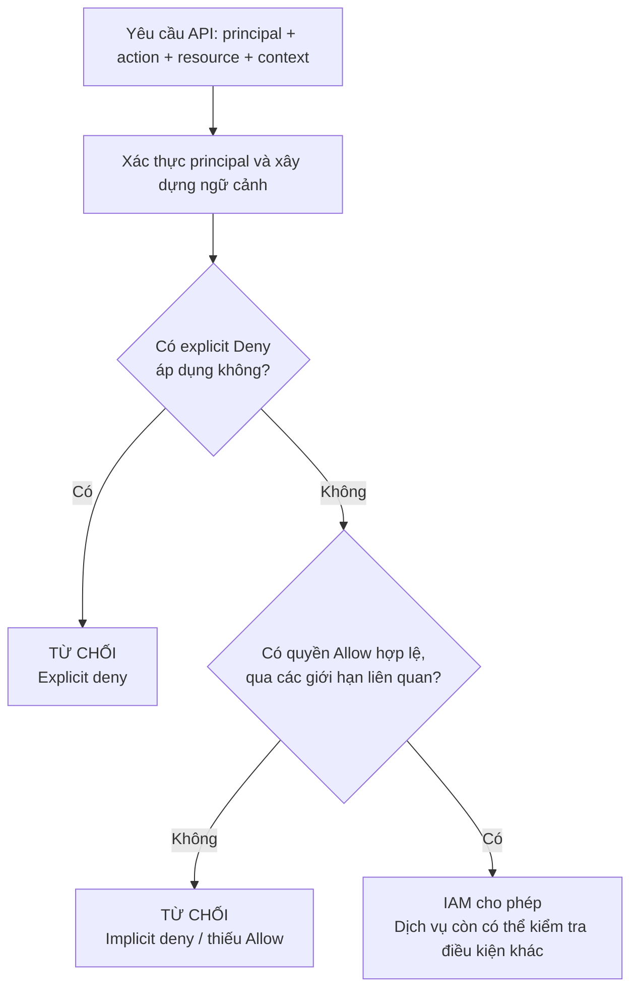
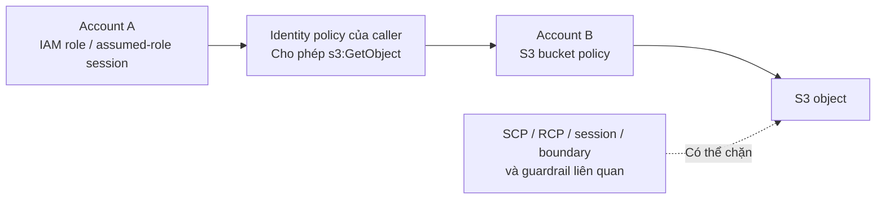

# Cách IAM đánh giá quyền và explicit deny trên AWS

> **Chương:** IAM và phân quyền · **Module:** CLOUD_PROVIDERS_AWS  
> **Trọng tâm:** hiểu cách AWS IAM quyết định *Allow* hay *Deny* cho một yêu cầu truy cập, đặc biệt là vai trò ưu tiên tuyệt đối của **explicit deny** trong những chính sách áp dụng cho yêu cầu đó.

## 1. Mục tiêu học tập và bài toán thực tế

Khi một ứng dụng AWS gọi API, câu hỏi quan trọng không chỉ là “role này có policy cho phép không?”, mà là:

- **Ai** đang gọi: IAM user, assumed role session, dịch vụ AWS hay một principal từ tài khoản khác?
- Gọi **hành động gì**: ví dụ `s3:GetObject`, `s3:ListBucket` hay `ec2:TerminateInstances`?
- Đối với **tài nguyên nào**: ARN bucket, object, instance hoặc key cụ thể?
- Với **ngữ cảnh gì**: Region, địa chỉ IP, thẻ tag, MFA, kết nối TLS, thời gian, VPC endpoint...?
- Những **chính sách và cơ chế giới hạn nào** áp dụng: identity policy, resource policy, permissions boundary, session policy, SCP, RCP...?

Sau bài này, người học có thể đọc kết quả `AccessDenied` đúng cách; phân biệt **implicit deny** với **explicit deny**; theo dõi tác động của `Allow`, `Deny` và `Condition`; nhận biết các quyền hạn giữa tài khoản; thử nghiệm chính sách an toàn trước khi đưa vào môi trường sản xuất.

Kiến thức này là nền tảng để triển khai IAM cho ứng dụng chạy trên **EC2, Lambda, S3, RDS, VPC**, giám sát bằng **CloudTrail**, kiểm soát quyền theo nguyên tắc **least privilege** và giảm nguy cơ thao tác phá hủy tài nguyên.

## 2. Tư duy gốc: mặc định Deny, cần Allow hợp lệ, explicit Deny thắng

AWS IAM bắt đầu từ nguyên tắc **mặc định từ chối truy cập**. Không có quyền truy cập được cấp phù hợp thì yêu cầu bị từ chối.

Ba quy tắc phải ghi nhớ:

1. **Mặc định là implicit deny.** Khi không có `Allow` hợp lệ cấp quyền cho hành động/tài nguyên/ngữ cảnh, IAM không cho phép yêu cầu.
2. **Allow chỉ có hiệu lực khi các ràng buộc liên quan cho phép.** Một lệnh `Allow` trong identity policy chưa đủ nếu permissions boundary, session policy hoặc SCP áp dụng đang hạn chế quyền.
3. **Explicit deny có mức ưu tiên cao nhất.** Nếu có một câu lệnh `Effect: "Deny"` khớp với yêu cầu trong một chính sách có hiệu lực, yêu cầu bị từ chối, ngay cả khi chính sách khác có `Allow`.



Sơ đồ này là **mô hình tư duy tổng quát**, không thay thế các ngoại lệ trong chính sách tài nguyên, quyền theo phiên, Organizations hay xử lý riêng của từng dịch vụ được trình bày ở phần sau.

### 2.1. Implicit deny và explicit deny khác nhau thế nào?

| Tiêu chí | Implicit deny | Explicit deny |
|---|---|---|
| Nguồn gốc | Không có `Allow` hợp lệ sau khi xét các ràng buộc áp dụng | Có câu lệnh `Deny` khớp hành động, tài nguyên, principal/ngữ cảnh |
| Có cần viết `"Effect": "Deny"`? | Không | Có |
| Có thể được vượt qua bằng `Allow` khác? | Trong một số mô hình, có thể: ví dụ một resource-based policy cùng tài khoản cấp Allow trực tiếp cho principal phù hợp | **Không**, nếu Deny đó áp dụng cho request |
| Tác dụng điển hình | Thực hiện “deny by default”, giới hạn quyền trong boundary/session/SCP | Đặt hàng rào cấm truy cập rõ ràng, chẳng hạn chặn xóa dữ liệu |
| Khi xử lý sự cố | Tìm Allow còn thiếu hoặc giới hạn không cho phép | Tìm đúng câu lệnh Deny có hiệu lực và điều kiện đã khớp |

**Ví dụ nhanh:** role được cấp `s3:GetObject` trên `arn:aws:s3:::course-data/public/*`. Truy cập `public/lesson.json` có thể được cho phép. Truy cập `private/salary.csv` bị *implicit deny* vì không nằm trong vùng Allow. Nếu policy còn có `Deny` đối với `public/restricted/*`, thì `public/restricted/secret.json` bị *explicit deny*, bất chấp `Allow` bao trùm `public/*`.

## 3. AWS thu thập những thông tin nào để đánh giá?

Một yêu cầu truy cập thường gồm các thành phần sau:

| Thành phần | Ví dụ | Vì sao quan trọng? |
|---|---|---|
| **Principal** | `arn:aws:sts::111122223333:assumed-role/ShopApiRole/session-01` | Nhận diện người/role session thực hiện hành động |
| **Action** | `s3:GetObject` | Quyết định quyền API cần được cấp |
| **Resource** | `arn:aws:s3:::shop-training-data/public/item.json` | Xác định ARN hoặc tập tài nguyên được yêu cầu |
| **Request context** | `aws:SecureTransport = true`, source IP, tags, MFA | Dùng để đánh giá các `Condition` trong policy |
| **Account/organization context** | Tài khoản sở hữu resource, tài khoản principal, OU và SCP/RCP | Xác định các chính sách giới hạn và điều kiện truy cập chéo tài khoản |

Ở một số dịch vụ/hành động, API yêu cầu nhiều quyền hoặc nhiều loại resource; có hành động không hỗ trợ resource-level permissions và cần `"Resource": "*"`. Vì vậy không được suy ra một API có thể chỉ cần kiểm tra đúng một ARN.

### 3.1. Cấu trúc câu lệnh IAM JSON

Một chính sách IAM thường gồm `Version` và danh sách `Statement`. Các phần quan trọng trong một statement:

- `Effect`: `Allow` hoặc `Deny`.
- `Action` / `NotAction`: những hành động phù hợp.
- `Resource` / `NotResource`: tài nguyên phù hợp.
- `Condition`: điều kiện phải khớp thì statement mới có hiệu lực.
- `Principal` / `NotPrincipal`: xác định đối tượng áp dụng trong **resource-based policy** hoặc role trust policy; thường không dùng `Principal` trong identity-based policy.

Ví dụ identity-based policy cấp quyền đọc object ở thư mục `public/` nhưng cấm vùng `public/restricted/`:

```json
{
  "Version": "2012-10-17",
  "Statement": [
    {
      "Sid": "AllowReadPublicObjects",
      "Effect": "Allow",
      "Action": "s3:GetObject",
      "Resource": "arn:aws:s3:::shop-training-data/public/*"
    },
    {
      "Sid": "DenyReadRestrictedObjects",
      "Effect": "Deny",
      "Action": "s3:GetObject",
      "Resource": "arn:aws:s3:::shop-training-data/public/restricted/*"
    }
  ]
}
```

Hãy đánh giá từng yêu cầu:

| Action và object | Statement Allow | Statement Deny | Kết quả nếu không có chính sách/giới hạn khác |
|---|---|---|---|
| `GetObject` trên `public/catalog.json` | Khớp | Không khớp | **Allow** |
| `GetObject` trên `public/restricted/plan.json` | Khớp | Khớp | **Explicit deny** |
| `GetObject` trên `private/plan.json` | Không khớp | Không khớp | **Implicit deny** |
| `PutObject` trên `public/new.json` | Không khớp vì khác Action | Không khớp | **Implicit deny** |
| `ListBucket` trên bucket `shop-training-data` | Không khớp vì khác Action/Resource | Không khớp | **Implicit deny** |

**Thứ tự xuất hiện** của hai statement trong mảng JSON không làm thay đổi mức ưu tiên. AWS không đọc theo kiểu “dòng cuối thắng”; explicit Deny luôn ưu tiên khi khớp.

> **Lưu ý ARN S3:** `s3:ListBucket` dùng ARN của bucket (`arn:aws:s3:::shop-training-data`), còn `s3:GetObject` dùng ARN object (`arn:aws:s3:::shop-training-data/*` hoặc prefix cụ thể). Nhầm hai kiểu ARN là nguyên nhân phổ biến dẫn đến quyền không hoạt động.

## 4. Những lớp policy tham gia vào quá trình đánh giá

Cùng một hành động có thể chịu tác động của nhiều loại chính sách. Các lớp sau có **vai trò khác nhau**, không thể đơn giản gộp mọi `Allow` vào một danh sách.

| Loại chính sách | Gắn ở đâu? | Vai trò khi đánh giá |
|---|---|---|
| **Identity-based policy** | IAM user, group hoặc role | Cấp hoặc từ chối hành động của principal; có thể là AWS managed, customer managed hoặc inline |
| **Resource-based policy** | S3 bucket, SQS queue, Lambda function, KMS key, role trust policy... | Quy định principal nào được thao tác trên resource; tác động tùy dịch vụ và quan hệ cùng tài khoản/khác tài khoản |
| **Permissions boundary** | IAM user/role | Giới hạn **quyền tối đa** mà identity-based policy có thể cấp; bản thân boundary **không cấp quyền** |
| **Session policy** | Phiên STS khi assume role/federation phù hợp | Thu hẹp quyền của phiên so với quyền của role/user nguồn theo cơ chế tương ứng; **không cấp thêm quyền** |
| **Service Control Policy (SCP)** | AWS Organizations: root, OU, account | Giới hạn quyền tối đa đối với principal thuộc tài khoản thành viên nằm trong phạm vi SCP; SCP **không cấp quyền** |
| **Resource Control Policy (RCP)** | AWS Organizations: root, OU, account | Hàng rào quyền đối với các loại resource được RCP hỗ trợ trong tài khoản thuộc tổ chức; RCP **không cấp quyền** |
| **VPC endpoint policy** | Một số loại VPC endpoint | Kiểm soát những request được phép đi qua endpoint đó; không thay thế quyền IAM và resource policy |
| **Quy tắc dịch vụ khác** | Ví dụ KMS key policy/grant, S3 Block Public Access, một số điều kiện của dịch vụ | Có thể bổ sung yêu cầu riêng; IAM Allow chưa chắc khiến thao tác thực tế thành công |

**Cách hiểu đúng:** Identity policy thường là nơi bắt đầu trao quyền; boundary, session policy, SCP và RCP là các giới hạn; resource policy có thể cấp quyền từ phía tài nguyên hoặc từ chối cụ thể. Có ngoại lệ khi resource policy cấp Allow **trực tiếp cho IAM user hoặc assumed-role session** ở cùng tài khoản. Vì thế cần đọc loại principal được ghi trong resource policy trước khi kết luận quyền bị chặn chỉ vì boundary/session thiếu Allow.

### 4.1. Identity-based và resource-based policy: hợp trong cùng tài khoản

Trong tình huống thông thường, **cùng một tài khoản**, các Allow từ identity-based policy và resource-based policy được xét theo phép **hợp**: một trong hai có thể cung cấp Allow, nếu không gặp Deny hay giới hạn liên quan.

Ví dụ bucket và role cùng tài khoản:

- Identity-based policy của `ShopApiRole` có Allow `s3:GetObject`.
- Bucket policy không có câu lệnh Allow riêng cho role.
- Nếu bucket policy không có Deny, và các giới hạn khác đều cho phép, request có thể được chấp nhận dựa vào identity policy.

Chiều ngược lại, resource policy có thể cấp quyền trực tiếp cho một principal cùng tài khoản mà không cần Allow tương đương từ identity policy. Tuy nhiên, kết quả còn phụ thuộc **loại principal được cấp** (IAM role ARN, IAM user ARN, role session ARN), permissions boundary, session policy và các cơ chế giới hạn khác.

**Không áp dụng máy móc “phép hợp” cho truy cập chéo tài khoản.** Truy cập cross-account thông thường cần được chủ tài khoản principal và chủ tài khoản tài nguyên cùng cho phép theo các lớp chính sách tương ứng.

### 4.2. Permissions boundary: giới hạn chứ không tự cấp quyền

Giả sử role `CatalogReaderRole` có:

- Identity policy: `Allow s3:GetObject` trên `arn:aws:s3:::shop-training-data/public/*`.
- Permissions boundary: chỉ `Allow s3:ListBucket` trên `arn:aws:s3:::shop-training-data`.
- Không có resource-based policy cấp quyền trực tiếp theo trường hợp ngoại lệ.

Role gọi `s3:GetObject` sẽ bị **implicit deny**, vì quyền được cấp bởi identity policy nằm ngoài giới hạn Allow của boundary. Việc identity policy có Allow không thể làm boundary tự mở rộng.

Biểu thức tư duy trong trường hợp identity policy thông thường:

```text
Quyền hiệu lực từ identity policy
  = Quyền Allow của identity policy
  ∩ Quyền Allow của permissions boundary (nếu có)
  ∩ Quyền Allow của session policy (nếu có)
  ∩ Phạm vi SCP/RCP áp dụng
  - Mọi explicit Deny có hiệu lực
```

Biểu thức trên chỉ mô tả tuyến **cấp quyền qua identity policy**. Nó không phải công thức đầy đủ cho tất cả lời gọi vì resource-based policy cấp quyền trực tiếp có những khác biệt được trình bày ở `4.5`. SCP và RCP còn có phạm vi áp dụng, loại principal/resource và ngoại lệ riêng.

### 4.3. SCP: hàng rào quyền của AWS Organizations

Một SCP có `Deny` trên `ec2:TerminateInstances` cho những tài khoản thành viên thuộc OU `Production`. Dù role `OperationsRole` trong một tài khoản đó được identity policy cấp `ec2:*`, thao tác chấm dứt EC2 vẫn bị **explicit deny**, nếu request nằm trong phạm vi SCP.

Ví dụ SCP tối giản cho tác vụ minh họa:

```json
{
  "Version": "2012-10-17",
  "Statement": [
    {
      "Sid": "DenyTerminateInstances",
      "Effect": "Deny",
      "Action": "ec2:TerminateInstances",
      "Resource": "*"
    }
  ]
}
```

Cần nhớ:

- SCP đặt **trần quyền**, không tự cấp quyền cho tài khoản hoặc principal.
- Khi dùng chiến lược SCP dạng allow-list, quyền còn phụ thuộc các `Allow` ở từng cấp tổ chức liên quan (root → OU → account); không có Allow hợp lệ ở một cấp thì request có thể bị chặn bởi **implicit deny**.
- SCP áp dụng theo phạm vi Organizations và có **ngoại lệ**, ví dụ không giới hạn principal trong tài khoản quản lý (management account) và một số loại principal/service-linked role theo tài liệu AWS.
- Nếu không có Organizations hoặc SCP không áp dụng cho request đang xét, không được giả định có một SCP đang chặn.

### 4.4. RCP: giới hạn quyền trên phía tài nguyên

**Resource Control Policy (RCP)** là một lớp guardrail của AWS Organizations áp dụng cho những loại tài nguyên và hành động được hỗ trợ. Nó đặt giới hạn đối với việc principal truy cập resource thuộc tài khoản trong phạm vi RCP; không dùng RCP để cấp quyền cho principal.

Ví dụ về tư duy: một bucket S3 tại tài khoản chịu sự quản lý của RCP có guardrail từ chối một kiểu truy cập nhất định; resource-based policy của bucket cấp `Allow` không đủ vượt qua guardrail có hiệu lực đó.

Không giả định RCP áp dụng cho **mọi** dịch vụ AWS. Khi đánh giá lỗi phải kiểm tra danh sách tài nguyên/hành động RCP hỗ trợ, OU/account nhận RCP, và những ngoại lệ AWS công bố. Tương tự SCP, RCP có cơ chế phân cấp tổ chức và không đóng vai trò thay thế identity/resource policy.

### 4.5. Ngoại lệ quan trọng khi resource-based policy cấp trực tiếp cho principal

Tại **cùng tài khoản**, resource-based policy cấp quyền cho các loại principal khác nhau có thể dẫn đến cách tính implicit deny khác nhau:

- Cấp trực tiếp cho **IAM user ARN**: một Allow phù hợp trong resource policy có thể không bị giới hạn bởi **implicit deny** của identity policy hoặc permissions boundary.
- Cấp trực tiếp cho **assumed-role session ARN**: Allow có thể không bị giới hạn bởi **implicit deny** của identity policy, permissions boundary hoặc session policy trong một số trường hợp.
- Cấp cho **IAM role ARN**: các giới hạn implicit deny của permissions boundary và session policy vẫn có thể ảnh hưởng đến quyền mà resource policy trao.

Các khác biệt này phụ thuộc **principal thực sự trong request** và **cách policy chỉ định principal**, bao gồm trường hợp sử dụng điều kiện `aws:PrincipalArn`. Không dùng các ngoại lệ để thiết kế đường lách guardrail.

**Bất biến:** explicit `Deny` trong một policy có hiệu lực vẫn thắng mọi Allow được cấp theo những trường hợp trên. Các ràng buộc SCP/RCP, nơi chúng áp dụng, vẫn cần được kiểm tra riêng.

## 5. Explicit deny hoạt động thế nào?

Một statement Deny phải **khớp yêu cầu** mới có hiệu lực: Action, Resource, Principal (nếu có) và các Condition liên quan đều phải được thỏa theo cú pháp IAM. Deny không có tính “lan sang mọi request” chỉ vì policy chứa từ khóa `Deny`.

### 5.1. Deny theo hành động hoặc tài nguyên

Ví dụ cần ngăn EC2 production bị xóa. Một guardrail có thể Deny `ec2:TerminateInstances` với phạm vi resource hoặc điều kiện tag phù hợp; tùy nhu cầu có thể dùng SCP, identity policy hoặc lớp khác.

Phân biệt:

- Deny `ec2:TerminateInstances` **không tự động** Deny `ec2:StopInstances`.
- Deny trên một ARN instance cụ thể **không tự động** áp dụng cho ARN instance khác.
- Deny theo tag chỉ kích hoạt khi key/value và toán tử Condition khớp ngữ cảnh request.

### 5.2. Deny khi không dùng HTTPS/TLS

Ví dụ bucket policy từ chối truy cập object và bucket khi request không dùng TLS:

```json
{
  "Version": "2012-10-17",
  "Statement": [
    {
      "Sid": "DenyInsecureTransport",
      "Effect": "Deny",
      "Principal": "*",
      "Action": "s3:*",
      "Resource": [
        "arn:aws:s3:::shop-training-data",
        "arn:aws:s3:::shop-training-data/*"
      ],
      "Condition": {
        "Bool": {
          "aws:SecureTransport": "false"
        }
      }
    }
  ]
}
```

Đây là **resource-based policy** cho S3 bucket; `Principal` xác định đối tượng mà statement áp dụng. Khi `aws:SecureTransport = false` và statement khớp, explicit Deny chặn request, ngay cả khi role có `Allow s3:*` trong identity policy.

Nếu `aws:SecureTransport = true`, Deny statement này **không khớp**; điều đó chỉ có nghĩa request *không bị statement này từ chối*, chứ chưa đủ kết luận request được Allow. Với một số lời gọi dịch vụ tới dịch vụ, thông tin mạng/SSL có thể không hiện đầy đủ trong ngữ cảnh authorization; khi tạo chính sách TLS production cần kiểm tra hướng dẫn AWS về AWS service principals và `aws:PrincipalIsAWSService` để tránh chặn các lời gọi dịch vụ hợp lệ.

### 5.3. Condition ảnh hưởng trực tiếp đến việc statement có khớp

Ví dụ Allow chỉ khi caller dùng MFA, source IP được phép hoặc có tag đã quy định. Trong IAM:

- Nhiều condition key trong cùng statement thường được kết hợp theo logic **AND**.
- Các giá trị cho một key và toán tử được đánh giá theo quy tắc toán tử IAM tương ứng; không suy luận tất cả là AND hoặc tất cả là OR.
- `StringEquals`, `StringNotEquals`, `Bool`, `Null`, `IpAddress` và các toán tử `IfExists` có quy tắc khác nhau.
- Khi key không xuất hiện trong request context, kết quả phụ thuộc toán tử; đặc biệt phải cẩn thận với `Not...`, `IfExists` và Deny.
- Các key đặc thù như `aws:RequestedRegion`, `aws:PrincipalTag/...`, `aws:ResourceTag/...`, `aws:MultiFactorAuthPresent` cần được kiểm tra về khả năng hỗ trợ bởi dịch vụ/action.

Không nên chép policy có điều kiện theo Region/IP/MFA từ môi trường này sang môi trường khác khi chưa xác minh context. Một Deny sai có thể khiến cả ứng dụng hoặc quy trình quản trị bị chặn.

## 6. Diễn giải nhiều policy bằng các tình huống

### 6.1. Bảng quyết định quyền

Giả sử một role thực hiện hành động từ identity-based policy (không có Allow trực tiếp từ resource policy theo ngoại lệ) và những lớp chính sách nêu trong bảng đều áp dụng:

| Identity policy | Boundary | SCP | Resource policy | Quyết định |
|---|---|---|---|---|
| Allow `GetObject` | Allow `GetObject` | Cho phép trong guardrail | Không có Deny | **Allow** nếu mọi điều kiện khác hợp lệ |
| Allow `GetObject` | Không Allow `GetObject` | Cho phép | Không có Deny | **Implicit deny** do boundary |
| Allow `GetObject` | Allow | Explicit Deny `GetObject` | Không có Deny | **Explicit deny** do SCP |
| Allow `GetObject` | Allow | Cho phép | Explicit Deny `GetObject` | **Explicit deny** do resource policy |
| Không Allow `GetObject` | Allow | Cho phép | Không cấp Allow | **Implicit deny** do thiếu quyền |
| Allow `GetObject` | Allow | Cho phép | Có Deny chỉ với kết nối không TLS | **Allow khi TLS**, **Deny khi không TLS**, nếu không vướng giới hạn khác |

Bảng trên giúp dự đoán kết quả, nhưng mỗi tình huống production còn cần xét RCP, session policy, endpoint policy, cross-account, service-specific authorization và cách resource policy chỉ định principal.

### 6.2. Kịch bản A: Lambda được phép đọc S3 nhưng vẫn AccessDenied

Một Lambda ở Region Singapore dùng execution role `ShopReportRole` để đọc `arn:aws:s3:::shop-training-data/public/sales.json`. Role có:

```json
{
  "Version": "2012-10-17",
  "Statement": [
    {
      "Effect": "Allow",
      "Action": "s3:GetObject",
      "Resource": "arn:aws:s3:::shop-training-data/public/*"
    }
  ]
}
```

Tuy nhiên, bucket policy có Deny `s3:GetObject` với `Condition` giới hạn mạng; request thực tế khớp Deny. Kết quả là **explicit deny**.

**Hướng điều tra:** xác định role session thực thi Lambda, ARN object, vị trí bucket, action và context request; đọc toàn bộ statement Deny của bucket policy, xét boundary/SCP/RCP nếu có. Việc thêm `s3:*` vào role **không giải quyết** một explicit Deny có hiệu lực và còn làm tăng rủi ro.

### 6.3. Kịch bản B: identity Allow nhưng boundary thiếu Allow

Role `DeployRole` có identity policy Allow `cloudformation:CreateStack`. Permissions boundary của role chỉ Allow một số action đọc thông tin (`Describe*`, `List*`), không cho phép `CreateStack`.

Kết quả: **implicit deny** do quyền CreateStack không nằm trong giới hạn boundary, trong tình huống không có cấp quyền theo ngoại lệ từ resource policy.

**Cách sửa đúng:** đối chiếu nhu cầu nghiệp vụ và điều chỉnh **đồng bộ** quyền trong identity policy/boundary theo nguyên tắc least privilege, có kiểm duyệt; không xóa boundary để “thử cho chạy”.

### 6.4. Kịch bản C: admin role không xóa được EC2

Role có identity policy `AdministratorAccess` hoặc `Allow ec2:*`; SCP của OU production lại có `Deny ec2:TerminateInstances`.

Kết quả: **explicit deny** do SCP khi request chịu sự áp dụng của SCP. Quyền admin trong một tài khoản thành viên không thắng guardrail Organizations.

**Cách xử lý:** xác định SCP nào gắn tại các cấp root/OU/account, chính xác principal có chịu áp dụng hay không, và mục đích bảo vệ. Chỉ chủ quản trị có thẩm quyền nên điều chỉnh guardrail nếu có nhu cầu nghiệp vụ hợp lệ.

### 6.5. Kịch bản D: account A cần truy cập S3 bucket ở account B

Tài khoản A có application role. Tài khoản B sở hữu bucket dữ liệu.



Để truy cập chéo tài khoản theo mô hình phổ biến:

1. Ở **A**, quyền của caller phải cho phép hành động với resource ở **B**, xét cả boundary/session/SCP áp dụng.
2. Ở **B**, bucket policy phải cho phép principal thích hợp từ **A** (trực tiếp hoặc theo cấu hình cross-account được hỗ trợ), và không có Deny tương ứng.
3. RCP áp dụng với resource của **B**, nếu có, không được chặn. Các yêu cầu riêng như quyền dùng KMS key khi object mã hóa bằng SSE-KMS cũng phải được đáp ứng.
4. Yêu cầu đi qua VPC endpoint thì endpoint policy tương ứng cũng phải cho phép.

**Một bên cấp Allow chưa đủ** để suy ra truy cập chéo tài khoản thành công. Đây cũng là lý do nhiều lỗi cross-account chỉ xảy ra tại production dù ứng dụng hoạt động trong môi trường cùng tài khoản.

### 6.6. Kịch bản E: role assumption khác quyền gọi API của role

Để dịch vụ hoặc principal khác **assume role**, AWS còn đánh giá **role trust policy** và những quyền liên quan tới `sts:AssumeRole`. Trust policy là resource-based policy gắn với IAM role. Sau khi assume thành công, ứng dụng nhận **temporary credentials** của phiên role; các API tiếp theo được đánh giá theo quyền hiệu lực của **session** đó.

Do đó phải phân biệt hai bước:

1. Có được tạo session của role hay không?
2. Sau khi có session, session được phép gọi `s3:GetObject`, `dynamodb:PutItem`... hay không?

Một role có trust policy cho Lambda assume **không tự động** được quyền truy cập S3; execution role vẫn cần chính sách trao quyền phù hợp.

## 7. Phương pháp đọc lỗi AccessDenied có hệ thống

Khi nhận `AccessDenied` hoặc `UnauthorizedOperation`, nên phân tích theo thứ tự:

1. **Xác nhận principal thực tế.** Xem role, user hoặc assumed-role session đang dùng; đừng dựa vào tên profile hay biến môi trường mà suy ra identity.
2. **Xác định action và resource.** Đọc API bị từ chối và ARN chuẩn; phân biệt tài nguyên bucket với object, hoặc action ghi với action liệt kê.
3. **Đọc thông báo lỗi nếu có.** Một số dịch vụ trả về lý do như “because no identity-based policy allows...” hoặc “with an explicit deny in a service control policy”. Thông báo không phải lúc nào cũng đầy đủ và có thể chỉ nêu một nguyên nhân.
4. **Tìm mọi Deny áp dụng.** Kiểm tra identity policy, resource policy, boundary, session policy, SCP/RCP, VPC endpoint policy và các ràng buộc dịch vụ phù hợp.
5. **Nếu không có Deny, tìm Allow còn thiếu.** Kiểm tra Action, Resource, Principal, Condition, ARN, prefix, Region và sự giao nhau giữa các policy giới hạn.
6. **Kiểm tra điều kiện thực thi.** Encryption/KMS, network path, VPC endpoint, tags, MFA và các chính sách dịch vụ cụ thể.
7. **Thử lại bằng truy vấn tối thiểu và ghi nhận thay đổi.** Không mở toàn bộ quyền chỉ để “xem còn lỗi không”.

Cách xử lý theo mô hình này giúp tránh hai sai lầm: cấp quyền quá rộng mà lỗi vẫn còn, hoặc xóa guardrail bảo mật đáng lẽ phải duy trì.

### 7.1. AWS CLI: xác định danh tính đang dùng

Các ví dụ sau là lệnh **đọc/kiểm tra**, không tạo hoặc sửa tài nguyên. Cần AWS CLI v2 và credential/profile phù hợp.

```bash
aws sts get-caller-identity
```

Kết quả gồm `Account`, `Arn` và `UserId`. Với một phiên assume role, ARN thường có dạng:

```text
arn:aws:sts::111122223333:assumed-role/ShopApiRole/session-name
```

Lưu ý: role ARN gốc và assumed-role session ARN là hai dạng ARN khác nhau; sự khác nhau này có thể ảnh hưởng cách resource policy cấp trực tiếp cho principal.

### 7.2. IAM Policy Simulator: thử một action và ARN

Ví dụ mô phỏng role đọc một object:

```bash
aws iam simulate-principal-policy \
  --policy-source-arn arn:aws:iam::111122223333:role/CatalogReaderRole \
  --action-names s3:GetObject \
  --resource-arns arn:aws:s3:::shop-training-data/public/catalog.json \
  --query "EvaluationResults[].[EvalActionName,EvalResourceName,EvalDecision]" \
  --output table
```

Giá trị `EvalDecision` có thể là `allowed`, `implicitDeny` hoặc `explicitDeny`. Cần quyền IAM cho việc mô phỏng và một role tồn tại thực tế.

**Giới hạn:** Policy Simulator không thay thế hoàn toàn yêu cầu thực tế; một số trường hợp với resource-based policy, Organizations SCP/RCP, service-specific logic, context keys hay cross-account cần kiểm tra riêng và có thể không được mô phỏng đầy đủ. Hãy dùng simulator để khoanh vùng, kết hợp **CloudTrail** và chính sách hiện hành, rồi xác minh bằng hành động được phép trong môi trường kiểm thử.

### 7.3. IAM Access Analyzer và CloudTrail

- **IAM Access Analyzer**: hỗ trợ kiểm tra tính hợp lệ và những rủi ro thường gặp của policy; có các khả năng phân tích/đề xuất theo dữ liệu truy cập. Kết quả cảnh báo không phải phán quyết cuối cho từng request.
- **AWS CloudTrail**: giúp tra dấu API, principal, thời điểm và kết quả lỗi khi sự kiện được ghi lại; cần đúng tài khoản, Region, trail/event data store và loại sự kiện đã được cấu hình thu thập. Không mặc định mọi data event S3 được ghi sẵn.
- **IAM policy summary, policy viewer, Organizations policy viewer**: dùng để đối chiếu policy thực tế, không chỉ bản JSON trong source code.
- **Resource policy và endpoint policy**: cần kiểm tra trực tiếp tại resource/endpoint vì chúng không tự hiển thị trong identity policy của role.

## 8. Thiết kế policy an toàn cho ứng dụng AWS

Một ứng dụng web có **API chạy trên Lambda hoặc EC2**, file trong **S3**, bản ghi trong **DynamoDB hoặc RDS**, log trong **CloudWatch** thường cần nhiều quyền, nhưng mỗi phần nên được cấp hẹp:

| Thành phần | Quyền cần xem xét | Cách giữ phạm vi tối thiểu |
|---|---|---|
| Lambda/EC2 execution role | Quyền đọc/ghi tài nguyên ứng dụng | Giới hạn Action, ARN, môi trường và Condition khi dịch vụ hỗ trợ |
| S3 bucket | Đọc object ở prefix cần thiết | Phân biệt `GetObject`/`PutObject` với `ListBucket`; dùng TLS và quy tắc public access phù hợp |
| DynamoDB | `GetItem`/`Query`/`PutItem` theo tác vụ | Giới hạn bảng/index, cân nhắc điều kiện truy cập theo dữ liệu khi hỗ trợ |
| RDS | Thông tin xác thực kết nối hoặc IAM DB authentication khi được cấu hình | Phân biệt quyền gọi API quản trị RDS với quyền SQL trong database |
| KMS | `Decrypt`/`Encrypt`/`GenerateDataKey` khi dùng mã hóa | Kết hợp IAM policy với key policy/grant và điều kiện encryption context cần thiết |
| CloudWatch Logs | Ghi log vào log group/stream phù hợp | Hạn chế quyền quản lý/xóa log không cần thiết |
| Quản trị production | Boundary/SCP/RCP và approval phù hợp | Đặt explicit Deny cho thao tác nhạy cảm khi yêu cầu; kiểm tra phạm vi áp dụng để tránh khóa vận hành |

Một nguyên tắc thiết kế hiệu quả là **đặt Allow ở đúng vị trí nhỏ nhất, dùng Deny cho điều cấm rõ ràng và có lý do**. Đừng dùng Deny hàng loạt để bù cho identity policy cấp quá rộng nếu có thể sửa nguồn cấp quyền. Ngược lại, guardrail Deny cấp tổ chức có thể hữu ích khi cần bảo vệ nhất quán nhiều tài khoản.

### 8.1. Không nhầm IAM với mạng, vùng triển khai và dịch vụ

IAM user/role là nguồn danh tính mang tính global trong một AWS partition, nhưng một Lambda function, VPC, RDS instance hay S3 bucket vẫn có vị trí triển khai và các giới hạn dịch vụ riêng. Một IAM Allow không có nghĩa:

- kết nối tới RDS sẽ đi qua security group/NACL/firewall được;
- dữ liệu S3 có quyền đi qua các boundary lưu trú dữ liệu đã đặt;
- có thể dùng KMS key ở Region khác một cách tự động;
- một action được phép ở bất kỳ Region nào nếu SCP hoặc điều kiện IAM giới hạn `aws:RequestedRegion`;
- tài nguyên đang tồn tại, hỗ trợ tính năng hoặc có capacity/quota khả dụng.

**Quyết định của IAM là một phần của quyết định vận hành cuối cùng.** Khi request thất bại, ngoài chính sách còn cần xét mạng, mã hóa, cấu hình ứng dụng và trạng thái dịch vụ.

## 9. Bài tập tư duy: tự xác định nguyên nhân Deny

### Bài 1 — Thứ tự statement

Một identity policy gồm:

- Statement 1: `Allow s3:GetObject` trên `arn:aws:s3:::shop-training-data/*`.
- Statement 2: `Deny s3:GetObject` trên `arn:aws:s3:::shop-training-data/secrets/*`.

Người dùng đọc `secrets/key.json`. Nếu đổi chỗ hai statement, kết quả có đổi không?

**Đáp án:** Không. Vì explicit Deny khớp object trong `secrets/*`, kết quả vẫn Deny, độc lập thứ tự hai statement.

### Bài 2 — Thiếu Allow

Một role chỉ có `Allow s3:ListBucket` trên ARN bucket, không có `Allow s3:GetObject`. Role tải một object trong bucket.

**Đáp án:** Thông thường là implicit deny đối với `s3:GetObject` vì ListBucket và GetObject là hai action khác nhau. Phải xét thêm resource policy có thể cấp Allow trực tiếp và các giới hạn liên quan trước khi kết luận cho request cụ thể.

### Bài 3 — Boundary chặn

Role có `Allow dynamodb:PutItem`, boundary chỉ cho phép `dynamodb:GetItem` và `dynamodb:Query`. Không có resource policy cấp thêm quyền.

**Đáp án:** Implicit deny với PutItem; Allow của identity policy nằm ngoài boundary.

### Bài 4 — SCP chặn admin

Một role được cấp `AdministratorAccess` tại tài khoản thành viên, nhưng SCP áp dụng có `Deny iam:CreateUser`.

**Đáp án:** Explicit deny; quyền admin tại tài khoản không vượt qua Deny của SCP khi SCP thực sự áp dụng cho principal/action.

### Bài 5 — Điều kiện Deny không khớp

Bucket policy có Deny `s3:GetObject` khi `aws:SecureTransport = false`. Request dùng HTTPS và có identity Allow phù hợp, không bị các giới hạn khác từ chối.

**Đáp án:** Deny theo TLS không khớp; request có thể được Allow. “Không bị Deny này chặn” và “được Allow tổng thể” là hai mệnh đề khác nhau.

### Bài 6 — Cross-account

Role tại A có `Allow s3:GetObject` tới bucket B, nhưng B chưa cấp quyền cross-account trong bucket policy, không có cơ chế quyền tương đương khác.

**Đáp án:** Truy cập thất bại. Chủ bucket B cũng phải cho phép principal từ A theo mô hình cấp quyền cross-account phù hợp.

### Bài 7 — Cấp quyền trực tiếp cho role session

Resource policy cùng tài khoản cấp Allow trực tiếp cho `arn:aws:sts::111122223333:assumed-role/MyRole/session-A`, trong khi identity policy không có Allow tương ứng.

**Đáp án:** Không được kết luận luôn là implicit deny chỉ vì identity policy thiếu Allow; cấp quyền trực tiếp cho role session có quy tắc khác. Vẫn phải tìm explicit Deny và các lớp giới hạn áp dụng cho request.

## 10. Checklist áp dụng trong code review và xử lý sự cố

Trước khi đưa IAM policy vào production:

1. Xác minh principal, action, ARN và context của request thật.
2. Tách **identity-based Allow**, **resource-based Allow** và các **giới hạn** (boundary/session/SCP/RCP).
3. Tìm explicit Deny trước; nếu có Deny khớp, không cố thêm Allow để vượt qua.
4. Nếu không có Deny, kiểm tra Allow hợp lệ và cách các giới hạn giao nhau; lưu ý ngoại lệ cấp trực tiếp qua resource policy.
5. Kiểm tra kỹ `Resource`, `Principal`, Region, prefix, tag, MFA và Condition key.
6. Với cross-account, xác minh hai phía và quyền KMS/endpoint nếu có.
7. Dùng simulator, Access Analyzer và CloudTrail để tìm bằng chứng; thử nghiệm trong phạm vi an toàn.
8. Chỉ cấp quyền tối thiểu và ghi rõ lý do cho các câu lệnh Deny quan trọng.

**Mấu chốt:** IAM không quyết định quyền theo “policy nào mạnh hơn” hay “dòng nào xuất hiện cuối”. Kết quả hình thành từ request context, những Allow hợp lệ qua các cơ chế giới hạn và mọi explicit Deny áp dụng. Nắm rõ điều này giúp triển khai workload trên AWS an toàn, dễ giám sát và dễ giải thích lỗi cấp quyền.

## Tài liệu AWS tham khảo

- [Policy evaluation logic — IAM User Guide](https://docs.aws.amazon.com/IAM/latest/UserGuide/reference_policies_evaluation-logic.html)
- [Determining whether a request is allowed or denied — IAM](https://docs.aws.amazon.com/IAM/latest/UserGuide/reference_policies_evaluation-logic_policy-eval-denyallow.html)
- [How permissions boundaries work — IAM](https://docs.aws.amazon.com/IAM/latest/UserGuide/access_policies_boundaries.html)
- [Identity-based policies and resource-based policies — IAM](https://docs.aws.amazon.com/IAM/latest/UserGuide/access_policies_identity-vs-resource.html)
- [Cross-account policy evaluation logic — IAM](https://docs.aws.amazon.com/IAM/latest/UserGuide/reference_policies_evaluation-logic-cross-account.html)
- [Service Control Policies — AWS Organizations](https://docs.aws.amazon.com/organizations/latest/userguide/orgs_manage_policies_scps.html)
- [Resource Control Policies — AWS Organizations](https://docs.aws.amazon.com/organizations/latest/userguide/orgs_manage_policies_rcps.html)
- [Testing IAM policies with the IAM policy simulator](https://docs.aws.amazon.com/IAM/latest/UserGuide/access_policies_testing-policies.html)
- [IAM JSON policy elements reference](https://docs.aws.amazon.com/IAM/latest/UserGuide/reference_policies_elements.html)
- [IAM Access Analyzer](https://docs.aws.amazon.com/IAM/latest/UserGuide/what-is-access-analyzer.html)
