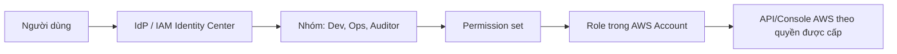
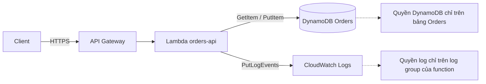

# Thiết kế quyền tối thiểu cho người dùng và workload trên AWS

> **Chương:** IAM và phân quyền  
> **Phạm vi:** Thiết kế quyền truy cập AWS theo nguyên tắc *least privilege* cho người sử dụng console/CLI và cho workload chạy trên EC2, Lambda, ECS, EKS hoặc hệ thống CI/CD. Các ví dụ sử dụng AWS Account giả định `123456789012`, Region `ap-southeast-1`.

## Mục tiêu học tập

Sau bài học, người học có thể:

1. Giải thích **quyền tối thiểu (least privilege)** và phân biệt danh tính **con người** với danh tính **workload**.
2. Tách bạch **ai được assume role**, **role được phép làm gì**, **tài nguyên nào chấp nhận truy cập** và **giới hạn bảo vệ bổ sung**.
3. Viết IAM policy theo cấu trúc `Effect`, `Action`, `Resource` và `Condition`, thu hẹp quyền theo tài nguyên, môi trường và nhu cầu nghiệp vụ.
4. Chọn cơ chế cấp thông tin xác thực phù hợp cho AWS IAM Identity Center, Lambda execution role, EC2 instance profile, ECS task role, EKS và CI/CD.
5. Kiểm tra quyền, phân tích `AccessDenied`, dùng CloudTrail/IAM Access Analyzer để tinh chỉnh và duy trì chính sách qua các lần phát hành.
6. Nhận diện rủi ro leo thang đặc quyền và kiểm soát truy cập khi triển khai hệ thống nhiều tài khoản, nhiều Region.

## 1. Least privilege là gì?

**Least privilege** là cấp cho mỗi danh tính **đúng những hành động cần thực hiện, trên đúng tài nguyên, trong điều kiện và khoảng thời gian cần thiết**. Mục tiêu không phải là tạo chính sách ngắn nhất, mà là tạo **tập quyền nhỏ nhất vẫn đáp ứng yêu cầu nghiệp vụ**.

Ví dụ một tác vụ xuất báo cáo hằng ngày chỉ cần đọc object S3 ở `reports/daily/`:

- Cần: `s3:GetObject` với các object thuộc prefix đó.
- Có thể cần: `s3:ListBucket` nếu tác vụ phải liệt kê object để chọn file.
- Không cần: `s3:DeleteObject`, `s3:PutBucketPolicy`, `s3:ListAllMyBuckets` hay `AdministratorAccess`.
- Không cần quyền đọc dữ liệu khách hàng ở một bucket hoặc Account khác.

Sự khác biệt này có ý nghĩa khi credential bị lộ, ứng dụng có lỗ hổng hoặc người dùng vô tình chạy sai lệnh: **quyền đã cấp quyết định phạm vi hành động có thể xảy ra**.

Để thiết kế được, hãy trả lời năm câu hỏi:

| Câu hỏi | Ví dụ với dịch vụ báo cáo |
|---|---|
| **Ai?** Danh tính (principal) nào gửi yêu cầu? | IAM role dành cho Lambda `DailyReportJobRole` |
| **Làm gì?** Hành động API nào thật sự cần? | `s3:GetObject`, `dynamodb:Query` |
| **Trên đâu?** ARN tài nguyên nào? | `arn:aws:s3:::example-report-bucket/daily/*` |
| **Khi nào/điều kiện nào?** Có cần giới hạn bằng policy condition? | Chỉ request mang principal tag hoặc đi từ endpoint được cho phép, khi cơ chế truy cập hỗ trợ |
| **Ai cho phép danh tính nhận role?** Trust relationship nào hợp lệ? | Dịch vụ Lambda được `sts:AssumeRole` vào execution role |

**Quyền dùng trong lúc triển khai** (tạo role, gán policy, tạo Lambda, tạo VPC) thường **khác hẳn** quyền dùng khi ứng dụng đang chạy (đọc/ghi đúng dữ liệu). Không gộp hai vai trò này chỉ vì cùng thuộc một dự án.

## 2. Nền tảng IAM cần hiểu trước khi viết policy

### 2.1 Principal, identity và session

**Principal** là bên thực hiện request AWS: IAM user, IAM role, phiên assumed role, tài khoản hoặc service principal tùy ngữ cảnh. **IAM role** không có access key dài hạn gắn sẵn theo cách một IAM user có thể có; role thường được sử dụng thông qua **temporary security credentials** từ AWS STS hoặc cơ chế do AWS quản lý.

Với con người, ưu tiên **AWS IAM Identity Center** kết hợp nhà cung cấp danh tính (IdP) và nhóm người dùng để nhận quyền truy cập có thời hạn vào các tài khoản AWS. Với workload chạy trên AWS, ưu tiên **role của môi trường thực thi**. Tránh tạo access key dài hạn cho ứng dụng khi đã có cơ chế role/federation phù hợp.

### 2.2 Các loại policy và vai trò của chúng

| Thành phần | Chức năng | Có tự cấp quyền thực hiện API không? |
|---|---|---|
| **Identity-based policy** | Gắn với IAM role/user/group; liệt kê hành động và tài nguyên danh tính có thể sử dụng | Có thể tạo quyền `Allow`, tùy đánh giá tổng thể |
| **Resource-based policy** | Gắn với tài nguyên hỗ trợ, ví dụ S3 bucket, KMS key, SQS queue, Lambda function | Có thể cho phép principal theo cú pháp/chính sách tài nguyên, tùy bối cảnh |
| **Role trust policy** | Loại resource-based policy của IAM role; quyết định principal nào có thể assume role | Cho phép thao tác assume role; không cấp các hành động dữ liệu của role |
| **Permissions boundary** | Đặt giới hạn quyền tối đa của identity-based policy trên IAM user/role | Không; chỉ giới hạn |
| **AWS Organizations SCP** | Giới hạn quyền tối đa đối với principal trong tài khoản chịu ảnh hưởng của SCP | Không; chỉ giới hạn |
| **AWS Organizations RCP** | Đặt giới hạn kiểm soát quyền tài nguyên trong phạm vi tổ chức hỗ trợ | Không; chỉ giới hạn |
| **Session policy** | Giới hạn thêm quyền của một phiên role/federated session tương ứng | Không; không thể mở rộng quyền role gốc |

**Điểm mấu chốt:** Một câu lệnh `Allow` trong một policy không bảo đảm request cuối cùng được cho phép. AWS tổng hợp các chính sách áp dụng, và **explicit `Deny` có ưu tiên**. Kết quả còn phụ thuộc loại principal, resource policy, Organizations controls, boundary, session policy và điều kiện của request. Một số trường hợp đánh giá quyền dựa trên resource policy có quy tắc riêng; không nên coi toàn bộ chính sách luôn giao nhau theo một công thức đơn giản.

### 2.3 Cấu trúc policy

Một identity-based IAM policy thông dụng:

```json
{
  "Version": "2012-10-17",
  "Statement": [
    {
      "Sid": "ReadSelectedObjects",
      "Effect": "Allow",
      "Action": "s3:GetObject",
      "Resource": "arn:aws:s3:::example-report-bucket/daily/*"
    }
  ]
}
```

Các trường cần hiểu:

- `Version` là **phiên bản ngôn ngữ IAM policy**, không phải ngày bạn cập nhật tài liệu. `2012-10-17` là giá trị tiêu chuẩn phổ biến.
- `Statement` chứa một hoặc nhiều khối điều kiện quyền.
- `Effect` là `Allow` hoặc `Deny`.
- `Action` có dạng `service:Operation`, ví dụ `dynamodb:Query`.
- `Resource` xác định ARN cần áp dụng, khi hành động hỗ trợ resource-level permissions.
- `Condition` giới hạn dựa trên ngữ cảnh yêu cầu, như principal tag, source VPC endpoint hay tag tài nguyên, **khi dịch vụ/hành động có hỗ trợ khóa điều kiện đó**.
- `Sid` là nhãn mô tả tùy chọn, có ích cho kiểm toán.

**Không nhầm IAM policy với ACL, security group hoặc network route.** IAM kiểm soát quyền API; security group và route kiểm soát khía cạnh kết nối mạng. Một request có quyền IAM vẫn có thể thất bại vì DNS, firewall, thiếu endpoint, khóa KMS hoặc yêu cầu xác thực ở tầng ứng dụng.

## 3. Hai kiểu danh tính, hai cách cấp quyền

### 3.1 Người dùng: truy cập qua Identity Center và nhóm

Người vận hành, lập trình viên và kiểm toán viên thường làm việc qua console hoặc CLI. Mô hình thường dùng:



**Thiết kế theo vai trò công việc:**

| Nhóm ví dụ | Nhiệm vụ | Phạm vi quyền gợi ý |
|---|---|---|
| `Developers` | Xem log và kiểm tra một ứng dụng ở dev | Read-only/quan sát trong Account dev, thay vì toàn bộ prod |
| `Deployers` | Triển khai stack từ pipeline | Quyền triển khai riêng, giới hạn stack, role được truyền và môi trường |
| `Operations` | Vận hành/khắc phục sự cố production | Quyền vận hành được kiểm soát; quyền thay đổi nhạy cảm cần quy trình nâng quyền |
| `Auditors` | Xem cấu hình, log và trạng thái tuân thủ | Read-only phù hợp với phạm vi kiểm toán, tránh quyền sửa |
| `Break-glass administrators` | Xử lý sự cố nghiêm trọng khi đường truy cập thông thường không còn | Quyền đặc biệt, được bảo vệ và giám sát chặt, dùng theo quy trình khẩn cấp |

Sử dụng **nhóm và permission set** để quản lý quyền theo chức năng. Hạn chế gán quyền tùy tiện cho từng cá nhân vì khó đánh giá khi thay đổi nhân sự. Tách **dev/staging/prod** bằng Account khi có điều kiện để giảm mức ảnh hưởng của lỗi thao tác và chính sách quá rộng.

**MFA** nên áp dụng cho đăng nhập người dùng; thời lượng phiên, phê duyệt nâng quyền và truy cập production cần phù hợp mức nhạy cảm. Đừng sao chép điều kiện `aws:MultiFactorAuthPresent` vào mọi policy mà chưa kiểm tra cách IdP/Identity Center biểu diễn phiên và hỗ trợ ngữ cảnh MFA.

### 3.2 Workload: ứng dụng dùng role và temporary credentials

Workload là code tự động gọi AWS API, ví dụ job xử lý đơn hàng trên Lambda, ứng dụng EC2, ECS task, Pod EKS hoặc CI/CD pipeline.

| Nơi chạy | Cơ chế khuyến nghị | Phân biệt cần nhớ |
|---|---|---|
| **AWS Lambda** | **Execution role** | Role cho code Lambda; không phải vai trò người dùng triển khai Lambda |
| **Amazon EC2** | **IAM role qua instance profile** | Ứng dụng dùng credential tạm thời từ instance metadata, không hardcode access key |
| **Amazon ECS** | **Task role** | Task role cho app gọi AWS API; **task execution role** dành cho ECS agent, pull image, gửi log hoặc tác vụ nền hỗ trợ |
| **Amazon EKS** | **EKS Pod Identity** hoặc **IRSA** tùy cluster/nhu cầu | Gán role theo workload/pod, tránh cấp dư quyền qua node role |
| **CI/CD ngoài AWS** | OIDC federation/`AssumeRoleWithWebIdentity` khi nền tảng hỗ trợ | Chỉ cho phép repo, branch, environment hoặc job phù hợp qua trust conditions |
| **Workload từ Account khác** | STS `AssumeRole` vào role đích | Cần cấu hình trust ở đích và quyền assume role từ nguồn |

**Không nên dùng chung role có quyền lớn cho tất cả ứng dụng.** Hai Lambda cùng nằm trong một VPC nhưng phục vụ các nhiệm vụ khác nhau nên có execution role riêng, trừ khi yêu cầu truy cập thật sự đồng nhất và đã được kiểm soát.

**Không để access key trong source code, image, user-data hoặc biến môi trường được lưu lâu dài.** SDK có thể dùng default credential provider chain để tự lấy thông tin xác thực theo môi trường. Cần bảo vệ log, stack trace và cấu hình để không làm lộ dữ liệu xác thực.

## 4. Quy trình thiết kế chính sách quyền tối thiểu

### Bước 1 — Vẽ luồng thao tác nghiệp vụ

Liệt kê những hành động ứng dụng **thực sự phải thực hiện** thay vì mở rộng `service:*` cho tiện.

Ví dụ API tạo đơn hàng:



Các thao tác **không** cần ở runtime: tạo/xóa bảng, sửa IAM policy, tạo role, xóa bucket hoặc cấu hình API Gateway. Chúng thuộc phạm vi deployment/administration.

### Bước 2 — Xác định chính xác Action và Resource

Tra bảng **Service Authorization Reference** để biết action nào hỗ trợ resource ARN cụ thể, những resource type nào bắt buộc và condition keys nào khả dụng.

Ví dụ:

| Nhu cầu | Action tương ứng | Resource nên giới hạn |
|---|---|---|
| Lấy một item theo khóa | `dynamodb:GetItem` | ARN bảng DynamoDB |
| Ghi item mới | `dynamodb:PutItem` | ARN bảng DynamoDB |
| Đọc nội dung một object | `s3:GetObject` | ARN object S3, không phải ARN bucket |
| Liệt kê object theo prefix | `s3:ListBucket` | ARN bucket + `s3:prefix` phù hợp |
| Gửi log vào một log stream | `logs:PutLogEvents` | ARN log stream trong log group |
| Invoke một function cụ thể | `lambda:InvokeFunction` | ARN Lambda function/alias/version phù hợp |

Không phải hành động AWS nào cũng hỗ trợ `Resource` theo ARN; một số hành động liệt kê/mô tả yêu cầu `Resource: "*"`. Khi đó cần cân nhắc giảm các action được cấp và dùng condition key được hỗ trợ, tránh gán `*` vào toàn bộ policy theo thói quen.

### Bước 3 — Chọn cơ chế credential và trust relationship

Con người dùng Identity Center/IdP; Lambda dùng execution role; EC2 dùng instance profile; ECS dùng task role; pipeline dùng OIDC/STS. Với role, **trust policy** xác định ai được nhận role.

Đảm bảo trust policy chỉ cho phép principal thực sự cần, và cấu hình **quyền IAM của bên gọi** để sử dụng `sts:AssumeRole` khi kịch bản yêu cầu.

### Bước 4 — Thu hẹp quyền bằng Resource, Condition và môi trường

Thiết kế “đúng Action” mới là bước đầu. Ví dụ cùng `s3:GetObject` nhưng các cấp độ khác nhau:

- Rộng: `Resource: "*"` — có thể bao phủ nhiều bucket/object phù hợp, không đáp ứng nhu cầu đọc báo cáo đơn lẻ.
- Hẹp theo bucket: `arn:aws:s3:::example-report-bucket/*`.
- Hẹp theo vùng dữ liệu: `arn:aws:s3:::example-report-bucket/daily/*`.

Có thể cân nhắc policy condition như `aws:PrincipalTag/Team`, `aws:ResourceTag/Environment`, `aws:SourceVpce` hoặc `aws:RequestedRegion`. **Không có condition key nào mặc nhiên phù hợp với mọi dịch vụ**. Đặc biệt, ép `aws:SourceVpce` chỉ có ý nghĩa với request thực sự đi qua VPC endpoint tương ứng; làm sai có thể khiến cả console hoặc các luồng AWS service-to-service hợp lệ bị từ chối.

### Bước 5 — Thử quyền cần có và quyền phải bị chặn

Kiểm chứng **đường đi tích cực**: người dùng có thể xem log, workload đọc/ghi đúng tài nguyên. Đồng thời thử **đường đi tiêu cực**: job không được xóa bảng, người dùng dev không sửa prod, runtime không tạo IAM role.

Dùng IAM Access Analyzer để **validate policy** và phát hiện phạm vi truy cập ngoài ý muốn; dùng IAM Policy Simulator như một công cụ hỗ trợ phân tích. Simulator không thể hiện chính xác mọi tương tác của các loại policy, dữ liệu môi trường và trạng thái dịch vụ. Kết hợp kiểm thử tích hợp có kiểm soát, log thực tế và việc kiểm tra chính sách áp dụng.

### Bước 6 — Quan sát rồi tinh chỉnh

Dùng CloudTrail để tìm hành động API đã thực hiện, IAM last accessed information để xem tín hiệu sử dụng quyền và IAM Access Analyzer policy generation (khi đủ dữ liệu CloudTrail hỗ trợ) để có bản nháp policy hẹp hơn.

**Không tự động kết luận “không có log nghĩa là không cần quyền”.** Sự kiện hiếm như phục hồi thảm họa, rotate key, xử lý sự cố hoặc công việc hàng quý có thể chưa xuất hiện trong khoảng quan sát. Phối hợp với người sở hữu nghiệp vụ trước khi gỡ quyền.

### Bước 7 — Duy trì qua Infrastructure as Code và review

Lưu policy, trust policy, permission set và thiết lập liên quan dưới dạng IaC có review. Khi thêm chức năng, bổ sung đúng hành động mới; khi bỏ tính năng, loại bỏ quyền không còn cần.

Định kỳ xem lại role không dùng, trust relationship, IAM user access key, external sharing, wildcard và quyền triển khai nhạy cảm. Kết hợp CloudWatch/CloudTrail/Config/AWS Security Hub hoặc cơ chế giám sát sẵn có để phát hiện thay đổi bất thường. Mức độ log, bảo lưu và kiểm toán cần cân đối với yêu cầu tuân thủ, khả năng giám sát và chi phí.

## 5. Ví dụ đầy đủ: cấp quyền cho Lambda xử lý đơn hàng

Giả định Lambda `orders-api` ở Account `123456789012`, Region `ap-southeast-1`, chỉ cần đọc và tạo item trong bảng DynamoDB `Orders`. Ta thiết kế **hai phần khác nhau**.

### 5.1 Trust policy của execution role

Trust policy trên IAM role `OrdersApiExecutionRole`:

```json
{
  "Version": "2012-10-17",
  "Statement": [
    {
      "Sid": "AllowLambdaServiceToAssumeRole",
      "Effect": "Allow",
      "Principal": {
        "Service": "lambda.amazonaws.com"
      },
      "Action": "sts:AssumeRole"
    }
  ]
}
```

Trust policy ở trên cho phép **dịch vụ Lambda** assume role theo cơ chế execution role. Nó không tự cấp quyền DynamoDB cho code. Người có quyền tạo/cập nhật Lambda và `iam:PassRole` đối với role đó cũng cần được kiểm soát riêng để ngăn role bị gắn vào function do người không phù hợp quản lý.

### 5.2 Permissions policy của execution role

Gắn identity-based permissions policy:

```json
{
  "Version": "2012-10-17",
  "Statement": [
    {
      "Sid": "ReadAndCreateOrders",
      "Effect": "Allow",
      "Action": [
        "dynamodb:GetItem",
        "dynamodb:PutItem"
      ],
      "Resource": "arn:aws:dynamodb:ap-southeast-1:123456789012:table/Orders"
    }
  ]
}
```

Chính sách có chủ đích **không cấp** `dynamodb:Scan`, `dynamodb:DeleteItem`, `dynamodb:DeleteTable`, `dynamodb:UpdateTable` và quyền IAM. Nếu ứng dụng cần `Query` theo GSI, phải xác định action, index ARN và nhu cầu dữ liệu thực tế rồi mới mở rộng.

Để Lambda ghi log, nếu log group `/aws/lambda/orders-api` đã tồn tại, có thể bổ sung policy riêng:

```json
{
  "Version": "2012-10-17",
  "Statement": [
    {
      "Sid": "WriteFunctionLogs",
      "Effect": "Allow",
      "Action": [
        "logs:CreateLogStream",
        "logs:PutLogEvents"
      ],
      "Resource": "arn:aws:logs:ap-southeast-1:123456789012:log-group:/aws/lambda/orders-api:log-stream:*"
    }
  ]
}
```

Ví dụ quyền CloudWatch Logs giả định **log group đã được tạo trước** bởi hạ tầng; nếu workload được phép tự tạo log group, cần phân tích thêm `logs:CreateLogGroup` và resource scope của API đó. Các AWS managed policy như `AWSLambdaBasicExecutionRole` có thể cấp phạm vi lớn hơn ví dụ trên; hãy kiểm tra nội dung policy trước khi chọn dùng mặc định.

### 5.3 Quyền triển khai không nằm trong runtime role

Một deployment role có thể cần quyền tạo/cập nhật Lambda và truyền execution role cho dịch vụ. Để giới hạn `iam:PassRole`, có thể sử dụng:

```json
{
  "Version": "2012-10-17",
  "Statement": [
    {
      "Sid": "PassOnlyOrdersExecutionRoleToLambda",
      "Effect": "Allow",
      "Action": "iam:PassRole",
      "Resource": "arn:aws:iam::123456789012:role/OrdersApiExecutionRole",
      "Condition": {
        "StringEquals": {
          "iam:PassedToService": "lambda.amazonaws.com"
        }
      }
    }
  ]
}
```

**`iam:PassRole` không phải API độc lập** mà là quyền AWS kiểm tra khi caller truyền một role cho dịch vụ trong các API phù hợp. Policy này chỉ kiểm soát phần pass role; role triển khai còn cần các action Lambda và quyền liên quan được thiết kế riêng. Người triển khai không nên được tự do tạo role mới có `AdministratorAccess` rồi truyền role đó cho function.

**Vì sao ví dụ này là quyền tối thiểu?** Execution role của Lambda chỉ thực thi những API dữ liệu và logging cần thiết; deployment role mới được quản lý cấu hình. Việc tách nhiệm vụ hạn chế tác động của lỗ hổng runtime và đơn giản hóa kiểm toán.

## 6. Ví dụ dành cho con người: chỉ xem báo cáo trong S3

Giả định một nhóm phân tích chỉ cần **liệt kê và tải object** trong prefix `daily/` của bucket `example-report-bucket`, không được upload, xóa hoặc sửa bucket policy.

Có thể đưa chính sách sau vào permission set theo mô hình IAM Identity Center nếu tính năng và cấu hình áp dụng cho phép:

```json
{
  "Version": "2012-10-17",
  "Statement": [
    {
      "Sid": "ListDailyPrefixOnly",
      "Effect": "Allow",
      "Action": "s3:ListBucket",
      "Resource": "arn:aws:s3:::example-report-bucket",
      "Condition": {
        "StringLike": {
          "s3:prefix": [
            "daily",
            "daily/*"
          ]
        }
      }
    },
    {
      "Sid": "DownloadDailyObjects",
      "Effect": "Allow",
      "Action": "s3:GetObject",
      "Resource": "arn:aws:s3:::example-report-bucket/daily/*"
    }
  ]
}
```

**Phân tích:**

- `s3:ListBucket` được đánh giá trên **bucket ARN**, và `s3:prefix` giới hạn danh sách key được yêu cầu.
- `s3:GetObject` được đánh giá trên **object ARN** nằm trong `daily/`.
- Không cấp `s3:PutObject`, `s3:DeleteObject`, `s3:PutBucketPolicy` hoặc `s3:*`.
- Kết quả truy cập thực tế còn phụ thuộc bucket policy, SCP, KMS key nếu object mã hóa bằng SSE-KMS, các điều kiện bổ sung và quyền của phiên.

**Lưu ý khi thao tác qua S3 console:** giao diện console có thể cần quyền bổ sung để duyệt danh sách bucket hoặc đường dẫn. Khi yêu cầu chỉ giới hạn đọc prefix, ưu tiên kiểm tra hành vi qua AWS CLI/SDK với đúng URI trước khi mở rộng policy chỉ để đáp ứng một thao tác giao diện.

Ví dụ thao tác dự kiến:

```bash
aws s3 ls s3://example-report-bucket/daily/ --region ap-southeast-1
aws s3 cp s3://example-report-bucket/daily/report.csv ./report.csv --region ap-southeast-1
```

Các lệnh chỉ thành công nếu tài nguyên thực sự tồn tại, người gọi có quyền phù hợp và điều kiện truy cập đáp ứng. Lệnh `cp` tải về máy local; hãy bảo vệ dữ liệu báo cáo theo chính sách tổ chức.

## 7. Những ranh giới quyền thường gây nhầm lẫn

### 7.1 Trust policy khác permissions policy

Khi Lambda chạy:

1. **Trust policy** cho phép dịch vụ Lambda nhận execution role.
2. **Permissions policy** của role cho biết code được thao tác với tài nguyên nào.
3. **Resource policy** của tài nguyên đích (nếu có) có thể cho phép, ràng buộc hoặc từ chối truy cập.
4. Các ràng buộc bổ sung như SCP, RCP, boundary, session policy và explicit deny vẫn có thể tác động.

Chỉ sửa trust policy để “mở quyền DynamoDB” là sai lớp. Chỉ sửa permissions policy cũng không giải quyết trường hợp service không được phép assume role.

### 7.2 Permission boundary không cấp thêm quyền

Giả sử developer được phép tạo role cho môi trường dev, nhưng role mới phải gắn permissions boundary chỉ cho phép một tập dịch vụ nhất định. Khi đó:

- Identity policy **không cấp** hành động `s3:PutBucketPolicy` → vẫn không được phép.
- Identity policy cấp hành động nhưng **boundary không cho phép** → bị chặn trong phạm vi boundary áp dụng.
- Boundary cho phép một hành động mà identity policy không cấp → boundary **không tự biến hành động thành được phép**.

Cần giám sát khả năng tháo/gỡ boundary hoặc tạo role không gắn boundary. Với các trường hợp resource-based policy cấp trực tiếp tới user/role session, AWS có quy tắc chi tiết khác; phải kiểm tra loại principal và tài liệu đánh giá quyền thay vì suy diễn từ ví dụ đơn giản.

### 7.3 SCP không thay thế IAM permissions

SCP của AWS Organizations được dùng để giới hạn những quyền khả dụng cho tài khoản chịu ảnh hưởng. Ví dụ chính sách tổ chức có thể chặn một nhóm hành động quản trị nguy hiểm trong production. Nhưng nếu role không được phép `dynamodb:GetItem` trong policy áp dụng, một SCP “cho phép” DynamoDB **không tạo** quyền đó.

SCP và RCP cần thiết kế theo cấu trúc AWS Organizations, mức áp dụng và các ngoại lệ của cơ chế; không phải mọi tài khoản hay principal trong tổ chức đều chịu kiểm soát giống nhau.

### 7.4 IAM Allow không mở đường mạng

Một EC2 instance trong private subnet có role được phép gọi DynamoDB nhưng không có đường kết nối phù hợp có thể vẫn lỗi mạng. Sử dụng route, NAT hoặc VPC endpoint thích hợp; điều chỉnh security group/DNS theo kiểu endpoint. Ngược lại, thêm VPC endpoint không tự động cấp `dynamodb:GetItem`.

### 7.5 Quyền xem và quyền sửa phải tách rõ

Những hành động tưởng là “quản lý cấu hình” như `iam:PassRole`, `iam:AttachRolePolicy`, `iam:CreatePolicyVersion`, `lambda:UpdateFunctionConfiguration` hoặc thao tác với các resource policy có thể tạo đường leo thang quyền nếu kết hợp không kiểm soát. Khi cấp quyền triển khai, cần đánh giá **chuỗi hành động có thể kết hợp**, không chỉ từng action riêng lẻ.

## 8. Mở rộng quyền tối thiểu qua nhiều Account và nhiều Region

### 8.1 Cross-account AssumeRole

Một job trong Account A (`210987654321`) cần đọc bảng trong Account B (`123456789012`). Thay vì copy access key của Account B sang A, có thể tạo role ở B với trust policy cho **role cụ thể** tại A:

```json
{
  "Version": "2012-10-17",
  "Statement": [
    {
      "Sid": "TrustReportingJobInSourceAccount",
      "Effect": "Allow",
      "Principal": {
        "AWS": "arn:aws:iam::210987654321:role/ReportingJobRole"
      },
      "Action": "sts:AssumeRole"
    }
  ]
}
```

Để dùng mô hình này, thường cần:

1. Role nguồn `ReportingJobRole` ở A có quyền `sts:AssumeRole` trên ARN role đích.
2. Trust policy role đích ở B tin cậy đúng principal nguồn.
3. Permissions policy role đích chỉ cho phép đọc những tài nguyên yêu cầu tại B.
4. Các lớp ràng buộc tổ chức và resource policies khác không chặn.
5. Code ở A assume role, sau đó sử dụng **temporary credentials** nhận được để gọi dịch vụ tại B.

Nếu một **bên thứ ba** được ủy quyền truy cập nhiều khách hàng, xem xét điều kiện `sts:ExternalId` trong trust policy để giảm rủi ro *confused deputy*. External ID không phải bí mật thay thế authentication; thiết kế giá trị và quy trình cấp phát phải phù hợp từng đối tác.

### 8.2 Theo Region và môi trường

ARN của tài nguyên Regional thường chứa Region và Account. Dù Lambda `orders-api` ở dev và production có cùng tên, ARN vẫn khác khi Account/Region khác. Định rõ tài nguyên trong policy; tránh dùng wildcard kiểu `arn:aws:lambda:*:*:function:*` chỉ vì triển khai đa Region.

Một số IAM role và dịch vụ có phạm vi toàn cục theo partition, nhưng phần lớn quyền dữ liệu cần xem xét địa bàn triển khai. Nếu dùng `aws:RequestedRegion` để giới hạn hành động, kiểm tra các API global, hiệu ứng liên Region và các trường hợp service hỗ trợ trước khi áp dụng trong production.

## 9. ABAC: giới hạn theo thuộc tính khi tài nguyên tăng nhanh

**ABAC (attribute-based access control)** dùng tag hoặc thuộc tính được hỗ trợ để biểu diễn quy tắc thay vì liệt kê hàng trăm ARN thủ công. Ví dụ: người dùng có principal tag `Project=Shop` chỉ được thao tác với tài nguyên có resource tag tương ứng, nếu loại action/resource hỗ trợ điều kiện cần thiết.

ABAC giúp giảm gánh nặng policy khi số lượng môi trường/tài nguyên tăng, nhưng có những yêu cầu quan trọng:

- Tag phải được quản lý đáng tin cậy. Nếu principal tự sửa `Project` hoặc tag tài nguyên tùy ý, họ có thể tự mở rộng quyền.
- Phải kiểm tra quyền **tag-on-create** và quyền cập nhật/xóa tag; cần chính sách quản trị tag phù hợp.
- **Không phải dịch vụ, action hoặc resource type nào cũng hỗ trợ mọi tag condition key**.
- Kiểm tra cách condition hoạt động khi tag thiếu, phân biệt `StringEquals`, `StringEqualsIfExists` và toán tử set khi cần.
- ABAC không thay thế kiểm soát trust role hoặc tính bảo mật của credential.

Ví dụ tình huống: mỗi nhóm có thể chạy một số loại EC2 instance đã được gắn tag dự án. Kết hợp quy tắc ABAC, phạm vi action và guardrail tổ chức để ngăn thay đổi tag nhằm chiếm quyền quản trị tài nguyên nhóm khác.

## 10. Thiết kế quyền cho CI/CD an toàn

Pipeline thường cần quyền cấp phát hạ tầng, nên tác động lớn hơn runtime role. Một pipeline triển khai Lambda bằng IaC có thể cần:

- Quyền cập nhật đúng stack/resource và tạo những dependency đã định nghĩa.
- `iam:PassRole` chỉ trên các execution role được phép truyền và tới đúng service principal.
- Trust relationship OIDC chỉ cho phép **đúng tổ chức, repository, nhánh/tag hoặc environment** theo claim và IdP hỗ trợ.
- Tách pipeline staging và production; cần kiểm soát approval và quyền bảo vệ branch/environment theo nền tảng CI.
- Theo dõi CloudTrail event để truy vết phiên role và thay đổi policy.

**Phân biệt ba quyền:** quyền sửa source code ≠ quyền chạy pipeline deployment ≠ quyền của ứng dụng khi hoạt động. Nếu một developer có thể sửa pipeline rồi tự đẩy bản triển khai production có `iam:*`, điều đó có thể phá vỡ toàn bộ thiết kế least privilege.

Đối với Amazon ECS, nhớ tách **execution role** của ECS agent (ví dụ kéo image từ ECR và ghi log theo cấu hình) khỏi **task role** dùng bên trong container. Với EKS, cấu hình role theo service account/pod phù hợp và giới hạn ai được gán service account đó; không dùng node role rộng để bù cho việc chưa cấu hình workload identity.

## 11. Hướng dẫn kiểm chứng và chẩn đoán

### 11.1 Xác định principal và tài khoản đang sử dụng

AWS CLI:

```bash
aws sts get-caller-identity
```

Kết quả thông thường:

```json
{
  "UserId": "AROAEXAMPLEID:example-session",
  "Account": "123456789012",
  "Arn": "arn:aws:sts::123456789012:assumed-role/OrdersApiExecutionRole/example-session"
}
```

Đây là dữ liệu minh họa. Với assumed role, `Arn` là **session ARN**, không trùng hoàn toàn với IAM role ARN dạng `arn:aws:iam::123456789012:role/OrdersApiExecutionRole`.

### 11.2 Dùng IAM Access Analyzer kiểm tra chính sách

Lệnh CLI ví dụ để **validate policy** lưu trong một tệp đã được người vận hành chuẩn bị từ trước:

```bash
aws accessanalyzer validate-policy \
  --policy-document file://orders-permissions.json \
  --policy-type IDENTITY_POLICY \
  --region ap-southeast-1
```

API có thể trả về findings về cú pháp, khuyến nghị hoặc vấn đề bảo mật. Hãy xem `findingType`, `issueCode` và `locations`; “không có finding” không chứng minh policy đã hẹp tuyệt đối hay mọi request thực tế sẽ thành công.

Bài này **không yêu cầu tạo** tệp policy hay cấp credential; lệnh trên được trình bày để hiểu cách kiểm tra khi làm lab.

### 11.3 Mô phỏng quyền ở mức action/resource

Ví dụ chỉ minh họa với role và bảng giả định:

```bash
aws iam simulate-principal-policy \
  --policy-source-arn arn:aws:iam::123456789012:role/OrdersApiExecutionRole \
  --action-names dynamodb:GetItem dynamodb:DeleteTable \
  --resource-arns arn:aws:dynamodb:ap-southeast-1:123456789012:table/Orders
```

Mong đợi theo policy ở mục 5: `dynamodb:GetItem` được phép nếu không có deny/giới hạn khác, còn `dynamodb:DeleteTable` không được phép. Công cụ mô phỏng có những giới hạn với loại policy, request context và một số trường hợp cross-account/resource-based policies; **không** xem kết quả mô phỏng là thay thế cho thử nghiệm thực tế có kiểm soát.

### 11.4 Kiểm tra quyền sử dụng sau khi triển khai

Quan sát CloudTrail event history hoặc log trails phù hợp để tìm:

- `eventSource` và `eventName` cho biết API đã gọi.
- `userIdentity`/session information giúp truy ra role, session và nguồn gọi.
- `errorCode`, `errorMessage` giúp phân loại deny do IAM hay lỗi dịch vụ.
- Kết hợp metric ở CloudWatch để phân biệt lỗi quyền với throttling, sai endpoint hoặc quota.

Cấu hình ghi log phải phù hợp loại event: CloudTrail **management events** và **data events** có phạm vi thu thập khác nhau. Không mặc định mọi thao tác trên object S3 hoặc item DynamoDB đều xuất hiện ở event history nếu chưa cấu hình thu thập phù hợp.

### 11.5 Bảng chẩn đoán lỗi thường gặp

| Hiện tượng | Cần kiểm tra | Cách xử lý |
|---|---|---|
| `AccessDenied` dù đã gắn `Allow` | Action/Resource ARN, explicit deny, boundary, SCP/RCP, session policy, condition key, resource policy | Xác nhận principal, request context và toàn bộ các policy liên quan |
| Lambda không đọc DynamoDB được | Trust và execution role, đúng Account/Region/table ARN, policy `dynamodb:GetItem`, VPC network nếu có | Xác định caller bằng role thực tế; kiểm tra IAM và đường mạng độc lập |
| S3 `GetObject` bị deny | Dùng bucket ARN thay object ARN; thiếu KMS decrypt; bucket policy deny | Chuyển sang object ARN theo prefix, kiểm tra key policy và quyền KMS nếu cần |
| Developer có thể truyền admin role cho service | `iam:PassRole` trên `*` hoặc thiếu giới hạn role/PassedToService | Thu hẹp role ARN, service đích và quyền tạo/sửa role |
| AssumeRole bị từ chối | Trust policy sai principal, thiếu `sts:AssumeRole` ở nguồn, thiếu `ExternalId`/condition cần thiết | Kiểm tra cả hai phía của quan hệ trust và session constraints |
| Truy cập thất bại chỉ ở production | Sai AWS profile/account, Region, condition theo tag, SCP hoặc boundary khác | Kiểm tra `sts get-caller-identity`, ARN, Organizations controls, tag và deployment config |
| Gọi API timeout | DNS, route, SG, NAT/VPC endpoint, TLS, endpoint Region | Điều tra kết nối trước khi mở rộng IAM policy |
| API trả `ThrottlingException` | Giới hạn tốc độ/quota hoặc thiết kế tải | Quan sát metric, backoff có jitter và điều chỉnh năng lực phù hợp |

**Không tự sửa lỗi `AccessDenied` bằng cách gắn `AdministratorAccess` rồi để nguyên trong production.** Nếu cần phân tích phạm vi, thử trong môi trường có kiểm soát, đọc mã lỗi/trường ARN và thu hẹp chính sách theo thao tác thực tế.

## 12. Thiết kế truy cập tối thiểu mà vẫn vận hành được

Least privilege có thể ảnh hưởng đến vận hành nếu thiếu quy trình phản hồi sự cố. Một thiết kế tốt cần:

- **Nhiệm vụ rõ ràng:** ai chịu trách nhiệm application, dữ liệu, mạng, KMS, deployment, security và incident response.
- **Role phục hồi có kiểm soát:** có cách truy cập khẩn cấp và audit khi quyền thông thường không đủ.
- **Theo dõi thay đổi:** CloudTrail, báo cáo IAM Access Analyzer, review IaC và cảnh báo quyền nhạy cảm.
- **Tách tài khoản, môi trường và dữ liệu:** giảm blast radius khi bị chiếm credential hoặc triển khai sai.
- **Khả năng điều tra:** log định danh role/session, tài khoản, Region, API, resource và thời điểm; tránh ghi secret/PII không cần thiết.
- **Kiểm soát chi phí:** quyền rộng có thể cho phép tạo dịch vụ/tài nguyên tốn kém; giới hạn quyền triển khai kết hợp AWS Budgets, CloudWatch và kiểm soát quota thích hợp.

Quyền tối thiểu không đồng nghĩa mọi API phải được phép ngay từ lần chạy đầu. Quy trình tốt là **cấp quyền có căn cứ → kiểm chứng → quan sát → chỉnh lại policy**. Mức quyền phải đủ cho cả đường xử lý bình thường lẫn các tình huống hiếm đã được xác định, chẳng hạn failover hoặc khôi phục dữ liệu.

## 13. Bài tập vận dụng

### Bài 1 — Thiết kế role

Một Lambda chỉ đọc item từ DynamoDB `Orders`. Chính sách hiện tại:

```json
{
  "Version": "2012-10-17",
  "Statement": [
    {
      "Effect": "Allow",
      "Action": "dynamodb:*",
      "Resource": "*"
    }
  ]
}
```

Hãy thu hẹp Action và Resource. Khi role còn phải ghi CloudWatch Logs, bạn sẽ cấp quyền bằng cách nào mà không mở thêm quyền DynamoDB?

### Bài 2 — Phân quyền cho người dùng

Một nhân viên vận hành có nhiệm vụ đọc log Lambda ở production và xem cấu hình function, nhưng không được đổi code hoặc xóa function. Hãy phân loại hành động:

- Có thể cần: `logs:FilterLogEvents`, `logs:GetLogEvents`, `lambda:GetFunctionConfiguration` (theo nhu cầu thực tế).
- Không nên mặc nhiên có: `lambda:UpdateFunctionCode`, `lambda:DeleteFunction`, `iam:PassRole`.

Các action CloudWatch Logs cần tài nguyên nào? Có khác với ARN Lambda không? Giao diện console có thể cần quyền bổ sung ra sao?

### Bài 3 — CI/CD và leo thang quyền

Pipeline được quyền tạo Lambda nhưng cũng có `iam:PassRole` trên `*`. Kẻ tấn công có quyền sửa pipeline có thể cố khai thác điều gì? Hãy đề xuất cách giới hạn role, service, nhánh deploy và đường phê duyệt vào production.

### Bài 4 — Cross-account

Role trong Account A cần assume role đọc bảng DynamoDB ở Account B. Chỉ thêm `sts:AssumeRole` trong identity policy của role A đã đủ chưa? Giải thích vai trò của trust policy ở B và policy dữ liệu trên role B.

### Bài 5 — Phân tích lỗi

Một function ở private subnet có policy `dynamodb:GetItem` đúng bảng nhưng client timeout. Bạn sẽ kiểm tra network/DNS/route/VPC endpoint và IAM theo thứ tự nào? Khi CloudTrail không ghi nhận data event, có thể kết luận function không gửi request không?

<details>
<summary>Gợi ý đáp án</summary>

1. Dùng `dynamodb:GetItem` trên `arn:aws:dynamodb:ap-southeast-1:123456789012:table/Orders`. Cấp quyền log bằng statement/policy riêng trên log group/stream phù hợp.
2. Giới hạn quyền đọc log tới log group của function và quyền Lambda tới ARN function. Kiểm tra riêng resource type và action của từng dịch vụ; chỉ thêm quyền console tối thiểu nếu cần.
3. Có thể cố truyền một role có quyền lớn cho workload và dùng workload thực hiện API đặc quyền. Giới hạn `iam:PassRole` theo ARN, `iam:PassedToService`, quản lý role nguồn, bảo vệ branch/environment và tách production deploy.
4. Chưa đủ. Account B phải tin principal nguồn qua trust policy, role nguồn có quyền assume role, role B được cấp quyền DynamoDB, và các lớp deny/Organizations controls không chặn.
5. Timeout trước hết gợi ý lỗi đường kết nối. Kiểm tra DNS, route và NAT/gateway endpoint, security group khi liên quan; tiếp theo đối chiếu lỗi xác thực/ủy quyền khi request tới AWS. Không có data event có thể chỉ vì chưa bật đúng loại logging.

</details>

## 14. Checklist trước khi merge hoặc triển khai

- [ ] Đã xác định rõ principal con người/workload và **nhiệm vụ nghiệp vụ**.
- [ ] Người dùng vào AWS bằng Identity Center/IdP, MFA và nhóm/permission set phù hợp.
- [ ] Workload dùng **temporary credentials** qua role, Pod Identity/IRSA hoặc federation; không lưu access key trong code.
- [ ] Trust policy chỉ cho đúng service principal hoặc principal cụ thể được ủy quyền.
- [ ] IAM permissions có **Action và ARN cụ thể**; không dùng wildcard nếu có thể giới hạn.
- [ ] Đã xem xét **Condition** theo tag, môi trường, mạng hoặc nguồn request và xác nhận hỗ trợ của API.
- [ ] Đã tách **deployment role**, **runtime role** và quyền con người.
- [ ] `iam:PassRole` và quyền sửa IAM/resource policy được kiểm soát theo nguy cơ leo thang quyền.
- [ ] Đã kiểm tra resource policy, KMS key policy, permissions boundary, SCP/RCP và session policy khi áp dụng.
- [ ] Có kiểm thử cả **hành động được phép** lẫn **hành động phải bị từ chối**.
- [ ] Đã validate/review policy, giám sát CloudTrail và sẵn quy trình thu hẹp quyền không dùng.
- [ ] Có khả năng điều tra sự cố, quy trình nâng quyền/khôi phục và cảnh báo chi phí thích hợp.

## Tài liệu AWS chính thức

- [AWS IAM — Security best practices](https://docs.aws.amazon.com/IAM/latest/UserGuide/best-practices.html)
- [AWS IAM — Policies and permissions](https://docs.aws.amazon.com/IAM/latest/UserGuide/access_policies.html)
- [AWS IAM — Policy evaluation logic](https://docs.aws.amazon.com/IAM/latest/UserGuide/reference_policies_evaluation-logic.html)
- [AWS IAM — Service Authorization Reference](https://docs.aws.amazon.com/service-authorization/latest/reference/reference.html)
- [AWS IAM Identity Center — User Guide](https://docs.aws.amazon.com/singlesignon/latest/userguide/what-is.html)
- [AWS Lambda — Execution role](https://docs.aws.amazon.com/lambda/latest/dg/lambda-intro-execution-role.html)
- [Amazon ECS — Task IAM role](https://docs.aws.amazon.com/AmazonECS/latest/developerguide/task-iam-roles.html)
- [Amazon EKS — IAM roles for service accounts](https://docs.aws.amazon.com/eks/latest/userguide/iam-roles-for-service-accounts.html)
- [Amazon EKS — EKS Pod Identity](https://docs.aws.amazon.com/eks/latest/userguide/pod-identities.html)
- [AWS IAM Access Analyzer — Validate policies](https://docs.aws.amazon.com/IAM/latest/UserGuide/access-analyzer-policy-validation.html)
- [AWS STS — Temporary security credentials](https://docs.aws.amazon.com/IAM/latest/UserGuide/id_credentials_temp.html)

Một hệ thống AWS có phân quyền tốt bắt đầu từ nhu cầu của người dùng và workload, chuyển nhu cầu đó thành các hành động API và ARN cụ thể, rồi xác minh bằng policy evaluation, truy vết hoạt động và kiểm thử. Cách tiếp cận này hỗ trợ thiết kế ứng dụng an toàn, dễ giám sát và phục hồi, đồng thời tránh trao quyền tạo, sửa hoặc sử dụng tài nguyên vượt nhu cầu và ngân sách.

