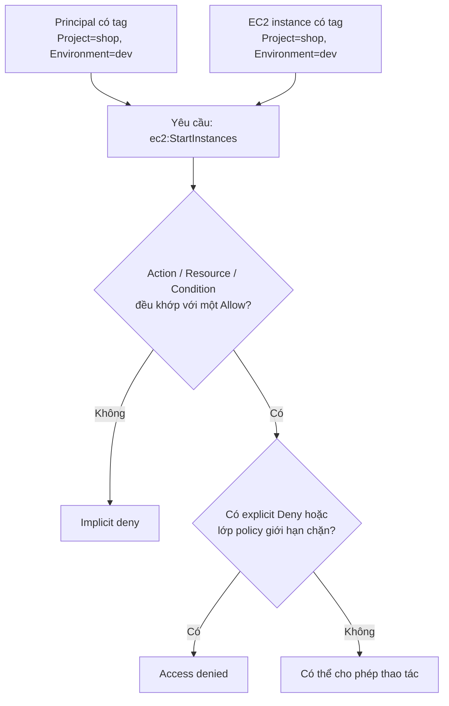
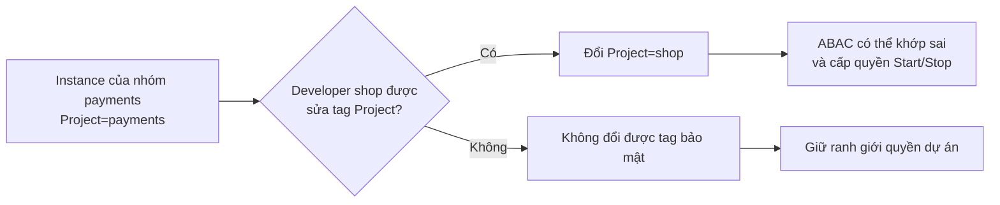
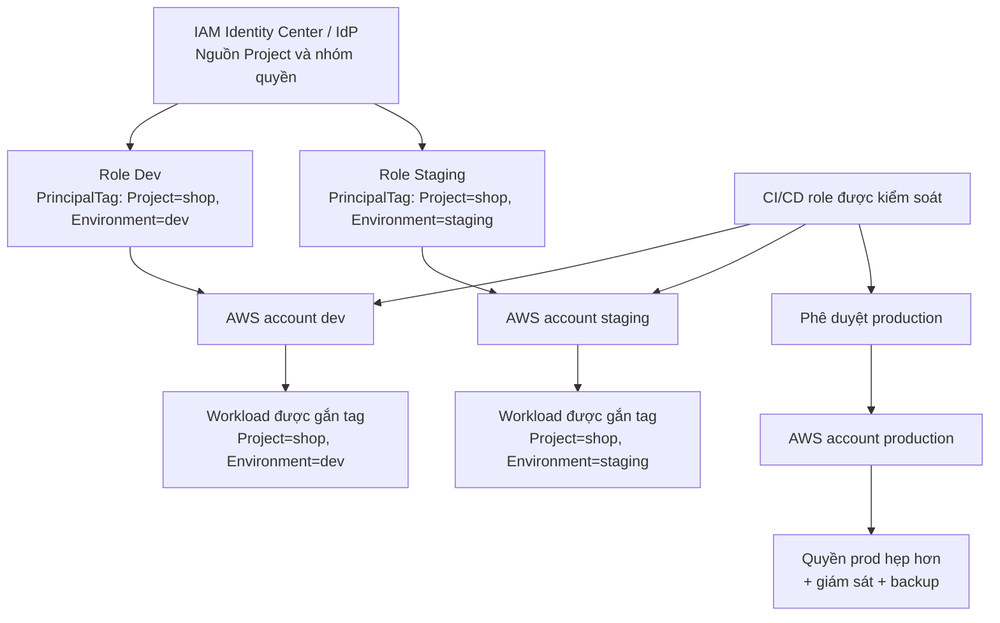

# ABAC với tag và điều kiện truy cập tài nguyên trên AWS

Trong hệ sinh thái **Amazon Web Services (AWS)**, Identity and Access Management (**IAM**) kiểm soát ai hoặc dịch vụ nào được phép thực hiện thao tác gì lên tài nguyên nào, trong điều kiện nào. Khi số lượng đội phát triển, ứng dụng, tài khoản và tài nguyên tăng nhanh, cách tạo một policy riêng cho từng máy chủ hay từng bucket dễ trở nên khó bảo trì. **Attribute-Based Access Control (ABAC)** giúp diễn đạt quyền theo **thuộc tính** của danh tính, tài nguyên và yêu cầu truy cập.

Bài này thuộc chương **IAM và phân quyền**, module **CLOUD_PROVIDERS_AWS**. Trong phạm vi học AWS từ Region/AZ, IAM và VPC đến tính toán, lưu trữ, cơ sở dữ liệu, tích hợp, serverless, giám sát, phục hồi và chi phí, ABAC là công cụ để phân quyền nhất quán khi nhiều nhóm cùng triển khai hạ tầng. Trọng tâm của bài là **ABAC với tag và điều kiện truy cập tài nguyên**: thiết kế tag, đọc và viết điều kiện IAM, ngăn nâng quyền qua sửa tag, và vận dụng an toàn cho dev, staging, production.

## 1. Vì sao cần ABAC?

Giả sử công ty có ba nhóm `shop`, `payments` và `analytics`. Mỗi nhóm tự triển khai EC2, secret và hàng đợi trong account dev. Với cách phân quyền truyền thống, đội platform có thể phải cập nhật nhiều policy khi tài nguyên mới được tạo:

- Danh sách chính xác những instance mà nhóm `shop` được khởi động và dừng.
- Danh sách secret mà nhóm `payments` được truy cập.
- Danh sách tài nguyên của từng môi trường `dev`, `staging`, `prod`.

Nếu policy liệt kê tài nguyên qua ARN, mỗi lần tạo tài nguyên mới có thể phải sửa policy. ABAC cho phép viết nguyên tắc tổng quát hơn: **người dùng có tag `Project=shop` được thao tác trên tài nguyên cũng có tag `Project=shop`**, với các điều kiện bổ sung về môi trường, hành động và phạm vi tài khoản.

Ví dụ:

| Chủ thể | Thuộc tính của chủ thể | Tài nguyên | Thuộc tính tài nguyên | Kết quả mong muốn |
|---|---|---|---|---|
| Developer nhóm Shop | `Project=shop`, `Environment=dev` | EC2 A | `Project=shop`, `Environment=dev` | Cho phép Start/Stop nếu các policy khác cũng cho phép |
| Developer nhóm Shop | `Project=shop`, `Environment=dev` | EC2 B | `Project=payments`, `Environment=dev` | Không được Start/Stop |
| Developer nhóm Shop | `Project=shop`, `Environment=dev` | EC2 C | `Project=shop`, `Environment=prod` | Không được Start/Stop |
| Developer nhóm Shop | `Project=shop`, `Environment=dev` | EC2 D | Không có tag `Project` | Không được Start/Stop |

**Lợi ích**: một policy có thể phục vụ nhiều nhóm hoặc tài nguyên được tạo liên tục; không cần sửa danh sách ARN sau mỗi lần cấp máy chủ. **Đổi lại**, tính chính xác của quyền phụ thuộc vào quy tắc gắn tag, quyền sửa tag và mức hỗ trợ điều kiện của từng API AWS.

### ABAC và RBAC bổ sung cho nhau

| Phương pháp | Dựa trên điều gì? | Ví dụ | Đặc điểm |
|---|---|---|---|
| **RBAC** — Role-Based Access Control | Vai trò/chức năng của người dùng | `Developer` có quyền dùng EC2; `Auditor` đọc log | Dễ hiểu khi số lượng vai trò ổn định |
| **ABAC** — Attribute-Based Access Control | Thuộc tính của principal, tài nguyên hoặc request | `Project` của principal phải bằng `Project` của instance | Phù hợp tài nguyên, nhóm và dự án thay đổi liên tục |
| **Kết hợp RBAC + ABAC** | Vai trò xác định loại thao tác, tag xác định phạm vi tài nguyên | Role `Developer` được Start/Stop EC2 **chỉ trong dự án của mình** | Cách áp dụng thực tế phổ biến |

ABAC không tự cấp bất kỳ quyền nào. IAM vẫn cần policy `Allow` cho hành động được yêu cầu; việc đối chiếu tag chỉ quyết định policy đó có khớp trong ngữ cảnh cụ thể hay không.

## 2. Những thuộc tính nào tham gia quyết định truy cập?

Trong AWS, **tag** thường là cặp `key=value`, chẳng hạn `Project=shop`. Không phải thuộc tính IAM nào cũng là tag: thời gian, địa chỉ IP, Region yêu cầu, tổ chức nguồn hay VPC endpoint cũng có thể được đưa vào điều kiện.

### 2.1. Phân biệt các condition key quan trọng

| Condition key | Dữ liệu được kiểm tra | Dùng khi nào |
|---|---|---|
| `aws:PrincipalTag/Project` | Tag gắn với IAM principal hoặc session hiện tại | Xác định principal thuộc dự án nào |
| `aws:ResourceTag/Project` | Tag của tài nguyên đích, nếu hành động/dịch vụ hỗ trợ | Kiểm tra principal có cùng dự án với tài nguyên |
| `ec2:ResourceTag/Project` | Tag tài nguyên theo context key riêng của EC2 | Kiểm soát các API EC2 hỗ trợ điều kiện này |
| `aws:RequestTag/Project` | Tag được gửi trong request tạo/gắn tag, nếu API hỗ trợ | Bắt buộc tài nguyên mới mang tag được phép |
| `aws:TagKeys` | Tập key tag xuất hiện trong request | Giới hạn danh sách tag key mà request được phép sử dụng |
| `aws:RequestedRegion` | AWS Region mà API request nhắm tới | Giới hạn vùng hoạt động trong trường hợp phù hợp |
| `aws:PrincipalOrgID` | ID AWS Organizations của principal | Giới hạn truy cập nguồn từ tổ chức, thường dùng trong resource-based policy |
| `aws:SourceVpce` | ID VPC endpoint mà request đi qua, khi key này tồn tại | Giới hạn điểm vào mạng cho hành động hỗ trợ |

Các key có tiền tố `aws:` là **global condition context keys**, nhưng **không có nghĩa mọi dịch vụ và mọi action đều hỗ trợ mọi key**. Ngoài ra, dịch vụ có thể cung cấp condition key riêng như `ec2:ResourceTag/…`, `s3:ExistingObjectTag/…` hoặc `s3:RequestObjectTag/…`. Cần kiểm tra **Service Authorization Reference** cho từng action, resource type và condition key trước khi chọn cách triển khai.

### 2.2. Tag của principal đến từ đâu?

Principal có thể là IAM user, IAM role hoặc phiên truy cập được cấp bằng AWS STS. Giá trị mà điều kiện `aws:PrincipalTag/…` đọc được có thể đến từ:

1. **Tag của IAM user hoặc IAM role**: được quản trị gán cho danh tính.
2. **Session tag**: được đưa vào phiên STS trong quy trình federation/assume role, nếu trust policy và quyền STS cho phép.
3. **IAM Identity Center attributes for access control**: thuộc tính từ identity source có thể được truyền vào session để sử dụng cho ABAC, tùy cách cấu hình.

Ví dụ role `DeveloperShopDev` có các principal tag:

```text
Project     = shop
Environment = dev
Team        = storefront
```

Một phiên được cấp các thuộc tính trên có thể khớp với tài nguyên cùng dự án và môi trường. Tuy nhiên, **không được để người dùng tự tùy ý gán `Project=payments` khi assume role**, nếu điều đó làm họ có thể truy cập tài nguyên của đội khác. Thẩm quyền gán principal tag quan trọng tương đương thẩm quyền cấp IAM permission.

### 2.3. Bộ tag tối thiểu đề xuất

| Tag key | Ví dụ | Vai trò |
|---|---|---|
| `Project` | `shop`, `payments` | Ranh giới nhóm/workload để áp dụng ABAC |
| `Environment` | `dev`, `staging`, `prod` | Phân biệt môi trường |
| `Owner` | `shop-platform` | Liên hệ và chịu trách nhiệm vận hành |
| `CostCenter` | `commerce` | Phân bổ và phân tích chi phí |
| `DataClassification` | `public`, `internal`, `restricted` | Phục vụ yêu cầu quản trị dữ liệu |
| `ManagedBy` | `terraform`, `cloudformation` | Giúp nhận diện tài nguyên được tự động hóa |

**Không phải mọi tag đều nên tham gia phân quyền.** `Project` và `Environment` có thể là tag an ninh nhạy cảm; `Owner` và `CostCenter` chủ yếu phục vụ quản trị. Chỉ sử dụng key trong policy ABAC khi đã có quy trình cấp, thay đổi, kiểm tra và bảo vệ key đó.

Tag key và giá trị phải có chuẩn chính tả/chữ hoa chữ thường nhất quán. Không đưa mật khẩu, API key, thông tin cá nhân hoặc dữ liệu bí mật vào tag.

## 3. IAM đánh giá điều kiện ABAC như thế nào?

Một request AWS gồm:

- **Principal**: ai đang yêu cầu, ví dụ session của role `DeveloperShopDev`.
- **Action**: thao tác, ví dụ `ec2:StartInstances`.
- **Resource**: tài nguyên đích, ví dụ EC2 instance.
- **Context**: tag, Region, nguồn truy cập và những condition key sẵn có.



Diễn giải:

1. Nếu không có policy `Allow` phù hợp, IAM mặc định **deny** (implicit deny).
2. Nếu có policy `Deny` khớp, **explicit deny** ưu tiên hơn bất kỳ Allow nào.
3. Permissions boundary, session policy, SCP và các cơ chế quản trị khác có thể giới hạn quyền tối đa; resource-based policy cũng có vai trò trong cách đánh giá tùy kiểu principal và request.
4. Đối với truy cập **xuyên account**, cần đồng thời có đường tin cậy và quyền ở các phía liên quan. Tag không tự tạo quyền truy cập xuyên tài khoản.

> **Quy tắc quan trọng:** Điều kiện `StringEquals` chỉ khớp khi key trong context có giá trị phù hợp. Thiếu principal tag hoặc thiếu resource tag thường khiến một điều kiện Allow yêu cầu so khớp không thành công; có thể dùng điều kiện `Null` để thể hiện rõ ý định bắt buộc key tồn tại.

## 4. Ví dụ chính: role được Start/Stop EC2 cùng dự án

Yêu cầu: developer của dự án `shop` trên môi trường `dev` được **xem danh sách instance và khởi động/dừng** EC2 thuộc đúng `Project` và `Environment` của mình trong một account dev.

Giả định:

- Account dev có ID ví dụ `111122223333`; Region sử dụng là `ap-southeast-1`.
- Principal đã nhận tag `Project=shop` và `Environment=dev` từ nguồn đáng tin cậy.
- Mỗi EC2 instance được gắn tag `Project` và `Environment` theo quy trình triển khai.
- Không có policy khác cấp quyền rộng hơn hoặc explicit deny cản trở hành động.

Gắn identity-based policy sau vào IAM role của developer:

```json
{
  "Version": "2012-10-17",
  "Statement": [
    {
      "Sid": "DescribeInstances",
      "Effect": "Allow",
      "Action": [
        "ec2:DescribeInstances",
        "ec2:DescribeTags"
      ],
      "Resource": "*"
    },
    {
      "Sid": "StartStopInstancesInSameProjectAndEnvironment",
      "Effect": "Allow",
      "Action": [
        "ec2:StartInstances",
        "ec2:StopInstances"
      ],
      "Resource": "arn:aws:ec2:ap-southeast-1:111122223333:instance/*",
      "Condition": {
        "StringEquals": {
          "ec2:ResourceTag/Project": "${aws:PrincipalTag/Project}",
          "ec2:ResourceTag/Environment": "${aws:PrincipalTag/Environment}"
        },
        "Null": {
          "aws:PrincipalTag/Project": "false",
          "aws:PrincipalTag/Environment": "false"
        }
      }
    }
  ]
}
```

**Đọc từng phần:**

- `Action`: chỉ cho phép xem thông tin và Start/Stop; không có quyền Terminate hay thay IAM role.
- `Resource`: Start/Stop giới hạn theo ARN của instance trong một account và một Region.
- `ec2:ResourceTag/Project`: phải bằng `aws:PrincipalTag/Project` của phiên hiện tại.
- `ec2:ResourceTag/Environment`: phải bằng `aws:PrincipalTag/Environment`.
- `Null: false`: yêu cầu các principal tag tương ứng hiện diện trong request context.

Ví dụ với principal `Project=shop, Environment=dev`:

| Instance | Tag của instance | Start/Stop | Lý do |
|---|---|---|---|
| `i-shop-dev` | `Project=shop, Environment=dev` | Được phép nếu không có lớp deny khác | Hai tag khớp |
| `i-payments-dev` | `Project=payments, Environment=dev` | Bị từ chối | Project khác |
| `i-shop-prod` | `Project=shop, Environment=prod` | Bị từ chối | Environment khác |
| `i-untagged` | Chưa có `Project` | Bị từ chối | Thiếu tag cần thiết |
| Instance cùng tag nhưng ở Region khác | `Project=shop, Environment=dev` | Bị từ chối theo policy này | ARN Resource không khớp |

**Giới hạn thực tế:** một số API `Describe*` của EC2 yêu cầu `Resource: "*"` và không lọc kết quả trả về theo ABAC như thao tác Start/Stop. Policy ví dụ có thể cho developer **nhìn thấy metadata** của những instance khác trong cùng account, dù không cho họ Start/Stop chúng. Nếu cần cô lập cả metadata, phân tách account/thiết kế tổ chức là lớp bảo vệ quan trọng. Ngoài ra, policy minh họa chỉ cho Start/Stop; để deploy ứng dụng cần policy khác với quyền hạn được kiểm tra riêng.

## 5. ABAC khi tạo tài nguyên mới: kiểm tra RequestTag và TagKeys

Đối chiếu `ResourceTag` hữu ích khi tài nguyên **đã tồn tại**. Nhưng lúc tạo resource mới, tag dự định thường chỉ nằm trong **request**. Khi đó có thể dùng `aws:RequestTag/<Key>` để kiểm soát giá trị tag được gửi và `aws:TagKeys` để giới hạn loại tag key.

Ví dụ: developer được phép tạo secret trong account dev khi khai báo đúng `Project`, `Environment` của principal và chỉ dùng hai key này. Với AWS Secrets Manager, một policy minh họa:

```json
{
  "Version": "2012-10-17",
  "Statement": [
    {
      "Sid": "CreateSecretsWithAuthorizedTags",
      "Effect": "Allow",
      "Action": "secretsmanager:CreateSecret",
      "Resource": "arn:aws:secretsmanager:ap-southeast-1:111122223333:secret:*",
      "Condition": {
        "StringEquals": {
          "aws:RequestTag/Project": "${aws:PrincipalTag/Project}",
          "aws:RequestTag/Environment": "${aws:PrincipalTag/Environment}"
        },
        "ForAllValues:StringEquals": {
          "aws:TagKeys": ["Project", "Environment"]
        },
        "Null": {
          "aws:RequestTag/Project": "false",
          "aws:RequestTag/Environment": "false"
        }
      }
    }
  ]
}
```

Giải thích:

1. `aws:RequestTag/Project` và `aws:RequestTag/Environment` yêu cầu giá trị tag mới trùng với principal tag.
2. `ForAllValues:StringEquals` trên `aws:TagKeys` yêu cầu mọi tag key trong request thuộc danh sách cho phép. Không có nghĩa request phải chứa **tất cả** key đó.
3. Hai điều kiện `StringEquals` và `Null` yêu cầu các tag cần thiết thực sự được gửi. Điều này tránh nhầm lẫn vì tập rỗng đôi khi vẫn thỏa một điều kiện `ForAllValues`.
4. Policy chỉ giải quyết hành động `CreateSecret` và các condition key được dịch vụ hỗ trợ. Để đọc/cập nhật/xóa secret cần policy riêng; với mỗi API cũng phải kiểm tra hành vi phân quyền khi tạo kèm tag.

Thực tế thường cần thêm `Owner`, `CostCenter` hoặc tag do pipeline gắn. Khi mở rộng danh sách tag được phép, vẫn phải **bắt buộc** các tag dùng cho ABAC có mặt và đúng giá trị.

### Các trường hợp request

| Request tạo secret | Kết quả của policy minh họa |
|---|---|
| `Project=shop, Environment=dev` từ principal tương ứng | Có thể cho phép |
| `Project=payments, Environment=dev` trong phiên `Project=shop` | Bị từ chối vì giá trị Project không khớp |
| `Project=shop` nhưng thiếu Environment | Bị từ chối vì thiếu tag bắt buộc |
| `Project=shop, Environment=dev, Privileged=true` | Bị từ chối vì có TagKey ngoài danh sách |

**Phân biệt:** `aws:RequestTag` là dữ liệu khách gửi trong request, không có nghĩa tag đó đã được tạo thành công hay được bảo vệ về sau. Quyền tạo tài nguyên và quyền **sửa/xóa tag** phải được xem xét cùng nhau.

## 6. Bảo vệ tag để ABAC không bị vượt qua

Đây là điểm quyết định độ an toàn của mô hình. Giả sử role `DeveloperShopDev` có quyền Start/Stop instance thuộc `Project=shop`. Nếu cũng được phép đổi tag của một instance `Project=payments` thành `Project=shop`, role có thể tự làm cho resource policy khớp với mình.



### Biện pháp quản trị thực tế

- **Chỉ nguồn đáng tin cậy gán tag an ninh**: pipeline IaC, account bootstrap hoặc role chuyên biệt được kiểm toán.
- **Giới hạn thao tác sửa tag**: xem xét `ec2:CreateTags` / `ec2:DeleteTags`, `secretsmanager:TagResource` / `secretsmanager:UntagResource`, và API tagging tương ứng của dịch vụ.
- **Phân biệt tag khởi tạo và sửa tag sau này**: với các hành động hỗ trợ, kiểm soát tagging tại thời điểm tạo resource bằng condition key như `ec2:CreateAction`; không cho đổi Project/Environment tùy ý sau khi tạo.
- **Chặn privilege escalation gián tiếp**: bảo vệ quyền thay IAM policy, role trust policy, permission boundary, STS session tag và những tài nguyên có thể tạo principal mạnh hơn.
- **Bật phát hiện lệch cấu hình**: theo dõi CloudTrail, AWS Config khi phù hợp, báo cáo tài nguyên thiếu tag và thay đổi tag nhạy cảm.

Ví dụ một **explicit deny** bảo thủ trong policy dành cho role chỉ chạy/dừng EC2:

```json
{
  "Version": "2012-10-17",
  "Statement": [
    {
      "Sid": "DenyChangingEC2Tags",
      "Effect": "Deny",
      "Action": [
        "ec2:CreateTags",
        "ec2:DeleteTags"
      ],
      "Resource": "*"
    }
  ]
}
```

Policy deny này phù hợp role vận hành **không chịu trách nhiệm tạo hoặc thay tag**. Nếu gắn nó vào role triển khai EC2 cần tag-on-create, pipeline có thể không tạo được instance như thiết kế. Cách vận hành đúng là tách role developer ra khỏi role provisioning/CI-CD, hoặc tạo policy chi tiết cho phép đúng tag và đúng giai đoạn tạo, có kiểm thử trước.

Chỉ deny `ec2:CreateTags` là chưa đủ cho toàn bộ AWS: các dịch vụ khác có API gắn tag khác nhau và một số API cập nhật tài nguyên cũng có thể tác động tag. Phải kiểm kê theo dịch vụ đang dùng.

### Ai được thay đổi principal tag?

Nếu người dùng tự thêm tag `Project=payments` vào IAM role của mình hoặc tùy ý truyền session tag qua `sts:AssumeRole`, kết quả cũng nguy hiểm như sửa resource tag. Do đó:

- Quản trị viên danh tính/Identity Center phải kiểm soát nguồn và ánh xạ thuộc tính.
- Trust policy, quyền `sts:TagSession`, các giá trị cho phép của `aws:RequestTag` và `aws:TagKeys` cần được giới hạn phù hợp.
- Khi sử dụng role chaining, cần hiểu session tag nào được truyền tiếp (transitive tags), tag nào được ưu tiên khi trùng key và ai được phép thay đổi chúng.
- Tránh để principal tự gắn tag phân quyền bằng cơ chế tự phục vụ không có xác minh.

## 7. Các toán tử điều kiện IAM cần nắm

Mỗi loại condition key tương ứng các toán tử phù hợp. Chọn sai toán tử có thể khiến policy quá rộng hoặc vô tình chặn luồng hợp lệ.

| Toán tử / cách dùng | Ý nghĩa | Ví dụ tình huống |
|---|---|---|
| `StringEquals` | Giá trị chuỗi phải bằng một giá trị cho phép | Project của resource bằng principal Project |
| `StringLike` | So khớp mẫu có wildcard | Tên đường dẫn/giá trị theo quy ước, khi API hỗ trợ |
| `StringNotEquals` | Giá trị khác điều kiện cho trước | Dùng trong điều kiện deny theo mục tiêu cụ thể |
| `Bool` | Giá trị boolean true/false | Kiểm soát TLS, MFA hoặc flag condition khi key khả dụng |
| `Null` | Kiểm tra context key có tồn tại hay không | `"false"` nghĩa là bắt buộc key có mặt |
| `ForAnyValue:StringEquals` | Ít nhất một phần tử tập nhiều giá trị khớp | Chấp nhận ít nhất một key thuộc tập yêu cầu |
| `ForAllValues:StringEquals` | Tất cả phần tử tập nhiều giá trị thuộc tập cho phép | Chặn tag key ngoài danh sách |
| `...IfExists` | Bỏ qua điều kiện khi key không có mặt trong một số ngữ cảnh | Thích hợp cho policy phải tính tới request mà key có thể vắng |

### Cảnh báo khi dùng tập nhiều giá trị

`ForAllValues:StringEquals` là lựa chọn hay gặp với `aws:TagKeys`. Nhưng **tập request rỗng có thể vẫn làm điều kiện ForAllValues đúng**. Nếu phải có tag Project, hãy kết hợp điều kiện kiểm tra sự hiện diện/giá trị như `aws:RequestTag/Project` và `Null`. Không sử dụng `ForAllValues` một mình để khẳng định tag bắt buộc tồn tại.

`...IfExists` có thể làm Allow hoặc Deny hoạt động khác cách người đọc trực giác mong đợi. Ví dụ, đưa `StringEqualsIfExists` vào rule phải bắt buộc resource có tag có thể tạo lỗ hổng vì context key thiếu vẫn không làm điều kiện thất bại. Với tag bảo mật, ưu tiên viết điều kiện **tồn tại và khớp rõ ràng**.

**Lưu ý:** Nếu nhiều key cùng xuất hiện trong một điều kiện `StringEquals`, tất cả các key phải phù hợp. Nếu một key có danh sách giá trị, tập giá trị đó thường biểu diễn các lựa chọn được chấp nhận cho **chính key đó**. Quy tắc của set operators khác; hãy kiểm tra chính xác theo hướng dẫn IAM trước khi dùng.

## 8. Kết hợp tag với điều kiện truy cập khác

ABAC không nhất thiết chỉ nhìn vào tag. Một policy đầy đủ có thể thêm điều kiện về ngữ cảnh request:

### 8.1. Giới hạn Region

`aws:RequestedRegion` có thể được dùng trong các policy có hỗ trợ để kiểm soát yêu cầu nhắm vào Region được phép. Ví dụ quy định workload dev chỉ hoạt động tại `ap-southeast-1`. Tuy nhiên, một API gọi tại Region nhất định vẫn có thể ảnh hưởng tài nguyên ở nơi khác tùy dịch vụ, và nhiều dịch vụ AWS có tính toàn cầu. Không nên sao chép quy tắc Deny tất cả Region khác khi chưa lập danh sách ngoại lệ và thử nghiệm.

### 8.2. Giới hạn đường vào mạng

`aws:SourceVpce` có thể áp dụng cho request đi qua VPC endpoint được chỉ định. Nhưng request từ console, luồng AWS service-to-service hoặc dịch vụ không đi qua endpoint có thể không chứa key này. Khi thiết kế policy có explicit Deny theo network context, cần xem xét trường hợp AWS service gọi thay mặt principal và những key điều kiện có liên quan; một Deny cứng nhắc có thể làm hỏng pipeline, log delivery hoặc tích hợp dịch vụ.

### 8.3. Giới hạn tổ chức nguồn

Trong resource-based policy, `aws:PrincipalOrgID` giúp quy định principal nguồn thuộc cùng AWS Organizations. Key này **không thay thế** kiểm tra `Project`/`Environment`, quyền truy cập cụ thể và cơ chế tin cậy xuyên tài khoản. Người thuộc cùng tổ chức không tự động được đọc mọi dữ liệu.

### 8.4. Điều kiện về xác thực mạnh

MFA và xác thực liên kết nên được triển khai ở tầng IAM Identity Center/identity provider và quy trình vận hành đặc quyền. Chú ý `aws:MultiFactorAuthPresent` không hiện diện giống nhau trong mọi kiểu phiên xác thực; không áp dụng máy móc điều kiện này cho mọi principal federated. Thử nghiệm đúng loại session production sẽ sử dụng.

### 8.5. Giới hạn phạm vi ARN và môi trường

Điều kiện tag không nên là lớp giới hạn duy nhất. Với policy EC2 ở trên, `Resource` đã khóa account và Region. Đối với production, thiết kế **tài khoản riêng**, role production riêng và luồng approval còn giúp tránh việc một tag hoặc một role bị cấu hình sai làm ảnh hưởng nhiều môi trường.

## 9. ABAC trong AWS Organizations và nhiều account

Một kiến trúc gồm account `shop-dev`, `shop-staging` và `shop-prod` thường dùng cả **RBAC, ABAC, SCP, tagging governance**:

| Lớp | Mục đích | Ví dụ |
|---|---|---|
| **IAM Identity Center** | Quản lý đăng nhập, nhóm và cấp quyền vào account | Developer Shop được cấp role dev |
| **IAM role/policy** | Định nghĩa thao tác và điều kiện ABAC | Start/Stop EC2 khi Project, Environment khớp |
| **Session tags** | Mang thuộc tính principal theo phiên | `Project=shop`, `Environment=dev` |
| **SCP** | Đặt giới hạn quyền tối đa cho member account/OU | Hạn chế một số thao tác nhạy cảm hoặc Region |
| **Tag policy của AWS Organizations** | Giúp chuẩn hóa cách sử dụng tag và có thể hỗ trợ cưỡng chế tuân thủ tag ở các loại tài nguyên được hỗ trợ | Chuẩn hóa key `Project` và giá trị hợp lệ |
| **IaC / policy-as-code** | Tạo resource đúng tag và phát hiện sai lệch | Terraform/CDK/CloudFormation gắn tag nhất quán |
| **Giám sát/kiểm toán** | Phát hiện truy cập và thay đổi tag không mong muốn | CloudTrail, AWS Config, EventBridge |

**Phân biệt rõ ràng**:

- **SCP không cấp quyền Allow**. Nó chỉ giới hạn quyền tối đa theo phạm vi có hiệu lực.
- **Tag policy của Organizations không thay IAM authorization**. Việc chuẩn hóa hoặc cưỡng chế tag chỉ áp dụng trong phạm vi các tài nguyên/thao tác được hỗ trợ và theo cách cấu hình, không mặc nhiên bảo đảm mỗi API đều bị từ chối khi thiếu tag.
- **Mỗi member account có tài nguyên và policy riêng**. Session mang tag `Project=shop` không tự tạo đường truy cập vào tài khoản production.

Nếu người dùng hoặc pipeline phải **assume role xuyên account**, phải bảo đảm trust policy ở account đích chấp nhận principal được chỉ định; identity policy phía nguồn, role policy phía đích và các lớp kiểm soát liên quan cho phép luồng đó. Nếu cần mang thuộc tính phiên vào account đích, cấu hình session tags và `sts:TagSession` an toàn; không giả định mọi tag từ role nguồn sẽ tự đi theo qua mọi lần assume role.

### Mẫu phân bổ quyền theo môi trường

| Người/role | Account dev | Account staging | Account production |
|---|---|---|---|
| Developer Shop | Đọc và thao tác tài nguyên `Project=shop, Environment=dev` theo quyền cụ thể | Chủ yếu read-only hoặc deploy qua pipeline | Không có quyền ghi trực tiếp |
| QA | Đọc log, chạy tác vụ kiểm thử được cấp | Đọc và kiểm thử workload theo dự án | Chỉ quyền cần thiết và đã được duyệt |
| CI/CD role | Tạo/update hạ tầng và dịch vụ trong scope dự án | Promote artifact và kiểm thử release | Deploy artifact đã duyệt, theo quyền hẹp |
| Security/SRE | Điều tra, vận hành theo phân vai | Điều tra, vận hành theo phân vai | Đặc quyền ngắn hạn và kiểm toán |

ABAC là cách giảm khối lượng policy khi nhiều dự án chia sẻ một account. Nếu yêu cầu bảo mật cao, không được dùng tag để thay thế sự cách ly mạnh hơn bằng account, VPC, KMS, mạng và các quyền vận hành độc lập.

## 10. Những giới hạn ABAC theo dịch vụ AWS

Không có một điều kiện tag toàn năng cho mọi dịch vụ:

| Dịch vụ / tài nguyên | Điểm cần kiểm tra trước khi viết ABAC |
|---|---|
| **Amazon EC2** | Action nào hỗ trợ resource-level permission, `ec2:ResourceTag`, tag-on-create và quyền `CreateTags/DeleteTags` |
| **Amazon S3** | Phân biệt tag của bucket với object; một số hành động dùng `s3:ExistingObjectTag/…` hoặc `s3:RequestObjectTag/…`; kiểm tra từng API |
| **Secrets Manager** | `CreateSecret`, `GetSecretValue`, `TagResource` và policy về ARN/tag; quyền KMS khi sử dụng customer managed key |
| **AWS Lambda** | Tag function và quyền update/invoke có thể áp dụng điều kiện khác nhau; kiểm tra action và resource type |
| **Amazon SQS** | Queue policy, queue tag và quyền thao tác gửi/nhận; cross-account cần policy tài nguyên phù hợp |
| **RDS / Aurora** | Phạm vi Resource ARN (DB instance, cluster, snapshot), action hỗ trợ tag condition và quyền sửa tag |
| **IAM / STS** | Ai được tạo/sửa role, gắn policy, truyền session tags và assume role; rủi ro nâng quyền |
| **KMS** | Key policy, grant, encryption context và IAM phối hợp; tag không tự thay thế quyền sử dụng key |

Ví dụ: policy cho phép đọc object dựa vào tag của **S3 object** không thể dùng tùy tiện cùng condition key với policy đọc **EC2 instance**. Khi tích hợp dịch vụ, ARN, context key và API call thực tế quyết định policy có hiệu lực.

**Nguồn kiểm tra bắt buộc khi triển khai thực tế:** trang **Actions, resources, and condition keys** của từng AWS service trong Service Authorization Reference; sau đó thử bằng đúng API, principal và tài nguyên của hệ thống.

## 11. Tình huống tổng hợp: ứng dụng bán hàng trên AWS

Một ứng dụng bán hàng sử dụng:

- **EC2/ECS/Lambda** để xử lý API hoặc tác vụ.
- **Amazon S3** cho ảnh sản phẩm.
- **RDS/Aurora/DynamoDB** cho dữ liệu nghiệp vụ.
- **SQS/EventBridge** cho xử lý bất đồng bộ.
- **CloudWatch/CloudTrail** để giám sát và kiểm toán.

Tổ chức có hai dự án `shop` và `payments`, mỗi dự án chạy dev và staging; production nằm trong account tách biệt. Một cách triển khai:



**Phân chia trách nhiệm:**

1. **IAM Identity Center/IdP** quản lý quyền đăng nhập và thuộc tính dự án. Developer không được tự thay đổi Project thành giá trị khác.
2. **IAM policy dev** cho phép thao tác một số tài nguyên của cùng Project/Environment. Với tài nguyên chưa hỗ trợ tag conditions đầy đủ, dùng ARN cụ thể, account boundary và role chuyên biệt.
3. **Pipeline IaC** tạo tài nguyên và áp tag tin cậy. Pipeline có quyền tagging cần thiết; developer thường không có quyền sửa tag dùng để ủy quyền.
4. **Staging** dùng cấu trúc dịch vụ gần production để xác nhận deploy/rollback, nhưng quyền thao tác của developer được thu hẹp.
5. **Production** dùng account riêng, IAM role riêng, approval và guardrail; ABAC có thể tăng độ chi tiết nhưng không bỏ qua kiểm soát thay đổi.
6. **Logging** thu thập hoạt động IAM, tagging và deploy; **cost allocation tags** hỗ trợ phân tích chi phí nhưng được phân biệt với tag phục vụ bảo mật.

### Một request đi từ ứng dụng đến tài nguyên

Giả sử Lambda của ứng dụng Shop cần đọc secret `/shop/dev/payment-api`. Execution role của Lambda là **principal** trong IAM; tag của người phát triển đăng nhập console **không tự truyền vào runtime role**. Muốn áp dụng ABAC cho secret, phải gắn thuộc tính hợp lệ cho execution role (hoặc phiên tin cậy của role) và viết policy hỗ trợ condition key của Secrets Manager.

Phân tích theo ba câu hỏi:

1. **Ai gọi API thật?** Execution role của Lambda, task role của ECS, instance role của EC2 hay session người dùng?
2. **Action và resource nào?** `secretsmanager:GetSecretValue` đối với ARN secret, cộng quyền KMS nếu cần.
3. **Tag và điều kiện có khớp không?** Project/Environment của principal, secret và các lớp policy khác có được cấu hình nhất quán?

Nếu có lỗi `AccessDenied`, việc secret có tag `Project=shop` không đủ để kết luận Lambda được đọc: role có thể thiếu `GetSecretValue`, resource ARN sai, không khớp principal tag, bị explicit deny hoặc thiếu quyền KMS.

## 12. Quy trình triển khai ABAC từng bước

### Bước 1: xác định ranh giới quyền

Liệt kê ứng dụng, nhóm, môi trường, tài khoản và thao tác được phép. Ví dụ `shop-dev` được Start/Stop EC2 trong dev, nhưng không được Terminate EC2 hoặc truy cập secret production.

### Bước 2: chuẩn hóa taxonomy của tag

Chọn những tag dùng cho phân quyền như `Project` và `Environment`. Định nghĩa ai tạo, ai sửa, giá trị hợp lệ, cách xử lý thiếu tag và vòng đời tài nguyên. Nếu một dịch vụ không hỗ trợ tag trong API cần kiểm soát, chọn cơ chế khác.

### Bước 3: tạo nguồn principal tag đáng tin cậy

Cấu hình IAM role tags hoặc Identity Center attributes/session tags. Giới hạn `sts:TagSession`, trust policy và quyền sửa IAM tags. Gắn tag test cho role thử nghiệm.

### Bước 4: cấu hình resource tags

Thêm tag qua IaC khi khởi tạo resource. Với tài nguyên đã tồn tại, kiểm kê và gắn tag dưới quyền provisioning, xử lý các tài nguyên thiếu tag trước khi bắt đầu áp dụng policy.

### Bước 5: viết policy theo hành động cụ thể

Trước khi viết:

- Action có hỗ trợ resource-level permission không?
- Resource type/ARN có đúng không?
- Tag condition key của service có được action hỗ trợ không?
- Request có dùng session principal nào; tag đã có trong context chưa?
- Những policy khác có thể cấp quyền rộng hơn hoặc chặn request không?

Viết policy cho **những action cần thiết**, kết hợp Action + Resource + Condition. Tránh dùng `Action:"*"` hay `Resource:"*"` cho thao tác có thể giới hạn chính xác.

### Bước 6: ngăn sửa tag và nâng quyền

Kiểm tra quyền tagging, sửa IAM role, cấp STS session tag, chuyển role, chỉnh sửa policy và thay đổi pipeline. Tag có ảnh hưởng phân quyền phải được bảo vệ như một phần của hệ thống IAM.

### Bước 7: thử cả Allow và Deny

Lập bộ test gồm người đúng dự án, khác dự án, khác môi trường, tài nguyên thiếu tag, principal thiếu tag, request cố sửa tag bảo mật, session STS mới và yêu cầu xuyên account.

### Bước 8: đưa vào giám sát và quản trị

Theo dõi CloudTrail cho thay đổi role/policy và API tagging; dùng AWS Config hoặc công cụ kiểm kê để phát hiện tài nguyên thiếu hoặc lệch tag. Cập nhật tài liệu và triển khai qua review/pipeline thay vì sửa tay production.

## 13. Kiểm thử và xử lý lỗi AccessDenied

Một quy trình điều tra ngắn:

1. Dùng `aws sts get-caller-identity` để xác định **Account, ARN, UserId** của session đang gọi. Đừng mặc định người đang dùng console và principal thật của workload là một.
2. Xác nhận thao tác thực tế, ARN resource, Region, thời điểm và account từ thông báo lỗi/CloudTrail.
3. Kiểm tra tag của principal (kể cả session tags theo cách được cấp) và resource, tên key, giá trị, sự hiện diện.
4. Kiểm tra action/service có hỗ trợ condition key áp dụng không; với API tạo tài nguyên, kiểm tra request có gửi tag đúng cách.
5. Rà soát identity policy, resource policy, trust policy, permissions boundary, session policy, SCP và các cơ chế deny liên quan; đối với KMS/S3, xem policy của resource phụ thuộc.
6. Dùng **IAM Access Analyzer policy validation** để kiểm tra vấn đề policy; dùng simulator khi hỗ trợ để thử tình huống, rồi kiểm thử bằng principal và API thật trong môi trường an toàn.
7. Sau khi sửa, thử lại cả **trường hợp phải được Allow** lẫn **trường hợp bắt buộc bị Deny**. Một bài test Allow thành công chưa chứng minh tài nguyên của nhóm khác an toàn.

| Hiện tượng | Nguyên nhân thường gặp | Gợi ý kiểm tra |
|---|---|---|
| Developer không Start/Stop được instance của mình | Role/session thiếu principal tag, resource thiếu tag, account/Region/ARN sai | Kiểm tra context thực và ARN, sau đó kiểm tra policy |
| Developer tác động được instance của nhóm khác | Có Allow rộng ở policy khác hoặc được quyền sửa tag/role | Tìm đường quyền bổ sung và bảo vệ tag |
| Tạo resource thất bại dù đã có `Create*` | Thiếu RequestTag, tag key không được phép hoặc cần quyền tagging bổ sung | Kiểm tra API tạo resource, tag-on-create và các quyền liên quan |
| ABAC trên S3 không hoạt động như EC2 | Dùng condition key hoặc resource type không được S3 action hỗ trợ | Tra Service Authorization Reference cho action chính xác |
| Pipeline deploy staging được, prod bị từ chối | Trust/role đích, approval, session policy, KMS/SCP hoặc condition khác | Kiểm tra toàn bộ assume-role/deploy path |
| Role của Lambda đọc secret bị từ chối | Runtime principal không mang tag, thiếu quyền Secrets Manager/KMS | Kiểm tra execution role và secret ARN/key policy |

## 14. Những lỗi thiết kế ABAC thường gặp

| Sai lầm | Hệ quả | Cách khắc phục |
|---|---|---|
| Coi mọi tag là đáng tin cậy | Người dùng sửa tag để lấy quyền | Bảo vệ tag dùng cho IAM authorization |
| Cấp `TagResource` hoặc `CreateTags` quá rộng | Có đường tự nâng quyền | Tách role provisioning; điều kiện tagging theo action/dịch vụ |
| Cho phép truyền session tag tùy ý | Người dùng giả mạo thuộc tính dự án | Giới hạn `sts:TagSession` và trust policy |
| Dùng `ForAllValues` rồi tưởng tag bắt buộc tồn tại | Request thiếu tag vẫn có thể khớp phần kiểm tra tập | Dùng `RequestTag` và kiểm tra `Null` |
| Dùng `StringEqualsIfExists` khi phải buộc có tag | Thiếu tag có thể không làm Allow thất bại | Dùng `StringEquals` và kiểm tra tồn tại |
| Cho rằng ABAC hỗ trợ mọi API AWS | Một số action không thể giới hạn theo tag | Tra Service Authorization Reference và chọn ARN/account boundary |
| Dùng chung admin role dev và production | Rủi ro thao tác nhầm hệ thống thật | Tách account, role, đường deploy và approval |
| Dùng tag thay cho kiểm soát dữ liệu nghiệp vụ | IAM chỉ kiểm soát AWS API, không tự lọc từng hàng dữ liệu ứng dụng | Dùng authorization ở tầng ứng dụng/database |
| Gắn tag chỉ để tính phí rồi tái sử dụng làm tag bảo mật | Tag có thể được sửa bởi người được cấp quyền cost management | Tách mục đích và áp quyền quản trị phù hợp |
| Không thử trường hợp từ chối | Không phát hiện policy cấp quyền quá rộng | Kiểm thử matrix Allow/Deny, thiếu tag, giả mạo tag |

## 15. Bài tập thực hành có hướng dẫn

### Bài tập A — Dự đoán kết quả theo tag

Principal của một IAM role:

```text
Project=shop
Environment=staging
```

Role được gán policy Start/Stop EC2 ở phần 4, nhưng Resource ARN được điều chỉnh cho account và Region chứa các instance dưới đây.

| Tài nguyên | Project | Environment | Kết quả của Allow ABAC |
|---|---|---|---|
| Instance A | shop | staging | Khớp |
| Instance B | shop | dev | Không khớp |
| Instance C | payments | staging | Không khớp |
| Instance D | *không có tag* | staging | Không khớp |

**Giải thích:** cả hai tag resource phải bằng tag principal. Dòng A chỉ có nghĩa statement Allow ABAC khớp; việc gọi API thành công vẫn phụ thuộc tất cả lớp policy và trạng thái tài nguyên.

### Bài tập B — Tìm lỗ hổng trong policy

Xét policy sau:

```json
{
  "Effect": "Allow",
  "Action": "ec2:StartInstances",
  "Resource": "*",
  "Condition": {
    "StringEqualsIfExists": {
      "ec2:ResourceTag/Project": "${aws:PrincipalTag/Project}"
    }
  }
}
```

**Yêu cầu:** tìm ít nhất ba điểm rủi ro.

**Hướng giải:**

1. `StringEqualsIfExists` không thích hợp khi phải **bắt buộc** có tag Project.
2. Thiếu điều kiện `Environment`, nên một role có tag Project hợp lệ có thể khớp nhiều môi trường.
3. `Resource:"*"` rộng hơn cần thiết; nên giới hạn account, Region và ARN instance.
4. Chưa đề cập bảo vệ quyền sửa tag hoặc principal tag; kiểm tra cả những policy khác có thể cấp quyền bổ sung.

### Bài tập C — Thiết kế policy theo tình huống

Đội `analytics` cần đọc secret trong môi trường dev nhưng không được sửa giá trị secret, tag hoặc truy cập secret của `shop`. Hãy đề xuất:

1. Principal tags và resource tags phải gắn.
2. Action đọc secret phù hợp (ví dụ `secretsmanager:GetSecretValue`, thêm `DescribeSecret` nếu cần), ARN giới hạn và điều kiện tag theo hỗ trợ của Secrets Manager.
3. Các quyền quản trị/tagging cần tránh cấp cho role này.
4. Cách kiểm thử secret cùng dự án, khác dự án, thiếu tag và secret được mã hóa bằng KMS key riêng.

**Tiêu chí đánh giá:** policy có giới hạn Action/Resource, khớp Project và Environment; không tạo đường sửa tag hoặc secret; giải thích được sự phối hợp giữa Secrets Manager permission và KMS key policy/permission khi sử dụng customer managed key.

## 16. Checklist trước khi dùng ABAC cho môi trường thật

- [ ] Đã chọn rõ những tag nào là **thuộc tính phân quyền**; có owner của taxonomy.
- [ ] Danh tính và session tags được cấp từ nguồn đáng tin cậy, không thể tùy ý giả mạo.
- [ ] Có quy trình bắt buộc gắn tag trên tài nguyên mới và xử lý tài nguyên thiếu tag.
- [ ] Đã kiểm tra từng **action/resource/condition key** được AWS service hỗ trợ.
- [ ] Mỗi IAM policy chỉ cho phép những action cần thiết, giới hạn ARN/account/Region khi có thể.
- [ ] Đã bảo vệ quyền sửa resource tag và principal tag; có review các API tagging tương ứng.
- [ ] Đã cân nhắc permission boundary, session policy, SCP và resource-based policy trong ngữ cảnh thực.
- [ ] Có kiểm thử đủ Allow/Deny, khác dự án/môi trường, thiếu tag, tag giả mạo và assume-role xuyên account.
- [ ] Production có ranh giới account/role và quy trình phê duyệt phù hợp.
- [ ] Đã bật kiểm toán thay đổi chính sách/tag và cơ chế phát hiện drift.
- [ ] Đã xác nhận tag không chứa thông tin bí mật, dữ liệu nhạy cảm.
- [ ] Có kế hoạch xử lý API chưa hỗ trợ ABAC mà không cấp quyền rộng vô tình.

## 17. Tổng kết kiến thức

**ABAC dùng thuộc tính để xác định phạm vi thao tác; IAM policy vẫn quyết định quyền thao tác nào được phép.** Trên AWS, ba cặp thông tin thường phải kiểm tra là:

- `aws:PrincipalTag/<Key>`: thuộc tính **của chủ thể** trong ngữ cảnh request.
- `aws:ResourceTag/<Key>` hoặc key theo dịch vụ như `ec2:ResourceTag/<Key>`: thuộc tính **của tài nguyên** đã tồn tại.
- `aws:RequestTag/<Key>` và `aws:TagKeys`: thuộc tính **được gửi khi tạo/gắn tag**.

Cách áp dụng vững chắc là kết hợp **RBAC cho loại quyền + ABAC cho phạm vi tài nguyên + kiểm soát tag + giới hạn ARN/account + kiểm toán**. Nếu không bảo vệ quyền thay đổi tag, ABAC có thể trở thành đường nâng quyền. Nếu không kiểm tra API được hỗ trợ, policy có thể từ chối ngoài ý muốn hoặc không giới hạn theo cách kỳ vọng.

Trong module **CLOUD_PROVIDERS_AWS**, kỹ năng này giúp người học xây dựng hạ tầng AWS có nhiều team, nhiều môi trường và nhiều dịch vụ nhưng vẫn **phân quyền theo nguyên tắc ít đặc quyền, theo dõi được, phục hồi được và kiểm soát được chi phí**.

### Tài liệu AWS tham khảo

- [AWS IAM — Attribute-based access control (ABAC)](https://docs.aws.amazon.com/IAM/latest/UserGuide/introduction_attribute-based-access-control.html)
- [AWS IAM — Control access using tags](https://docs.aws.amazon.com/IAM/latest/UserGuide/access_tags.html)
- [AWS IAM — Global condition context keys](https://docs.aws.amazon.com/IAM/latest/UserGuide/reference_policies_condition-keys.html)
- [AWS IAM — IAM policy elements: Variables](https://docs.aws.amazon.com/IAM/latest/UserGuide/reference_policies_variables.html)
- [AWS IAM — Passing session tags in AWS STS](https://docs.aws.amazon.com/IAM/latest/UserGuide/id_session-tags.html)
- [AWS IAM — Condition operators](https://docs.aws.amazon.com/IAM/latest/UserGuide/reference_policies_elements_condition_operators.html)
- [AWS IAM — Policy evaluation logic](https://docs.aws.amazon.com/IAM/latest/UserGuide/reference_policies_evaluation-logic.html)
- [AWS Service Authorization Reference — Actions, resources and condition keys](https://docs.aws.amazon.com/service-authorization/latest/reference/reference_policies_actions-resources-contextkeys.html)
- [AWS Organizations — Tag policies](https://docs.aws.amazon.com/organizations/latest/userguide/orgs_manage_policies_tag-policies.html)
