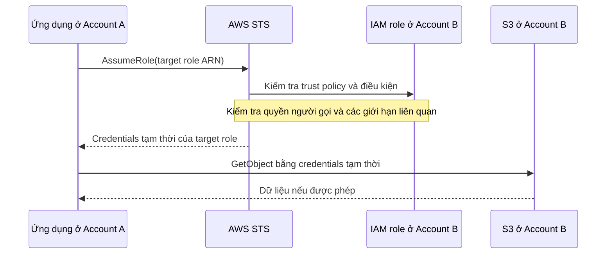
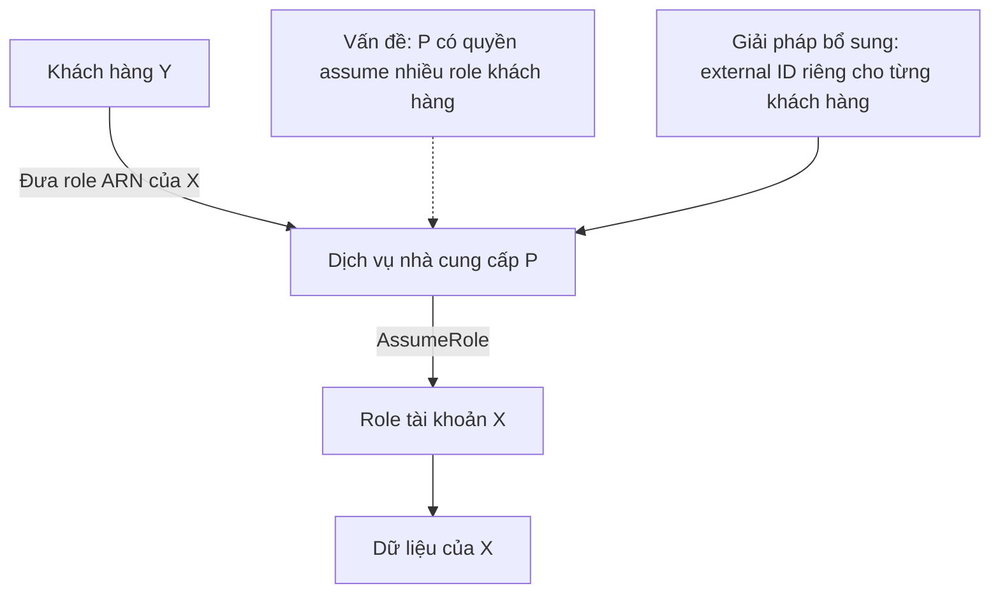
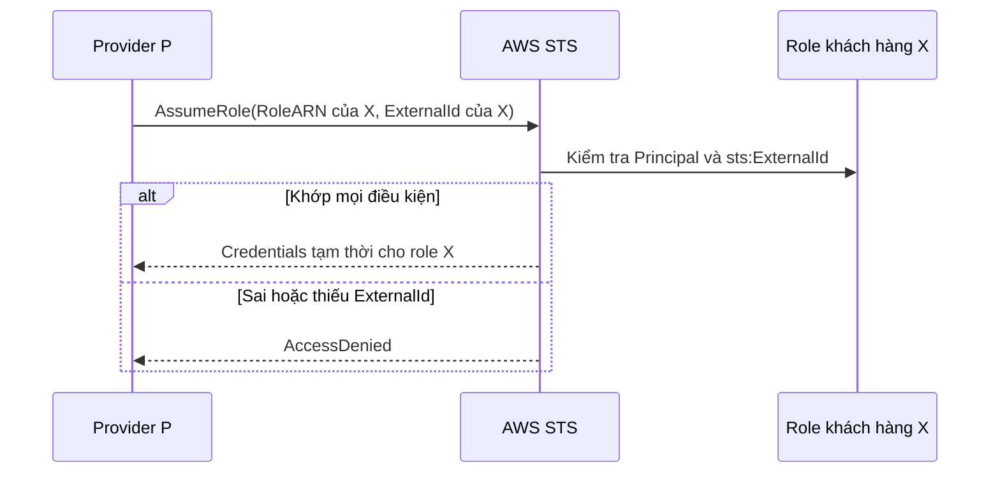
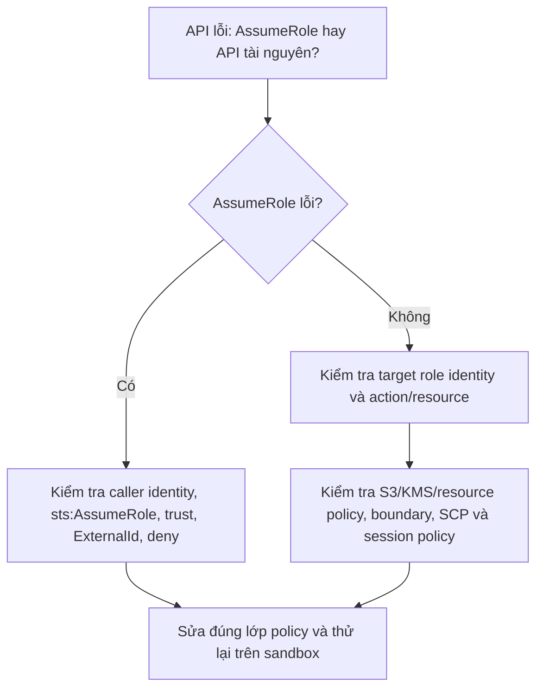

# Truy cập liên tài khoản và external ID

> **Học phần:** CLOUD_PROVIDERS_AWS  
> **Chương:** IAM và phân quyền  
> **Phạm vi:** AWS IAM, AWS Security Token Service (STS), chính sách tin cậy (*trust policy*), quyền truy cập liên tài khoản (*cross-account access*) và `sts:ExternalId`.

## 1. Mục tiêu học tập và bối cảnh

Khi thiết kế ứng dụng trên AWS, hiếm khi toàn bộ tài nguyên nằm trong một tài khoản. Doanh nghiệp có thể tách tài khoản cho môi trường phát triển, kiểm thử và sản xuất; hệ thống giám sát có thể cần đọc CloudWatch Logs ở nhiều tài khoản; hoặc một nhà cung cấp bên ngoài phải được phép đọc một nhóm dữ liệu S3 để thực hiện dịch vụ đã ký kết.

Trong hệ sinh thái AWS gồm Region/AZ, VPC, EC2, Lambda, S3, cơ sở dữ liệu và các dịch vụ tích hợp, **quyền liên tài khoản** giúp phân tách ranh giới quản trị nhưng vẫn cho phép một danh tính được chỉ định thực hiện đúng công việc. **External ID** là một điều kiện bảo vệ bổ sung, đặc biệt quan trọng khi cho một bên thứ ba có nhiều khách hàng cùng sử dụng dịch vụ.

Sau bài này, người học có thể:

1. Mô tả cách AWS STS `AssumeRole` cấp thông tin xác thực tạm thời cho truy cập liên tài khoản.
2. Phân biệt chính sách **trust**, chính sách **quyền của role**, chính sách **của bên gọi** và các giới hạn kiểm soát khác.
3. Tạo role ở tài khoản đích chỉ tin cậy một role cụ thể ở tài khoản nguồn.
4. Giải thích rủi ro **confused deputy** và cơ chế `sts:ExternalId` giảm rủi ro đó.
5. Gọi role bằng AWS CLI, xác minh danh tính đã đổi và khắc phục lỗi `AccessDenied` thường gặp.
6. Chọn mô hình phân quyền an toàn, dễ giám sát, có thể thu hồi khi vận hành các ứng dụng AWS.

## 2. Mô hình truy cập liên tài khoản

Xét một tổ chức có hai tài khoản:

| Thành phần | Giá trị minh họa | Trách nhiệm |
|---|---|---|
| **Account A — nguồn** | `444455556666` | Chứa ứng dụng hoặc role gọi API. |
| **Account B — đích** | `111122223333` | Chứa S3 bucket và IAM role cho phép đọc dữ liệu. |
| **Caller role** ở A | `AppReader` | Danh tính đang chạy ứng dụng. |
| **Target role** ở B | `CrossAccountReportsRead` | Cấp quyền đọc đúng tài nguyên ở B. |
| **AWS STS** | API `AssumeRole` | Kiểm tra điều kiện được phép và cấp credentials tạm thời. |

Các account ID, role name và tên tài nguyên xuyên suốt bài chỉ là **ví dụ**, cần thay bằng giá trị của môi trường thực tế.



Điểm cốt lõi: ứng dụng **không cần sở hữu access key dài hạn của Account B**. Nó dùng danh tính đang có ở A để xin một phiên (*role session*) tại B. Sau khi gọi thành công, các API tiếp theo chạy với quyền của **target role trong Account B**.

### 2.1. IAM role không giống IAM user

IAM role là danh tính có thể được *assume* trong những điều kiện cho phép. Role không có mật khẩu đăng nhập cố định hoặc access key dài hạn gắn trực tiếp như IAM user. Khi `AssumeRole` thành công, STS trả về:

- `AccessKeyId`
- `SecretAccessKey`
- `SessionToken`
- `Expiration`

Bộ credentials này có thời hạn. Quyền phiên làm việc được tính từ chính sách của role đích, có thể bị giới hạn thêm bởi **session policy**, **permissions boundary**, **Service Control Policies (SCP)** và các chính sách/tình huống liên quan. Hết hạn phiên thì phải lấy credentials mới.

**Ví dụ ARN:**

- IAM role định nghĩa ở B: `arn:aws:iam::111122223333:role/CrossAccountReportsRead`
- Phiên assumed role có thể xuất hiện trong `sts get-caller-identity`: `arn:aws:sts::111122223333:assumed-role/CrossAccountReportsRead/report-reader-session`

Đừng nhầm ARN của **role** với ARN của **role session**: chúng diễn tả hai đối tượng khác nhau trong cùng luồng truy cập.

## 3. Những chính sách nào phải khớp?

Một lời gọi liên tài khoản thường cần đồng thời:

| Lớp kiểm soát | Nằm ở đâu? | Câu hỏi cần trả lời |
|---|---|---|
| **Identity-based policy của caller** | Account A | Caller có quyền gọi `sts:AssumeRole` tới ARN role đích không? |
| **Trust policy của target role** | Account B | B có tin cậy caller ở A và cho phép `sts:AssumeRole` trong điều kiện hiện tại không? |
| **Permissions policy của target role** | Account B | Khi đã assume role, phiên này được thao tác gì trên S3, DynamoDB, CloudWatch... ở B? |
| **SCP, permissions boundary, session policy** | Tại phạm vi tương ứng | Có giới hạn hoặc explicit deny nào làm lời gọi bị từ chối không? |
| **Resource-based policy**, khi áp dụng | S3 bucket, KMS key, SQS queue... | Chính sách của tài nguyên có yêu cầu bổ sung hoặc từ chối hành động không? |

**Hai câu hỏi thường bị nhập làm một:**

- “Tôi có thể **assume role** không?” → xem quyền caller, trust policy và các điều kiện liên quan.
- “Sau khi assume role, tôi có thể **đọc S3 object** không?” → xem permissions của target role, bucket policy, KMS key policy nếu dữ liệu dùng SSE-KMS, và các giới hạn khác.

Trust policy không tự cấp quyền `s3:GetObject`. Ngược lại, gắn `s3:GetObject` vào target role cũng không tự cho phép bất kỳ danh tính nào assume role đó.

### 3.1. Explicit deny vẫn thắng allow

IAM áp dụng quy tắc **mặc định từ chối**. Một `Allow` hợp lệ cần đáp ứng các điều kiện của từng lớp liên quan và không bị `Deny` tường minh chặn. Ví dụ, kể cả khi trust cho phép Account A, SCP của tổ chức có thể ngăn `sts:AssumeRole`; hoặc bucket policy ở B có thể từ chối truy cập S3 với phiên role.

Vì vậy, lỗi `AccessDenied` phải được chẩn đoán theo **API đang lỗi** và **danh tính thực sự đã gọi API**, không chỉ nhìn một chính sách duy nhất.

## 4. Thực hành mô hình A → B trong nội bộ

Ở ví dụ này, người quản trị kiểm soát cả Account A và Account B. Mục tiêu là để role `AppReader` tại A đọc một thư mục báo cáo trong S3 bucket thuộc B.

### 4.1. Tạo IAM role đích tại Account B

Trong Account B, vào **IAM → Roles → Create role**, chọn phương thức tin cậy **AWS account** và cấu hình cho account nguồn hoặc chọn hướng tạo phù hợp; sau đó **chỉnh trust policy** để tin cậy đúng IAM role của Account A.

Mẫu trust policy của `CrossAccountReportsRead`:

```json
{
  "Version": "2012-10-17",
  "Statement": [
    {
      "Sid": "AllowSpecificCallerRole",
      "Effect": "Allow",
      "Principal": {
        "AWS": "arn:aws:iam::444455556666:role/AppReader"
      },
      "Action": "sts:AssumeRole"
    }
  ]
}
```

Phân tích:

- `Principal` xác định **ai được phép** yêu cầu assume role; ở đây là **một role cụ thể** tại Account A.
- `Action` cho phép hành động `sts:AssumeRole`.
- Không có `Resource` ở trust policy của IAM role, vì chính role đang chứa policy là đối tượng được tin cậy.
- Không đặt `"Principal": "*"` một cách tùy tiện. Điều kiện và phạm vi Principal quyết định mức phơi bày quyền truy cập.

Một cấu hình khác hay gặp là `"AWS": "arn:aws:iam::444455556666:root"`. Trong trust policy, giá trị này **ủy quyền cho account A** khả năng phân quyền assume role; nó **không có nghĩa chỉ root user của A mới được phép**. Người quản trị account A có thể cấp `sts:AssumeRole` cho các danh tính trong account đó. Khi biết trước caller role, chỉ định ARN role cụ thể thường rõ ràng và chặt chẽ hơn.

> **Lưu ý bảo trì:** Khi trust policy ghi rõ ARN của IAM role trong account khác, IAM có thể lưu tham chiếu nội bộ bằng **principal ID**. Nếu role nguồn bị xóa và tạo lại cùng tên, chính sách tin cậy có thể cần cập nhật lại vì role mới có danh tính nội bộ khác.

### 4.2. Gắn permissions policy cho target role ở B

Giả sử bucket `company-reports-demo-111122223333` lưu báo cáo trong prefix `exports/`. Policy sau cho phép liệt kê đúng prefix và đọc các đối tượng bên trong prefix:

```json
{
  "Version": "2012-10-17",
  "Statement": [
    {
      "Sid": "ListReportPrefix",
      "Effect": "Allow",
      "Action": "s3:ListBucket",
      "Resource": "arn:aws:s3:::company-reports-demo-111122223333",
      "Condition": {
        "StringLike": {
          "s3:prefix": [
            "exports/",
            "exports/*"
          ]
        }
      }
    },
    {
      "Sid": "ReadReportObjects",
      "Effect": "Allow",
      "Action": "s3:GetObject",
      "Resource": "arn:aws:s3:::company-reports-demo-111122223333/exports/*"
    }
  ]
}
```

Gắn policy này vào **role ở B**, không gắn nhầm vào role caller ở A. `s3:ListBucket` áp dụng cho **bucket ARN**; `s3:GetObject` áp dụng cho **object ARN**. Phân tách này là một lỗi dễ gặp khi viết quyền IAM cho S3.

Nếu các object mã hóa bằng **SSE-KMS** qua customer managed KMS key, phiên role cũng phải được phép sử dụng KMS key tương ứng, xét cả IAM policy và **KMS key policy**. Nếu bucket policy có explicit deny, quyền của role không vượt qua được deny đó.

### 4.3. Cho caller ở A quyền assume role

Gắn một identity-based policy vào `AppReader` ở Account A:

```json
{
  "Version": "2012-10-17",
  "Statement": [
    {
      "Sid": "AssumeReportsRoleInB",
      "Effect": "Allow",
      "Action": "sts:AssumeRole",
      "Resource": "arn:aws:iam::111122223333:role/CrossAccountReportsRead"
    }
  ]
}
```

Đây là quyền gọi API STS để nhận phiên role; nó **không cấp trực tiếp** `s3:GetObject` ở Account B. Sau khi assume thành công, ứng dụng mới dùng thông tin xác thực của target role để đọc đối tượng.

### 4.4. Kiểm tra bằng CLI

Trước tiên đăng nhập AWS CLI bằng **nguồn credentials có thời hạn** của caller, chẳng hạn IAM Identity Center:

```bash
aws sso login --profile caller-base
aws sts get-caller-identity --profile caller-base
```

`caller-base` chỉ là tên profile minh họa, phải được cấu hình trước cho danh tính ở A có quyền gọi `sts:AssumeRole`.

Dùng lệnh `sts assume-role` để kiểm tra:

```bash
aws sts assume-role \
  --profile caller-base \
  --role-arn arn:aws:iam::111122223333:role/CrossAccountReportsRead \
  --role-session-name reports-reader-lab
```

Khi thành công, CLI xuất một JSON gồm thông tin `AssumedRoleUser` và **credentials tạm thời**. Không đưa output này vào issue, tài liệu public, nhật ký ứng dụng hoặc chat nhóm. Có thể chuyển sang profile assume-role tự động để tránh thao tác sao chép credentials thủ công; ví dụ trong phần 6.

**Không** cần thêm `--external-id` cho kịch bản nội bộ này nếu trust policy ở B không yêu cầu nó. External ID không phải điều kiện bắt buộc cho mọi lần assume role.

## 5. External ID và bài toán confused deputy

External ID đặc biệt hữu ích khi **một nhà cung cấp dịch vụ bên ngoài** (*third-party provider*) dùng cùng danh tính AWS của họ để làm việc thay mặt nhiều khách hàng.

Giả sử:

- **Nhà cung cấp P** có AWS account `444455556666` và role xử lý tích hợp `IntegrationWorker`.
- **Khách hàng X** có account `111122223333` và role `PartnerReportsRead` mà P được phép assume.
- **Khách hàng Y** cũng sử dụng P, nhưng không được phép đọc dữ liệu của X.

Nếu trust policy của X chỉ tin cậy tài khoản P, rồi hệ thống P nhận **role ARN do khách hàng nhập** mà không gắn chặt với khách hàng đã xác thực, Y có thể cố yêu cầu P assume **role của X**. Khi đó P trở thành *confused deputy*: một bên có quyền hợp lệ nhưng bị lợi dụng để thực hiện yêu cầu sai đối tượng.



### 5.1. External ID hoạt động như thế nào?

Khi P làm việc với X, P cung cấp **một external ID riêng cho X**. Tài khoản X đưa giá trị này vào **trust policy** bằng condition `sts:ExternalId`. Khi P gọi STS để assume role của X, P truyền đúng giá trị vào tham số `ExternalId`. AWS chỉ cho phép khi các điều kiện cùng thỏa mãn.



Giả sử P cấp cho khách hàng X giá trị minh họa:

```text
customer-x-integration-9a4e8d72
```

Đây chỉ là định danh ngẫu nhiên dùng cho tài liệu. Trong tích hợp thật, **nhà cung cấp P nên cấp/gắn external ID riêng cho từng khách hàng và quản lý ánh xạ**. Khách hàng không tự đoán rồi nhập một chuỗi bất kỳ nếu nhà cung cấp đã thiết kế một quy trình cấp ID.

### 5.2. External ID không phải mật khẩu

Cần hiểu chính xác phạm vi bảo vệ:

- **External ID không phải bí mật xác thực**; nó là điều kiện bổ sung của lời gọi STS. Bản thân việc biết external ID **không đủ** để assume role nếu Principal không được tin cậy.
- External ID **không thay thế** trust policy hạn chế Principal, quyền tối thiểu cho role đích, MFA/Identity Center, kiểm toán và kiểm soát dữ liệu của nhà cung cấp.
- Mỗi khách hàng của cùng nhà cung cấp cần một external ID **khác nhau** để tránh nhầm lẫn giữa các tenant.
- Provider phải ràng buộc **role ARN + external ID** với khách hàng đã xác thực. Nếu cho phép tự do thay cặp giá trị của khách hàng khác, bảo vệ tenant có thể bị phá vỡ.
- Với các account đều nằm dưới quyền quản trị nội bộ và biết rõ caller role, external ID có thể không cần; ưu tiên trust đúng Principal và nguyên tắc ít đặc quyền.

Phân biệt thêm với `sts:SourceIdentity`: source identity có thể giúp gắn và theo dõi danh tính gốc của phiên role qua chuỗi assume role, trong khi **external ID kiểm soát điều kiện được phép assume**. Đây là hai mục đích riêng.

## 6. Thực hành: tích hợp bên thứ ba có external ID

Ta chuyển sang tình huống khách hàng X là Account B và nhà cung cấp P là Account A. Nhà cung cấp cần đọc các báo cáo S3 trong `exports/`, không cần thao tác ghi hay xóa.

### 6.1. Khách hàng tạo role với trust policy kiểm tra external ID

Role tại khách hàng: `arn:aws:iam::111122223333:role/PartnerReportsRead`.

Trust policy mẫu:

```json
{
  "Version": "2012-10-17",
  "Statement": [
    {
      "Sid": "AllowVendorOnlyWithCustomerExternalId",
      "Effect": "Allow",
      "Principal": {
        "AWS": "arn:aws:iam::444455556666:role/IntegrationWorker"
      },
      "Action": "sts:AssumeRole",
      "Condition": {
        "StringEquals": {
          "sts:ExternalId": "customer-x-integration-9a4e8d72"
        }
      }
    }
  ]
}
```

Ý nghĩa từng thành phần:

| Thuộc tính | Tác dụng |
|---|---|
| `Principal.AWS` | Chỉ tin cậy role `IntegrationWorker` của nhà cung cấp. |
| `Action = sts:AssumeRole` | Cho phép đề nghị tạo phiên target role. |
| `Condition.StringEquals.sts:ExternalId` | Yêu cầu yêu cầu STS phải mang **chính xác** external ID được cấp cho khách hàng X. |

Một bên ngoài P không thể tự assume role chỉ nhờ biết chuỗi external ID. Ngược lại, P gọi bằng danh tính hợp lệ nhưng **không truyền ID hoặc truyền sai** sẽ bị từ chối.

**Điểm thường sai:** Đưa `sts:ExternalId` vào **permissions policy của role** thay vì **trust policy** sẽ không đặt được điều kiện cho lời gọi `AssumeRole` như mong muốn. Điều kiện này phải được kiểm tra ở thời điểm cấp quyền assume role.

### 6.2. Cấp quyền nghiệp vụ tối thiểu cho target role

Khách hàng gắn vào `PartnerReportsRead` một permissions policy cho S3 tương đương mẫu ở mục 4.2, giới hạn đúng bucket/prefix cần đọc. Nếu nhà cung cấp cần đọc một bảng DynamoDB hoặc secret cụ thể thì tạo policy riêng, chỉ cấp hành động và ARN tương ứng, không gắn `AdministratorAccess` chỉ vì làm tích hợp nhanh.

Khách hàng nên ghi lại **nhà cung cấp**, **owner nội bộ**, **role ARN**, **phạm vi quyền**, **external ID do ai cấp**, **ngày rà soát/thu hồi**. Với từng tích hợp, nên dùng role riêng để dễ thu hồi và xem nhật ký truy cập.

### 6.3. Nhà cung cấp cho caller quyền gọi STS

Role `IntegrationWorker` tại P được gắn identity-based policy:

```json
{
  "Version": "2012-10-17",
  "Statement": [
    {
      "Sid": "AssumeCustomerXReportsRole",
      "Effect": "Allow",
      "Action": "sts:AssumeRole",
      "Resource": "arn:aws:iam::111122223333:role/PartnerReportsRead"
    }
  ]
}
```

Chính sách này là ví dụ giới hạn vào **một khách hàng**. Nhà cung cấp nhiều khách hàng có thể cần nhiều ARN cho phép, nhưng việc chọn đúng cặp role ARN/external ID phải được kiểm soát trong ứng dụng tích hợp.

### 6.4. Gọi AssumeRole có external ID qua CLI

Khi CLI đang chạy bằng danh tính thực sự có quyền tương đương `IntegrationWorker`:

```bash
aws sts assume-role \
  --profile provider-source \
  --role-arn arn:aws:iam::111122223333:role/PartnerReportsRead \
  --role-session-name customer-x-report-sync \
  --external-id customer-x-integration-9a4e8d72
```

API STS sẽ trả lại thông tin xác thực tạm thời nếu cả quyền bên gọi và trust policy của khách hàng cho phép. **Không lưu/đăng công khai phần `Credentials` trong output.**

Để AWS CLI tự assume role mỗi khi gọi dịch vụ, thêm profile sau vào file cấu hình AWS CLI của người vận hành (`~/.aws/config`):

```ini
[profile customer-x-reports]
role_arn = arn:aws:iam::111122223333:role/PartnerReportsRead
source_profile = provider-source
external_id = customer-x-integration-9a4e8d72
role_session_name = customer-x-report-sync
region = ap-southeast-1
```

Profile nguồn `provider-source` phải đã được cấu hình và đăng nhập vào **danh tính hợp lệ của provider P** (chẳng hạn profile sử dụng IAM Identity Center hoặc temporary credentials). Cấu hình `source_profile` không tự cấp quyền.

Xác minh:

```bash
# Profile này sẽ tự gọi AssumeRole nếu cần.
aws sts get-caller-identity --profile customer-x-reports

# Kiểm tra quyền chỉ đọc đúng prefix đã cho phép.
aws s3api list-objects-v2 \
  --bucket company-reports-demo-111122223333 \
  --prefix exports/ \
  --max-items 5 \
  --profile customer-x-reports
```

Nếu `get-caller-identity` hiển thị ARN dạng `arn:aws:sts::111122223333:assumed-role/PartnerReportsRead/customer-x-report-sync`, phiên đã chuyển sang role của khách hàng X. Việc gọi S3 thành công còn phụ thuộc quyền S3, bucket policy và cấu hình mã hóa thực tế.

### 6.5. Kiểm chứng tình huống bị từ chối

Để xác minh điều kiện external ID, có thể so sánh hai lời gọi **chỉ xin phiên**, không thay đổi dữ liệu:

| Trường hợp | Kết quả mong đợi |
|---|---|
| Caller đúng `IntegrationWorker`, external ID chính xác | `AssumeRole` thành công nếu không có deny khác. |
| Caller đúng, **thiếu** `--external-id` | `AccessDenied`. |
| Caller đúng, external ID sai | `AccessDenied`. |
| Caller không được trust, external ID đúng | `AccessDenied`. |

Sử dụng account thử nghiệm do bạn kiểm soát hoặc môi trường sandbox được cấp quyền. Nếu không sở hữu role của nhà cung cấp thật, bạn **không thể mô phỏng thành công** bằng cách khai báo một profile bất kỳ rồi giả vờ là principal đó. Để làm lab với hai tài khoản thử nghiệm, bạn có thể tạo role caller tương ứng và dùng chính sách cùng nguyên tắc trên.

### 6.6. Giới hạn khi thao tác bằng Console

**Switch Role trong AWS Management Console không hỗ trợ nhập external ID** khi chuyển role. Nếu trust policy yêu cầu `sts:ExternalId`, hãy dùng STS/API/SDK/CLI hoặc cơ chế tích hợp do nhà cung cấp hỗ trợ. Đừng xóa điều kiện external ID chỉ để người dùng thử Switch Role thành công.

## 7. External ID trong ứng dụng Java/Spring Boot

Trong ứng dụng Java chạy dưới role nhà cung cấp, AWS SDK for Java 2.x có thể lấy credentials của target role nhờ STS. Ví dụ minh họa:

```java
import java.time.Duration;
import software.amazon.awssdk.auth.credentials.StsAssumeRoleCredentialsProvider;
import software.amazon.awssdk.regions.Region;
import software.amazon.awssdk.services.s3.S3Client;
import software.amazon.awssdk.services.sts.StsClient;
import software.amazon.awssdk.services.sts.model.AssumeRoleRequest;

public class CustomerReportsClient {
    public static void main(String[] args) {
        // Role nguồn của ứng dụng phải có sts:AssumeRole tới target role.
        try (StsClient sts = StsClient.builder()
                .region(Region.AP_SOUTHEAST_1)
                .build();
             StsAssumeRoleCredentialsProvider provider =
                StsAssumeRoleCredentialsProvider.builder()
                    .stsClient(sts)
                    .refreshRequest(AssumeRoleRequest.builder()
                        .roleArn("arn:aws:iam::111122223333:role/PartnerReportsRead")
                        .roleSessionName("customer-x-report-sync")
                        .externalId("customer-x-integration-9a4e8d72")
                        .build())
                    .build();
             S3Client s3 = S3Client.builder()
                .region(Region.AP_SOUTHEAST_1)
                .credentialsProvider(provider)
                .build()) {

            // Ví dụ gọi nghiệp vụ: liệt kê object trong prefix.
            s3.listObjectsV2(request -> request
                .bucket("company-reports-demo-111122223333")
                .prefix("exports/")
                .maxKeys(5))
              .contents()
              .forEach(item -> System.out.println(item.key()));
        }
    }
}
```

**Giải thích:** SDK dùng credentials của role **nguồn** để gọi STS, nhận credentials tạm thời của **role đích** rồi dùng chúng để gọi S3. `StsAssumeRoleCredentialsProvider` hỗ trợ làm mới credentials cho các phiên tiếp theo. Không cần hard-code access key của tài khoản khách hàng.

Trong sản xuất, role ARN và external ID nên đến từ **cấu hình tenant được quản lý**, không gắn cố định trong source code. Ứng dụng phải xác thực tenant và tra cứu cặp giá trị đã cấp cho tenant đó; không tin vào role ARN/external ID tùy ý do request từ bên ngoài gửi lên. Nên sử dụng mã định danh phiên hỗ trợ truy vết khi kiểm toán, tránh đưa dữ liệu cá nhân vào tên session.

> **Giới hạn ví dụ:** Đoạn Java chỉ tập trung vào cách cấp quyền truy cập; chưa triển khai retry, phân trang, logging, quản lý cấu hình hay xử lý lỗi ứng dụng. Khi chạy thật, cần có dependency AWS SDK for Java 2.x tương ứng và cấu hình Region của bucket/endpoint phù hợp.

## 8. Vận hành an toàn và AWS Organizations

### 8.1. Khi nào cần external ID?

| Tình huống | Khuyến nghị |
|---|---|
| Lambda ở Account A đọc DynamoDB ở Account B, cả hai do cùng nhóm quản trị | Tạo target role và trust đúng source role. External ID thường không phải trọng tâm. |
| Công ty cung cấp SaaS đọc dữ liệu AWS của hàng trăm khách hàng | Dùng target role **mỗi khách hàng**, external ID duy nhất mỗi khách hàng, kiểm soát tenant tại phía SaaS. |
| Công cụ kiểm toán bên thứ ba yêu cầu AWS role ARN | Yêu cầu vendor cung cấp AWS Principal chính xác, external ID theo quy trình của họ, scope quyền tối thiểu và cách thu hồi. |
| Ứng dụng EC2/ECS/EKS cần gọi AWS API **trong cùng account** | Ưu tiên IAM role dành cho workload phù hợp; không thêm cơ chế cross-account khi không cần. |
| Nhân viên cần truy cập nhiều AWS accounts trong một tổ chức | Ưu tiên IAM Identity Center/permission sets và cơ chế truy cập tập trung phù hợp. |

### 8.2. Các điểm kiểm soát nên áp dụng

1. **Tin cậy Principal cụ thể:** Dùng ARN role của vendor thay vì tin cậy cả account nếu có thể. Không sử dụng wildcard thiếu giới hạn.
2. **Cấp quyền tối thiểu:** Chỉ hành động và tài nguyên cần thiết. Giới hạn prefix S3, bảng DynamoDB, secret, queue... theo nghiệp vụ.
3. **Tách role cho từng nhà cung cấp/tích hợp:** Tránh dùng chung một role đầy quyền cho nhiều đối tác.
4. **Cấp external ID riêng từng khách hàng:** Phía provider sinh và quản lý mapping; định kỳ rà soát khi onboarding/offboarding.
5. **Dùng temporary credentials:** Không yêu cầu khách hàng cung cấp access key dài hạn; hạn chế sao chép token vào log.
6. **Giám sát CloudTrail:** Kiểm tra sự kiện `AssumeRole` và các hoạt động của phiên role với account/role/session thực tế.
7. **Rà soát SCP và resource policy:** Với AWS Organizations, SCP có thể giới hạn caller hoặc role đích; một trust policy hợp lệ không làm các giới hạn này biến mất.
8. **Thu hồi rõ ràng:** Xóa/chỉnh trust statement của vendor, chặn quyền assume, thay điều kiện khi cần. Với phiên tạm thời đã phát, cân nhắc cơ chế **revoke active sessions**/deny dựa trên thời điểm cấp phiên và thời hạn credentials, thay vì cho rằng xóa trust lập tức xóa mọi session.

### 8.3. Audit trail trong CloudTrail

Khi tích hợp hoạt động, nên tìm:

- API `AssumeRole` và **thời điểm** tạo phiên.
- ARN role đích, tài khoản nguồn, `roleSessionName` và danh tính gọi theo dữ liệu có thể quan sát.
- Các API tiếp theo do ARN dạng `assumed-role/...` thực hiện, chẳng hạn `GetObject` hoặc `ListObjectsV2`.

**Lưu ý:** CloudTrail management events có thể ghi hoạt động STS, nhưng để quan sát thao tác trên object S3 như `GetObject`, cần cấu hình **S3 data events** phù hợp; data events không mặc định có trong mọi trail/event data store và có thể phát sinh chi phí. Không nên khẳng định thấy mọi thao tác trên object chỉ vì đã bật mặc định CloudTrail.

## 9. Chẩn đoán lỗi thường gặp

| Hiện tượng | Nguyên nhân cần kiểm tra | Cách xử lý |
|---|---|---|
| `AccessDenied` ngay tại `sts:AssumeRole` | Caller không có `sts:AssumeRole`, trust policy sai Principal, external ID thiếu/sai, explicit deny/SCP. | Gọi `sts get-caller-identity` ở profile nguồn; so khớp ARN, trust, condition và các giới hạn. |
| `AssumeRole` thành công nhưng `s3:GetObject` bị từ chối | Target role thiếu `s3:GetObject`, ARN sai prefix, bucket policy deny, KMS key policy chưa cấp quyền. | Dùng profile role đích để xác minh; kiểm tra action/resource, bucket policy và KMS. |
| `Switch Role` trên Console không vào được role vendor | Trust policy yêu cầu external ID, Console không có chỗ nhập. | Dùng SDK/CLI/API có tham số ExternalId. |
| Thay role nguồn cùng tên rồi bỗng nhiên bị từ chối | Trust policy lưu principal ID của role cũ đã bị xóa. | Cập nhật Principal ARN cho role nguồn mới ở trust policy. |
| CLI vẫn dùng account nguồn sau khi cấu hình profile | Chưa chọn profile role đích, sai `source_profile`, chưa đăng nhập hoặc cấu hình thiếu `role_arn`. | Gọi `aws sts get-caller-identity --profile customer-x-reports` và đối chiếu ARN. |
| Role đích assume được nhưng chỉ đọc được một phần | Policy giới hạn prefix/Region, thiếu quyền KMS, explicit deny hoặc điều kiện theo tag. | Đối chiếu tài nguyên thực tế và đầy đủ lớp policy. |
| Phiên hết hạn giữa tác vụ | Temporary credentials hết hạn, provider chưa refresh; vai trò chained role có giới hạn thời lượng phiên. | Dùng SDK credentials provider hỗ trợ refresh, giới hạn thời lượng hợp lý. |

### 9.1. Quy trình debug ba bước



Một lỗi `AccessDenied` từ S3 **không chứng minh** trust policy sai nếu `AssumeRole` đã thành công. Ngược lại, thêm quyền `s3:*` vào role đích **không khắc phục** lỗi tại bước STS nếu external ID không khớp.

## 10. Bài tập vận dụng

**Tình huống:** Nhóm của bạn vận hành hệ thống quản lý khóa học Java/Spring Boot. Dữ liệu báo cáo học tập lưu trong Account B. Một nhà cung cấp phân tích bên ngoài P muốn chạy tác vụ hàng ngày, chỉ đọc những file ở S3 prefix `exports/daily/`. Nhóm muốn hạn chế chi phí phát sinh do đọc ngoài phạm vi và có thể thu hồi quyền khi ngừng hợp tác.

**Yêu cầu:**

1. Vẽ sơ đồ ba thực thể: role nguồn của P, role đích ở B và bucket báo cáo ở B. Chú thích API `AssumeRole`.
2. Viết **trust policy** chỉ tin cậy role `arn:aws:iam::444455556666:role/IntegrationWorker` và yêu cầu external ID `customer-x-integration-9a4e8d72`.
3. Viết **permissions policy** cho target role, chỉ gồm `s3:ListBucket` đúng prefix và `s3:GetObject` trên `exports/daily/*`.
4. Viết **identity-based policy** ở provider cho phép assume duy nhất role đích.
5. Ghi hai lời gọi CLI: một lần dùng external ID đúng và một lần dùng ID sai. Dự đoán kết quả; không công khai credentials trong kết quả.
6. Trình bày cách giám sát truy cập bằng CloudTrail, khi nào cần bật S3 data events.
7. Giả sử provider dừng hợp tác nhưng phiên STS còn hạn: nêu cách thu hồi quyền và giới hạn của thao tác chỉ xóa trust policy.

**Tiêu chí tự đánh giá:** Giải pháp đúng khi chỉ ra đầy đủ **caller policy + trust condition + target permission**, kiểm soát đúng tenant, chứng minh external ID sai bị từ chối, và không nhầm ngân sách/giám sát chi phí với cơ chế giới hạn IAM.

### 10.1. Câu hỏi kiểm tra nhanh

**1. Nếu có external ID đúng, một IAM user bất kỳ ở tài khoản khác assume role được không?**  
Không. Principal trong trust policy và các lớp phân quyền khác vẫn phải cho phép caller.

**2. External ID có phải access key của khách hàng không?**  
Không. Đây là giá trị được kiểm tra trong điều kiện `sts:ExternalId` của trust policy.

**3. Trust policy cho phép `sts:AssumeRole` có đồng nghĩa với quyền đọc mọi bucket trong account đích không?**  
Không. Quyền đọc phụ thuộc permissions của role đích và các chính sách tài nguyên/giới hạn liên quan.

**4. Sử dụng `arn:aws:iam::444455556666:root` trong Principal có nghĩa chỉ người dùng root của account A được assume role?**  
Không. Nó cho phép **tài khoản A ủy quyền** cho các danh tính phù hợp; không tự giới hạn vào root user.

**5. Vì sao không nên “sửa nhanh” bằng `AdministratorAccess`?**  
Vì khi một phiên bị lạm dụng, mọi hành động mà role quản trị được phép thực hiện đều có thể bị ảnh hưởng; quyền phải giới hạn theo tác vụ đã thỏa thuận.

## 11. Tổng kết và tài liệu tham khảo

**Truy cập liên tài khoản** là sự kết hợp của quyền **được phép chuyển role** và quyền **được phép làm việc sau khi chuyển role**. AWS STS cấp thông tin xác thực tạm thời giúp giảm nhu cầu chia sẻ access key dài hạn. Với bên thứ ba có nhiều khách hàng, external ID là một lớp kiểm soát bổ sung chống nhầm lẫn khách hàng trong bài toán confused deputy; việc phân tách tenant trong ứng dụng bên thứ ba vẫn là yêu cầu bắt buộc.

Các tài liệu AWS chính thức nên tham khảo và đối chiếu khi triển khai:

- [AWS IAM — Tutorial: Delegate access across AWS accounts using IAM roles](https://docs.aws.amazon.com/IAM/latest/UserGuide/tutorial_cross-account-with-roles.html)
- [AWS IAM — Providing access to third parties](https://docs.aws.amazon.com/IAM/latest/UserGuide/id_roles_common-scenarios_third-party.html)
- [AWS IAM — How to use an external ID](https://docs.aws.amazon.com/IAM/latest/UserGuide/id_roles_create_for-user_externalid.html)
- [AWS IAM — Principal element in policies](https://docs.aws.amazon.com/IAM/latest/UserGuide/reference_policies_elements_principal.html)
- [AWS IAM — Policies and permissions in IAM](https://docs.aws.amazon.com/IAM/latest/UserGuide/access_policies.html)
- [AWS STS — AssumeRole API](https://docs.aws.amazon.com/STS/latest/APIReference/API_AssumeRole.html)
- [AWS CLI — Configuration settings and precedence](https://docs.aws.amazon.com/cli/latest/topic/config-vars.html)
- [AWS IAM — Revoking IAM role temporary security credentials](https://docs.aws.amazon.com/IAM/latest/UserGuide/id_roles_use_revoke-sessions.html)
- [AWS CloudTrail — Logging data events](https://docs.aws.amazon.com/awscloudtrail/latest/userguide/logging-data-events-with-cloudtrail.html)

> Các account ID, tên resource, ARN, external ID và đoạn code trong bài là dữ liệu thực hành giả lập. Trước khi sử dụng trên môi trường thật, xác minh tài khoản đích, chính sách hiện hành, Region, chi phí audit và yêu cầu bảo mật của tổ chức.
