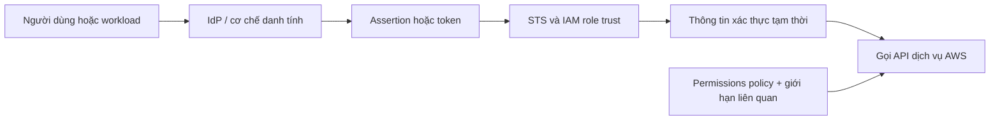
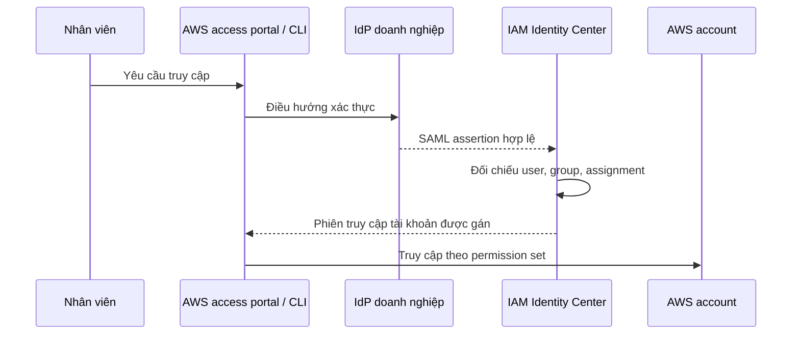
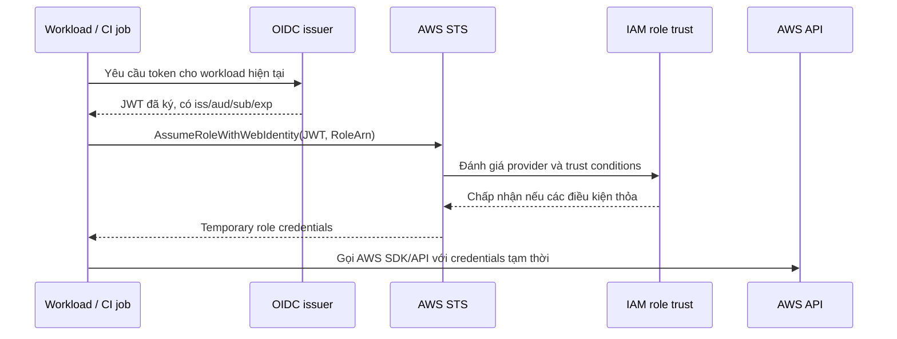

# Liên kết danh tính qua SAML, OIDC và workload identity

## 1. Bối cảnh: vì sao cần liên kết danh tính?

Khi doanh nghiệp có nhiều tài khoản AWS, việc tạo một IAM user với mật khẩu và access key riêng cho mỗi nhân viên hay mỗi hệ thống gây khó khăn trong thu hồi quyền, kiểm toán và xoay vòng thông tin xác thực. Hệ thống nhân sự có thể đã dùng Microsoft Entra ID, Okta hoặc một nền tảng quản lý danh tính khác; pipeline triển khai chạy trên GitHub Actions; ứng dụng chạy trên EC2, ECS, Lambda, EKS hoặc ở trung tâm dữ liệu riêng. Những môi trường này cần truy cập AWS nhưng không nhất thiết cần sở hữu **IAM user** và **access key dài hạn**.

**Identity federation** (liên kết/liên thông danh tính) cho phép AWS tin cậy một hệ thống xác thực bên ngoài hoặc một cơ chế danh tính workload, sau đó cung cấp quyền truy cập thích hợp. Trên AWS, kết quả thường là **thông tin xác thực tạm thời** gắn với một **IAM role**, thay vì khóa bí mật dài hạn được lưu trong mã nguồn.

Bài học thuộc chương **IAM và phân quyền** của lộ trình **CLOUD_PROVIDERS_AWS**. Nội dung hỗ trợ thiết kế, triển khai và vận hành ứng dụng dùng hạ tầng Region/AZ, VPC, EC2, container, serverless, lưu trữ và cơ sở dữ liệu theo nguyên tắc quyền tối thiểu, có khả năng giám sát, phục hồi và kiểm soát chi phí.

Sau bài học, bạn có thể:

- Phân biệt xác thực, phân quyền, identity federation và role assumption.
- Giải thích luồng SAML 2.0 cho **workforce identity** và luồng OIDC cho **web identity/workload identity**.
- Chọn giữa **IAM Identity Center**, IAM SAML/OIDC provider và các cơ chế cấp danh tính workload của AWS.
- Đọc trust policy, thiết lập điều kiện `aud`/`sub`, phân biệt **trust policy** với **permissions policy**.
- Thiết kế quyền truy cập tạm thời cho CI/CD, EKS, EC2, ECS, Lambda hoặc workload ngoài AWS.
- Chẩn đoán các lỗi `AccessDenied`, sai audience/subject, token hết hạn và phạm vi quyền không phù hợp.

## 2. Các thành phần trong một hệ thống federation

| Thuật ngữ | Ý nghĩa | Ví dụ |
| --- | --- | --- |
| **Principal** | Danh tính thực hiện một yêu cầu | Nhân viên, IAM role session, pod, pipeline |
| **Identity provider (IdP)** | Hệ thống xác minh danh tính và phát hành bằng chứng xác thực | Microsoft Entra ID, Okta, GitHub OIDC issuer |
| **Relying party / Service provider (SP)** | Hệ thống chấp nhận bằng chứng từ IdP theo quan hệ tin cậy | AWS hoặc ứng dụng nhận SAML/OIDC |
| **Assertion / Token** | Bằng chứng danh tính có chữ ký, thời hạn, đối tượng nhận và các thuộc tính liên quan | SAML assertion; OIDC JWT |
| **IAM role** | Đối tượng IAM có thể được assume, gồm trust policy và quyền được gắn | `DeploymentRole`, `ReadReportsRole` |
| **AWS STS** | Dịch vụ phát hành thông tin xác thực AWS tạm thời | `AssumeRoleWithSAML`, `AssumeRoleWithWebIdentity` |
| **Temporary credentials** | Bộ `AccessKeyId`, `SecretAccessKey`, `SessionToken` có hạn dùng | Role session dùng để gọi S3, DynamoDB |

Phân biệt ba bước thường bị trộn lẫn:

1. **Authentication (xác thực):** xác minh *ai* là người/workload đưa yêu cầu. IdP thực hiện bước này khi phát hành token hoặc assertion.
2. **Federation / role assumption:** AWS kiểm tra danh tính đã được tin cậy và điều kiện cho phép nhận một IAM role.
3. **Authorization (phân quyền):** khi dùng role session gọi API, IAM và những cơ chế liên quan đánh giá *được làm gì* trên *tài nguyên nào*.

> Một token đăng nhập hợp lệ **không tự động** có quyền đọc S3 hay xóa DynamoDB. Quyền của role session được kiểm soát riêng; việc IdP xác thực thành công chỉ là một phần của quá trình.

### 2.1. Trust policy và permissions policy khác nhau

- **Role trust policy** (*assume role policy*) xác định **ai hoặc hệ thống nào được phép nhận role** và trong điều kiện nào. Ví dụ: chỉ workflow thuộc repository cụ thể, chạy ở nhánh `main`, mới được dùng `DeploymentRole`.
- **Permissions policy** gắn vào role xác định **role session có thể gọi API AWS nào**. Ví dụ: chỉ `s3:PutObject` vào một prefix đã phê duyệt.
- **SCP**, permissions boundary, session policy và resource policy có thể tiếp tục hạn chế hoặc tác động tới quyền thực tế; trust policy không bỏ qua các ranh giới này.

Sơ đồ khái quát:



## 3. SAML 2.0: federation cho nhân viên

**SAML 2.0 (Security Assertion Markup Language)** là chuẩn trao đổi thông tin xác thực dựa trên XML. SAML phổ biến trong **Single Sign-On (SSO)** doanh nghiệp: nhân viên đăng nhập bằng tài khoản công ty, có thể sử dụng MFA do IdP quản lý, rồi được truy cập các tài khoản và ứng dụng được phân công.

Một **SAML assertion** thường chứa thông tin chủ thể, IdP phát hành, nơi được phép nhận, thời gian hiệu lực và các thuộc tính liên quan. Assertion phải được hệ thống nhận kiểm tra chữ ký, issuer, audience/recipient, hiệu lực và các điều kiện bảo vệ cần thiết. Không thể chỉ giải mã XML rồi mặc định tin tưởng nội dung.

### 3.1. Cách khuyến nghị cho workforce: IAM Identity Center

**AWS IAM Identity Center** là dịch vụ quản lý truy cập tập trung cho người dùng vào nhiều tài khoản AWS và các ứng dụng được hỗ trợ. Với **external IdP**, tổ chức có thể cấu hình:

- **SAML 2.0** để liên kết quá trình **đăng nhập/xác thực** từ IdP doanh nghiệp đến IAM Identity Center.
- **SCIM** (*System for Cross-domain Identity Management*) để **đồng bộ user và group** khi được hỗ trợ; SCIM phục vụ provisioning, cập nhật và deprovisioning, **không thay thế SAML cho đăng nhập**.
- **Permission set** và **account assignment** để quyết định user/group được truy cập những tài khoản AWS nào với mức quyền nào.

Ví dụ: nhóm `Developers` được gán permission set `DeveloperReadOnly` cho tài khoản `sandbox`, trong khi nhóm `ProductionOperators` được gán permission set vận hành có giới hạn ở tài khoản sản xuất. Người dùng đi qua AWS access portal hoặc công cụ CLI hỗ trợ IAM Identity Center; AWS cung cấp thông tin xác thực phiên phù hợp thay vì yêu cầu nhân viên tự quản lý access key của IAM user.



Để vận hành an toàn, quản trị viên cần xác minh user/group đã được provision đúng, permission set không quá rộng, đồng bộ thu hồi truy cập và bảo vệ IdP bằng MFA cùng quy trình khôi phục. Một user xác thực thành công nhưng **chưa có account assignment** sẽ không tự xuất hiện quyền trên mọi tài khoản trong AWS Organizations.

**Ví dụ AWS CLI cho người dùng cuối đã được cấu hình SSO:**

```bash
# Profile này phải được cấu hình trước bằng 'aws configure sso'
aws sso login --profile company-dev

# Xác nhận role session và tài khoản thực tế
aws sts get-caller-identity --profile company-dev
```

CLI không biến tài khoản IdP thành IAM user. Nó sử dụng phiên đăng nhập và cơ chế credential phù hợp của IAM Identity Center; không nên dán access key tạm thời vào repository hay log để tiện chạy lại.

### 3.2. Federation SAML trực tiếp với IAM role

Trong một số hệ thống hoặc ứng dụng cũ, tổ chức sử dụng **IAM SAML identity provider** gắn trực tiếp với một AWS account và **AWS STS `AssumeRoleWithSAML`**. Đây là cơ chế khác với việc quản lý nhân viên tập trung qua IAM Identity Center.

Luồng chính:

1. Quản trị viên đăng ký SAML IdP trong IAM bằng metadata XML/chứng chỉ thích hợp, cấu hình IAM role và trust policy của role đó.
2. Nhân viên xác thực ở IdP. IdP phát hành SAML assertion cho AWS, thường kèm thông tin role/provider được cho phép.
3. AWS xác minh assertion và trust policy; luồng federation hoặc ứng dụng gọi `AssumeRoleWithSAML`.
4. STS trả về thông tin xác thực tạm thời gắn với role được chấp nhận; những thao tác sau đó chịu permissions policy của role và các ràng buộc AWS khác.

Ví dụ **trust policy cho role nhận SAML assertion**:

```json
{
  "Version": "2012-10-17",
  "Statement": [
    {
      "Effect": "Allow",
      "Principal": {
        "Federated": "arn:aws:iam::123456789012:saml-provider/CompanyIdP"
      },
      "Action": "sts:AssumeRoleWithSAML",
      "Condition": {
        "StringEquals": {
          "SAML:aud": "https://signin.aws.amazon.com/saml"
        }
      }
    }
  ]
}
```

`123456789012` và `CompanyIdP` là giá trị minh họa. `Principal.Federated` phải trỏ đến SAML provider **đã đăng ký** trong IAM của account chứa role. `SAML:aud` ràng buộc audience của assertion cho AWS sign-in endpoint tương ứng; cần đối chiếu các endpoint/Region và kiến trúc đăng nhập thực tế nếu sử dụng biến thể khác. Phía IdP cũng cần cấu hình các thuộc tính role và trust để không cho nhóm không phù hợp tự chọn role đặc quyền.

**Thời hạn phiên:** thời lượng STS `AssumeRoleWithSAML` phụ thuộc `DurationSeconds`, giới hạn `MaxSessionDuration` của role và thời điểm hết hạn ghi trong assertion. Đừng coi thời hạn đăng nhập IdP, assertion và AWS role session là một; cả ba có thể khác nhau.

### 3.3. Chọn giữa IAM Identity Center và SAML role trực tiếp

| Nhu cầu | Phương án thường phù hợp | Lý do |
| --- | --- | --- |
| Nhân viên truy cập nhiều AWS account | IAM Identity Center + external IdP | Permission set, group assignment và quản trị tập trung |
| Đồng bộ người dùng/nhóm từ IdP | IAM Identity Center + SCIM | Tránh cấp/sửa tài khoản và nhóm thủ công |
| Tích hợp ứng dụng đặc thù đã dùng `AssumeRoleWithSAML` | IAM SAML provider + IAM role | Cung cấp luồng STS trực tiếp theo thiết kế ứng dụng |
| Pipeline CI/CD chạy tự động | OIDC federation hoặc workload-specific credential | Gắn quyền với danh tính workload và giảm bí mật tĩnh |

**Không nên tạo một IAM user riêng cho mỗi nhân viên** chỉ để họ có thể đăng nhập AWS console; với mô hình nhiều tài khoản, federation trung tâm thường dễ quản trị và thu hồi quyền hơn.

## 4. OIDC: danh tính và token cho ứng dụng, pipeline

**OpenID Connect (OIDC)** là lớp nhận diện danh tính xây trên OAuth 2.0. Một hệ thống OIDC phát hành token chứa claims dạng JSON (thường là JWT) để bên tin cậy có thể xác minh thông tin chủ thể theo issuer, audience, chữ ký và thời hạn.

Trong AWS IAM federation, một **IAM OIDC identity provider** được đăng ký ở account, IAM role có trust policy tin vào provider đó và **STS `AssumeRoleWithWebIdentity`** có thể đổi token được chấp nhận thành thông tin xác thực tạm thời của role.

### 4.1. Các claim cần hiểu

| Claim | Ý nghĩa | Điều kiện cần kiểm tra |
| --- | --- | --- |
| `iss` (issuer) | Ai phát hành token? | Phải đúng OIDC provider được tin cậy |
| `aud` (audience) | Token được phát hành cho bên nhận nào? | Phù hợp client ID/audience mà AWS chấp nhận, ví dụ `sts.amazonaws.com` |
| `sub` (subject) | Danh tính cụ thể được IdP gán | Giới hạn về repository, branch, Kubernetes service account… |
| `exp`, `iat` | Thời gian hết hạn/phát hành | Token phải còn hiệu lực và hợp lệ theo yêu cầu |
| `kid`, chữ ký | Khóa ký của IdP | AWS xác minh chữ ký dựa trên thông tin khóa hợp lệ |

**ID token không đồng nghĩa AWS access key**; chỉ khi AWS xác minh được token theo quan hệ trust và các điều kiện của role, workload mới nhận AWS STS credentials. Token JWT có thể bị đọc phần payload mà không có khóa bí mật, do đó **giải mã token không chứng minh token đáng tin**; phải kiểm tra chữ ký và điều kiện. Trong mô hình STS, AWS đảm nhiệm những kiểm tra liên quan khi trao credentials.

### 4.2. Luồng OIDC workload federation



Thư viện AWS SDK và công cụ tích hợp hiện đại có thể tự nhận và làm mới thông tin xác thực bằng **default credential provider chain**. Về mặt thiết kế, ứng dụng không cần viết logic tự lưu, phát tán hay xoay vòng access key dài hạn.

## 5. Ví dụ thực tế: GitHub Actions triển khai vào AWS qua OIDC

Giả sử repository `acme/shop-api` được phép triển khai môi trường thử nghiệm từ nhánh `main` vào tài khoản AWS `123456789012`. Đội vận hành muốn tránh lưu `AWS_ACCESS_KEY_ID` và `AWS_SECRET_ACCESS_KEY` vào GitHub Secrets lâu dài.

Thiết kế gồm:

1. Tạo **OIDC identity provider** với issuer `https://token.actions.githubusercontent.com` trong IAM account đích; cấu hình audience `sts.amazonaws.com`.
2. Tạo IAM role, ví dụ `GitHubShopApiDeployRole`, với trust policy chỉ chấp nhận chủ thể của **đúng repository và nhánh**.
3. Gắn permissions policy cho role chỉ chứa API và tài nguyên cần cho việc triển khai ứng dụng đó.
4. Trong GitHub Actions, yêu cầu quyền phát hành OIDC token và dùng AWS credentials action để nhận phiên role tạm thời.

**Trust policy mẫu** gắn vào `GitHubShopApiDeployRole`:

```json
{
  "Version": "2012-10-17",
  "Statement": [
    {
      "Effect": "Allow",
      "Principal": {
        "Federated": "arn:aws:iam::123456789012:oidc-provider/token.actions.githubusercontent.com"
      },
      "Action": "sts:AssumeRoleWithWebIdentity",
      "Condition": {
        "StringEquals": {
          "token.actions.githubusercontent.com:aud": "sts.amazonaws.com",
          "token.actions.githubusercontent.com:sub": "repo:acme/shop-api:ref:refs/heads/main"
        }
      }
    }
  ]
}
```

Trường `sub` là yếu tố đặc biệt quan trọng. **Chỉ giới hạn `aud` không đủ**: nhiều repository trên GitHub có thể yêu cầu token có cùng audience. Nếu dùng `StringLike` với wildcard quá rộng như `repo:acme/*`, mọi repository phù hợp mẫu có thể nhận role nếu những rào chắn khác không ngăn cản.

Ví dụ một workflow GitHub Actions tối giản để **xác minh danh tính AWS sau khi assume role**:

```yaml
name: Verify AWS OIDC session
on:
  push:
    branches: [main]
permissions:
  id-token: write
  contents: read
jobs:
  verify-aws:
    runs-on: ubuntu-latest
    steps:
      - name: Configure temporary AWS credentials
        uses: aws-actions/configure-aws-credentials@v4
        with:
          role-to-assume: arn:aws:iam::123456789012:role/GitHubShopApiDeployRole
          aws-region: ap-southeast-1
      - name: Confirm current AWS identity
        run: aws sts get-caller-identity
```

Đây là ví dụ giảng dạy; khi đưa vào production, nên ghim phiên bản action theo chính sách kiểm soát chuỗi cung ứng (ví dụ full commit SHA đã thẩm định), bổ sung chính sách bảo vệ nhánh/môi trường và thay ARN, repository, tài khoản bằng giá trị thật. Quyền `id-token: write` giúp job yêu cầu OIDC token; **nó không tự cấp quyền ghi lên tài nguyên AWS**. Các quyền đó nằm ở IAM role được assume.

**Khi GitHub job sử dụng GitHub Environment**, `sub` mặc định có thể mang dạng `repo:acme/shop-api:environment:production` thay cho dạng `ref:refs/heads/main`. Khi ấy phải thiết kế trust policy khớp subject được thực sự phát hành và bật **environment protection rules** (như giới hạn deployment branch, reviewer nếu cần). Không nên nới lỏng trust thành wildcard chỉ để khắc phục `AccessDenied`.

### 5.1. Permissions policy tối thiểu minh họa

Nếu role chỉ cần ghi artifact vào prefix `releases/` của một bucket, có thể dùng policy dạng sau thay vì `AdministratorAccess`:

```json
{
  "Version": "2012-10-17",
  "Statement": [
    {
      "Sid": "WriteReleaseArtifactsOnly",
      "Effect": "Allow",
      "Action": ["s3:PutObject"],
      "Resource": "arn:aws:s3:::example-shop-artifacts/releases/*"
    }
  ]
}
```

Policy trên chỉ minh họa quyền `PutObject` đối với prefix. Một pipeline triển khai ECS/Lambda/CloudFormation thực tế có thể cần thêm các quyền tương ứng, `iam:PassRole` được giới hạn đến role phù hợp, quyền KMS nếu bucket được mã hóa bằng customer managed key và quyền đọc artifact. Không cấp `iam:*`, `sts:*` hoặc `Resource: "*"` rộng chỉ vì workflow ban đầu gặp lỗi.

## 6. Workload identity: danh tính gắn với môi trường chạy

**Workload identity** là cách định danh chương trình, job, container hoặc service để nó nhận quyền truy cập theo vai trò của chính workload. Đặc điểm cốt lõi là **không chia sẻ khóa AWS dài hạn** giữa nhiều ứng dụng. Một số cơ chế dùng OIDC trực tiếp; những cơ chế khác dùng khả năng danh tính do dịch vụ AWS cung cấp hoặc chứng chỉ X.509.

| Môi trường chạy | Cơ chế thường phù hợp | Ghi chú |
| --- | --- | --- |
| **Amazon EC2** | IAM role qua **instance profile** | AWS cung cấp temporary credentials qua IMDS; nên cấu hình IMDSv2 và bảo vệ truy cập metadata |
| **Amazon ECS** | **Task role** | Ứng dụng nhận quyền theo task; phân biệt task role với task execution role |
| **AWS Lambda** | **Execution role** | Lambda nhận temporary credentials để gọi API AWS cần thiết |
| **Amazon EKS** | **EKS Pod Identity** hoặc **IAM Roles for Service Accounts (IRSA)** | Hai cơ chế khác nhau; lựa chọn theo nền tảng và khả năng hỗ trợ |
| **GitHub Actions / CI bên ngoài** | OIDC federation → `AssumeRoleWithWebIdentity` | Ràng buộc issuer, audience, repository/branch/environment |
| **Máy chủ on-premises hoặc môi trường ngoài AWS** | **IAM Roles Anywhere** với chứng chỉ X.509; hoặc OIDC nếu IdP hỗ trợ và mô hình phù hợp | Xác thực workload bằng CA/IdP rồi nhận credentials tạm thời |
| **Người dùng di động/web cần truy cập AWS trực tiếp** | Amazon Cognito identity pools hoặc kiến trúc backend trung gian, tùy yêu cầu | Người dùng cuối khác workload máy-máy; cần kiểm soát quyền cả authenticated/unauthenticated |

### 6.1. EC2, ECS và Lambda: ưu tiên role của dịch vụ

Khi ứng dụng chạy trên dịch vụ AWS được hỗ trợ, thường nên dùng cách cấp role **native**:

- **EC2:** gắn IAM role qua instance profile; AWS SDK đọc thông tin xác thực tạm thời theo credential chain. Không ghi access key vào AMI hoặc startup script. Bảo vệ Instance Metadata Service bằng IMDSv2 và phân vùng mạng/ứng dụng hợp lý.
- **ECS:** dùng **task role** để ứng dụng truy cập tài nguyên như S3/DynamoDB. **Task execution role** chủ yếu phục vụ agent thực hiện thao tác như kéo image hoặc ghi log; không nên dùng thay task role cho quyền nghiệp vụ.
- **Lambda:** cấu hình **execution role** vừa đủ cho hàm; Lambda tự cung cấp credentials cho runtime. Giảm phạm vi quyền cho từng hàm, đặc biệt với chức năng có thể bị gọi từ bên ngoài.

Các cơ chế này không yêu cầu tự tạo OIDC provider cho từng workload, nhưng vẫn áp dụng nguyên tắc role trust, quyền tối thiểu, xoay vòng credentials và giám sát.

### 6.2. Amazon EKS: phân biệt IRSA và EKS Pod Identity

**IRSA (IAM Roles for Service Accounts)** sử dụng OIDC issuer của cluster EKS. Pod chạy với một Kubernetes service account được gắn IAM role ARN; token của service account có `sub` theo dạng `system:serviceaccount:<namespace>:<service-account>` và audience thích hợp. AWS SDK nhận token qua web identity credential provider rồi gọi `AssumeRoleWithWebIdentity`.

Ví dụ trust policy **IRSA** cho service account `orders-api` trong namespace `production`:

```json
{
  "Version": "2012-10-17",
  "Statement": [
    {
      "Effect": "Allow",
      "Principal": {
        "Federated": "arn:aws:iam::123456789012:oidc-provider/oidc.eks.ap-southeast-1.amazonaws.com/id/EXAMPLE123456789"
      },
      "Action": "sts:AssumeRoleWithWebIdentity",
      "Condition": {
        "StringEquals": {
          "oidc.eks.ap-southeast-1.amazonaws.com/id/EXAMPLE123456789:aud": "sts.amazonaws.com",
          "oidc.eks.ap-southeast-1.amazonaws.com/id/EXAMPLE123456789:sub": "system:serviceaccount:production:orders-api"
        }
      }
    }
  ]
}
```

`EXAMPLE123456789` chỉ là chỗ giữ chỗ, phải thay bằng OIDC issuer ID của cluster. Muốn dùng IRSA, tổ chức cần đăng ký IAM OIDC provider tương ứng với EKS cluster và cấu hình Kubernetes service account/pod theo tài liệu EKS. Dùng `StringEquals` cho subject cụ thể giúp giới hạn đúng workload; nếu cần nhiều namespace/service account, phải đánh giá kỹ phạm vi mở rộng.

**EKS Pod Identity** sử dụng **EKS Pod Identity Agent và association** giữa Kubernetes service account với IAM role; vai trò tin vào service principal `pods.eks.amazonaws.com`, thay vì tạo một IAM OIDC identity provider cho mỗi cluster. Cơ chế nhận credentials của pod thông qua Pod Identity Agent/credential provider khác với IRSA, dù phía ứng dụng vẫn dùng AWS SDK.

Ví dụ trust policy tối giản minh họa phía role cho EKS Pod Identity:

```json
{
  "Version": "2012-10-17",
  "Statement": [
    {
      "Effect": "Allow",
      "Principal": {
        "Service": "pods.eks.amazonaws.com"
      },
      "Action": ["sts:AssumeRole", "sts:TagSession"]
    }
  ]
}
```

Policy trên chỉ thể hiện **điều kiện tin cậy tối thiểu**. Khi triển khai, cần xem xét điều kiện chống *confused deputy* như `aws:SourceOrgId`, bảo vệ quyền tạo/sửa Pod Identity association, ràng buộc namespace/service account và giới hạn quyền của role. Các mẫu chính thức của AWS có thể bổ sung điều kiện bảo mật phù hợp với kiến trúc tổ chức.

| Tiêu chí | IRSA | EKS Pod Identity |
| --- | --- | --- |
| Cơ chế xác thực IAM chính | OIDC provider + `AssumeRoleWithWebIdentity` | EKS Pod Identity Agent/association, vai trò tin dịch vụ EKS |
| IAM OIDC provider cho cluster | Cần | Không cần cho cơ chế Pod Identity |
| Gắn vai trò với workload | Kubernetes service account kết hợp role annotation | Pod Identity association của EKS |
| Nhu cầu tương thích | Hữu ích cho môi trường hỗ trợ IRSA hoặc đã triển khai lâu dài | AWS khuyến nghị cho workload EKS mới trên loại node/nền tảng được hỗ trợ |
| Truy cập liên tài khoản | Có thể thiết kế trực tiếp qua trust OIDC của account đích | Có thể dùng target role/role chaining theo cấu hình được hỗ trợ |

**Lưu ý:** Không nên coi EKS Pod Identity là một tên khác của IRSA. Hướng dẫn triển khai, role trust, quota, nền tảng node được hỗ trợ và đường lấy credentials khác nhau. Ví dụ, với workload EKS chạy trên nền tảng chưa hỗ trợ Pod Identity như một số kịch bản Fargate/Windows, IRSA có thể là phương án phù hợp hơn.

### 6.3. Workload ngoài AWS: IAM Roles Anywhere

Khi một ứng dụng chạy trên máy chủ tại trung tâm dữ liệu riêng, có thể dùng **IAM Roles Anywhere** nếu tổ chức quản lý được **PKI/chứng chỉ X.509**. AWS tin vào một **trust anchor** tham chiếu CA; workload dùng chứng chỉ và khóa riêng phù hợp để yêu cầu phiên credentials tạm thời theo role/profile đã cấu hình.

Luồng tổng quan: CA cấp chứng chỉ cho workload → admin đăng ký trust anchor, profile và role trust với `rolesanywhere.amazonaws.com` → workload dùng công cụ/SDK tích hợp Roles Anywhere để nhận temporary credentials → SDK gọi API AWS theo quyền role.

IAM Roles Anywhere **không phải OIDC**; đây là mô hình federation dựa trên chứng chỉ và PKI. Nếu công ty đã có CA, nó có thể phù hợp hơn việc tự dựng OIDC issuer chỉ cho một nhóm máy chủ. Dù vậy, cần quản lý khóa riêng, vòng đời chứng chỉ, thu hồi, trust anchor, vai trò IAM và nhật ký một cách nghiêm ngặt.

## 7. Liên kết danh tính trong tổ chức nhiều tài khoản AWS

Giả sử AWS Organizations có các account `security`, `development` và `production`:

```text
IdP doanh nghiệp ── SAML ──> IAM Identity Center
                               ├─ Developers    → development (Developer)
                               └─ Operators     → production  (ReadOnly / Operator)

GitHub Actions ── OIDC ─────> IAM role của development
GitHub Actions ── OIDC ─────> IAM role của production (chỉ workflow đã duyệt)

EC2/ECS/Lambda/EKS ─────────> IAM role của workload trong account liên quan
```

Thiết kế này tách **danh tính con người** khỏi **danh tính hệ thống** và phân quyền theo tài khoản:

- IAM Identity Center xác thực/điều phối nhân viên và gán permission set phù hợp cho từng account.
- CI/CD có role riêng cho mỗi môi trường; role production chặt hơn, có nhánh/môi trường và phê duyệt triển khai.
- Workload chỉ sử dụng role của chức năng cần thiết, không dùng role quản trị chung của pipeline.
- Với truy cập tài nguyên **xuyên tài khoản**, phải xem xét đồng thời trust của role được assume, quyền nguồn, resource policy liên quan và giới hạn SCP.

Không nên gắn một role `AdministratorAccess` dùng chung cho tất cả pipeline của tổ chức. Làm vậy khiến một repository hoặc job bị xâm nhập có thể trở thành điểm mở rộng quyền sang những môi trường khác.

### 7.1. Authorization vẫn phải tính toàn bộ chính sách

Với request gọi AWS API từ phiên role được federation:

1. Trust policy phải cho phép principal/IdP tương ứng **assume role**.
2. STS phải chấp nhận assertion/token/certificate cùng các điều kiện của cơ chế federation.
3. Role session phải có quyền AWS API cần thiết qua identity-based permissions và các chính sách liên quan.
4. Những `Deny` tường minh trong IAM, resource policy, SCP áp dụng cho account thành viên và các giới hạn khác tiếp tục được đánh giá.

Ví dụ role OIDC có `s3:GetObject` trên bucket `reports`, nhưng SCP của OU `Production` chặn `s3:GetObject` đối với nguồn tài nguyên thuộc danh mục hạn chế. Khi đó request vẫn bị từ chối dù GitHub token và trust policy đều hợp lệ.

## 8. Những rủi ro bảo mật và cách kiểm soát

| Rủi ro | Tác động | Biện pháp |
| --- | --- | --- |
| OIDC trust chỉ kiểm `aud`, `sub` quá rộng | Repository/job khác có thể nhận role | Khóa `sub` về repository + branch/environment cụ thể, hạn chế wildcard |
| Role permission quá lớn | Token hợp lệ trở thành đường leo thang quyền | Least privilege theo API, resource ARN, điều kiện, permission boundary khi phù hợp |
| SAML IdP cấu hình sai audience/role mapping | Đăng nhập lỗi hoặc cấp role sai | Kiểm tra metadata, SAML assertion, gán nhóm/role, MFA và quy trình cập nhật chứng chỉ |
| Lưu JWT, assertion hoặc STS credentials trong log | Có thể làm lộ thông tin xác thực còn hiệu lực | Không ghi token/secret ra stdout; hạn chế quyền xem log |
| Nhầm role workload với role hạ tầng | Pod/container nhận quyền rộng hơn cần thiết | Dùng ECS task role, Lambda execution role, IRSA/Pod Identity riêng theo ứng dụng |
| Bỏ qua thời hạn token/chứng chỉ | Pipeline đột ngột mất quyền | Dùng SDK tự refresh; giám sát expired token/certificate và xoay vòng đúng lúc |
| Tin cậy OIDC issuer không đủ kiểm soát | Kẻ tấn công với token issuer khác thuộc phạm vi rộng có thể nhận role | Đối chiếu `iss`, `aud`, `sub`, chữ ký, JWKS, quan hệ trust IAM |
| Nhân viên nghỉ việc vẫn có assignment | Tiếp tục truy cập hệ thống | Deprovision user/group, thu hồi phiên theo khả năng dịch vụ, audit định kỳ |

### 8.1. Nguyên tắc thiết kế vận hành

**Ưu tiên temporary credentials**, áp dụng quyền tối thiểu và phân tách môi trường phát triển/sản xuất. Tạo role theo chức năng nghiệp vụ thay vì role toàn quyền dùng chung. Sử dụng trust conditions cụ thể, nhất là với OIDC CI/CD và workload ngoài AWS.

**Quản lý IdP như hạ tầng bảo mật trọng yếu:** bảo vệ quản trị viên IdP, MFA, quy trình thay đổi chứng chỉ/khóa ký, cấu hình issuer/audience và xóa quyền nhân sự. Nếu IdP bị xâm nhập hoặc phát hành token không kiểm soát, nhiều role tin cậy IdP đó có thể bị ảnh hưởng.

**Thiết kế vòng đời session:** AWS STS credentials có thời hạn; khi token nguồn hết hạn hoặc bị thu hồi, các phiên AWS đã được phát hành **không nhất thiết bị thu hồi ngay lập tức**. Cần xem xét thời lượng role session phù hợp, cách thu hồi phiên trong IAM khi xảy ra sự cố và giám sát hành vi bất thường. Không dựa duy nhất vào việc xóa user ở IdP để khẳng định mọi STS session đã ngừng có hiệu lực.

**Ghi log và kiểm toán:** theo dõi CloudTrail cho các hoạt động STS/role session và hành động quản trị IAM, Identity Center, Organizations. Gắn nhãn session/role và tên job hợp lý khi được hỗ trợ để truy xuất chủ thể gốc. Không lưu trực tiếp SAML assertion, ID token, access token hoặc session token vào log để chẩn đoán.

## 9. Quy trình triển khai mẫu

### 9.1. Workforce SAML với IAM Identity Center

1. Xác định **identity source** và các nhóm nhân sự cần truy cập AWS. Bật MFA/kiểm soát truy cập theo khả năng IdP.
2. Cấu hình **external identity provider** trong IAM Identity Center, trao đổi thông tin SAML metadata/issuer/signing certificate và ACS/recipient đúng theo hướng dẫn AWS.
3. Thiết lập đồng bộ user/group qua **SCIM** hoặc provisioning thủ công nếu môi trường yêu cầu; xác minh tên danh tính và account assignment.
4. Tạo các **permission set** theo nhiệm vụ như `ReadOnly`, `Developer`, `Operator`; gán cho user/group ở đúng account.
5. Kiểm thử đăng nhập console và `aws sso login`; chạy `aws sts get-caller-identity` để xác định đúng role và account.
6. Kiểm thử người không thuộc nhóm được duyệt **không** truy cập được; hoàn tất cấu hình log, hỗ trợ và thu hồi quyền khi nhân viên chuyển nhóm/nghỉ việc.

### 9.2. OIDC cho CI/CD

1. Xác định issuer và claim thực tế (`iss`, `aud`, `sub`) của nền tảng CI; kiểm tra tài liệu OIDC issuer được tin cậy.
2. Đăng ký OIDC provider trong **IAM account đích** với issuer và audience phù hợp. Các bước chứng chỉ/TLS và endpoint phải theo hướng dẫn IAM hiện hành.
3. Tạo IAM role có **trust policy giới hạn chặt** theo nguồn hợp lệ; GitHub nên xác định đúng repository, nhánh hoặc environment được phê duyệt.
4. Gắn permissions policy chỉ cho API và tài nguyên deployment cần thiết.
5. Cấu hình workflow yêu cầu token, dùng thư viện tích hợp STS để nhận credentials tạm thời; không đưa khóa AWS dài hạn vào secrets.
6. Kiểm thử **cả trường hợp được phép và bị từ chối**: job nhánh hợp lệ, job nhánh khác, repository khác, audience sai, role permission thiếu.
7. Ghi nhận phiên sử dụng qua CloudTrail; rà soát định kỳ repository, branch protection, trust policy, permission và các workflow có quyền `id-token: write`.

### 9.3. Workload trên EKS

1. Xác định cluster, node type, namespace, service account và API AWS workload cần sử dụng.
2. Chọn **EKS Pod Identity** nếu phù hợp với nền tảng và mô hình vận hành; dùng **IRSA** nếu đã có nền tảng OIDC tương ứng hoặc cần hỗ trợ ở nơi Pod Identity chưa đáp ứng.
3. Tạo IAM role quyền tối thiểu; cấu hình trust/association theo đúng cơ chế đã chọn.
4. Gắn workload với service account thích hợp. Kiểm tra Pod sử dụng phiên role dự kiến thay vì vô tình rơi về credentials của node hoặc biến môi trường cũ.
5. Kiểm thử API được phép/không được phép, giám sát STS/EKS Pod Identity và khả năng làm mới credentials sau khi token/phiên hết hạn.

## 10. Chẩn đoán lỗi federation

Khi thấy `AccessDenied`, `InvalidIdentityToken`, `IDPRejectedClaim`, `ExpiredToken` hoặc lỗi đăng nhập IAM Identity Center, hãy kiểm tra theo **đúng tầng**:

| Hiện tượng | Nhóm nguyên nhân thường gặp | Bước kiểm tra |
| --- | --- | --- |
| SAML sign-in không thành công | Assertion sai audience/recipient, chứng chỉ, time skew, role mapping | Metadata IdP, `SAML:aud`, chữ ký và thời gian assertion |
| Nhân viên đăng nhập SSO nhưng không thấy account | Chưa provision user/group hoặc chưa account assignment | IdC identity source, SCIM, permission set assignment |
| `AssumeRoleWithWebIdentity` bị từ chối | IAM OIDC provider sai, `aud`/`sub` không khớp, role ARN sai | Trust policy, issuer, claims thực tế, account ID |
| `InvalidIdentityToken` | Token hết hạn/sai issuer, lỗi xác minh token, cấu hình OIDC discovery/JWKS | `iss`, `aud`, `exp`, OIDC provider và endpoint |
| Assume role thành công nhưng S3 báo `AccessDenied` | Permissions policy, bucket policy, KMS, SCP hoặc resource condition | `get-caller-identity`, IAM/SCP và chính sách tài nguyên |
| EKS pod dùng sai quyền | Service account/annotation/association sai, credential chain đọc nguồn khác | Pod identity setup, role, môi trường runtime/SDK |
| Phiên chạy lâu bị lỗi xác thực | STS credentials hết hạn, ứng dụng không refresh | Credential provider chain, thời lượng phiên, SDK |

Hai lệnh đọc danh tính/role hữu ích khi đã có credentials phù hợp:

```bash
# Kiểm tra account và role session thực tế đang dùng
aws sts get-caller-identity

# Xem trust policy hiện hành của role (cần quyền IAM read)
aws iam get-role --role-name GitHubShopApiDeployRole
```

Với CI, nên chạy `get-caller-identity` sau khi cấu hình OIDC credentials để kiểm tra role/account đích. Với CLI cá nhân, dùng `--profile` đúng để tránh nhầm tài khoản. Đừng in toàn bộ biến môi trường, assertion hoặc web identity token vào log chỉ để tìm lỗi.

## 11. Tình huống phân tích

### Tình huống A — Pipeline GitHub nhận role quá rộng

Một role có `Principal.Federated` trỏ tới GitHub issuer và `Condition` chỉ chứa `aud=sts.amazonaws.com`, nhưng permissions policy cấp quyền deploy production. Khi đó một job từ repository khác có token phù hợp vẫn có thể đáp ứng trust policy, nếu không bị kiểm soát bởi điều kiện khác. Cách sửa là giới hạn `sub` về repository + branch/environment được phép và bổ sung chính sách bảo vệ workflow.

### Tình huống B — Nhân viên chuyển nhóm nhưng vẫn thấy account

Một nhân viên được chuyển từ `Operators` sang `Analysts` ở IdP nhưng tiếp tục có thể dùng một phiên AWS đã cấp. Cần đối chiếu cơ chế SCIM provisioning, assignment cũ, thời hạn phiên và khả năng thu hồi session. Việc đổi nhóm ở IdP không bảo đảm vô hiệu hóa tức thì tất cả thông tin xác thực tạm thời đã phát hành.

### Tình huống C — Pod EKS chỉ cần đọc một bảng DynamoDB

Ứng dụng `orders-api` trong namespace `production` chỉ cần `dynamodb:GetItem` và `dynamodb:Query` cho một bảng. Hãy tạo role với policy phạm vi tài nguyên đúng bảng/index được dùng, gắn theo IRSA hoặc EKS Pod Identity cho service account tương ứng và kiểm tra pod không có quyền ghi/xóa. Không dùng quyền node instance hoặc `AdministratorAccess` để giải quyết nhanh.

### Tình huống D — Ứng dụng on-premises yêu cầu khóa AWS lâu dài

Một job ngoài AWS cần tải dữ liệu định kỳ từ S3. Nếu công ty đã có PKI quản trị máy chủ, có thể cân nhắc IAM Roles Anywhere để dùng chứng chỉ X.509 đổi lấy temporary credentials. Nếu nền tảng job có issuer OIDC đáng tin, OIDC federation cũng là một hướng. Chọn theo khả năng quản trị danh tính nguồn, rủi ro lưu khóa và yêu cầu triển khai.

## 12. Câu hỏi tự kiểm tra

**Câu 1.** Tại sao role trust policy OIDC có `Effect: Allow` chưa đủ để pipeline ghi vào S3?

**Gợi ý:** Trust policy chỉ kiểm soát ai được nhận role. Role vẫn cần permissions policy cấp `s3:PutObject` trên ARN phù hợp, đồng thời không bị từ chối bởi resource policy, SCP hoặc kiểm soát khác.

**Câu 2.** Trong IAM Identity Center, SAML và SCIM có chức năng khác nhau thế nào?

**Gợi ý:** SAML phục vụ liên kết đăng nhập/xác thực; SCIM đồng bộ vòng đời user/group để Identity Center có thể gán permission set và quản trị thay đổi danh tính.

**Câu 3.** Tại sao phải kiểm tra `sub` của GitHub token thay vì chỉ kiểm tra `aud`?

**Gợi ý:** `aud` chỉ nêu đối tượng nhận. Nhiều job có thể cùng dùng `aud=sts.amazonaws.com`; `sub` cho phép thu hẹp nguồn truy cập đến repository/branch/environment phù hợp.

**Câu 4.** EKS Pod Identity có cần tự đăng ký IAM OIDC provider cho cluster giống IRSA không?

**Gợi ý:** Không. Pod Identity dùng association, Pod Identity Agent và service principal của EKS; IRSA dựa vào IAM OIDC provider và `AssumeRoleWithWebIdentity`.

**Câu 5.** Workload trên EC2 nên nhận AWS credentials như thế nào?

**Gợi ý:** Gắn IAM role thông qua instance profile, bảo vệ metadata service và để AWS SDK lấy/làm mới temporary credentials qua credential chain.

## 13. Ghi nhớ

**SAML** thường giải quyết liên kết danh tính nhân viên, đặc biệt khi kết hợp external IdP với **IAM Identity Center** và đồng bộ người dùng/nhóm bằng **SCIM**. **OIDC** phù hợp cho nhiều tình huống web identity và workload identity, nổi bật là pipeline CI/CD và IRSA, nơi token có chữ ký được AWS STS trao đổi lấy credentials tạm thời theo **trust policy**. Các workload chạy ngay trên AWS thường nên dùng role do dịch vụ cung cấp; EKS có hai lựa chọn khác nhau là **IRSA** và **EKS Pod Identity**; workload ngoài AWS có thể dùng **IAM Roles Anywhere** hoặc một mô hình federation phù hợp.

Nguyên tắc xuyên suốt là **danh tính đáng tin cậy + role trust chặt + permissions tối thiểu + credentials ngắn hạn + giám sát/thu hồi được thiết kế rõ ràng**. Chỉ khi kết hợp các yếu tố đó với IAM, SCP, resource policy và quy trình vận hành, hệ thống AWS nhiều tài khoản mới bảo đảm truy cập đúng người, đúng workload, đúng tài nguyên.

### Tài liệu AWS tham khảo

- [IAM Identity Center — External identity providers (SAML/SCIM)](https://docs.aws.amazon.com/singlesignon/latest/userguide/manage-your-identity-source-idp.html)
- [IAM Identity Center — SAML and SCIM implementation](https://docs.aws.amazon.com/singlesignon/latest/userguide/scim-profile-saml.html)
- [IAM — Create a role for SAML 2.0 federation](https://docs.aws.amazon.com/IAM/latest/UserGuide/id_roles_create_for-idp_saml.html)
- [AWS STS — AssumeRoleWithSAML](https://docs.aws.amazon.com/STS/latest/APIReference/API_AssumeRoleWithSAML.html)
- [IAM — Create a role for OIDC federation](https://docs.aws.amazon.com/IAM/latest/UserGuide/id_roles_create_for-idp_oidc.html)
- [AWS STS — AssumeRoleWithWebIdentity](https://docs.aws.amazon.com/STS/latest/APIReference/API_AssumeRoleWithWebIdentity.html)
- [IAM — Security best practices](https://docs.aws.amazon.com/IAM/latest/UserGuide/best-practices.html)
- [Amazon EKS — Grant Kubernetes workloads access to AWS](https://docs.aws.amazon.com/eks/latest/userguide/service-accounts.html)
- [Amazon EKS — Pod identities](https://docs.aws.amazon.com/eks/latest/userguide/pod-identities.html)
- [IAM Roles Anywhere — Introduction](https://docs.aws.amazon.com/rolesanywhere/latest/userguide/introduction.html)
- [AWS IAM — Policy evaluation logic](https://docs.aws.amazon.com/IAM/latest/UserGuide/reference_policies_evaluation-logic.html)
