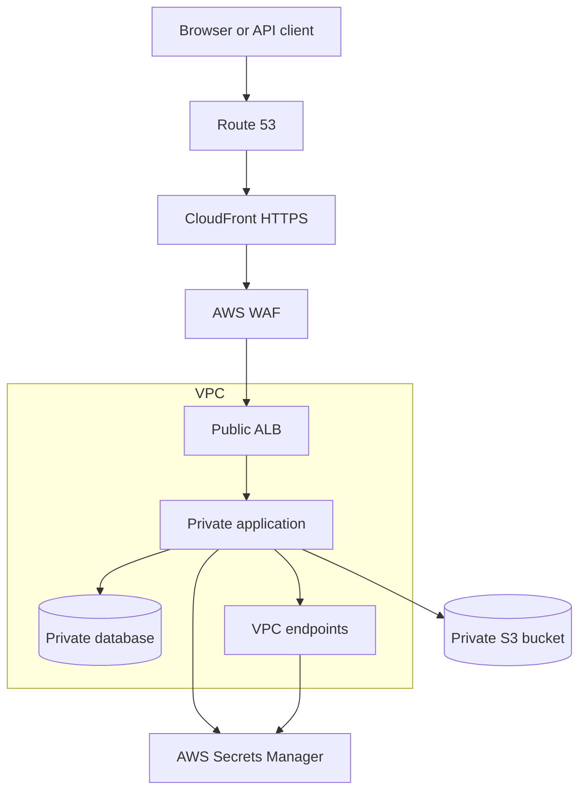

# Thiết kế phân lớp bảo vệ từ edge đến dữ liệu

Một ứng dụng AWS cần nhiều lớp kiểm soát vì mỗi thành phần đối mặt với một nhóm rủi ro khác nhau. Ở edge, hệ thống lọc request và giảm lưu lượng độc hại. Ở tầng mạng, VPC và subnet giới hạn đường đi. Ở tầng workload và ứng dụng, IAM, xác thực, phân quyền và kiểm tra đầu vào bảo vệ hành động nghiệp vụ. Ở tầng dữ liệu, mã hóa, chính sách truy cập và sao lưu bảo vệ tính bí mật, toàn vẹn và khả năng phục hồi.

Thiết kế phân lớp bảo vệ (defense in depth) không phải là xếp càng nhiều dịch vụ bảo mật càng tốt. Mục tiêu là tạo các ranh giới có trách nhiệm rõ ràng, giảm quyền mặc định, giới hạn tác động khi một lớp bị vượt qua và tạo tín hiệu để phát hiện sự cố.

Sau bài học, người học có thể phân tích luồng request; thiết kế bảo vệ từ CloudFront/WAF qua VPC và workload đến API, database, object storage; chọn IAM, TLS, KMS và dịch vụ phát hiện phù hợp; xây dựng quy trình kiểm thử và phản ứng.

## 1. Tư duy phân lớp và mô hình đe dọa

Một request có thể đi qua DNS, CDN, Web Application Firewall (WAF), load balancer, application service, database và object storage. Mỗi lớp có trách nhiệm riêng:

| Lớp | Rủi ro tiêu biểu | Kiểm soát thường dùng |
|---|---|---|
| Edge và DNS | DDoS, bot, request bất thường, truy cập origin trực tiếp | Route 53, CloudFront, AWS WAF, AWS Shield, TLS |
| Network ingress/egress | Cổng mở rộng, lateral movement, egress không kiểm soát | Route table, security group, network ACL, Network Firewall, VPC endpoint |
| Workload | Lỗ hổng hệ điều hành, image độc hại, credential bị lộ | IAM role, patching, image scanning, runtime hardening, secrets |
| Application/API | Broken access control, injection, SSRF, credential stuffing | Authentication, authorization, validation, throttling |
| Data | Lộ dữ liệu, sửa/xóa trái phép, ransomware | IAM/resource policy, KMS, TLS, backup, versioning |
| Detection/response | Tấn công không được phát hiện, phản ứng chậm | CloudTrail, VPC Flow Logs, WAF logs, GuardDuty, Security Hub, Config |

WAF lọc request HTTP(S) nhưng không xác thực người dùng và không thay thế kiểm tra quyền trong service. Security group giới hạn kết nối mạng nhưng không ngăn user hợp lệ đọc nhầm bản ghi của khách hàng khác. Mã hóa ổ đĩa bảo vệ dữ liệu lưu trữ nhưng không ngăn principal có quyền hợp lệ đọc plaintext sau khi ứng dụng giải mã.

Trước khi chọn dịch vụ, hãy xác định tài sản, principal, đường truy cập được phép và tác động nếu một lớp bị xâm nhập. Trust boundary là nơi hệ thống chuyển từ miền tin cậy này sang miền khác, chẳng hạn Internet vào CloudFront, load balancer vào service, hoặc application role đến database. Mỗi boundary cần xác thực nguồn, giới hạn quyền và ghi lại hoạt động phù hợp.

### Luồng tham chiếu



Sơ đồ rút gọn không thể hiện mọi route table, security group, IAM policy hay log destination. Khi triển khai, kiểm tra từng hop và cả đường đi thay thế có thể bỏ qua lớp kiểm soát, ví dụ truy cập trực tiếp origin.

## 2. Bảo vệ edge: DNS, CDN, WAF và DDoS

### 2.1. Route 53 và domain

Amazon Route 53 cung cấp DNS hosting, health check và routing policy. Quyền sửa hosted zone và record có thể ảnh hưởng tính sẵn sàng hoặc dẫn người dùng đến endpoint giả mạo.

- Hạn chế quyền thay đổi hosted zone và registrar ở nhóm quản trị được chỉ định; bật MFA và dùng role tạm thời.
- Dùng health check và routing policy khi cần failover hoặc định tuyến theo độ trễ/địa lý.
- Cân nhắc DNSSEC cho public hosted zone để resolver xác minh tính xác thực và toàn vẹn của dữ liệu DNS đã ký.
- Theo dõi thay đổi record, delegation và health check bằng CloudTrail.

DNSSEC không mã hóa truy vấn DNS và không thay thế HTTPS.

### 2.2. CloudFront trước origin

Amazon CloudFront phân phối nội dung qua edge location, giảm độ trễ và giúp hấp thụ lưu lượng gần người dùng. CloudFront cũng là điểm kết thúc TLS phía client và nơi thích hợp để áp dụng cache behavior, origin selection và AWS WAF.

- Chỉ cho phép HTTPS ở viewer protocol policy; dùng HTTPS-only từ CloudFront đến origin khi origin hỗ trợ TLS.
- Chỉ forward header, cookie và query string ứng dụng thực sự cần. Forward quá nhiều dữ liệu làm giảm cache hit ratio và có thể chuyển tiếp thông tin nhạy cảm.
- Thiết kế cache key có chủ đích. Không cache response cá nhân nếu cache policy không cô lập đúng người dùng/tenant.
- Với S3 origin, dùng Origin Access Control (OAC) và bucket policy giới hạn quyền đọc cho distribution cần thiết; bật S3 Block Public Access.
- Với ALB/custom origin, giới hạn ingress chỉ nhận traffic từ CloudFront bằng cơ chế phù hợp, chẳng hạn managed prefix list dành cho origin-facing CloudFront trong security group. Kiểm thử để chắc chắn client không thể bypass WAF bằng cách gọi origin trực tiếp.
- Dùng access log theo nhu cầu điều tra; kiểm soát quyền đọc vì URL, header hoặc query có thể chứa dữ liệu nhạy cảm.

Chứng chỉ ACM cho alternate domain name của CloudFront phải được cấp/import trong Region us-east-1. Chứng chỉ cho ALB được quản lý ở cùng Region với load balancer.

### 2.3. AWS WAF

AWS WAF là firewall cho HTTP(S). Web ACL có thể gắn với CloudFront, Application Load Balancer và một số dịch vụ được hỗ trợ như API Gateway REST API. WAF đánh giá request theo rule priority; rule có thể allow, block, count hoặc dùng CAPTCHA/Challenge tùy cấu hình.

Các rule thường dùng:

- AWS Managed Rules phát hiện nhóm mẫu tấn công phổ biến như SQL injection và cross-site scripting.
- Rate-based rule giới hạn tốc độ request theo IP hoặc khóa tổng hợp được hỗ trợ.
- IP set chặn/cho phép dải địa chỉ; geo match áp dụng chính sách địa lý có cơ sở.
- Regex/pattern matching kiểm tra URI, header hoặc query string theo schema endpoint.
- Bot Control, CAPTCHA hoặc Challenge hỗ trợ kiểm soát automation.

Rate-based rule giảm abuse và request burst, không phải bộ đếm chính xác để tính quota nghiệp vụ hay billing. Rate limit theo IP có thể ảnh hưởng nhiều người dùng sau cùng NAT; chọn aggregate key và scope-down statement phù hợp.

Ví dụ hai rule fragment cho Web ACL:

```json
{
  "Name": "CommonManagedRules",
  "Priority": 10,
  "OverrideAction": {"None": {}},
  "Statement": {
    "ManagedRuleGroupStatement": {
      "VendorName": "AWS",
      "Name": "AWSManagedRulesCommonRuleSet"
    }
  },
  "VisibilityConfig": {
    "SampledRequestsEnabled": true,
    "CloudWatchMetricsEnabled": true,
    "MetricName": "CommonManagedRules"
  }
}
```

```json
{
  "Name": "LimitRequestsByClientIp",
  "Priority": 20,
  "Action": {"Block": {}},
  "Statement": {
    "RateBasedStatement": {
      "Limit": 2000,
      "AggregateKeyType": "IP"
    }
  },
  "VisibilityConfig": {
    "SampledRequestsEnabled": true,
    "CloudWatchMetricsEnabled": true,
    "MetricName": "LimitRequestsByClientIp"
  }
}
```

Đây là rule fragment, chưa phải Web ACL hoàn chỉnh. ACL còn cần scope, default action, rule list và visibility configuration cấp ACL. Ngưỡng 2.000 chỉ là giá trị ví dụ; đo traffic hợp lệ và thử nghiệm trước khi bật Block.

Quy trình an toàn: bắt đầu với Count, phân tích sampled request và log, điều chỉnh exception/scope, chuyển sang Block theo từng rule, sau đó theo dõi blocked request và tỷ lệ lỗi ứng dụng. Managed Rules không hiểu đầy đủ logic nghiệp vụ; backend vẫn phải kiểm tra quyền sở hữu tài nguyên, schema và trạng thái nghiệp vụ.

### 2.4. AWS Shield và DDoS

AWS Shield Standard cung cấp bảo vệ DDoS tự động cho khách hàng AWS trước nhiều kiểu tấn công ở tầng mạng và vận chuyển. AWS Shield Advanced bổ sung khả năng bảo vệ nâng cao cho tài nguyên được hỗ trợ, khả năng hiển thị và hỗ trợ ứng phó theo điều kiện dịch vụ.

Kết hợp Shield với CloudFront, Route 53, load balancer và WAF. Xác định endpoint nào cần public; cache static content an toàn; đặt autoscaling, capacity limit, queue và timeout phù hợp; theo dõi request rate, latency, error rate, origin load và chi phí; chuẩn bị runbook ứng phó. Autoscaling không giới hạn có thể biến tấn công thành chi phí lớn.

DDoS protection không ngăn mọi kiểu abuse ở tầng ứng dụng. Request đăng nhập hợp lệ về mặt HTTP nhưng gây tốn CPU hoặc truy vấn database vẫn cần rate limiting, throttling, quota theo account và tối ưu nghiệp vụ.

## 3. Bảo vệ TLS và đường truyền

TLS bảo vệ tính bí mật và toàn vẹn dữ liệu khi truyền. HTTPS ở viewer side không tự bảo đảm đường CloudFront-to-origin hoặc service-to-service cũng được mã hóa.

| Kết nối | Kiểm soát đề xuất |
|---|---|
| Browser → CloudFront | HTTPS, chứng chỉ hợp lệ, TLS policy hiện hành, redirect HTTP sang HTTPS |
| CloudFront → ALB/origin | HTTPS-only, chứng chỉ origin hợp lệ, kiểm soát origin để tránh bypass |
| ALB → application | Dùng HTTPS khi threat model yêu cầu và nền tảng hỗ trợ |
| Application → database/cache | Bật TLS và xác minh certificate theo driver/engine |
| Application → AWS service | AWS SDK dùng TLS; VPC endpoint khi cần private path |
| Operator → management endpoint | SSM Session Manager hoặc kênh quản trị được kiểm soát |

AWS Certificate Manager (ACM) cấp, triển khai và tự động gia hạn chứng chỉ công khai cho dịch vụ tích hợp. Private certificate có thể dùng ACM Private CA. Xác định ai có quyền request, import, renew và gắn certificate vào listener.

Ở tầng ứng dụng, không gửi session token/API key/secret qua URL; dùng cookie có `Secure`, `HttpOnly` và `SameSite` phù hợp; bật HSTS khi toàn bộ domain đã sẵn sàng HTTPS; không tắt kiểm tra certificate trong production; không ghi authorization header hoặc secret vào log.

TLS không thay thế authorization. Một kết nối HTTPS vẫn có thể chứa request của user không có quyền.

## 4. Phân đoạn VPC và kiểm soát luồng mạng

### 4.1. Chia subnet theo chức năng

Amazon VPC cung cấp mạng logic cô lập. Subnet là phạm vi IP trong một Availability Zone; route table quyết định đường đi. Kiến trúc nhiều tầng thường có:

- **Public subnet:** internet-facing load balancer hoặc NAT Gateway; route đến Internet Gateway. Từng resource vẫn cần public addressing và security group phù hợp.
- **Private application subnet:** EC2, ECS task, EKS workload; không cấp public IP nếu không có lý do cụ thể.
- **Isolated data subnet:** database và data service không cần đường Internet trực tiếp; chỉ giữ route nội bộ và route cần thiết.
- **Management/inspection subnet:** endpoint hoặc thành phần inspection theo kiến trúc.

Tên subnet không phải kiểm soát bảo mật. Một subnet tên private nhưng resource có public IP và security group mở vẫn có thể bị truy cập từ ngoài. Kiểm tra route table, public IP, gateway và security group cùng nhau.

### 4.2. Security group và network ACL

Security group là firewall stateful gắn với network interface/resource được hỗ trợ. Khi cho phép kết nối, traffic phản hồi của kết nối đó được cho phép tự động. Security group chỉ có allow rules.

Network ACL (NACL) là firewall stateless ở cấp subnet. Inbound và outbound được đánh giá độc lập; phải mở cả chiều đi và chiều về, gồm ephemeral port cần thiết. NACL hỗ trợ allow/deny và xử lý theo số thứ tự rule nhỏ nhất trước.

| Thuộc tính | Security group | Network ACL |
|---|---|---|
| Phạm vi | Network interface/resource | Subnet |
| Trạng thái | Stateful | Stateless |
| Rule | Allow | Allow và deny |
| Đánh giá | Tập rule cho resource | Theo số rule, dừng ở rule khớp đầu tiên |
| Vai trò | Kiểm soát nguồn/cổng của từng tier | Lớp subnet bổ sung, chặn CIDR hoặc traffic đặc biệt |

Security group nên là kiểm soát chính giữa các tier. NACL phù hợp với quy tắc subnet-wide nhưng cấu hình phức tạp dễ chặn nhầm traffic phản hồi.

| Security group | Inbound | Outbound |
|---|---|---|
| `sg-alb` | TCP 443 từ Internet hoặc dải edge đã thiết kế | TCP 8080 đến `sg-app` |
| `sg-app` | TCP 8080 chỉ từ `sg-alb` | TCP 5432 đến `sg-db`; HTTPS đến endpoint cần thiết |
| `sg-db` | TCP 5432 chỉ từ `sg-app` | Chỉ traffic phản hồi và luồng cần thiết |

Ví dụ thêm inbound rule cho application security group từ load balancer security group:

```bash
aws ec2 authorize-security-group-ingress --group-id sg-0app123456789abcd --protocol tcp --port 8080 --source-group sg-0alb123456789abcd
```

ID là placeholder. Trước khi áp dụng, kiểm tra đúng VPC, security group, port của target group và rule hiện hữu.

### 4.3. Egress, VPC endpoint và Network Firewall

Egress không kiểm soát có thể cho phép workload bị xâm nhập tải công cụ, gửi dữ liệu ra ngoài hoặc gọi API không mong muốn.

- Giới hạn outbound security group theo port/destination phù hợp; security group không lọc theo domain name.
- Dùng NAT Gateway cho private subnet cần Internet outbound; NAT không tự cung cấp lọc URL.
- Dùng AWS Network Firewall hoặc proxy egress để kiểm tra traffic theo kiến trúc.
- Dùng gateway endpoint cho S3/DynamoDB khi phù hợp; dùng interface endpoint/PrivateLink cho service hỗ trợ.
- Gắn endpoint policy để giới hạn API/resource có thể truy cập qua endpoint; vẫn cần IAM và resource policy.
- Theo dõi VPC Flow Logs, Network Firewall logs và DNS query logs khi cần điều tra.

VPC endpoint giúp traffic đến service đi qua private path, nhưng không tự cấp quyền truy cập resource. IAM policy, resource policy, KMS key policy và endpoint policy có thể cùng ảnh hưởng quyết định truy cập.

AWS Network Firewall cung cấp firewall có trạng thái cho traffic được định tuyến qua firewall endpoint. Có thể dùng rule stateless và stateful để lọc traffic mạng theo tính năng hỗ trợ. Với egress inspection, route table ở subnet nguồn, subnet firewall và subnet NAT phải tạo đường đi đối xứng. Nếu traffic bỏ qua firewall hoặc đường về bất đối xứng, inspection có thể không áp dụng như dự kiến.

WAF phân tích HTTP(S); Network Firewall kiểm soát traffic mạng tại điểm được định tuyến qua endpoint; security group giới hạn kết nối đến workload; NACL lọc stateless ở subnet. Chọn dịch vụ theo threat model, routing, khả năng vận hành và chi phí.

## 5. Bảo vệ load balancer và workload

### 5.1. Load balancer

Application Load Balancer (ALB) phù hợp với HTTP/HTTPS và routing theo host/path. Network Load Balancer (NLB) phù hợp với TCP/UDP/TLS và yêu cầu transport-level.

- Chỉ public load balancer khi cần nhận traffic Internet; đặt application target trong private subnet.
- Dùng security group riêng cho load balancer và target; target chỉ nhận từ security group của load balancer.
- Chỉ mở listener và target port cần thiết; bật access log và metric phù hợp.
- Cấu hình health check không tiết lộ thông tin nội bộ hoặc secret.
- Nếu terminate TLS tại ALB, đánh giá có cần mã hóa tiếp đến target không.
- Khi dùng `X-Forwarded-For`, chỉ tin proxy/load balancer trong chuỗi đã kiểm soát. Client có thể tự gửi header cùng tên; không dùng nó như bằng chứng identity.

### 5.2. EC2, container và Lambda

Với EC2: gán IAM instance profile tối thiểu; yêu cầu IMDSv2 khi phù hợp; vá hệ điều hành/package; dùng Systems Manager Session Manager thay cho SSH/RDP mở rộng; tắt service/port không cần; mã hóa EBS volume/snapshot và kiểm soát quyền chia sẻ.

Với ECS/EKS:

- Quét image, cập nhật base image và pin digest cho release quan trọng.
- Chạy container non-root khi có thể; bỏ Linux capability không cần và dùng read-only root filesystem nếu phù hợp.
- Không nhúng secret vào image hoặc source.
- Tách ECS task role, execution role, EKS workload identity và node role; mỗi workload chỉ nhận quyền cần thiết.
- Với EKS, dùng Pod Identity hoặc IRSA theo mô hình triển khai; giới hạn quyền node role và Kubernetes API.
- Dùng network policy/security group for pods khi nền tảng hỗ trợ; kiểm soát quyền deploy, exec và đọc secret.
- Bật audit log và giám sát control plane/workload.

Với Lambda: gán execution role tối thiểu; giới hạn resource-based invoke policy; đặt function trong VPC khi cần truy cập private resource. VPC attachment không tự tạo private endpoint và có thể cần NAT hoặc VPC endpoint để gọi dịch vụ ngoài VPC. Quản lý secret qua secret store, giới hạn concurrency/timeout/payload và bật code signing khi cần xác minh publisher.

## 6. Bảo vệ ứng dụng và API

### 6.1. Authentication và authorization

Authentication xác định principal là ai; authorization xác định principal được phép làm gì trên tài nguyên cụ thể.

Có thể dùng Amazon Cognito User Pools, OIDC/OAuth 2.0 identity provider, IAM authentication hoặc API Gateway authorizer. Mutual TLS phù hợp với client/đối tác cần chứng thư. Với JWT, kiểm tra chữ ký, issuer, audience, thời hạn (exp), thời điểm hiệu lực (nbf nếu có), thuật toán và scope/claim. Không tin token chỉ vì parse được.

Sau khi xác thực, kiểm tra quyền trên từng object và hành động. User đã đăng nhập vẫn chỉ được đọc invoice thuộc tenant của mình. Không dựa duy nhất vào ID do client gửi để quyết định quyền sở hữu.

### 6.2. API Gateway và lỗi ứng dụng phổ biến

API Gateway cung cấp authorizer, request validation, throttling, usage plan và logging theo loại API. API key/usage plan chủ yếu nhận diện client và điều tiết usage; API key không phải xác thực người dùng mạnh. Throttling giảm burst; backend vẫn phải kiểm tra quyền và invariant nghiệp vụ. Dùng timeout, payload limit, pagination, concurrency limit và idempotency cho thao tác có thể retry.

| Rủi ro | Kiểm soát chính |
|---|---|
| SQL/NoSQL injection | Parameterized query, kiểm tra schema và kiểu dữ liệu |
| Broken access control | Authorization ở mỗi object/action, tenant isolation, deny by default |
| XSS | Output encoding theo context, CSP, tránh render HTML không tin cậy |
| CSRF | CSRF token, SameSite cookie, kiểm tra origin theo mô hình |
| SSRF | Allowlist destination, chặn metadata endpoint không cần thiết, egress control |
| Credential stuffing | MFA, rate limit theo account/IP/device, phát hiện bất thường |
| Path traversal | Chuẩn hóa path, allowlist file/resource |
| Mass assignment | DTO/allowlist field có thể cập nhật |
| Abuse nghiệp vụ | Quota theo user/tenant, concurrency limit, queue, timeout |

CORS chỉ quyết định browser có được phép đọc response từ origin khác hay không. CORS không xác thực user và không ngăn client ngoài browser gọi API.

### 6.3. Secret và credential

Dùng AWS Secrets Manager cho secret cần rotation/tích hợp dịch vụ; dùng Systems Manager Parameter Store cho cấu hình và SecureString theo yêu cầu.

- Cấp quyền đọc secret cho đúng workload role và ARN/secret path.
- Dùng resource policy khi cần chia sẻ secret giữa account; phối hợp IAM policy và KMS key policy.
- Bật rotation khi loại credential và ứng dụng hỗ trợ; kiểm thử giai đoạn chuyển đổi.
- Không ghi secret vào log, exception, tracing attribute, metric dimension hoặc URL.
- Không truyền secret qua user data hoặc container image.
- Xoay credential bị lộ và rà soát log để xác định phạm vi ảnh hưởng.

## 7. Bảo vệ dữ liệu và khóa mã hóa

### 7.1. Phân loại và kiểm soát truy cập

Phân loại dữ liệu theo độ nhạy và yêu cầu lưu giữ. Với từng loại, xác định principal, mục đích sử dụng, thời hạn lưu, nơi lưu và yêu cầu mã hóa.

- Mặc định private; chỉ public khi có nhu cầu nghiệp vụ được phê duyệt.
- Tách quyền đọc, ghi, xóa và quản trị; tách quyền ứng dụng khỏi quyền vận hành/bảo mật.
- Giới hạn truy cập theo tenant, account, tag hoặc prefix khi mô hình policy hỗ trợ và đã kiểm thử.
- Giữ audit log cho thao tác dữ liệu nhạy cảm; không lưu nhiều dữ liệu cá nhân hơn mức cần thiết.

### 7.2. Amazon S3

Với bucket ứng dụng:

- Bật S3 Block Public Access ở cấp account và bucket; rà soát ACL và bucket policy.
- Dùng Bucket owner enforced Object Ownership để vô hiệu hóa ACL khi mô hình không cần ACL.
- Dùng bucket policy theo principal/action cần thiết; yêu cầu TLS qua `aws:SecureTransport`.
- Dùng CloudFront OAC cho private content phân phối qua CDN.
- Bật SSE-S3 hoặc SSE-KMS theo yêu cầu quản lý khóa và audit.
- Bật versioning để hỗ trợ phục hồi object bị ghi đè/xóa; dùng lifecycle kiểm soát chi phí.
- Dùng Object Lock khi cần WORM/retention bất biến; hiểu rõ retention mode và legal hold.
- Bật CloudTrail data events hoặc server access logging khi cần điều tra; cân nhắc chi phí.
- Dùng replication và backup theo RPO/RTO; versioning không tự thay thế backup.

Ví dụ bucket policy yêu cầu HTTPS:

```json
{
  "Version": "2012-10-17",
  "Statement": [{
    "Sid": "DenyInsecureTransport",
    "Effect": "Deny",
    "Principal": "*",
    "Action": "s3:*",
    "Resource": [
      "arn:aws:s3:::example-private-data",
      "arn:aws:s3:::example-private-data/*"
    ],
    "Condition": {
      "Bool": {"aws:SecureTransport": "false"}
    }
  }]
}
```

Đây là statement bổ sung. Hợp nhất vào bucket policy hiện có và xác minh không làm gián đoạn principal/service integration hợp lệ.

### 7.3. Database và cache

Với RDS/Aurora: đặt DB trong DB subnet group private; SG chỉ cho phép port database từ application SG; bật encryption at rest bằng KMS khi tạo resource; bật TLS và xác minh certificate ở driver; dùng database user riêng cho service thay vì master user; dùng Secrets Manager rotation hoặc IAM database authentication khi engine hỗ trợ; bật backup retention và point-in-time recovery; kiểm thử restore.

Với DynamoDB, kiểm soát IAM/resource policy, encryption at rest, VPC endpoint và point-in-time recovery theo nhu cầu. Với ElastiCache, đặt cache trong private subnet, bật TLS/authentication theo engine và chỉ cho application tier truy cập.

### 7.4. AWS KMS

Mã hóa chỉ hữu ích nếu quyền sử dụng key được giới hạn đúng.

- Key policy là nền tảng phân quyền cho KMS key; IAM policy chỉ có tác dụng khi key policy cho phép account dùng IAM để phân quyền hoặc cấp trực tiếp cho principal.
- Tách key theo môi trường/miền dữ liệu khi có ranh giới quản trị rõ; không tạo key mà thiếu quy trình vận hành.
- Chọn rotation theo key type và yêu cầu compliance; rotation không tự mã hóa lại mọi dữ liệu cũ.
- Dùng grant cho quyền có vòng đời rõ ràng hoặc tích hợp cần grant; hạn chế principal được phép `kms:CreateGrant`.
- Encryption context gắn ciphertext với ngữ cảnh nghiệp vụ khi dùng symmetric KMS key; context không phải secret và có thể xuất hiện trong CloudTrail.
- Kiểm soát `kms:Decrypt`, `kms:GenerateDataKey`, `kms:CreateGrant`, `kms:ScheduleKeyDeletion` và quyền quản trị key theo vai trò riêng.
- Không schedule deletion key trước khi xác định mọi dữ liệu, backup, snapshot và workload còn phụ thuộc.

Khi dữ liệu nằm ở nhiều account, phối hợp key policy, IAM policy, grant, resource policy của dịch vụ và endpoint policy nếu có. Kiểm thử cả quyền cho phép và trường hợp phải bị từ chối.

## 8. IAM và guardrail trên nhiều account

IAM quyết định principal nào có thể gọi API AWS. Phân biệt identity policy, resource policy, permission boundary, session policy và Service Control Policy (SCP).

### 8.1. Workload identity

Dùng IAM role cho EC2, ECS task, EKS workload, Lambda và CI/CD; tránh access key dài hạn; tách role deploy/runtime/audit/security administration; giới hạn action/resource bằng ARN cụ thể; dùng condition như source VPC endpoint, principal tag, resource tag hoặc encryption context khi phù hợp; rà soát wildcard và policy không còn sử dụng.

### 8.2. Guardrail tổ chức

AWS Organizations SCP đặt trần quyền tối đa cho account member; SCP không tự cấp quyền và không thay thế IAM policy. Có thể dùng SCP để ngăn account tắt dịch vụ bảo mật hoặc thực hiện thao tác nguy hiểm ngoài quy trình. AWS Control Tower, AWS Config conformance pack và Security Hub hỗ trợ quản trị posture nhiều account/Region.

Mô hình account thường tách management account, security account, log archive account và workload accounts theo môi trường/sản phẩm. Dùng cross-account role với ExternalId khi tích hợp đối tác cần assume role; workload nội bộ nên dùng federation/role chaining phù hợp.

### 8.3. Ví dụ IAM policy giới hạn prefix S3

```json
{
  "Version": "2012-10-17",
  "Statement": [
    {
      "Sid": "ListInvoicePrefix",
      "Effect": "Allow",
      "Action": "s3:ListBucket",
      "Resource": "arn:aws:s3:::example-private-data",
      "Condition": {
        "StringLike": {"s3:prefix": ["invoices/*"]}
      }
    },
    {
      "Sid": "ReadInvoiceObjects",
      "Effect": "Allow",
      "Action": "s3:GetObject",
      "Resource": "arn:aws:s3:::example-private-data/invoices/*"
    }
  ]
}
```

Quyền thực tế còn phụ thuộc bucket policy, SCP, permission boundary, KMS key policy và các policy áp dụng khác. Thay ARN và kiểm thử trước khi dùng.

## 9. Phát hiện, ghi log và phản ứng

| Dịch vụ | Vai trò |
|---|---|
| AWS CloudTrail | Ghi hoạt động API/control plane; data events cho tài nguyên được hỗ trợ khi bật |
| Amazon VPC Flow Logs | Metadata luồng IP đến/từ network interface, subnet hoặc VPC |
| AWS WAF logs | Request được WAF đánh giá, rule match và action |
| CloudFront access logs | Request đến distribution và response |
| Amazon GuardDuty | Phát hiện dấu hiệu đe dọa từ log/telemetry được hỗ trợ |
| AWS Security Hub | Tổng hợp security finding và posture |
| Amazon Inspector | Phát hiện lỗ hổng workload/package/container/image được hỗ trợ |
| Amazon Macie | Phát hiện dữ liệu nhạy cảm trong S3 |
| AWS Config | Ghi nhận cấu hình resource và đánh giá compliance |
| Amazon CloudWatch | Metrics, logs, alarms và dashboard |

Thiết kế logging:

- Bật organization trail hoặc multi-Region trail theo yêu cầu; lưu log vào account tập trung.
- Bật data events có chọn lọc cho bucket/tài nguyên nhạy cảm; data events có thể phát sinh chi phí.
- Bật VPC Flow Logs cho VPC/subnet/ENI quan trọng.
- Bật WAF logging và che thông tin nhạy cảm nếu cấu hình hỗ trợ.
- Dùng correlation ID xuyên suốt CloudFront, load balancer, API và application.
- Hạn chế quyền xóa/sửa log; dùng retention, versioning, Object Lock hoặc cơ chế bảo vệ phù hợp.
- Tạo alarm cho thay đổi security group, bucket policy, KMS key policy, IAM privilege, WAF ACL và việc tắt logging/security service.
- Kiểm thử định kỳ rằng log có thể truy vấn khi sự cố xảy ra.

VPC Flow Logs không ghi payload ứng dụng. Chúng cung cấp metadata kết nối, không thay thế application log hoặc WAF log.

### 9.1. Quy trình phản ứng cơ bản

1. Xác định tài nguyên, account, Region, thời điểm và principal liên quan.
2. Xác minh bằng CloudTrail, VPC Flow Logs, WAF logs, application log và finding nguồn.
3. Giảm thiểu: thu hồi credential, disable access key, cô lập security group/subnet hoặc chặn IP theo runbook.
4. Bảo toàn bằng chứng: snapshot, log, image/disk và timeline theo quy trình pháp chứng.
5. Khôi phục từ artifact/backup đã xác minh; thay secret và kiểm tra integrity.
6. Xác nhận dịch vụ hoạt động, quyền đã thu hẹp và không còn persistence.
7. Ghi lại nguyên nhân gốc, tác động, thời gian phát hiện/khôi phục và hành động phòng ngừa.

Không xóa resource hoặc log ngay khi phát hiện bất thường nếu chúng có thể là bằng chứng điều tra.

## 10. Kiến trúc mẫu: cửa hàng trực tuyến

| Thành phần | Vị trí/đường đi | Kiểm soát |
|---|---|---|
| Domain | Route 53 | Hạn chế quyền DNS, CloudTrail, health check |
| Web ingress | CloudFront | HTTPS, cache policy, OAC cho S3 |
| Request filter | AWS WAF, Shield | Managed rules, rate limit, DDoS protection |
| API ingress | Public ALB hoặc API Gateway | TLS, WAF association, listener/access log |
| Application | ECS/EC2 trong private subnet | SG chỉ nhận từ ingress, IAM role, patch/image scan |
| Database | RDS/Aurora private subnet | SG chỉ từ app, TLS, KMS encryption, backup |
| Product images | S3 private bucket | Block Public Access, OAC, SSE, versioning |
| Secrets | Secrets Manager | IAM role đọc đúng secret, rotation |
| Key management | KMS | Key policy, rotation, CloudTrail |
| AWS API access | VPC endpoints | Endpoint policy, SG cho interface endpoint |
| Detection | CloudTrail, GuardDuty, Security Hub, Config, CloudWatch | Log tập trung, alarm và incident runbook |

Request đọc trang sản phẩm có thể được cache ở CloudFront. Request tạo đơn hàng phải qua WAF, API authorization, application validation và transaction logic. Application role chỉ có quyền cần thiết với database secret và bucket prefix tương ứng.

Nếu application bị xâm nhập, security group hạn chế kết nối sang workload khác; IAM role giới hạn API AWS có thể gọi; database user giới hạn operation; KMS policy giới hạn quyền giải mã; log giúp xác định hành động đã thực hiện. Các lớp kết hợp làm giảm phạm vi thiệt hại.

## 11. Quy trình triển khai theo vòng đời

**Trước triển khai:** vẽ data flow/trust boundary; phân loại dữ liệu; liệt kê public endpoint, port, protocol, identity và owner; xác định RTO/RPO, logging, alert, budget và người chịu trách nhiệm.

**Khi triển khai:** dùng IaC cho VPC, route, SG, WAF, IAM, KMS và storage policy; dùng secret store; bật baseline trước khi public workload; dùng Count mode kiểm thử WAF rồi mới Block; review wildcard; kiểm thử cả request hợp lệ và request phải bị chặn; kiểm thử restore và rotation.

**Sau triển khai:** theo dõi finding, error rate, latency, WAF action và network flow; rà soát IAM/resource policy; vá workload và dependency; diễn tập failover/restore/incident response; đánh giá chi phí WAF, logging, NAT, Network Firewall và data transfer; thu hồi endpoint/credential/rule không còn cần.

## 12. Những lỗi thiết kế thường gặp

| Lỗi | Hệ quả | Cách sửa |
|---|---|---|
| ALB public cho phép truy cập trực tiếp trong khi WAF chỉ gắn ở CloudFront | Client bypass WAF | Giới hạn ingress ALB theo CloudFront origin-facing prefix list hoặc origin access khác |
| Database có public accessibility | Tăng bề mặt tấn công | Đặt DB trong private subnet, SG chỉ cho app tier |
| SG app mở inbound `0.0.0.0/0` | Bất kỳ nguồn nào có thể thử kết nối | Chỉ nhận từ SG ingress |
| Dùng NACL thay SG | Rule stateless dễ chặn traffic phản hồi | Dùng SG cho resource; NACL là lớp subnet bổ sung |
| Mở outbound toàn bộ | Workload bị xâm nhập có đường exfiltration rộng | Giới hạn egress, endpoint, proxy hoặc Network Firewall |
| Chỉ dùng WAF, bỏ authorization backend | User hợp lệ đọc dữ liệu người khác | Kiểm tra quyền object/tenant trong application |
| Coi API key là danh tính người dùng | Credential bị chia sẻ/lộ, quyền không rõ | Dùng OAuth/OIDC/JWT/IAM và authorization |
| Cache response cá nhân với cache key không phân tách | Rò rỉ dữ liệu giữa user | Bypass cache hoặc cô lập cache key theo identity/tenant đã xác minh |
| Ghi token/PII vào log | Log trở thành nguồn rò rỉ | Redact/mask và giới hạn quyền đọc |
| Lưu secret trong image/source | Secret tồn tại trong lịch sử artifact | Dùng secret store và rotate khi lộ |
| Cho quá nhiều principal `Decrypt` | Principal không cần thiết vẫn đọc được dữ liệu | Tách key/role, giới hạn decrypt và audit |
| Không kiểm thử restore | Backup có thể không dùng được | Restore drill và đo RTO/RPO |
| Bật security service nhưng không có người xử lý finding | Finding tồn đọng | Gán owner, SLA, triage và escalation |

## 13. Bài thực hành: bảo vệ API đơn hàng

Một nhóm triển khai API đơn hàng trên AWS. Client gọi `api.shop.example`; API chạy trên application service trong private subnet và lưu dữ liệu ở RDS. Ảnh sản phẩm nằm trong S3.

Nhiệm vụ:

1. Đặt Route 53 record trỏ đến CloudFront; cấu hình HTTPS và origin HTTPS đến ALB.
2. Gắn AWS WAF Web ACL ở edge; bắt đầu bằng Count cho managed rule.
3. Đặt ALB ở public subnet, app ở private subnet và DB ở isolated/private subnet.
4. Tạo ba security group riêng cho ALB, app và DB; app chỉ nhận traffic từ ALB, DB chỉ nhận traffic từ app.
5. Dùng IAM task role cho app đọc một secret cụ thể và object prefix cần thiết.
6. Bật RDS encryption, TLS, backup và S3 Block Public Access/SSE.
7. Bật CloudTrail, VPC Flow Logs, WAF logs và CloudWatch alarms.
8. Kiểm thử request hợp lệ, request vượt rate limit, truy cập thẳng origin, kết nối trực tiếp DB và truy cập object ngoài prefix.
9. Thực hiện restore thử nghiệm và ghi lại thời gian phục hồi.

Tiêu chí hoàn thành: không thể truy cập DB từ Internet hoặc workload ngoài app tier; không thể bypass edge policy; WAF có log/metric và false positive được đánh giá; app role chỉ có quyền cần thiết; TLS bật trên các hop trong threat model; request có thể truy vết bằng correlation ID; backup đã restore thử nghiệm.

## 14. Câu hỏi tự kiểm tra

1. Vì sao WAF không thể thay thế authorization trong application?
2. Security group khác network ACL ở phạm vi và state tracking như thế nào?
3. Vì sao private subnet vẫn có thể có egress Internet?
4. Khi dùng CloudFront trước ALB, cần làm gì để tránh client truy cập thẳng origin?
5. AWS Shield và AWS WAF bảo vệ các loại rủi ro nào?
6. Vì sao API key không nên được coi là cơ chế xác thực người dùng?
7. Vì sao CORS không phải là biện pháp kiểm soát quyền truy cập API?
8. Khi nào nên dùng VPC endpoint thay cho NAT Gateway?
9. Vì sao encryption at rest chưa đủ nếu IAM role có quyền Decrypt quá rộng?
10. Những policy nào phối hợp khi chia sẻ dữ liệu S3 SSE-KMS giữa các account?
11. VPC Flow Logs cho biết điều gì và không cho biết điều gì?
12. Vì sao phải kiểm thử backup restore thay vì chỉ xem trạng thái backup là Enabled?

### Gợi ý trả lời

1. WAF lọc mẫu request; application xác minh principal có quyền với object/hành động.
2. Security group gắn với network interface/resource và stateful; NACL áp dụng subnet, stateless và có allow/deny theo thứ tự.
3. Private subnet có thể route outbound qua NAT Gateway hoặc firewall/proxy; không có route trực tiếp từ Internet Gateway không đồng nghĩa không có egress.
4. Giới hạn ingress origin chỉ nhận từ CloudFront theo prefix list hoặc cơ chế origin access và kiểm thử đường bypass.
5. Shield tập trung DDoS; WAF lọc HTTP(S) theo rule ứng dụng.
6. API key thường nhận diện client/usage; không chứng minh user identity hoặc quyền trên tài nguyên.
7. CORS là chính sách browser; client ngoài browser vẫn có thể gọi API.
8. Endpoint cung cấp private path, giảm phụ thuộc Internet/NAT; vẫn phải đánh giá service support, endpoint policy và chi phí.
9. Principal có quyền giải mã có thể đọc plaintext; cần giới hạn Decrypt và kiểm soát identity.
10. Bucket policy, IAM policy, KMS key policy/grant, endpoint policy nếu có và quyền account/Region.
11. Flow Logs ghi metadata flow; không ghi payload HTTP hoặc nội dung ứng dụng.
12. Restore drill xác minh dữ liệu, quyền, key và RTO thực tế.

## 15. Checklist rà soát kiến trúc

- [ ] Domain, DNS và certificate có owner và quy trình thay đổi.
- [ ] Public endpoint được liệt kê; origin không có đường bypass chưa được bảo vệ.
- [ ] HTTPS được bật trên các hop cần thiết.
- [ ] WAF rule đã quan sát false positive và có người theo dõi.
- [ ] DDoS, rate limiting, quota và autoscaling có giới hạn chi phí.
- [ ] Public/private/data/inspection subnet có route rõ ràng.
- [ ] Security group chỉ cho phép luồng cần thiết; NACL không chặn traffic phản hồi hợp lệ.
- [ ] Egress và endpoint policy được rà soát theo threat model.
- [ ] Workload dùng IAM role tạm thời và least privilege.
- [ ] OS, image, dependency và function package được vá/quét.
- [ ] API có authentication, object-level authorization và input validation.
- [ ] Secret được lưu trong secret store và có quy trình rotation.
- [ ] S3, database, cache và backup có policy, encryption, TLS và retention phù hợp.
- [ ] KMS key policy, grants và quyền Decrypt được giới hạn.
- [ ] CloudTrail, VPC Flow Logs, WAF logs và application logs có retention/owner.
- [ ] Finding có quy trình triage, escalation và incident runbook.
- [ ] Backup restore, failover và recovery đã được diễn tập.
- [ ] Chi phí security services và logging được theo dõi.

## 16. Tài liệu tham khảo

- [AWS Well-Architected Framework - Security Pillar](https://docs.aws.amazon.com/wellarchitected/latest/security-pillar/welcome.html)
- [AWS Security Best Practices](https://docs.aws.amazon.com/prescriptive-guidance/latest/security-reference-architecture/welcome.html)
- [Amazon CloudFront security](https://docs.aws.amazon.com/AmazonCloudFront/latest/DeveloperGuide/SecurityAndPrivateContent.html)
- [AWS WAF Developer Guide](https://docs.aws.amazon.com/waf/latest/developerguide/what-is-aws-waf.html)
- [AWS Shield](https://docs.aws.amazon.com/waf/latest/developerguide/shield-chapter.html)
- [Amazon VPC security](https://docs.aws.amazon.com/vpc/latest/userguide/VPC_Security.html)
- [Security groups](https://docs.aws.amazon.com/vpc/latest/userguide/vpc-security-groups.html)
- [Network ACLs](https://docs.aws.amazon.com/vpc/latest/userguide/vpc-network-acls.html)
- [AWS Network Firewall](https://docs.aws.amazon.com/network-firewall/latest/developerguide/what-is-aws-network-firewall.html)
- [VPC endpoints](https://docs.aws.amazon.com/vpc/latest/privatelink/vpc-endpoints.html)
- [Elastic Load Balancing security](https://docs.aws.amazon.com/elasticloadbalancing/latest/userguide/security.html)
- [AWS Certificate Manager](https://docs.aws.amazon.com/acm/latest/userguide/acm-overview.html)
- [IAM best practices](https://docs.aws.amazon.com/IAM/latest/UserGuide/best-practices.html)
- [Amazon S3 security best practices](https://docs.aws.amazon.com/AmazonS3/latest/userguide/security-best-practices.html)
- [Amazon RDS security](https://docs.aws.amazon.com/AmazonRDS/latest/UserGuide/UsingWithRDS.html)
- [AWS KMS best practices](https://docs.aws.amazon.com/kms/latest/developerguide/best-practices.html)
- [AWS CloudTrail](https://docs.aws.amazon.com/awscloudtrail/latest/userguide/cloudtrail-user-guide.html)
- [Amazon GuardDuty](https://docs.aws.amazon.com/guardduty/latest/ug/what-is-guardduty.html)
- [AWS Security Hub](https://docs.aws.amazon.com/securityhub/latest/userguide/what-is-securityhub.html)