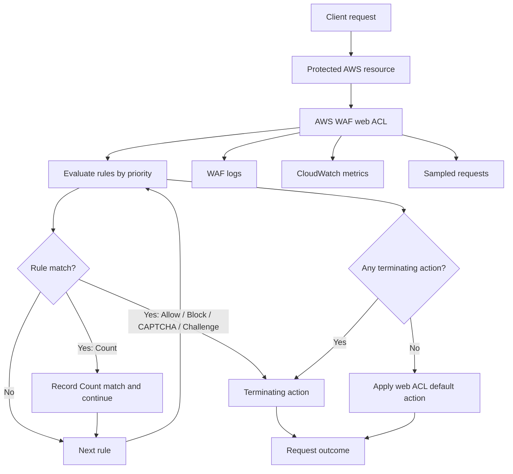
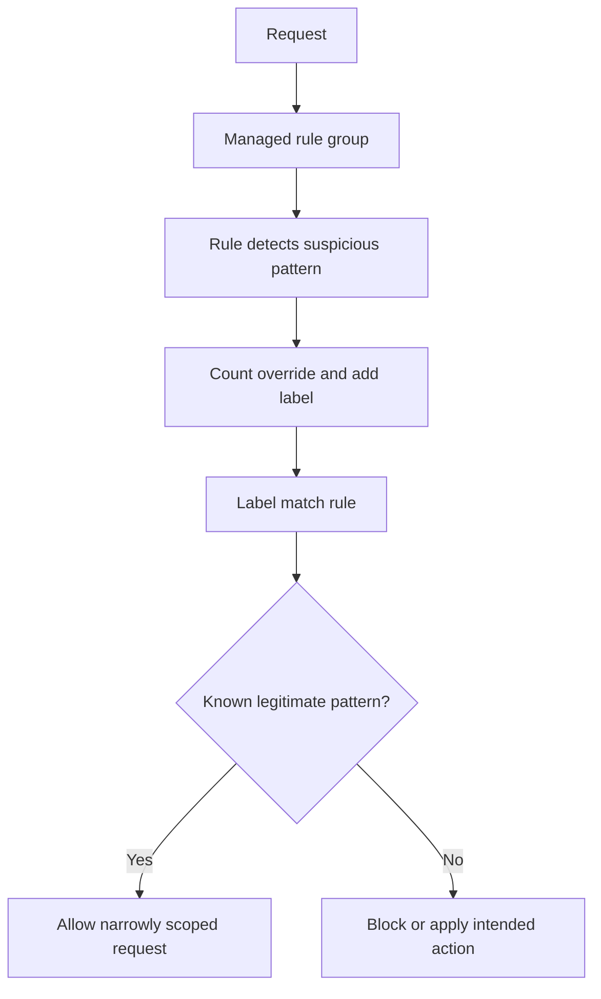

# Kiểm thử WAF bằng count mode và phân tích log

## 1. Vì sao cần kiểm thử AWS WAF trước khi bật chặn?

AWS WAF bảo vệ ứng dụng web bằng cách đánh giá request theo các rule được cấu hình trong web ACL (protection pack). Một rule có thể phát hiện SQL injection, cross-site scripting (XSS), địa chỉ IP đáng ngờ, bot, lưu lượng vượt ngưỡng hoặc mẫu request không phù hợp với chính sách.

Nếu bật hành động Block ngay khi triển khai rule mới, request hợp lệ có thể bị chặn do rule nhận diện nhầm. Điều này thường xảy ra khi ứng dụng có payload đặc thù, API nhận dữ liệu tự do, tích hợp bên thứ ba hoặc header/query string có định dạng khác dự kiến.

AWS WAF cung cấp hành động **Count** để quan sát rule match mà không để chính rule đó quyết định chặn hay cho phép request. Nhờ vậy, đội bảo mật có thể kiểm tra hành vi trên traffic thật, phân tích log, xác định false positive và điều chỉnh điều kiện trước khi bật hành động production.

Count mode là một giai đoạn kiểm thử quan trọng trong vòng đời triển khai WAF:

1. Xây dựng rule hoặc chọn managed rule group.
2. Kiểm thử trong staging với dữ liệu đại diện.
3. Chuyển rule mới sang Count để quan sát traffic production.
4. Phân tích metrics, logs và sampled requests.
5. Điều chỉnh điều kiện, exception hoặc scope.
6. Chuyển rule đã được xác minh sang Block, CAPTCHA hoặc Challenge theo mục tiêu.
7. Tiếp tục giám sát sau khi triển khai.

Bài học thuộc module **CLOUD_PROVIDERS_AWS**, nơi người học rèn khả năng chọn dịch vụ, thiết kế và triển khai ứng dụng an toàn, có khả năng giám sát, phục hồi và kiểm soát chi phí. Trọng tâm ở đây là dùng dữ liệu thực tế để kiểm chứng chính sách bảo vệ ứng dụng trước khi áp dụng hành động có thể ảnh hưởng người dùng.

## 2. Mục tiêu học tập

Sau bài học, người học có thể:

1. Giải thích Count là hành động non-terminating và phân biệt nó với Allow, Block, CAPTCHA và Challenge.
2. Giải thích thứ tự đánh giá rule và tác động của default action trong web ACL.
3. Chuyển custom rule và managed rule group sang Count đúng cách.
4. Phân biệt RuleActionOverrides với OverrideAction của rule group.
5. Chuẩn bị môi trường staging, logging, CloudWatch metrics và request sampling.
6. Đọc các trường quan trọng trong AWS WAF log để tìm rule match, terminating action và request context.
7. Dùng CloudWatch Logs Insights để phân tích Count matches, Block events, URI, client IP và rule group.
8. Phát hiện false positive, điều chỉnh inspection criteria và tạo exception có phạm vi hẹp.
9. Chuyển rule từ Count sang hành động production với kế hoạch rollout và rollback.
10. Bảo vệ dữ liệu nhạy cảm, quản lý chi phí và xây dựng checklist kiểm thử WAF.

## 3. Kiến trúc và luồng đánh giá request

AWS WAF có thể bảo vệ các resource được hỗ trợ như Amazon CloudFront, Application Load Balancer, API Gateway REST API, AppSync, Cognito user pool, App Runner và Verified Access. Phạm vi liên kết phụ thuộc loại resource và cấu hình web ACL.

Khi request đến resource được bảo vệ:

1. Resource chuyển request đến AWS WAF để đánh giá.
2. AWS WAF kiểm tra rule theo thứ tự priority tăng dần, bắt đầu từ số priority nhỏ nhất.
3. Rule có thể không match, match với Count hoặc match với một terminating action.
4. Khi một terminating action xuất hiện, quá trình đánh giá dừng lại.
5. Nếu không có rule nào kết thúc quá trình, web ACL áp dụng default action.
6. AWS WAF có thể ghi log, phát metrics và cung cấp sampled requests cho request đã đánh giá.

Sơ đồ tổng quan:



Count mode giúp quan sát kết quả match trong quá trình đánh giá. Logs và metrics cho biết rule nào match; request outcome cuối cùng vẫn phụ thuộc các rule tiếp theo và default action.

## 4. Hiểu chính xác hành động Count

### 4.1. Count là non-terminating action

Khi một rule có action Count match request:

- AWS WAF ghi nhận request match rule.
- Rule không tự quyết định allow hoặc block.
- AWS WAF tiếp tục đánh giá các rule tiếp theo trong web ACL.
- Rule có thể thêm label cho request.
- Request cuối cùng có thể được Allow, Block, CAPTCHA hoặc Challenge bởi một rule khác hoặc default action.

Count khác với các hành động terminating:

| Action | Loại | Hành vi |
|---|---|---|
| Allow | Terminating | Cho request đi tiếp đến resource được bảo vệ và dừng đánh giá rule |
| Block | Terminating | Chặn request; mặc định thường trả HTTP 403 nếu không cấu hình custom response |
| Count | Non-terminating | Ghi nhận match rồi tiếp tục đánh giá rule còn lại |
| CAPTCHA | Có thể terminating hoặc non-terminating | Nếu token hợp lệ thì tiếp tục; nếu token thiếu, sai hoặc hết hạn thì kết thúc và yêu cầu giải CAPTCHA |
| Challenge | Có thể terminating hoặc non-terminating | Nếu token hợp lệ thì tiếp tục; nếu không hợp lệ thì kết thúc và yêu cầu client thực hiện challenge |

### 4.2. Count không có nghĩa là Allow

Giả sử web ACL có ba rule:

| Priority | Rule | Action |
|---:|---|---|
| 10 | Detect SQL injection | Count |
| 20 | Block IP trong deny list | Block |
| 30 | Detect suspicious user agent | Count |
| Default | Default action | Allow |

Một request chứa chuỗi bị rule SQL injection nhận diện và đồng thời đến từ IP trong deny list:

1. Rule priority 10 match và ghi nhận Count.
2. AWS WAF tiếp tục đến rule priority 20.
3. Rule priority 20 match và Block.
4. Rule priority 30 không được đánh giá vì request đã gặp terminating action.
5. Request bị chặn.

Trong log, request có thể xuất hiện Count match trong danh sách non-terminating, nhưng trường action cuối cùng vẫn là BLOCK và terminatingRuleId chỉ ra rule deny list.

Nếu request chỉ match rule Count và không gặp terminating action khác, web ACL sẽ áp dụng default action. Với default Allow, request được cho qua. Với default Block, request bị chặn.

### 4.3. Count mode có thể tạo nhiều match hơn production

Khi nhiều rule được đặt ở Count, request tiếp tục đi qua các rule sau. Vì vậy, một request có thể match nhiều rule trong cùng một lần đánh giá.

Khi chuyển các rule sang Block hoặc Allow, một terminating action có thể dừng quá trình trước khi request đến những rule sau. Do đó:

- Số Count matches trong giai đoạn kiểm thử thường cao hơn số rule matches quan sát được sau khi bật production actions.
- Không so sánh trực tiếp Count metrics với số request bị Block sau triển khai.
- Cần đọc priority, terminatingRuleId và nonTerminatingMatchingRules cùng nhau.

### 4.4. Priority ảnh hưởng dữ liệu kiểm thử

AWS WAF đánh giá rule theo priority số nhỏ trước, số lớn sau. Một rule Allow hoặc Block ở priority thấp hơn có thể kết thúc đánh giá trước khi rule Count ở phía sau chạy.

Nếu muốn đo một rule mới trên traffic mà các rule khác có thể kết thúc sớm, hãy thiết kế vị trí priority phù hợp trong môi trường thử nghiệm. Tuy nhiên, thay đổi thứ tự rule có thể ảnh hưởng chính sách production; cần kiểm thử toàn bộ luồng và giữ nguyên thứ tự bảo vệ đã được phê duyệt.

## 5. Các cấp độ chuyển sang Count

Có ba trường hợp phổ biến.

### 5.1. Custom rule trong web ACL

Với rule do tổ chức tự tạo, đặt action thành Count trong cấu hình rule. Rule sẽ ghi nhận match và tiếp tục đánh giá.

Ví dụ JSON rút gọn:

Đây là cấu trúc minh họa cho rule trong web ACL. Nếu gửi cấu hình bằng AWS CLI v2 với SearchString là văn bản thuần, thêm tùy chọn --cli-binary-format raw-in-base64-out; CLI sẽ xử lý blob theo định dạng đầu vào. Nếu gọi AWS WAF API trực tiếp, SearchString phải là giá trị base64-encoded.

```json
{
  "Name": "DetectSuspiciousQuery",
  "Priority": 20,
  "Action": {
    "Count": {}
  },
  "Statement": {
    "ByteMatchStatement": {
      "SearchString": "union select",
      "FieldToMatch": {
        "QueryString": {}
      },
      "TextTransformations": [
        {
          "Priority": 0,
          "Type": "URL_DECODE"
        },
        {
          "Priority": 1,
          "Type": "LOWERCASE"
        }
      ],
      "PositionalConstraint": "CONTAINS"
    }
  },
  "VisibilityConfig": {
    "SampledRequestsEnabled": true,
    "CloudWatchMetricsEnabled": true,
    "MetricName": "DetectSuspiciousQuery"
  }
}
```

Đây là ví dụ minh họa về cấu trúc rule. Rule production cần kiểm thử trên request hợp lệ và độc hại, đánh giá cách chuẩn hóa dữ liệu, và xem xét việc match một chuỗi SQL phổ biến có thể tạo false positive hay không.

### 5.2. Managed rule group: override từng rule sang Count

AWS Managed Rules và các managed rule group khác chứa nhiều rule con. Có thể override action của một hoặc nhiều rule con sang Count trong cấu hình tham chiếu rule group của web ACL.

Đây là cách phù hợp khi muốn biết chính xác rule con nào trong managed rule group đang match traffic nhưng chưa muốn rule đó block request.

Ví dụ rút gọn:

```json
{
  "Name": "AWSManagedRulesCommonRuleSet",
  "Priority": 100,
  "Statement": {
    "ManagedRuleGroupStatement": {
      "VendorName": "AWS",
      "Name": "AWSManagedRulesCommonRuleSet",
      "RuleActionOverrides": [
        {
          "Name": "SizeRestrictions_BODY",
          "ActionToUse": {
            "Count": {}
          }
        },
        {
          "Name": "CrossSiteScripting_BODY",
          "ActionToUse": {
            "Count": {}
          }
        }
      ]
    }
  },
  "OverrideAction": {
    "None": {}
  },
  "VisibilityConfig": {
    "SampledRequestsEnabled": true,
    "CloudWatchMetricsEnabled": true,
    "MetricName": "CommonRuleSet"
  }
}
```

Tên rule con phải chính xác và phân biệt chữ hoa/chữ thường. Với managed rule group, AWS WAF có thể bỏ qua một override nếu tên rule không tồn tại hoặc không khớp chính xác; cấu hình vẫn có thể được lưu nên cần kiểm tra lại kết quả thực tế trong log và metrics.

### 5.3. Override toàn bộ rule group sang Count

Trong console có tùy chọn override tất cả rule actions trong rule group sang Count. Cách này hữu ích khi muốn thử nghiệm cả group, nhưng cần hiểu rằng mọi rule con sẽ không thực hiện action ban đầu của nó.

Khi kiểm thử managed rule group, thường nên ưu tiên override đúng các rule con đang cần đánh giá, giữ các rule đã tin cậy ở action hiện hành. Nếu đang thử toàn bộ group, hãy làm điều đó trong staging trước và xác định tác động khi chạy Count với production traffic.

### 5.4. Phân biệt RuleActionOverrides và OverrideAction.Count

Đây là điểm dễ cấu hình sai nhất.

| Cấu hình | Tác dụng | Có phù hợp để kiểm thử từng rule con? |
|---|---|---|
| RuleActionOverrides với ActionToUse.Count | Thay action của rule con thành Count | Có |
| OverrideAction.Count ở cấp rule group | Chỉ đổi action cuối cùng mà rule group trả về khi có terminating match | Không |
| Action.Count trên custom rule | Đặt rule đó thành Count | Có |

OverrideAction.Count không làm các rule con bên trong group chuyển sang Count. Rule group vẫn đánh giá như bình thường và có thể dừng tại rule con Block đầu tiên; chỉ kết quả cuối cùng của group được đổi thành Count khi trả về web ACL. Vì vậy, cấu hình này không cho thấy toàn bộ rule con có thể match trong quá trình test.

AWS khuyến nghị dùng RuleActionOverrides nếu mục tiêu là kiểm thử hành vi của từng rule trong rule group.

### 5.5. Rule group do tổ chức quản lý

Nếu nhiều web ACL dùng chung một custom rule group, không nên sửa action của rule trực tiếp trong rule group chỉ để thử nghiệm một web ACL. Thay đổi đó có thể ảnh hưởng mọi web ACL đang tham chiếu.

Hãy đặt RuleActionOverrides ở cấu hình tham chiếu rule group trong web ACL cần thử. Cách này giới hạn phạm vi thay đổi và giữ được metrics/artifacts phục vụ kiểm thử.

## 6. Chiến lược kiểm thử theo từng giai đoạn

AWS khuyến nghị kiểm thử thay đổi WAF trong môi trường test/staging trước, sau đó kiểm thử ở Count mode với production traffic rồi mới bật hành động production.

Một quy trình thực tế:

| Giai đoạn | Môi trường | Hành động | Kết quả mong đợi |
|---|---|---|---|
| 1. Thiết kế | Dev | Xây dựng rule, xác định match component và priority | Rule có mục tiêu rõ ràng |
| 2. Kiểm thử chức năng | Staging | Gửi request hợp lệ và request mô phỏng tấn công | Biết rule match đúng và không match nhầm |
| 3. Quan sát | Staging | Bật Count, logs, metrics và sampling | Có dữ liệu đủ để điều chỉnh |
| 4. Kiểm chứng thực tế | Production | Đặt rule mới ở Count, theo dõi traffic đại diện | Phát hiện false positive và tác động tiềm ẩn |
| 5. Kích hoạt | Production | Chuyển từng rule hoặc nhóm rule sang action mục tiêu | Bảo vệ tăng lên có kiểm soát |
| 6. Theo dõi | Production | Quan sát metrics, logs, ứng dụng và phản hồi người dùng | Xác nhận rule hoạt động như dự kiến |

Trong web ACL mới đang thử nghiệm, có thể đặt default action là Allow và các rule mới ở Count để quan sát mà không làm gián đoạn traffic. Khi kiểm thử trên web ACL production đang hoạt động, giữ các rule bảo vệ đã được xác minh và chỉ chuyển phần rule mới cần kiểm tra sang Count.

Không chuyển toàn bộ web ACL production sang default Allow chỉ để quan sát một rule mới.

## 7. Chuẩn bị bộ dữ liệu kiểm thử

Một bộ kiểm thử WAF phải bao gồm cả traffic hợp lệ và traffic có dấu hiệu tấn công.

### 7.1. Request hợp lệ

Thu thập từ ứng dụng:

- Trang đăng nhập, đăng ký và khôi phục mật khẩu.
- API tìm kiếm và lọc dữ liệu.
- API nhận JSON body lớn hoặc nội dung có ký tự đặc biệt.
- Upload/download nếu ứng dụng hỗ trợ.
- API webhook và tích hợp đối tác.
- Các request có query string, cookie, header đặc thù.
- Luồng mobile app, SPA, background jobs và health checks.

### 7.2. Request mô phỏng tấn công trong staging

Ví dụ an toàn để kiểm tra rule SQLi/XSS trong môi trường do tổ chức kiểm soát:

```bash
curl -i "https://staging.example.com/search?q=hello"

curl -i "https://staging.example.com/search?q=1%20OR%201%3D1"

curl -i \
  -H "Content-Type: application/json" \
  -d '{"comment":"<script>alert(1)</script>"}' \
  "https://staging.example.com/api/comments"
```

Các payload này chỉ dùng trên endpoint staging được phép kiểm thử. Không gửi payload kiểm thử đến hệ thống của bên thứ ba hoặc endpoint production khi chưa có kế hoạch và quyền phù hợp.

### 7.3. Ma trận kết quả mong đợi

| Nhóm request | Rule dự kiến match | Kết quả khi Count | Kiểm tra bổ sung |
|---|---|---|---|
| Search bình thường | Không match SQLi | Không có Count match | Ứng dụng trả kết quả bình thường |
| Search có chuỗi SQLi mô phỏng | SQLi rule | Count | Log chỉ ra rule và match detail |
| Comment chứa markup hợp lệ | Có thể bị XSS rule nhận diện | Count để phân tích | Xác định nghiệp vụ có cần cho phép markup |
| Request thiếu header bắt buộc | Rule kiểm tra header | Count hoặc không match tùy điều kiện | Kiểm tra client thực tế |
| Request vượt ngưỡng | Rate-based rule | Count | Kiểm tra aggregation key và thời gian |

Không nên kỳ vọng mọi payload mô phỏng đều match một managed rule cụ thể. Rule group, phiên bản và inspection settings quyết định kết quả; hãy xem log để xác nhận.

## 8. Bật metrics, logging và request sampling

AWS khuyến nghị chuẩn bị đồng thời ba nguồn quan sát:

- **CloudWatch metrics**: đo số lượng request theo action, rule, rule group và label.
- **AWS WAF logs**: lưu chi tiết request, rule match và kết quả đánh giá.
- **Sampled requests**: cung cấp một mẫu request để xem nhanh nội dung và rule match trong console.

Ba nguồn bổ sung cho nhau. Metrics cho xu hướng, logs cho chi tiết từng request, sampled requests hỗ trợ kiểm tra nhanh một số ví dụ.

### 8.1. CloudWatch metrics

AWS WAF phát metrics trong namespace AWS/WAFV2 và báo cáo khoảng một lần mỗi phút.

Các metric thường dùng:

| Metric | Ý nghĩa |
|---|---|
| AllowedRequests | Số request được Allow |
| BlockedRequests | Số request bị Block |
| CountedRequests | Số request được ít nhất một Count rule match |
| CaptchaRequests | Số request có CAPTCHA action |
| ChallengeRequests | Số request có Challenge action |
| PassedRequests | Request đi qua rule group mà không match rule con nào |

Dùng statistic Sum khi xem số request trong khoảng thời gian. Đặt dimension theo WebACL, Rule, RuleGroup, Region và resource phù hợp.

Một số giới hạn cần nhớ:

- Metric chỉ được phát khi có giá trị khác 0.
- Count rule trong managed rule group có thể không xuất metric với dimension WebACL; chỉ có dimension Rule, RuleGroup và Region theo cách AWS công bố.
- Rule group thuộc account khác thường có metric riêng do chủ sở hữu quản lý; override action ở web ACL có thể làm metric của rule được hiển thị dưới metrics của web ACL.
- Label metrics giúp quan sát nhãn do rule group hoặc custom rule thêm vào.

### 8.2. Request sampling

AWS WAF có thể lấy mẫu request đã được đánh giá. API GetSampledRequests cho phép lấy tối đa 500 request từ tối đa 5.000 request đầu tiên mà resource nhận trong time range đã chọn, trong phạm vi ba giờ gần nhất.

Sampling có giới hạn:

- Đây là mẫu ngẫu nhiên, không phải toàn bộ traffic.
- Số request mẫu không thể thay thế logging đầy đủ khi cần phân tích xu hướng hoặc điều tra.
- Dữ liệu request sampling chịu ảnh hưởng của web ACL data protection.
- Logging redaction không tự động áp dụng cho sampled requests.

Dùng sampling để xác minh một vài request đại diện, sau đó dùng logs để phân tích đầy đủ hơn.

## 9. AWS WAF logging destinations

AWS WAF hỗ trợ ba đích ghi log:

| Destination | Phù hợp khi | Điểm cần chú ý |
|---|---|---|
| CloudWatch Logs | Phân tích nhanh, Logs Insights, dashboard và alarm | Log group cùng account/Region với web ACL |
| Amazon S3 | Lưu trữ dài hạn, Athena, data lake và điều tra lịch sử | Bucket cùng account, tên bắt đầu bằng aws-waf-logs-, file nén |
| Amazon Data Firehose | Streaming đến S3 hoặc đích phân tích downstream | Delivery stream cùng account/Region, Direct PUT |

Một web ACL chỉ cấu hình một logging destination tại một thời điểm. Nếu cần phân phối đến nhiều hệ thống, có thể dùng Firehose hoặc pipeline downstream để fan-out dữ liệu.

### 9.1. Quy tắc đặt tên destination

Tên destination phải bắt đầu bằng tiền tố:

- CloudWatch Logs log group: aws-waf-logs-
- S3 bucket: aws-waf-logs-
- Data Firehose delivery stream: aws-waf-logs-

Với CloudWatch Logs, log group phải nằm trong cùng account và Region quản lý web ACL. Với web ACL CloudFront, cấu hình global được quản lý qua Region US East (N. Virginia), vì vậy cần kiểm tra Region của destination tương ứng.

### 9.2. CloudWatch Logs

Khi bật logging, AWS WAF gửi log vào log streams bên trong log group. Có thể mở tab Logging insights của web ACL hoặc dùng CloudWatch Logs Insights.

Log group phải được tạo trước và tên bắt đầu bằng aws-waf-logs-. Khi bật logging thành công, AWS WAF tạo service-linked role/quyền log delivery cần thiết.

CloudWatch Logs có quota throughput dùng chung theo Region. Nếu volume log cao, theo dõi throttling của PutLogEvents và yêu cầu tăng quota nếu cần.

### 9.3. Amazon S3

AWS WAF gửi log file đến S3 theo khoảng thời gian năm phút. File được nén; khi tải về cần giải nén để đọc. Một chu kỳ có thể tạo nhiều file và log delivery là best effort.

Cấu trúc prefix thường có dạng:

```text
AWSLogs/<account-id>/WAFLogs/<region>/<web-acl-name>/YYYY/MM/dd/HH/mm/
```

S3 là lựa chọn phù hợp cho retention dài hạn và truy vấn bằng Athena. Có thể dùng lifecycle để chuyển lớp lưu trữ hoặc hết hạn theo chính sách. Với SSE-KMS, AWS WAF cần quyền sử dụng customer managed key theo tài liệu logging destination.

### 9.4. Amazon Data Firehose

Firehose phù hợp khi cần streaming đến S3, OpenSearch hoặc đích phân tích được hỗ trợ. AWS WAF yêu cầu delivery stream cùng account và Region với web ACL; với CloudFront, Firehose phải ở us-east-1. Delivery stream cần cấu hình Direct PUT, không dùng Kinesis Data Streams làm source.

Ước lượng throughput dựa trên request rate thực tế. Một WAF log tương ứng một Firehose record; nếu Firehose không đủ throughput, log có thể không được ghi đầy đủ.

## 10. Bật logging bằng AWS CLI

Trước tiên tạo CloudWatch Logs log group:

```bash
aws logs create-log-group \
  --log-group-name aws-waf-logs-orders-staging \
  --region ap-southeast-1
```

Tạo file waf-logging.json:

```json
{
  "ResourceArn": "arn:aws:wafv2:ap-southeast-1:111122223333:regional/webacl/orders-staging/11111111-2222-3333-4444-555555555555",
  "LogDestinationConfigs": [
    "arn:aws:logs:ap-southeast-1:111122223333:log-group:aws-waf-logs-orders-staging"
  ],
  "RedactedFields": [
    {
      "SingleHeader": {
        "Name": "authorization"
      }
    }
  ]
}
```

Bật logging:

```bash
aws wafv2 put-logging-configuration \
  --logging-configuration file://waf-logging.json \
  --region ap-southeast-1
```

Kiểm tra cấu hình:

```bash
aws wafv2 get-logging-configuration \
  --resource-arn arn:aws:wafv2:ap-southeast-1:111122223333:regional/webacl/orders-staging/11111111-2222-3333-4444-555555555555 \
  --region ap-southeast-1
```

Các giá trị account ID, Region, web ACL ARN và log group trong ví dụ là giả lập. Với web ACL CloudFront, scope và Region cần theo cấu hình global của AWS WAF. IAM principal dùng để cấu hình logging cần quyền WAF logging và quyền tạo log delivery/resource policy tương ứng.

## 11. Cấu trúc AWS WAF log và các trường quan trọng

Một log record thường là JSON. Các trường quan trọng:

| Field | Ý nghĩa |
|---|---|
| timestamp | Thời điểm AWS WAF ghi nhận request, dạng milliseconds |
| webaclId | ARN/ID của web ACL |
| action | Terminating action cuối cùng áp dụng cho request |
| terminatingRuleId | Rule kết thúc đánh giá; nếu không có terminating rule thì là Default_Action |
| terminatingRuleType | Loại rule kết thúc: REGULAR, GROUP, RATE_BASED hoặc MANAGED_RULE_GROUP |
| terminatingRuleMatchDetails | Chi tiết match của terminating rule; chủ yếu có cho SQLi/XSS |
| nonTerminatingMatchingRules | Các rule match nhưng không kết thúc đánh giá, bao gồm Count |
| ruleGroupList | Các rule group đã đánh giá và kết quả match bên trong |
| labels | Các label được thêm trong quá trình đánh giá |
| httpRequest.clientIp | IP client |
| httpRequest.country | Quốc gia nguồn request |
| httpRequest.uri | URI path |
| httpRequest.args | Query string |
| httpRequest.httpMethod | HTTP method |
| httpRequest.headers | Header được ghi nhận |
| httpRequest.requestId | Request ID từ resource bảo vệ |
| oversizeFields | Request component vượt giới hạn inspection khi được rule kiểm tra |
| rateBasedRuleList | Các rate-based rule được đánh giá và thông tin liên quan |

Không phải mọi field đều xuất hiện trong mọi log record. Ví dụ clientAsn chỉ xuất hiện khi có ASN match statement; terminatingRuleMatchDetails chỉ được điền cho SQL injection và XSS match rule statements.

### 11.1. Count match nằm ở đâu?

Rule có action Count là non-terminating. Match được ghi trong nonTerminatingMatchingRules, ví dụ:

```json
{
  "timestamp": 1795152000000,
  "formatVersion": 1,
  "webaclId": "arn:aws:wafv2:ap-southeast-1:111122223333:regional/webacl/orders-staging/example",
  "terminatingRuleId": "Default_Action",
  "terminatingRuleType": "REGULAR",
  "action": "ALLOW",
  "nonTerminatingMatchingRules": [
    {
      "ruleId": "DetectSQLiCount",
      "action": "COUNT",
      "ruleMatchDetails": [
        {
          "conditionType": "SQL_INJECTION",
          "location": "QUERY_STRING",
          "matchedData": ["union", "select"]
        }
      ]
    }
  ],
  "httpRequest": {
    "clientIp": "203.0.113.25",
    "country": "-",
    "uri": "/search",
    "args": "q=example",
    "httpMethod": "GET",
    "requestId": "request-example"
  },
  "labels": []
}
```

Ví dụ này minh họa một Count rule match và không có terminating rule khác. Vì default action là Allow, action cuối cùng là ALLOW và terminatingRuleId là Default_Action.

### 11.2. Count match nhưng cuối cùng vẫn Block

Một request có thể match Count rule trước rồi bị Block bởi rule sau. Khi đó:

- nonTerminatingMatchingRules chứa rule Count.
- action là BLOCK.
- terminatingRuleId chỉ ra rule Block.
- Request không được chuyển đến ứng dụng.

Không dùng action field đơn lẻ để xác định rule nào đang được thử nghiệm. Hãy kiểm tra cả nonTerminatingMatchingRules và terminatingRuleId.

### 11.3. Managed rule group trong log

Với rule group, log có thể chứa ruleGroupList. Bên trong mỗi group có terminatingRule và nonTerminatingMatchingRules.

Nếu một rule con được override sang Count, hãy tìm ruleId và action COUNT trong non-terminating list. Với override mới, trường overriddenAction có thể ghi action cấu hình ban đầu của rule group rule. Các cấu hình legacy ExcludedRules có thể hiển thị qua excludedRules; khi quản lý mới, AWS khuyến nghị dùng RuleActionOverrides.

## 12. Phân tích log bằng CloudWatch Logs Insights

CloudWatch Logs Insights tự động phát hiện nhiều field trong JSON log và hỗ trợ dot notation để truy vấn field lồng nhau.

Trước khi truy vấn:

1. Chọn đúng log group có tiền tố aws-waf-logs-.
2. Chọn khoảng thời gian ngắn nhất đủ để trả lời câu hỏi.
3. Xác nhận đúng web ACL, Region và resource.
4. Chạy truy vấn với limit nhỏ trước.
5. Lưu query thường dùng thành query definition để tái sử dụng.

### 12.1. Xem các request gần đây có Count matches

```text
fields @timestamp,
       action,
       terminatingRuleId,
       httpRequest.clientIp,
       httpRequest.httpMethod,
       httpRequest.uri,
       nonTerminatingMatchingRules
| filter ispresent(nonTerminatingMatchingRules)
| sort @timestamp desc
| limit 100
```

Truy vấn trả về các request có ít nhất một non-terminating match. Danh sách này có thể gồm Count và một số CAPTCHA/Challenge match không kết thúc khi token hợp lệ. Hãy xem action bên trong từng phần tử để xác định Count.

### 12.2. Đếm số match theo từng Count rule

Dùng jsonParse và unnest để tách từng phần tử của nonTerminatingMatchingRules thành một record:

```text
fields jsonParse(@message) as waf
| unnest waf.nonTerminatingMatchingRules into match
| filter match.action = "COUNT"
| stats count() as matches by match.ruleId
| sort matches desc
| limit 50
```

Truy vấn này giúp xếp hạng rule có nhiều match nhất trong khoảng thời gian đã chọn. Nếu rule có volume lớn, cần xem tiếp endpoint và request context để xác định đó là traffic hợp lệ hay tấn công.

### 12.3. Xem URI thường bị Count rule match

```text
fields jsonParse(@message) as waf
| unnest waf.nonTerminatingMatchingRules into match
| filter match.action = "COUNT"
| stats count() as matches by match.ruleId, waf.httpRequest.uri
| sort matches desc
| limit 50
```

Dùng kết quả để xác định endpoint cụ thể có false positive. Ví dụ rule SQLi match nhiều ở endpoint tìm kiếm nhưng payload thực tế là chuỗi tìm kiếm hợp lệ.

### 12.4. Phân tích request bị Block theo terminating rule

```text
fields @timestamp,
       action,
       terminatingRuleId,
       terminatingRuleType,
       httpRequest.clientIp,
       httpRequest.country,
       httpRequest.httpMethod,
       httpRequest.uri
| filter action = "BLOCK"
| stats count() as blocked by terminatingRuleId
| sort blocked desc
```

Truy vấn giúp xác định rule nào đang chặn nhiều request nhất. Sau đó chạy truy vấn chi tiết:

```text
fields @timestamp,
       terminatingRuleId,
       httpRequest.clientIp,
       httpRequest.httpMethod,
       httpRequest.uri,
       httpRequest.args,
       terminatingRuleMatchDetails
| filter action = "BLOCK"
| sort @timestamp desc
| limit 100
```

### 12.5. Theo dõi Count matches theo thời gian

```text
fields jsonParse(@message) as waf
| unnest waf.nonTerminatingMatchingRules into match
| filter match.action = "COUNT"
| stats count() as matches by match.ruleId, bin(5m) as interval
| sort interval asc
```

Dùng biểu đồ để quan sát số match tăng đột biến theo từng rule. Đối chiếu thời điểm với deployment, chiến dịch marketing, crawler hợp lệ hoặc đợt tấn công.

### 12.6. Tìm request có field vượt giới hạn inspection

```text
fields @timestamp,
       httpRequest.clientIp,
       httpRequest.uri,
       oversizeFields,
       terminatingRuleId,
       action
| filter ispresent(oversizeFields)
| sort @timestamp desc
| limit 100
```

Nếu body/header/cookie vượt giới hạn inspection, cần xem rule xử lý oversize component theo cấu hình nào. Không được kết luận request đã được kiểm tra đầy đủ chỉ vì rule không match.

## 13. Phân tích bằng Amazon Athena khi lưu log trên S3

Nếu log được lưu trong S3, Athena có thể truy vấn trực tiếp bằng SQL sau khi tạo bảng phù hợp với schema AWS WAF log.

Các bước khái quát:

1. Lưu log trong bucket có tiền tố aws-waf-logs-.
2. Tạo database và table theo schema log hiện hành.
3. Partition theo account, Region, web ACL và ngày nếu tổ chức dùng partition projection hoặc crawler phù hợp.
4. Chạy truy vấn giới hạn partition và thời gian.
5. Lưu query result và kiểm soát quyền truy cập dữ liệu.

Ví dụ SQL sau khi đã có bảng tên waf_logs:

```sql
SELECT
    terminatingruleid,
    action,
    COUNT(*) AS request_count
FROM waf_logs
WHERE year = '2026'
  AND month = '11'
  AND day = '20'
  AND action = 'BLOCK'
GROUP BY terminatingruleid, action
ORDER BY request_count DESC;
```

Tên cột, kiểu dữ liệu và partition key phải khớp với DDL thực tế. Không copy query trước khi kiểm tra schema table; một số cấu trúc JSON có thể được khai báo dưới dạng array hoặc struct.

Athena phù hợp với phân tích lịch sử dài hạn, so sánh nhiều ngày và tạo báo cáo. Logs Insights thuận tiện hơn cho điều tra tương tác trên CloudWatch Logs.

## 14. Phát hiện và xử lý false positive

False positive xảy ra khi rule nhận diện request hợp lệ là đáng ngờ. Trong giai đoạn Count, cần xác định nguyên nhân trước khi chuyển sang Block.

### 14.1. Phân tích theo từng request

Với mỗi match đáng chú ý, ghi lại:

- Rule ID và rule group.
- Match component: URI, query string, body, cookie hay header.
- Text transformation và thứ tự transformation.
- Matched data nếu được cung cấp.
- Endpoint, method và loại nghiệp vụ.
- Client IP, country và user agent.
- Request ID để đối chiếu application/access log.
- Kết quả cuối cùng của web ACL.
- Có oversizeFields hay không.

Matched data không phải lúc nào cũng xuất hiện. AWS WAF chỉ cung cấp match details cho một số loại rule, đặc biệt là SQLi và XSS. Khi thiếu match detail, dùng request sample và application logs để điều tra.

### 14.2. Điều chỉnh inspection criteria

Với custom rule, cân nhắc:

- Kiểm tra đúng request component.
- Điều chỉnh text transformation để chuẩn hóa encoding và chữ hoa/thường.
- Dùng regex pattern set có phạm vi cụ thể.
- Thay đổi positional constraint.
- Giới hạn method hoặc URI nếu chỉ một endpoint cần kiểm tra.
- Điều chỉnh oversize handling để phù hợp dữ liệu ứng dụng.
- Kiểm tra forwarded IP configuration nếu dùng IP match hoặc rate-based rule.

Không nới lỏng toàn bộ rule chỉ vì một endpoint có false positive. Hãy xác định phần request gây match và điều chỉnh phạm vi hẹp nhất.

### 14.3. Mitigating rule và exception

Một số cách xử lý:

- Thêm rule Allow có priority thấp hơn (được đánh giá trước) để cho phép một nhóm request hợp lệ cụ thể.
- Kết hợp logical statement để loại trừ mẫu false positive khỏi điều kiện phát hiện.
- Dùng scope-down statement trong managed rule group hoặc rate-based rule để giới hạn request được đánh giá.
- Dùng label match rule sau managed rule group để phân loại và xử lý riêng một nhóm match.
- Chuyển một rule con của managed group sang Count vĩnh viễn nếu có lý do rõ ràng và được chấp thuận.
- Với managed rule group có version, cân nhắc quay lại phiên bản đã xác minh trong khi thử phiên bản mới ở staging.

Mỗi exception cần có owner, lý do, phạm vi, ngày hết hạn hoặc lịch review. Tránh tạo Allow rộng theo IP hoặc URI chỉ để làm biến mất một false positive.

### 14.4. Scope-down statement

Scope-down statement thu hẹp tập request mà managed rule group hoặc rate-based rule đánh giá. Request không match scope-down statement sẽ không được đưa vào phần đánh giá bên trong.

Ví dụ: chỉ đánh giá một managed rule group trên các endpoint đăng nhập và API công khai thay vì toàn bộ static assets.

Scope-down statement không phải bộ tiền xử lý request cho rule group. Text transformation trong scope-down chỉ áp dụng khi đánh giá scope-down; rule bên trong vẫn dùng inspection settings riêng.

## 15. Label và rule tùy chỉnh sau managed rule group

Managed rule group có thể thêm label để mô tả loại match. Label có thể được dùng bởi rule sau đó trong cùng web ACL nếu rule group không kết thúc việc đánh giá.

Một chiến lược thường dùng:

1. Override một rule con của managed group sang Count.
2. Quan sát label mà rule con thêm vào.
3. Tạo label match rule sau rule group.
4. Phân loại request theo nghiệp vụ.
5. Allow một nhóm false positive rất cụ thể hoặc Block phần còn lại.
6. Giữ override Count cho rule con nếu muốn tiếp tục quản lý bằng label rule.

Sơ đồ:



Label là tín hiệu phân loại trong quá trình đánh giá request; label không tự tồn tại như một quyết định Allow/Block. Action của rule và thứ tự priority vẫn quyết định luồng xử lý.

## 16. Chuyển từ Count sang production action

Chỉ chuyển rule sang production khi đã có dữ liệu đủ đại diện và owner chấp thuận.

### 16.1. Tiêu chí sẵn sàng

- Đã quan sát qua chu kỳ traffic đại diện, bao gồm giờ cao điểm và batch jobs.
- Có mẫu request hợp lệ và mẫu mô phỏng tấn công.
- False positive đã được phân tích và xử lý.
- Exception có phạm vi hẹp, owner và thời hạn.
- Application owner xác nhận không ảnh hưởng luồng nghiệp vụ.
- Metrics/logs có thể phát hiện tăng Block bất thường.
- Có kế hoạch rollback và người trực xử lý.

Không đặt một con số Count match duy nhất làm điều kiện chuyển production. Tỷ lệ match phải được đánh giá theo endpoint, rule, loại client và tác động nghiệp vụ.

### 16.2. Bật action production

Khi chuyển:

- Custom rule: đổi Action.Count thành Block hoặc action mục tiêu.
- Managed rule group: bỏ RuleActionOverrides cho rule muốn dùng action gốc; giữ override Count cho rule con được miễn trừ có chủ đích.
- Web ACL mới: chuyển default action từ Allow thử nghiệm sang default action production.
- Xóa test rules không còn cần thiết.
- Giữ label match rule nếu chúng là một phần của thiết kế production.

Bật từng nhóm thay đổi có kiểm soát. Nếu có thể, bắt đầu từ một ứng dụng hoặc phạm vi endpoint nhỏ, sau đó mở rộng khi metrics và application health ổn định.

### 16.3. Sau khi bật Block

Theo dõi:

- BlockedRequests theo WebACL và Rule.
- Số 4xx/5xx của ứng dụng và load balancer.
- Tỷ lệ login/search/checkout thất bại.
- Request ID và URI của các case bị chặn.
- Feedback từ người dùng và hệ thống tích hợp.
- Count metrics còn lại của các rule khác.
- Tăng đột biến theo quốc gia, ASN, client IP hoặc user agent.

Metrics WAF phản ánh quyết định tại lớp WAF. Kết hợp với application metrics và access logs để hiểu tác động end-to-end.

## 17. Rollback và xử lý sự cố sau triển khai

Nếu một rule gây chặn nhầm:

1. Xác định rule và phạm vi ảnh hưởng bằng WAF logs.
2. Đối chiếu request ID với log của resource/application.
3. Nếu rule mới là nguyên nhân, chuyển rule đó về Count hoặc bỏ action override phù hợp.
4. Nếu cần, tạo exception hẹp có kiểm soát.
5. Chờ cấu hình WAF propagate đến các điểm xử lý.
6. Kiểm tra request hợp lệ đã đi qua.
7. Ghi lại incident, nguyên nhân, thời gian và thay đổi cần review.

AWS WAF có thời gian propagation từ vài giây đến vài phút sau khi tạo hoặc sửa web ACL/rule. Trong khoảng đó, một số nơi có thể tạm thời dùng cấu hình cũ và nơi khác đã dùng cấu hình mới. Không đánh giá kết quả ngay sau khi nhấn Save; chờ propagation và kiểm tra lại.

Rollback không có nghĩa tắt toàn bộ WAF. Hãy khôi phục action của rule gây vấn đề trong khi giữ nguyên các rule bảo vệ đã được xác minh.

## 18. Bảo vệ dữ liệu nhạy cảm trong log

WAF logs có thể chứa:

- IP address và quốc gia nguồn.
- URI path và query string.
- HTTP headers và user agent.
- Request ID.
- Matched data của một số rule SQLi/XSS.
- Labels và thông tin rule group.

Một số dữ liệu có thể chứa token, email, thông tin tài khoản hoặc dữ liệu cá nhân. Cần thiết kế data protection trước khi bật logging rộng.

### 18.1. Logging redaction

AWS WAF logging redaction hỗ trợ các thành phần:

- URI path.
- Query string.
- Single header.
- HTTP method.

Redaction chỉ áp dụng cho component được cấu hình trong FieldToMatch tương ứng. Ví dụ redaction SingleHeader không tự động che dữ liệu nếu rule dùng Headers component.

Logging redaction chỉ ảnh hưởng dữ liệu gửi đến logging destination; nó không tự động áp dụng cho sampled requests hoặc Security Lake collection.

### 18.2. Web ACL data protection

Data protection ở cấp web ACL có thể áp dụng cho dữ liệu trong logging, request sampling và Security Lake theo cấu hình. Có thể thay thế dữ liệu nhạy cảm bằng chuỗi tĩnh hoặc giá trị hash.

Khi thiết kế:

- Che Authorization, Cookie hoặc header nhạy cảm.
- Hạn chế lưu query string nếu có dữ liệu định danh.
- Kiểm tra matchedData trong SQLi/XSS logs.
- Tách quyền đọc log khỏi quyền quản trị web ACL.
- Dùng retention theo mục đích điều tra.
- Mã hóa log destination và kiểm soát quyền decrypt.
- Tránh ghi log vào bucket hoặc log group public/shared ngoài phạm vi.

## 19. Log filtering và bảo toàn khả năng điều tra

AWS WAF cho phép filter log để chỉ giữ hoặc loại bỏ request theo rule action hoặc fully qualified label.

Một số ví dụ:

- Chỉ giữ request có action BLOCK.
- Giữ cả COUNT và BLOCK để phục vụ giai đoạn kiểm thử.
- Bỏ log của label có độ nhiễu cao nếu đã có phương án quan sát khác.
- Tập trung log theo label bảo mật quan trọng.

Nếu có nhiều filter, AWS WAF đánh giá từ trên xuống. Filter đầu tiên match sẽ quyết định giữ hay bỏ theo cấu hình; cần thiết kế default logging behavior phù hợp.

Không lọc bỏ toàn bộ Count logs trong giai đoạn test. Điều đó làm mất bằng chứng về false positive và khiến số liệu kiểm thử thiếu tin cậy.

Log delivery của AWS WAF là best effort, không bảo đảm 100%. Trong một số tình huống throttling, một số record có thể bị dropped. AWS ưu tiên bảo vệ ứng dụng hơn việc bảo đảm mọi log đều được phân phối. Vì vậy:

- Dùng CloudWatch metrics như tín hiệu tổng hợp bổ sung.
- Không coi WAF log là nguồn audit duy nhất cho mọi request.
- Nếu phát hiện thiếu log hàng loạt, kiểm tra throttling/quota và liên hệ AWS Support khi cần.
- Kết hợp access logs của CloudFront/ALB/API Gateway và application logs.

## 20. Chi phí khi kiểm thử và phân tích log

Các khoản chi phí cần đánh giá:

| Thành phần | Yếu tố ảnh hưởng |
|---|---|
| AWS WAF | Web ACL, rule, request volume, managed rule group và tính năng sử dụng |
| CloudWatch Logs | Log ingestion, storage, query scanned data và retention |
| Amazon S3 | Storage, request, lifecycle và truy vấn downstream |
| Data Firehose | Record throughput, processing và destination |
| Athena | Dữ liệu quét trong mỗi query |
| KMS | Request mã hóa/giải mã và key policy khi dùng SSE-KMS |
| Application observability | Metrics/logs/traces dùng để đối chiếu tác động |

Tối ưu:

1. Chỉ bật logging cho web ACL cần phân tích.
2. Dùng log filtering có chủ đích, nhưng giữ đủ dữ liệu cho giai đoạn Count.
3. Đặt retention CloudWatch Logs phù hợp với thời gian điều tra.
4. Dùng S3 lifecycle cho dữ liệu lịch sử dài hạn.
5. Giới hạn time range và log group khi chạy Logs Insights.
6. Dùng Athena partition để giảm lượng dữ liệu quét.
7. Tránh dashboard refresh quá thường xuyên vì mỗi lần refresh có thể khởi chạy query.
8. Theo dõi volume và throughput trước khi bật full logging trên traffic lớn.

Logging được tính phí riêng ngoài chi phí AWS WAF. Cần ước lượng request volume và retention trước khi bật ghi log đầy đủ cho workload có traffic lớn.

## 21. Khắc phục sự cố thường gặp

### 21.1. Rule Count không có metric

Kiểm tra:

- CloudWatchMetricsEnabled có bật không?
- MetricName có đúng và duy nhất trong phạm vi yêu cầu không?
- Rule có thực sự match request không?
- Đang xem đúng namespace AWS/WAFV2, Region, WebACL và Rule dimension không?
- Managed rule group rule có Count override nhưng metrics bị giới hạn theo dimension không?
- Có rule Allow/Block priority thấp hơn kết thúc đánh giá trước rule Count không?

AWS WAF phát metrics khoảng mỗi phút và không phát metric khi giá trị bằng 0. Chờ một khoảng thời gian đủ để có datapoint.

### 21.2. Không thấy Count match trong log

Kiểm tra:

- Đã bật logging cho đúng web ACL chưa?
- Destination cùng account/Region và có tên bắt đầu bằng aws-waf-logs- không?
- Log filter có loại bỏ action Count không?
- Rule có nằm sau một terminating rule khác không?
- Request có đi qua resource đang gắn web ACL không?
- IAM và service-linked role có quyền ghi log không?
- Có throttling hoặc vấn đề delivery không?

### 21.3. Log action là ALLOW dù Count rule match

Đây có thể là kết quả bình thường. Action field là terminating action cuối cùng. Hãy xem nonTerminatingMatchingRules để tìm Count rule; nếu không có terminating rule khác thì Default_Action có thể là Allow.

### 21.4. Log action là BLOCK nhưng Count rule cũng match

Request đã match một hoặc nhiều Count rule, sau đó bị một terminating rule khác Block. Xem terminatingRuleId để xác định rule quyết định kết quả cuối cùng.

### 21.5. Managed rule override không có tác dụng

Kiểm tra:

- Rule name trong RuleActionOverrides có đúng chính xác chữ hoa/thường không?
- Có đang sửa đúng web ACL và đúng managed rule group không?
- Có dùng OverrideAction.Count thay vì RuleActionOverrides không?
- Rule con có thực sự được nhà cung cấp rule group cung cấp trong version đang dùng không?
- Thay đổi đã propagate đến resource chưa?

Managed rule group có thể bỏ qua override với tên rule không hợp lệ. Đọc log và metrics sau khi cập nhật để xác nhận.

### 21.6. Không thấy request trong sampled requests

Kiểm tra:

- Sampling có bật trong visibility configuration không?
- Đúng web ACL, resource và rule metric name không?
- Khoảng thời gian nằm trong ba giờ gần nhất không?
- Request có nằm trong giới hạn sample của API không?
- Web ACL data protection có loại bỏ dữ liệu cần quan sát không?

Sampling là dữ liệu ngẫu nhiên và có giới hạn, vì vậy không thể dùng để chứng minh request không xảy ra.

### 21.7. CloudWatch Logs không nhận đủ log

Kiểm tra:

- CloudWatch Logs PutLogEvents throttling metrics.
- Service-linked role và resource policy.
- Log group retention và quota.
- Lưu lượng thực tế có vượt throughput hiện tại không.
- Log filtering có loại bỏ record không.

Với traffic lớn, xem xét yêu cầu tăng quota hoặc dùng Firehose/S3 cho kiến trúc lưu trữ phù hợp.

## 22. Bài thực hành: kiểm thử SQLi rule bằng Count và Logs Insights

### 22.1. Mục tiêu

Thiết lập một rule kiểm tra chuỗi SQLi trong query string của endpoint tìm kiếm staging. Học viên cần:

- Bật logging và metrics.
- Chuyển rule sang Count.
- Gửi request hợp lệ và request mô phỏng.
- Tìm Count match trong log.
- Phân biệt Count match với action cuối cùng.
- Điều chỉnh rule nếu request hợp lệ bị match nhầm.

### 22.2. Điều kiện chuẩn bị

- AWS account thử nghiệm.
- Web ACL staging gắn với CloudFront, ALB hoặc API Gateway REST API được hỗ trợ.
- Endpoint staging có quyền kiểm thử.
- CloudWatch Logs log group tên bắt đầu bằng aws-waf-logs-.
- IAM role có quyền chỉnh web ACL, cấu hình logging và truy vấn logs.
- Application logs có request ID để đối chiếu.
- Không dùng production endpoint cho payload thử nghiệm.

### 22.3. Các bước

1. Xác nhận web ACL và resource association.
2. Bật CloudWatch metrics, request sampling và logging.
3. Tạo custom SQLi detection rule với action Count.
4. Đặt priority sau các rule nền tảng mà tổ chức cần giữ nguyên.
5. Gửi request hợp lệ đến endpoint search.
6. Gửi request mô phỏng SQLi trong staging.
7. Chờ metrics và log xuất hiện.
8. Mở WAF Logging insights hoặc CloudWatch Logs Insights.
9. Chạy query tìm nonTerminatingMatchingRules có action COUNT.
10. Kiểm tra ruleId, match detail, URI, query string và client IP.
11. Đối chiếu request ID với application log.
12. Thử thêm các chuỗi tìm kiếm hợp lệ để tìm false positive.
13. Điều chỉnh FieldToMatch, text transformation hoặc scope.
14. Lặp lại cho đến khi rule match đúng mẫu mong muốn.
15. Ghi lại tiêu chí chuyển sang Block và phương án rollback.

### 22.4. Tiêu chí hoàn thành

- Rule match request mô phỏng theo dự kiến.
- Request hợp lệ không bị match ngoài ý muốn hoặc có exception rõ ràng.
- Log thể hiện Count trong nonTerminatingMatchingRules.
- Học viên giải thích được vì sao action cuối có thể là ALLOW hoặc BLOCK.
- Metrics CountedRequests có datapoint khi rule match.
- Có query Logs Insights tái sử dụng được.
- Có ghi chép về false positive, thay đổi và người phê duyệt.

## 23. Những nhầm lẫn thường gặp

| Nhầm lẫn | Cách hiểu đúng |
|---|---|
| Count đồng nghĩa với Allow | Count chỉ ghi nhận và tiếp tục đánh giá; rule sau hoặc default action quyết định kết quả |
| action field trong log cho biết mọi rule đã match | action là terminating action cuối; Count match nằm trong nonTerminatingMatchingRules |
| OverrideAction.Count là cách tốt nhất để test managed rule group | Dùng RuleActionOverrides để chuyển rule con sang Count |
| Count mode tạo số match giống production | Count thường tạo nhiều match hơn vì request tiếp tục qua các rule sau |
| Không có Block trong Count mode nghĩa là rule không phát hiện tấn công | Rule có thể đang match Count; xem nonTerminatingMatchingRules và metrics |
| Chỉ cần request sampling | Sampling là mẫu giới hạn; logs mới phù hợp cho phân tích traffic rộng |
| Logging redaction cũng che sampled requests | Redaction chỉ ảnh hưởng logging; dùng web ACL data protection hoặc tắt sampling để kiểm soát sample |
| Không thấy log nghĩa là request không qua WAF | Có thể log filter, sai destination, propagation, throttling hoặc best-effort delivery |
| Rule Count ở trong managed group luôn có metric WebACL | Một số Count metrics của rule group chỉ có Rule, RuleGroup và Region dimensions |
| Có thể sửa shared rule group để test một web ACL | Override ở web ACL để giới hạn tác động và giữ metrics kiểm thử |
| False positive chỉ cần thêm IP vào allow list | Cần xác định request component, endpoint và điều kiện gây match; exception phải hẹp |
| Count metrics giảm sau khi bật Block nghĩa là rule không còn hoạt động | Terminating action làm request dừng sớm nên các rule phía sau có thể không còn được đánh giá |

## 24. Câu hỏi tự kiểm tra

### Câu 1

Count là terminating hay non-terminating action?

**Đáp án:** Non-terminating. AWS WAF ghi nhận match rồi tiếp tục đánh giá các rule tiếp theo.

### Câu 2

Một request match Count rule và sau đó match Block rule. Kết quả cuối cùng là gì?

**Đáp án:** Request bị Block bởi rule terminating. Log vẫn có thể ghi Count match trong nonTerminatingMatchingRules.

### Câu 3

Trong WAF log, trường action có ý nghĩa gì?

**Đáp án:** Đây là terminating action cuối cùng áp dụng cho request. Muốn tìm Count match phải xem nonTerminatingMatchingRules.

### Câu 4

Muốn override một rule con của AWS Managed Rule Group sang Count, dùng cấu hình nào?

**Đáp án:** RuleActionOverrides với ActionToUse.Count.

### Câu 5

OverrideAction.Count ở cấp rule group có chuyển mọi rule con thành Count không?

**Đáp án:** Không. Nó chỉ override action cuối mà rule group trả về khi có terminating match; không thay đổi cách rule con được đánh giá.

### Câu 6

Tại sao Count mode có thể tạo nhiều match hơn production?

**Đáp án:** Vì Count không kết thúc đánh giá. Request tiếp tục đi qua các rule sau, trong khi Block/Allow có thể dừng evaluation.

### Câu 7

Một request có Count match nhưng action cuối là ALLOW. Điều này có hợp lý không?

**Đáp án:** Có. Nếu không có terminating rule nào khác, web ACL áp dụng default action Allow.

### Câu 8

Một managed rule override Count không tạo metrics dưới dimension WebACL. Có thể do đâu?

**Đáp án:** Count rule trong managed rule group có giới hạn dimension; metrics có thể chỉ hiển thị Rule, RuleGroup và Region.

### Câu 9

AWS WAF logging destination CloudWatch Logs cần tên log group có tiền tố gì?

**Đáp án:** aws-waf-logs-.

### Câu 10

Logging redaction có tự động áp dụng cho sampled requests không?

**Đáp án:** Không. Cần dùng web ACL data protection hoặc tắt sampling để kiểm soát dữ liệu sample.

### Câu 11

Một rule SQLi match request tìm kiếm hợp lệ. Nên làm gì trước khi chuyển sang Block?

**Đáp án:** Xem match component, text transformation, endpoint và request context; điều chỉnh điều kiện hoặc tạo exception hẹp; kiểm thử lại bằng traffic hợp lệ và mô phỏng tấn công.

### Câu 12

AWS WAF log delivery có bảo đảm mọi request đều có log không?

**Đáp án:** Không. Log delivery là best effort. Kết hợp metrics và access/application logs, kiểm tra throttling khi thấy thiếu dữ liệu.

## 25. Checklist triển khai và kiểm thử production

### Trước khi kiểm thử

- [ ] Xác định resource, web ACL, scope và Region.
- [ ] Ghi lại rule hiện hành, priority và default action.
- [ ] Xác định request hợp lệ quan trọng và endpoint có rủi ro.
- [ ] Có staging traffic đại diện.
- [ ] Có bộ request hợp lệ và payload mô phỏng trong môi trường được phép.
- [ ] Xác định owner, lịch kiểm thử và tiêu chí dừng.

### Cấu hình quan sát

- [ ] Bật CloudWatch metrics và đặt metric name rõ ràng.
- [ ] Bật request sampling nếu cần kiểm tra nhanh.
- [ ] Tạo logging destination có tiền tố aws-waf-logs-.
- [ ] Chọn CloudWatch Logs, S3 hoặc Firehose phù hợp.
- [ ] Cấu hình quyền IAM và service-linked role.
- [ ] Bật data protection/redaction cho dữ liệu nhạy cảm.
- [ ] Cấu hình log filtering để giữ Count matches trong giai đoạn test.
- [ ] Kiểm tra log delivery và quota.

### Kiểm thử Count

- [ ] Custom rule mới dùng Action.Count.
- [ ] Managed rule group dùng RuleActionOverrides cho rule con cần thử.
- [ ] Không nhầm RuleActionOverrides với OverrideAction.Count.
- [ ] Giữ các rule production đã được xác minh.
- [ ] Kiểm tra priority và terminating action.
- [ ] Quan sát staging trước khi Count trên production traffic.
- [ ] Phân tích nonTerminatingMatchingRules, labels và metrics.
- [ ] Kiểm tra false positive theo endpoint và nghiệp vụ.
- [ ] Ghi lại exception và owner.

### Chuyển production

- [ ] Có phê duyệt của security và application owner.
- [ ] Chuyển từng rule hoặc nhóm rule có kiểm soát.
- [ ] Xóa test rule không còn cần.
- [ ] Gỡ override Count để dùng action gốc khi phù hợp.
- [ ] Giữ override Count cho ngoại lệ đã được phê duyệt.
- [ ] Theo dõi BlockedRequests và application error rate.
- [ ] Có rollback về Count và người trực xử lý.
- [ ] Tiếp tục review false positive và thay đổi traffic định kỳ.

## 26. Tài liệu tham khảo chính thức

Các tài liệu AWS dưới đây là nguồn chính để triển khai và kiểm tra chi tiết. Tên giao diện, giới hạn, log fields và tính năng có thể thay đổi; hãy đối chiếu tài liệu theo thời điểm triển khai.

### Kiểm thử và hành động rule

- [Testing and tuning your AWS WAF protections](https://docs.aws.amazon.com/waf/latest/developerguide/web-acl-testing.html)
- [Testing and tuning high-level steps](https://docs.aws.amazon.com/waf/latest/developerguide/web-acl-testing-high-level.html)
- [Preparing for testing your AWS WAF protections](https://docs.aws.amazon.com/waf/latest/developerguide/web-acl-testing-prep.html)
- [Monitoring and tuning your AWS WAF protections](https://docs.aws.amazon.com/waf/latest/developerguide/web-acl-testing-activities.html)
- [Enabling your protections in production](https://docs.aws.amazon.com/waf/latest/developerguide/web-acl-testing-enable-production.html)
- [Using rule actions in AWS WAF](https://docs.aws.amazon.com/waf/latest/developerguide/waf-rule-action.html)
- [Overriding rule group actions in AWS WAF](https://docs.aws.amazon.com/waf/latest/developerguide/web-acl-rule-group-override-options.html)
- [Using managed rule groups](https://docs.aws.amazon.com/waf/latest/developerguide/waf-using-managed-rule-groups.html)
- [Using scope-down statements](https://docs.aws.amazon.com/waf/latest/developerguide/waf-rule-scope-down-statements.html)
- [Setting rule priority](https://docs.aws.amazon.com/waf/latest/developerguide/web-acl-processing-order.html)

### Logging và phân tích

- [Logging AWS WAF protection pack traffic](https://docs.aws.amazon.com/waf/latest/developerguide/logging.html)
- [AWS WAF logging destinations](https://docs.aws.amazon.com/waf/latest/developerguide/logging-destinations.html)
- [Configuring logging for a web ACL](https://docs.aws.amazon.com/waf/latest/developerguide/logging-management-configure.html)
- [Log fields for AWS WAF traffic](https://docs.aws.amazon.com/waf/latest/developerguide/logging-fields.html)
- [Log examples for AWS WAF traffic](https://docs.aws.amazon.com/waf/latest/developerguide/logging-examples.html)
- [Finding AWS WAF log records](https://docs.aws.amazon.com/waf/latest/developerguide/logging-management.html)
- [CloudWatch Logs Insights query syntax](https://docs.aws.amazon.com/AmazonCloudWatch/latest/logs/CWL_QuerySyntax.html)
- [CloudWatch Logs Insights unnest command](https://docs.aws.amazon.com/AmazonCloudWatch/latest/logs/CWL_QuerySyntax-Unnest.html)
- [Querying AWS WAF logs in Athena](https://docs.aws.amazon.com/athena/latest/ug/querying-waf-logs.html)

### Metrics và bảo vệ dữ liệu

- [AWS WAF metrics and dimensions](https://docs.aws.amazon.com/waf/latest/developerguide/waf-metrics.html)
- [Viewing sampled web requests](https://docs.aws.amazon.com/waf/latest/developerguide/web-acl-testing-view-sample.html)
- [Data protection and logging for AWS WAF traffic](https://docs.aws.amazon.com/waf/latest/developerguide/waf-data-protection-and-logging.html)
- [AWS WAF pricing](https://aws.amazon.com/waf/pricing/)

