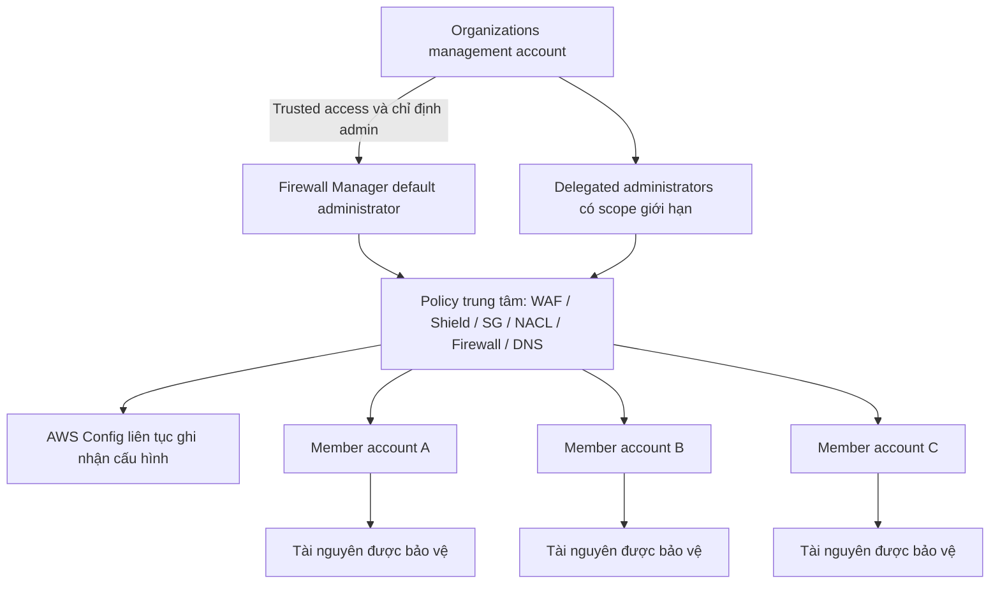

# Firewall Manager và quản lý policy bảo vệ tập trung

Trong một tổ chức AWS có nhiều tài khoản, đội bảo mật cần áp dụng các chuẩn bảo vệ nhất quán cho ứng dụng, VPC, load balancer và tài nguyên mạng. Nếu mỗi đội tự cấu hình AWS WAF, security group, network ACL hoặc firewall trong tài khoản của mình, chính sách dễ bị lệch nhau và khó phát hiện tài nguyên chưa được bảo vệ.

**AWS Firewall Manager (FMS)** giúp quản trị tập trung các chính sách bảo vệ trên nhiều tài khoản và Region thuộc cùng một AWS Organization. Người quản trị định nghĩa policy ở một tài khoản quản trị, chọn phạm vi áp dụng, sau đó Firewall Manager đánh giá và duy trì bảo vệ cho tài nguyên nằm trong phạm vi đó. Khi tài khoản hoặc tài nguyên mới được thêm vào phạm vi, dịch vụ có thể tự động áp dụng policy tương ứng.

Firewall Manager là lớp điều phối và quản lý policy. Nó triển khai, liên kết hoặc kiểm tra các dịch vụ bảo vệ như AWS WAF, AWS Shield Advanced, AWS Network Firewall, Route 53 Resolver DNS Firewall và security group. Luồng dữ liệu thực tế vẫn được xử lý bởi dịch vụ bảo vệ tương ứng.

## Mục tiêu học tập

Sau bài học, bạn có thể:

- Giải thích vai trò của Firewall Manager trong mô hình bảo mật nhiều tài khoản AWS.
- Thiết kế tài khoản quản trị mặc định, delegated administrator và phạm vi quản trị.
- Xác định điều kiện tiên quyết của AWS Organizations, AWS Config, IAM và AWS RAM.
- Phân biệt các loại Firewall Manager policy và chọn policy phù hợp với rủi ro.
- Thiết kế phạm vi policy theo OU, account, Region, resource type và tag.
- Triển khai theo từng giai đoạn từ audit đến auto remediation.
- Đọc compliance status, xử lý vi phạm, tránh xung đột policy và kiểm soát chi phí.

## 1. Bài toán bảo vệ tập trung trong môi trường nhiều tài khoản

Giả sử một doanh nghiệp có các OU `Production`, `Development`, `SharedServices` và `Sandbox`. Mỗi OU chứa nhiều AWS account. Các đội ứng dụng tự tạo VPC, EC2, Application Load Balancer và API Gateway. Một số tài khoản đã bật WAF, một số chưa; security group có nơi mở SSH từ Internet; DNS Firewall và Network Firewall chưa được triển khai đồng đều.

Quản trị thủ công từng account tạo ra một số vấn đề:

- Chuẩn bảo vệ khác nhau giữa các đội và môi trường.
- Tài khoản mới hoặc tài nguyên mới có thể bị bỏ sót.
- Đội bảo mật khó xem account nào chưa đáp ứng policy và tài nguyên nào vi phạm.
- Việc sửa policy ở từng account tiêu tốn thời gian và dễ xảy ra sai sót.
- Công cụ IaC, nhóm vận hành và nhóm bảo mật có thể cùng sửa một tài nguyên nhưng không biết cấu hình của nhau.

Firewall Manager cung cấp một điểm quản lý policy chung. Đội bảo mật có thể áp dụng cùng một baseline cho toàn tổ chức hoặc giới hạn policy theo OU, account, Region và tag. Dịch vụ tiếp tục đánh giá tài khoản/tài nguyên mới theo phạm vi đã định.

### Firewall Manager không thay thế dịch vụ bảo vệ

Firewall Manager không phải một proxy hay firewall dataplane mà mọi gói tin phải đi qua. Nó điều phối việc tạo và quản lý các cấu hình bảo vệ:

- AWS WAF kiểm tra HTTP(S) request đến các tài nguyên web được hỗ trợ.
- AWS Shield Advanced cung cấp các biện pháp bảo vệ DDoS nâng cao cho tài nguyên được hỗ trợ.
- Amazon VPC security groups kiểm soát traffic ở network interface.
- Network ACL kiểm soát traffic vào/ra subnet.
- AWS Network Firewall kiểm tra và lọc traffic mạng theo firewall policy.
- Route 53 Resolver DNS Firewall lọc truy vấn DNS từ VPC.
- Firewall bên thứ ba tích hợp với Firewall Manager cung cấp các khả năng theo sản phẩm tương ứng.

Firewall Manager giữ policy trung tâm và giúp các dịch vụ này được áp dụng nhất quán. Thiết kế mạng, routing, rule và khả năng xử lý traffic vẫn cần được hiểu theo từng dịch vụ.

## 2. Kiến trúc quản trị với AWS Organizations

Firewall Manager quản lý các tài khoản thuộc một AWS Organization. Tổ chức phải bật **All features** trong AWS Organizations; consolidated billing only không đáp ứng yêu cầu tích hợp của Firewall Manager.

Mô hình thường có các thành phần:

| Thành phần | Trách nhiệm |
|---|---|
| Organizations management account | Bật tích hợp trusted access và chỉ định Firewall Manager administrator |
| Firewall Manager default administrator | Quản lý policy bảo vệ trên phạm vi được cấp; administrator đầu tiên có full scope |
| Các delegated administrator bổ sung | Quản lý một tập OU/account, Region hoặc policy type được giới hạn |
| Member accounts | Chứa VPC, load balancer, API, EC2 và tài nguyên được bảo vệ |
| AWS Config | Ghi nhận cấu hình tài nguyên để Firewall Manager đánh giá compliance |
| AWS RAM | Chia sẻ tài nguyên cần thiết cho Network Firewall và DNS Firewall policy trên nhiều account |
| AWSServiceRoleForFMS | Service-linked role để Firewall Manager thực hiện thao tác cần thiết trong account |



Nên dùng một member account chuyên trách an ninh làm Firewall Manager administrator. Management account giữ vai trò quản trị Organizations và ủy quyền. Việc tách vai trò giúp giới hạn quyền vận hành trực tiếp trên tài nguyên ứng dụng và tạo ranh giới trách nhiệm rõ ràng.

## 3. Điều kiện tiên quyết

Trước khi tạo policy, cần hoàn tất các điều kiện sau.

### AWS Organizations và delegated administrator

1. Các account cần quản lý phải thuộc cùng AWS Organization.
2. Organization phải bật All features.
3. Management account chọn một member account làm Firewall Manager default administrator.
4. Bật trusted access giữa Firewall Manager và Organizations.
5. Nếu cần phân quyền cho nhiều đội bảo mật, tạo thêm Firewall Manager administrators và giới hạn administrative scope.

Administrator mặc định có full administrative scope và có thể quản lý policy type bên thứ ba. Các administrator bổ sung có thể bị giới hạn theo OU/account, Region và loại policy. Hãy áp dụng least privilege thay vì cấp full scope cho mọi đội.

### AWS Config

AWS Config phải được bật trong các member account, bao gồm account quản trị, và trong từng Region chứa tài nguyên cần bảo vệ. Để Firewall Manager theo dõi compliance, AWS Config phải ghi nhận thay đổi cấu hình ở chế độ **Continuous**. Đây là thiết lập mặc định của recorder.

Nếu không ghi nhận tất cả resource type, hãy bật các loại tài nguyên mà policy sử dụng. Ví dụ:

| Loại policy | Các resource type AWS Config thường cần ghi nhận |
|---|---|
| WAF | CloudFront Distribution, Application Load Balancer, API Gateway và WAF WebACL tương ứng |
| Shield Advanced | Shield Protection, Application Load Balancer, EC2 EIP và WAF WebACL tương ứng |
| Common security group | EC2 SecurityGroup, VPC, và resource type trong phạm vi policy như EC2 Instance/NetworkInterface |
| Security group content audit | EC2 SecurityGroup, NetworkInterface và Instance |
| Security group usage audit | EC2 SecurityGroup |
| Network ACL | EC2 Subnet và Network ACL |
| Network Firewall | NetworkFirewall FirewallPolicy, RuleGroup, VPC, InternetGateway, RouteTable và Subnet |
| DNS Firewall | VPC và Route 53 FirewallRuleGroupAssociation |
| Third-party firewall | VPC, InternetGateway, RouteTable, Subnet và VPCEndpoint |

Danh sách chính xác phụ thuộc policy type, resource type được chọn và thay đổi trong tài liệu AWS. Nếu dùng custom IAM role cho AWS Config recorder, role phải có quyền ghi nhận các resource type cần thiết. Thiếu quyền ghi nhận có thể khiến Firewall Manager không thấy được một phần tài nguyên.

### AWS Resource Access Manager và Marketplace

Để quản lý Network Firewall hoặc DNS Firewall policy xuyên account, bật resource sharing với AWS Organizations trong AWS Resource Access Manager (AWS RAM). Firewall Manager sử dụng cơ chế chia sẻ này để triển khai bảo vệ trong các account thuộc phạm vi.

Nếu sử dụng third-party firewall policy, cần đăng ký sản phẩm tương ứng trên AWS Marketplace và hoàn tất cấu hình tenant/deployment theo tài liệu của nhà cung cấp. Ví dụ hiện có gồm Palo Alto Networks Cloud NGFW và Fortigate Cloud Native Firewall as a Service.

### Service-linked role

Firewall Manager sử dụng service-linked role có tên `AWSServiceRoleForFMS`. Khi bật trusted access, role tương ứng được tạo trong các member account thuộc Organization. Role cho phép dịch vụ thực hiện các thao tác được định nghĩa trên tài nguyên của account. Không tự ý xóa role khi vẫn còn Firewall Manager policy hoặc tài nguyên phụ thuộc.

## 4. Các loại Firewall Manager policy

Mỗi Firewall Manager policy áp dụng cho một policy type. Nếu tổ chức cần nhiều lớp bảo vệ, hãy tạo nhiều policy có phạm vi và mục tiêu riêng.

| Policy type | Mục đích | Ví dụ sử dụng |
|---|---|---|
| AWS WAF | Áp dụng web ACL và rule group trung tâm cho tài nguyên web | Bảo vệ ALB, API Gateway hoặc CloudFront khỏi web exploit và request bất thường |
| AWS Shield Advanced | Áp dụng Shield Advanced protection trên tài nguyên được hỗ trợ | Bảo vệ ứng dụng Internet-facing trước DDoS |
| VPC security group | Áp dụng common security group hoặc audit nội dung/usage của SG | Baseline cổng quản trị, audit rule quá rộng, dọn SG thừa |
| VPC network ACL | Quản lý baseline rule inbound/outbound cho subnet | Đảm bảo subnet có rule chặn/cho phép bắt buộc |
| AWS Network Firewall | Triển khai firewall policy và firewall endpoint cho VPC trong phạm vi | Lọc traffic giữa subnet, egress và ingress theo kiến trúc định tuyến |
| Route 53 Resolver DNS Firewall | Gắn DNS Firewall rule group vào VPC | Chặn truy vấn đến domain độc hại hoặc domain không được phép |
| Third-party firewall | Điều phối giải pháp firewall tích hợp qua Marketplace | Dùng Cloud NGFW của Palo Alto hoặc Fortigate CNF |

Firewall Manager vẫn hỗ trợ AWS WAF Classic policy trong tài liệu hiện hành, nhưng với triển khai mới nên ưu tiên AWS WAF hiện hành (WAFv2) và có kế hoạch chuyển đổi nếu hệ thống còn phụ thuộc phiên bản Classic.

### AWS WAF policy

Firewall Manager có thể quản lý web ACL và rule group theo chuẩn chung. Với AWS WAF policy, tổ chức có thể xác định các rule group chạy trước và sau trong web ACL; account sở hữu tài nguyên có thể bổ sung rule/rule group riêng vào phần giữa theo mô hình policy cho phép. Cách này giúp duy trì baseline bảo mật chung nhưng vẫn cho đội ứng dụng thêm rule theo nhu cầu.

Ví dụ, policy trung tâm bắt buộc AWS Managed Rules và một rule group chặn IP có nguy cơ cao ở phần đầu; rule group trung tâm ghi log hoặc chặn hành vi cuối cùng ở phần cuối; đội ứng dụng thêm allow-list hoặc rule đặc thù vào phần giữa sau khi được kiểm duyệt.

CloudFront là tài nguyên global. Khi tạo WAF policy để bảo vệ CloudFront distribution, cần lưu ý yêu cầu Region quản trị của WAF/CloudFront, thường là US East (N. Virginia) (`us-east-1`). Các tài nguyên regional như ALB và API Gateway được quản lý theo Region chứa tài nguyên.

### AWS Shield Advanced policy

Shield Advanced policy giúp áp dụng bảo vệ Shield Advanced cho các tài nguyên được hỗ trợ trong phạm vi Organization. Đây là policy dành cho khách hàng có subscription Shield Advanced. FMS giúp theo dõi và áp dụng protection trên các account, nhưng không thay thế việc thiết kế kiến trúc chống DDoS, scale, caching, logging và quy trình phản ứng sự cố.

### Security group policy

Firewall Manager cung cấp ba cách quản lý security group phổ biến:

1. **Common security group policy**: áp dụng một security group chung do tổ chức quản lý đến tài nguyên phù hợp trong các account được chọn. Ví dụ, nhóm bảo mật định nghĩa một SG baseline cho phép HTTPS từ load balancer hoặc chỉ cho phép luồng quản trị từ mạng nội bộ.
2. **Content audit policy**: so sánh rule của các security group trong phạm vi với audit security group chuẩn, phát hiện rule không phù hợp và có thể sửa các rule vi phạm khi bật remediation.
3. **Usage audit policy**: tìm security group không được sử dụng hoặc trùng lặp; nếu bật remediation và chọn hành động tương ứng, FMS có thể gộp SG dư thừa hoặc xóa SG không còn được dùng.

Với common security group, cần hiểu cách policy gắn SG chung với ENI/tài nguyên và cách SG này kết hợp với các SG khác. Với content audit, cần chuẩn hóa audit security group và kiểm tra rule trước khi cho phép FMS sửa. Với usage audit, không xóa SG chỉ dựa trên tên hoặc cảm nhận; hãy kiểm tra quan hệ sử dụng và khoảng chờ đã cấu hình.

AWS khuyến nghị bắt đầu với automatic remediation tắt đối với content audit và usage audit. Hãy xem danh sách vi phạm và hành động dự kiến trước khi bật tự động sửa.

### Network ACL policy

Network ACL áp dụng ở cấp subnet và kiểm soát traffic inbound/outbound theo rule có số thứ tự. Firewall Manager cho phép xác định rule bắt buộc chạy đầu tiên và cuối cùng; account trong phạm vi có thể bổ sung rule riêng ở giữa theo cấu hình policy.

Khi thiết kế NACL, cần nhớ NACL là stateless. Nếu cho phép inbound traffic, phải cân nhắc rule outbound tương ứng cho response và ephemeral port. NACL quá chặt có thể làm hỏng kết nối hợp lệ, đặc biệt với dịch vụ có port động hoặc luồng kết nối hai chiều.

### Network Firewall policy

Network Firewall policy giúp Firewall Manager triển khai AWS Network Firewall vào các VPC thuộc phạm vi và quản lý cấu hình phụ thuộc như firewall policy, subnet và route. Đây là lớp bảo vệ mạng có khả năng lọc traffic ở cấp VPC. Việc triển khai có thể tác động trực tiếp đến đường đi của traffic; cần thiết kế trước firewall subnet, CIDR, Availability Zone, route table và luồng ingress/egress.

Network Firewall policy có các hành vi triển khai/remediation riêng; không nên giả định nó có cùng chế độ audit-only như mọi policy type khác. Tài liệu tạo policy hiện hành nêu Network Firewall policy tự thực hiện remediation cần thiết. Với policy có Monitor mode, Firewall Manager có thể phát hiện route không đúng và đưa ra đề xuất remediation. Kiểm tra kỹ mô hình routing và trạng thái trước khi triển khai ở production.

### DNS Firewall policy

Route 53 Resolver DNS Firewall policy giúp gắn DNS Firewall rule group vào VPC trong phạm vi. Rule group có thể cho phép, chặn hoặc cảnh báo truy vấn theo domain list và rule action. Đây là biện pháp kiểm soát DNS egress, hữu ích để giảm truy cập domain độc hại hoặc domain không thuộc danh sách cho phép.

Khi triển khai, cần xác định thứ tự rule group, domain list, hành động mặc định và cách xử lý truy vấn hợp lệ bị chặn nhầm. Bật logging và theo dõi DNS Firewall query để điều chỉnh policy theo traffic thực tế.

### Third-party firewall policy

Firewall Manager có thể điều phối một số firewall bên thứ ba thông qua AWS Marketplace. Ví dụ tài liệu hiện hành có Palo Alto Networks Cloud NGFW và Fortigate Cloud Native Firewall as a Service. Các giải pháp này có điều kiện subscription, tenant và deployment riêng. Firewall Manager là lớp tích hợp/quản trị; phí sản phẩm và vận hành của nhà cung cấp được tính theo điều khoản Marketplace tương ứng.

## 5. Policy scope: xác định nơi policy có hiệu lực

Policy scope quyết định account và resource nào phải tuân thủ policy. Đây là phần quan trọng nhất để tránh áp dụng bảo vệ sai môi trường.

### Phạm vi account và OU

Có thể áp dụng policy cho:

- Tất cả account trong Organization.
- Một hoặc nhiều OU cụ thể.
- Một nhóm account được chỉ định.
- Tất cả account ngoại trừ account hoặc OU bị loại trừ.

Nếu policy bao gồm một OU, account mới được tạo hoặc chuyển vào OU đó sẽ được đánh giá theo policy. Nếu policy chỉ liệt kê một tập account cụ thể, account mới sẽ không tự động được thêm vào danh sách đó.

### Phạm vi resource type và tag

Sau khi chọn account/OU, tiếp tục giới hạn theo resource type và tag. Ví dụ, một WAF policy có thể chỉ áp dụng cho ALB có tag `Exposure=Public`; một common security group policy chỉ áp dụng cho EC2 instance hoặc ENI có tag `Environment=Production`.

Firewall Manager hỗ trợ include hoặc exclude tài nguyên theo tag. Trong cùng cấu hình scope, chọn một hướng include hoặc exclude; không giả định có thể kết hợp cả hai danh sách. Việc so khớp dựa trên tag key và value tương ứng. Cần duy trì quy ước tag nhất quán trong Organization.

### Region

Phần lớn policy áp dụng theo Region chứa resource. Một số tài nguyên global như CloudFront có quy tắc Region riêng. Cần xác định Region policy và Region của resource trước khi tạo policy. Không tạo một policy ở Region A rồi kỳ vọng nó tự bảo vệ mọi resource regional ở Region B.

### Tài nguyên rời khỏi scope

Khi account hoặc resource rời khỏi policy scope, Firewall Manager không mặc định gỡ mọi protection hoặc xóa mọi resource do FMS quản lý. Một số policy cho phép chọn tự động remove protection khi tài nguyên rời scope. Nếu chọn, cần hiểu chính xác tài nguyên nào sẽ bị disassociate hoặc xóa.

Ví dụ, nếu một ALB rời khỏi scope WAF policy, việc tự động tháo web ACL có thể khiến ALB mất lớp bảo vệ đó. Ngược lại, giữ protection sau khi resource rời scope có thể tạo ra tài nguyên bảo vệ còn tồn tại và phát sinh chi phí. Hãy định nghĩa lifecycle khi account được chuyển OU, đóng hoặc tách khỏi Organization.

## 6. Audit-only và automatic remediation

Nhiều policy type cho phép chọn một trong hai cách vận hành:

- **Identify noncompliant resources**: chỉ đánh giá và báo cáo vi phạm. Người quản trị xem tác động trước khi thay đổi.
- **Auto remediate**: Firewall Manager tự động áp dụng cấu hình cần thiết để đưa tài nguyên về trạng thái policy yêu cầu.

Không nên bật remediation ngay khi tạo policy mới. Một rule có vẻ an toàn trong tài liệu có thể làm gián đoạn workload nếu áp dụng cho tài nguyên chưa được phân loại đầy đủ. Hãy bắt đầu bằng audit-only, xem vi phạm, kiểm tra ngoại lệ và thử nghiệm ở OU phi production. Sau khi xác nhận hành vi, bật auto remediation cho phạm vi đã kiểm chứng.

Một số policy type có hành vi tự triển khai hoặc remediation đặc thù. Ví dụ, Network Firewall policy tự thực hiện các thao tác triển khai cần thiết. Vì vậy, phải đọc hướng dẫn riêng của policy type thay vì áp dụng một quy tắc audit-only chung cho tất cả.

### Ví dụ: baseline WAF cho tài nguyên public

1. Chọn AWS WAF policy và Region phù hợp.
2. Chọn OU Production và loại resource cần bảo vệ như ALB/API Gateway; chọn CloudFront trong policy global phù hợp.
3. Chọn rule group trung tâm, thứ tự rule và logging destination.
4. Chọn audit-only nếu policy type hỗ trợ, tạo policy và đợi FMS đánh giá.
5. Kiểm tra account/resource chưa compliant, xác minh resource thực tế và ngoại lệ.
6. Kiểm thử request hợp lệ và request độc hại ở môi trường thử nghiệm.
7. Bật remediation và tiếp tục giám sát các resource mới.

## 7. Compliance và cách đọc kết quả

Firewall Manager đánh giá policy theo từng account và resource. Trạng thái phổ biến gồm:

- **Compliant**: cấu hình tài nguyên phản ánh các yêu cầu của policy.
- **Noncompliant**: một hoặc nhiều resource trong account không đáp ứng policy.
- **Pending** hoặc trạng thái đang xử lý: policy mới được tạo hoặc thay đổi, FMS chưa hoàn tất đánh giá.
- **Out of scope**: account/resource không thuộc phạm vi policy.

Trong policy detail, có thể xem account trong và ngoài scope, số resource vi phạm, resource ID/type và lý do vi phạm. Với một số policy, trang violation detail cung cấp rule không phù hợp, rule tham chiếu, nguyên nhân và remediation action gợi ý.

Compliance không phải kết quả tức thời. Sau khi sửa policy hoặc resource, có thể mất vài phút để trạng thái mới xuất hiện. AWS Config cần ghi nhận thay đổi liên tục. Nếu trạng thái không đúng, hãy kiểm tra Config recorder và quyền ghi nhận trước khi kết luận Firewall Manager không hoạt động.

Tránh liên tục thay đổi association hoặc trạng thái protection bằng nhiều công cụ cùng lúc. AWS Config có thể không theo kịp các thay đổi dồn dập, dẫn đến thông tin compliance/remediation bị thiếu hoặc sai lệch. Nếu cần refresh đánh giá, kiểm tra cấu hình Config và thực hiện reevaluate rule liên quan theo hướng dẫn AWS.

## 8. Quy trình triển khai policy trong tổ chức

Một quy trình có kiểm soát nên chia thành các bước sau.

### Bước 1: xác định mục tiêu và chủ sở hữu

Mỗi policy cần có owner, mục tiêu bảo mật, phạm vi tài nguyên, mức độ ảnh hưởng và quy trình xử lý ngoại lệ. Ví dụ, policy WAF do đội AppSec sở hữu; Network Firewall do đội Network Security sở hữu; common security group do Cloud Platform sở hữu.

### Bước 2: hoàn thiện nền tảng Organization

Bật All features, trusted access, chọn default administrator, tạo delegated administrators theo nhiệm vụ. Thiết lập AWS Config recorder continuous trong account/Region cần quản lý. Bật AWS RAM organization sharing nếu triển khai Network Firewall hoặc DNS Firewall.

### Bước 3: xác định policy scope

Chọn OU/account, Region, resource type, tag include/exclude và các account/resource ngoại lệ. Đặc biệt kiểm tra scope của account quản trị Firewall Manager. Với security group policy, AWS khuyến nghị loại trừ Firewall Manager administrator account khỏi scope trong các trường hợp được hướng dẫn.

### Bước 4: tạo policy ở chế độ đánh giá

Chọn policy type, cấu hình baseline, logging, rule groups và hành vi remediation. Nếu policy hỗ trợ, bắt đầu bằng identify-only. Với policy có hành vi tự triển khai, kiểm tra kế hoạch thay đổi và routing trước khi tạo.

### Bước 5: kiểm tra vi phạm và ảnh hưởng

Đánh giá từng resource không compliant. Xác minh rule, traffic thực tế, dependency, owner và ngoại lệ. Kiểm thử trên OU Development hoặc một account đại diện trước khi mở rộng.

### Bước 6: bật remediation có kiểm soát

Khi đã xác nhận kết quả, bật auto remediation cho policy type hỗ trợ. Theo dõi CloudTrail, AWS Config, Firewall Manager compliance và metric/log của dịch vụ bảo vệ. Chuẩn bị phương án rollback hoặc tắt policy nếu phát hiện ảnh hưởng ngoài dự kiến.

### Bước 7: duy trì policy khi Organization thay đổi

Khi tạo account, chuyển OU, thêm Region hoặc thay đổi tag, xác nhận policy scope phản ánh đúng thiết kế. Định kỳ rà soát account ngoài scope, resource chưa compliant, policy không còn owner và ngoại lệ quá hạn.

## 9. CLI để kiểm tra trạng thái Firewall Manager

AWS CLI hữu ích để truy vấn trạng thái quản trị và compliance trong pipeline kiểm tra hoặc runbook vận hành.

```bash
# Xem account quản trị Firewall Manager và trạng thái role.
aws fms get-admin-account

# Liệt kê các member account trong Organization mà admin quản lý.
aws fms list-member-accounts

# Liệt kê policy trong Region đang kiểm tra.
aws fms list-policies --region us-east-1

# Lấy compliance detail của một policy trong một member account.
aws fms get-compliance-detail \
  --policy-id 11111111-2222-3333-4444-555555555555 \
  --member-account 123456789012 \
  --region us-east-1
```

Thay policy ID, account ID và Region bằng giá trị của môi trường. Các lệnh trên là truy vấn read-only; chúng không tạo hoặc sửa policy. Với automation, hãy phân trang các API trả về danh sách và lưu lại thời điểm truy vấn để so sánh compliance theo thời gian.

## 10. Ví dụ thiết kế baseline cho doanh nghiệp nhiều OU

Giả sử tổ chức có các OU:

| OU | Mục đích | Baseline đề xuất |
|---|---|---|
| Production | Workload phục vụ khách hàng | WAF cho tài nguyên public, Shield Advanced nếu subscription, SG audit, DNS Firewall và Network Firewall theo kiến trúc mạng |
| Development | Kiểm thử và phát triển | SG baseline, WAF khi có endpoint public, DNS Firewall; audit-only trước khi remediation |
| SharedServices | Dịch vụ dùng chung | Network Firewall/DNS Firewall, SG baseline, policy WAF cho portal quản trị |
| Sandbox | Thử nghiệm ngắn hạn | Scope hạn chế, tag bắt buộc, policy audit để tránh tác động workload thử nghiệm |

Đội bảo mật trung tâm sở hữu default administrator. Đội Network Security được cấp delegated administrator chỉ quản lý policy Network Firewall và DNS Firewall trong OU Production/SharedServices. Đội AppSec quản lý WAF policy trong các OU ứng dụng. Quyền được giới hạn theo Region và policy type để tránh một nhóm vô tình thay đổi cấu hình của nhóm khác.

Tài nguyên public phải được gắn tag theo chuẩn, ví dụ `Exposure=Public`, `Environment=Production`, `Owner=payments`. Policy WAF áp dụng theo tag và OU. Common security group policy áp dụng cho các ENI có tag phù hợp. Các tài nguyên ngoại lệ phải có owner, lý do, ngày hết hạn và quy trình phê duyệt.

## 11. Quản lý security group tránh xung đột

Security group có thể được quản lý bởi Firewall Manager, CloudFormation, Terraform, Kubernetes controller hoặc một hệ thống tự động khác. Nếu hai công cụ cùng quản lý một SG hoặc association nhưng có mục tiêu khác nhau, chúng có thể liên tục ghi đè cấu hình của nhau.

Ví dụ, Firewall Manager yêu cầu mọi ENI trong scope phải gắn common security group. Một controller bên ngoài lại xóa SG không nằm trong manifest của nó. Kết quả là hai bên liên tục thêm và xóa association, tạo vòng lặp remediation và gây khó xác định trạng thái chuẩn.

Để tránh tình trạng này:

- Chọn một hệ thống làm chủ sở hữu cho từng SG và association.
- Dùng tag để loại trừ tài nguyên do công cụ khác quản lý khỏi scope FMS khi cần.
- Cấu hình công cụ ngoài để bỏ qua SG do Firewall Manager quản lý.
- Bắt đầu content/usage audit ở chế độ không remediation.
- Tránh thay đổi association liên tục trong thời gian ngắn; policy usage audit có thể bỏ lỡ event nếu trạng thái bị thay đổi dồn dập.
- Xác minh các giới hạn theo loại ENI, ECS deployment controller và resource type trước khi áp dụng rộng.

## 12. Xử lý sự cố thường gặp

| Hiện tượng | Nguyên nhân có thể | Cách kiểm tra |
|---|---|---|
| Không thấy account trong phạm vi | Account ngoài Organization, trusted access chưa bật hoặc admin chưa được cấu hình đúng | Kiểm tra Organizations, default administrator và delegated administrator |
| Policy không đánh giá resource | AWS Config chưa bật ở account/Region hoặc thiếu resource type | Kiểm tra recorder, recording frequency continuous và IAM role của Config |
| Resource mới chưa được bảo vệ | Account/resource không thuộc scope, tag không khớp hoặc policy đang Pending | Kiểm tra OU, account inclusion/exclusion, tag key/value và Region |
| FMS báo Noncompliant sau khi đã sửa | AWS Config chưa ghi nhận thay đổi hoặc đánh giá chưa cập nhật | Kiểm tra Config timeline/recorder và đợi cập nhật; reevaluate rule khi phù hợp |
| Network Firewall/DNS Firewall không triển khai xuyên account | AWS RAM chưa bật organization sharing hoặc thiếu điều kiện policy | Kiểm tra RAM sharing, Region, resource share và service-linked role |
| Lambda/service không thể cập nhật bảo vệ | IAM/service-linked role thiếu quyền hoặc service integration chưa sẵn sàng | Kiểm tra role, CloudTrail event và trạng thái policy |
| SG liên tục bị thêm/xóa | FMS và công cụ ngoài cùng quản lý association | Kiểm tra owner, tag exclusion và automation bên ngoài |
| WAF policy không áp dụng CloudFront | Policy được tạo ở sai Region hoặc resource global chưa được cấu hình đúng | Kiểm tra yêu cầu `us-east-1` và scope CloudFront |
| Tài nguyên mất protection sau khi chuyển OU | Policy scope và lựa chọn cleanup khi rời scope | Kiểm tra scope mới, tùy chọn remove protection và association hiện tại |

## 13. Bảo mật tài khoản quản trị và policy

Firewall Manager có quyền triển khai hoặc thay đổi nhiều cấu hình bảo vệ trong Organization. Vì vậy, account quản trị và quyền truy cập cần được bảo vệ nghiêm ngặt.

- Dùng IAM Identity Center hoặc cơ chế federation được tổ chức quản lý; hạn chế dùng root.
- Bật MFA cho người có quyền quản trị cao.
- Tách quyền quản lý Organizations, quyền tạo policy và quyền xem compliance.
- Dùng delegated administrator scope để giới hạn OU, Region và policy type.
- Bảo vệ thay đổi policy bằng quy trình review, approval và change management.
- Ghi nhận CloudTrail management events để điều tra ai đã tạo, sửa hoặc xóa policy.
- Rà soát service-linked role; không chỉnh sửa/xóa tùy tiện các role do AWS service quản lý.
- Quản lý ngoại lệ có thời hạn, owner và bằng chứng chấp thuận.

Policy trung tâm cần được quản lý như mã nguồn: có version, review, thử nghiệm ở môi trường hẹp, rollout theo đợt và rollback plan. Với cấu hình được quản lý bằng IaC, cần tránh thay đổi trực tiếp trong console mà không cập nhật source of truth.

## 14. Chi phí và tối ưu

Các Firewall Manager protection policy được tính phí theo tháng và theo Region theo bảng giá của từng loại policy. Với khách hàng Shield Advanced, phí Firewall Manager policy được bao gồm trong subscription Shield Advanced; các AWS Config rule do FMS tạo vẫn có thể phát sinh phí. Ngoài phí policy, có thể phát sinh:

- AWS Config configuration items và rule evaluations.
- AWS WAF Web ACL, rule group và request inspection.
- AWS Network Firewall endpoint-hour và traffic processing.
- Route 53 Resolver DNS Firewall rule group, domain list và DNS query.
- AWS Shield Advanced subscription và các thành phần liên quan.
- Phí AWS Marketplace của firewall bên thứ ba.
- Logging, storage và data transfer của dịch vụ bảo vệ.

Giá policy có thể khác theo Region và thay đổi theo thời gian; một số dịch vụ bảo vệ có chi phí lớn hơn phí policy, ví dụ Network Firewall endpoint-hour/traffic processing hoặc DNS Firewall query/domain list. Trước khi rollout, hãy dùng AWS Pricing Calculator và trang giá chính thức để ước lượng theo số Region, số policy, số account và lưu lượng thực tế.

Các cách kiểm soát chi phí:

- Không tạo policy trùng lặp với cùng mục tiêu và scope nếu không có lý do rõ ràng.
- Chọn resource type và tag scope chính xác để tránh bảo vệ tài nguyên ngoài mục tiêu.
- Rà soát policy không còn dùng và resource bảo vệ mồ côi.
- Theo dõi AWS Config recording và rule evaluation vì chúng có chi phí riêng.
- Kiểm soát log retention, WAF request volume, Network Firewall endpoint và DNS query volume.
- Rà soát subscription Marketplace và các thành phần third-party.

## 15. Bài thực hành: triển khai common security group policy

Mục tiêu là áp dụng một baseline security group cho các EC2 instance production trong một OU, quan sát compliance trước khi remediation.

### Chuẩn bị

1. Có AWS Organization bật All features.
2. Đã cấu hình Firewall Manager administrator và trusted access.
3. AWS Config đang ghi nhận liên tục các resource type cần thiết trong account/Region.
4. Tạo một audit/common security group chuẩn trong account quản trị theo thiết kế mạng.
5. Xác định OU Production và tag tài nguyên mục tiêu.

### Thực hiện

1. Mở Firewall Manager trong administrator account.
2. Chọn tạo policy mới, policy type Security group.
3. Chọn common security group policy và Region chứa tài nguyên.
4. Chọn OU Production, resource type phù hợp và tag scope như `Environment=Production`.
5. Cấu hình policy action ở chế độ identify-only nếu tùy chọn này có sẵn.
6. Tạo policy, chờ FMS đánh giá rồi mở từng account để xem resource vi phạm.
7. Xác minh rule baseline không chặn traffic hợp lệ và không xung đột với IaC/controller hiện có.
8. Trong môi trường thử nghiệm, bật remediation và quan sát security group association.
9. Kiểm tra CloudTrail, AWS Config và trạng thái compliance sau thay đổi.

### Kết quả cần đạt

- Tài nguyên trong scope được nhận diện chính xác.
- Resource ngoài scope không bị thay đổi.
- Các vi phạm có nguyên nhân rõ ràng.
- Remediation chỉ thực hiện hành động đã được review.
- Khi thêm account hoặc EC2 instance mới vào OU/tag phù hợp, policy đánh giá tài nguyên mới.

## 16. Những hiểu lầm thường gặp

- **Firewall Manager tự lọc mọi gói tin**: FMS điều phối policy; WAF, Shield, Network Firewall, DNS Firewall và security group mới thực thi bảo vệ tương ứng.
- **Chỉ cần bật Organizations**: cần All features, trusted access, administrator account và AWS Config phù hợp.
- **Một policy áp dụng mọi loại tài nguyên**: mỗi policy gắn với một policy type; cần nhiều policy cho nhiều lớp bảo vệ.
- **Bật auto remediation luôn an toàn**: remediation có thể thay đổi SG, web ACL, routing hoặc association; phải xem tác động trước.
- **Account mới luôn được bảo vệ dù policy scope chỉ liệt kê account cụ thể**: account mới tự động được áp dụng nếu policy scope bao gồm OU hoặc toàn Organization; danh sách account chỉ định không tự thêm account mới.
- **Compliance cập nhật tức thì**: FMS phụ thuộc AWS Config và cần thời gian đánh giá.
- **Tài nguyên rời scope sẽ tự mất protection**: mặc định nhiều protection vẫn được giữ; hành vi cleanup phụ thuộc policy và tùy chọn.
- **Delegated administrator luôn có toàn quyền**: administrator có thể bị giới hạn theo OU/account, Region và policy type.
- **FMS loại bỏ nhu cầu quản lý từng dịch vụ**: đội vận hành vẫn cần hiểu rule, route, logging và giới hạn của dịch vụ nền.
- **Có thể để nhiều công cụ cùng quản lý một security group**: hai hệ thống remediation có thể tạo vòng lặp cấu hình.

## 17. Checklist vận hành production

Trước khi đưa Firewall Manager vào vận hành chính thức, hãy xác nhận:

- [ ] Organization bật All features và trusted access.
- [ ] Default administrator là member account chuyên trách, được bảo vệ bằng MFA và quyền tối thiểu.
- [ ] Các delegated administrator có administrative scope đúng OU/account, Region và policy type.
- [ ] AWS Config continuous recording bật trong mọi account/Region cần bảo vệ.
- [ ] Config recorder ghi nhận đủ resource type và có IAM permissions phù hợp.
- [ ] AWS RAM organization sharing đã bật cho Network Firewall/DNS Firewall nếu sử dụng.
- [ ] Third-party firewall đã có subscription và tenant/deployment hợp lệ nếu sử dụng.
- [ ] Policy scope có account/OU, Region, resource type và tag được kiểm tra.
- [ ] Ngoại lệ có owner, lý do, ngày hết hạn và quy trình phê duyệt.
- [ ] Policy được thử nghiệm audit-only trước khi remediation nếu loại policy hỗ trợ.
- [ ] Network Firewall routing, subnet và CIDR được thiết kế trước khi triển khai.
- [ ] SG policy không xung đột với Terraform, CloudFormation hoặc controller khác.
- [ ] Compliance, CloudTrail, AWS Config và log của dịch vụ bảo vệ được theo dõi.
- [ ] Có runbook xử lý false positive, remediation sai và resource rời scope.
- [ ] Có dự toán chi phí cho FMS, Config và dịch vụ bảo vệ nền.

## Kết luận

AWS Firewall Manager giúp doanh nghiệp áp dụng và duy trì policy bảo vệ trên nhiều tài khoản, OU và Region trong AWS Organizations. Giá trị chính của dịch vụ nằm ở khả năng quản lý tập trung, tự đánh giá tài nguyên mới và cung cấp compliance visibility theo từng account/resource.

Để triển khai hiệu quả, hãy hoàn thiện Organizations, delegated administrator, AWS Config và resource sharing trước. Sau đó chọn policy type theo rủi ro, xác định scope chính xác, bắt đầu bằng đánh giá khi có thể, kiểm tra tác động rồi mới bật remediation. Kết hợp quản lý policy có version, least privilege, giám sát và quy trình ngoại lệ để duy trì chuẩn bảo vệ nhất quán khi Organization phát triển.

## Tài liệu tham khảo

- [AWS Firewall Manager – User Guide](https://docs.aws.amazon.com/waf/latest/developerguide/fms-chapter.html)
- [AWS Firewall Manager prerequisites](https://docs.aws.amazon.com/waf/latest/developerguide/fms-prereq.html)
- [Joining and configuring AWS Organizations](https://docs.aws.amazon.com/waf/latest/developerguide/join-aws-orgs.html)
- [Enabling AWS Config for Firewall Manager](https://docs.aws.amazon.com/waf/latest/developerguide/enable-config.html)
- [Enabling AWS RAM resource sharing](https://docs.aws.amazon.com/waf/latest/developerguide/enable-ram.html)
- [Using AWS Firewall Manager policies](https://docs.aws.amazon.com/waf/latest/developerguide/working-with-policies.html)
- [Using Firewall Manager administrators](https://docs.aws.amazon.com/waf/latest/developerguide/fms-administrators.html)
- [Using the Firewall Manager policy scope](https://docs.aws.amazon.com/waf/latest/developerguide/policy-scope.html)
- [Creating a Firewall Manager policy](https://docs.aws.amazon.com/waf/latest/developerguide/create-policy.html)
- [Viewing Firewall Manager compliance information](https://docs.aws.amazon.com/waf/latest/developerguide/fms-compliance.html)
- [Firewall Manager service-linked roles](https://docs.aws.amazon.com/waf/latest/developerguide/fms-using-service-linked-roles.html)
- [Security group policies in Firewall Manager](https://docs.aws.amazon.com/waf/latest/developerguide/security-group-policies.html)
- [Usage audit security group policies](https://docs.aws.amazon.com/waf/latest/developerguide/security-group-policies-usage.html)
- [Third-party firewall policy prerequisites](https://docs.aws.amazon.com/waf/latest/developerguide/fms-third-party-prerequisites.html)
- [AWS Firewall Manager pricing](https://aws.amazon.com/firewall-manager/pricing/)
- [AWS Config pricing](https://aws.amazon.com/config/pricing/)
- [AWS Firewall Manager CLI examples](https://docs.aws.amazon.com/cli/latest/userguide/cli_fms_code_examples.html)
