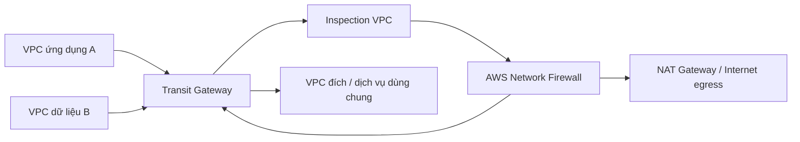

# Cô lập workload, kiểm soát east-west traffic và nguyên tắc zero trust

Trong một hệ thống AWS, các workload thường giao tiếp với nhau qua nhiều lớp: web tier gọi API, API truy vấn cơ sở dữ liệu, dịch vụ xử lý gửi thông điệp vào queue, worker đọc object trong S3 và các thành phần nội bộ gọi AWS service API. Luồng giao tiếp giữa các thành phần bên trong hệ thống được gọi là **east-west traffic**. Nếu mạng nội bộ cho phép mọi workload kết nối rộng rãi, một máy chủ bị xâm nhập có thể trở thành điểm xuất phát để dò quét và di chuyển ngang sang các dịch vụ khác.

Cô lập workload giúp giới hạn phạm vi kết nối và giảm tác động khi một thành phần gặp sự cố bảo mật. Nguyên tắc **zero trust** bổ sung cách tiếp cận dựa trên danh tính: mỗi kết nối và yêu cầu cần được xác thực, cấp quyền theo mục đích, giới hạn theo ngữ cảnh và ghi nhận để giám sát. Vị trí trong VPC hoặc subnet riêng không tự động khiến một workload được tin cậy.

Trong module `CLOUD_PROVIDERS_AWS`, chủ đề này kết hợp thiết kế VPC, subnet, route table, security group, network ACL, AWS Network Firewall, IAM và các dịch vụ kết nối riêng như AWS PrivateLink và VPC Lattice. Mục tiêu là thiết kế các đường giao tiếp cần thiết, kiểm soát được ai gọi ai, bảo vệ dữ liệu trên đường truyền và phát hiện hành vi bất thường.

Sau bài học, bạn có thể:

- Phân biệt cô lập ở cấp tài khoản, VPC, subnet, network interface và ứng dụng.
- Thiết kế security group theo luồng ứng dụng và nguyên tắc đặc quyền tối thiểu.
- Phân biệt vai trò của security group, network ACL, route table và AWS Network Firewall.
- Kiểm soát east-west traffic trong một VPC và giữa nhiều VPC hoặc tài khoản.
- Kết hợp danh tính workload, IAM, TLS/mTLS và authorization ở tầng ứng dụng theo zero trust.
- Dùng VPC endpoints, PrivateLink và VPC Lattice để cung cấp kết nối riêng có kiểm soát.
- Giám sát và kiểm thử đường đi mạng bằng VPC Flow Logs, CloudTrail, GuardDuty và Reachability Analyzer.

## 1. East-west traffic và nguy cơ di chuyển ngang

Trong kiến trúc mạng, north-south traffic thường mô tả lưu lượng đi vào hoặc đi ra khỏi ranh giới hệ thống, chẳng hạn người dùng Internet truy cập website. East-west traffic là lưu lượng giữa các thành phần nội bộ: giữa hai subnet, hai VPC, hai dịch vụ hoặc hai workload trong cùng một cụm.

Ví dụ hệ thống thương mại điện tử có các thành phần:

- Web frontend nhận kết nối HTTPS từ người dùng.
- API service xử lý nghiệp vụ và truy vấn dữ liệu.
- Database lưu thông tin đơn hàng.
- Worker đọc thông điệp từ queue và xử lý tác vụ nền.
- Monitoring agent gửi telemetry tới hệ thống quan sát.

Các luồng cần thiết có thể là frontend → API, API → database, API → queue, worker → queue, worker → database và workload → AWS service endpoint. Nếu tất cả workload đều ở cùng một subnet và dùng security group rộng, một thành phần bị xâm nhập có thể thử kết nối tới database, metadata service, management port hoặc API nội bộ mà nó không cần sử dụng.

**Lateral movement** (di chuyển ngang) là hành vi kẻ tấn công dùng một điểm truy cập ban đầu để tiếp cận các workload hoặc tài nguyên khác trong môi trường. Các nguyên nhân làm tăng rủi ro gồm:

- Cho phép toàn bộ subnet hoặc CIDR nội bộ truy cập mọi port.
- Dùng chung một security group cho frontend, API, worker và database.
- Cho phép quản trị từ mọi địa chỉ nội bộ thay vì qua bastion hoặc Systems Manager.
- Dùng credential tĩnh giống nhau trong nhiều workload.
- Không xác thực danh tính ở tầng ứng dụng vì cho rằng lưu lượng trong VPC là đáng tin.
- Không có log để nhận biết kết nối bất thường giữa các thành phần.

Mục tiêu của cô lập workload là giới hạn những đường giao tiếp thật sự cần thiết. Khi frontend bị xâm nhập, frontend chỉ nên có thể gọi API ở port được quy định; nó không nên tự kết nối tới database, worker management port hoặc các dịch vụ quản trị.

## 2. Zero trust là nguyên tắc thiết kế, không phải một thiết bị mạng

Zero trust là mô hình bảo mật giả định rằng không có kết nối nào mặc nhiên đáng tin chỉ vì nó xuất phát từ mạng nội bộ, thiết bị thuộc công ty hoặc một subnet được xem là an toàn. Mỗi lần truy cập cần được đánh giá dựa trên danh tính, quyền, ngữ cảnh và chính sách.

Các nguyên tắc chính:

1. **Xác minh rõ ràng**: xác thực người dùng, workload hoặc dịch vụ bằng danh tính phù hợp.
2. **Đặc quyền tối thiểu**: chỉ cấp quyền cho tài nguyên, hành động và thời gian cần thiết.
3. **Giả định có xâm nhập**: thiết kế để một workload bị chiếm quyền không thể dễ dàng tiếp cận toàn hệ thống.
4. **Phân đoạn theo mục đích**: giới hạn kết nối ở lớp mạng và ứng dụng.
5. **Đánh giá liên tục**: theo dõi trạng thái, hành vi và sự kiện truy cập; thu hồi quyền khi có dấu hiệu rủi ro.
6. **Mã hóa và bảo vệ danh tính**: dùng TLS, mTLS hoặc cơ chế xác thực dịch vụ phù hợp; quản lý credential an toàn.
7. **Ghi nhận và kiểm chứng**: lưu log, kiểm tra cấu hình và thử nghiệm các đường truy cập.

Zero trust không đồng nghĩa với việc mã hóa mọi thứ bằng một sản phẩm duy nhất hay chặn toàn bộ giao tiếp nội bộ. Đây là cách kết hợp nhiều lớp kiểm soát để mỗi đường truy cập có lý do rõ ràng và có thể kiểm chứng.

### 2.1. Các câu hỏi cần trả lời cho mỗi luồng

Với mỗi kết nối giữa workload A và workload B, hãy xác định:

- Workload A là danh tính nào? Chạy trên EC2, ECS, EKS hay Lambda?
- A cần gọi B để làm gì? Đọc dữ liệu, ghi dữ liệu, gửi thông điệp hay gọi API?
- B cần mở port và protocol nào?
- Kết nối có cần đi qua endpoint riêng hoặc firewall kiểm tra không?
- B xác thực A bằng cách nào: IAM/SigV4, OAuth/OIDC, mTLS hay token ứng dụng?
- B kiểm tra quyền ở mức tài nguyên và hành động nào?
- Log nào chứng minh request được chấp nhận hoặc từ chối?
- Khi A bị xâm nhập, những tài nguyên nào vẫn có thể bị tiếp cận?

Nếu không xác định được lý do nghiệp vụ của một đường kết nối, hãy xem đó là ứng viên cần loại bỏ hoặc giới hạn.

## 3. Cô lập workload theo nhiều lớp

Không có một ranh giới mạng duy nhất phù hợp cho mọi hệ thống. AWS cung cấp nhiều lớp cô lập; nên chọn ranh giới dựa trên mức độ nhạy cảm, chủ sở hữu, vòng đời và yêu cầu giao tiếp.

| Lớp cô lập | Cơ chế AWS thường dùng | Mục tiêu |
|---|---|---|
| Tổ chức/tài khoản | AWS Organizations, account boundary, SCP | Tách production, non-production, security và log archive; áp dụng guardrail |
| Mạng | VPC, subnet, route table, Transit Gateway | Tách miền mạng, kiểm soát định tuyến và kết nối |
| Workload/interface | Security group, network ACL | Giới hạn nguồn, đích, protocol và port |
| Đường ra dịch vụ | VPC endpoints, PrivateLink, NAT, Network Firewall | Kiểm soát dịch vụ workload có thể gọi |
| Ứng dụng | Authentication, authorization, mTLS, API policy | Xác minh danh tính và quyền của từng request |
| Vận hành | IAM role, Systems Manager, CloudTrail, Flow Logs | Giảm credential tĩnh, giám sát và truy vết |

### 3.1. Tách tài khoản cho các ranh giới quan trọng

Với môi trường lớn, nên tách production và non-production bằng AWS account riêng. Tài khoản riêng giúp giới hạn blast radius, tách quyền quản trị và áp dụng guardrail ở cấp tổ chức. Các tài khoản security, log archive và shared services có thể giữ những chức năng dùng chung nhưng cần quyền truy cập được kiểm soát.

SCP trong AWS Organizations đặt giới hạn quyền tối đa cho member account. SCP không tự cấp quyền cho IAM principal; role vẫn cần identity policy, resource policy và các điều kiện tương ứng. Không nên xem SCP là một policy cho phép ứng dụng gọi dịch vụ.

Tách account không loại bỏ nhu cầu phân đoạn bên trong từng VPC. Một account production vẫn có thể chứa nhiều workload với mức nhạy cảm khác nhau. Hãy kết hợp account boundary với VPC, subnet, security group và authorization ứng dụng.

### 3.2. Phân tầng subnet

Một mẫu phổ biến là chia subnet theo vai trò:

- **Public/edge subnet**: đặt thành phần cần nhận kết nối từ Internet như load balancer công khai hoặc NAT Gateway.
- **Application private subnet**: chạy API, service và worker không cần public IP.
- **Data private subnet**: đặt database hoặc hệ thống lưu trữ có yêu cầu truy cập chặt chẽ.
- **Inspection subnet**: đặt endpoint của AWS Network Firewall hoặc thiết bị kiểm tra lưu lượng.
- **Management subnet**: dành cho công cụ quản trị nội bộ nếu kiến trúc cần.

Tên gọi public và private chủ yếu phản ánh đường định tuyến. Một subnet được gọi là private vẫn có thể có đường ra Internet qua NAT Gateway. Vì vậy, cần kiểm tra route table và egress policy thay vì suy luận mức độ an toàn chỉ từ tên subnet.

Không nên đặt mọi database vào cùng một subnet với API chỉ để giảm độ phức tạp định tuyến. Database cần security group riêng và chỉ nhận kết nối từ các application role hoặc service cần thiết.

## 4. Security group: kiểm soát lưu lượng ở network interface

Security group (SG) là firewall stateful gắn với network interface của tài nguyên AWS. Nó kiểm soát lưu lượng vào (inbound) và ra (outbound) theo protocol, port và nguồn/đích.

Các đặc điểm quan trọng:

- SG chỉ có rule Allow; không định nghĩa rule Deny riêng.
- Inbound traffic không được rule cho phép sẽ bị chặn.
- SG là stateful: khi một kết nối được phép khởi tạo, lưu lượng phản hồi của kết nối đó được cho phép tự động.
- Có thể gắn nhiều SG vào một network interface; các rule Allow được tổng hợp.
- Có thể tham chiếu một SG khác làm nguồn hoặc đích trong các trường hợp kết nối được AWS hỗ trợ.
- SG áp dụng ở cấp network interface, không phải công cụ lọc theo URL hoặc path HTTP.

Ví dụ, SG của database chỉ cho phép TCP 5432 từ SG của API. Nếu một EC2 frontend có SG khác, nó không tự nhiên được phép kết nối database chỉ vì nằm cùng VPC.

### 4.1. Mô hình security group theo tầng ứng dụng

Giả sử có ba nhóm:

| Security group | Inbound được phép | Outbound cần thiết |
|---|---|---|
| `sg-web` | TCP 443 từ Internet hoặc CloudFront origin-facing managed prefix list theo kiến trúc | TCP 8080 tới `sg-api` |
| `sg-api` | TCP 8080 từ `sg-web` hoặc load balancer SG | TCP 5432 tới `sg-db`; các endpoint cần dùng |
| `sg-db` | TCP 5432 chỉ từ `sg-api` | Chỉ các luồng khởi tạo outbound cần thiết; phản hồi của kết nối đã cho phép được SG xử lý tự động |

Mẫu này minh họa cách mô hình hóa, không phải rule hoàn chỉnh cho mọi kiến trúc. Nếu ALB kết thúc TLS, frontend service có thể nhận traffic từ SG của ALB trên port ứng dụng; SG của ALB nhận 443 từ nguồn được phép. Nếu web và API là hai service độc lập, cần chọn đúng SG nguồn theo network interface thực tế.

### 4.2. Tham chiếu security group thay vì CIDR rộng

Khi các workload ở cùng VPC, tham chiếu SG nguồn thường dễ duy trì hơn việc nhập dải IP của subnet. Nếu địa chỉ IP của task hoặc instance thay đổi, rule vẫn áp dụng cho các ENI có SG được tham chiếu.

Ví dụ cho phép API truy cập database:

```bash
aws ec2 authorize-security-group-ingress \
  --group-id sg-db1234567890 \
  --protocol tcp \
  --port 5432 \
  --source-group sg-api1234567890 \
  --region ap-southeast-1
```

Lệnh minh họa thêm rule inbound vào SG của database. Hãy thay ID mẫu bằng SG ID thực tế và xác nhận account/Region trước khi chạy. SG reference chỉ là điều kiện mạng: ứng dụng vẫn cần xác thực database bằng credential hoặc cơ chế identity phù hợp, và database vẫn cần phân quyền theo user/schema.

SG reference có giới hạn theo topology và dịch vụ. Khi đi qua VPC peering, Transit Gateway hoặc giữa các tài khoản, cần kiểm tra điều kiện hỗ trợ của AWS và quyền chia sẻ SG. Không giả định SG reference có thể hoạt động xuyên qua mọi kiểu kết nối.

### 4.3. Egress cũng cần đặc quyền tối thiểu

SG mới thường được tạo với outbound rule cho phép toàn bộ lưu lượng ra ngoài. Nếu không rà soát, một workload có thể gọi nhiều địa chỉ hoặc port không cần thiết. Với workload có yêu cầu kiểm soát cao, hãy xóa outbound rộng và thêm các rule cần thiết như:

- API service tới database SG trên TCP 5432.
- Worker tới queue hoặc endpoint cần dùng trên TCP 443.
- Workload tới VPC interface endpoint trên TCP 443.
- Workload tới DNS resolver và dịch vụ hạ tầng cần thiết theo cấu hình mạng.

Khi siết egress, phải kiểm tra cả DNS, telemetry, cập nhật hệ điều hành, endpoint AWS và các dependency bên ngoài. Một rule quá chặt có thể làm hỏng health check, logging hoặc cơ chế gia hạn chứng chỉ.

## 5. Network ACL và route table bổ sung cho security group

Network ACL (NACL) là firewall stateless gắn với subnet. NACL hỗ trợ rule Allow và Deny, xử lý theo số thứ tự từ nhỏ đến lớn và dừng ở rule đầu tiên khớp. Lưu lượng không khớp rule nào sẽ bị từ chối.

| Đặc điểm | Security group | Network ACL |
|---|---|---|
| Phạm vi | Network interface | Subnet |
| Trạng thái | Stateful | Stateless |
| Rule | Allow | Allow và Deny |
| Thứ tự | Các rule Allow được tổng hợp | Rule có số thứ tự; rule đầu tiên khớp được áp dụng |
| Phản hồi kết nối | Tự động cho phép response traffic | Phải cho phép chiều về riêng |
| Cách dùng phù hợp | Kiểm soát workload/service cụ thể | Guardrail ở ranh giới subnet hoặc chặn dải IP |

Với NACL stateless, nếu cho phép inbound TCP tới port ứng dụng, cần xem xét outbound ephemeral port cho traffic phản hồi. Dải ephemeral port phụ thuộc hệ điều hành/client; cấu hình quá hẹp có thể gây lỗi kết nối khó chẩn đoán. Vì SG thường đủ để kiểm soát traffic giữa các workload, hãy dùng NACL cho những yêu cầu subnet-level rõ ràng, chẳng hạn chặn một CIDR hoặc thêm lớp guardrail.

Route table quyết định next hop của traffic. SG và NACL không thay thế định tuyến: nếu route table không có đường tới đích, kết nối vẫn không tới được; nếu route table có đường rộng qua peering hoặc Transit Gateway, cần dùng các lớp policy khác để giới hạn ai được truy cập.

## 6. AWS Network Firewall và kiến trúc kiểm tra lưu lượng

AWS Network Firewall là dịch vụ firewall được quản lý cho VPC, hỗ trợ kiểm tra và lọc lưu lượng ở nhiều lớp mạng. Dịch vụ cung cấp firewall policy, stateless rule group và stateful rule group. Có thể dùng để kiểm soát egress, ingress và east-west traffic khi thiết kế route đưa lưu lượng qua firewall endpoint.

Các khả năng thường dùng:

- Lọc theo địa chỉ IP, protocol và port.
- Stateful inspection để đánh giá luồng kết nối.
- Domain name filtering trong các tình huống được hỗ trợ.
- Rule theo Suricata-compatible stateful rules.
- Ghi log alert/flow tới CloudWatch Logs, S3 hoặc Kinesis Data Firehose tùy cấu hình.

### 6.1. Mô hình centralized inspection

Với nhiều VPC, tổ chức có thể dùng một inspection VPC làm điểm kiểm tra tập trung. Transit Gateway kết nối các VPC; route table đưa các luồng cần kiểm tra qua firewall endpoint trong inspection VPC trước khi tới đích hoặc Internet.



Sơ đồ là mô hình khái niệm. Thiết kế route table thực tế phải bảo đảm luồng đi và luồng về đi qua cùng firewall endpoint khi dùng stateful inspection. Bất đối xứng đường đi có thể làm firewall không thấy đủ hai chiều của một flow. Với triển khai nhiều AZ, hãy bố trí endpoint và route theo từng AZ để giảm phụ thuộc liên AZ và tránh điểm lỗi đơn.

Không phải mọi traffic nội bộ đều cần đi qua một firewall trung tâm. Nếu tất cả lưu lượng đều hairpin qua inspection VPC, độ trễ, chi phí và độ phức tạp định tuyến có thể tăng. Hãy xác định luồng nào cần deep inspection, luồng nào có thể được kiểm soát hiệu quả bằng SG, NACL, endpoint policy và authorization ở ứng dụng.

### 6.2. Chọn Network Firewall hay AWS WAF?

Hai dịch vụ giải quyết các lớp khác nhau:

- AWS Network Firewall kiểm tra lưu lượng mạng được định tuyến qua firewall endpoint, phù hợp với kiểm soát L3/L4 và một số khả năng L7.
- AWS WAF lọc HTTP(S) request theo web ACL, rule, managed rule group và điều kiện ở tầng web; thường gắn với CloudFront, ALB, API Gateway và dịch vụ được hỗ trợ.

WAF hữu ích để giảm rủi ro SQL injection, cross-site scripting, bot và request web độc hại. Nó không thay thế SG hoặc Network Firewall cho kết nối database, SSH, RDP hay các giao thức nội bộ khác. Ngược lại, Network Firewall không thay thế authorization trong API và logic nghiệp vụ.

## 7. Kiểm soát kết nối giữa VPC và tài khoản

Khi hệ thống phát triển, east-west traffic không chỉ nằm trong một VPC. Các service có thể nằm ở VPC khác, account khác hoặc Region khác. Kết nối cần có cả đường định tuyến và chính sách truy cập.

### 7.1. VPC peering và Transit Gateway

VPC peering tạo kết nối mạng riêng giữa hai VPC. Peering không có tính transitive: nếu VPC A peering với B và B peering với C, A không tự động có đường tới C thông qua B. Route table và CIDR không được chồng lấn theo yêu cầu của peering.

Transit Gateway đóng vai trò hub định tuyến cho nhiều VPC và kết nối mạng. Transit Gateway route table cho phép kiểm soát VPC nào có thể trao đổi traffic với VPC nào. Có thể kết hợp TGW với inspection VPC để kiểm tra luồng liên VPC.

Dù dùng peering hay TGW, kết nối mạng không tự cấp quyền ứng dụng. SG, NACL, Network Firewall, endpoint policy và service authorization vẫn phải giới hạn truy cập. Hãy tránh route propagation hoặc association quá rộng làm các VPC không liên quan có thể nhìn thấy nhau.

### 7.2. AWS PrivateLink cho kết nối service riêng

AWS PrivateLink cho phép consumer truy cập service qua interface VPC endpoint và private connectivity. Với endpoint service do provider công bố qua Network Load Balancer, consumer không cần thiết lập full network peering tới VPC provider. Đây là cách hữu ích để chia sẻ một dịch vụ cụ thể giữa tài khoản hoặc VPC mà không mở toàn bộ mạng.

Các điểm cần kiểm soát:

- Provider quản lý endpoint service, quyền principal được phép kết nối và trạng thái acceptance nếu bật yêu cầu chấp thuận.
- Consumer tạo interface endpoint trong subnet và gắn SG kiểm soát traffic tới endpoint.
- Endpoint policy có thể giới hạn API hoặc tài nguyên được truy cập đối với các dịch vụ AWS hỗ trợ endpoint policy.
- IAM policy và resource policy của service vẫn quyết định principal có được thực hiện hành động hay không.
- DNS private và private hosted zone cần được thiết kế để client phân giải endpoint đúng.

PrivateLink giảm phạm vi kết nối mạng, nhưng không thay thế xác thực và phân quyền ở tầng service. Nếu một client được phép kết nối tới endpoint, service vẫn phải kiểm tra danh tính và quyền của request.

### 7.3. VPC Lattice cho kết nối service-to-service

Amazon VPC Lattice cung cấp lớp kết nối và quản trị cho service-to-service communication giữa VPC và tài khoản. Service network có thể tập hợp các service và VPC association, trong khi auth policy giúp định nghĩa ai được phép truy cập service.

VPC Lattice hữu ích khi cần:

- Công bố service qua một endpoint ổn định mà không phải quản lý từng kết nối VPC peering.
- Kết nối workload ở nhiều VPC hoặc tài khoản theo mô hình service network.
- Áp dụng xác thực dựa trên IAM cho request giữa service.
- Quan sát kết nối và lưu lượng ở lớp service.

Kết nối qua VPC Lattice vẫn cần SG, route, DNS và policy phù hợp. IAM auth policy kiểm soát caller theo principal và action, nhưng ứng dụng vẫn phải kiểm tra quyền nghiệp vụ, dữ liệu và tenant. Không nên cấp quyền invoke rộng cho mọi principal trong organization nếu service chỉ phục vụ một nhóm workload.

## 8. Kiểm soát truy cập tới AWS service bằng VPC endpoints

Workload thường cần gọi S3, DynamoDB, Secrets Manager, Systems Manager, ECR, CloudWatch hoặc STS. Nếu mọi request đều đi ra Internet hoặc NAT Gateway, bề mặt egress và chi phí có thể tăng.

VPC endpoints cho phép workload truy cập nhiều AWS service qua mạng AWS:

- **Gateway endpoint**: dùng cho S3 và DynamoDB, được cấu hình qua route table.
- **Interface endpoint**: dùng AWS PrivateLink để tạo ENI trong subnet cho nhiều AWS service khác.

Với interface endpoint, SG gắn vào endpoint ENI phải cho phép inbound trên port cần thiết, thường là TCP 443 từ SG của workload. Endpoint policy có thể giới hạn API hoặc tài nguyên khi dịch vụ hỗ trợ. IAM policy và resource policy vẫn áp dụng; endpoint policy là một lớp bổ sung.

Ví dụ, role của worker chỉ cần đọc một prefix trong bucket S3. Có thể kết hợp:

1. Gateway endpoint cho S3 trong route table.
2. Endpoint policy giới hạn bucket được truy cập.
3. IAM policy của worker chỉ cho phép `s3:GetObject` trên prefix cần thiết.
4. Bucket policy xác minh principal và điều kiện truy cập.
5. SG và route table giới hạn đường mạng của worker.

VPC endpoint không tự động làm mọi traffic trở nên an toàn. Hãy kiểm tra DNS, endpoint policy, IAM, bucket/resource policy và encryption policy. Khi dùng endpoint riêng, có thể dùng điều kiện như `aws:SourceVpce` trong resource policy ở những dịch vụ hỗ trợ, nhưng phải kiểm thử để tránh vô tình chặn truy cập hợp lệ từ pipeline, backup hoặc principal vận hành.

## 9. Zero trust ở tầng danh tính workload

Network policy trả lời câu hỏi “gói tin nào có thể tới network interface này?”. Zero trust cần thêm câu hỏi “ai đang gọi service và họ được phép làm gì?”. Không nên dựa vào địa chỉ IP hoặc SG như danh tính duy nhất của một ứng dụng.

### 9.1. Dùng IAM role thay cho access key tĩnh

Các workload AWS có thể nhận temporary credentials thông qua role:

| Nền tảng | Cơ chế danh tính thường dùng |
|---|---|
| Amazon EC2 | IAM role gắn qua instance profile |
| Amazon ECS | Task role dành cho container gọi AWS API |
| Amazon EKS | EKS Pod Identity hoặc IAM Roles for Service Accounts (IRSA) |
| AWS Lambda | Execution role của function |

Mỗi workload nên có role riêng theo nhiệm vụ. Ví dụ, worker xử lý hóa đơn có quyền đọc một queue và ghi object vào một prefix; nó không cần quyền quản trị VPC hoặc đọc toàn bộ database. Temporary credentials do AWS cấp giúp giảm việc lưu access key dài hạn trong image, file cấu hình hoặc biến môi trường.

Phân biệt task role với execution role trong ECS: task role là danh tính mà code trong container sử dụng để gọi AWS API; execution role cho phép ECS agent thực hiện các tác vụ như pull image hoặc ghi log theo cấu hình. Gán quyền ứng dụng vào đúng role để giảm phạm vi truy cập.

### 9.2. Xác thực và authorization ở service

Với API nội bộ, có thể dùng các cơ chế phù hợp như IAM authentication/SigV4, OAuth 2.0/OIDC, JWT, API key kết hợp cơ chế xác thực mạnh hơn hoặc mTLS. Sau xác thực, service phải kiểm tra authorization theo hành động và tài nguyên: người gọi có thể đọc order nào, cập nhật account nào hoặc gọi endpoint nào.

Một request được xác thực không có nghĩa được phép thực hiện mọi hành động. Ví dụ, service có thể nhận diện đúng role `OrderWorker` nhưng chỉ cho phép role đó cập nhật trạng thái đơn hàng, không được thay đổi thông tin thanh toán.

Hãy thiết kế policy theo resource và action, xác minh audience/issuer/expiry của token, và tránh dùng một shared secret giống nhau cho mọi service. Credential cần có vòng đời, rotation và quy trình thu hồi rõ ràng.

## 10. Mã hóa east-west traffic bằng TLS và mTLS

TLS mã hóa dữ liệu trên đường truyền và giúp client xác minh server. Với service-to-service communication, mutual TLS (mTLS) yêu cầu cả client và server trình bày chứng chỉ để xác minh danh tính hai phía.

mTLS có thể giúp:

- Xác thực workload client bằng chứng chỉ.
- Xác thực server mà client kết nối.
- Mã hóa dữ liệu giữa các service.
- Giảm phụ thuộc vào IP address làm định danh.
- Hỗ trợ thu hồi hoặc thay thế chứng chỉ theo vòng đời.

AWS Certificate Manager Private CA có thể phát hành chứng chỉ riêng cho workload; ACM public certificate thường dùng cho endpoint công khai. Cần thiết kế trust chain, SAN, thời hạn, phân phối certificate, bảo vệ private key và rotation. Không đưa private key vào image container hoặc source repository.

mTLS không thay thế authorization. Một client có chứng chỉ hợp lệ vẫn cần được server kiểm tra quyền truy cập endpoint và dữ liệu. Khi chứng chỉ bị thu hồi hoặc workload bị xóa, quy trình cần cập nhật trust và thu hồi danh tính tương ứng.

## 11. Kiểm soát DNS và egress

DNS thường bị bỏ quên khi thiết kế zero trust. Workload có thể kết nối tới dịch vụ ngoài thông qua tên miền; nếu không kiểm soát DNS và egress, một workload bị xâm nhập có thể gửi dữ liệu ra ngoài hoặc liên lạc với hạ tầng độc hại.

Amazon Route 53 Resolver DNS Firewall giúp tạo rule group để kiểm soát truy vấn DNS từ VPC theo domain list. Có thể dùng allowlist hoặc blocklist phù hợp với yêu cầu. DNS Firewall không thay thế firewall ở lớp IP và không chặn mọi kiểu DNS-over-HTTPS hoặc hardcoded IP; cần kết hợp egress control, SG và Network Firewall.

Một thiết kế egress có kiểm soát có thể gồm:

- Workload private subnet chỉ được gọi VPC endpoint cần thiết.
- Outbound tới Internet đi qua NAT Gateway và AWS Network Firewall.
- SG giới hạn port/protocol đích ở mức workload.
- DNS Firewall chặn domain không được phép.
- Network Firewall kiểm tra flow và domain theo khả năng rule.
- VPC Flow Logs và Network Firewall logs hỗ trợ điều tra.

Không nên chặn DNS hoặc egress trước khi xác định dependency của workload. Hãy quan sát traffic trong giai đoạn thử nghiệm, xây allowlist có owner và có quy trình cập nhật khi ứng dụng thay đổi.

## 12. Truy cập quản trị không nên mở rộng trong mạng nội bộ

SSH, RDP và các cổng quản trị thường trở thành đường di chuyển ngang nếu được mở cho cả CIDR VPC. Thay vì cho phép mọi máy trong subnet truy cập port quản trị, hãy ưu tiên AWS Systems Manager Session Manager cho các EC2 instance được cấu hình phù hợp.

Session Manager cho phép quản trị instance mà không cần mở inbound SSH/RDP hoặc duy trì bastion host cho mọi trường hợp. Instance cần SSM Agent, IAM instance profile phù hợp và đường kết nối tới Systems Manager endpoints qua Internet hoặc VPC endpoints. Có thể cấu hình logging session tới S3 hoặc CloudWatch Logs và giới hạn ai được start session bằng IAM.

Nếu vẫn cần bastion hoặc jump host, hãy đặt trong subnet quản trị riêng, giới hạn nguồn truy cập, dùng MFA/SSO, ghi log phiên và không cho phép bastion truy cập rộng mọi subnet. Quyền quản trị mạng, quyền quản trị máy và quyền truy cập dữ liệu cần được tách biệt.

## 13. Quan sát east-west traffic và phát hiện bất thường

Cô lập chỉ có hiệu quả khi đội vận hành biết những luồng nào đang tồn tại và khi nào có kết nối bất thường.

| Công cụ | Dữ liệu/khả năng | Câu hỏi có thể trả lời |
|---|---|---|
| VPC Flow Logs | Metadata về IP, port, protocol, interface, action và bytes/packets | Workload nào đang kết nối tới đâu? Traffic bị ACCEPT hay REJECT? |
| AWS CloudTrail | API activity và thay đổi cấu hình AWS | Ai thay đổi SG, route table, NACL, endpoint hoặc firewall policy? |
| Amazon GuardDuty | Phát hiện mối đe dọa dựa trên nguồn dữ liệu hỗ trợ | Có dấu hiệu reconnaissance, credential abuse hoặc kết nối đáng ngờ không? |
| Route 53 Resolver query logs | DNS query từ VPC | Workload nào truy vấn domain nào? |
| Network Firewall logs | Flow và alert theo policy | Luồng nào bị rule chặn hoặc kích hoạt cảnh báo? |
| Reachability Analyzer | Phân tích khả năng kết nối dựa trên cấu hình mạng | Vì sao nguồn không thể tới đích hoặc đường nào đang cho phép? |
| Network Access Analyzer | Phân tích đường truy cập mạng theo phạm vi mong muốn | Có đường mạng ngoài ý muốn tới tài nguyên nhạy cảm không? |

VPC Flow Logs ghi nhận metadata của network flow, không phải packet capture đầy đủ và không chứa nội dung payload ứng dụng. Để kiểm tra nội dung, cần công cụ và cơ chế capture phù hợp, đồng thời tuân thủ yêu cầu bảo vệ dữ liệu. Flow Logs có thể được gửi tới CloudWatch Logs, S3 hoặc Firehose tùy cấu hình.

GuardDuty có thể sử dụng VPC Flow Logs và các nguồn dữ liệu khác để phát hiện hành vi đáng ngờ. Nó là dịch vụ phát hiện, không phải firewall tự động thay đổi SG trong mọi trường hợp. Quy trình phản ứng có thể dùng EventBridge, Lambda hoặc Systems Manager Automation để điều phối hành động cô lập sau khi có đánh giá và guardrail phù hợp.

## 14. Kiểm thử chính sách và đường truy cập

Policy trên giấy có thể khác với hành vi thực tế do route, SG, NACL, endpoint policy, DNS hoặc ứng dụng. Hãy kiểm thử cả đường được phép và đường phải bị từ chối.

Một kế hoạch kiểm thử gồm:

1. Xác nhận frontend truy cập API qua đúng port.
2. Xác nhận API truy cập database qua đúng port.
3. Xác nhận frontend không thể kết nối trực tiếp database.
4. Xác nhận worker chỉ gọi queue và endpoint cần thiết.
5. Xác nhận workload không thể SSH/RDP vào nhau khi không có nhu cầu.
6. Xác nhận request không có token hoặc chứng chỉ hợp lệ bị ứng dụng từ chối.
7. Xác nhận role hợp lệ nhưng thiếu action vẫn bị authorization từ chối.
8. Xác nhận egress không cần thiết bị chặn.
9. Xác nhận log ghi nhận cả flow được chấp nhận và bị từ chối theo cấu hình.
10. Kiểm tra các luồng health check, monitoring, backup và cập nhật hệ điều hành vẫn hoạt động.

Reachability Analyzer giúp phân tích đường đi dựa trên cấu hình mạng AWS mà không gửi traffic thử nghiệm qua đường đó. Công cụ này hữu ích để tìm route, SG, NACL hoặc thành phần đang cản kết nối. Network Access Analyzer giúp phát hiện đường truy cập không mong muốn theo phạm vi phân tích. Cả hai không thay thế kiểm thử xác thực và authorization ở tầng ứng dụng.

## 15. Tình huống thực tế: cô lập hệ thống xử lý đơn hàng

Một công ty triển khai hệ thống trong một production account. VPC `10.20.0.0/16` có ba AZ, mỗi AZ có subnet edge, application và data. Frontend được phân phối qua CloudFront và ALB; API chạy trên ECS; database là Amazon RDS; worker chạy ECS service riêng và đọc SQS.

Thiết kế các ranh giới:

- ALB nhận HTTPS từ CloudFront hoặc nguồn Internet được thiết kế; SG của ALB chỉ mở port 443.
- ECS frontend/API chỉ nhận traffic từ SG của ALB hoặc service caller tương ứng.
- API task role chỉ được gọi các AWS API cần thiết và truy cập tài nguyên nghiệp vụ của API.
- SG database chỉ cho phép TCP 5432 từ SG của API.
- Worker có task role riêng, chỉ đọc queue và ghi kết quả vào S3 prefix được chỉ định.
- Interface endpoints cho ECR, CloudWatch Logs, Secrets Manager và các dịch vụ cần thiết; endpoint SG chỉ nhận TCP 443 từ workload SG.
- Egress Internet đi qua Network Firewall theo route được thiết kế; DNS Firewall chặn domain không được phép.
- VPC Flow Logs, CloudTrail, GuardDuty và Network Firewall logs được gửi tới hệ thống giám sát tập trung.
- Session Manager là đường quản trị EC2; không mở SSH từ toàn bộ VPC.

### 15.1. Luồng hợp lệ và luồng bị chặn

| Nguồn | Đích | Kết quả mong muốn | Lý do |
|---|---|---|---|
| CloudFront/edge | ALB HTTPS 443 | Cho phép | Điểm vào ứng dụng |
| ALB | ECS API port ứng dụng | Cho phép | Chuyển request tới target |
| ECS API | RDS TCP 5432 | Cho phép | Truy vấn nghiệp vụ |
| ECS frontend | RDS TCP 5432 | Chặn | Frontend không cần truy cập database |
| ECS worker | SQS qua endpoint HTTPS | Cho phép | Nhận tác vụ nền |
| ECS worker | EC2 management port của API | Chặn | Không có nhu cầu quản trị chéo |
| ECS API | AWS Secrets Manager endpoint 443 | Cho phép | Lấy secret theo IAM role |
| Workload | Domain ngoài danh sách cho phép | Chặn hoặc cảnh báo | Giới hạn egress theo chính sách |

### 15.2. Khi một task API bị xâm nhập

Nếu một task API bị xâm nhập, SG và route table giới hạn phạm vi mạng; task role giới hạn AWS API; database user chỉ có quyền trên schema cần thiết; mTLS hoặc token nội bộ giới hạn service identity; Network Firewall và DNS Firewall kiểm soát egress; Flow Logs và GuardDuty hỗ trợ phát hiện hành vi bất thường.

Đội phản ứng có thể thay SG của task hoặc service để cô lập kết nối, thu hồi/giảm quyền role, rotate secret, dừng task và triển khai image sạch. Việc cô lập cần phối hợp với ECS, load balancer và quy trình ứng cứu để tránh làm mất bằng chứng hoặc gây gián đoạn diện rộng.

## 16. Lộ trình triển khai zero trust

Không cần thay đổi toàn bộ mạng trong một lần. Có thể triển khai theo từng giai đoạn có thể đo lường:

**Giai đoạn 1 — Khám phá luồng**

- Liệt kê workload, chủ sở hữu, dữ liệu và mức độ nhạy cảm.
- Thu thập Flow Logs, dependency map và traffic thực tế.
- Xác định luồng nghiệp vụ bắt buộc, luồng quản trị và luồng egress.

**Giai đoạn 2 — Phân đoạn mạng**

- Tách SG theo workload và vai trò.
- Thay CIDR rộng bằng SG reference khi phù hợp.
- Giới hạn inbound và outbound; tách database subnet.
- Rà soát route table, peering và TGW propagation.

**Giai đoạn 3 — Bảo vệ service identity**

- Dùng IAM role riêng cho từng workload.
- Thay access key tĩnh bằng temporary credentials.
- Bật TLS/mTLS và xác thực API.
- Áp dụng authorization theo resource/action.

**Giai đoạn 4 — Kiểm soát đường ra và kết nối dùng chung**

- Dùng VPC endpoints cho AWS services phù hợp.
- Xây dựng egress policy, DNS Firewall và Network Firewall nếu yêu cầu.
- Dùng PrivateLink hoặc VPC Lattice khi cần công bố service có phạm vi hẹp.

**Giai đoạn 5 — Giám sát và cải tiến**

- Bật Flow Logs, CloudTrail, GuardDuty và log firewall.
- Thiết lập cảnh báo cho SG mở rộng, route bất thường và flow bị từ chối tăng đột biến.
- Kiểm tra định kỳ bằng Reachability Analyzer và Network Access Analyzer.
- Thử nghiệm kịch bản workload bị xâm nhập và xác minh blast radius.

## 17. Những nhầm lẫn cần tránh

| Nhầm lẫn | Cách hiểu đúng |
|---|---|
| Workload cùng VPC là đáng tin cậy | Mỗi workload cần được xác minh và cấp quyền riêng |
| Private subnet không thể truy cập Internet | Private subnet vẫn có thể đi ra qua NAT Gateway hoặc đường egress khác |
| Security group có rule Deny | SG chỉ có rule Allow; không khớp rule inbound thì bị chặn |
| Network ACL stateful như SG | NACL stateless, cần cho phép cả chiều đi và chiều về |
| Có SG là không cần authorization ứng dụng | SG kiểm soát network reachability; ứng dụng vẫn cần xác thực và phân quyền |
| VPC peering có thể định tuyến transitive | VPC peering không hỗ trợ transitive routing |
| VPC endpoint tự cấp quyền truy cập service | Endpoint chỉ cung cấp đường kết nối; IAM/resource/endpoint policy vẫn áp dụng |
| Network Firewall thay thế WAF | Network Firewall và WAF xử lý lớp lưu lượng, use case khác nhau |
| Flow Logs chứa toàn bộ payload | Flow Logs chủ yếu ghi metadata flow, không phải packet capture |
| SCP cấp quyền cho role | SCP đặt giới hạn quyền tối đa; IAM/resource policy mới cấp quyền cụ thể |
| mTLS nghĩa là client được phép làm mọi việc | mTLS xác thực hai phía; authorization nghiệp vụ vẫn cần kiểm tra |
| VPC Lattice hoặc PrivateLink loại bỏ mọi lớp mạng | SG, route, DNS, IAM và authorization ứng dụng vẫn cần cấu hình |

## 18. Tóm tắt kiến thức

Cô lập workload là cách giới hạn đường giao tiếp và phạm vi ảnh hưởng khi một thành phần bị xâm nhập. Hãy phân đoạn ở nhiều lớp: account, VPC, subnet, security group, endpoint và ứng dụng. Security group stateful phù hợp để cho phép luồng cụ thể giữa các workload; NACL stateless bổ sung guardrail ở subnet; route table quyết định next hop; AWS Network Firewall kiểm tra traffic được định tuyến qua firewall endpoint.

Zero trust bổ sung kiểm soát dựa trên danh tính và ngữ cảnh. Mỗi workload nên có IAM role riêng, dùng temporary credentials, xác thực service-to-service và kiểm tra authorization ở từng API. TLS/mTLS bảo vệ dữ liệu và danh tính trên đường truyền. PrivateLink và VPC Lattice giúp kết nối service với phạm vi hẹp; VPC endpoints giảm nhu cầu egress công khai tới AWS services.

Cuối cùng, hãy đo lường và kiểm thử. VPC Flow Logs, CloudTrail, GuardDuty, DNS query logs, Network Firewall logs và các công cụ phân tích reachability giúp xác định đường truy cập thực tế. Thiết kế chỉ hoàn chỉnh khi các luồng hợp lệ hoạt động, các luồng không cần thiết bị chặn và đội vận hành có thể phát hiện, điều tra, cô lập sự cố.

## Tài liệu tham khảo

- [Security groups for your VPC](https://docs.aws.amazon.com/vpc/latest/userguide/vpc-security-groups.html)
- [Control subnet traffic with network ACLs](https://docs.aws.amazon.com/vpc/latest/userguide/vpc-network-acls.html)
- [AWS Network Firewall](https://docs.aws.amazon.com/network-firewall/latest/developerguide/what-is-aws-network-firewall.html)
- [AWS PrivateLink concepts](https://docs.aws.amazon.com/vpc/latest/privatelink/privatelink-share-your-services.html)
- [Amazon VPC Lattice](https://docs.aws.amazon.com/vpc-lattice/latest/ug/what-is-vpc-lattice.html)
- [VPC endpoints](https://docs.aws.amazon.com/vpc/latest/privatelink/vpc-endpoints.html)
- [VPC Flow Logs](https://docs.aws.amazon.com/vpc/latest/userguide/flow-logs.html)
- [Amazon GuardDuty](https://docs.aws.amazon.com/guardduty/latest/ug/what-is-guardduty.html)
- [Reachability Analyzer](https://docs.aws.amazon.com/vpc/latest/reachability/what-is-reachability-analyzer.html)
- [Network Access Analyzer](https://docs.aws.amazon.com/vpc/latest/network-access-analyzer/what-is-network-access-analyzer.html)
- [AWS Systems Manager Session Manager](https://docs.aws.amazon.com/systems-manager/latest/userguide/session-manager.html)
- [Zero Trust architecture in AWS](https://docs.aws.amazon.com/whitepapers/latest/implementing-zero-trust-architectures/implementing-zero-trust-architectures.html)

