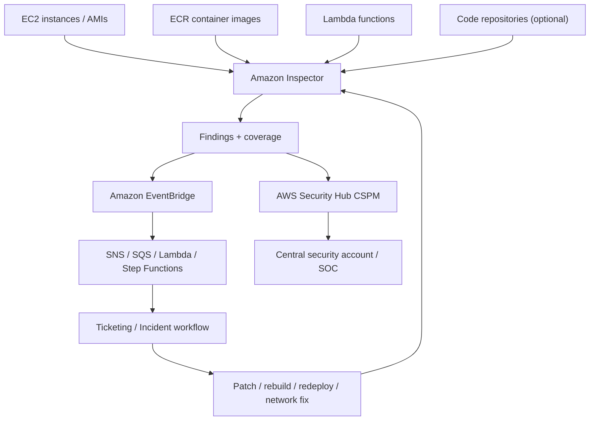
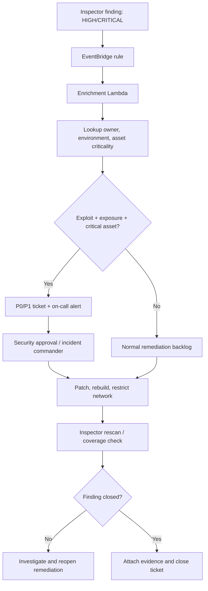

# Amazon Inspector và quản lý lỗ hổng workload

> **Chương:** Giám sát an ninh và ứng phó  
> **Module:** CLOUD_PROVIDERS_AWS  
> **Mục tiêu:** triển khai Amazon Inspector để liên tục phát hiện lỗ hổng phần mềm và đường truy cập mạng ngoài ý muốn; quản lý độ bao phủ workload; ưu tiên, xử lý, xác minh và báo cáo findings trong môi trường AWS nhiều tài khoản.

## 1. Vì sao cần quản lý lỗ hổng liên tục?

Một workload AWS có thể thay đổi mỗi ngày:

- EC2 instances được tạo từ AMI mới hoặc thay đổi package sau khi boot.
- Container image được build, push và deploy liên tục.
- Lambda functions được cập nhật dependencies hoặc layers.
- Một CVE mới được công bố sau khi workload đã chạy ổn định nhiều tháng.
- Security Group, route table hoặc load balancer thay đổi khiến một cổng dịch vụ trở nên reachable từ Internet.
- Một account mới được tạo trong AWS Organizations nhưng chưa được bật scanning.

Quét một lần trước khi go-live không đủ để theo dõi các thay đổi đó. Quản lý lỗ hổng cần một vòng đời liên tục:

1. **Discover:** biết workload nào đang tồn tại.
2. **Assess:** thu thập inventory và so sánh với security advisories/CVE.
3. **Prioritize:** đánh giá mức độ nghiêm trọng cùng khả năng khai thác và mức độ phơi lộ.
4. **Remediate:** cập nhật package/image/code hoặc sửa network configuration.
5. **Verify:** quét lại và xác nhận finding đã đóng.
6. **Govern:** theo dõi coverage, SLA, exception và xu hướng rủi ro.

Amazon Inspector hỗ trợ bước discover, assess và theo dõi findings liên tục. Đội workload vẫn chịu trách nhiệm quyết định remediation, triển khai bản vá, kiểm thử ứng dụng và chấp nhận rủi ro theo quy trình tổ chức.

## 2. Amazon Inspector là gì?

Amazon Inspector là dịch vụ quản lý lỗ hổng tự động. Dịch vụ phát hiện các workload đủ điều kiện trong account/Region, thu thập software inventory hoặc dữ liệu cần thiết, đối chiếu với vulnerability intelligence và tạo findings khi phát hiện vấn đề.

Các nhóm khả năng chính:

- **EC2 scanning:** package vulnerabilities trên EC2 và network reachability issues.
- **ECR scanning:** lỗ hổng trong operating system packages và programming-language dependencies của container images.
- **Lambda standard scanning:** lỗ hổng trong dependencies được đóng gói cùng function và layers.
- **Lambda code scanning:** phát hiện code vulnerabilities trong source code của Lambda functions; đây là lớp tùy chọn.
- **Machine image scanning:** quét AMIs để phát hiện package vulnerabilities trước khi dùng image tạo EC2; phải bật riêng.
- **Code Security:** quét source repositories, third-party dependencies và Infrastructure as Code; phải bật và cấu hình riêng.

Inspector tạo finding với thông tin về resource, vulnerability, severity, package/version, fix availability, exploit intelligence và hướng khắc phục. Một số findings còn mô tả network path hoặc vị trí code bị ảnh hưởng.

### 2.1. Inspector nằm ở đâu trong security architecture?



Inspector không thay thế mọi lớp security:

| Dịch vụ | Vai trò chính |
|---|---|
| Amazon Inspector | Phát hiện software vulnerabilities và network reachability issues |
| AWS Systems Manager Patch Manager | Lập lịch và triển khai OS patches cho managed nodes |
| AWS Security Hub CSPM | Tổng hợp findings và kiểm tra security posture |
| Amazon GuardDuty | Phát hiện hành vi đe dọa qua threat signals |
| AWS Config | Theo dõi resource configuration và đánh giá rules |
| AWS WAF / Network Firewall | Kiểm soát traffic theo policy |
| Amazon ECR | Lưu container images và cấu hình enhanced scanning |
| AWS CodeBuild / CodePipeline | Build, test và triển khai artifacts |

Inspector trả lời câu hỏi “workload có lỗ hổng hoặc đường mạng rủi ro nào?”. Patch Manager hoặc pipeline chịu trách nhiệm triển khai thay đổi để sửa vấn đề.

## 3. Chọn scan type theo workload

| Workload | Scan type | Phạm vi phát hiện |
|---|---|---|
| EC2 | EC2 scanning | OS/application packages và network reachability |
| ECR | Enhanced scanning | OS packages và language dependencies trong image |
| Lambda | Standard scanning | Dependencies được upload cùng function/layers |
| Lambda | Code scanning (optional) | Code vulnerabilities như injection, data leaks, weak cryptography |
| AMI | Machine image scanning (optional) | Package vulnerabilities trong EBS snapshots backing AMI |
| Source repository | Code Security (optional) | First-party code (SAST), third-party dependencies (SCA), IaC |

Khi kích hoạt Inspector lần đầu, các scan types cốt lõi thường bao gồm EC2, ECR và Lambda standard theo quy trình onboarding hiện hành. Lambda code scanning là lớp tùy chọn; machine image scanning và Code Security cần được kích hoạt riêng. Kiểm tra Region support và coverage sau khi enable vì không phải mọi tính năng đều có ở mọi Region.

### 3.1. Phân biệt vulnerability finding và network reachability finding

- **Package vulnerability:** package version khớp với một vulnerability advisory/CVE.
- **Network reachability:** có đường mạng cho phép một port/protocol tiếp cận EC2 instance từ VPC edge hoặc kết nối mạng liên quan.
- **Code vulnerability:** source code có pattern có thể dẫn đến injection, data leak, missing encryption hoặc weak cryptography.

Một instance có package vulnerable nhưng không có đường mạng trực tiếp từ Internet vẫn cần xử lý theo asset criticality và threat model. Ngược lại, một service reachable từ Internet không tự động là vulnerability nếu không có package/code issue; đó là một finding về network exposure cần đánh giá riêng.

## 4. EC2 scanning: agent-based và agentless

Amazon Inspector thu thập inventory của EC2 instances rồi so sánh package versions với security advisories. Có hai scan methods cho package vulnerabilities.

### 4.1. Agent-based scanning

Agent-based scanning dùng SSM Agent và cơ chế Inspector VM Scanner/SSM associations để thu thập software inventory trên instance.

Điều kiện vận hành:

- Instance phải là SSM managed node và đáp ứng OS/architecture support.
- SSM Agent phải hoạt động và có quyền giao tiếp với Systems Manager endpoints.
- Instance profile hoặc service permissions phải đúng.
- SSM associations/plugins của Inspector cần được tạo và duy trì.
- Network egress/VPC endpoints phải cho phép traffic tới các AWS service endpoints cần thiết.

Enhanced EC2 scanning dùng Inspector VM Scanner, được cài/cập nhật thông qua SSM associations. Cơ chế này thu thập inventory nhất quán hơn trên các operating systems được hỗ trợ; kiểm tra trạng thái association và scanner health khi coverage thiếu.

Ưu điểm của agent-based:

- Theo dõi thay đổi package trên managed instances.
- Hỗ trợ deep inspection cho một số Linux application-language packages và paths.
- Có thể quét lại khi có CVE mới hoặc inventory thay đổi.
- Không cần Inspector tạo EBS snapshots chỉ để thu thập inventory.

Hạn chế:

- Instance chưa được SSM quản lý có thể không đủ điều kiện ở agent-based-only mode.
- Agent/association lỗi làm inventory cũ hoặc thiếu.
- Custom package paths cần được cấu hình nếu nằm ngoài default paths của deep inspection.

### 4.2. Agentless scanning

Agentless scanning thu thập inventory từ EBS snapshots backing instance, không cần SSM Agent trên instance.

Cơ chế này hữu ích khi:

- Instance không được SSM quản lý.
- Không thể cài agent do OS/application constraints.
- Muốn có thêm coverage cho EBS-backed instances đủ điều kiện.

Agentless scanning có điều kiện eligibility về instance, EBS volumes, file systems, snapshot access và giới hạn storage. Không giả định mọi EC2 instance đều được agentless scan. Kiểm tra scan status và coverage reason cho từng instance.

Agentless method có thể phát hiện Linux application-language packages trên các paths khác với agent-based method. Vì vậy hai phương thức có thể tạo tập findings khác nhau trên cùng một instance.

### 4.3. Hybrid scanning

Hybrid scanning kết hợp agent-based và agentless:

- Instance được SSM quản lý: dùng agent-based.
- Instance không được SSM quản lý nhưng đủ điều kiện: dùng agentless.
- Instance không đủ điều kiện của cả hai phương pháp: có thể không được scan.

Hybrid scanning là cách tăng coverage cho fleet không đồng nhất. Sau khi bật, vẫn phải theo dõi coverage; đừng chỉ dựa vào số EC2 instances đang chạy.

### 4.4. Network reachability

Inspector đánh giá cấu hình network để tìm đường truy cập đến EC2 instance qua VPC edges, chẳng hạn Internet Gateway, load balancer, VPC peering hoặc VPN/gateway paths.

Service phân tích các cấu hình như:

- Security Groups.
- Network ACLs.
- Route Tables và Subnets.
- Internet Gateways và Virtual Private Gateways.
- Elastic Network Interfaces.
- Load Balancers và VPC peering connections.

Network reachability findings chỉ áp dụng cho EC2. Inspector thực hiện reachability scans theo chu kỳ khoảng 12 giờ; đây không phải packet capture hay real-time IDS. Sau khi sửa security group/route, chờ lần scan kế tiếp hoặc kiểm tra coverage/findings được cập nhật.

## 5. ECR enhanced scanning cho container images

Amazon ECR có basic scanning và enhanced scanning. Enhanced scanning tích hợp Amazon Inspector để quét cả OS packages và programming-language dependencies.

| Tiêu chí | ECR basic scanning | ECR enhanced scanning |
|---|---|---|
| Engine | ECR native scanning | Amazon Inspector |
| OS package vulnerabilities | Có | Có |
| Language package vulnerabilities | Không đầy đủ như enhanced | Có |
| Scan on push | Có | Có |
| Continuous rescanning khi CVE mới | Không như Inspector enhanced | Có |
| Findings integration với Inspector/Security Hub/EventBridge | Hạn chế | Có |

### 5.1. Chọn scan frequency

Enhanced scanning hỗ trợ:

- **Scan on push:** scan image khi image mới được push vào repository.
- **Continuous scanning:** theo dõi image trong thời gian eligibility window và scan lại khi có vulnerability intelligence mới liên quan.

Continuous scanning phù hợp cho images đang được sử dụng hoặc có vòng đời dài. Scan on push phù hợp khi pipeline yêu cầu kết quả ban đầu trước khi promote artifact; tuy nhiên image không được theo dõi liên tục sau lần scan đó.

### 5.2. Image eligibility và re-scan duration

Inspector chỉ scan images có trạng thái `ACTIVE` trong ECR; archived images không được scan cho tới khi restore. Continuous scanning có các cửa sổ thời gian theo push date và last-in-use/last-pull date.

Tại thời điểm tháng 11/2026, default re-scan duration cho các accounts kích hoạt ECR scanning mới từ ngày 15/10/2026 là 7 ngày. Accounts đã kích hoạt trước đó giữ cấu hình hiện tại của họ. Đây là default eligibility window, không có nghĩa mọi image chỉ được quét một lần trong 7 ngày.

Đội platform nên chọn duration theo vòng đời thực tế của images. Image lâu dài trong production cần được theo dõi phù hợp; image ephemeral hoặc không còn được deploy có thể dùng window ngắn hơn để giảm chi phí và noise.

### 5.3. Remediate container findings

Quy trình an toàn:

1. Xác định image digest, repository, tag, build ID và deployment đang sử dụng image đó.
2. Xác định package vulnerable và fixed version.
3. Cập nhật base image hoặc dependency lockfile.
4. Rebuild image từ source có thể tái lập.
5. Chạy unit/integration/security tests.
6. Push image mới và chờ Inspector scan.
7. Promote đúng digest đã được kiểm tra qua staging/production.
8. Redeploy service và xác minh runtime đang chạy digest mới.
9. Kiểm tra finding cũ đã đóng và image mới có coverage.

Không chỉ đổi tag trỏ sang digest mới rồi kết luận đã sửa. Deployment phải thực sự dùng image digest đã được build/test và scan.

## 6. Lambda scanning và Code Security

### 6.1. Lambda standard scanning

Lambda standard scanning kiểm tra software package dependencies được đóng gói cùng function code và layers.

Ví dụ:

- Python function đóng gói `requests` hoặc `cryptography`.
- Node.js function đóng gói `lodash` hoặc `jsonwebtoken`.
- Java function mang theo thư viện trong deployment package hoặc layer.

Inspector tạo Package Vulnerability finding nếu dependency có version vulnerable.

Một giới hạn quan trọng: Lambda standard scanning không quét AWS SDK dependency được cung cấp sẵn trong runtime environment; nó tập trung vào dependencies mà bạn upload cùng function code hoặc kế thừa từ layer.

### 6.1.1. Eligibility và giới hạn Lambda

Inspector chỉ scan các Lambda functions đủ điều kiện, bao gồm:

- Function có runtime được hỗ trợ cho scan type tương ứng.
- Function version đang được xét là `$LATEST`.
- Function đã được invoke hoặc update trong 90 ngày gần nhất.
- Function không bị loại trừ bằng exclusion tags.

Function không được invoke/update trong 90 ngày có thể tự động hết scan eligibility; khi được invoke lại hoặc update code, Inspector có thể đưa function trở lại coverage. Tại thời điểm viết bài, Inspector không hỗ trợ scan Lambda functions được mã hóa bằng customer-managed KMS keys; kiểm tra Region/runtime support và encryption configuration trước khi đặt mục tiêu coverage.

### 6.2. Lambda code scanning

Lambda code scanning là lớp tùy chọn để phát hiện lỗi trong application code do đội phát triển viết, ví dụ:

- Injection flaws.
- Data leaks.
- Hardcoded credentials.
- Missing encryption.
- Weak cryptography.

Finding có thể chứa code snippet, file path, vị trí dòng và remediation suggestion. Snippet có thể vô tình chứa credentials hoặc dữ liệu nhạy cảm nếu code đã hardcode chúng. Vì vậy hạn chế quyền xem findings/code snippets. Delegated administrator không thể xem code snippets thuộc member accounts; member account owner phải phối hợp cung cấp evidence phù hợp theo quy trình tổ chức.

Remediation suggestion có thể được hỗ trợ bằng automated reasoning; developer phải review và test patch trước khi merge/deploy.

### 6.3. Code Security cho repository

Amazon Inspector Code Security mở rộng scanning sang source repositories:

- **SAST:** phân tích first-party source code.
- **SCA:** phát hiện vulnerabilities trong third-party dependencies.
- **IaC scanning:** tìm cấu hình Infrastructure as Code có rủi ro.

Có thể cấu hình scan theo push hoặc pull request/merge request và tích hợp repository providers được hỗ trợ. Một số findings SAST có thể tạo pull request đề xuất fix theo severity threshold và scan configuration.

Code Security cần được kích hoạt riêng, kết nối repository và tạo scan configuration. Nó không tự thay thế code review, unit tests, dependency policy hoặc pipeline quality gates.

## 7. Machine image scanning: tìm lỗ hổng trước khi launch

Machine image scanning là scan type tùy chọn cho Amazon Machine Images (AMIs). Inspector đọc software inventory từ EBS snapshots backing AMI và so sánh package versions với vulnerability intelligence.

Lợi ích:

- Phát hiện package vulnerabilities trước khi AMI được dùng tạo EC2.
- Quét lại khi Inspector bổ sung CVE mới liên quan tới AMI đang trong scope.
- Hỗ trợ kiểm tra golden images và image promotion pipeline.
- Không cần launch instance từ AMI chỉ để thu thập inventory.

### 7.1. Điều kiện và eligibility

Inspector chỉ scan các machine images đáp ứng điều kiện hỗ trợ, chẳng hạn:

- Account sở hữu AMI và EBS snapshots backing image.
- AMI là EBS-backed, ở trạng thái phù hợp và dùng OS được hỗ trợ.
- Snapshot file systems và storage layout nằm trong giới hạn scanning.
- AMI nằm trong scan eligibility windows và không bị exclusion rules loại trừ.

AMI public/shared thuộc account khác không tự động được scan như image do account mình sở hữu. Muốn kiểm tra image đó, copy image vào account của mình để tạo snapshots thuộc account rồi scan bản copy.

### 7.2. Continuous và on-demand scans

- **Continuous machine image scanning:** theo dõi AMIs trong scope, scan image mới và rescan khi vulnerability intelligence có CVE liên quan.
- **On-demand scan:** chạy một lần cho một AMI cụ thể mà không cần bật continuous machine image scanning.

Một khác biệt vận hành quan trọng: kết quả của on-demand AMI scans được gửi qua EventBridge. Chúng không xuất hiện trong Inspector console, không được trả về bởi ListFindings và không được gửi sang Security Hub CSPM như findings thông thường. Phải lưu EventBridge events/scan IDs nếu cần evidence cho build pipeline.

### 7.3. Tích hợp với golden AMI pipeline

1. Build AMI từ base image đã được phê duyệt.
2. Chờ AMI ở trạng thái available.
3. Chạy Inspector machine image scan hoặc on-demand scan.
4. Lấy findings theo AMI ID và scan ID.
5. Chặn promotion nếu có Critical/High findings vượt policy.
6. Sửa package trong build recipe, tạo AMI mới và scan lại.
7. Chỉ publish AMI ID đã qua security gate.
8. Theo dõi AMIs cũ đang được dùng bởi EC2 instances và retire theo change plan.

## 8. Coverage: biết workload nào thật sự được scan

Một danh sách findings sạch không có nghĩa fleet đã được scan đầy đủ. Nếu resource không nằm trong coverage, Inspector không thể báo lỗ hổng của resource đó.

Coverage review cần trả lời:

- Account và Region nào đã enable Inspector?
- Scan types nào đã bật?
- Có bao nhiêu EC2 instances đủ điều kiện?
- Instance dùng agent-based hay agentless scanning?
- SSM Agent/Inspector VM Scanner associations có hoạt động không?
- ECR repositories có Enhanced Scanning và image có trạng thái ACTIVE không?
- Lambda functions có đủ điều kiện scan và có được exclude bằng tags không?
- AMIs và code repositories có nằm trong scope không?
- Có resource nào bị access denied, unsupported hoặc scan error không?

### 8.1. Các nguồn tạo coverage gap

| Resource | Coverage gap thường gặp | Hướng xử lý |
|---|---|---|
| EC2 | SSM Agent không hoạt động, OS không hỗ trợ, scan mode không phù hợp | Kiểm tra SSM managed status, scan mode và eligibility |
| EC2 agentless | Instance không dùng EBS phù hợp, volume/file system vượt giới hạn | Xác minh agentless eligibility hoặc chuyển agent-based |
| ECR | Repository dùng basic scanning, image archived/inactive hoặc hết scan eligibility | Bật Enhanced Scanning và kiểm tra scan frequency/window |
| Lambda | Function chưa được scan, layer/package ngoài scope hoặc Region không hỗ trợ | Kiểm tra scan type, invocation/update eligibility và layer |
| AMI | Image không thuộc account hoặc không nằm trong eligibility window | Copy image vào account, điều chỉnh scan scope |
| Code repository | Repository chưa được kết nối hoặc scan configuration chưa áp dụng | Kiểm tra integration, permissions và scan configuration |

### 8.2. Coverage inventory và KPI

Nên quản lý một inventory độc lập với findings:

| Metric | Cách hiểu |
|---|---|
| Eligible EC2 instances | EC2 instances nằm trong điều kiện scan |
| Covered EC2 instances | EC2 instances có scan coverage hợp lệ |
| SSM managed ratio | Tỷ lệ instances được SSM quản lý |
| Agentless coverage ratio | Tỷ lệ instances đủ điều kiện và được agentless scan |
| ECR active image coverage | Tỷ lệ active images có enhanced scanning |
| Lambda coverage | Tỷ lệ functions đủ điều kiện có standard/code scan |
| Unsupported/error resources | Resource không scan được hoặc lỗi |
| Last scanned age | Thời gian từ lần scan gần nhất |
| Accounts/Regions enabled | Số account/Region có scan types đúng policy |

Ví dụ công thức:

```text
EC2 coverage % =
  covered eligible EC2 instances
  / eligible EC2 instances
  * 100

ECR coverage % =
  active in-scope images monitored by Inspector
  / active in-scope images
  * 100
```

Không dùng tổng số EC2 instances đang running làm denominator nếu inventory có nhiều instances không thuộc scope/không được hỗ trợ. Ghi rõ eligibility criteria để KPI có thể kiểm chứng.

## 9. Hiểu findings và các trạng thái

Finding là một bản ghi mô tả vấn đề được phát hiện trên resource. Inspector có ba finding types chính:

| Finding type | Ví dụ |
|---|---|
| PACKAGE_VULNERABILITY | Package OpenSSL hoặc library version bị ảnh hưởng bởi CVE |
| NETWORK_REACHABILITY | EC2 port có đường truy cập từ VPC edge hoặc Internet path |
| CODE_VULNERABILITY | Lambda/source code có injection, hardcoded secret hoặc weak cryptography |

Một package vulnerability finding thường có:

- Finding ARN và account/Region.
- Resource ARN/ID và resource type.
- Vulnerability ID/CVE, title và description.
- Severity và Inspector score.
- CVSS vector/score, EPSS probability và exploit availability khi có dữ liệu.
- Affected package name, installed version và fixed version.
- First observed/last observed/updated timestamps.
- Remediation guidance và references.

### 9.1. Severity không phải toàn bộ risk

Severity thường có các mức Informational, Low, Medium, High và Critical. Inspector có thể cung cấp Inspector score điều chỉnh theo context của resource.

Ví dụ, một vulnerability có CVSS cao nhưng EC2 không có đường network reachability từ VPC edge có thể được đánh giá khác với cùng vulnerability trên instance public-facing. Inspector score là tín hiệu ưu tiên hữu ích; đội security vẫn phải kết hợp asset criticality, business impact và exploit context.

### 9.2. Exploit available không có nghĩa đã bị exploit

Trường Exploit available cho biết vulnerability có known exploit theo threat intelligence mà Inspector sử dụng. Nó không chứng minh exploit đã được thực thi trong account.

Để điều tra exploitation thực tế, tương quan finding với:

- GuardDuty findings.
- CloudTrail API events.
- VPC Flow Logs và load balancer access logs.
- Application/authentication logs.
- EDR/runtime telemetry nếu có.
- Incident timeline và identity/session events.

### 9.3. Finding states

| State | Ý nghĩa |
|---|---|
| Active | Finding chưa được remediated |
| Suppressed | Finding khớp suppression rule và bị ẩn khỏi danh sách mặc định |
| Closed | Finding đã được đóng sau remediation hoặc resource không còn đủ điều kiện |

Suppressed không đồng nghĩa Closed. Suppression chỉ thay đổi cách finding được hiển thị/ưu tiên; vulnerability vẫn tồn tại cho tới khi được xử lý.

### 9.4. Finding và coverage phải được đọc cùng nhau

Nếu finding count giảm đột ngột, hãy kiểm tra:

- Resource có bị terminate/delete không?
- ECR image có bị archived hoặc scan eligibility expired không?
- Lambda function có bị exclude hoặc không còn đủ điều kiện không?
- Inspector có bị disable ở account/Region không?
- Findings có bị suppress bởi rule mới không?
- Security Hub/EventBridge integration có bị thay đổi không?

Không báo cáo “vulnerability count = 0” nếu coverage cũng giảm hoặc có resource scan errors.

## 10. Ưu tiên remediation theo rủi ro thực tế

Không nên xếp hàng remediation chỉ theo CVSS. Một finding cần được ưu tiên bằng cách kết hợp:

1. Severity/CVSS và Inspector score.
2. Known exploit availability và EPSS.
3. Network reachability hoặc public exposure.
4. Business criticality của workload.
5. Data sensitivity và blast radius.
6. Fix availability và effort.
7. Age/recurrence và SLA đã cam kết.
8. Compensating controls đang có.

### 10.1. Ma trận ưu tiên tham khảo

| Priority | Dấu hiệu | Hành động |
|---|---|---|
| P0 / Emergency | Critical, exploit known, public reachable, asset critical | Incident/security escalation ngay; containment và emergency patch |
| P1 / High | Critical/High trên production, có fix, hoặc asset quan trọng | Ưu tiên remediation trong change window gần nhất |
| P2 / Medium | Medium/High nhưng exposure hạn chế hoặc chưa có exploit | Đưa vào sprint/patch cycle có owner |
| P3 / Planned | Low, non-production hoặc có compensating control mạnh | Theo dõi và xử lý theo maintenance schedule |

Đây là ví dụ policy nội bộ; AWS không áp đặt SLA P0/P1/P2/P3 này. Tổ chức phải định nghĩa deadline theo regulatory obligations, customer contracts, business criticality và khả năng vận hành.

### 10.2. Ví dụ so sánh

**Finding A:** CVSS 9.8, EC2 instance public-facing, exploit known, package có fixed version, workload xử lý payment traffic.

**Finding B:** CVSS 9.8, EC2 instance isolated trong private subnet, không có đường reachability từ VPC edge, không có known exploit, package chưa có fix.

Finding A thường cần ưu tiên cao hơn vì có exploit intelligence, network exposure và business criticality. Finding B vẫn cần owner, risk acceptance hoặc kế hoạch xử lý; không được tự động bỏ qua chỉ vì private subnet.

### 10.3. Tạo backlog có thể hành động

Mỗi finding/ticket nên có:

- Finding ARN, CVE và resource ID.
- Account, Region, environment và application owner.
- Installed package/version và fixed version.
- Inspector score, severity, EPSS/exploit information.
- Network exposure và business criticality.
- Remediation action, change ticket và target date.
- Exception/approval nếu chưa thể sửa.
- Verification evidence sau khi remediation.

Deduplicate theo CVE + package + resource/image digest khi cần, nhưng giữ mapping về từng resource để không bỏ sót workload.

## 11. Suppression rules và risk exceptions

Suppression rules giúp giảm noise trong findings view. Rule có thể match theo severity, resource, vulnerability hoặc các finding attributes được hỗ trợ.

Cần hiểu rõ:

- Suppression **ẩn finding khỏi danh sách mặc định**, không vá package và không sửa network.
- Finding bị suppress vẫn tồn tại trong Inspector cho tới khi remediated.
- Rule có thể mất tới 24 giờ để áp dụng.
- Chỉ standalone account hoặc delegated administrator có quyền tạo/quản lý suppression rules trong môi trường organization.
- Xóa suppression rule có thể làm các findings phù hợp trở lại Active và hiển thị/publish events.

### 11.1. Khi nào được suppress?

Một exception có thể hợp lý khi:

- Finding là false positive đã được xác minh.
- Package không được sử dụng trong runtime path và đã có evidence.
- Workload được cô lập bởi compensating controls đã kiểm thử.
- Vendor chưa cung cấp fix và có kế hoạch mitigation.
- Resource sắp được retire theo lịch có owner/approval.

Không suppress chỉ vì finding có severity thấp, team chưa có thời gian xử lý hoặc dashboard đang có quá nhiều alerts.

### 11.2. Nội dung bắt buộc của exception

| Field | Nội dung |
|---|---|
| Finding/CVE | ARN, CVE hoặc finding criteria |
| Resource scope | Resource/account/Region/image digest cụ thể |
| Reason | Lý do suppress/risk acceptance |
| Evidence | Test result, network path, vendor advisory hoặc compensating control |
| Owner | Team chịu trách nhiệm |
| Approver | Security/risk owner phê duyệt |
| Created/expiry date | Ngày tạo và ngày hết hạn |
| Review cadence | Khi nào đánh giá lại |
| Exit criteria | Điều kiện đóng exception và bỏ suppression |

Ưu tiên exception có thời hạn. Khi hết hạn, mở lại review; không để suppression vĩnh viễn mà không có owner và evidence.

## 12. Quản trị Inspector trên nhiều AWS accounts và Regions

Amazon Inspector là Regional service. Mỗi Region cần được kiểm tra riêng về activation, delegated administrator, scan types, coverage và integrations.

### 12.1. Delegated administrator

Trong AWS Organizations, có thể chỉ định một account làm Inspector delegated administrator để quản lý member accounts.

Vai trò này có thể:

- Theo dõi scan coverage và findings của member accounts.
- Bật/tắt scan types cho các accounts theo mô hình governance được sử dụng.
- Quản lý suppression rules và cấu hình tập trung.
- Xuất findings/SBOM cho phạm vi organization theo quyền được hỗ trợ.
- Tích hợp Security Hub và EventBridge để điều phối findings.

Delegated administrator là cấu hình theo Region; thực hiện setup ở các Regions cần quản lý. Một Organization chỉ có một delegated administrator cho Amazon Inspector và account được chọn phải nhất quán giữa các Regions. AWS Organizations phải bật all features.

### 12.2. Organization policies

AWS Organizations policies là cách quản trị tập trung được AWS khuyến nghị để tự động enable Inspector cho các accounts trong Organization, bao gồm accounts mới được thêm vào.

Khi organization policy quản lý một scan type:

- Policy quyết định scan types nào được enable.
- Member account/delegated administrator không thể override policy-managed scan type bằng API enable/disable thông thường.
- Delegated administrator vẫn có thể quản lý một số scan settings như scan mode/deep inspection paths theo quyền và loại setting.
- Account onboarding/offboarding cần được kiểm tra để coverage không bị đứt.

Nếu không dùng organization policies, delegated administrator có thể kích hoạt scanning cho member accounts qua console/API. Dù dùng mô hình nào, phải kiểm tra từng Region và account state.

### 12.3. Account/Region onboarding checklist

Khi tạo account hoặc bật Region mới:

1. Xác minh account đã thuộc đúng Organization/OU.
2. Kiểm tra organization policy có áp dụng.
3. Xác minh delegated administrator đã được đăng ký ở Region.
4. Bật EC2/ECR/Lambda scan types cần thiết.
5. Bật Lambda code scanning, machine image scanning hoặc Code Security nếu scope yêu cầu.
6. Kiểm tra Security Hub integration và EventBridge rules.
7. Kiểm tra coverage status và scan errors.
8. Ghi account/Region vào vulnerability coverage inventory.

Không lấy số account được đăng ký với delegated administrator làm bằng chứng mọi account/Region đều đã scan. Organization policy có thể bao phủ số accounts lớn hơn phạm vi mà delegated administrator console/API hiển thị; đối chiếu coverage thực tế.

## 13. Tích hợp findings với Security Hub và EventBridge

### 13.1. AWS Security Hub CSPM

Khi bật Security Hub CSPM, integration của Amazon Inspector được kích hoạt tự động và Inspector gửi findings sang Security Hub theo AWS Security Finding Format (ASFF).

Security Hub hỗ trợ:

- Tổng hợp Inspector findings với findings từ GuardDuty, Config và các security products khác.
- Central configuration/aggregation cho nhiều accounts và Regions.
- Correlation và workflow status.
- Tạo custom insights theo severity, resource, account hoặc finding type.
- Gửi findings sang EventBridge và ticketing/SOC integrations.

Security Hub là nơi tổng hợp posture/findings; Inspector vẫn là nguồn scan coverage và vulnerability details. Khi investigation cần package/version/fix details, mở finding gốc trong Inspector hoặc API.

### 13.2. EventBridge event flow

Inspector phát các event trực tiếp tới EventBridge, bao gồm:

- `Inspector2 Finding`: finding được tạo, cập nhật hoặc đóng.
- `Inspector2 Scan`: trạng thái initial scan hoàn tất.
- `Inspector2 Coverage`: coverage của resource thay đổi.
- Một số event khác liên quan tới account/scan configuration.

EventBridge service events được phát theo best-effort delivery và event bus là Regional. Tạo rules tại từng Region đã enable Inspector. Nếu cần cross-Region/cross-account, route tới central event bus có policy cho phép.

### 13.3. EventBridge rule cho findings High/Critical

Ví dụ pattern:

```json
{
  "source": ["aws.inspector2"],
  "detail-type": ["Inspector2 Finding"],
  "detail": {
    "severity": ["HIGH", "CRITICAL"],
    "status": ["ACTIVE"]
  }
}
```

Có thể route tới:

- SNS để thông báo security/on-call.
- SQS để giữ queue và xử lý có retry.
- Lambda để enrich asset owner, tạo ticket hoặc gọi internal API.
- Step Functions để chạy workflow phê duyệt/containment.
- Central EventBridge bus ở security account.

Không tự động isolate instance, terminate resource hoặc deploy patch chỉ vì có finding event. Trước hết xác minh finding/resource và thiết kế approval/rollback/exception controls.

### 13.4. Ví dụ workflow phản ứng



### 13.5. Suppression và Security Hub workflow

Inspector suppression rules ảnh hưởng việc hiển thị findings trong Inspector. Security Hub có workflow status và automation riêng. Đừng giả định thay đổi suppression rule tự động xóa finding ở mọi hệ thống downstream. Thiết kế đồng bộ status/ticket closure bằng finding ARN và workflow metadata.

## 14. Remediation EC2: từ finding đến patch

Inspector phát hiện package vulnerable nhưng không tự cài OS patch. AWS Systems Manager Patch Manager hoặc configuration-management tooling thực hiện patching.

### 14.1. Xác định package và fix

Với mỗi finding, xác định:

- EC2 instance ID, account, Region và environment.
- OS/platform và package manager.
- Package name, installed version và fixed version.
- CVE/advisory và exploit availability.
- Instance có public/network reachability hay không.
- Application owner, maintenance window và dependency impact.

Không áp dụng package update mù quáng. Một package update có thể thay đổi ABI, dependency tree hoặc application behavior.

### 14.2. Patch Manager workflow

Một quy trình phổ biến:

1. Đảm bảo EC2 instance là SSM managed node.
2. Kiểm tra Patch Baseline/patch policy cho đúng OS.
3. Chọn maintenance window và target tags.
4. Chạy scan để xác định missing patches.
5. Test Install trong dev/staging.
6. Backup/snapshot khi workload yêu cầu.
7. Triển khai theo batch/canary.
8. Theo dõi application health và reboot requirement.
9. Chạy Inspector rescan/đợi inventory refresh.
10. Xác nhận finding đóng và lưu patch compliance evidence.

### 14.3. Ví dụ Run Command

Lệnh minh họa chạy Patch Manager document cho managed instances có tag `PatchGroup=prod-linux`:

```bash
aws ssm send-command \
  --region ap-southeast-1 \
  --document-name "AWS-RunPatchBaseline" \
  --targets "Key=tag:PatchGroup,Values=prod-linux" \
  --parameters '{"Operation":["Install"],"RebootOption":["RebootIfNeeded"]}' \
  --comment "Approved security patch wave CHG-2026-042"
```

Đây là mutating operation: nó có thể cài patches và reboot instances. Chỉ chạy trong maintenance window đã phê duyệt; kiểm tra command ID, per-instance status, reboot behavior và application health trước khi coi remediation hoàn tất.

### 14.4. Nếu chưa có fix

Khi vendor chưa phát hành fixed version:

- Xác định package có thực sự được sử dụng trong workload path không.
- Đánh giá exploit availability và network exposure.
- Áp dụng compensating controls như giới hạn ingress, disable feature hoặc isolate workload.
- Theo dõi vendor advisory và patch availability.
- Ghi exception có owner, approver, expiry date và review cadence.
- Reassess khi có fixed version hoặc threat intelligence mới.

Không tự đánh dấu finding là fixed chỉ vì đã thêm network control. Network mitigation có thể giảm risk nhưng package vulnerability vẫn tồn tại.

## 15. Remediation ECR, Lambda, AMI và source code

### 15.1. Container image

- Sửa Dockerfile/base image và dependency lockfiles.
- Pin package versions rõ ràng.
- Rebuild từ source; tránh sửa trực tiếp container đang chạy.
- Scan digest mới và kiểm tra findings.
- Promote digest qua environments.
- Redeploy và xác minh ECS/EKS workload dùng digest đã duyệt.
- Retire old images theo image retention policy sau khi xác nhận rollback window.

### 15.2. Lambda dependencies và code

Với package vulnerability:

1. Xác định dependency nằm trong deployment package hay Lambda layer.
2. Cập nhật version đã được vendor fix.
3. Rebuild artifact/layer.
4. Chạy tests và security checks.
5. Publish version mới và cập nhật alias/traffic routing.
6. Kiểm tra Inspector finding trên function/layer mới.

Với code vulnerability:

- Review file path, line number, detector/CWE và code snippet.
- Sửa input validation, output encoding, secret handling, crypto hoặc data flow.
- Không copy remediation suggestion mà chưa review.
- Xóa hardcoded credentials khỏi code và rotate credential nếu đã bị lộ.
- Chạy tests, deploy version mới và xác nhận finding đóng.

Nếu code snippet có thể chứa secret, giới hạn access tới finding và dùng quy trình secret rotation phù hợp.

### 15.3. Golden AMI

Nếu finding nằm trong AMI:

- Sửa image build pipeline/package manifest.
- Tạo AMI mới và scan trước khi publish.
- Cập nhật launch template/Auto Scaling Group để dùng AMI đã duyệt.
- Roll instance fleet theo rolling update hoặc blue/green.
- Xác minh cả AMI mới lẫn EC2 instances đang chạy không còn finding cũ.
- Retire AMIs cũ theo retention policy, giữ rollback image nếu cần.

### 15.4. Network reachability

Với NETWORK_REACHABILITY finding:

- Xem open port/protocol và network path trong finding.
- Xác định nguồn reachable: Internet Gateway, load balancer, peering, VPN hoặc VPC path.
- Review Security Group ingress/egress và NACL rules.
- Kiểm tra route table, public IP, load balancer listener và target.
- Chỉ mở port từ CIDR/source cần thiết.
- Dùng Systems Manager Session Manager thay SSH/RDP public nếu phù hợp.
- Quét lại sau khi sửa network configuration.

Một port có thể cần public cho business; khi đó phải có authentication, TLS, WAF/rate limiting, patch cadence và monitoring tương ứng.

## 16. AWS CLI: enable, coverage và findings

Các lệnh dưới đây minh họa thao tác trên account/Region lab. Thay account IDs, Region, bucket, KMS key và filter theo môi trường thực tế.

### 16.1. Enable scan types

Ví dụ bật các scan types EC2, ECR, Lambda standard, Lambda code và Code Security cho account hiện tại:

```bash
aws inspector2 enable \
  --region ap-southeast-1 \
  --resource-types EC2 ECR LAMBDA LAMBDA_CODE CODE_REPOSITORY
```

CODE_REPOSITORY dùng cho Code Security repository scanning; LAMBDA_CODE là lớp code scanning của Lambda và cần Lambda standard scanning. Machine image scanning có cấu hình riêng trong Inspector; không giả định bật EC2 scanning đồng nghĩa mọi AMI đã được đưa vào machine image scan scope.

Trong môi trường Organization, enablement có thể được quản lý bởi organization policy hoặc delegated administrator. Không dùng member account API để override scan types do organization policy quản lý.

### 16.2. Kiểm tra coverage

```bash
aws inspector2 list-coverage \
  --region ap-southeast-1 \
  --max-items 100 \
  --output json
```

ListCoverage là paginated API. CLI tự paginate theo mặc định; nếu script dùng SDK, xử lý NextToken đến khi hết kết quả. Phân tích coverage theo resource type, account, Region, scan status và last scanned timestamp.

### 16.3. Lấy findings Active mức High/Critical

```bash
aws inspector2 list-findings \
  --region ap-southeast-1 \
  --filter-criteria '{"findingStatus":[{"comparison":"EQUALS","value":"ACTIVE"}],"severity":[{"comparison":"EQUALS","value":"CRITICAL"},{"comparison":"EQUALS","value":"HIGH"}]}' \
  --sort-criteria '{"field":"INSPECTOR_SCORE","sortOrder":"DESC"}' \
  --max-items 100 \
  --output json
```

Các filter attributes trong cùng field dùng logic OR giữa các values; các filter fields khác nhau được kết hợp để thu hẹp kết quả. ListFindings là paginated operation, nên script cần xử lý pagination.

### 16.4. Export findings report

```bash
aws inspector2 create-findings-report \
  --region ap-southeast-1 \
  --report-format CSV \
  --s3-destination bucketName=security-findings-archive,keyPrefix=inspector/2026-11,kmsKeyArn=arn:aws:kms:ap-southeast-1:111122223333:key/EXAMPLE-KEY-ID
```

Có thể chọn JSON nếu cần toàn bộ finding fields. S3 bucket policy phải cho phép Inspector ghi report; KMS key policy phải cho phép mã hóa. Lưu report ID/status và metadata của export trong evidence manifest.

### 16.5. Kiểm tra account/scan settings

Dùng Inspector console Account management, General settings và Scan settings để kiểm tra:

- Delegated administrator và member account status.
- Scan types enabled.
- EC2 scan mode.
- ECR re-scan duration.
- Lambda code scanning.
- Machine image scan scope.
- Exclusion tags và coverage status.

CLI command/API names có thể thay đổi theo AWS CLI version; dùng **aws inspector2 help** và API reference để xác minh trước khi đưa script vào production.

## 17. SBOM và evidence cho software supply chain

Software Bill of Materials (SBOM) là inventory các software components trong một workload/image. SBOM hỗ trợ:

- Biết package/dependency nào đang tồn tại trong production.
- Đối chiếu khi có CVE mới.
- Phục vụ software supply chain review.
- Chia sẻ component inventory với security/compliance teams.
- Điều tra package transitive dependencies và version drift.

Amazon Inspector có thể export SBOM cho resources đang được monitor dưới dạng JSON tương thích:

- CycloneDX 1.4.
- SPDX 2.3.

### 17.1. Export SBOM vào S3

Điều kiện:

- Resource đang có Inspector scan coverage.
- S3 bucket policy cho phép Inspector ghi report.
- KMS key policy cho phép Inspector mã hóa report.
- Role đọc report có quyền S3/KMS phù hợp.
- Bucket retention, versioning và access logging phù hợp với evidence policy.

Ví dụ:

```bash
aws inspector2 create-sbom-export \
  --region ap-southeast-1 \
  --report-format CYCLONEDX_1_4 \
  --s3-destination bucketName=security-sbom-archive,keyPrefix=inspector/sbom,kmsKeyArn=arn:aws:kms:ap-southeast-1:111122223333:key/EXAMPLE-KEY-ID
```

Có thể dùng SPDX_2_3 thay cho CYCLONEDX_1_4. Nếu export cho nhiều accounts, thực hiện trong delegated administrator context theo hướng dẫn AWS.

### 17.2. Giới hạn SBOM

SBOM phản ánh inventory mà scanner nhận diện được; một số dynamic dependencies hoặc unresolved hashes có thể không map thành package name/version để vulnerability detection. Vì vậy:

- Không coi SBOM là bằng chứng tuyệt đối rằng không có component nào khác.
- Giữ source build manifests/lockfiles và artifact digest.
- Ghi thời điểm export, resource ID, account/Region, format và report status.
- So sánh SBOM giữa các image releases để phát hiện dependency drift.

## 18. Chi phí và capacity planning

Amazon Inspector tính phí theo loại workload/scan usage, không theo số findings. Các nhóm chi phí có thể gồm:

| Scan type | Yếu tố tính phí chính |
|---|---|
| EC2 instance scans | Số lượng instances trung bình được assess trong tháng; instance chạy ngắt quãng có thể tính prorated |
| ECR image scans | Số image được scan ban đầu và số lần rescan trong tháng |
| Lambda standard/code scans | Số functions và coverage hours |
| Machine image scans | Số AMIs được scan/scan runs theo pricing model |
| Code Security | Số scans trên repositories/code changes và các scan types SAST/SCA/IaC |

Tài khoản mới đủ điều kiện có thể có 15-day free trial theo điều kiện AWS công bố. Xem pricing page hiện hành trước khi bật scope lớn.

### 18.1. Kiểm soát chi phí

- Chọn ECR continuous scanning cho repositories/images cần theo dõi liên tục.
- Đặt re-scan duration theo lifecycle của images.
- Retire/archive old images và AMIs không còn cần theo dõi.
- Dùng tags/exclusion controls có approval để loại workload ngoài scope.
- Theo dõi coverage trước và sau khi thay đổi scope để không giảm security mà không biết.
- Bật higher-value scan types trước theo threat model; đánh giá Code Security và machine image scans theo use case.
- Theo dõi AWS Cost Explorer/CUR theo account, Region và service.

Không giảm coverage chỉ để giảm chi phí mà không có risk acceptance. Trước khi thay đổi scope, ghi lại resources bị ảnh hưởng và ai phê duyệt.

## 19. Troubleshooting Amazon Inspector

| Triệu chứng | Nguyên nhân có thể | Hướng kiểm tra |
|---|---|---|
| EC2 instance không có coverage | OS không hỗ trợ, scan mode/eligibility không phù hợp | Coverage tab, supported OS, scan mode |
| EC2 agent-based không scan | SSM Agent/association lỗi hoặc instance không managed | SSM managed node, associations, instance profile |
| EC2 agentless không scan | Instance/EBS layout không đủ điều kiện hoặc snapshot access bị chặn | EBS volumes, file systems, KMS/resource policies |
| Package findings thiếu | Inventory cũ, deep inspection paths chưa cấu hình hoặc package manager không được hỗ trợ | Last scanned, scanner status, package path |
| Network finding chưa cập nhật | Reachability scan theo chu kỳ | Chờ scan cycle, kiểm tra coverage và network path |
| ECR không có findings | Registry đang basic scanning, image archived/inactive hoặc hết eligibility | ECR enhanced scanning, image status, rescan duration |
| ECR image không rescan khi có CVE mới | Repository chỉ scan on push hoặc image hết continuous window | Scan frequency, push/last-in-use/last-pull window |
| Lambda standard không thấy dependency | Dependency thuộc runtime-managed AWS SDK hoặc không nằm trong package/layer | Deployment artifact và layer inventory |
| Lambda code scan không hoạt động | Chưa enable Lambda standard hoặc code scan chưa bật/Region không hỗ trợ | Scan type settings và Region availability |
| AMI không scan | AMI không thuộc account, không EBS-backed hoặc OS/storage không hỗ trợ | AMI ownership, snapshots, eligibility |
| Code repository không có findings | Repository chưa kết nối hoặc scan configuration chưa chạy | Integration, permissions, scan configuration |
| Finding vẫn Active sau patch | Instance chưa cập nhật, image digest cũ đang chạy hoặc inventory chưa refresh | Runtime version/digest, last scanned, rescan |
| Finding biến mất đột ngột | Resource không còn eligible, bị exclude hoặc Inspector disabled | Coverage, exclusion tags, account/Region state |
| Security Hub không nhận findings | Integration bị disable hoặc sai Region/account | Security Hub integration và delegated admin |
| EventBridge không tạo ticket | Rule sai pattern, target permission thiếu hoặc event delivery best-effort | Source/detail-type, target policy, DLQ/retry |
| Suppression chưa áp dụng | Rule mới chưa được xử lý hoặc delegated admin scope sai | Rule criteria, account role, chờ propagation |
| SBOM export AccessDenied | S3 bucket policy/KMS key policy không cho Inspector | Destination policy, KMS key policy và role |
| Member account không được scan | Organization policy/delegated admin/Region chưa cấu hình | AWS Organizations policy và account management |

### 19.1. Kiểm tra findings sau remediation

Nếu finding vẫn Active sau khi vá:

1. Xác minh đúng resource ID/account/Region.
2. Kiểm tra package version thực tế trên instance hoặc artifact.
3. Với container, xác minh deployment đang dùng image digest mới.
4. Với Lambda, xác minh function version/alias và layer mới đã được publish.
5. Kiểm tra Inspector coverage và last scanned time.
6. Đợi inventory/rescan cycle hoặc thực hiện quy trình rescan được AWS hỗ trợ.
7. Kiểm tra finding có package khác hoặc resource khác cùng CVE.
8. Chỉ đóng ticket sau khi Inspector finding Closed và runtime evidence phù hợp.

### 19.2. Finding closed nhưng workload vẫn rủi ro?

Finding có thể đóng khi resource bị terminate, xóa hoặc không còn đủ điều kiện scan. Điều này không chứng minh vulnerability đã được sửa. Trước khi close risk ticket, xác minh workload đã được retire hoặc thay bằng resource đã được scan.

## 20. Runbook: xử lý Critical vulnerability trên EC2 production

Tình huống: Inspector phát hiện Critical CVE trên EC2 instance phục vụ production API và finding cho biết có exploit available.

### Bước 1 — Xác định phạm vi

- Lấy finding ARN, CVE, package, installed/fixed version.
- Ghi account, Region, instance ID, AMI ID, VPC/subnet và application owner.
- Xác định Inspector score, CVSS, EPSS và exploit availability.
- Kiểm tra network reachability, public IP/load balancer và exposed ports.

### Bước 2 — Đánh giá threat

- Kiểm tra GuardDuty findings và threat signals liên quan.
- Tìm CloudTrail events bất thường theo principal/time range.
- Review VPC Flow Logs, ALB access logs và application/auth logs.
- Xác định có dấu hiệu exploitation hay chỉ là exposure/vulnerability.
- Nếu có evidence exploitation, mở incident response process song song với remediation.

### Bước 3 — Containment

- Hạn chế ingress/egress theo incident commander/security approval.
- Nếu cần, đưa instance khỏi target group hoặc isolate bằng security group.
- Bảo toàn forensic evidence và logs trước khi thay đổi resource.
- Không terminate instance nếu cần memory/disk evidence và chưa có approval.

### Bước 4 — Remediation

- Xác nhận fixed package/version và vendor advisory.
- Test patch trên staging hoặc canary.
- Dùng Patch Manager/maintenance window để cài patch.
- Reboot nếu cần và kiểm tra application health.
- Nếu patch gây lỗi, rollback theo AMI/snapshot/application recovery plan đã phê duyệt.

### Bước 5 — Verify

- Kiểm tra package version đã được cập nhật.
- Kiểm tra SSM compliance và application health.
- Đợi Inspector rescan và xác nhận finding Closed.
- Xác nhận network exposure đã được xử lý nếu finding có reachability.
- Kiểm tra không có duplicate findings trên instances khác cùng AMI/package.

### Bước 6 — Close và học từ incident

- Lưu finding ARN, CVE, timeline, patch command ID và approval.
- Lưu Inspector rescan evidence, package version và test results.
- Ghi exception nếu chưa thể sửa hoàn toàn.
- Cập nhật golden AMI/base image để không tái tạo vulnerability.
- Thêm policy/automation để phát hiện sớm các instances cùng cấu hình.

## 21. Bài tập tình huống và đáp án

### Bài 1 — Inspector và Patch Manager

Một EC2 instance có package vulnerable. Amazon Inspector có tự cài bản vá không?

**Đáp án:** Không. Inspector phát hiện và mô tả finding; Patch Manager hoặc configuration-management tool triển khai patch. Sau đó cần rescan và xác minh finding đóng.

### Bài 2 — Agent-based coverage

Một EC2 instance không xuất hiện trong agent-based coverage. Kiểm tra gì trước?

**Đáp án:** Kiểm tra SSM managed-node status, SSM Agent, instance profile, SSM associations/Inspector VM Scanner, OS support và network endpoints. Nếu không thể dùng agent, đánh giá agentless eligibility.

### Bài 3 — Hybrid scanning

Một fleet có cả SSM-managed instances và legacy instances không có agent. Scan mode nào giúp tăng coverage?

**Đáp án:** Hybrid scanning kết hợp agent-based cho SSM-managed instances và agentless cho eligible EBS-backed instances không được SSM quản lý. Vẫn cần kiểm tra eligibility và coverage errors.

### Bài 4 — Network reachability

Inspector phát hiện EC2 port reachable từ Internet. Finding này có chứng minh instance đã bị tấn công?

**Đáp án:** Không. Nó chỉ mô tả đường truy cập mạng có thể đi tới resource. Cần kiểm tra logs/GuardDuty/runtime telemetry để xác định exploitation thực tế.

### Bài 5 — ECR basic và enhanced

Team chỉ thấy OS package findings và muốn theo dõi language dependencies cùng CVE mới. Cần kiểm tra gì?

**Đáp án:** Xác minh repository đang dùng ECR Enhanced Scanning tích hợp Inspector. Enhanced scanning hỗ trợ OS và programming-language package vulnerabilities cùng scan on push/continuous scanning.

### Bài 6 — ECR image không còn được scan

Một image không còn được Inspector monitor dù repository vẫn tồn tại. Nguyên nhân có thể?

**Đáp án:** Image có thể Archived/inactive hoặc hết push/last-in-use/last-pull eligibility window. Kiểm tra image status và ECR re-scan duration; đừng giả định mọi image được monitor vô thời hạn.

### Bài 7 — Lambda standard scanning

Lambda function dùng AWS SDK có sẵn trong runtime và không đóng gói SDK trong artifact. Vì sao Inspector standard scan không báo dependency đó?

**Đáp án:** Lambda standard scanning tập trung vào dependencies được upload cùng function code hoặc layers; AWS SDK được cung cấp sẵn trong runtime environment không nằm trong phạm vi standard dependency scan.

### Bài 8 — Lambda code scanning

Finding code vulnerability hiển thị snippet chứa hardcoded token. Cần xử lý gì?

**Đáp án:** Giới hạn quyền truy cập finding/snippet, xóa credential khỏi source, rotate credential vì đã có khả năng lộ, sửa code, test và deploy version mới. Review remediation suggestion trước khi áp dụng.

### Bài 9 — On-demand AMI scan

On-demand AMI scan hoàn tất nhưng không thấy findings trong Inspector console hoặc Security Hub. Đây có phải lỗi?

**Đáp án:** Không nhất thiết. On-demand AMI scan findings được giao qua EventBridge; chúng không xuất hiện trong console, ListFindings hoặc Security Hub CSPM. Dùng EventBridge events và scan ID để correlate.

### Bài 10 — Không có findings

Dashboard Inspector báo 0 findings. Có thể kết luận toàn bộ workload an toàn?

**Đáp án:** Không. Trước hết kiểm tra coverage, account/Region enablement, unsupported resources, scan errors, ECR image eligibility và exclusions. Zero findings khi coverage thiếu không phải bằng chứng an toàn.

### Bài 11 — Risk score

Hai findings có cùng CVSS nhưng một EC2 instance public-facing và instance còn lại isolated. Có nên ưu tiên giống nhau?

**Đáp án:** Không nhất thiết. Kết hợp Inspector score, network reachability, exploit availability, EPSS, asset criticality và business impact để xếp hạng.

### Bài 12 — Exploit available

Finding ghi Exploit available = YES. Có thể báo incident rằng attacker đã exploit thành công?

**Đáp án:** Không. Trường này cho biết known exploit tồn tại theo threat intelligence; nó không chứng minh exploit đã xảy ra. Cần correlate GuardDuty, CloudTrail, VPC Flow Logs và application telemetry.

### Bài 13 — Suppression rule

Team tạo suppression rule cho một Critical finding. Vulnerability đã được sửa chưa?

**Đáp án:** Chưa. Suppression chỉ ẩn finding khỏi danh sách mặc định; finding vẫn tồn tại và chỉ đóng khi được remediated hoặc resource không còn đủ điều kiện. Exception cần owner, evidence và expiry.

### Bài 14 — Delegated administrator

Một delegated administrator được cấu hình ở ap-southeast-1. Nó có tự quản lý Inspector ở mọi Region không?

**Đáp án:** Không. Inspector là Regional service. Phải thiết lập delegated administrator và scan configuration ở từng Region cần quản lý, với cùng delegated admin account.

### Bài 15 — Organization policy

Member account cố disable Inspector scan type nhưng API báo policy-managed. Vì sao?

**Đáp án:** Organization policy đang quản lý enablement và có precedence với member/delegated administrator enablement APIs. Thay đổi phải thực hiện qua governance policy owner.

### Bài 16 — EventBridge events

Một Region có Inspector findings nhưng không có ticket được tạo. Kiểm tra gì?

**Đáp án:** Kiểm tra EventBridge rule source aws.inspector2, detail-type Inspector2 Finding, severity/status filters, target permissions, DLQ/retry và rule ở đúng Region. Service events được giao best-effort.

### Bài 17 — Patch và reboot

Patch Manager đã báo command success nhưng Inspector finding vẫn Active. Cần làm gì?

**Đáp án:** Xác minh package version thực tế, reboot requirement, SSM command status từng instance, application health, Inspector last scanned time và rescan. Command success không tự chứng minh finding đã được đóng.

### Bài 18 — Container digest

Team rebuild image đã fix CVE nhưng ECS service vẫn có finding cũ. Nguyên nhân phổ biến?

**Đáp án:** Service vẫn chạy digest cũ hoặc tag chưa được deploy. Xác minh image digest runtime, redeploy artifact đã scan và kiểm tra finding theo digest/resource.

### Bài 19 — SBOM

Một SBOM không liệt kê package có dynamic version reference. Có thể kết luận package không tồn tại?

**Đáp án:** Không. Một số dynamic dependencies/unresolved hashes không map thành package name/version để vulnerability detection. Giữ manifests/lockfiles và artifact digest để bổ sung evidence.

### Bài 20 — Chi phí và coverage

Một team muốn giảm chi phí bằng cách tắt continuous ECR scanning cho toàn bộ production repositories. Cần đánh giá gì?

**Đáp án:** Đánh giá image lifecycle, rescan duration, active deployments, CVE update cadence và risk acceptance. Có thể chọn scan on push cho một số repositories, nhưng phải giữ continuous scanning nơi cần theo dõi image đang chạy lâu dài.

## 22. Checklist production cho Amazon Inspector

1. **Scope:** EC2, ECR, Lambda, AMI và code repositories đã được phân loại?
2. **Accounts:** Organization accounts mới được tự động đưa vào scan policy?
3. **Regions:** delegated administrator và scan types đã được cấu hình ở từng Region?
4. **EC2 mode:** agent-based, agentless hay hybrid phù hợp với fleet?
5. **SSM:** SSM Agent, instance profiles, associations và VM Scanner health được theo dõi?
6. **EC2 eligibility:** unsupported OS, unmanaged instances và EBS limitations đã được xử lý?
7. **Network:** reachability findings được triage theo source path/port/protocol?
8. **ECR:** Enhanced Scanning được bật cho repositories cần thiết?
9. **ECR frequency:** on push/continuous và re-scan duration phù hợp lifecycle?
10. **ECR images:** archived/inactive/expired images không bị nhầm với scanned images?
11. **Lambda:** standard scanning và Lambda code scanning đã chọn đúng?
12. **Lambda layers:** dependencies trong layers được quản lý và cập nhật?
13. **AMI:** golden images được scan trước khi publish và launch?
14. **Code Security:** repository connections, SAST/SCA/IaC scan configuration và PR workflow?
15. **Coverage:** coverage metrics có denominator/eligibility rõ ràng?
16. **Findings:** Inspector score, severity, EPSS, exploit và fix availability được dùng để ưu tiên?
17. **SLA:** P0/P1/P2 deadlines có owner và escalation path?
18. **Suppression:** exception có reason, evidence, approver, owner và expiry?
19. **Security Hub:** integration và delegated administration hoạt động?
20. **EventBridge:** rules được tạo ở mọi Region, target permissions/DLQ được kiểm tra?
21. **Remediation:** Patch Manager, image rebuild, Lambda deploy và network change có runbooks?
22. **Verification:** finding chỉ đóng ticket sau khi runtime/resource evidence xác nhận?
23. **SBOM:** export format, S3 bucket, KMS key và retention được quản lý?
24. **Cost:** EC2, ECR, Lambda, AMI và Code Security costs được theo dõi?
25. **Audit:** finding ARN, CVE, resource, owner, change ticket, scan evidence và approval được lưu?

**Ghi nhớ cuối bài:** Amazon Inspector giúp tổ chức phát hiện liên tục package vulnerabilities, code vulnerabilities và network reachability issues trên các workloads đủ điều kiện. Giá trị của dịch vụ phụ thuộc vào coverage đầy đủ, ưu tiên findings theo risk thực tế, remediation có kiểm soát và verification sau thay đổi. Kết hợp Inspector với Patch Manager, ECR/Lambda deployment pipelines, Security Hub, EventBridge và SBOM để biến vulnerability findings thành quy trình xử lý có owner và bằng chứng.

## Tài liệu AWS chính thức

- [What is Amazon Inspector?](https://docs.aws.amazon.com/inspector/latest/user/)
- [Automated scan types in Amazon Inspector](https://docs.aws.amazon.com/inspector/latest/user/scanning-resources.html)
- [Getting started with Amazon Inspector](https://docs.aws.amazon.com/inspector/latest/user/getting_started.html)
- [Scanning Amazon EC2 instances](https://docs.aws.amazon.com/inspector/latest/user/scanning-ec2.html)
- [Assessing Inspector coverage](https://docs.aws.amazon.com/inspector/latest/user/assessing-coverage.html)
- [Scanning machine images](https://docs.aws.amazon.com/inspector/latest/user/scanning-machine-images.html)
- [Configuring machine image scanning](https://docs.aws.amazon.com/inspector/latest/user/machine-image-scan-configuration.html)
- [Scanning Amazon ECR container images](https://docs.aws.amazon.com/inspector/latest/user/scanning-ecr.html)
- [ECR enhanced scanning](https://docs.aws.amazon.com/AmazonECR/latest/userguide/image-scanning-enhanced.html)
- [Configuring ECR re-scan duration](https://docs.aws.amazon.com/inspector/latest/user/scanning_resources_configure_duration_setting_ecr.html)
- [Lambda standard scanning](https://docs.aws.amazon.com/inspector/latest/user/scanning_resources_lambda.html)
- [Lambda code scanning](https://docs.aws.amazon.com/inspector/latest/user/scanning_resources_lambda_code.html)
- [Amazon Inspector Code Security](https://docs.aws.amazon.com/inspector/latest/user/code-security-assessments.html)
- [Understanding Inspector findings](https://docs.aws.amazon.com/inspector/latest/user/findings-understanding.html)
- [Finding types](https://docs.aws.amazon.com/inspector/latest/user/findings-types.html)
- [Finding details](https://docs.aws.amazon.com/inspector/latest/user/findings-understanding-details.html)
- [Suppressing Inspector findings](https://docs.aws.amazon.com/inspector/latest/user/findings-managing-supression-rules.html)
- [EventBridge integration and event schemas](https://docs.aws.amazon.com/inspector/latest/user/eventbridge-integration.html)
- [Custom responses with EventBridge](https://docs.aws.amazon.com/inspector/latest/user/findings-managing-automating-responses.html)
- [Security Hub CSPM integration](https://docs.aws.amazon.com/inspector/latest/user/securityhub-integration.html)
- [Managing multiple accounts with AWS Organizations](https://docs.aws.amazon.com/inspector/latest/user/managing-multiple-accounts.html)
- [Exporting SBOMs](https://docs.aws.amazon.com/inspector/latest/user/sbom-export.html)
- [Exporting findings reports](https://docs.aws.amazon.com/inspector/latest/user/findings-managing-exporting-reports.html)
- [Amazon Inspector pricing](https://aws.amazon.com/inspector/pricing/)
- [AWS CLI: inspector2 enable](https://docs.aws.amazon.com/cli/latest/reference/inspector2/enable.html)
- [AWS CLI: inspector2 list-coverage](https://docs.aws.amazon.com/cli/latest/reference/inspector2/list-coverage.html)
- [AWS CLI: inspector2 list-findings](https://docs.aws.amazon.com/cli/latest/reference/inspector2/list-findings.html)
- [AWS Systems Manager Patch Manager](https://docs.aws.amazon.com/systems-manager/latest/userguide/systems-manager-patch.html)
- [AWS Pricing Calculator](https://calculator.aws/)
