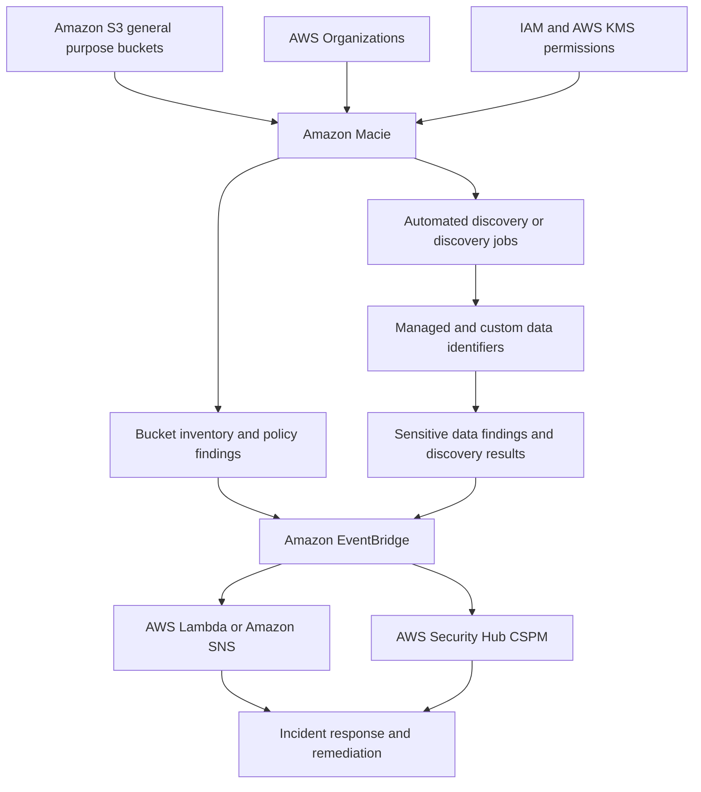

# Amazon Macie và phát hiện dữ liệu nhạy cảm trên S3

Amazon S3 thường lưu trữ dữ liệu xuất từ ứng dụng, bản sao lưu, hồ sơ khách hàng, báo cáo tài chính và tệp phục vụ phân tích. Khi số lượng bucket và đối tượng tăng lên, đội ngũ vận hành khó biết dữ liệu nhạy cảm đang nằm ở đâu, ai có thể truy cập và bucket nào đang có cấu hình rủi ro. Một bucket được chia sẻ rộng hoặc vô tình cho phép truy cập công khai có thể làm lộ dữ liệu cá nhân, thông tin thanh toán hay thông tin xác thực.

Amazon Macie giúp giải quyết bài toán này bằng cách kiểm kê bucket S3, theo dõi một số rủi ro về quyền truy cập và phân tích nội dung đối tượng để phát hiện dữ liệu nhạy cảm. Macie sử dụng machine learning và pattern matching, cung cấp findings để đội ngũ bảo mật điều tra và xử lý. Trong hệ sinh thái AWS, Macie thường phối hợp với IAM, Amazon S3, AWS KMS, AWS Organizations, Amazon EventBridge và AWS Security Hub CSPM để tạo thành quy trình giám sát và ứng phó.

## Mục tiêu học tập

Sau bài học, bạn có thể:

- Giải thích vai trò, phạm vi và cách Amazon Macie phát hiện dữ liệu nhạy cảm trong S3.
- Phân biệt automated sensitive data discovery với sensitive data discovery jobs.
- Chọn managed data identifiers, custom data identifiers và allow lists phù hợp.
- Đọc policy findings và sensitive data findings, sau đó định tuyến chúng đến quy trình ứng phó.
- Lập kế hoạch triển khai Macie cho một tài khoản hoặc môi trường nhiều tài khoản, đồng thời kiểm soát phạm vi quét và chi phí.

## Amazon Macie giải quyết vấn đề gì?

Amazon Macie là dịch vụ bảo mật dữ liệu tập trung vào Amazon S3 general purpose buckets. Khi được bật trong một AWS Region, Macie tạo và duy trì inventory các bucket trong Region đó, đánh giá một số thuộc tính bảo mật và quyền truy cập, đồng thời có thể phân tích đối tượng để xác định dữ liệu nhạy cảm.

Macie cung cấp hai nhóm khả năng liên quan nhưng khác nhau:

1. **Đánh giá bảo mật bucket:** theo dõi thay đổi về cấu hình hoặc chính sách làm giảm tính riêng tư và an toàn của bucket, chẳng hạn bucket trở nên công khai hoặc được chia sẻ ra ngoài phạm vi dự kiến.
2. **Phát hiện dữ liệu nhạy cảm:** phân tích nội dung đối tượng S3 bằng các bộ nhận diện có sẵn hoặc do tổ chức tự định nghĩa, sau đó tạo finding khi phát hiện dữ liệu phù hợp.

Macie giúp trả lời các câu hỏi như:

- Những bucket nào đang tồn tại trong Region và bucket nào có cấu hình truy cập đáng chú ý?
- Dữ liệu cá nhân, dữ liệu tài chính hoặc thông tin xác thực có thể đang nằm trong những bucket nào?
- Đối tượng S3 nào có dấu hiệu chứa dữ liệu nhạy cảm và được phát hiện bằng bộ nhận diện nào?
- Finding nào cần được ưu tiên điều tra và có thể chuyển đến hệ thống xử lý sự kiện nào?

Macie tập trung vào dữ liệu trong S3. Nếu dữ liệu nằm trong RDS, Aurora hoặc DynamoDB, bạn có thể cần xuất dữ liệu hoặc snapshot sang S3 theo định dạng được hỗ trợ rồi mới dùng Macie phân tích. Macie cũng không thay thế các cơ chế phân quyền, mã hóa, phòng chống rò rỉ dữ liệu trên endpoint hay quy trình phân loại dữ liệu của tổ chức.

## Hai cách phát hiện dữ liệu nhạy cảm

Macie có hai cơ chế chính. Chọn cơ chế theo mục tiêu giám sát: cần quan sát rộng toàn bộ data estate hay cần phân tích sâu một tập dữ liệu đã xác định.

| Tiêu chí | Automated sensitive data discovery | Sensitive data discovery job |
|---|---|---|
| Mục tiêu | Có cái nhìn tổng quan về nơi dữ liệu nhạy cảm có thể đang tồn tại | Phân tích có chủ đích các bucket hoặc đối tượng đã chọn |
| Cách chọn đối tượng | Macie đánh giá inventory và lấy mẫu các đối tượng đại diện | Người vận hành chọn bucket hoặc tiêu chí bucket, rồi tinh chỉnh phạm vi đối tượng |
| Lịch chạy | Macie liên tục đánh giá inventory và thực hiện phân tích theo chu kỳ hằng ngày | Chạy một lần hoặc lặp lại theo lịch hằng ngày, hằng tuần hay hằng tháng |
| Phù hợp khi | Cần lập bản đồ độ nhạy dữ liệu trên nhiều bucket | Cần điều tra một bucket, tiền tố, nhóm đối tượng hoặc yêu cầu kiểm tra cụ thể |
| Lưu ý | Kết quả dựa trên lấy mẫu, không chứng minh mọi đối tượng đều đã được quét | Có thể kiểm soát phạm vi và độ sâu phân tích rõ hơn; cần quản lý lịch và phạm vi job |

### Automated sensitive data discovery

Sau khi bật tính năng này, Macie đánh giá inventory bucket S3 và dùng kỹ thuật lấy mẫu để chọn các đối tượng đại diện. Việc chọn mẫu xét đến các nhóm đối tượng có metadata tương tự, chẳng hạn tên bucket, prefix, storage class, phần mở rộng tệp và thời điểm sửa đổi. Macie tải các đối tượng được chọn để phân tích nội dung, sau đó tạo thông tin về dữ liệu nhạy cảm đã phát hiện và kết quả phân tích.

Theo cấu hình mặc định, phạm vi có thể bao gồm các S3 general purpose buckets của tài khoản. Trong môi trường tổ chức, Macie administrator có thể quản lý việc bật tính năng cho các member accounts và điều chỉnh bucket bị loại trừ. Người quản trị cũng có thể tinh chỉnh các managed data identifiers, custom data identifiers và allow lists được dùng trong quá trình phân tích.

Lấy mẫu giúp Macie phân bổ phân tích trên nhiều bucket để nhanh chóng cung cấp góc nhìn tổng quan. Tuy nhiên, không nên diễn giải việc một bucket chưa có finding thành bằng chứng rằng mọi đối tượng trong bucket đều không chứa dữ liệu nhạy cảm. Khi cần kiểm tra sâu một tập dữ liệu cụ thể, hãy tạo discovery job với phạm vi và lịch chạy phù hợp.

### Sensitive data discovery jobs

Discovery job là chuỗi tác vụ phân tích tự động do bạn cấu hình. Khi tạo job, bạn chọn một hoặc nhiều bucket cụ thể hoặc đặt tiêu chí để Macie xác định bucket cần phân tích khi job chạy. Bạn có thể tinh chỉnh phạm vi bằng các thuộc tính của đối tượng như prefix, object tags và thời điểm sửa đổi.

Job có thể chạy một lần để phục vụ đánh giá hoặc điều tra, hoặc chạy định kỳ để kiểm tra dữ liệu mới và thay đổi theo thời gian. Bạn cũng chọn các managed data identifiers, custom data identifiers và allow lists mà job sẽ sử dụng. Cấu hình này quyết định loại dữ liệu được tìm kiếm và những trường hợp ngoại lệ được bỏ qua.

Một quy trình hợp lý là dùng automated discovery để xác định khu vực có khả năng chứa dữ liệu nhạy cảm, sau đó chạy job tập trung trên bucket hoặc prefix có mức độ rủi ro cao. Cách làm này giúp cân bằng độ bao phủ, độ sâu phân tích và chi phí.

## Các bộ nhận diện dữ liệu

Macie dùng ba thành phần cấu hình để quyết định nội dung nào được xem là dữ liệu nhạy cảm và nội dung nào cần được bỏ qua.

### Managed data identifiers

Managed data identifier là bộ tiêu chí và kỹ thuật có sẵn do AWS cung cấp để phát hiện một loại dữ liệu cụ thể. Các nhóm dữ liệu có thể bao gồm:

- Thông tin nhận dạng cá nhân (PII), ví dụ số hộ chiếu hoặc một số loại số định danh.
- Thông tin tài chính, ví dụ số thẻ thanh toán hoặc số tài khoản ngân hàng.
- Thông tin xác thực, ví dụ AWS secret access keys.
- Một số loại thông tin sức khỏe cá nhân (PHI).

Danh mục được AWS duy trì và có thể thay đổi theo thời gian. Khi tạo job, bạn có thể sử dụng tập managed identifiers được khuyến nghị, chọn các identifier cụ thể, hoặc điều chỉnh tập identifier theo mục tiêu kiểm tra. Tập được khuyến nghị thường là điểm bắt đầu tốt cho một lần đánh giá tổng quan vì AWS lựa chọn các identifier nhằm phát hiện những loại dữ liệu phổ biến và giảm nhiễu.

### Custom data identifiers

Custom data identifier cho phép tổ chức định nghĩa mẫu dữ liệu riêng. Một identifier sử dụng biểu thức chính quy (regular expression, regex) để mô tả chuỗi cần tìm; có thể bổ sung từ khóa, cụm từ cần xuất hiện gần chuỗi khớp hoặc các từ cần loại trừ.

Ví dụ, một tổ chức dùng mã khách hàng có dạng `CUS-` theo sau bởi tám chữ số. Identifier có thể dùng regex minh họa `CUS-[0-9]{8}`. Nếu mã này chỉ có ý nghĩa khi xuất hiện cạnh trường `customer_id`, hãy cấu hình từ khóa và quy tắc khoảng cách phù hợp để giảm kết quả không liên quan.

Custom identifiers hữu ích cho:

- Mã nhân viên hoặc mã khách hàng nội bộ.
- Mã hồ sơ, số hợp đồng hoặc mã giao dịch riêng của doanh nghiệp.
- Nhãn phân loại dữ liệu hoặc chuỗi nhận diện tài sản trí tuệ.

Hãy thử nghiệm regex với dữ liệu mẫu đại diện trước khi dùng trên diện rộng. Mẫu quá rộng làm tăng false positives; mẫu quá hẹp có thể bỏ sót dữ liệu thật. Cần có chủ sở hữu nghiệp vụ xác nhận định dạng và ý nghĩa của trường dữ liệu.

### Allow lists

Allow list định nghĩa văn bản hoặc mẫu văn bản mà Macie cần bỏ qua khi phân tích. Ví dụ, tổ chức có thể loại trừ số điện thoại công khai của tổng đài, tên đại diện đã công bố hoặc dữ liệu giả được dùng trong môi trường kiểm thử.

Allow list giúp giảm false positives, nhưng phải được quản lý như một cấu hình bảo mật. Chỉ thêm ngoại lệ đã được xác nhận, giới hạn người có quyền sửa danh sách và kiểm tra định kỳ để tránh bỏ qua dữ liệu nhạy cảm thật. Nên thử nghiệm allow list trên một job nhỏ trước khi áp dụng cho các lần phân tích diện rộng.

## Findings và kết quả phân tích

Macie tạo findings để thông báo một vấn đề cần xem xét. Có hai nhóm chính:

| Nhóm finding | Khi nào được tạo | Ví dụ cần điều tra |
|---|---|---|
| Policy finding | Cấu hình hoặc chính sách của S3 general purpose bucket thay đổi theo hướng làm giảm bảo mật hoặc quyền riêng tư | Tắt S3 Block Public Access, bucket trở nên public, chia sẻ bucket với tài khoản ngoài hoặc tắt mã hóa bucket |
| Sensitive data finding | Macie phát hiện nội dung nhạy cảm trong một đối tượng S3 khi automated discovery hoặc discovery job phân tích đối tượng đó | Tệp CSV chứa số định danh cá nhân, tệp xuất dữ liệu chứa số thẻ hoặc đối tượng có AWS secret access key |

Mỗi finding có loại, mức độ nghiêm trọng, thông tin tài nguyên bị ảnh hưởng và dữ liệu mô tả thời điểm cũng như cách phát hiện. Macie gán mức Low, Medium hoặc High dựa trên đặc điểm của loại finding và dữ liệu được phát hiện. Mức độ này giúp sắp xếp thứ tự điều tra; nó không tự phản ánh giá trị nghiệp vụ của bucket. Một bucket chứa bản sao dữ liệu khách hàng quan trọng có thể cần ưu tiên cao hơn bucket thử nghiệm, ngay cả khi mức severity hiển thị giống nhau.

Khi điều tra sensitive data finding, hãy xem bucket, object key, loại dữ liệu, identifier đã khớp, thời điểm phân tích và kết quả discovery liên quan. Xác minh xem đối tượng có chứa dữ liệu thật hay dữ liệu giả, ai sở hữu dữ liệu, ai có thể truy cập và liệu dữ liệu có đang được chia sẻ ngoài phạm vi cho phép hay không.

Macie còn tạo **sensitive data discovery results** để ghi lại chi tiết phân tích của từng đối tượng, bao gồm cả trường hợp đối tượng không thể phân tích do lỗi hoặc không đáp ứng điều kiện hỗ trợ. Findings và discovery results là hai loại thông tin khác nhau: finding thông báo một phát hiện cần chú ý, còn discovery result cung cấp bản ghi về quá trình phân tích đối tượng.

Macie lưu findings và sensitive data discovery results trong thời hạn giới hạn 90 ngày. Nếu cần lưu bằng chứng phục vụ kiểm toán, điều tra dài hạn hoặc báo cáo, hãy cấu hình repository trên S3 để lưu discovery results và thiết kế chính sách vòng đời, mã hóa, quyền truy cập cũng như thời gian lưu giữ phù hợp. Việc lưu findings dài hạn cũng cần được thiết kế qua API hoặc tích hợp sự kiện với hệ thống lưu trữ của tổ chức.

## Kiến trúc tích hợp và luồng xử lý

Macie phát hiện và mô tả rủi ro; các dịch vụ khác hỗ trợ định tuyến, quản lý quyền và ứng phó. Một kiến trúc điển hình có thể triển khai như sau:

Trong mô hình này:

- **Amazon S3** lưu dữ liệu cần kiểm kê và phân tích.
- **Amazon Macie** theo dõi inventory, đánh giá bucket và tìm dữ liệu nhạy cảm.
- **AWS Organizations** hỗ trợ quản lý Macie tập trung trên nhiều tài khoản.
- **IAM và AWS KMS** kiểm soát quyền quản trị, quyền truy cập bucket và khả năng sử dụng khóa mã hóa khi Macie cần phân tích đối tượng.
- **Amazon EventBridge** nhận finding dưới dạng sự kiện và định tuyến đến target phù hợp.
- **AWS Lambda hoặc Amazon SNS** có thể kích hoạt quy trình xử lý, thông báo đội ngũ phụ trách hoặc mở ticket qua hệ thống tích hợp.
- **AWS Security Hub CSPM** tổng hợp findings của Macie cùng các tín hiệu bảo mật khác để đánh giá tư thế bảo mật chung.

Không nên tự động xóa hoặc di chuyển mọi đối tượng ngay khi nhận finding. Một sự kiện có thể là false positive, dữ liệu thử nghiệm hoặc dữ liệu có chủ sở hữu và yêu cầu lưu trữ riêng. Nếu tự động hóa remediation, hãy xác định trước điều kiện, phạm vi tác động, cơ chế phê duyệt và cách khôi phục.

## Triển khai Macie theo từng bước

### 1. Xác định phạm vi và trách nhiệm

Liệt kê các AWS Regions đang lưu dữ liệu S3, các tài khoản sở hữu bucket và nhóm dữ liệu cần bảo vệ. Xác định ai là Macie administrator, ai quản lý bucket, ai phụ trách dữ liệu nghiệp vụ và ai tiếp nhận finding. Macie được bật theo Region, vì vậy cần kiểm tra từng Region có dữ liệu liên quan.

### 2. Bật Macie và kiểm tra inventory

Đăng nhập AWS Management Console bằng IAM identity có quyền quản trị Macie, chọn Region cần triển khai và bật Macie. Khi kích hoạt, Macie tạo service-linked role cần thiết và bắt đầu xây dựng inventory các S3 general purpose buckets trong Region. Kiểm tra số bucket, thuộc tính public access, mã hóa, số lượng đối tượng và các policy findings được tạo.

### 3. Thiết lập cho môi trường nhiều tài khoản

Với AWS Organizations, tài khoản quản lý tổ chức chỉ định một member account làm delegated Macie administrator. Sau đó, quản trị viên liên kết các member accounts và bật Macie trong từng Region cần giám sát. Có thể cấu hình tự động bật Macie cho tài khoản mới, nhưng cần kiểm tra riêng các tài khoản hiện có và các Region khác. Việc tích hợp với Organizations không có nghĩa mọi tài khoản và mọi Region đã tự động được bật.

### 4. Cấu hình automated sensitive data discovery

Bật automated discovery để có góc nhìn tổng quan. Xem các bucket được đưa vào phạm vi, loại trừ bucket không cần phân tích nếu có lý do rõ ràng, chọn identifier và allow list phù hợp. Theo dõi coverage để biết bucket hoặc đối tượng nào chưa đủ điều kiện phân tích.

### 5. Tạo discovery job cho dữ liệu ưu tiên

Tạo job một lần cho đợt đánh giá ban đầu hoặc job định kỳ cho dữ liệu cần theo dõi thường xuyên. Chọn bucket hoặc tiêu chí bucket, giới hạn prefix hay thuộc tính đối tượng nếu phù hợp, chọn managed/custom identifiers và allow lists. Trước khi chạy, xác nhận Macie có thể truy cập bucket và sử dụng khóa KMS cần thiết để giải mã đối tượng được mã hóa.

### 6. Thiết lập nơi lưu kết quả và định tuyến finding

Nếu cần bằng chứng dài hạn, cấu hình S3 repository cho sensitive data discovery results. Tiếp theo, tạo quy tắc EventBridge dựa trên loại finding, severity, tài khoản hoặc bucket. Chuyển sự kiện đến Lambda, SNS, Security Hub CSPM hoặc hệ thống quản lý sự cố theo quy trình nội bộ.

### 7. Kiểm tra bằng finding mẫu và diễn tập ứng phó

Có thể tạo sample findings trong Macie để kiểm tra quy tắc lọc và tích hợp mà không cần chờ dữ liệu thật được phát hiện. Diễn tập từ lúc nhận sự kiện đến lúc xác định chủ sở hữu, xác minh dữ liệu, thu hẹp quyền truy cập và ghi lại kết quả. Sau diễn tập, điều chỉnh ngưỡng ưu tiên, allow lists và hướng dẫn xử lý.

## Tình huống thực tế: phát hiện dữ liệu khách hàng trong bucket chia sẻ

Một ứng dụng thương mại điện tử xuất báo cáo khách hàng hằng ngày vào bucket `customer-export-prod`. Tệp CSV có thể chứa tên, địa chỉ email, số điện thoại và mã khách hàng. Nhóm dữ liệu cần biết liệu các tệp này có bị chia sẻ ngoài tổ chức hay không.

Quy trình triển khai:

1. Bật Macie trong Region chứa bucket và xác nhận bucket xuất hiện trong inventory.
2. Kiểm tra Block Public Access, bucket policy, encryption settings và quyền truy cập liên tài khoản.
3. Bật automated discovery để có cái nhìn tổng quan về các bucket có khả năng chứa dữ liệu cá nhân.
4. Tạo một discovery job tập trung vào `customer-export-prod` và prefix chứa báo cáo. Dùng managed identifiers cho các loại PII phù hợp; tạo custom identifier nếu mã khách hàng có định dạng riêng.
5. Kiểm tra findings và discovery results. Xác minh object key, loại dữ liệu được phát hiện, chủ sở hữu và quyền truy cập hiện tại.
6. Nếu finding cho thấy bucket được chia sẻ ngoài tổ chức ngoài dự kiến, kiểm tra bucket policy, access point policy, ACL còn được sử dụng và cấu hình Block Public Access. Thu hẹp quyền truy cập theo danh tính hoặc vai trò cần thiết.
7. Nếu dữ liệu nhạy cảm đã bị chia sẻ sai phạm vi, kích hoạt quy trình ứng phó sự cố: bảo toàn log và bằng chứng, xác định thời gian/phạm vi phơi lộ, thông báo đúng nhóm phụ trách và thực hiện các bước khắc phục theo chính sách tổ chức.
8. Đưa findings vào EventBridge và Security Hub CSPM để theo dõi tập trung. Thiết lập job định kỳ và xem lại cấu hình khi định dạng dữ liệu hoặc yêu cầu nghiệp vụ thay đổi.

Điểm cần nhớ trong tình huống này là finding của Macie cung cấp tín hiệu để điều tra. Đội ngũ vẫn phải xác minh dữ liệu và quyền truy cập trước khi quyết định hành động, đồng thời cần ghi nhận kết quả để phục vụ kiểm toán.

## Giới hạn, quyền truy cập và chi phí

**Phạm vi dữ liệu:** Macie phân tích đối tượng trong S3 general purpose buckets, với storage class và định dạng được hỗ trợ. Một số storage class như S3 Glacier Deep Archive và S3 Express One Zone, S3 directory buckets, cũng như nội dung ảnh, âm thanh và video không được phân tích như dữ liệu văn bản thông thường. Đối tượng dùng định dạng hoặc storage class không được hỗ trợ sẽ được xem là unclassifiable và bị bỏ qua trong quá trình phân tích. Hãy kiểm tra thống kê unclassifiable objects trong inventory để không nhầm việc không có finding với việc dữ liệu đã được kiểm tra.

**Mã hóa và chính sách bucket:** Nếu đối tượng được mã hóa, Macie cần quyền truy cập và sử dụng khóa mã hóa phù hợp. Bucket policy quá chặt cũng có thể ngăn Macie đọc đối tượng. Khi lập kế hoạch, hãy kiểm tra quyền IAM, key policy của AWS KMS và chính sách bucket theo hướng dẫn hiện hành của AWS. Không nên nới quyền rộng chỉ để làm cho job chạy được; hãy cấp đúng quyền cần thiết.

**Độ chính xác:** Managed identifiers và custom identifiers dựa trên mẫu và kỹ thuật nhận diện, nên kết quả cần được xác minh theo ngữ cảnh nghiệp vụ. Allow lists làm giảm nhiễu nhưng có thể che khuất dữ liệu thật nếu được cấu hình quá rộng. Hãy kiểm thử định kỳ với dữ liệu mẫu có cả trường hợp khớp và không khớp.

**Phạm vi lấy mẫu:** Automated discovery cung cấp góc nhìn tổng quan dựa trên các đối tượng đại diện. Đối với yêu cầu kiểm tra cụ thể, hãy dùng discovery job và kiểm tra báo cáo coverage. Không dùng một kết quả lấy mẫu để khẳng định mọi đối tượng trong bucket đều sạch.

**Chi phí:** Chi phí Macie có các thành phần liên quan đến việc duy trì inventory và giám sát bucket, cũng như số lượng đối tượng hoặc dữ liệu được đánh giá cho các tính năng khám phá dữ liệu nhạy cảm. Mức chi phí phụ thuộc vào quy mô S3, phạm vi job, lịch chạy và cấu hình discovery. Trước khi mở rộng, ước tính chi phí theo Region và tài khoản, giới hạn phạm vi job, loại trừ dữ liệu không cần quét và theo dõi usage cost trong Macie cùng AWS Billing.

## Thực hành tốt

- Bật Macie tại mọi Region có dữ liệu cần bảo vệ và kiểm tra trạng thái bật của từng tài khoản trong môi trường Organizations.
- Dùng automated discovery để lập bản đồ tổng quan; dùng jobs cho các đợt kiểm tra sâu hoặc dữ liệu có mức độ rủi ro cao.
- Bắt đầu bằng managed identifiers được khuyến nghị, sau đó bổ sung custom identifiers theo định dạng dữ liệu riêng.
- Quản lý allow lists có phê duyệt, chủ sở hữu và lịch rà soát; tránh tạo ngoại lệ quá rộng.
- Theo dõi cả policy findings và sensitive data findings. Một đối tượng chứa dữ liệu nhạy cảm trong bucket public cần được ưu tiên điều tra.
- Lưu sensitive data discovery results vào S3 nếu cần bằng chứng dài hạn; cấu hình mã hóa, quyền truy cập và lifecycle cho repository.
- Định tuyến findings qua EventBridge và Security Hub CSPM để tập trung giám sát, đồng thời bảo đảm mỗi loại finding có nhóm chịu trách nhiệm.
- Kết hợp Macie với S3 Block Public Access, bucket policies, IAM least privilege, AWS KMS và logging. Macie phát hiện vấn đề; các cơ chế này thực thi quyền truy cập và bảo vệ dữ liệu.
- Đánh giá lại coverage, identifier, lịch job và chi phí khi bucket, định dạng dữ liệu hoặc yêu cầu tuân thủ thay đổi.

## Kết luận

Amazon Macie giúp tổ chức hiểu dữ liệu nhạy cảm đang nằm ở đâu trong S3 và phát hiện các thay đổi có thể làm suy giảm an toàn hoặc quyền riêng tư của bucket. Automated sensitive data discovery phù hợp để tạo góc nhìn rộng dựa trên lấy mẫu; discovery jobs phù hợp để phân tích sâu một phạm vi đã chọn. Managed identifiers, custom identifiers và allow lists quyết định chất lượng phát hiện. Khi kết hợp findings với EventBridge, Security Hub CSPM, IAM, KMS và quy trình ứng phó, Macie trở thành một thành phần quan trọng trong hoạt động giám sát an ninh và bảo vệ dữ liệu trên AWS.

## Tài liệu tham khảo

- [What is Amazon Macie?](https://docs.aws.amazon.com/macie/latest/user/what-is-macie.html)
- [Performing automated sensitive data discovery](https://docs.aws.amazon.com/macie/latest/user/discovery-asdd.html)
- [Creating a sensitive data discovery job](https://docs.aws.amazon.com/macie/latest/user/discovery-jobs-create.html)
- [Building custom data identifiers](https://docs.aws.amazon.com/macie/latest/user/custom-data-identifiers.html)
- [Types of Macie findings](https://docs.aws.amazon.com/macie/latest/user/findings-types.html)
- [Supported storage classes and formats](https://docs.aws.amazon.com/macie/latest/user/discovery-supported-storage.html)
- [Getting started with Macie](https://docs.aws.amazon.com/macie/latest/user/getting-started.html)
