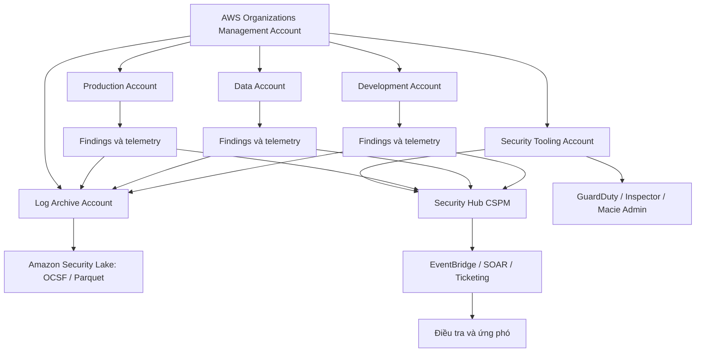
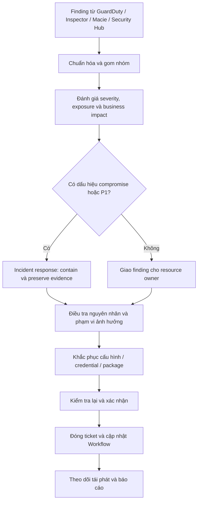

# Tập trung phát hiện bảo mật trong mô hình nhiều tài khoản

Trong một tổ chức AWS có nhiều tài khoản và Region, sự kiện bảo mật thường xuất hiện ở nhiều nơi: GuardDuty phát hiện hành vi đáng ngờ, Inspector tìm lỗ hổng phần mềm, Macie nhận diện dữ liệu nhạy cảm trong Amazon S3, còn Security Hub CSPM đánh giá cấu hình theo các chuẩn bảo mật. Nếu từng đội phải đăng nhập vào từng account để xem kết quả, tổ chức sẽ khó phát hiện một cuộc tấn công liên quan đến nhiều workload, khó ưu tiên rủi ro và dễ bỏ sót tài khoản mới.

Mô hình phát hiện tập trung giải quyết bài toán này bằng cách tổ chức các tài khoản chuyên trách, ủy quyền quản trị dịch vụ bảo mật, bật khả năng phát hiện trên toàn Organization, tổng hợp findings và chuyển chúng vào một quy trình điều tra thống nhất. AWS Organizations cung cấp ranh giới quản trị; các dịch vụ phát hiện tiếp tục chạy trong account/Region của workload; AWS Security Hub CSPM tập hợp và chuẩn hóa findings; Amazon EventBridge và các công cụ ứng phó đưa finding đến đúng đội xử lý. Khi cần phân tích log ở quy mô lớn, Amazon Security Lake tập trung dữ liệu bảo mật theo schema OCSF để truy vấn và threat hunting.

## Mục tiêu học tập

Sau bài học, bạn có thể:

- Thiết kế mô hình Security Tooling, Log Archive và member accounts trong AWS Organizations.
- Phân biệt vai trò của Security Hub CSPM, GuardDuty, Inspector, Macie, Detective và Security Lake.
- Thiết lập delegated administrator và tự động bật dịch vụ phát hiện cho account mới.
- Phân biệt central configuration, declarative policies và cross-Region aggregation của Security Hub CSPM.
- Đọc AWS Security Finding Format (ASFF), đánh giá mức độ ưu tiên và quản lý workflow của finding.
- Thiết kế luồng EventBridge, automation, ticketing và remediation có kiểm soát.
- Xây dựng quy trình triage, điều tra, ứng phó, đóng finding và theo dõi coverage.

## 1. Bài toán phát hiện bảo mật trong Organization

Giả sử doanh nghiệp có các OU `Production`, `Development`, `Data` và `Sandbox`, trải trên nhiều Region. Một EC2 instance ở account Production có thể bị khai thác, một container image trong ECR có package dễ bị tấn công, một S3 bucket trong account Data có thể chứa dữ liệu cá nhân và một security group ở account Development có thể mở cổng quản trị ra Internet.

Các vấn đề xuất hiện khi mỗi dịch vụ và account được quản lý riêng:

- Đội bảo mật phải đổi account/Region liên tục để xem finding.
- Mỗi dịch vụ có cách đặt tên, severity, trạng thái và định dạng dữ liệu khác nhau.
- Một account mới được tạo có thể chưa bật GuardDuty, Inspector, Macie hoặc Security Hub CSPM.
- Finding trùng lặp từ nhiều nguồn làm đội vận hành mất thời gian xử lý.
- Không có một nơi thống nhất để biết finding nào đang được điều tra, ai là owner và khi nào cần xử lý.
- Log cần cho điều tra có thể nằm ở nhiều account và nhiều hệ thống lưu trữ khác nhau.

Một kiến trúc tốt cần đáp ứng bốn mục tiêu:

1. **Coverage**: mọi account và Region cần bảo vệ đều bật các dịch vụ phát hiện phù hợp.
2. **Visibility**: đội bảo mật có thể xem findings tập trung và biết nguồn, account, Region, resource liên quan.
3. **Prioritization**: phân biệt vấn đề nghiêm trọng cần xử lý ngay với cảnh báo thông tin hoặc rủi ro có thể chấp nhận.
4. **Response**: finding được giao cho owner, điều tra, khắc phục, xác minh và lưu bằng chứng.

## 2. Kiến trúc tài khoản bảo mật tập trung

Trong AWS Organizations, nên tách tài khoản theo trách nhiệm. Một mô hình thường gặp có:

| Tài khoản | Vai trò |
|---|---|
| Management account | Quản trị Organizations, OU, SCP và đăng ký delegated administrator cho các dịch vụ |
| Security Tooling account | Đội Security Operations quản lý findings, cấu hình dịch vụ bảo mật và quy trình ứng phó |
| Log Archive account | Lưu trữ log tập trung, hỗ trợ kiểm toán và điều tra dài hạn |
| Member accounts | Chạy ứng dụng, dữ liệu và workload theo OU như Production, Development, Data |

Security Tooling account thường được chọn làm delegated administrator của Security Hub CSPM, GuardDuty, Inspector và Macie. Với Security Lake, AWS khuyến nghị dùng Log Archive account làm delegated administrator để dữ liệu bảo mật được tập trung trong tài khoản lưu trữ. Đây là các đăng ký độc lập: chọn một account làm delegated administrator cho Security Hub không tự động biến account đó thành administrator của GuardDuty, Inspector, Macie hoặc Security Lake.



Management account nên giữ quyền quản trị Organizations và chỉ thực hiện các thao tác cần thiết để bật trusted access, đăng ký hoặc gỡ delegated administrator. Đội vận hành hàng ngày làm việc bằng role trong Security Tooling account. Điều này giúp tách quyền quản lý cấu trúc Organization khỏi quyền điều tra và ứng phó sự cố.

## 3. Vai trò của các dịch vụ phát hiện AWS

Không có một dịch vụ duy nhất phát hiện mọi loại rủi ro. Các dịch vụ dưới đây quan sát những khía cạnh khác nhau và bổ sung findings cho nhau.

| Dịch vụ | Phát hiện chính | Ví dụ finding |
|---|---|---|
| AWS Security Hub CSPM | Đánh giá posture, security controls và tổng hợp findings từ tích hợp | S3 bucket không bật public access block; EC2 security group mở cổng không phù hợp |
| Amazon GuardDuty | Threat detection dựa trên log và telemetry AWS | Credential bị dùng từ địa chỉ IP đáng ngờ; EC2 liên lạc với command-and-control domain |
| Amazon Inspector | Lỗ hổng phần mềm và rủi ro trong EC2, ECR, Lambda theo cấu hình hỗ trợ | Package có CVE nghiêm trọng trong EC2 hoặc container image |
| Amazon Macie | Dữ liệu nhạy cảm trong Amazon S3 | Bucket chứa thông tin định danh cá nhân hoặc dữ liệu tài chính |
| Amazon Detective | Phân tích quan hệ và hoạt động liên quan để điều tra finding | Truy vết role, IP, instance và API call có liên quan đến hoạt động đáng ngờ |
| AWS IAM Access Analyzer | Phát hiện quyền truy cập bên ngoài hoặc policy có thể cấp quyền ngoài dự kiến | S3 bucket hoặc KMS key được chia sẻ ra account ngoài |
| AWS Firewall Manager | Quản trị policy bảo vệ và phát hiện resource không tuân thủ policy | Resource chưa được gắn WAF Web ACL hoặc security group lệch baseline |
| Amazon Security Lake | Thu thập, chuẩn hóa và lưu trữ log/event bảo mật để phân tích | VPC Flow Logs, CloudTrail, WAF logs, Security Hub findings trong OCSF |

### Security Hub CSPM: trung tâm posture và findings

AWS Security Hub CSPM cung cấp cái nhìn tập trung về security posture và findings. Dịch vụ thực hiện security checks theo các standards và controls được bật, đồng thời nhận findings từ các dịch vụ AWS và sản phẩm đối tác tích hợp. Findings được chuẩn hóa theo AWS Security Finding Format (ASFF), giúp truy vấn và tự động hóa theo một cấu trúc thống nhất.

Security Hub CSPM phù hợp để trả lời các câu hỏi như:

- Account nào đang có nhiều finding Critical hoặc High?
- Resource nào không đáp ứng control của AWS Foundational Security Best Practices?
- Finding nào đã được giao cho owner nhưng chưa xử lý?
- Lỗ hổng từ Inspector có liên quan đến tài nguyên đang public hay chứa dữ liệu nhạy cảm không?
- Account/Region nào chưa bật dịch vụ phát hiện hoặc chưa có coverage?

Security Hub CSPM chỉ nhận findings được tạo sau khi tích hợp được bật. Không nên giả định nó sẽ tự nhập lại mọi finding cũ của dịch vụ nguồn. Khi onboarding, hãy bật tích hợp và xác nhận luồng finding bắt đầu hoạt động.

### GuardDuty: phát hiện hành vi đe dọa

GuardDuty phân tích các nguồn telemetry như CloudTrail management events, VPC Flow Logs và DNS logs để phát hiện hoạt động bất thường. Tùy protection plan được bật, GuardDuty có thể phân tích thêm dữ liệu từ S3, EKS, runtime, RDS, Lambda hoặc malware protection.

GuardDuty trả lời câu hỏi: *Có dấu hiệu tài khoản, workload hoặc dữ liệu đang bị sử dụng theo cách đáng ngờ không?* Ví dụ, một IAM credential được dùng từ vị trí bất thường, EC2 giao tiếp với hạ tầng độc hại hoặc workload có hành vi liên quan đến crypto mining.

### Inspector: phát hiện lỗ hổng và exposure phần mềm

Inspector đánh giá lỗ hổng trong các workload được hỗ trợ như EC2, container image trong ECR và Lambda. Phạm vi scan và điều kiện hỗ trợ tùy loại workload, Region và cấu hình. Inspector findings giúp đội bảo mật xác định package, CVE, đường dẫn khai thác và tài nguyên chịu ảnh hưởng.

Không phải mọi CVE Critical đều có cùng mức rủi ro thực tế. Khi ưu tiên xử lý, cần xét khả năng khai thác, mức độ public, đường truy cập, quyền của workload, dữ liệu mà workload xử lý và thời gian tồn tại của image/package.

### Macie: phát hiện dữ liệu nhạy cảm

Macie phân tích Amazon S3 để phát hiện dữ liệu nhạy cảm theo managed data identifiers và custom data identifiers. Kết quả giúp xác định bucket chứa dữ liệu cá nhân, dữ liệu tài chính, thông tin xác thực hoặc loại dữ liệu cần bảo vệ đặc biệt.

Finding Macie cần được kết hợp với thông tin quyền truy cập, encryption, public access, replication và owner của bucket. Một bucket chứa dữ liệu nhạy cảm nhưng bị khóa quyền chặt có rủi ro khác với bucket tương tự đang cho phép truy cập công khai.

### Detective và Security Lake: điều tra chuyên sâu

Amazon Detective giúp phân tích các thực thể và hoạt động liên quan đến finding bằng cách kết hợp dữ liệu bảo mật theo thời gian. Security Lake tập trung log/event từ nhiều nguồn vào data lake dựa trên S3, chuyển dữ liệu AWS được hỗ trợ sang Apache Parquet và schema OCSF.

Security Hub CSPM trả lời *finding nào đang tồn tại và posture ra sao?* Security Lake hỗ trợ trả lời *điều gì đã xảy ra trong log, ở thời điểm nào và liên quan đến thực thể nào?* Detective hỗ trợ kết nối các thực thể và hoạt động để đội điều tra hiểu rõ hơn một sự cố.

## 4. Delegated administrator và Organizations

Delegated administrator là member account được Organizations ủy quyền quản trị một AWS service cho toàn Organization. Mỗi dịch vụ có quy trình đăng ký và phạm vi riêng. Chỉ management account mới có quyền đăng ký hoặc gỡ delegated administrator ở cấp Organization, nhưng các thao tác vận hành sau đó được thực hiện từ delegated administrator account.

### Nguyên tắc thiết kế

- Chọn một account chuyên trách và ổn định cho mỗi dịch vụ; không chọn account workload có thể bị xóa hoặc chuyển OU tùy tiện.
- Dùng cùng Security Tooling account cho Security Hub CSPM, GuardDuty, Inspector và Macie nếu phù hợp với mô hình vận hành.
- Dùng Log Archive account cho Security Lake nếu muốn tách dữ liệu log dài hạn khỏi account xử lý sự cố.
- Ghi lại account ID, Region, dịch vụ, owner và quy trình thay đổi delegated administrator.
- Bật trusted access theo hướng dẫn từng dịch vụ và bảo vệ service-linked roles.

### Mỗi dịch vụ có cách quản lý account khác nhau

| Dịch vụ | Cấu hình tổ chức | Lưu ý quan trọng |
|---|---|---|
| Security Hub CSPM | Management account đăng ký delegated admin; delegated admin quản lý accounts, policies và findings | Không thể dùng Organizations management account làm delegated administrator cho central configuration |
| GuardDuty | Chỉ định delegated admin; admin quản lý member accounts theo từng Region | Dùng cùng delegated admin account ở tất cả Region đã bật GuardDuty |
| Inspector | Delegated administrator quản lý scan; AWS Organizations policies hiện là cách được khuyến nghị để bật Inspector tập trung | Xác minh account và Region coverage, đặc biệt account mới |
| Macie | Management account chỉ định delegated admin trong từng Region | Phải lặp thao tác ở mỗi Region; cùng một admin account được dùng ở các Region tích hợp |
| Security Lake | Management account dùng `RegisterDataLakeDelegatedAdministrator` để chỉ định admin | Một delegated admin cho Organization; AWS khuyến nghị Log Archive account |

Không nên xem trạng thái `Enabled` ở một Region là bằng chứng dịch vụ đã bật trên toàn Organization. GuardDuty, Macie, Inspector và Security Hub CSPM có các cấu hình Region riêng; phải kiểm tra tất cả Region mà workload được phép chạy.

## 5. Security Hub CSPM: quản lý cấu hình nhiều tài khoản

Security Hub CSPM có thể bật và cấu hình standards, controls, integrations và findings trên nhiều account. Đội bảo mật cần chọn cơ chế quản lý phù hợp với cấu hình hiện tại của Organization.

### Declarative policies và central configuration

Tài liệu AWS hiện hành khuyến nghị dùng **Security Hub CSPM declarative policies** để quản lý Security Hub CSPM tập trung trong AWS Organizations. Declarative policy là Organizations policy áp dụng vào organization root, OU hoặc account. Policy xác định Security Hub CSPM được bật/tắt ở Region nào, standards và controls nào được bật, cùng các control parameters được hỗ trợ.

Security Hub CSPM **central configuration** là cơ chế cũ hơn, dùng delegated administrator tạo configuration policies từ một home Region rồi associate với root, OU hoặc account. Central configuration và declarative policies không thể hoạt động đồng thời trong cùng Organization. Khi gắn declarative policy đầu tiên, Security Hub CSPM sẽ tắt central configuration cho toàn Organization. Nếu đang dùng central configuration, hãy dùng import tool trong Security Hub console để chuyển đổi trước khi gắn declarative policy, tránh mất coverage hoặc ghi đè cấu hình thành viên ngoài dự kiến.

Với triển khai mới, hãy đánh giá declarative policies trước. Với Organization đang dùng central configuration, không thay đổi cơ chế khi chưa có kế hoạch chuyển đổi và xác minh các association hiện tại.

### Home Region và linked Regions

Khi sử dụng central configuration, delegated administrator chỉ tạo và quản lý configuration policies từ **home Region**. Các policy này có hiệu lực ở home Region và các linked Regions. Home Region cũng là nơi tổng hợp findings, insights và dữ liệu từ linked Regions.

Cross-Region aggregation và việc bật Security Hub CSPM là hai thao tác khác nhau:

- Bật cross-Region aggregation chỉ cấu hình nơi dữ liệu được tổng hợp; nó không tự bật Security Hub CSPM ở Region đó.
- Security Hub CSPM chỉ tổng hợp dữ liệu từ account/Region đã bật dịch vụ.
- Với declarative policies, việc bật dịch vụ ở Region và việc thêm Region vào cross-Region aggregation được quản lý độc lập.
- Opt-in Region phải được bật trong account trước khi Security Hub CSPM có thể hoạt động ở đó; opt-in Region không thể làm home Region.

Khi thêm linked Region, configuration policy của central configuration bắt đầu áp dụng ở Region mới. Khi gỡ linked Region, policy không còn được quản lý tập trung tại Region đó; cấu hình trước đó của account được giữ lại và phải quản lý riêng. Nếu đổi hoặc xóa home Region, configuration policies và associations của central configuration có thể bị xóa. Hãy xem xét tác động trước khi thay đổi.

Một số finding đã tồn tại trước khi Region được liên kết có thể chưa xuất hiện ngay ở home Region cho đến khi finding được cập nhật hoặc hết hạn. Inventory resource cũng có thể cần thời gian đồng bộ. Vì vậy, sau khi cấu hình aggregation, hãy kiểm tra dữ liệu thực tế và không coi trạng thái vừa tạo là đồng bộ tức thời.

### Standards và controls

Security Hub CSPM có thể đánh giá môi trường theo các standards như AWS Foundational Security Best Practices, CIS AWS Foundations Benchmark, PCI DSS và các chuẩn được hỗ trợ trong Region. Mỗi standard chứa các controls, mỗi control kiểm tra một yêu cầu cụ thể.

Khi chọn standards:

- Chọn baseline phù hợp với yêu cầu tuân thủ và kiến trúc.
- Không bật mọi standard mà không đánh giá chi phí, phạm vi kiểm tra và sự trùng lặp controls.
- Kiểm tra control nào cần AWS Config recorder và resource type nào phải được ghi nhận.
- Dùng control ID làm khóa ổn định cho automation; title hoặc description có thể thay đổi.
- Dùng exception có owner, lý do và thời hạn thay vì tắt control vô thời hạn.

## 6. Bật coverage cho các dịch vụ phát hiện

Sau khi đăng ký delegated administrator, cần bật dịch vụ cho account hiện có và tự động áp dụng cho account mới. Các bước này thường phải thực hiện theo từng Region.

### GuardDuty

GuardDuty hỗ trợ cấu hình auto-enable organization member theo ba giá trị:

- `ALL`: bật cho tất cả account thành viên hiện có và account mới.
- `NEW`: chỉ tự động bật cho account mới tham gia Organization.
- `NONE`: không tự động bật; admin quản lý từng account.

Có thể cấu hình riêng cho GuardDuty và từng protection plan được hỗ trợ. Ví dụ, tổ chức có thể bật GuardDuty cho toàn bộ account nhưng chỉ bật một số protection plan cho OU Production. Cần lặp cấu hình ở mỗi Region và kiểm tra opt-in Region. Việc cập nhật có thể mất thời gian để áp dụng đến tất cả member accounts.

### Inspector

Inspector có thể được quản lý bởi delegated administrator. Tài liệu hiện hành khuyến nghị dùng AWS Organizations policies để tự động bật Inspector trên Organization và áp dụng cho account mới. Nếu chưa sử dụng Organizations policies, delegated administrator có thể kích hoạt Inspector cho account hiện có qua console/API.

Hãy kiểm tra từng loại scan: EC2, ECR và Lambda. Một account có Inspector enabled không đồng nghĩa mọi loại scan đều được cấu hình và có dữ liệu. Coverage phụ thuộc workload, agent/SSM, image push, runtime, quyền và điều kiện dịch vụ.

### Macie

Management account chỉ định delegated Macie administrator ở từng Region. Sau đó delegated administrator thêm account hiện có thành member accounts và có thể bật auto-enable cho account mới. Auto-enable không tự thêm lại mọi account cũ; các account hiện có cần được thêm/kiểm tra riêng. Automated sensitive data discovery cũng là cấu hình riêng, có thể bật cho account phù hợp.

### Security Hub CSPM

Với declarative policies, gắn policy vào organization root hoặc OU để quản lý Security Hub CSPM coverage theo Region. Account mới và account được chuyển OU sẽ nhận effective policy theo vị trí của chúng. Nếu account hoặc Region không được policy quản lý, cấu hình hiện tại có thể tiếp tục được giữ và cần được giám sát như self-managed scope.

Với local configuration cũ, auto-enable chủ yếu áp dụng cho account mới trong Region hiện tại; không thay thế việc kiểm tra account cũ và Region khác. Không trộn lẫn hướng dẫn local configuration với declarative policies hoặc central configuration.

### Security Lake

Security Lake delegated administrator có thể bật collection cho member accounts và cấu hình nguồn dữ liệu cho account mới. Với Security Lake, cần dùng API `RegisterDataLakeDelegatedAdministrator` từ management account để đăng ký delegated administrator theo hướng dẫn dịch vụ; không thay thế thao tác này bằng một lệnh Organizations chung.

## 7. AWS Security Finding Format (ASFF)

Security Hub CSPM chuyển findings từ các dịch vụ tích hợp sang AWS Security Finding Format. ASFF giúp các nguồn khác nhau có cấu trúc chung, nhưng vẫn giữ thông tin về finding provider và resource cụ thể.

Một finding ASFF thường có các nhóm trường:

| Trường | Ý nghĩa |
|---|---|
| `Id` | Định danh finding do provider tạo |
| `ProductArn` | Dịch vụ hoặc sản phẩm tạo finding |
| `GeneratorId` | Thành phần hoặc rule tạo finding |
| `AwsAccountId` | Account chứa resource/finding |
| `Region` | Region liên quan đến finding |
| `Types` | Nhóm loại finding |
| `CreatedAt`, `UpdatedAt`, `FirstObservedAt`, `LastObservedAt` | Mốc thời gian của finding |
| `Severity` | Mức độ nghiêm trọng do provider cung cấp hoặc chuẩn hóa |
| `Resources` | Resource bị ảnh hưởng và thông tin định danh |
| `Compliance` | Trạng thái tuân thủ đối với finding dạng compliance |
| `Workflow` | Tiến độ điều tra nội bộ |
| `RecordState` | Finding đang active hay archived |
| `Remediation` | Hướng dẫn khắc phục nếu provider cung cấp |
| `FindingProviderFields` | Trường bổ sung riêng từ nguồn phát hiện |

Ví dụ rút gọn:

```json
{
  "SchemaVersion": "2018-10-08",
  "Id": "example-finding-id",
  "ProductArn": "arn:aws:securityhub:us-east-1::product/aws/guardduty",
  "GeneratorId": "example-detector",
  "AwsAccountId": "123456789012",
  "Region": "us-east-1",
  "Types": ["TTPs/Command and Control"],
  "CreatedAt": "2026-11-20T08:00:00Z",
  "UpdatedAt": "2026-11-20T08:15:00Z",
  "Severity": {"Label": "HIGH", "Normalized": 70},
  "Resources": [
    {
      "Type": "AwsEc2Instance",
      "Id": "arn:aws:ec2:us-east-1:123456789012:instance/i-example"
    }
  ],
  "Workflow": {"Status": "NEW"},
  "RecordState": "ACTIVE"
}
```

Đây là ví dụ cấu trúc rút gọn để học cách đọc; finding thực tế có thể chứa nhiều trường hơn và phải tuân theo schema ASFF hiện hành.

### Workflow status và record state

Hai trường này có ý nghĩa khác nhau:

- `Workflow.Status` phản ánh tiến độ điều tra: `NEW`, `NOTIFIED`, `SUPPRESSED` hoặc `RESOLVED`.
- `RecordState` phản ánh finding còn active hay đã được archive: thường là `ACTIVE` hoặc `ARCHIVED`.

Đánh dấu finding `RESOLVED` không ngăn Security Hub CSPM tạo finding mới cho cùng vấn đề nếu control tiếp tục phát hiện vi phạm. Nếu compliance chuyển từ `PASSED` sang `FAILED`, `WARNING` hoặc `NOT_AVAILABLE`, workflow có thể trở lại `NEW`. Vì vậy, phải xử lý nguyên nhân gốc và xác minh resource đã compliant thay vì chỉ đổi trạng thái finding.

## 8. Tổng hợp findings và tránh trùng lặp

Security Hub CSPM tổng hợp findings từ nhiều tích hợp. Một resource có thể đồng thời có:

- Inspector finding về CVE trong package.
- GuardDuty finding về hành vi mạng đáng ngờ.
- Security Hub control finding về security group hoặc cấu hình IAM.
- Macie finding về dữ liệu nhạy cảm trong bucket.

Đây có thể là nhiều tín hiệu liên quan đến cùng một resource nhưng không nhất thiết là duplicate. Cần giữ lại nguồn, finding ID và thời điểm để điều tra. Khi gom nhóm, có thể dùng các khóa như account, Region, resource ARN, finding type, CVE ID, detector ID và khoảng thời gian.

### Automation rules

Security Hub CSPM automation rules có thể cập nhật các trường ASFF hoặc suppress findings theo điều kiện. Ví dụ:

- Gắn `SUPPRESSED` cho finding đã được chấp thuận ngoại lệ trong thời hạn.
- Chuẩn hóa severity từ tích hợp bên thứ ba theo tiêu chí của tổ chức.
- Thêm note hoặc user-defined fields để ghi nhận owner hoặc ticket ID.
- Điều chỉnh workflow status khi finding đã được chuyển sang quy trình xử lý khác.

Automation rules thay đổi finding metadata trong Security Hub CSPM. Chúng không tự sửa cấu hình AWS resource. Nếu cần hành động bên ngoài Security Hub, dùng EventBridge hoặc hệ thống response.

Khi viết rule cho security controls, ưu tiên lọc theo control ID thay vì title hoặc description vì nội dung hiển thị có thể thay đổi theo bản cập nhật.

### Cross-Region aggregation

Home Region có thể nhận findings, resources và trends từ linked Regions. Khi cấu hình, hãy xác định rõ Region nào cần tổng hợp và Region nào có yêu cầu data residency riêng. Cross-Region aggregation không tự bật Security Hub CSPM ở các linked Regions và không thay thế việc bật dịch vụ trong từng account.

## 9. Ưu tiên finding theo rủi ro thực tế

Không nên xử lý finding chỉ dựa vào severity label. Severity là một tín hiệu; mức rủi ro thực tế còn phụ thuộc vào tài sản, khả năng khai thác và đường truy cập.

Hãy đánh giá các yếu tố sau:

1. **Severity và confidence**: mức độ nghiêm trọng và độ tin cậy của finding.
2. **Exposure**: resource có public endpoint, public IP hoặc trust relationship rộng không?
3. **Exploitability**: CVE có exploit thực tế, có điều kiện khai thác phù hợp hay không?
4. **Identity privilege**: role hoặc credential liên quan có quyền quản trị, quyền truy cập dữ liệu nhạy cảm hay không?
5. **Data sensitivity**: resource có chứa dữ liệu cá nhân, tài chính hoặc bí mật kinh doanh không?
6. **Blast radius**: resource có ảnh hưởng đến nhiều account, service hoặc customer không?
7. **Threat context**: GuardDuty, threat intelligence hoặc các finding khác có cho thấy hoạt động đang diễn ra không?
8. **Business criticality**: workload có thuộc hệ thống thanh toán, định danh, dữ liệu khách hàng hoặc dịch vụ cốt lõi không?

Ví dụ, một CVE High trên EC2 private, không có đường truy cập và đang chạy workload thử nghiệm có thể được xếp sau một GuardDuty finding Medium liên quan đến IAM access key có dấu hiệu bị sử dụng trái phép trên account production. Ngược lại, CVE có exploit công khai trên service public có thể cần xử lý khẩn cấp.

### Ma trận ưu tiên gợi ý

| Ưu tiên | Điều kiện gợi ý | Mục tiêu xử lý |
|---|---|---|
| P1 – Critical | Dấu hiệu compromise đang diễn ra, credential đặc quyền bị lộ, public exposure kết hợp exploit hoặc dữ liệu nhạy cảm bị truy cập trái phép | Kích hoạt incident response ngay, containment và bảo toàn bằng chứng |
| P2 – High | Lỗ hổng dễ khai thác trên resource quan trọng, cấu hình public nguy hiểm hoặc quyền truy cập ngoài dự kiến | Giao owner và khắc phục trong SLA ngắn |
| P3 – Medium | Vi phạm baseline, lỗ hổng có điều kiện khai thác hoặc resource có mức exposure hạn chế | Lập kế hoạch khắc phục và theo dõi deadline |
| P4 – Low/Informational | Rủi ro thấp, thông tin quan sát hoặc cải tiến posture | Đưa vào backlog, rà soát định kỳ |

Đây là ma trận nội bộ mẫu, không phải severity mapping chính thức của AWS. Tổ chức cần xác định SLA và ngưỡng riêng theo chính sách quản trị rủi ro.

## 10. Quy trình triage và ứng phó

Một quy trình xử lý finding nên có trạng thái rõ ràng, owner và bằng chứng.



### Bước 1: tiếp nhận và xác thực

Ghi nhận finding ID, nguồn, account, Region, resource ARN, thời gian, severity, finding type và các finding liên quan. Xác minh finding còn active và dữ liệu mới nhất đã được cập nhật. Không suppress finding chỉ vì resource owner nói rằng đây là môi trường test.

### Bước 2: xác định owner

Dùng account inventory, resource tags, CMDB hoặc hệ thống ownership để tìm đội chịu trách nhiệm. Nếu owner chưa rõ, chuyển về Security Operations hoặc Cloud Platform để xác định. Ghi nhận ticket ID và thời điểm giao.

### Bước 3: containment khi có dấu hiệu compromise

Với sự cố đang diễn ra, ưu tiên ngăn hoạt động gây hại và giữ bằng chứng. Ví dụ:

- Thu hồi hoặc vô hiệu hóa access key bị lộ sau khi xác minh tác động.
- Cô lập EC2 instance theo runbook đã được kiểm thử.
- Chặn địa chỉ IP hoặc domain độc hại bằng lớp kiểm soát phù hợp.
- Hạn chế quyền truy cập S3 hoặc KMS khi có dấu hiệu truy cập trái phép.
- Bảo toàn snapshot, CloudTrail, VPC Flow Logs và log ứng dụng trước khi thay đổi có thể làm mất dấu vết.

Containment cần theo playbook đã phê duyệt; hành động tự động có thể làm gián đoạn workload hoặc phá hủy bằng chứng nếu áp dụng sai.

### Bước 4: điều tra và khắc phục

Kết hợp GuardDuty, Detective, CloudTrail, VPC Flow Logs, Security Hub CSPM, Inspector và log ứng dụng để xây dựng timeline. Xác định initial access, persistence, privilege escalation, lateral movement, data access và exfiltration nếu có.

Khắc phục nguyên nhân gốc, ví dụ cập nhật package, thay credential, thu hẹp IAM policy, sửa security group, bật encryption hoặc chỉnh S3 bucket policy. Không chỉ đóng finding mà chưa kiểm tra cấu hình thực tế.

### Bước 5: xác minh và đóng

Chạy lại kiểm tra hoặc chờ dịch vụ nguồn cập nhật finding. Xác nhận control đã `PASSED`, package không còn CVE, credential cũ không còn hiệu lực hoặc resource đã được bảo vệ. Cập nhật ticket, evidence, owner và `Workflow.Status` phù hợp. Nếu vấn đề tái xuất hiện, finding có thể trở lại `NEW`; cần xử lý nguyên nhân tái phát.

## 11. EventBridge và tự động hóa response

Security Hub CSPM automation rules phù hợp để chuẩn hóa hoặc cập nhật metadata của finding. Amazon EventBridge phù hợp để khởi chạy hành động bên ngoài Security Hub CSPM.

Một luồng response có thể gồm:

1. Security Hub CSPM phát event finding.
2. EventBridge rule lọc theo account, Region, product, severity, resource type hoặc control ID.
3. EventBridge gửi event đến Lambda, Step Functions, SNS, SQS hoặc ticketing integration.
4. Workflow xác thực finding, kiểm tra idempotency và lấy thêm context.
5. Nếu hành động rủi ro thấp và đã phê duyệt, workflow tự động sửa.
6. Nếu hành động có thể gây gián đoạn, yêu cầu approval của người trực ca hoặc owner.
7. Workflow kiểm tra kết quả, cập nhật ticket và ghi log hành động.

Automation rules trong Security Hub CSPM được áp dụng trước EventBridge rules. Do đó, EventBridge có thể nhận finding sau khi automation rule đã cập nhật các trường tương ứng.

### Ví dụ EventBridge event pattern

Ví dụ sau minh họa cách lọc finding có severity label HIGH hoặc CRITICAL. Cần điều chỉnh pattern theo event envelope và mục tiêu thực tế của tổ chức.

```json
{
  "source": ["aws.securityhub"],
  "detail-type": ["Security Hub Findings - Imported"],
  "detail": {
    "findings": {
      "Severity": {
        "Label": ["HIGH", "CRITICAL"]
      },
      "RecordState": ["ACTIVE"]
    }
  }
}
```

Với security control findings, nên lọc theo `Compliance.SecurityControlId` hoặc control ID trong trường ASFF phù hợp. Với finding GuardDuty/Inspector/Macie, có thể lọc theo `ProductArn`, `Types`, resource type và account. Không lọc chỉ theo title vì title có thể thay đổi.

### Guardrails cho automation

- **Idempotency**: cùng một finding có thể được gửi lại; workflow không được thực hiện hành động phá hủy nhiều lần.
- **Least privilege**: Lambda/Step Functions chỉ có quyền trên resource và account cần xử lý.
- **Approval**: cô lập production, xóa resource, rotate credential hoặc thay đổi quyền đặc biệt cần approval theo mức rủi ro.
- **Rate limit**: tránh hàng trăm finding kích hoạt hàng trăm remediation cùng lúc.
- **Timeout và retry**: giới hạn retry, dùng backoff và gửi lỗi sang dead-letter queue khi cần.
- **Audit trail**: ghi lại finding ID, principal, action, resource, approval và kết quả.
- **Rollback**: chuẩn bị cách khôi phục cấu hình nếu remediation gây ảnh hưởng ngoài dự kiến.
- **Data protection**: không đưa secret hoặc dữ liệu nhạy cảm vào event payload, log hay ticket không bảo vệ.

## 12. Security Lake và threat hunting

Security Hub CSPM tập trung findings, còn Security Lake thu thập log và event bảo mật từ nhiều nguồn. Security Lake lưu dữ liệu trong S3 thuộc quyền sở hữu của tài khoản data lake, chuyển các nguồn AWS được hỗ trợ sang Apache Parquet và Open Cybersecurity Schema Framework (OCSF).

Các nguồn có thể gồm:

- CloudTrail management events và một số data events.
- Amazon VPC Flow Logs.
- Route 53 Resolver query logs.
- AWS WAF logs.
- Amazon EKS audit logs.
- Security Hub CSPM findings.
- Nguồn custom hoặc bên thứ ba được tích hợp.

Security Lake hỗ trợ hai loại subscriber chính:

- **Data access subscriber**: nhận thông báo về object mới hoặc truy cập dữ liệu nguồn theo cơ chế được cấp.
- **Query access subscriber**: truy vấn dữ liệu qua AWS Lake Formation và dịch vụ như Amazon Athena.

Subscriber nên chỉ được truy cập source và Region cần thiết. Security Tooling account có thể là subscriber để phân tích; Log Archive account giữ quyền quản lý data lake. Khi bật Security Lake, xác định rõ source, Region, rollup Region, retention, encryption, access policy và subscriber.

Khi bật Security Hub CSPM findings làm source, Security Lake nhận một luồng dữ liệu findings riêng và chuyển ASFF sang OCSF. Security Lake không quản lý finding hoặc thay đổi cấu hình Security Hub CSPM; việc cập nhật workflow và điều tra finding vẫn thực hiện trong Security Hub CSPM hoặc dịch vụ nguồn.

### Ví dụ truy vấn điều tra

Một cuộc điều tra có thể cần trả lời:

- IP nguồn nào kết nối đến EC2 trước thời điểm GuardDuty phát hiện?
- IAM principal nào gọi API thay đổi bucket policy?
- Có truy vấn DNS nào đến domain liên quan đến threat intelligence không?
- Có dữ liệu S3 nào được truy cập hoặc tải xuống bất thường không?
- Có cùng IP hoặc principal xuất hiện ở nhiều account không?

Các câu hỏi này thường cần kết hợp Security Hub finding với CloudTrail, VPC Flow Logs, Route 53 logs và S3 data events. Security Lake chuẩn hóa dữ liệu để phân tích qua nhiều nguồn, nhưng việc thu thập từng source phải được bật rõ ràng và có thể phát sinh chi phí.

## 13. Coverage và kiểm soát account mới

Một trong những lỗi phổ biến nhất là chỉ kiểm tra account hiện tại mà không kiểm tra account mới. Khi account được tạo hoặc chuyển OU, quy trình onboarding phải bật dịch vụ bảo mật và xác nhận findings có thể đến trung tâm.

### Coverage matrix

| Account/OU | Security Hub CSPM | GuardDuty | Inspector | Macie | Security Lake |
|---|---|---|---|---|---|
| Production | Declarative policy bật theo Region | `ALL` hoặc `NEW` theo protection plan | Organizations policy bật scan cần thiết | Bật theo nhu cầu S3 data | Thu thập log và findings |
| Data | Declarative policy với controls dữ liệu | Bật threat detection | Bật scan workload | Bật discovery cho bucket mục tiêu | Thu thập CloudTrail/S3/VPC/Macie/SH findings |
| Development | Policy riêng, có thể giảm một số controls phù hợp | Bật baseline | Scan ECR/EC2/Lambda | Theo phân loại dữ liệu | Thu thập theo retention phù hợp |
| Sandbox | Scope rõ ràng và ngoại lệ có hạn | Bật hoặc tắt theo risk policy | Bật nếu chạy workload hỗ trợ | Chỉ bật khi có S3 chứa dữ liệu cần kiểm tra | Có thể giới hạn source để kiểm soát chi phí |

Đây là ma trận ví dụ. Quyết định cuối cùng phải dựa trên data classification, threat model, nghĩa vụ tuân thủ và chi phí.

### Quy trình onboarding account

1. Account được tạo trong OU theo mục đích sử dụng.
2. AWS Organizations policy/SCP áp dụng baseline IAM và Region.
3. Delegated administrator của từng dịch vụ nhận account và bật dịch vụ trong các Region cần thiết.
4. Security Hub CSPM declarative policy quản lý standards, controls và enablement.
5. GuardDuty auto-enable và protection plans được xác minh.
6. Inspector scan coverage được kiểm tra theo EC2/ECR/Lambda.
7. Macie được bật nếu account có S3 chứa dữ liệu nhạy cảm.
8. Security Lake thu thập sources theo cấu hình Organization.
9. EventBridge và ticketing nhận được finding mẫu.
10. Dashboard coverage xác nhận account không còn trạng thái missing hoặc unknown.

### Kiểm tra định kỳ

- So sánh account trong Organizations với danh sách member account của từng dịch vụ.
- Kiểm tra từng Region, bao gồm opt-in Regions.
- Xác nhận auto-enable không bị chuyển về `NONE` ngoài dự kiến.
- Kiểm tra protection plan GuardDuty có bị tắt riêng hay không.
- Xác nhận Inspector có dữ liệu scan mới và không chỉ là trạng thái enabled.
- Kiểm tra Macie discovery jobs/automated discovery và S3 inventory.
- Xác nhận Security Hub CSPM đang nhận findings từ tích hợp.
- Xác nhận Security Lake source và subscriber vẫn hoạt động.

### CLI kiểm tra findings và aggregation

Các lệnh dưới đây là ví dụ truy vấn read-only. Chạy bằng role được cấp quyền trong delegated administrator account và chọn đúng Region.

```bash
# Lấy một số finding High đang active trong Region.
aws securityhub get-findings \
  --region us-east-1 \
  --filters '{"SeverityLabel":[{"Value":"HIGH","Comparison":"EQUALS"}],"RecordState":[{"Value":"ACTIVE","Comparison":"EQUALS"}]}' \
  --max-results 10

# Kiểm tra cấu hình home Region và linked Regions.
aws securityhub get-finding-aggregator --region us-east-1

# Kiểm tra auto-enable của GuardDuty trong Region.
aws guardduty describe-organization-configuration \
  --detector-id <detector-id> \
  --region us-east-1
```

Thay `<detector-id>` bằng detector ID của delegated GuardDuty administrator trong Region tương ứng. API danh sách có thể trả `NextToken`; automation phải phân trang để không bỏ sót finding. Không ghi raw finding payload chứa thông tin nhạy cảm vào log công khai.

## 14. Dashboard, chỉ số và SLA vận hành

Một dashboard tốt cần phản ánh cả security outcome lẫn khả năng vận hành của pipeline.

| Chỉ số | Ý nghĩa |
|---|---|
| Account coverage | Tỷ lệ account được bật dịch vụ cần thiết |
| Region coverage | Tỷ lệ Region có detector/scan/policy hoạt động |
| New Critical/High findings | Finding nghiêm trọng mới trong khoảng thời gian |
| Mean time to acknowledge (MTTA) | Thời gian từ lúc finding xuất hiện đến khi có owner xác nhận |
| Mean time to remediate (MTTR) | Thời gian từ lúc xác nhận đến khi khắc phục và xác minh |
| Overdue findings | Finding vượt SLA theo priority |
| Reopened findings | Finding tái xuất hiện sau khi đã đóng |
| Suppressed findings | Finding bị suppress, cần rà soát ngoại lệ |
| EventBridge delivery failures | Sự cố pipeline response hoặc ticketing |
| Security Lake source freshness | Độ trễ dữ liệu log/event đến data lake |

Không nên chỉ báo cáo tổng số finding. Số finding tăng có thể do coverage tốt hơn, thêm account hoặc bật thêm standards; số finding giảm có thể do khắc phục hoặc vô tình tắt control. Luôn xem cùng coverage, thời gian phát hiện và xu hướng tái phát.

Đặt SLA theo mức ưu tiên và loại workload. Ví dụ P1 cần acknowledge trong vài phút và kích hoạt incident response; P2 cần owner xác nhận trong ca trực; P3 có thời hạn khắc phục theo policy; P4 được đưa vào backlog. Các con số cụ thể là quyết định nội bộ và phải phù hợp nguồn lực vận hành.

## 15. IAM và bảo vệ dữ liệu bảo mật

Tài khoản Security Tooling và Log Archive chứa dữ liệu có thể tiết lộ kiến trúc, danh tính, lỗ hổng và hoạt động của tổ chức. Cần kiểm soát chặt quyền truy cập.

- Dùng IAM Identity Center/federation và MFA cho người vận hành.
- Tách quyền xem findings, cập nhật workflow, thay đổi configuration policy và thực hiện remediation.
- Chỉ delegated administrator được quản lý cấu hình Organization tương ứng.
- Dùng resource policy và role cross-account theo least privilege.
- Bảo vệ S3 data lake bằng encryption, bucket policy, Lake Formation permissions và retention.
- Dùng customer managed KMS key khi cần kiểm soát key policy, audit và separation of duties.
- Không đưa finding chứa dữ liệu nhạy cảm vào ticketing system không có kiểm soát truy cập phù hợp.
- Bảo vệ EventBridge, Lambda và Step Functions bằng resource policy và execution role riêng.
- Theo dõi CloudTrail management events cho thay đổi delegated administrator, policy, integrations và data access.
- Rà soát service-linked roles; không xóa role khi dịch vụ vẫn phụ thuộc.

## 16. Chi phí và tối ưu

Phát hiện tập trung có chi phí ở nhiều lớp. Cần đánh giá chi phí dịch vụ nguồn, Security Hub CSPM, Security Lake, AWS Config, lưu trữ log, truy vấn và response automation.

| Thành phần | Yếu tố ảnh hưởng chi phí |
|---|---|
| GuardDuty | Volume phân tích theo nguồn dữ liệu và protection plan được bật |
| Inspector | Số workload/resource được scan, thời gian scan và loại scan |
| Macie | Số lượng object được phân tích, discovery và classification jobs |
| Security Hub CSPM | Số security checks/control, số finding và cấu hình tích hợp theo bảng giá hiện hành |
| AWS Config | Configuration items, rule evaluations và recorder coverage |
| Security Lake | Ingestion, transformation, S3 storage, query và replication |
| Athena | Dữ liệu scan theo query; partition pruning giúp giảm lượng dữ liệu đọc |
| EventBridge/SOAR | Số event, invocation, workflow execution, log và ticket integration |

Các biện pháp tối ưu:

- Chọn standards và controls theo yêu cầu; tránh bật controls không có mục tiêu rõ ràng.
- Dùng Security Hub CSPM declarative policies để quản lý cấu hình nhất quán và tránh cấu hình account thủ công lệch nhau.
- Chọn GuardDuty protection plans theo threat model và loại workload.
- Bật Inspector scan đúng resource type và loại bỏ workload không thuộc phạm vi khi policy cho phép.
- Dùng Macie discovery phù hợp với phân loại dữ liệu và scope S3.
- Thiết kế Security Lake source, retention và subscriber theo nhu cầu; không thu thập mọi log vô thời hạn.
- Dùng partition và filter trong Athena; chỉ query Region/source cần thiết.
- Lọc EventBridge events trước khi khởi chạy workflow đắt tiền.
- Theo dõi chi phí theo account, Region, OU và owner.

Giá dịch vụ thay đổi theo Region và cách sử dụng. Trước khi triển khai rộng, dùng AWS Pricing Calculator và trang giá chính thức của từng dịch vụ để ước lượng theo số account, Region, workload và volume dữ liệu.

## 17. Bài thực hành: tập trung GuardDuty và Security Hub CSPM

Mục tiêu là xây dựng một luồng finding từ member account đến Security Tooling account.

### Chuẩn bị

1. Có AWS Organization với một Security Tooling account.
2. Management account có quyền đăng ký delegated administrator.
3. Security Hub CSPM và GuardDuty hỗ trợ trong các Region dự định sử dụng.
4. Member account có một EC2 test instance hoặc có thể tạo sample finding.
5. Có IAM role để đội bảo mật truy cập findings.

### Thực hiện

1. Đăng ký Security Tooling account làm delegated administrator cho Security Hub CSPM.
2. Thiết lập declarative policies cho organization root hoặc OU thử nghiệm, bật Security Hub CSPM và standards cần thiết.
3. Cấu hình home/linked Regions cho cross-Region aggregation theo kế hoạch.
4. Đăng ký Security Tooling account làm delegated GuardDuty administrator.
5. Bật GuardDuty cho account hiện có và cấu hình auto-enable `NEW` hoặc `ALL` phù hợp ở từng Region.
6. Tạo sample GuardDuty finding trong member account.
7. Kiểm tra finding xuất hiện ở GuardDuty administrator và Security Hub CSPM.
8. Tạo automation rule chỉ cập nhật metadata của finding thử nghiệm.
9. Tạo EventBridge rule gửi finding đến SNS hoặc Lambda không gây thay đổi workload.
10. Kiểm tra account ID, Region, resource ID, severity, workflow status và event delivery.

### Kết quả cần đạt

- Delegated administrator quản lý được member accounts.
- Security Hub CSPM bật đúng theo declarative policy.
- GuardDuty phát hiện và gửi finding từ member account.
- Finding được nhìn thấy ở home Region sau khi aggregation hoạt động.
- EventBridge chỉ kích hoạt với finding khớp điều kiện.
- Workflow không thực hiện remediation ngoài dự kiến.

## 18. Tình huống thiết kế thực tế

### Tình huống A: phát hiện credential bị lộ

GuardDuty phát hiện IAM access key có hành vi bất thường trong Production. Security Hub CSPM nhận finding, EventBridge lọc theo account và severity rồi tạo incident ticket. Security Operations xác minh principal, CloudTrail timeline và resource truy cập. Nếu xác nhận compromise, đội ứng phó vô hiệu hóa credential, rotate secret liên quan, kiểm tra quyền và rà soát hành vi lateral movement.

### Tình huống B: CVE trên container image đang public

Inspector phát hiện package có CVE nghiêm trọng trong image ECR được triển khai cho service public. Đội bảo mật đối chiếu image digest, workload, exposure, exploitability và owner. Pipeline CI/CD rebuild image với package đã vá, scan lại, ký artifact nếu tổ chức yêu cầu, rồi triển khai version mới. Finding chỉ được đóng sau khi Inspector xác nhận package dễ bị tấn công đã biến mất khỏi workload.

### Tình huống C: S3 bucket chứa dữ liệu cá nhân

Macie phát hiện bucket có dữ liệu nhạy cảm. Security Hub CSPM có thêm finding về bucket policy hoặc encryption. Đội Data Security kiểm tra owner, public access, cross-account access, KMS key và log truy cập. Nếu có exposure, hạn chế truy cập ngay, bảo toàn CloudTrail data events và đánh giá khả năng dữ liệu đã bị truy cập.

### Tình huống D: account mới không có findings

Một account Production mới được tạo nhưng dashboard Security Hub không có dữ liệu. Đội vận hành kiểm tra Organizations, effective declarative policy, Region opt-in, GuardDuty auto-enable, Inspector policy và tích hợp finding. Account không có finding không đồng nghĩa account an toàn; có thể dịch vụ chưa được bật hoặc chưa có telemetry.

## 19. Những lỗi thiết kế thường gặp

- **Chỉ đăng ký delegated administrator cho Security Hub**: GuardDuty, Inspector, Macie và Security Lake cần đăng ký riêng.
- **Bật dịch vụ ở một Region rồi cho rằng toàn Organization đã có coverage**: phần lớn cấu hình quản trị và enablement được thực hiện theo Region.
- **Nhầm cross-Region aggregation với enablement**: aggregation không tự bật Security Hub CSPM trong linked Region.
- **Bật central configuration và declarative policies cùng lúc**: hai cơ chế mutually exclusive; chuyển đổi phải dùng import tool phù hợp.
- **Không bật account mới tự động**: account mới có thể thiếu detector hoặc scan nếu không có organization policy/auto-enable.
- **Coi finding RESOLVED là đã sửa xong**: finding có thể xuất hiện lại khi control tiếp tục phát hiện vấn đề.
- **Suppress finding để làm dashboard sạch**: suppression không thay thế khắc phục và phải có lý do, owner, expiry.
- **Ưu tiên chỉ theo severity**: cần xét exposure, exploitability, identity privilege, dữ liệu và business impact.
- **Tự động cô lập mọi EC2 có GuardDuty finding**: có thể gây outage hoặc làm mất bằng chứng nếu finding false positive.
- **Coi Security Lake là nơi quản lý workflow finding**: Security Lake phục vụ lưu trữ/phân tích log; quản lý finding vẫn ở dịch vụ nguồn/Security Hub CSPM.
- **Không kiểm tra finding mẫu sau onboarding**: cấu hình enabled chưa chứng minh pipeline hoạt động end-to-end.
- **Không theo dõi chi phí AWS Config và data ingestion**: chi phí phát sinh ở cả lớp posture, log và query.

## 20. Checklist vận hành production

Trước khi đưa mô hình phát hiện tập trung vào production, hãy xác nhận:

- [ ] Security Tooling account và Log Archive account có owner và ranh giới quyền rõ ràng.
- [ ] Management account chỉ giữ các quyền Organizations cần thiết.
- [ ] Delegated administrator được đăng ký riêng cho Security Hub CSPM, GuardDuty, Inspector, Macie và Security Lake khi dùng.
- [ ] GuardDuty delegated administrator nhất quán ở tất cả Region đã bật.
- [ ] Inspector Organizations policies hoặc quy trình kích hoạt đã bao phủ account hiện có và account mới.
- [ ] Macie được bật ở đúng Region và account có S3 chứa dữ liệu nhạy cảm.
- [ ] Security Hub CSPM declarative policies được đánh giá/áp dụng; nếu còn central configuration thì có kế hoạch migration rõ ràng.
- [ ] Home Region và linked Regions phản ánh yêu cầu dữ liệu và vận hành.
- [ ] Opt-in Regions được bật trước khi triển khai dịch vụ cần thiết.
- [ ] AWS Config ghi nhận đủ resource type cho Security Hub CSPM controls.
- [ ] Tích hợp findings được bật và đã xác nhận bằng sample finding.
- [ ] EventBridge rule có filter, retry, DLQ và idempotency phù hợp.
- [ ] Automation có approval cho hành động rủi ro cao.
- [ ] Finding có owner, priority, SLA và quy trình exception.
- [ ] Security Lake sources, retention, encryption và subscribers được giới hạn theo least privilege.
- [ ] Dashboard đo coverage, MTTA, MTTR, overdue, reopened và pipeline failures.
- [ ] CloudTrail theo dõi thay đổi admin, policy, integration và truy cập dữ liệu.
- [ ] Đã diễn tập incident response và kiểm thử account mới end-to-end.
- [ ] Đã ước lượng chi phí cho detector, scans, controls, Config, ingestion, storage và query.

## Kết luận

Phát hiện bảo mật tập trung trong AWS cần nhiều lớp phối hợp. GuardDuty tìm dấu hiệu đe dọa, Inspector phát hiện lỗ hổng, Macie tìm dữ liệu nhạy cảm, Security Hub CSPM đánh giá posture và chuẩn hóa findings, còn Detective và Security Lake hỗ trợ điều tra sâu hơn. AWS Organizations cùng delegated administrators giúp quản lý các dịch vụ này trên nhiều account; home Region và linked Regions hỗ trợ tổng hợp dữ liệu đa Region.

Để hệ thống đáng tin cậy, hãy quản lý coverage như một yêu cầu vận hành liên tục: account mới phải được bật đúng dịch vụ, Region phải được kiểm tra, findings phải đến được trung tâm, và mọi finding quan trọng phải có owner cùng quy trình xử lý. Kết hợp automation có guardrails, dữ liệu điều tra được bảo vệ, dashboard đo thời gian phản ứng và kiểm thử định kỳ để phát hiện sớm rủi ro trên toàn Organization.

## Tài liệu tham khảo

- [AWS Security Hub CSPM User Guide](https://docs.aws.amazon.com/securityhub/latest/userguide/what-is-securityhub.html)
- [Managing accounts with declarative policies in Security Hub CSPM](https://docs.aws.amazon.com/securityhub/latest/userguide/accounts-orgs-policies.html)
- [Declarative policies and central configuration in Security Hub CSPM](https://docs.aws.amazon.com/securityhub/latest/userguide/orgs-policies-and-central-config.html)
- [Understanding central configuration in Security Hub CSPM](https://docs.aws.amazon.com/securityhub/latest/userguide/central-configuration-intro.html)
- [Impact of central configuration on cross-Region aggregation](https://docs.aws.amazon.com/securityhub/latest/userguide/aggregation-central-configuration.html)
- [Understanding cross-Region aggregation in Security Hub CSPM](https://docs.aws.amazon.com/securityhub/latest/userguide/security-hub-region-aggregation.html)
- [AWS Security Finding Format (ASFF)](https://docs.aws.amazon.com/securityhub/latest/userguide/securityhub-findings-format.html)
- [Automatically modifying and acting on findings in Security Hub CSPM](https://docs.aws.amazon.com/securityhub/latest/userguide/automations.html)
- [Setting the workflow status of findings in Security Hub CSPM](https://docs.aws.amazon.com/securityhub/latest/userguide/findings-workflow-status.html)
- [Managing GuardDuty accounts with AWS Organizations](https://docs.aws.amazon.com/guardduty/latest/ug/guardduty_organizations.html)
- [Setting GuardDuty organization auto-enable preferences](https://docs.aws.amazon.com/guardduty/latest/ug/set-guardduty-auto-enable-preferences.html)
- [Activating Amazon Inspector scans for member accounts](https://docs.aws.amazon.com/inspector/latest/user/adding-member-accounts.html)
- [Amazon Inspector integration with Security Hub CSPM](https://docs.aws.amazon.com/inspector/latest/user/securityhub-integration.html)
- [Integrating and configuring an organization in Macie](https://docs.aws.amazon.com/macie/latest/user/accounts-mgmt-ao-integrate.html)
- [Managing Macie member accounts for an organization](https://docs.aws.amazon.com/macie/latest/user/accounts-mgmt-ao-administer.html)
- [Managing multiple accounts with AWS Organizations in Security Lake](https://docs.aws.amazon.com/security-lake/latest/userguide/multi-account-management.html)
- [What is Amazon Security Lake?](https://docs.aws.amazon.com/security-lake/latest/userguide/)
- [Open Cybersecurity Schema Framework (OCSF) in Security Lake](https://docs.aws.amazon.com/security-lake/latest/userguide/open-cybersecurity-schema-framework.html)
- [Security Hub CSPM findings in Security Lake](https://docs.aws.amazon.com/security-lake/latest/userguide/security-hub-findings.html)
