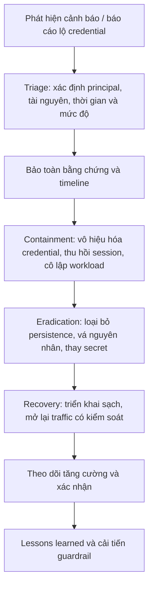
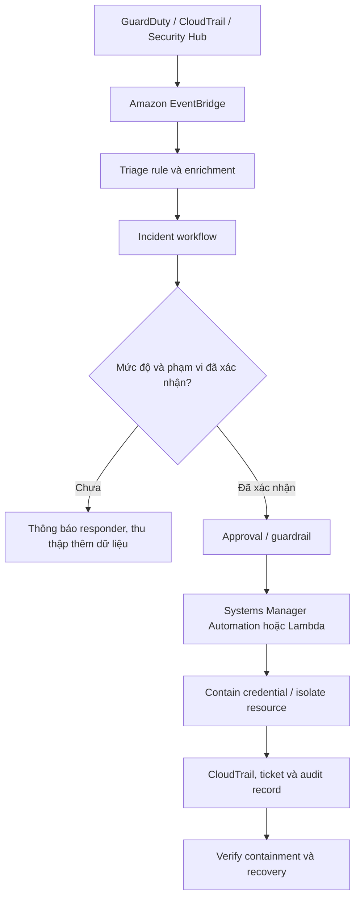

# Playbook xử lý lộ credential và tài nguyên bị xâm nhập

Một credential AWS bị lộ có thể cho phép người khác gọi API bằng danh tính hợp lệ, đọc dữ liệu, tạo tài nguyên, thay đổi cấu hình mạng hoặc chiếm quyền quản trị. Một workload bị xâm nhập cũng có thể trở thành điểm khởi đầu để đánh cắp credential tạm thời, di chuyển ngang và truy cập tài nguyên khác. Vì vậy, khi phát hiện dấu hiệu rò rỉ hoặc xâm nhập, đội vận hành cần nhanh chóng xác định danh tính và tài nguyên bị ảnh hưởng, chặn khả năng truy cập của kẻ tấn công, bảo toàn bằng chứng, loại bỏ nguyên nhân và khôi phục dịch vụ an toàn.

Playbook này hướng dẫn cách xử lý các tình huống thường gặp trong AWS: IAM access key bị công khai, role session bị đánh cắp, secret xuất hiện trong source code, EC2 hoặc container bị chiếm quyền, database hoặc S3 bị truy cập trái phép và quyền KMS bị sử dụng sai mục đích. Quy trình dựa trên các nguyên tắc của module `CLOUD_PROVIDERS_AWS`: IAM và phân quyền, VPC và cô lập mạng, mã hóa, giám sát, phục hồi và kiểm soát chi phí.

Sau bài học, bạn có thể:

- Phân biệt các loại credential AWS và hiểu giới hạn của từng cách thu hồi.
- Triển khai trình tự phát hiện, đánh giá, cô lập, loại bỏ nguyên nhân và phục hồi.
- Vô hiệu hóa access key bị lộ, thu hồi role session và thay thế secret an toàn.
- Cô lập EC2, ECS/EKS workload và tài nguyên dữ liệu bị xâm nhập.
- Thu thập CloudTrail, VPC Flow Logs, GuardDuty và bằng chứng liên quan.
- Xây dựng lệnh CLI, guardrail và quy trình kiểm soát thay đổi để ứng phó có thể lặp lại.
- Xác minh tài nguyên sạch, credential mới và quyền truy cập tối thiểu trước khi mở lại dịch vụ.

## 1. Hiểu sự cố credential và workload compromise

**Credential** là thông tin hoặc vật mang danh tính được dùng để chứng minh quyền truy cập. Trong AWS, credential có thể là access key, temporary security credentials, mật khẩu console, token ứng dụng, secret cơ sở dữ liệu, SSH key hoặc private key của chứng chỉ.

**Credential exposure** xảy ra khi credential bị công khai hoặc nằm ngoài phạm vi người được phép, chẳng hạn:

- Access key được commit vào Git repository hoặc đưa vào log.
- Secret xuất hiện trong ticket, chat, artifact build hoặc image container.
- Credential bị lấy qua phishing, malware hoặc máy developer bị xâm nhập.
- Token tạm thời bị đọc từ môi trường chạy ứng dụng.
- Private key hoặc database password bị lưu trong file không được bảo vệ.

**Workload compromise** xảy ra khi máy chủ, container, function hoặc thành phần ứng dụng bị kiểm soát trái phép. Kẻ tấn công có thể khai thác lỗ hổng, thực thi mã, cài persistence, lấy credential từ môi trường hoặc sử dụng quyền vốn có của workload.

Hai loại sự cố thường liên quan nhau. Một EC2 bị xâm nhập có thể truy cập instance profile credentials; một IAM access key bị lộ có thể được dùng để tạo role session, mở security group hoặc đọc secret. Vì vậy, chỉ vá máy chủ hoặc chỉ thay một mật khẩu có thể không đủ để chấm dứt sự cố.

### 1.1. Tài sản cần bảo vệ

Khi đánh giá phạm vi, hãy xác định những tài sản sau có thể bị ảnh hưởng:

| Nhóm tài sản | Ví dụ | Tác động có thể xảy ra |
|---|---|---|
| Danh tính | IAM user, role, root user, Identity Center permission set | Truy cập trái phép, leo thang quyền, tạo persistence |
| Credential | Access key, STS token, password, API token, SSH key | Giả mạo danh tính, gọi API hoặc đăng nhập |
| Compute | EC2, ECS task, EKS pod/node, Lambda | Thực thi mã, đào tiền mã hóa, pivot sang hệ thống khác |
| Dữ liệu | S3 object, EBS volume, RDS, DynamoDB | Đọc, sửa, xóa hoặc đánh cắp dữ liệu |
| Mạng | VPC, route table, security group, NACL, firewall | Mở đường truy cập, tạo tunnel hoặc né kiểm soát |
| Mã hóa | KMS key, key policy, Secrets Manager | Giải mã dữ liệu, thay đổi quyền hoặc làm gián đoạn dịch vụ |
| Audit | CloudTrail, Config, Flow Logs, log ứng dụng | Mất khả năng phát hiện và điều tra nếu log bị sửa/xóa |

Không nên mặc định mọi tài nguyên trong account đều bị xâm nhập. Tuy nhiên, hãy coi mọi tài nguyên mà credential bị lộ có thể truy cập là nằm trong phạm vi cần kiểm tra cho tới khi có bằng chứng loại trừ.

## 2. Nguyên tắc ứng phó

Khi xử lý sự cố, cần cân bằng giữa tốc độ chặn tấn công, bảo toàn bằng chứng và duy trì dịch vụ.

1. **Bảo vệ con người và dữ liệu trước**: ưu tiên ngăn rò rỉ dữ liệu nhạy cảm, phá hoại và truy cập trái phép đang diễn ra.
2. **Cô lập có mục tiêu**: giới hạn credential, role, network path hoặc workload liên quan; tránh khóa nhầm toàn bộ hệ thống nếu chưa cần thiết.
3. **Bảo toàn bằng chứng**: lưu log, snapshot và timeline trước khi xóa hoặc terminate tài nguyên có thể chứa dấu vết.
4. **Giả định credential đã bị sao chép**: xóa secret khỏi Git không làm credential cũ mất hiệu lực; phải thu hồi hoặc thay thế credential.
5. **Xác minh danh tính thực tế**: phân tích principal ARN, session name, source IP, user agent, Region và API được gọi.
6. **Không tin trạng thái sạch chỉ vì một cảnh báo đã đóng**: kiểm tra persistence, resource mới, trust policy, access key và quyền bất thường.
7. **Khôi phục từ nguồn đáng tin**: dùng image, artifact, backup và cấu hình đã kiểm chứng.
8. **Ghi lại mọi thay đổi**: ai thực hiện, thời điểm, lý do, tài nguyên và kết quả.

Một hành động containment có thể làm gián đoạn production. Người chỉ huy sự cố cần ghi rõ mục tiêu, phạm vi và tiêu chí rollback trước khi thay đổi cấu hình diện rộng.

## 3. Vòng đời xử lý sự cố

Quy trình thực tế có thể chia thành sáu giai đoạn. Các giai đoạn có thể lặp lại khi phát hiện thêm credential hoặc tài nguyên bị ảnh hưởng.



| Giai đoạn | Mục tiêu | Kết quả cần có |
|---|---|---|
| Detect | Nhận biết dấu hiệu bất thường | Finding, cảnh báo hoặc báo cáo được ghi nhận |
| Triage | Xác định phạm vi và mức độ | Principal, tài nguyên, thời điểm, account/Region |
| Contain | Ngăn truy cập trái phép tiếp tục | Credential bị vô hiệu hóa, session bị thu hồi, workload được cô lập |
| Eradicate | Loại bỏ nguyên nhân và persistence | Secret mới, image sạch, policy và cấu hình đã sửa |
| Recover | Khôi phục dịch vụ an toàn | Health check đạt, quyền đúng, dữ liệu nhất quán |
| Learn | Ngăn tái diễn | Báo cáo, action item, detection và runbook được cập nhật |

### 3.1. Phân loại mức độ sự cố

Đây là thang phân loại vận hành gợi ý; tổ chức cần điều chỉnh theo SLA và quy trình nội bộ.

| Mức | Ví dụ | Cách xử lý |
|---|---|---|
| Critical | Root credential bị lộ; quyền admin bị chiếm; dữ liệu nhạy cảm đang bị exfiltrate; nhiều account bị ảnh hưởng | Kích hoạt incident commander, security, cloud platform và data owner ngay; containment khẩn cấp |
| High | IAM key có quyền rộng bị sử dụng từ vị trí lạ; EC2 production bị chiếm quyền; KMS key policy bị thay đổi trái phép | Cô lập principal/workload, điều tra các account/Region liên quan, đánh giá dữ liệu |
| Medium | Secret của một ứng dụng ít quyền bị lộ nhưng chưa thấy hoạt động bất thường | Thu hồi và rotate, kiểm tra log và resource access, xác minh phạm vi |
| Low | Secret test hết hạn xuất hiện trong repository riêng, không có quyền truy cập thực tế | Xử lý theo quy trình credential exposure, kiểm tra lịch sử và cải thiện secret scanning |

Không hạ mức độ chỉ vì chưa tìm thấy bằng chứng sử dụng. Credential có thể bị sao chép nhưng chưa được dùng; vẫn cần thu hồi và kiểm tra.

## 4. Triage: xác định điều gì đã bị lộ

Trong những phút đầu, cần trả lời các câu hỏi:

- Credential thuộc loại nào: IAM user access key, role session, root, secret, token hay private key?
- Ai là chủ sở hữu và workload nào sử dụng credential?
- Credential có quyền gì và có thể truy cập account/Region nào?
- Lần đầu credential xuất hiện ở đâu và vào thời điểm nào?
- Có dấu hiệu sử dụng từ IP, ASN, thiết bị hoặc Region lạ không?
- API nào được gọi? Có tạo user/key/role, thay policy, mở SG hoặc đọc dữ liệu không?
- Có tài nguyên mới, snapshot, AMI, Lambda layer, container image hoặc access key nào được tạo không?
- Có dấu hiệu xóa log, thay đổi CloudTrail, GuardDuty hoặc security control không?

### 4.1. Xác minh principal đang được sử dụng

Dùng AWS STS để xác định danh tính của phiên hiện tại:

```bash
aws sts get-caller-identity
```

Kết quả cho biết account, user ID và ARN. Với role session, ARN thường có dạng:

```text
arn:aws:sts::111122223333:assumed-role/OrderService/session-name
```

Đối chiếu ARN này với CloudTrail `userIdentity`, đặc biệt là `type`, `principalId`, `arn`, `accessKeyId`, `sessionContext` và `sessionIssuer`. Không kết luận danh tính chỉ từ tên session vì session name có thể do caller chọn.

### 4.2. Xác định thời gian và phạm vi

Tạo một timeline theo UTC gồm:

- Thời điểm credential được tạo hoặc cấp.
- Thời điểm phát hiện credential exposure.
- Thời điểm API đáng ngờ đầu tiên.
- Thời điểm thay đổi IAM, network, compute hoặc storage.
- Thời điểm bắt đầu containment và kết quả.
- Thời điểm credential được thu hồi hoặc thay thế.

Kiểm tra mọi Region được phép hoạt động trong account. CloudTrail Event history cho phép xem management events trong 90 ngày gần nhất theo Region; điều tra dài hạn cần trail hoặc CloudTrail Lake đã được cấu hình trước. Data events như S3 object-level access không tự động có đầy đủ nếu trail chưa bật loại sự kiện tương ứng.

## 5. Bảo toàn bằng chứng trước khi thay đổi

Không trì hoãn containment khi có exfiltration đang diễn ra hoặc nguy cơ phá hoại cấp bách. Tuy nhiên, nếu có thể, hãy lưu bằng chứng trước khi terminate instance, xóa user, xóa key hoặc thay cấu hình làm mất dấu vết.

Bằng chứng hữu ích gồm:

- CloudTrail management/data events và digest files nếu bật log file integrity validation.
- VPC Flow Logs, Route 53 Resolver query logs và Network Firewall logs.
- GuardDuty findings, Security Hub findings và AWS Config timeline.
- CloudWatch application/system logs, ECS/EKS audit logs và Lambda logs.
- EBS snapshots, AMI, container image digest, task/pod metadata.
- S3 object versions, access logs, replication metadata và bucket policy.
- RDS snapshots, database audit logs và connection history.
- IAM policy, trust policy, access key metadata, credential report và thay đổi gần đây.

### 5.1. Bảo vệ bản sao bằng chứng

Nên lưu log và snapshot vào security/log archive account riêng, với quyền ghi và đọc tách biệt. S3 versioning, Object Lock và bucket policy có thể giúp bảo vệ dữ liệu audit khỏi bị xóa hoặc ghi đè. Giới hạn principal có quyền thay đổi retention hoặc Object Lock governance/compliance settings.

Với file được thu thập từ máy bị xâm nhập, ghi nhận:

- Tên nguồn, instance ID/task ID/pod UID và account/Region.
- Thời điểm thu thập và người thực hiện.
- Phương pháp thu thập và lệnh đã chạy.
- Hash của artifact nếu phù hợp.
- Nơi lưu bản gốc và bản phân tích.

Không đưa secret, token hoặc dữ liệu khách hàng nguyên văn vào ticket, chat hay báo cáo phổ thông. Hãy dùng ARN, ID, hash hoặc giá trị đã che.

## 6. Phân loại credential và cách thu hồi

Mỗi loại credential có vòng đời khác nhau. Bảng sau giúp chọn hành động phù hợp.

| Loại credential | Nơi thường xuất hiện | Hành động containment chính |
|---|---|---|
| IAM user access key | CLI, SDK, CI/CD, file cấu hình | Deactivate key, tạo key thay thế sạch nếu cần, cập nhật workload, xóa key cũ |
| Root access key/password | Account root | Vô hiệu hóa/xóa root access key, bảo vệ password, MFA và recovery channel |
| STS temporary credentials | AssumeRole, GetSessionToken, workload role | Thu hồi role sessions bằng policy/deny phù hợp; sửa trust và quyền cấp session |
| EC2 instance profile | EC2 metadata service | Cô lập instance, giới hạn/thu hồi quyền role, thay instance hoặc role nếu cần |
| ECS task role | Container task | Cô lập task/service, giới hạn task role, dừng hoặc thay task sau khi bảo toàn bằng chứng |
| EKS Pod Identity/IRSA | Pod service account | Cô lập workload, giới hạn IAM role/trust, thu hồi session và kiểm tra node/pod |
| Secrets Manager/Parameter Store secret | Ứng dụng, CI/CD, runtime | Rotate secret tại nguồn, cập nhật consumer, xác minh secret cũ không còn được chấp nhận |
| Database credential | Connection string, env, secret store | Disable/reset user hoặc password, giới hạn network, kiểm tra query/audit log |
| SSH/TLS private key | Bastion, server, service identity | Thu hồi hoặc thay certificate/key, cập nhật trust và cấu hình client/server |

### 6.1. IAM user access key bị lộ

IAM user có thể có tối đa hai access key. Khi một key bị lộ:

1. Xác định IAM user, access key ID, account và workload đang sử dụng key.
2. Deactivate key bị lộ ngay khi có đủ thông tin để không vô hiệu hóa nhầm key khác.
3. Tạo key mới chỉ khi workload còn cần IAM user access key; ưu tiên chuyển sang IAM role hoặc federation.
4. Cập nhật secret store hoặc pipeline bằng key mới qua quy trình an toàn.
5. Triển khai và xác minh workload dùng credential mới.
6. Xóa key cũ sau khi xác nhận không còn dependency.
7. Kiểm tra CloudTrail để tìm hoạt động trái phép trước và sau thời điểm phát hiện.

Ví dụ liệt kê key của user:

```bash
aws iam list-access-keys \
  --user-name legacy-integration
```

Vô hiệu hóa key đã xác định:

```bash
aws iam update-access-key \
  --user-name legacy-integration \
  --access-key-id $COMPROMISED_ACCESS_KEY_ID \
  --status Inactive
```

Giá trị `$COMPROMISED_ACCESS_KEY_ID` là biến minh họa; hãy nạp ID từ nguồn được bảo vệ, không in giá trị ra log. Chỉ chạy lệnh sau khi đối chiếu user và access key ID với inventory. Deactivate key chặn các request mới được ký trực tiếp bằng key đó; nếu key đã được dùng để lấy STS credentials, các session tạm thời đã cấp có thể còn hiệu lực tới khi hết hạn. Cần kiểm tra và thu hồi role session liên quan riêng.

Không xóa key cũ trước khi biết workload nào phụ thuộc vào nó nếu mục tiêu là thay thế có kiểm soát. Trong trường hợp key đang bị khai thác, ưu tiên deactivate ngay rồi xử lý sự cố gián đoạn theo incident process.

### 6.2. Root credential bị lộ

Root user có quyền rất rộng trong account và không nên dùng cho tác vụ vận hành hằng ngày. Nếu root password, MFA hoặc root access key bị lộ:

- Kích hoạt quy trình Critical và thông báo đội chịu trách nhiệm quản trị account.
- Nếu có root access key, vô hiệu hóa rồi xóa key không còn cần thiết.
- Đổi root password qua quy trình account recovery chính thức.
- Kiểm tra và khôi phục MFA, email, số điện thoại và alternate contacts.
- Kiểm tra thay đổi IAM, Organizations, billing, support plan, account settings, CloudTrail và các Region.
- Kiểm tra user, role, access key, identity provider, trust policy và resource policy mới được tạo.
- Kiểm tra CloudTrail, GuardDuty và hoạt động dữ liệu trong toàn bộ account.
- Liên hệ AWS Support qua kênh chính thức nếu mất quyền kiểm soát account hoặc phát hiện hoạt động trái phép nghiêm trọng.

Không dựa vào việc đổi password để kết luận mọi access key hoặc session đã bị thu hồi. Root password, MFA, root access key và session là các cơ chế khác nhau; cần kiểm tra từng loại.

## 7. Role session và temporary credentials bị đánh cắp

Temporary security credentials thường gồm access key ID, secret access key và session token. Chúng được cấp bởi AWS STS hoặc cơ chế workload identity và có thời hạn. Temporary credentials giảm rủi ro so với access key dài hạn, nhưng nếu bị đánh cắp thì kẻ tấn công có thể sử dụng chúng cho tới khi session hết hạn hoặc bị chặn bởi policy.

### 7.1. Thu hồi session của IAM role

Với role session đã phát hành, có thể áp dụng policy explicit Deny dựa trên `aws:TokenIssueTime` để chặn session được cấp trước một thời điểm. AWS có thể tạo policy dạng `AWSRevokeOlderSessions` khi dùng thao tác revoke active sessions trong IAM console.

Ví dụ policy minh họa:

```json
{
  "Version": "2012-10-17",
  "Statement": [
    {
      "Sid": "DenySessionsIssuedBeforeIncidentCutoff",
      "Effect": "Deny",
      "Action": "*",
      "Resource": "*",
      "Condition": {
        "DateLessThan": {
          "aws:TokenIssueTime": "2026-11-20T10:00:00Z"
        }
      }
    }
  ]
}
```

Thời điểm UTC trong ví dụ chỉ để minh họa; hãy thay bằng cutoff đã được incident commander xác định. Policy này chặn các session được cấp trước cutoff và có thể làm gián đoạn mọi workload đang dùng role đó. Các session được cấp sau cutoff không bị điều kiện này chặn, vì vậy phải sửa nguyên nhân cấp credential, trust policy hoặc permission boundary liên quan trước khi cho phép session mới.

Khi áp dụng, hãy kiểm tra role đang được dùng bởi service nào, có break-glass role độc lập hay không và quyền nào cần giữ lại để đội phản ứng tiếp tục vận hành. Sau khi sự cố kết thúc, gỡ policy revoke theo quy trình phê duyệt và kiểm tra lại quyền hiệu lực.

### 7.2. Sửa nguồn cấp session

Ngoài thu hồi session hiện tại, cần xử lý nguồn cấp credential:

- Sửa trust policy của role để chỉ principal và điều kiện mong muốn được assume.
- Thu hồi hoặc giới hạn quyền `sts:AssumeRole` từ principal nguồn.
- Kiểm tra external ID, OIDC audience/subject, SAML trust và condition.
- Với EC2/ECS/EKS/Lambda, rà soát role gắn với workload và quyền truy cập metadata/credential endpoint.
- Kiểm tra session policy, permissions boundary và SCP.
- Xem lại `DurationSeconds`; thời hạn ngắn giảm cửa sổ rủi ro nhưng không thay thế khả năng revoke.

Policy revoke session gắn vào IAM role chỉ nhắm tới session của role đó. Nếu credential bị lộ là session của IAM user, federated user hoặc Identity Center, hãy dùng cơ chế thu hồi/đăng xuất phù hợp với loại principal và identity provider. Nếu chỉ gỡ một IAM Allow nhưng role session đã được cấp, session có thể tiếp tục có quyền tùy loại policy và cách policy được đánh giá. Với sự cố nghiêm trọng, dùng explicit Deny hoặc cơ chế revoke sessions phù hợp, rồi xác minh bằng một request thử trong phạm vi kiểm soát.

## 8. Secret bị commit vào Git hoặc xuất hiện trong log

Khi phát hiện secret trong repository, artifact, container image hoặc log:

1. Xác định secret thuộc dịch vụ nào và quyền của nó.
2. Coi secret đã bị lộ nếu repository hoặc artifact từng có người không được phép truy cập.
3. Thu hồi hoặc rotate secret tại hệ thống phát hành.
4. Cập nhật secret store và toàn bộ consumer.
5. Kiểm tra log/API usage để xác định secret đã bị dùng chưa.
6. Xóa secret khỏi working tree, commit mới và artifact phát hành.
7. Nếu cần, làm sạch Git history theo quy trình repository owner và thông báo người dùng đã clone.
8. Bật secret scanning/pre-commit scanning để ngăn tái diễn.

**Xóa secret khỏi Git history không làm secret cũ mất hiệu lực.** Kẻ tấn công có thể đã clone repository hoặc lưu bản sao. Thu hồi credential phải là bước đầu tiên.

Với AWS Secrets Manager, có thể tạo phiên bản secret mới và triển khai rotation theo cơ chế của dịch vụ hoặc ứng dụng. Với Parameter Store SecureString, hãy ghi phiên bản mới và cập nhật consumer. Sau rotation, kiểm tra ứng dụng đã chuyển sang phiên bản mới và secret cũ không còn được chấp nhận.

## 9. Workload EC2 bị xâm nhập

EC2 bị xâm nhập có thể chứa dữ liệu nhạy cảm, credential trong bộ nhớ, log, disk hoặc instance profile credentials. Mục tiêu là chặn kết nối và credential của instance trong khi bảo toàn bằng chứng.

### 9.1. Cô lập instance

Các hành động thường dùng:

- Thay security group bằng quarantine SG chỉ cho phép đường điều tra được phê duyệt; không mở inbound/outbound rộng.
- Kiểm tra route table, NACL và Network Firewall nếu cần cô lập ở subnet hoặc VPC.
- Xóa hoặc giới hạn quyền của instance profile role khi có nguy cơ credential bị sử dụng trái phép.
- Chặn kết nối tới endpoint và tài nguyên nhạy cảm mà instance không còn được phép truy cập.
- Nếu cần, dừng instance sau khi đánh giá tác động tới volatile evidence và yêu cầu nghiệp vụ.

SG là stateful và thay đổi rule có thể không cắt ngay mọi kết nối đang tồn tại; theo dõi Flow Logs và kiểm chứng đường kết nối sau containment. Với egress quan trọng, có thể cần NACL hoặc Network Firewall rule phù hợp để chặn flow, nhưng phải đánh giá phạm vi ảnh hưởng.

### 9.2. Bảo toàn và phân tích

Trước khi terminate:

- Ghi lại instance ID, AMI ID, subnet, ENI, SG, IAM instance profile và tags.
- Thu thập system/application logs và metadata liên quan.
- Tạo EBS snapshot cho volume cần bảo toàn; gắn mô tả incident ID.
- Lưu CloudTrail, Flow Logs, GuardDuty findings và các sự kiện liên quan.
- Ghi lại process, network connection và volatile evidence nếu quy trình forensics cho phép.
- Giữ bản gốc read-only cho phân tích; không khởi động image nghi vấn trong mạng production.

Không nên coi snapshot là bằng chứng đầy đủ cho bộ nhớ hoặc trạng thái runtime. Dữ liệu volatile có thể mất khi dừng instance; quyết định thu thập phải theo mức độ khẩn cấp và năng lực forensics.

### 9.3. Khôi phục EC2

Không chỉ cài lại package trên instance bị xâm nhập rồi đưa trở lại production. Hãy:

1. Xác định vector ban đầu: lỗ hổng, credential, cấu hình mở hoặc image không tin cậy.
2. Vá image/base AMI và dependency.
3. Tạo instance mới từ image đã kiểm chứng.
4. Gắn IAM role mới hoặc role đã được rà soát quyền.
5. Gắn SG và subnet theo nguyên tắc tối thiểu.
6. Rotate secret mà instance cũ từng truy cập.
7. Kiểm tra logging, SSM, endpoint và monitoring.
8. Đưa traffic trở lại theo từng bước và giám sát tăng cường.

## 10. Container, EKS và Lambda bị xâm nhập

Container có thể bị xâm nhập ở cấp application, task/pod, node hoặc image registry. Cần xác định ranh giới bị ảnh hưởng trước khi dừng toàn bộ cluster.

### 10.1. Amazon ECS

Với ECS:

- Xác định cluster, service, task ARN, task definition revision, image digest và task role.
- Nếu task có dấu hiệu bị chiếm quyền, giảm hoặc dừng traffic qua load balancer/service discovery.
- Với task dùng `awsvpc`, xác định task ENI và security group để giới hạn kết nối mạng.
- Rà soát task role và execution role riêng biệt; task role thường là quyền mà code trong container sử dụng.
- Kiểm tra ECS Exec, CloudWatch Logs, image pull history và các secret được inject.
- Thu thập log và metadata trước khi dừng task nếu tình huống cho phép.
- Triển khai task mới từ image sạch, task definition đã review và role có quyền tối thiểu.

Nếu một task role được dùng chung cho nhiều task, thay đổi quyền có thể ảnh hưởng tất cả workload sử dụng role đó. Xác định consumer trước khi revoke và chuẩn bị role thay thế. Task ENI do ECS quản lý; triển khai thay đổi security group qua cấu hình service/task và rollout có kiểm soát theo cơ chế ECS, không mặc định sửa trực tiếp ENI đang được service quản lý.

### 10.2. Amazon EKS

Với EKS, cần xác định compromise ở pod, service account, node, control plane integration hay image:

- Cordon node để ngăn scheduling workload mới lên node nghi vấn; drain chỉ sau khi đánh giá tác động và bảo toàn bằng chứng.
- Dùng Kubernetes NetworkPolicy hoặc security groups for pods nếu kiến trúc đã cấu hình hỗ trợ để cô lập pod.
- Rà soát service account, IRSA trust policy hoặc EKS Pod Identity association.
- Thu hồi quyền IAM role gắn với workload và kiểm tra session đã cấp.
- Kiểm tra Kubernetes audit logs, control plane logs, CloudTrail và image digest.
- Kiểm tra DaemonSet, admission webhook, privileged container, hostPath mount, secret và service account token.
- Tạo lại workload từ image sạch và cập nhật node group nếu node bị ảnh hưởng.

NetworkPolicy chỉ có hiệu lực khi CNI và cluster được cấu hình hỗ trợ. Không giả định mọi EKS cluster mặc định enforce NetworkPolicy. Khi cần cô lập nhanh, phối hợp security group, node group và network controls đã được xác minh.

### 10.3. AWS Lambda

Khi Lambda bị nghi ngờ thực thi mã trái phép:

- Xác định function ARN, version/alias, execution role, event source mapping và trigger.
- Tạm dừng trigger hoặc đặt reserved concurrency bằng 0 khi cần ngăn invocation mới; đánh giá tác động tới event backlog và retry.
- Thu hồi hoặc giới hạn execution role, đặc biệt quyền đọc secret, ghi S3, gọi STS hoặc sửa cấu hình.
- Kiểm tra CloudTrail, CloudWatch Logs, deployment package, layer, environment variables và dependency.
- Xác định event payload có chứa credential hoặc dữ liệu nhạy cảm không.
- Triển khai version sạch, kiểm tra alias và traffic shifting trước khi bật trigger lại.

Không chỉ xóa function nếu chưa hiểu event source, dead-letter queue, retry và dữ liệu đang chờ xử lý. Bảo toàn event/log cần thiết để điều tra.

## 11. Dữ liệu S3 và database bị truy cập trái phép

Credential bị lộ có thể được dùng để đọc hoặc xóa dữ liệu mà không cần chiếm máy chủ.

### 11.1. Amazon S3

Khi nghi ngờ S3 bị truy cập trái phép:

- Xác định bucket, prefix, object và principal liên quan.
- Kiểm tra S3 data events nếu đã bật trong CloudTrail; xem server access logs hoặc các log khác đã cấu hình.
- Kiểm tra bucket policy, access point policy, ACL, Block Public Access, replication và access point.
- Thu hẹp quyền IAM/resource policy; chặn public access nếu cấu hình cho phép và không phá vỡ use case hợp lệ.
- Bảo toàn object versions, delete markers, replication metadata và audit logs.
- Kiểm tra object đã bị tải xuống, thay đổi, xóa hoặc chia sẻ qua URL ký trước hay chưa.
- Rotate secret hoặc credential có thể truy cập bucket.

Versioning giúp khôi phục một số object bị ghi đè/xóa, nhưng không thay thế backup và không tự ngăn exfiltration. Presigned URL là bearer token có thời hạn; khi nghi ngờ URL bị lộ, hãy đánh giá thời hạn, credential ký và quyền của tài nguyên, đồng thời dùng policy để chặn truy cập nếu cần.

### 11.2. Amazon RDS và database

Khi database credential hoặc database bị compromise:

- Giới hạn SG inbound chỉ cho application/service cần thiết.
- Disable hoặc rotate database user/password bị lộ.
- Kiểm tra database audit log, connection log, query history và CloudTrail cho API quản trị RDS.
- Xác định query đọc/xuất dữ liệu, thay đổi schema, tạo user hoặc thay đổi quyền.
- Tạo snapshot theo quy trình bảo toàn; bảo vệ snapshot và bản sao.
- Kiểm tra encryption, backup retention, automated backup và cross-account snapshot sharing.
- Triển khai credential mới qua Secrets Manager hoặc cơ chế quản lý phù hợp.
- Xác minh connection pool và toàn bộ consumer đã chuyển sang credential mới.

Không xóa database user hoặc snapshot trước khi xác định tác động điều tra và phục hồi. Nếu nghi ngờ dữ liệu bị thay đổi, cần xác định mốc dữ liệu sạch và phối hợp với data owner để đối chiếu tính toàn vẹn.

## 12. KMS key và secret store bị sử dụng sai quyền

KMS key material do AWS KMS quản lý không được export như một private key thông thường. Vì vậy, cần phân biệt:

- **Credential hoặc quyền KMS bị lộ**: kẻ tấn công có thể gọi API KMS như Decrypt, GenerateDataKey hoặc PutKeyPolicy theo quyền được cấp.
- **Key policy bị thay đổi**: principal trái phép có thể được cấp quyền sử dụng hoặc quản trị key.
- **Secret plaintext bị lộ**: dữ liệu giải mã được có thể đã bị sao chép ra ngoài; rotate secret hoặc credential gốc là cần thiết.
- **Private key do khách hàng quản lý/import**: cần xử lý theo quy trình PKI và key custody tương ứng.

Khi phát hiện truy cập KMS bất thường:

1. Xác định key ARN, principal, API và encryption context trong CloudTrail.
2. Kiểm tra key policy, grants, IAM policies và các thay đổi gần đây.
3. Thu hồi quyền principal hoặc session bị lộ.
4. Nếu key policy bị sửa, khôi phục policy đã review và giữ đường quản trị đáng tin cậy.
5. Nếu nghi ngờ dữ liệu plaintext đã bị giải mã, đánh giá dữ liệu bị lộ và rotate secret/data encryption key theo kiến trúc.
6. Cân nhắc disable key khi cần ngăn ngay thao tác mật mã; đánh giá kỹ tác động vì ứng dụng có thể không đọc/ghi được dữ liệu.
7. Tạo key thay thế và tái mã hóa dữ liệu theo kế hoạch nếu key hoặc quyền sử dụng không còn đáng tin cậy.

Disable KMS key không xóa ciphertext và không thu hồi plaintext đã bị sao chép trước đó. Xóa key vĩnh viễn có thể làm dữ liệu không thể giải mã; không dùng deletion như biện pháp containment thông thường. Việc thay key phải có kế hoạch re-encryption, kiểm tra backup và phê duyệt của data owner.

Với Secrets Manager, kiểm tra rotation status, version staging labels và consumer. Khi rotate, bảo đảm ứng dụng thực sự dùng phiên bản mới và credential cũ đã bị vô hiệu hóa tại hệ thống đích; chỉ tạo version mới trong secret store không làm password cũ mất hiệu lực.

## 13. Containment ở cấp mạng và AWS Organizations

Credential containment và network containment cần phối hợp. Một principal có thể bị vô hiệu hóa nhưng workload đã bị xâm nhập vẫn có thể dùng một đường khác; ngược lại, cô lập network mà không thu hồi credential có thể để kẻ tấn công tiếp tục gọi AWS API từ bên ngoài.

### 13.1. Quarantine security group

Tạo SG quarantine với inbound/outbound tối thiểu, chỉ giữ đường điều tra đã được phê duyệt. Trước khi thay SG:

- Xác định tài nguyên và ENI thực tế.
- Kiểm tra các phụ thuộc health check, logging, SSM và forensic collection.
- Ghi lại SG hiện tại và rule để có thể khôi phục.
- Chỉ cho phép forensic workstation hoặc management endpoint cần thiết.
- Xác minh Flow Logs và kiểm thử kết nối sau khi thay.

Không dùng SG quarantine chung cho nhiều tài nguyên nhạy cảm nếu chưa đánh giá phạm vi. Nếu tài nguyên nằm trong Auto Scaling Group hoặc ECS service, controller có thể tạo lại instance/task; cần xử lý cả desired capacity, deployment và controller để containment có hiệu lực.

### 13.2. SCP hoặc policy Deny tạm thời

SCP có thể đặt guardrail ở cấp OU/account, ví dụ ngăn một số hành động quản trị nguy hiểm trong member accounts. Tuy nhiên:

- SCP không cấp quyền và không thay identity/resource policy.
- SCP không áp dụng cho management account.
- SCP có thể ảnh hưởng cả incident responder và service recovery.
- Không nên thêm Deny rộng mà không có break-glass path đã kiểm thử.
- Tài nguyên và dịch vụ cần ngoại lệ phải được xác định rõ.

Với sự cố chỉ liên quan một role hoặc một resource, thường nên containment ở principal/resource trước khi áp dụng SCP diện rộng. Nếu cần quarantine account, phối hợp Organizations administrator và incident commander để kiểm soát thứ tự thay đổi.

## 14. Điều tra bằng CloudTrail, GuardDuty và các nguồn log

### 14.1. CloudTrail

CloudTrail giúp truy vết API activity. Các event đáng chú ý khi điều tra credential compromise gồm:

| Event hoặc nhóm event | Ý nghĩa cần kiểm tra |
|---|---|
| `ConsoleLogin` | Đăng nhập console, source IP, MFA và kết quả |
| `CreateAccessKey`, `UpdateAccessKey`, `DeleteAccessKey` | Tạo, bật/tắt hoặc xóa access key |
| `CreateUser`, `CreateRole`, `AttachRolePolicy`, `PutRolePolicy` | Tạo danh tính hoặc mở rộng quyền |
| `UpdateAssumeRolePolicy`, `AssumeRole` | Thay đổi trust hoặc cấp role session |
| `CreateLoginProfile`, `UpdateLoginProfile` | Tạo hoặc thay đổi thông tin đăng nhập console |
| `AuthorizeSecurityGroupIngress`, `ModifyNetworkInterfaceAttribute` | Mở đường mạng hoặc thay đổi interface |
| `PutBucketPolicy`, `PutPublicAccessBlock`, `GetObject` | Thay đổi quyền hoặc truy cập S3; data event cần được bật |
| `GetSecretValue`, `PutSecretValue`, `RotateSecret` | Truy cập hoặc thay đổi secret |
| `Decrypt`, `GenerateDataKey`, `PutKeyPolicy`, `CreateGrant` | Sử dụng hoặc thay đổi quyền KMS |
| `StopLogging`, `DeleteTrail`, `UpdateTrail` | Hành động có thể làm giảm khả năng audit |

Tên event là gợi ý để tìm kiếm, không phải danh sách đầy đủ. Một số API data-plane chỉ xuất hiện nếu trail được cấu hình data events tương ứng. Kiểm tra cả event thành công lẫn thất bại và đối chiếu event source, principal, source IP, user agent, Region, request parameters và response elements.

### 14.2. GuardDuty

GuardDuty phân tích dữ liệu và tạo finding về hành vi có thể đáng ngờ, chẳng hạn credential bất thường, reconnaissance, malware hoặc truy cập dữ liệu khác thường. Khi có finding:

1. Ghi lại finding ID, type, severity, account, Region và resource.
2. Đối chiếu principal và API với CloudTrail.
3. Xác định finding là hoạt động hợp lệ, false positive hay sự cố thực tế.
4. Nếu confirmed, containment principal/workload theo playbook.
5. Theo dõi finding liên quan và xác minh không còn hoạt động mới.

GuardDuty là dịch vụ phát hiện; không giả định finding đã được archive/resolved nghĩa là credential đã bị thu hồi. Có thể dùng EventBridge để định tuyến finding tới hệ thống incident management hoặc automation.

### 14.3. AWS Config, Security Hub và log mạng

AWS Config cung cấp lịch sử cấu hình và đánh giá compliance cho resource được ghi nhận. Security Hub CSPM tập hợp finding từ nhiều nguồn và giúp ưu tiên rủi ro. VPC Flow Logs cho biết metadata của network flow, còn Route 53 Resolver query logs giúp nhận biết domain mà workload truy vấn.

Kết hợp nhiều nguồn cho bức tranh đầy đủ hơn:

- CloudTrail: ai gọi API nào?
- GuardDuty: hành vi nào có dấu hiệu đe dọa?
- Config: resource đã thay đổi cấu hình ra sao?
- Flow Logs: workload đã kết nối tới IP/port nào?
- Application logs: request nghiệp vụ và dữ liệu nào đã bị tác động?
- S3/RDS audit: dữ liệu nào được đọc, sửa hoặc xóa?

## 15. Kiểm tra persistence và dấu hiệu leo thang quyền

Sau khi thu hồi credential ban đầu, cần tìm những thay đổi mà kẻ tấn công có thể đã tạo để quay lại.

Kiểm tra:

- IAM user, role, group và policy mới.
- Access key mới hoặc key được kích hoạt lại.
- Trust policy cho phép principal bên ngoài assume role.
- Identity provider, OIDC provider, SAML provider và federation mapping.
- Inline policy, managed policy version hoặc permissions boundary bị thay đổi.
- Lambda function, layer, event source mapping, schedule hoặc EventBridge rule mới.
- EC2 instance, AMI, EBS snapshot, launch template, Auto Scaling configuration.
- ECS task definition, EKS DaemonSet, privileged pod, admission webhook hoặc image mới.
- S3 bucket policy, access point, replication rule, ACL và public access setting.
- KMS key policy, grant, alias và trạng thái key.
- CloudTrail trail, log bucket, EventBridge rule và GuardDuty configuration bị tắt hoặc thay đổi.

Đừng chỉ tìm resource có tên lạ. Kẻ tấn công có thể sửa resource hiện có hoặc dùng tên hợp lệ. So sánh với baseline, change record và lịch sử cấu hình.

## 16. Eradication: loại bỏ nguyên nhân

Eradication phải xử lý cả credential và vector xâm nhập.

- Rotate hoặc revoke mọi credential có khả năng bị lộ.
- Vá lỗ hổng, cập nhật dependency và loại bỏ image/package bị nhiễm.
- Xóa persistence như user/key/role, Lambda layer, scheduled task hoặc startup script trái phép.
- Khôi phục IAM trust policy, resource policy, SG, route table và endpoint policy đã bị thay đổi.
- Xác minh CI/CD pipeline, build agent, repository secret và artifact.
- Thay credential dùng chung hoặc credential bị đọc từ workload.
- Kiểm tra máy developer/admin nếu credential có thể bị đánh cắp từ endpoint.
- Cập nhật secret scanning, MFA, federation, workload identity và guardrail.

Nếu không xác định được nguyên nhân ban đầu, hãy giữ mức giám sát cao và cân nhắc thay mới workload từ image tin cậy thay vì cố làm sạch tại chỗ. Không đưa tài nguyên trở lại production chỉ vì malware scanner không phát hiện gì.

## 17. Recovery: khôi phục dịch vụ an toàn

Khôi phục cần có tiêu chí rõ ràng và được thực hiện theo từng bước.

### 17.1. Điều kiện trước khi mở lại

- Credential cũ đã bị revoke/deactivate hoặc được xác nhận hết hạn.
- Credential mới được lưu trong secret store và không nằm trong source/image/log.
- Role và policy đã được review; quyền chỉ đủ cho workload.
- Workload chạy từ image hoặc artifact đã kiểm chứng.
- Security group, NACL, route table và firewall policy đã được khôi phục theo thiết kế.
- Database, S3 và KMS access đã được kiểm tra.
- Logging và detection hoạt động, log được gửi tới nơi lưu trữ đáng tin.
- Health check, backup và dependency được kiểm tra.
- Data owner đã xác nhận tính toàn vẹn dữ liệu nếu có thay đổi.

### 17.2. Mở lại traffic theo từng giai đoạn

1. Chạy workload mới trong phạm vi kiểm soát.
2. Xác minh startup, health check, IAM call và secret retrieval.
3. Gửi traffic thử nghiệm hoặc một tỷ lệ nhỏ.
4. Theo dõi error rate, latency, denied API, GuardDuty và Flow Logs.
5. Mở traffic theo từng bước khi tiêu chí đạt.
6. Giữ quarantine artifact và snapshot phục vụ điều tra theo retention policy.

Nếu phát hiện hoạt động bất thường mới, quay lại containment. Không xóa bằng chứng hoặc đóng incident chỉ vì dịch vụ đã chạy.

## 18. Lệnh CLI hỗ trợ điều tra và containment

Các lệnh dưới đây là mẫu thao tác. Thay account, Region, ARN, tên user và ID bằng giá trị đã xác minh. Dùng profile/role ứng phó có quyền phù hợp; không lưu credential mới trực tiếp trong shell history hoặc file plaintext.

Liệt kê access key của IAM user:

```bash
aws iam list-access-keys \
  --user-name legacy-integration
```

Xem trạng thái và metadata của key:

```bash
aws iam get-access-key-last-used \
  --access-key-id $COMPROMISED_ACCESS_KEY_ID
```

Vô hiệu hóa access key:

```bash
aws iam update-access-key \
  --user-name legacy-integration \
  --access-key-id $COMPROMISED_ACCESS_KEY_ID \
  --status Inactive
```

Kiểm tra danh tính của profile hiện tại:

```bash
aws sts get-caller-identity
```

Mô tả EC2 instance để ghi nhận cấu hình trước containment:

```bash
aws ec2 describe-instances \
  --instance-ids i-0123456789abcdef0 \
  --region ap-southeast-1
```

Liệt kê GuardDuty findings ở một Region:

```bash
aws guardduty list-findings \
  --detector-id 12abc34d567e8f901234567890abcdef \
  --region ap-southeast-1
```

Tra cứu chứng chỉ/secret/role hoặc resource cần thiết bằng API tương ứng. Trước khi chạy lệnh thay đổi, hãy ghi lại trạng thái hiện tại và xác minh tác động tới production. Với hành động có thể làm mất bằng chứng hoặc gây downtime, cần incident commander phê duyệt.

## 19. Tự động hóa containment có guardrail

Có thể dùng EventBridge để nhận GuardDuty finding hoặc CloudTrail event, sau đó điều phối Lambda hay Systems Manager Automation. Ví dụ, finding về EC2 có thể mở incident ticket, thu thập instance metadata, yêu cầu approval rồi gắn quarantine SG.

Luồng tham khảo:



Automation cần có các guardrail:

- Chỉ xử lý account, Region và resource type đã được allowlist.
- Kiểm tra principal và resource owner trước khi thay đổi.
- Có chế độ dry-run hoặc bước phê duyệt cho hành động rủi ro cao.
- Có ngoại lệ cho break-glass, logging, security tooling và recovery role.
- Ghi lại input, output, caller, thời điểm và kết quả.
- Có timeout, retry có giới hạn và xử lý idempotent.
- Không tự động xóa instance, bucket, key hoặc snapshot.
- Không đưa secret vào event payload, log hoặc notification.
- Kiểm thử trong môi trường non-production trước khi bật cho production.

Không phải finding nào cũng nên tự động cô lập. Một false positive có thể làm ngừng dịch vụ quan trọng; automation cần dựa trên severity, confidence, resource criticality và context.

## 20. Tình huống thực tế: access key của CI/CD bị công khai

Một nhóm phát triển phát hiện access key của IAM user `legacy-deploy` trong commit công khai. User có quyền cập nhật ECS service, đọc ECR và lấy secret triển khai. CloudTrail cho thấy key đã gọi `AssumeRole` từ một địa chỉ IP không thuộc pipeline.

### 20.1. Triage

- Ghi access key ID, user ARN, commit hash, thời điểm public và source IP.
- Kiểm tra CloudTrail để tìm `AssumeRole`, `GetSecretValue`, `UpdateService`, `RegisterTaskDefinition`, `CreateAccessKey` và API liên quan.
- Xác định role session được tạo, thời gian hết hạn, policy và tài nguyên có thể truy cập.
- Kiểm tra ECS task definition revision, image digest, ECR repository và secret liên quan.
- Bảo toàn CloudTrail, pipeline logs và artifact trước khi sửa.

### 20.2. Containment

1. Deactivate access key bị lộ.
2. Thu hồi các role session đã được cấp từ key đó bằng policy revoke sessions phù hợp.
3. Tạm dừng pipeline hoặc role deploy nếu chưa xác định được integrity.
4. Kiểm tra và chặn access key/role/policy mới được tạo trái phép.
5. Nếu ECS workload có dấu hiệu bị thay đổi, dừng rollout và cô lập task/service liên quan.
6. Rotate secret mà pipeline có thể đọc.

### 20.3. Eradication và recovery

- Chuyển pipeline sang OIDC federation hoặc role assumption từ runner đáng tin cậy, không dùng IAM user key dài hạn.
- Tạo role deploy với trust condition giới hạn repository, branch, audience và provider phù hợp.
- Giới hạn quyền deploy theo ECS cluster/service và ECR repository cần thiết.
- Tạo task definition sạch, xác minh image digest và cấu hình.
- Chạy pipeline kiểm thử, xác minh CloudTrail cho thấy đúng principal và source.
- Xóa access key cũ sau khi không còn dependency.
- Bật secret scanning và rule phát hiện access key trong commit.
- Rà soát các repository, artifact và runner khác có thể đã nhận cùng secret.

Sự cố chỉ được đóng khi key cũ không còn dùng được, role session bị kiểm soát, pipeline dùng danh tính mới, workload sạch và không còn dấu hiệu persistence.

## 21. Checklist vận hành nhanh

Khi có cảnh báo lộ credential hoặc workload compromise, dùng checklist sau để không bỏ sót bước:

- [ ] Ghi nhận incident ID, người chỉ huy, thời điểm UTC và mức độ.
- [ ] Xác định account, Region, principal ARN, credential type và resource.
- [ ] Kiểm tra source IP, user agent, API event và dữ liệu có thể bị truy cập.
- [ ] Bảo toàn CloudTrail, Flow Logs, application logs, snapshots và findings.
- [ ] Deactivate credential dài hạn bị lộ.
- [ ] Revoke role sessions/temporary credentials nếu cần.
- [ ] Rotate secret và credential ở hệ thống đích.
- [ ] Cô lập workload hoặc resource bằng SG, firewall, service control hoặc trigger pause.
- [ ] Kiểm tra IAM user/role/key/trust policy và persistence.
- [ ] Kiểm tra S3, RDS, KMS, ECR, Lambda, ECS/EKS và network changes.
- [ ] Khôi phục từ image/artifact/backup đã kiểm chứng.
- [ ] Kiểm tra logging, detection, IAM least privilege và health check.
- [ ] Theo dõi tăng cường sau khi mở lại traffic.
- [ ] Ghi lại nguyên nhân gốc, tác động, thời gian xử lý và action item.

## 22. Những sai lầm cần tránh

| Sai lầm | Hậu quả | Cách làm đúng |
|---|---|---|
| Chỉ xóa key khỏi Git | Key cũ vẫn có thể hoạt động | Deactivate/revoke và rotate tại hệ thống phát hành |
| Chỉ disable IAM access key | STS session đã cấp có thể còn hiệu lực | Kiểm tra và revoke role sessions liên quan |
| Terminate EC2 ngay lập tức | Mất volatile evidence và trạng thái cần điều tra | Cô lập, snapshot và thu thập bằng chứng trước khi terminate nếu tình huống cho phép |
| Chỉ đổi mật khẩu database | Kẻ tấn công có thể còn session hoặc user khác | Kiểm tra session, user, grants, audit log và secret consumers |
| Cấp Deny toàn account không có ngoại lệ | Incident responder và recovery có thể bị khóa | Phạm vi containment rõ ràng, break-glass và approval |
| Xóa KMS key để ngăn truy cập | Dữ liệu có thể không thể giải mã | Thu hồi quyền, cân nhắc disable có kiểm soát, lập kế hoạch key replacement |
| Chỉ dựa vào GuardDuty | Có thể bỏ sót hoạt động chưa được finding | Đối chiếu CloudTrail, Flow Logs, Config và application logs |
| Tin rằng private subnet an toàn | Workload vẫn có thể truy cập qua NAT/peering/TGW | Kiểm tra route, SG, NACL, endpoint và egress |
| Đưa instance đã vá trở lại ngay | Persistence hoặc backdoor có thể còn | Tạo mới từ image sạch, rotate credential và xác minh |
| Đóng incident khi service hoạt động | Persistence hoặc exfiltration có thể chưa được xử lý | Xác minh scope, credential, log và thời gian theo dõi |

## 23. Cải tiến sau sự cố

Sau khi khôi phục, tổ chức cần biến bài học thành thay đổi cụ thể:

- Thay IAM user access key bằng IAM role, OIDC federation hoặc workload identity.
- Bật MFA cho người dùng đặc quyền và bảo vệ root account.
- Bật CloudTrail organization trail, tập trung log ở security account và bảo vệ retention.
- Bật các data events quan trọng như S3 object access theo yêu cầu rủi ro.
- Bật GuardDuty, Security Hub và AWS Config theo mô hình quản trị.
- Quét secret trong repository, CI/CD, container image và artifact.
- Giảm quyền IAM theo access analyzer, last accessed và use case thực tế.
- Dùng Secrets Manager rotation và quy trình secret lifecycle.
- Áp dụng SG theo workload, egress control và VPC endpoints.
- Xây dựng automation containment có approval và audit.
- Diễn tập sự cố định kỳ, gồm credential leak, role session theft, EC2 compromise và data exfiltration.
- Đo thời gian phát hiện (MTTD), thời gian containment (MTTC) và thời gian phục hồi (MTTR).

Mỗi action item cần có owner, deadline, tiêu chí hoàn thành và bằng chứng xác minh. Không nên kết thúc báo cáo bằng một nhận xét chung như “đã nhắc nhân viên cẩn thận”; cần thay đổi kỹ thuật hoặc quy trình có thể kiểm tra.

## 24. Tóm tắt kiến thức

Xử lý lộ credential và workload bị xâm nhập cần một quy trình thống nhất: phát hiện, triage, bảo toàn bằng chứng, containment, eradication, recovery và cải tiến. Hãy xác định chính xác credential type vì deactivate IAM access key không tự động thu hồi mọi STS session đã cấp. Role session cần được kiểm soát bằng revoke sessions hoặc explicit Deny phù hợp; secret phải được rotate tại hệ thống phát hành và mọi consumer cần chuyển sang phiên bản mới.

Khi workload bị xâm nhập, cô lập mạng và quyền IAM song song, nhưng bảo toàn bằng chứng trước khi terminate nếu điều kiện cho phép. EC2, ECS/EKS, Lambda, S3, RDS và KMS có đặc thù khác nhau; cần xác định đúng resource, role, data path và controller trước khi hành động. CloudTrail, GuardDuty, Config, Flow Logs và application logs giúp xác định hoạt động và phạm vi. Khôi phục chỉ hoàn tất khi credential cũ bị vô hiệu hóa, persistence bị loại bỏ, workload sạch, quyền tối thiểu và logging/detection hoạt động.

## Tài liệu tham khảo

- [AWS Security Incident Response Guide](https://docs.aws.amazon.com/whitepapers/latest/aws-security-incident-response-guide/welcome.html)
- [Responding to compromised AWS credentials](https://docs.aws.amazon.com/IAM/latest/UserGuide/id_credentials_temp_control-access_disable-perms.html)
- [Deactivate or delete access keys for IAM users](https://docs.aws.amazon.com/IAM/latest/UserGuide/id_credentials_access-keys.html)
- [Revoke IAM role temporary security credentials](https://docs.aws.amazon.com/IAM/latest/UserGuide/id_roles_use_revoke-sessions.html)
- [Best practices for managing AWS access keys](https://docs.aws.amazon.com/general/latest/gr/aws-access-keys-best-practices.html)
- [AWS CloudTrail user guide](https://docs.aws.amazon.com/awscloudtrail/latest/userguide/cloudtrail-user-guide.html)
- [Amazon GuardDuty user guide](https://docs.aws.amazon.com/guardduty/latest/ug/what-is-guardduty.html)
- [AWS Systems Manager Automation](https://docs.aws.amazon.com/systems-manager/latest/userguide/systems-manager-automation.html)
- [Amazon EC2 security groups](https://docs.aws.amazon.com/AWSEC2/latest/UserGuide/ec2-security-groups.html)
- [AWS Secrets Manager rotation](https://docs.aws.amazon.com/secretsmanager/latest/userguide/rotating-secrets.html)
- [AWS KMS key policies](https://docs.aws.amazon.com/kms/latest/developerguide/key-policies.html)
- [AWS Security Incident Response](https://aws.amazon.com/security/incident-response/)

