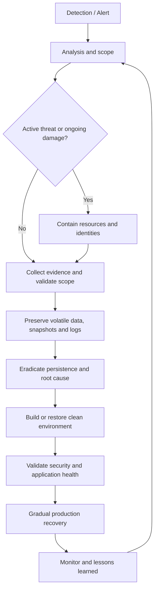
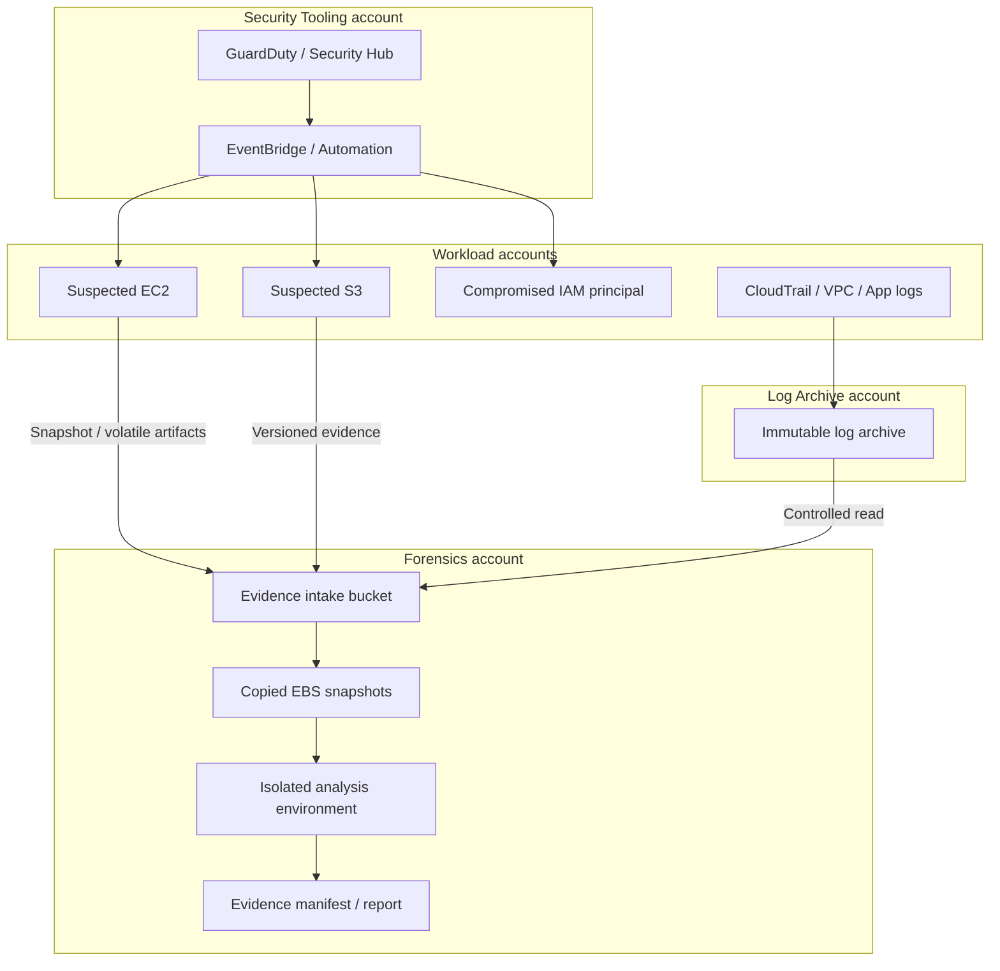

# Cô lập tài nguyên, bảo toàn bằng chứng và phục hồi an toàn

## 1. Vì sao phải phối hợp cô lập, điều tra và phục hồi?

Khi một tài nguyên AWS có dấu hiệu bị xâm nhập, nhóm vận hành phải xử lý đồng thời ba mục tiêu:

- **Ngăn thiệt hại lan rộng:** hạn chế kẻ tấn công tiếp tục truy cập, đánh cắp dữ liệu, tạo persistence hoặc di chuyển ngang sang tài nguyên khác.
- **Bảo toàn bằng chứng:** giữ lại dữ liệu cần thiết để xác định nguyên nhân, phạm vi ảnh hưởng, danh tính và hành động đã xảy ra.
- **Khôi phục dịch vụ an toàn:** đưa workload trở lại hoạt động trên một trạng thái đáng tin cậy, đồng thời loại bỏ lỗ hổng và đường truy cập đã bị khai thác.

Ba mục tiêu này có thể xung đột. Tắt một EC2 instance có thể ngăn mã độc tiếp tục hoạt động nhưng làm mất dữ liệu trong RAM, process list và kết nối mạng đang tồn tại. Thay Security Group có thể hạn chế kết nối mới nhưng các kết nối đã được theo dõi vẫn tiếp tục. Khôi phục ngay từ backup mới nhất có thể đưa ransomware hoặc cấu hình đã bị xâm phạm trở lại production.

Vì vậy, phản ứng sự cố cần có thứ tự ưu tiên và quyết định dựa trên mức độ nguy hiểm. Nếu đang có hành vi đánh cắp dữ liệu hoặc phá hoại, containment có thể cần thực hiện ngay. Nếu tình huống đã được kiểm soát và bằng chứng volatile có giá trị, nhóm điều tra nên thu thập chúng trước khi reboot hoặc stop instance.

Bài học thuộc module **CLOUD_PROVIDERS_AWS**, nơi người học khám phá cách thiết kế và vận hành hệ thống AWS an toàn, có khả năng giám sát, phục hồi và kiểm soát rủi ro. Trọng tâm là xây dựng một quy trình có thể lặp lại cho EC2, IAM, S3 và workload nhiều account.

## 2. Mục tiêu học tập

Sau bài học, người học có thể:

1. Phân biệt detection, analysis, containment, eradication, recovery và post-incident review.
2. Chọn cách cô lập phù hợp cho EC2, IAM principal, S3 bucket và workload container.
3. Giải thích giới hạn của Security Group, Network ACL và việc dừng EC2 khi containment.
4. Thu thập volatile evidence, EBS snapshots, logs và cấu hình tài nguyên theo một quy trình có thể kiểm tra lại.
5. Duy trì chain of custody, hash, metadata, quyền truy cập và retention của bằng chứng.
6. Dùng Systems Manager Automation, GuardDuty, CloudTrail, AWS Config và AWS Backup trong quy trình ứng phó.
7. Xây dựng môi trường forensic riêng và bảo vệ artifact bằng S3 Object Lock, KMS và kiểm soát cross-account.
8. Phân biệt eradication với recovery và lựa chọn recovery point đáng tin cậy.
9. Khôi phục workload từ known-good state, kiểm tra an toàn trước khi đưa vào production.
10. Xây dựng runbook, tiêu chí dừng, rollback và checklist sau sự cố.

## 3. Vòng đời ứng phó sự cố

Một quy trình incident response thường có các giai đoạn sau:

| Giai đoạn | Mục tiêu | Kết quả cần có |
|---|---|---|
| Preparation | Chuẩn bị con người, quyền, log, backup, automation và forensic environment | Runbook đã thử nghiệm, contact list, evidence plan |
| Detection | Phát hiện dấu hiệu bất thường | Finding, alert, incident ticket |
| Analysis | Xác minh sự cố và xác định phạm vi | Timeline, resource list, severity, hypothesis |
| Containment | Hạn chế hoạt động nguy hiểm và ngăn lan rộng | Tài nguyên/identity bị cô lập, kết nối rủi ro bị chặn |
| Eradication | Loại bỏ malware, persistence, credentials và nguyên nhân | Không còn đường truy cập hoặc thành phần độc hại đã xác định |
| Recovery | Khôi phục trạng thái đáng tin cậy và xác minh | Workload sạch hoạt động ổn định |
| Lessons learned | Cải thiện control, quy trình và khả năng phát hiện | Action items có owner và thời hạn |

Các giai đoạn không nhất thiết diễn ra tuyến tính. Khi phát hiện thêm tài khoản bị chiếm quyền trong lúc phục hồi, nhóm ứng phó có thể quay lại analysis và containment. Với sự cố ransomware, containment và bảo toàn backup thường quan trọng hơn việc khôi phục nhanh. Với bucket bị public, containment có thể chỉ cần thay đổi policy và kiểm tra lịch sử truy cập.

Sơ đồ tổng quan:



## 4. Nguyên tắc ra quyết định trong incident response

### 4.1. Ưu tiên theo mức độ nguy hiểm

Trước khi thao tác, đánh giá:

- Có đang exfiltrate dữ liệu hoặc phá hoại dữ liệu không?
- Kẻ tấn công còn có session hoặc credential hợp lệ không?
- Tài nguyên có khả năng truy cập sang workload khác không?
- Dịch vụ có phải hệ thống critical hoặc phụ thuộc nhiều thành phần không?
- Việc dừng hoặc cô lập có làm mất dữ liệu volatile không?
- Có yêu cầu pháp lý, hợp đồng hoặc quy định về bảo toàn bằng chứng không?
- Có thể thực hiện containment tạm thời, có thể đảo ngược không?

Nếu thiệt hại đang tiếp diễn, ưu tiên ngăn chặn trước. Nếu có thể kiểm soát kết nối mà không phá hủy trạng thái, thu thập bằng chứng volatile trước khi shutdown. Ghi rõ lý do khi phải bỏ qua một bước thu thập vì yêu cầu containment khẩn cấp.

### 4.2. Dùng hành động có thể đảo ngược khi phù hợp

Ví dụ:

- Gắn Isolation Security Group thay vì terminate instance ngay.
- Vô hiệu hóa access key thay vì xóa IAM user.
- Gắn deny policy có kiểm soát thay vì xóa role đang có nhiều dependency.
- Hạn chế truy cập bucket bằng policy và giữ nguyên object/version.
- Đưa EC2 vào trạng thái Standby trong Auto Scaling group nếu runbook và kiến trúc cho phép.

Hành động có thể đảo ngược giúp giảm thời gian phục hồi và giữ cấu hình gốc để điều tra. Tuy nhiên, reversible không đồng nghĩa an toàn tuyệt đối: một policy deny có thể làm gián đoạn ứng dụng, và việc khôi phục cấu hình cũ có thể mở lại chính đường truy cập bị khai thác.

### 4.3. Xác định người có quyền quyết định

Mỗi incident nên có một incident commander hoặc người chịu trách nhiệm điều phối. Phân định:

- Security responder: đánh giá threat, IOC và phạm vi.
- Cloud/platform operator: thực hiện containment và snapshot.
- Application owner: đánh giá tác động dịch vụ và xác nhận health.
- Forensics analyst: thu thập, bảo toàn và phân tích evidence.
- Legal/compliance: xác định yêu cầu lưu trữ, notification và chain of custody.
- Business owner: quyết định mức độ gián đoạn chấp nhận được.

Không để nhiều nhóm cùng thay đổi Security Group, IAM policy hoặc backup policy mà không có incident timeline chung.

## 5. Chuẩn bị môi trường và quyền ứng phó

### 5.1. Tách account theo chức năng

Với môi trường AWS Organizations, nên chuẩn bị các account có trách nhiệm rõ ràng:

| Account | Vai trò |
|---|---|
| Workload accounts | Chạy ứng dụng và dữ liệu nghiệp vụ |
| Security Tooling account | Tập trung GuardDuty, Security Hub CSPM, automation và điều phối |
| Log Archive account | Lưu CloudTrail, VPC Flow Logs, WAF, DNS và application/security logs |
| Forensics account | Lưu và phân tích snapshots, disk images, memory dumps và artifact điều tra |

Tách Security Tooling và Forensics account giúp phân chia quyền, hạn chế việc phân tích malware ảnh hưởng hệ thống giám sát và bảo vệ artifact khỏi quyền quản trị workload. Mô hình account cần được triển khai trước sự cố, không đợi đến lúc incident mới tạo forensic account.

### 5.2. Chuẩn bị quyền break-glass

Chuẩn bị role ứng phó có quyền đủ để:

- Đọc findings, CloudTrail, Config, VPC Flow Logs và resource metadata.
- Thay đổi Security Group, Network ACL hoặc resource policy theo runbook.
- Thu thập snapshots và sao chép artifact.
- Quản lý IAM credentials/session trong phạm vi được phê duyệt.
- Ghi kết quả vào kho evidence.
- Khôi phục cấu hình sau containment.

Dùng least privilege, MFA, session duration ngắn, phê duyệt và CloudTrail logging. Không dùng root credentials thường xuyên để xử lý sự cố. Bảo vệ role break-glass khỏi chính workload account bị xâm phạm.

### 5.3. Chuẩn bị logging trước sự cố

Các nguồn dữ liệu hữu ích:

- AWS CloudTrail management events và data events phù hợp.
- AWS Config configuration history và compliance.
- VPC Flow Logs.
- Amazon GuardDuty findings.
- AWS Security Hub CSPM findings.
- Amazon CloudWatch Logs và metrics.
- CloudFront, Application Load Balancer và AWS WAF logs.
- Route 53 Resolver query logs.
- EKS control plane audit logs và container/application logs.
- Database audit logs, application logs và OS authentication logs.

Đồng bộ timestamp theo UTC trong báo cáo. Bảo đảm log được chuyển tới account lưu trữ độc lập với workload, có quyền truy cập được kiểm soát và retention phù hợp.

## 6. Xác minh sự cố và xác định phạm vi

Một finding không phải lúc nào cũng là incident đã được xác nhận. Trước khi containment, thu thập các dữ kiện tối thiểu:

1. Finding ID, loại finding, severity và thời điểm.
2. Account, Region, resource ARN/ID và tag owner.
3. Nguồn phát hiện: GuardDuty, Security Hub CSPM, WAF, EDR hoặc bên thứ ba.
4. IOC: IP, domain, hash, process, user agent, IAM principal hoặc API call.
5. Hoạt động trước và sau thời điểm phát hiện.
6. Các tài nguyên liên quan qua IAM role, security group, ENI, subnet, bucket, KMS key và network path.
7. Dấu hiệu persistence hoặc lateral movement.
8. Tác động tới tính bí mật, toàn vẹn và sẵn sàng của dữ liệu/dịch vụ.

Dùng CloudTrail để xác định ai đã gọi API và khi nào; AWS Config để xem trạng thái cấu hình và thay đổi; VPC Flow Logs để xem network traffic metadata; GuardDuty và log ứng dụng để bổ sung ngữ cảnh. Không kết luận actor chỉ dựa vào một IP hoặc tên session.

### 6.1. Tạo incident timeline

Một timeline tối thiểu nên có:

| UTC time | Event | Resource/Identity | Evidence reference | Action/Owner |
|---|---|---|---|---|
| 02:10 | GuardDuty finding | EC2 i-... | Finding ID | Security |
| 02:14 | API call bất thường | Role session ... | CloudTrail event ID | Analyst |
| 02:18 | Cô lập ENI | eni-... | Change record | Cloud operator |
| 02:25 | EBS snapshot request | vol-... | Snapshot ID | Forensics |
| 03:00 | Restore staging | Recovery account | Restore job ID | Platform |

Mọi thời gian nên chuẩn hóa UTC, giữ nguyên timestamp gốc và ghi cả thời điểm thu thập lẫn thời điểm sự kiện xảy ra.

## 7. Cô lập Amazon EC2

### 7.1. Isolation Security Group

Với EC2 nghi bị xâm nhập, GuardDuty khuyến nghị tạo một Isolation Security Group riêng:

- Không có inbound rule mở rộng.
- Không có outbound rule cho phép 0.0.0.0/0 hoặc ::/0.
- Chỉ thêm đường truy cập giới hạn nếu cần một kênh forensic đã được thiết kế.
- Gắn Isolation Security Group vào mọi network interface cần cô lập.
- Gỡ các Security Group cũ khỏi interface để tránh rule khác tiếp tục cho phép traffic.

Ví dụ thay Security Group cho một ENI bằng AWS CLI:

```bash
aws ec2 modify-network-interface-attribute \
  --network-interface-id eni-0123456789abcdef0 \
  --groups sg-0a1b2c3d4e5f67890 \
  --region ap-southeast-1
```

Ví dụ chỉ minh họa thao tác trên một ENI. Với instance nhiều ENI, phải kiểm tra và xử lý từng ENI phù hợp. Security Group sg-0a1b2c3d4e5f67890 phải được tạo trước với rule cô lập đã kiểm tra.

**Giới hạn quan trọng:** Security Group là stateful. Thay đổi Security Group không chấm dứt các kết nối đã được theo dõi; nó chủ yếu chặn các kết nối mới. Nếu cần ngắt một kết nối đang tồn tại, có thể phải dùng Network ACL phù hợp hoặc stop instance.

### 7.2. Network ACL để chặn kết nối đang tồn tại

Network ACL là stateless và áp dụng ở cấp subnet. Có thể dùng NACL để chặn IOC hoặc traffic cụ thể, bao gồm các luồng mà thay đổi Security Group chưa ngắt.

Cần cân nhắc:

- NACL ảnh hưởng mọi ENI trong subnet, không chỉ một instance.
- NACL có rule number và thứ tự đánh giá; rule mới phải được đặt đúng thứ tự.
- NACL stateless nên phải kiểm soát cả chiều vào và chiều ra.
- Thay đổi quá rộng có thể làm gián đoạn các workload khác.
- Nên ghi lại cấu hình ban đầu và chuẩn bị lệnh rollback trước khi thay đổi.

Không thay toàn bộ NACL của subnet dùng chung chỉ để cô lập một EC2 nếu có phương án isolation theo ENI/instance phù hợp hơn.

### 7.3. Stop instance khi nào?

Stop EC2 có thể là biện pháp containment mạnh hơn nếu:

- Đang có exfiltration hoặc phá hoại mà network isolation chưa đủ.
- Kết nối hiện hữu phải chấm dứt ngay.
- Không thể bảo đảm instance ngừng hoạt động độc hại.
- Chính sách ứng phó yêu cầu ngắt compute.

Tuy nhiên, stop/reboot có thể làm mất RAM, process state, active connections và dữ liệu volatile. Nếu có thể, thu thập volatile evidence trước. Dữ liệu trên instance store bị mất khi instance bị stop hoặc terminate; reboot không có cùng tác động vòng đời này.

### 7.4. Load balancer và Auto Scaling

Nếu instance là thành viên của Auto Scaling group hoặc target group:

- Đánh giá việc deregister khỏi load balancer để ngừng nhận traffic.
- Xem xét đưa instance vào Standby để tránh Auto Scaling thay thế ngoài dự kiến trong quá trình điều tra.
- Kiểm tra health check và desired/min/max capacity.
- Bảo đảm việc cô lập không khiến nhóm tự tạo instance mới từ một AMI đã bị xâm phạm.
- Lưu lại cấu hình ASG, launch template và target group trước khi thay đổi.

Không chỉ gỡ instance khỏi load balancer rồi xem như đã cô lập. Instance vẫn có thể gọi ra ngoài hoặc truy cập dịch vụ nội bộ.

### 7.5. Systems Manager Automation runbook

AWS cung cấp **AWSSupport-ContainEC2Instance** để thực hiện network containment có thể đảo ngược. Runbook có thể:

- Lưu cấu hình Security Group hiện tại vào S3 để phục hồi.
- Tạo Security Group tạm thời cho bước chuyển tiếp, sau đó thay bằng containment Security Group.
- Tạo AMI backup nếu được yêu cầu.
- Xử lý instance thuộc Auto Scaling group và đưa instance vào Standby.
- Có DryRun để xem trước hành động.
- Có Restore để cố gắng phục hồi cấu hình ban đầu.

Runbook có các quyền cao và có thể ảnh hưởng network/Auto Scaling. Đọc kỹ IAM role, S3 bucket, tham số và output. Tài liệu hiện hành đặt DryRun=true làm mặc định; hãy giữ chế độ xem trước trong bước kiểm tra. Lưu ý runbook có bước chuyển tiếp qua Security Group tạm thời cho phép traffic, vì vậy cần đánh giá liệu chuỗi hành động đó có phù hợp với mức độ khẩn cấp và mô hình đe dọa của incident hay không. Không chạy automation production khi chưa hiểu tác động.

## 8. Cô lập IAM user, role và Identity Center

### 8.1. IAM user có dấu hiệu bị lộ credential

Các hành động thường cân nhắc:

- Vô hiệu hóa access key bị lộ.
- Gỡ hoặc thay đổi console password nếu có dấu hiệu lộ mật khẩu.
- Thu hồi session đang hoạt động nếu có cơ chế phù hợp.
- Đặt deny policy tạm thời hoặc dùng runbook containment.
- Kiểm tra IAM policy, group membership, MFA device, access key metadata và CloudTrail history.
- Xác định các secret hoặc token khác có thể đã bị truy cập từ principal đó.

Không xóa user ngay khi chưa thu thập metadata và lịch sử cần thiết. Giữ identity để điều tra và chỉ xóa sau khi đã đánh giá dependency, evidence và quy trình phê duyệt.

### 8.2. IAM role và temporary credentials

Temporary credentials của role có thể tiếp tục hợp lệ đến khi hết hạn nếu chưa bị thu hồi. IAM hỗ trợ **Revoke active sessions** để gắn policy AWSRevokeOlderSessions, từ chối session được tạo trước thời điểm thu hồi.

Lưu ý:

- Việc revoke áp dụng cho tất cả session cũ của role, không chỉ session nghi bị lộ.
- Các ứng dụng hợp lệ dùng cùng role có thể bị gián đoạn.
- Người dùng hợp lệ cần assume role lại để nhận credentials mới.
- Không áp dụng thao tác này cho service-linked role; cần theo quy trình riêng của dịch vụ.
- Với role được tạo bởi IAM Identity Center permission set, thu hồi session theo cơ chế IAM Identity Center tương ứng.

Nếu role được dùng bởi nhiều ứng dụng, cân nhắc blast radius trước khi revoke. Nếu nghi ngờ instance profile bị lạm dụng, kiểm tra cả các workload khác đang dùng cùng role.

### 8.3. Systems Manager containment cho IAM principal

**AWSSupport-ContainIAMPrincipal** hỗ trợ containment có thể đảo ngược cho IAM user, role và Identity Center user:

- IAM user: vô hiệu hóa access keys, loại bỏ console access và gắn deny policy.
- IAM role: gắn deny policy để thu hồi quyền của session được tạo trước containment.
- Identity Center user: có thể gỡ permission sets, group memberships và áp dụng deny policy.
- Runbook lưu cấu hình trước containment vào S3 để phục hồi.
- Có tùy chọn DryRun.

Đây là thao tác ảnh hưởng rộng đến mọi workload phụ thuộc identity. Phải xem lại principal, policy, session và dependency trước khi thực thi.

## 9. Cô lập S3 bucket và dữ liệu

Khi bucket có dấu hiệu bị public, bị xóa object trái phép hoặc bị dùng để phát tán dữ liệu:

1. Xác định bucket, object prefix, access point và replication destination liên quan.
2. Lưu bucket policy, ACL, Block Public Access, Object Ownership, versioning, lifecycle, replication và access logging.
3. Xác định API event như PutBucketPolicy, PutPublicAccessBlock, DeleteObject, PutObjectAcl hoặc GetObject.
4. Cô lập quyền truy cập bên ngoài bằng bucket/access point policy hoặc runbook được phê duyệt.
5. Giữ nguyên object và version cần điều tra.
6. Kiểm tra CloudTrail S3 data events và server access logs nếu đã bật.
7. Kiểm tra replication, lifecycle và các bản sao có thể đã bị ảnh hưởng.

AWS cung cấp **AWSSupport-ContainS3Resource** để cô lập bucket hoặc object bằng restrictive policy trong khi giữ object. Với bucket general purpose, runbook chặn các hành động S3 ngoại trừ role được liệt kê trong tham số allowlist; nó cũng sao lưu cấu hình ban đầu vào S3 backup bucket. Runbook có DryRun mặc định true và chế độ Restore. Trước khi dùng, xác định rõ principal hợp lệ cần tiếp tục truy cập, ví dụ backup service hoặc forensic role. Một deny policy quá rộng có thể làm ứng dụng, replication hoặc backup không hoạt động.

Không xóa object nghi độc hại trước khi bảo toàn version, metadata và access history. Nếu cần ngăn client ghi thêm, xem xét policy/role containment và ghi lại policy ban đầu.

## 10. Cô lập các loại tài nguyên khác

| Tài nguyên | Hành động containment thường cân nhắc | Evidence cần giữ |
|---|---|---|
| RDS/Aurora | Thu hẹp Security Group, chặn public access, xoay credential, xem xét snapshot | DB logs, audit logs, snapshot, parameter/option group |
| EKS | Cordon node, cô lập network path, hạn chế service account/role, xem xét network policy | Control plane audit logs, pod logs, image digest, node metadata |
| Lambda | Hạn chế invoke/trigger, cô lập IAM role, kiểm tra event source mapping | Function configuration, code package/version, CloudTrail, invocation logs |
| API Gateway | Hạn chế route/stage hoặc authorizer, rotate API key/secret | Access logs, execution logs, stage/config history |
| KMS | Thu hẹp key policy/grants, disable key nếu quy trình yêu cầu và hiểu tác động | Key policy, grants, CloudTrail KMS events |
| SQS/SNS | Hạn chế policy và principal publish/consume, kiểm tra subscription | Queue/topic policy, message metadata phù hợp, CloudTrail |
| Secrets Manager | Rotate/revoke secret, kiểm tra resource policy và access history | Secret version metadata, CloudTrail, rotation logs |

Không có một hành động cô lập chung cho mọi dịch vụ. Với database, disable key hoặc chặn network có thể làm workload mất khả năng phục vụ; với KMS, disable key có thể khiến dữ liệu được mã hóa không thể giải mã. Hãy đánh giá dependency và phương án phục hồi trước khi thay đổi.

## 11. Thu thập volatile evidence

Volatile evidence là dữ liệu có thể biến mất khi instance tắt, reboot hoặc process kết thúc, ví dụ:

- Nội dung RAM và memory pages.
- Process list, command line và process tree.
- Active network connections, socket và listening ports.
- Logged-in users và session.
- Mount points, open files và temporary files.
- Kernel modules, loaded drivers và runtime state.
- Container process và ephemeral filesystem.
- Các token hoặc credentials đang tồn tại trong memory.

### 11.1. Thứ tự thu thập

Nếu tình huống cho phép và không làm tăng nguy cơ:

1. Ghi timestamp UTC, instance ID, hostname, private/public IP và ENI.
2. Thu thập process list và network connection state.
3. Thu thập logged-in sessions, listening ports và mount information.
4. Thu thập memory dump bằng công cụ forensic đã được chuẩn bị.
5. Lưu command, tool version, operator và output.
6. Tính hash cho artifact sau khi xuất.
7. Sau đó mới stop/reboot hoặc thực hiện bước có thể phá hủy volatile state.

Nếu threat đang hoạt động và gây thiệt hại nghiêm trọng, containment có thể phải diễn ra trước. Ghi lại loại evidence không thể thu thập và lý do.

### 11.2. Thu thập qua Systems Manager

SSM Run Command có thể giúp chạy lệnh thu thập trên managed EC2 đang online. Tuy nhiên:

- Việc chạy command làm thay đổi trạng thái hệ thống và tạo thêm log/process.
- Không cài tool tùy tiện lên máy nghi nhiễm.
- Dùng script đã kiểm tra, lưu checksum và phiên bản.
- Ghi lại command ID, document version, parameters và execution output.
- Đảm bảo SSM Agent và endpoint không bị kẻ tấn công kiểm soát.
- Nếu cô lập network hoàn toàn, SSM Agent có thể không liên lạc được endpoint; phải thiết kế kênh forensic riêng từ trước.

AWS Security Incident Response có tùy chọn EC2 Triage role để thu thập volatile forensic data từ EC2 đang chạy thông qua Systems Manager, chẳng hạn process đang chạy, network connections và logged-in users. Tính năng này không phải memory dump hoặc full endpoint forensics. Dịch vụ Security Incident Response chủ yếu triage findings, điều tra log và hỗ trợ containment; không thay thế full disk imaging hoặc endpoint forensic suite.

## 12. Bảo toàn disk evidence và EBS snapshots

### 12.1. Snapshot không phải memory dump

EBS snapshot là bản sao point-in-time của các block đã ghi trên volume. Snapshot không chứa dữ liệu đang nằm trong cache của ứng dụng hoặc hệ điều hành. Nó không lưu RAM, process state hay active network connections.

AWS khuyến nghị pause writes trước khi snapshot; nếu không thể, unmount volume trong guest OS rồi remount sau khi snapshot chuyển sang trạng thái pending. Với root volume, AWS khuyến nghị stop instance trước khi snapshot để tăng tính nhất quán. Việc stop có thể làm mất volatile evidence, vì vậy cần quyết định thứ tự theo tình huống.

### 12.2. Multi-volume và application consistency

Nếu instance có nhiều EBS volumes, cần ghi lại quan hệ giữa instance, ENI, volume và mount point. Multi-volume snapshots có thể giúp chụp một nhóm volume trong cùng một yêu cầu, nhưng tính nhất quán của ứng dụng vẫn cần quiesce hoặc cơ chế backup phù hợp.

Snapshot đang ở trạng thái pending chưa có nghĩa toàn bộ dữ liệu đã được chuyển xong. Chờ trạng thái completed trước khi sử dụng snapshot cho phân tích hoặc restore.

### 12.3. Tạo snapshot bằng AWS CLI

Ví dụ tạo snapshot cho một EBS volume và gắn incident tags:

```bash
aws ec2 create-snapshot \
  --volume-id vol-0123456789abcdef0 \
  --description "Incident INC-2026-0042 forensic evidence" \
  --tag-specifications 'ResourceType=snapshot,Tags=[{Key=IncidentId,Value=INC-2026-0042},{Key=EvidenceType,Value=Disk}]' \
  --region ap-southeast-1
```

Lưu SnapshotId, VolumeId, StartTime, Description, KmsKeyId, Encrypted và các tag trong incident record. Chờ snapshot hoàn tất:

```bash
aws ec2 wait snapshot-completed \
  --snapshot-ids snap-0123456789abcdef0 \
  --region ap-southeast-1
```

Các ID ở trên là placeholder. Thực hiện với role được phê duyệt và lưu output vào incident evidence manifest.

### 12.4. Bảo vệ snapshot

- Giữ snapshot gốc trong account nguồn và giới hạn quyền xóa.
- Copy snapshot sang Forensics account khi cần tách quyền.
- Với snapshot mã hóa, kiểm tra quyền KMS key.
- Khi chia sẻ encrypted snapshot cross-account, cần customer managed KMS key và policy/grant cho account đích.
- Có thể copy/re-encrypt bằng key thuộc Forensics account để giảm phụ thuộc vào key nguồn.
- Không chia sẻ snapshot public.
- Tag snapshot với incident ID, resource ID, thời điểm và owner.
- Bật giám sát CloudTrail cho snapshot create/copy/share/delete và KMS key operations.

Một EBS snapshot có thể chứa toàn bộ dữ liệu trên volume, bao gồm secret, PII và dữ liệu nghiệp vụ. Chỉ chia sẻ cho account/principal forensic đã được phê duyệt.

## 13. Bảo toàn log, cấu hình và bằng chứng control plane

### 13.1. CloudTrail

Thu thập management events và data events phù hợp với incident:

- EC2: RunInstances, ModifyInstanceAttribute, AuthorizeSecurityGroupIngress, CreateSnapshot, ModifySnapshotAttribute.
- IAM: CreateAccessKey, UpdateAccessKey, AttachRolePolicy, PutRolePolicy, AssumeRole.
- S3: PutBucketPolicy, PutPublicAccessBlock, GetObject, PutObject, DeleteObject.
- KMS: DisableKey, ScheduleKeyDeletion, CreateGrant, Decrypt.
- Systems Manager: SendCommand, StartAutomationExecution, UpdateDocument.

Event history chỉ hiển thị management events trong 90 ngày gần nhất cho một Region; nó không thay thế kho lưu trữ dài hạn. Với điều tra dài hạn, dùng trail đến S3 hoặc kho lưu trữ đã được thiết kế. Bảo toàn cả event record, event ID, Region, account và query parameters.

### 13.2. AWS Config

AWS Config giúp xem cấu hình tài nguyên tại các mốc thời gian:

- Security Group và NACL.
- IAM resources được hỗ trợ.
- S3 bucket configuration.
- EC2 instance và network interface.
- KMS key metadata/configuration nếu resource type hỗ trợ.
- Các thay đổi compliance liên quan.

Lưu configuration history và snapshot phù hợp. AWS Config không thay thế CloudTrail: Config cho biết trạng thái tài nguyên, CloudTrail cho biết API activity và danh tính gọi hành động.

### 13.3. Network và application logs

Các nguồn bổ sung:

- VPC Flow Logs: source/destination IP, port, protocol, action và flow metadata.
- CloudFront/ALB access logs: request, status code, URI và client metadata.
- AWS WAF logs: rule match và action.
- Route 53 Resolver query logs: DNS query.
- CloudWatch application logs: lỗi, process và hành vi nghiệp vụ.
- EKS audit logs: API activity trên Kubernetes control plane.
- Database audit logs: truy vấn và hành động ở tầng database.

Đảm bảo retention chưa hết hạn và không ghi đè log gốc bằng dữ liệu đã xử lý.

## 14. Chain of custody và integrity của evidence

Chain of custody là hồ sơ theo dõi bằng chứng từ lúc thu thập đến lúc lưu trữ, truy cập, sao chép và phân tích. Mục tiêu là chứng minh nguồn gốc và các thao tác đã thực hiện.

Mỗi evidence item nên có:

| Trường | Nội dung |
|---|---|
| Evidence ID | Mã duy nhất |
| Incident ID | Mã incident liên quan |
| Source | Account, Region, resource ID, log group hoặc bucket |
| Collected at | Thời gian UTC bắt đầu/kết thúc thu thập |
| Collector | Người hoặc role thực hiện |
| Tool/method | CLI, SSM document, API, forensic tool và version |
| Original identifier | Snapshot ID, object version ID, CloudTrail event ID |
| Hash | SHA-256 của file artifact được xuất |
| Storage location | S3 bucket/key, version ID hoặc forensic repository |
| Access history | Ai đã đọc/copy/phân tích và khi nào |
| Notes | Giới hạn, lỗi, thay đổi hoặc lý do bỏ qua |

### 14.1. Tính hash cho file evidence

Với file đã được xuất vào workstation điều tra, tính SHA-256:

Linux:

```bash
sha256sum evidence-file.bin
```

Windows PowerShell:

```powershell
Get-FileHash -Algorithm SHA256 -LiteralPath .\evidence-file.bin
```

Lưu hash trong manifest tách biệt và kiểm tra lại sau khi sao chép. Hash chứng minh file không đổi so với giá trị đã ghi tại thời điểm tính; hash tự nó không chứng minh nguồn gốc hoặc tính hợp pháp của dữ liệu.

Không tính một hash tùy ý rồi gọi đó là hash của EBS snapshot. Với snapshot AWS, ghi lại Snapshot ID, Volume ID, encryption key và API metadata. Hash chỉ áp dụng cho artifact/file mà nhóm thực sự có thể đọc và băm.

### 14.2. Lưu bằng chứng trên S3 Object Lock

S3 Object Lock hỗ trợ WORM retention:

- **Governance mode:** người có quyền đặc biệt có thể bypass một số thao tác bảo vệ.
- **Compliance mode:** object version được bảo vệ không thể bị xóa hoặc overwrite trong thời hạn retention, kể cả bởi root user trong account.
- **Legal hold:** giữ một object version cho đến khi được gỡ bỏ rõ ràng.

Object Lock yêu cầu S3 Versioning. Lock áp dụng cho object version cụ thể; một version mới hoặc delete marker vẫn có thể được tạo trên cùng key. Vì vậy cần lưu version ID và bảo vệ cả bucket policy, versioning, KMS key, lifecycle và quyền quản trị.

Không chọn retention dài hoặc Compliance mode một cách tùy tiện. Thời hạn phải phù hợp chính sách pháp lý, hợp đồng và quy định dữ liệu của tổ chức.

## 15. Forensic account và quy trình phân tích an toàn

Forensic account là môi trường tách biệt để tiếp nhận, kiểm tra và phân tích evidence.

Kiến trúc tham khảo:



### 15.1. Tách bản gốc và bản phân tích

- Giữ artifact gốc ở khu vực intake với quyền ghi hạn chế.
- Tạo bản copy để phân tích.
- Mount forensic volume ở chế độ read-only khi công cụ hỗ trợ.
- Không boot trực tiếp disk image nghi nhiễm trong mạng doanh nghiệp.
- Dùng isolated VPC không có route tới production hoặc Internet trừ khi có thiết kế sandbox rõ ràng.
- Không cho malware sample truy cập metadata endpoint hoặc credential source.
- Ghi lại tool, command, analyst, thời gian và hash.
- Giới hạn quyền KMS decrypt và truy cập dữ liệu.

### 15.2. Copy snapshot encrypted sang account điều tra

Snapshot encrypted chỉ có thể được truy cập nếu principal có quyền trên KMS key tương ứng. Khi chia sẻ encrypted snapshot, account đích cần quyền sử dụng customer managed key; key policy và IAM policy của principal phải cùng cho phép.

Có thể copy snapshot sang key do Forensics account quản lý để tách quyền truy cập. Việc copy/re-encrypt có thể tạo chi phí lưu trữ và transfer; cần giữ liên kết giữa snapshot gốc và bản copy trong manifest.

### 15.3. Giới hạn của AWS Security Incident Response

AWS Security Incident Response nhận findings từ các nguồn như GuardDuty và Security Hub CSPM, hỗ trợ triage, điều tra log và containment. Dịch vụ này không phải nguồn phát hiện thay thế GuardDuty, không thực hiện full disk imaging hoặc endpoint forensics, và không trực tiếp thực thi recovery trên workload của khách hàng.

Nếu được cấu hình EC2 Triage, dịch vụ có thể thu thập volatile forensic data từ EC2 đang chạy thông qua Systems Manager. Khách hàng vẫn chịu trách nhiệm bảo toàn disk evidence, phân tích endpoint chuyên sâu, quyết định khôi phục và thực hiện các thay đổi phục hồi.

## 16. Eradication: loại bỏ nguyên nhân và persistence

Containment ngăn sự cố lan rộng trong ngắn hạn. Eradication xử lý nguyên nhân để attacker không thể quay lại.

Cần kiểm tra:

- Malware, web shell, scheduled task, cron job và startup service.
- Unauthorized IAM user, role, access key, trust policy và permission set.
- SSH key, RDP account, local administrator và service account.
- Lambda layer, container image, deployment package và CI/CD secret.
- Security Group, NACL, route table, VPC endpoint policy và public exposure.
- S3 bucket policy, access point, ACL, replication và lifecycle.
- KMS key policy, grants, secret resource policy và key rotation.
- Persistence trong EKS DaemonSet, Deployment, CronJob, admission webhook hoặc service account.
- Lỗ hổng ứng dụng, package lỗi thời, cấu hình yếu hoặc secret bị lộ.

Xoay vòng credentials có thể cần thực hiện trước khi hoàn tất forensic analysis nếu attacker còn có thể sử dụng chúng. Ghi lại giá trị metadata cần điều tra, nhưng không lưu plaintext secret vào incident ticket hoặc log.

Nếu không thể xác định và loại bỏ persistence trên một host, phương án an toàn thường là giữ host phục vụ điều tra và thay bằng instance mới được dựng từ image đáng tin cậy.

## 17. Chọn recovery point đáng tin cậy

Không phải backup mới nhất nào cũng sạch. Recovery point cần được đánh giá theo:

- Thời điểm compromise ước tính.
- Thời điểm attacker có quyền truy cập ban đầu.
- Thời điểm ransomware hoặc thao tác phá hoại bắt đầu.
- Thời điểm backup được tạo và khả năng backup chứa malware.
- CloudTrail, GuardDuty, Config và application logs quanh recovery point.
- Tính toàn vẹn dữ liệu và khả năng giải mã.
- KMS key, backup vault và quyền truy cập có bị xâm phạm không.

Với ransomware, backup phải được bảo vệ khỏi việc attacker xóa hoặc mã hóa. Dùng backup account/vault riêng, immutable retention và kiểm thử restore định kỳ.

### 17.1. Không khôi phục nguyên trạng một host đã bị xâm phạm

Snapshot/AMI của host bị compromise hữu ích cho điều tra. Nếu dùng chính snapshot đó để khởi chạy lại production, có thể khôi phục cả malware, persistence, backdoor và credential đã bị đánh cắp.

Recovery thường nên:

1. Dựng instance mới từ golden AMI hoặc image đã xác minh.
2. Áp dụng patch và hardening.
3. Tạo IAM role và secret mới.
4. Restore dữ liệu nghiệp vụ từ recovery point được đánh giá sạch.
5. Chạy vulnerability scan, malware scan và configuration validation.
6. Kiểm tra network egress và IAM permissions.
7. Đưa vào staging trước khi mở traffic production.

Chỉ dùng image cũ nếu đã có quy trình kiểm tra, loại bỏ persistence và chứng minh image đủ tin cậy.

## 18. Khôi phục an toàn với AWS Backup và các dịch vụ liên quan

### 18.1. AWS Backup

AWS Backup hỗ trợ quản lý recovery point cho nhiều dịch vụ AWS. Khi khôi phục sau sự cố:

- Chọn recovery point trước thời điểm compromise có xác suất cao.
- Kiểm tra backup vault, KMS key, retention và quyền restore.
- Restore sang account/Region/VPC cô lập nếu phù hợp.
- Không tự động nối restored resource vào production network.
- Kiểm tra application consistency, database recovery và data integrity.
- Ghi lại restore job ID, recovery point ARN, resource ARN và thời gian hoàn tất.

### 18.2. Restore testing

AWS Backup Restore Testing giúp lập lịch restore test, chọn resource/recovery point và theo dõi thời gian restore. Có thể dùng một account chuyên cho restore test. Sau khi validation window kết thúc, tài nguyên test được dọn theo cơ chế của dịch vụ.

Restore test chứng minh quy trình khôi phục có thể chạy và đo được thời gian. Nó không chứng minh recovery point không chứa malware. Cần bổ sung malware scan, kiểm tra dữ liệu, application test và xác nhận security baseline.

### 18.3. Cơ sở dữ liệu

Với RDS/Aurora hoặc database khác:

- Xác định snapshot/PITR point trước thời điểm compromise.
- Kiểm tra transaction log và audit log nếu có.
- Restore sang DB instance/cluster mới trong subnet cô lập.
- Xoay credential, kiểm tra user/role và quyền truy cập.
- Kiểm tra schema, row counts, integrity constraints và dữ liệu nghiệp vụ.
- Chỉ mở kết nối ứng dụng sau khi xác nhận security và data correctness.

Không khôi phục một database đã bị mã hóa hoặc bị sửa đổi từ recovery point nằm sau thời điểm attacker kiểm soát.

## 19. Kiểm tra trước khi đưa workload trở lại production

Dùng một release gate rõ ràng:

| Nhóm kiểm tra | Tiêu chí |
|---|---|
| Identity | Không còn credential bị lộ; role và trust policy đã rà soát |
| Compute | Image được xác minh, OS đã patch, không có persistence đã biết |
| Network | Security Group, NACL, route và egress đúng baseline |
| Storage | Dữ liệu restore có integrity, encryption và quyền phù hợp |
| Application | Smoke test, API test và dependency health đạt |
| Observability | CloudTrail, CloudWatch, GuardDuty và alert hoạt động |
| Backup | Backup mới đã tạo và có thể restore |
| Compliance | AWS Config/security controls đạt baseline cần thiết |
| Evidence | Snapshot/log/artifact gốc đã được bảo toàn và manifest đầy đủ |
| Approval | Security, application owner và incident commander phê duyệt |

### 19.1. Cutover theo từng bước

- Bắt đầu với staging hoặc canary.
- Mở traffic cho một phần nhỏ.
- Theo dõi error rate, latency, authentication, network flow và GuardDuty findings.
- Mở rộng traffic theo wave.
- Giữ khả năng quay lại trạng thái containment nếu IOC xuất hiện.
- Chỉ gỡ quarantine sau khi owner và security xác nhận.

Không xóa instance bị compromise ngay khi workload mới đã hoạt động. Giữ artifact và resource gốc trong thời gian điều tra/retention đã phê duyệt; sau đó mới decommission theo quy trình.

## 20. Runbook mẫu: EC2 bị nghi compromise

### 20.1. Tình huống

GuardDuty phát hiện EC2 có dấu hiệu liên lạc với IP đáng ngờ. Instance chạy API production trong Auto Scaling group.

### 20.2. Trình tự xử lý

1. Tạo incident ID và chỉ định incident commander.
2. Ghi finding ID, instance ID, ENI, subnet, Security Groups, IAM instance profile, ASG và target group.
3. Thu thập CloudTrail, GuardDuty, VPC Flow Logs, application logs và Config history.
4. Nếu có thể, thu thập volatile evidence bằng quy trình đã chuẩn bị.
5. Cân nhắc deregister khỏi target group và đưa instance vào ASG Standby.
6. Gắn Isolation Security Group cho từng ENI; đánh giá NACL nếu cần ngắt kết nối hiện hữu.
7. Nếu nguy cơ vẫn tiếp diễn, stop instance theo quyết định incident commander.
8. Tạo EBS snapshots cho các volume và ghi lại metadata.
9. Copy artifact sang Forensics account, bảo vệ bằng KMS và Object Lock phù hợp.
10. Phân tích bản copy trong môi trường cô lập.
11. Xác định nguyên nhân, xoay credentials và vá lỗ hổng.
12. Dựng instance mới từ golden AMI và restore dữ liệu sạch.
13. Kiểm tra application health, GuardDuty, logs và compliance.
14. Mở traffic theo wave và theo dõi.
15. Giữ instance gốc/snapshot theo evidence retention policy.
16. Thực hiện post-incident review và cập nhật runbook.

### 20.3. Quyết định dừng

Dừng mở traffic hoặc quay lại containment khi:

- GuardDuty phát hiện IOC tương tự trên instance mới.
- Role hoặc secret cũ vẫn được sử dụng.
- Application log cho thấy hành vi không giải thích được.
- Network egress có kết nối bất thường.
- Backup/recovery point bị nghi ngờ.
- Không chứng minh được integrity của dữ liệu phục hồi.

## 21. AWS CLI: truy vấn, snapshot và kiểm tra bằng chứng

### 21.1. Tìm API activity trong CloudTrail Event history

Ví dụ tìm hoạt động thay đổi Security Group:

```bash
aws cloudtrail lookup-events \
  --lookup-attributes AttributeKey=EventName,AttributeValue=AuthorizeSecurityGroupIngress \
  --max-results 50 \
  --region ap-southeast-1
```

Event history có giới hạn thời gian và loại event. Với điều tra dài hạn, truy vấn trail log trong S3 hoặc hệ thống phân tích tập trung.

### 21.2. Xem metadata EC2 trước containment

```bash
aws ec2 describe-instances \
  --instance-ids i-0123456789abcdef0 \
  --region ap-southeast-1 \
  --query "Reservations[].Instances[].{State:State.Name,PrivateIp:PrivateIpAddress,PublicIp:PublicIpAddress,Subnet:SubnetId,Vpc:VpcId,Groups:SecurityGroups,Profile:IamInstanceProfile,NetworkInterfaces:NetworkInterfaces[].NetworkInterfaceId}"
```

Lưu output vào incident manifest. Không chỉ lưu instance ID; cần biết ENI, IAM profile, ASG và volume dependency.

### 21.3. Liệt kê EBS volumes gắn với instance

```bash
aws ec2 describe-volumes \
  --filters Name=attachment.instance-id,Values=i-0123456789abcdef0 \
  --region ap-southeast-1 \
  --query "Volumes[].{VolumeId:VolumeId,Device:Attachments[0].Device,State:State,Encrypted:Encrypted,KmsKeyId:KmsKeyId}"
```

Dùng kết quả để lập danh sách snapshot cần tạo và xác định KMS key tương ứng.

### 21.4. Kiểm tra snapshot

```bash
aws ec2 describe-snapshots \
  --snapshot-ids snap-0123456789abcdef0 \
  --region ap-southeast-1 \
  --query "Snapshots[].{SnapshotId:SnapshotId,VolumeId:VolumeId,State:State,StartTime:StartTime,Encrypted:Encrypted,KmsKeyId:KmsKeyId,Tags:Tags}"
```

Giữ nguyên output cùng incident ID và collector identity. Không dùng snapshot ID làm bằng chứng rằng disk image đã được phân tích hoặc sạch.

## 22. Những nhầm lẫn thường gặp

| Nhầm lẫn | Cách hiểu đúng |
|---|---|
| Gắn Isolation Security Group sẽ ngắt mọi kết nối ngay | Security Group stateful; các tracked connections hiện tại có thể tiếp tục |
| Stop EC2 luôn là bước đầu tiên | Stop có thể làm mất volatile evidence; đánh giá mức độ nguy hiểm và thu thập dữ liệu nếu có thể |
| EBS snapshot chứa toàn bộ trạng thái máy | Snapshot không chứa RAM hoặc dữ liệu còn trong cache; cần thu thập volatile evidence riêng |
| Snapshot tạo xong là đã hoàn tất | Snapshot là asynchronous; chờ trạng thái completed |
| Có snapshot nghĩa là có forensic chain of custody | Cần metadata, hash cho file artifact, access log và evidence manifest |
| Object Lock khóa cả tên object vĩnh viễn | Object Lock áp dụng cho object version cụ thể; version mới hoặc delete marker vẫn có thể được tạo |
| Revoke role session chỉ ảnh hưởng attacker | Nó ảnh hưởng mọi session cũ của role và có thể làm gián đoạn workload hợp lệ |
| Chặn IAM principal là xóa principal | Containment có thể giữ identity và áp deny policy để phục vụ điều tra |
| Backup mới nhất luôn sạch | Backup có thể đã chứa malware hoặc dữ liệu bị mã hóa |
| Restore từ AMI của host compromise là phục hồi an toàn | AMI có thể chứa malware và persistence; ưu tiên image sạch và dữ liệu đã xác minh |
| GuardDuty finding tự chứng minh compromise | Finding cần được phân tích và đối chiếu ngữ cảnh trước khi kết luận |
| AWS Security Incident Response thay thế toàn bộ forensic team | Dịch vụ hỗ trợ triage, log investigation và containment; khách hàng vẫn chịu trách nhiệm full disk/endpoint forensics và recovery execution |

## 23. Bài thực hành: cô lập và bảo toàn evidence cho EC2 lab

### 23.1. Mục tiêu

Thực hành quy trình an toàn trên một EC2 lab không chứa dữ liệu production:

- Ghi nhận metadata.
- Chuẩn bị Isolation Security Group.
- Thử containment bằng DryRun.
- Tạo EBS snapshot.
- Kiểm tra snapshot metadata.
- Ghi evidence manifest.
- Dựng môi trường phục hồi thử nghiệm.

### 23.2. Điều kiện chuẩn bị

- AWS account lab riêng.
- EC2 instance có EBS root volume.
- Không chứa secret hoặc dữ liệu cá nhân thật.
- IAM role được cấp quyền theo least privilege.
- Một VPC/subnet lab để phân tích.
- S3 evidence bucket có encryption, versioning và Object Lock nếu cần.
- Có owner giám sát thao tác.

Không thực hành trên EC2 production. Không chạy containment runbook trên instance thật chỉ để thử nghiệm.

### 23.3. Các bước

1. Ghi lại instance ID, ENI, subnet, Security Group, IAM profile và EBS volumes.
2. Tạo Isolation Security Group không có ingress/egress mở rộng.
3. Kiểm tra tác động đến SSM Agent và kênh điều tra.
4. Mở AWSSupport-ContainEC2Instance, chọn Action=Contain và DryRun=true.
5. Đọc output, IAM permissions, S3 backup location và tác động ASG.
6. Chạy containment thật chỉ trên instance lab sau khi người phụ trách xác nhận.
7. Tạo EBS snapshot và chờ trạng thái completed.
8. Ghi Snapshot ID, Volume ID, encryption key, timestamp và incident ID.
9. Copy snapshot sang forensic account nếu lab có cấu hình cross-account.
10. Tạo bản volume phân tích từ snapshot copy và mount read-only khi công cụ hỗ trợ.
11. Tính hash SHA-256 cho file artifact được xuất.
12. Ghi chain of custody và kiểm tra quyền truy cập S3.
13. Dựng instance mới từ image sạch và restore dữ liệu thử nghiệm.
14. Chạy smoke test và xác nhận monitoring.
15. Gỡ tài nguyên lab theo quy trình cleanup sau khi giữ lại evidence cần thiết.

### 23.4. Tiêu chí hoàn thành

- Xác định được resource và identity liên quan.
- Có output DryRun và hiểu các hành động containment.
- Isolation Security Group không mở rộng traffic ngoài yêu cầu.
- Snapshot chuyển sang completed và metadata được lưu.
- Evidence manifest có incident ID, source, timestamp, collector và storage path.
- Artifact file có SHA-256 và có thể xác minh lại.
- Bản phục hồi được dựng từ nguồn sạch và kiểm tra trước khi mở traffic.

## 24. Câu hỏi tự kiểm tra

### Câu 1

Tại sao không nên stop EC2 ngay trong mọi tình huống nghi compromise?

**Đáp án:** Stop có thể làm mất RAM, process list, active connections và các dữ liệu volatile. Nếu rủi ro cho phép, thu thập volatile evidence trước; nếu threat đang gây thiệt hại, containment có thể ưu tiên.

### Câu 2

Thay Security Group của EC2 có ngắt các tracked connections hiện hữu không?

**Đáp án:** Không. Security Group là stateful; thay đổi chủ yếu chặn kết nối mới. Có thể cần NACL phù hợp hoặc stop instance để ngắt kết nối hiện hữu.

### Câu 3

EBS snapshot có chứa memory dump không?

**Đáp án:** Không. EBS snapshot lưu các block đã ghi trên volume, không lưu RAM hoặc dữ liệu còn trong cache.

### Câu 4

Vì sao cần chờ snapshot chuyển sang completed?

**Đáp án:** Snapshot được tạo bất đồng bộ và ở trạng thái pending cho đến khi dữ liệu được chuyển đầy đủ. Chỉ metadata request chưa chứng minh snapshot hoàn tất.

### Câu 5

AWSSupport-ContainEC2Instance hỗ trợ những gì?

**Đáp án:** Runbook có thể backup Security Group config vào S3, tạo containment Security Group, xử lý một số tình huống Auto Scaling, tùy chọn tạo AMI, DryRun và Restore.

### Câu 6

Revoke active sessions của IAM role ảnh hưởng ai?

**Đáp án:** Tất cả session được tạo trước thời điểm thu hồi của role đó, không chỉ session của attacker. Ứng dụng hợp lệ dùng cùng role có thể bị gián đoạn.

### Câu 7

S3 Object Lock có khóa mọi object version cùng key không?

**Đáp án:** Lock áp dụng cho object version cụ thể. Version mới hoặc delete marker vẫn có thể được tạo; cần lưu version ID và bảo vệ bucket.

### Câu 8

Vì sao không nên phân tích trực tiếp snapshot gốc?

**Đáp án:** Giữ bản gốc nguyên vẹn giúp bảo toàn evidence. Tạo bản copy để phân tích và ghi lại mọi thao tác, hash và quyền truy cập.

### Câu 9

Có thể dùng AMI của EC2 đã bị compromise để phục hồi production không?

**Đáp án:** Không nên mặc định như vậy. AMI có thể chứa malware và persistence. Ưu tiên image sạch, patch/harden và restore dữ liệu từ recovery point đã xác minh.

### Câu 10

AWS Backup Restore Testing chứng minh điều gì?

**Đáp án:** Nó kiểm tra khả năng thực hiện restore và thời gian restore. Nó không tự chứng minh recovery point không chứa malware hoặc dữ liệu đã bị sửa đổi.

### Câu 11

AWS Security Incident Response có thực hiện full disk forensics và recovery execution không?

**Đáp án:** Không. Dịch vụ hỗ trợ triage, log investigation, containment và hướng dẫn; khách hàng vẫn chịu trách nhiệm full disk/endpoint forensics và thực thi recovery.

### Câu 12

Hash SHA-256 của file evidence chứng minh điều gì?

**Đáp án:** Hash giúp phát hiện file thay đổi so với giá trị đã ghi. Nó không tự chứng minh nguồn gốc, thời điểm thu thập hay tính hợp pháp của bằng chứng.

## 25. Checklist production và sau sự cố

### Chuẩn bị trước incident

- [ ] Có incident commander, on-call và escalation path.
- [ ] Có runbook cho EC2, IAM, S3, database và container workloads.
- [ ] Có isolation Security Group và NACL template được thử nghiệm.
- [ ] Có log archive và forensic account.
- [ ] Có break-glass role với MFA và least privilege.
- [ ] Bật CloudTrail, GuardDuty, VPC Flow Logs và log ứng dụng cần thiết.
- [ ] Có EBS/RDS/S3 backup và kiểm tra restore định kỳ.
- [ ] Có S3 Object Lock, KMS và retention policy cho evidence.
- [ ] Có automation collection và evidence manifest template.
- [ ] Đã diễn tập containment và recovery.

### Trong incident

- [ ] Tạo incident ID và timeline UTC.
- [ ] Xác minh finding và scope.
- [ ] Ghi lại resource metadata, IAM identity và network context.
- [ ] Quyết định thứ tự containment và volatile evidence.
- [ ] Cô lập tài nguyên theo đúng runbook.
- [ ] Lưu cấu hình gốc trước khi thay đổi.
- [ ] Thu thập snapshots, logs, memory và artifact phù hợp.
- [ ] Bảo vệ evidence bằng KMS, versioning, Object Lock và access control.
- [ ] Ghi collector, tool, command, hash và evidence location.
- [ ] Kiểm tra lateral movement và các principal/tài nguyên liên quan.

### Trước recovery

- [ ] Xác định root cause và IOC.
- [ ] Loại bỏ persistence và xoay credentials.
- [ ] Chọn recovery point đã đánh giá.
- [ ] Dựng môi trường cô lập để restore và kiểm tra.
- [ ] Dùng image sạch, patch và hardening.
- [ ] Xác minh data integrity và application health.
- [ ] Kiểm tra IAM, network, encryption và logging.
- [ ] Có approval của Security và Application owner.

### Sau recovery

- [ ] Cutover theo canary/wave.
- [ ] Theo dõi GuardDuty, CloudTrail, CloudWatch và application logs.
- [ ] Giữ quarantine/evidence theo retention đã duyệt.
- [ ] Xác nhận backup mới và restore test.
- [ ] Đóng các exception tạm thời.
- [ ] Rà soát chi phí, snapshot và tài nguyên containment.
- [ ] Hoàn tất post-incident review.
- [ ] Giao action item có owner và deadline.

## 26. Tài liệu tham khảo chính thức

Các trang AWS dưới đây cung cấp quy trình và giới hạn kỹ thuật cần kiểm tra trước khi áp dụng trong production. Yêu cầu pháp lý về chain of custody và admissibility phải được đánh giá với bộ phận pháp chế hoặc chuyên gia phù hợp của tổ chức.

### AWS Security Incident Response và incident lifecycle

- [AWS Security Incident Response User Guide](https://docs.aws.amazon.com/security-ir/latest/userguide/)
- [Contain](https://docs.aws.amazon.com/security-ir/latest/userguide/contain.html)
- [Eradicate](https://docs.aws.amazon.com/security-ir/latest/userguide/eradicate.html)
- [Recover](https://docs.aws.amazon.com/security-ir/latest/userguide/recover.html)
- [Security Incident Response containment only template](https://docs.aws.amazon.com/security-ir/latest/userguide/containment-only-template.html)
- [Security Incident Response containment with EC2 triage](https://docs.aws.amazon.com/security-ir/latest/userguide/containment-with-ec2-triage-template.html)

### EC2, GuardDuty và Systems Manager

- [Remediating a potentially compromised EC2 instance](https://docs.aws.amazon.com/guardduty/latest/ug/compromised-ec2.html)
- [AWSSupport-ContainEC2Instance runbook](https://docs.aws.amazon.com/systems-manager-automation-runbooks/latest/userguide/automation-awssupport-containec2instance.html)
- [AWSSupport-ContainIAMPrincipal runbook](https://docs.aws.amazon.com/systems-manager-automation-runbooks/latest/userguide/awssupport-contain-iam-principal.html)
- [AWSSupport-ContainS3Resource runbook](https://docs.aws.amazon.com/systems-manager-automation-runbooks/latest/userguide/automation-awssupport-contains3resource.html)
- [AWS-QuarantineEC2Instance runbook](https://docs.aws.amazon.com/systems-manager-automation-runbooks/latest/userguide/aws-quarantineec2instance.html)
- [Revoke IAM role temporary security credentials](https://docs.aws.amazon.com/IAM/latest/UserGuide/id_roles_use_revoke-sessions.html)

### Forensics, logging và bảo toàn bằng chứng

- [SEC10-BP03 Prepare forensic capabilities](https://docs.aws.amazon.com/wellarchitected/latest/security-pillar/sec_incident_response_prepare_forensic.html)
- [AWS Prescriptive Guidance: Forensics account](https://docs.aws.amazon.com/prescriptive-guidance/latest/security-reference-architecture-cyber-forensics/forensics-account.html)
- [AWS Prescriptive Guidance: Log Archive account](https://docs.aws.amazon.com/prescriptive-guidance/latest/security-reference-architecture/log-archive.html)
- [Create Amazon EBS snapshots](https://docs.aws.amazon.com/ebs/latest/userguide/ebs-creating-snapshot.html)
- [Share an Amazon EBS snapshot with other accounts](https://docs.aws.amazon.com/ebs/latest/userguide/ebs-modifying-snapshot-permissions.html)
- [Share the KMS key used to encrypt a shared EBS snapshot](https://docs.aws.amazon.com/ebs/latest/userguide/share-kms-key.html)
- [S3 Object Lock](https://docs.aws.amazon.com/AmazonS3/latest/userguide/object-lock.html)
- [CloudTrail log file integrity validation](https://docs.aws.amazon.com/awscloudtrail/latest/userguide/cloudtrail-log-file-validation-intro.html)

### Backup và recovery

- [AWS Backup restore testing](https://docs.aws.amazon.com/aws-backup/latest/devguide/restore-testing.html)
- [AWS Backup security best practices](https://docs.aws.amazon.com/aws-backup/latest/devguide/security-best-practices.html)
- [AWS Backup](https://docs.aws.amazon.com/aws-backup/latest/devguide/whatisbackup.html)

