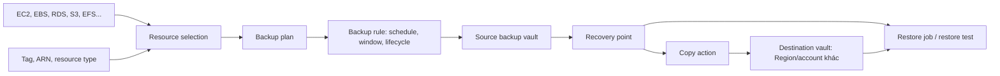

# AWS Backup plan, selection và backup vault

AWS Backup cung cấp một điểm quản lý tập trung để lập lịch, lưu giữ, sao chép và khôi phục dữ liệu từ nhiều dịch vụ AWS. Để thiết kế đúng, cần tách ba quyết định có liên quan nhưng có trách nhiệm khác nhau: **backup plan** mô tả khi nào và bằng cách nào tạo backup; **resource selection** xác định tài nguyên nào tham gia plan; **backup vault** xác định nơi lưu recovery point cùng các ranh giới mã hóa, truy cập và bảo vệ dữ liệu.

Một plan được tạo thành công chưa chứng minh dữ liệu đã được bảo vệ. Tài nguyên phải nằm trong selection, loại tài nguyên phải được bật phù hợp trong Region, IAM role phải có quyền, backup job phải hoàn tất và recovery point phải có thể khôi phục. Bài học này đi từ mô hình đó đến cấu hình bằng AWS CLI, cách kiểm tra job, thiết kế bản sao dự phòng và thử nghiệm restore.

## 1. Mục tiêu và phạm vi

Sau bài học, người học có thể:

- Phân biệt backup plan, backup rule, resource selection, backup vault, recovery point và các loại job.
- Thiết kế lịch backup, cửa sổ chạy, thời gian lưu giữ, chuyển cold storage và copy action theo RPO/RTO.
- Chọn tài nguyên bằng ARN, loại tài nguyên, tag và condition; hiểu service opt-in theo account và Region.
- Tạo vault với khóa KMS phù hợp, kiểm soát quyền truy cập và đánh giá khi nào cần AWS Backup Vault Lock hoặc logically air-gapped vault.
- Tạo plan và selection bằng AWS CLI, sau đó kiểm chứng backup job và recovery point.
- Thiết kế bản sao cross-Region/cross-account, kiểm tra quyền KMS và thực hiện restore test.

AWS Backup hỗ trợ nhiều dịch vụ AWS và một số workload bên ngoài AWS. Tuy nhiên, mức hỗ trợ không đồng nhất: một loại tài nguyên có thể hỗ trợ snapshot nhưng không hỗ trợ continuous backup, cold storage, cross-account copy hoặc restore testing. Trước khi thiết kế, luôn tra bảng **Feature availability by resource** trong tài liệu AWS Backup theo loại tài nguyên và Region triển khai.

## 2. Mô hình hoạt động: plan, selection và vault

| Thành phần | Trả lời câu hỏi | Trách nhiệm chính |
|---|---|---|
| Backup plan | Khi nào và theo quy tắc nào tạo backup? | Chứa một hoặc nhiều rule, lịch, vault đích, lifecycle và copy action |
| Backup rule | Một lần bảo vệ cụ thể diễn ra ra sao? | Xác định schedule, cửa sổ bắt đầu/hoàn tất, vault, retention, copy và tùy chọn continuous backup |
| Resource selection | Tài nguyên nào được plan áp dụng? | Chọn theo ARN, loại tài nguyên, tag, điều kiện bao gồm/loại trừ và IAM role |
| Backup vault | Recovery point được lưu và bảo vệ ở đâu? | Tổ chức recovery point, cấu hình khóa mã hóa, vault access policy và Vault Lock |
| Recovery point | Có thể khôi phục dữ liệu từ thời điểm nào? | Bản backup cụ thể do AWS Backup hoặc dịch vụ nguồn tạo ra |
| Backup/copy/restore job | Hoạt động bảo vệ đã thực sự chạy đến đâu? | Ghi trạng thái, thời gian, lỗi và kết quả của từng thao tác |

Một backup plan có thể có nhiều rule. Một plan cũng có thể có nhiều selection; mỗi selection có tên, tập tài nguyên và IAM role riêng. Mỗi rule chỉ định một vault đích cho recovery point gốc. Nếu cần bản sao ở Region hoặc account khác, rule có thể khai báo các copy action đến vault đích tương ứng.



Luồng thực tế có thể được hiểu như sau:

1. Quản trị viên tạo vault và quyết định khóa mã hóa, policy và retention guardrail.
2. Quản trị viên tạo backup plan với một hoặc nhiều rule.
3. Resource selection gắn các tài nguyên phù hợp vào plan và chỉ định IAM role.
4. Khi lịch đến hạn, AWS Backup đánh giá selection, tạo backup job và yêu cầu dịch vụ nguồn tạo recovery point.
5. Recovery point được lưu trong vault đích của rule; copy action có thể tạo thêm bản sao ở vault khác.
6. Người vận hành kiểm tra job và recovery point, rồi chạy restore hoặc restore test theo lịch.

**Phân biệt quan trọng:** plan là cấu hình mong muốn; selection là phạm vi; vault là nơi lưu; job và recovery point là bằng chứng vận hành. Không thể kết luận một workload đã được bảo vệ chỉ bằng cách nhìn thấy tên plan trong console.

## 3. Thiết kế theo RPO và RTO

Hai mục tiêu khôi phục quyết định lịch và cách lưu backup:

- **Recovery Point Objective (RPO)** là lượng dữ liệu tối đa tổ chức chấp nhận mất, thường biểu diễn bằng thời gian. Backup mỗi 24 giờ có thể tạo khoảng mất dữ liệu gần 24 giờ nếu sự cố xảy ra ngay trước lần backup tiếp theo.
- **Recovery Time Objective (RTO)** là thời gian tối đa để khôi phục dịch vụ về mức chấp nhận được. Một recovery point tồn tại chưa đảm bảo RTO nếu restore mất nhiều giờ, thiếu KMS permission, thiếu subnet, thiếu cấu hình ứng dụng hoặc không có runbook.

Ví dụ, một hệ thống xử lý đơn hàng có thể đặt RPO 15 phút cho cơ sở dữ liệu hỗ trợ continuous backup/PITR, nhưng dùng snapshot định kỳ cho các tài nguyên khác. Một workload phân tích có thể chấp nhận RPO 24 giờ và retention dài hơn. Quyết định cần dựa trên tác động kinh doanh, chi phí, giới hạn của dịch vụ nguồn và thời gian restore đã đo.

Không nên đặt lịch chỉ theo thói quen như “mọi thứ đều backup hằng ngày”. Hãy lập ma trận cho từng nhóm dữ liệu:

| Nhóm tài nguyên | RPO mục tiêu | Kiểu bảo vệ cần đánh giá | RTO cần kiểm chứng |
|---|---:|---|---|
| Cơ sở dữ liệu giao dịch | Vài phút đến một giờ | Continuous backup/PITR nếu được hỗ trợ, cộng snapshot định kỳ | Thời gian khôi phục DB, replay log và xác minh dữ liệu |
| Volume của máy chủ ứng dụng | Một ngày hoặc ngắn hơn | Snapshot định kỳ, copy sang Region dự phòng | Thời gian tạo volume/instance và khởi động ứng dụng |
| File dùng chung | Một giờ đến một ngày | Backup định kỳ hoặc continuous nếu loại tài nguyên hỗ trợ | Thời gian khôi phục file và quyền truy cập |
| Dữ liệu lưu trữ dài hạn | Theo chính sách lưu trữ | Snapshot/copy với retention dài, cold tier nếu hỗ trợ | Thời gian truy xuất từ tier lưu trữ và quy trình kiểm tra |

RPO/RTO phải được đo qua diễn tập. Nếu backup chạy thành công nhưng restore mất 8 giờ trong khi RTO là 2 giờ, kiến trúc chưa đáp ứng yêu cầu.

## 4. Cấu trúc một backup plan và rule

### 4.1 Backup plan

Backup plan là tập quy tắc có tên, có thể gắn tag để quản lý. AWS Backup có thể tạo plan từ mẫu có sẵn, tạo mới trong console, hoặc tạo qua API/CLI/CloudFormation. Một plan có thể dùng chung cho nhóm tài nguyên có chính sách tương tự; nhiều workload có yêu cầu khác nhau nên được tách thành các plan dễ vận hành và kiểm toán.

Khi thiết kế tên, hãy thể hiện mục đích và phạm vi, ví dụ `prod-critical-daily`, `nonprod-weekly` hoặc `finance-retention`. Tránh đặt tên chỉ theo cá nhân tạo plan. Tag của plan giúp phân loại cấu hình; tag của tài nguyên mới là một trong các tín hiệu để selection xác định tài nguyên.

### 4.2 Backup rule

Một rule thường xác định các thuộc tính sau:

| Thuộc tính | Ý nghĩa |
|---|---|
| `RuleName` | Tên rule trong plan |
| `TargetBackupVaultName` | Vault nhận recovery point gốc |
| `ScheduleExpression` | Lịch chạy backup, thường dùng biểu thức cron của AWS |
| `ScheduleExpressionTimezone` | Múi giờ của lịch; nếu bỏ qua trong API thì lịch dùng UTC |
| `StartWindowMinutes` | Khoảng thời gian sau giờ dự kiến mà job được phép bắt đầu |
| `CompletionWindowMinutes` | Thời hạn để job hoàn tất sau khi bắt đầu |
| `Lifecycle` | Thời điểm chuyển cold storage và thời điểm xóa recovery point |
| `CopyActions` | Các bản sao được tạo đến vault đích |
| `EnableContinuousBackup` | Bật continuous backup/PITR cho loại tài nguyên được hỗ trợ |

### 4.3 Lịch cron và múi giờ

AWS Backup sử dụng biểu thức cron sáu trường theo cú pháp AWS:

```text
cron(phút giờ ngày-trong-tháng tháng ngày-trong-tuần năm)
```

Ví dụ:

```text
cron(0 2 ? * * *)       # Mỗi ngày lúc 02:00 UTC
cron(30 1 ? * SUN *)    # Chủ nhật hằng tuần lúc 01:30 UTC
cron(0 3 1 * ? *)       # Ngày đầu mỗi tháng lúc 03:00 UTC
```

Trong ví dụ, `?` biểu thị không chỉ định trường ngày tương ứng; với cú pháp cron của AWS, không đặt đồng thời giá trị cụ thể ở cả ngày-trong-tháng và ngày-trong-tuần. Kiểm tra biểu thức trong tài liệu lịch AWS trước khi áp dụng.

Nếu tổ chức vận hành theo giờ địa phương, hãy đặt `ScheduleExpressionTimezone` bằng tên múi giờ IANA phù hợp, chẳng hạn `Asia/Ho_Chi_Minh`. Đừng tự quy đổi giờ địa phương sang UTC rồi quên thay đổi múi giờ mùa hè của các khu vực có DST. Với hệ thống đa quốc gia, lịch UTC thường dễ so sánh giữa account và Region hơn; với hệ thống có cửa sổ bảo trì theo giờ địa phương, múi giờ tường minh có thể dễ vận hành hơn.

Lịch cron biểu thị thời điểm AWS Backup có thể bắt đầu job, không phải cam kết mọi resource hoàn tất đúng phút đó. Thời gian thực tế phụ thuộc dịch vụ nguồn, kích thước dữ liệu, tải, giới hạn dịch vụ, thời gian chờ và copy action.

### 4.4 Start window và completion window

`StartWindowMinutes` cho phép AWS Backup thử bắt đầu job trong một khoảng thời gian thay vì yêu cầu khởi chạy đúng một thời điểm. Nếu job ở trạng thái `CREATED`, AWS Backup có thể thử lại khi gặp lỗi có thể phục hồi trong cửa sổ bắt đầu. Giá trị được chỉ định phải ít nhất 60 phút. Khi cửa sổ hết hạn mà job chưa bắt đầu thành công, job có thể chuyển sang `EXPIRED`.

`CompletionWindowMinutes` giới hạn thời gian hoàn tất job sau khi đã bắt đầu. Nếu workload lớn, cửa sổ quá ngắn có thể khiến job bị hủy hoặc không hoàn thành theo kỳ vọng. Cần đo thời gian backup thực tế, kể cả thời điểm bắt đầu muộn nhất trong start window, rồi mới chọn completion window. Một số loại tài nguyên có giới hạn riêng; ví dụ tùy chọn completion window không áp dụng cho Amazon FSx.

Không nên cấu hình start window và completion window bằng các con số nhỏ chỉ để lịch trông chính xác. Mục tiêu là có đủ thời gian cho job hoàn thành trong điều kiện tải cao, bảo trì dịch vụ hoặc retry.

### 4.5 Nhiều rule và lịch chồng lấn

Một plan có thể chứa nhiều rule, chẳng hạn rule snapshot hằng ngày và rule snapshot hằng tuần với retention khác nhau. Tuy nhiên, nếu start window của các rule chồng lấn, AWS Backup có logic hợp nhất lịch và retention; không được mặc định rằng mỗi rule luôn tạo một recovery point riêng trong mọi lần trùng lịch. Khi lịch chồng lấn, rule có thời gian lưu giữ dài hơn có thể chi phối recovery point được tạo trong khoảng đó.

Hãy dùng phần xem trước lịch của backup plan summary để kiểm tra các lần chạy dự kiến, kiểu execution và copy action. Tránh đặt các rule có lịch xung đột nếu chưa hiểu cách chúng tương tác. Nếu mục tiêu là giữ bản hằng ngày ngắn hạn và bản cuối tuần dài hạn, hãy thử cấu hình trên một nhóm tài nguyên đại diện, kiểm tra preview và xác minh recovery point thực tế trước khi mở rộng.

### 4.6 Lifecycle và cold storage

Lifecycle quy định thời điểm recovery point được chuyển sang cold storage và thời điểm bị xóa:

- `MoveToColdStorageAfterDays`: số ngày từ lúc tạo recovery point đến khi chuyển sang cold storage.
- `DeleteAfterDays`: số ngày từ lúc tạo recovery point đến khi hết hạn và bị xóa.

Backup đã chuyển sang cold storage phải được giữ trong cold storage tối thiểu 90 ngày. Vì vậy, `DeleteAfterDays` phải lớn hơn `MoveToColdStorageAfterDays` ít nhất 90 ngày. Ví dụ, chuyển sau 30 ngày thì retention phải ít nhất 120 ngày. Sau khi recovery point đã chuyển sang cold storage, không thể thay đổi thời điểm chuyển đã áp dụng cho recovery point đó.

Không phải mọi resource type đều hỗ trợ cold storage. AWS Backup bỏ qua cấu hình chuyển cold đối với các loại tài nguyên không hỗ trợ tính năng này. Hãy tra feature matrix trước khi đưa lifecycle vào plan. Với một số loại tài nguyên hỗ trợ incremental backup, cần duy trì ít nhất một full backup ở warm tier; chuyển full backup sang cold quá sớm có thể làm phát sinh một full backup warm khác và tăng chi phí.

Retention vô thời hạn có thể phù hợp với một số yêu cầu pháp lý, nhưng cần được chủ động phê duyệt vì chi phí tiếp tục tích lũy. Nếu dùng Vault Lock compliance mode, một recovery point có retention `Always` có thể không thể xóa sau khi lock trở nên bất biến.

### 4.7 Copy action

Copy action tạo bản sao của recovery point đến backup vault ở Region khác hoặc account khác, tùy cấu hình và loại tài nguyên. Copy action có thể có lifecycle riêng cho bản sao. Nếu không chỉ định lifecycle riêng, bản sao có thể kế thừa lifecycle từ recovery point nguồn theo hành vi được hỗ trợ.

Ví dụ trường `CopyActions` trong một rule:

```json
{
  "CopyActions": [
    {
      "DestinationBackupVaultArn": "arn:aws:backup:us-west-2:111122223333:backup-vault:dr-copy-vault",
      "Lifecycle": {
        "DeleteAfterDays": 90
      }
    }
  ]
}
```

Vault `dr-copy-vault` phải tồn tại ở Region đích trước khi job chạy. Với cross-account copy, ARN phải trỏ đến account đích và policy/KMS ở account đó phải cho phép thao tác. Thời hạn 90 ngày trong ví dụ chỉ minh họa; hãy chọn retention theo yêu cầu và giới hạn của resource type.

Copy action là một bước độc lập với backup gốc. Cần kiểm tra cả backup job lẫn copy job; backup gốc `COMPLETED` không có nghĩa copy đã hoàn tất. Với copy cross-account, cần cấu hình AWS Organizations/AWS Backup cross-account backup, policy của vault đích, quyền KMS và quyền của role thực hiện copy. Với một số loại tài nguyên không được AWS Backup quản lý hoàn toàn, vault đích cross-account phải sử dụng customer managed KMS key vì AWS managed key không thể chia sẻ giữa account.

### 4.8 Continuous backup và PITR

Một số dịch vụ hỗ trợ continuous backup và point-in-time recovery (PITR). Cơ chế này thường tạo bản đầy đủ ban đầu rồi liên tục ghi nhận thay đổi hoặc transaction log để có thể khôi phục về thời điểm được chọn. Với các dịch vụ hỗ trợ, PITR có thể khôi phục đến thời điểm có độ chính xác đến giây trong phạm vi tối đa 35 ngày.

Continuous backup không được lên lịch bằng cron như snapshot định kỳ. Nó có vòng đời và giới hạn khác snapshot. Snapshot định kỳ có thể được giữ lâu hơn (tùy dịch vụ và giới hạn), trong khi continuous backup/PITR có cửa sổ khôi phục ngắn hơn. Vì vậy, nếu RPO yêu cầu thấp nhưng vẫn cần giữ dữ liệu dài hạn, hãy đánh giá việc kết hợp continuous backup với snapshot rule.

Không suy luận rằng bật `EnableContinuousBackup` sẽ biến mọi resource trong selection thành PITR. Chỉ các resource type hỗ trợ mới có continuous backup; các resource khác vẫn cần snapshot rule. Hãy kiểm tra bảng feature availability và backup plan summary để biết execution type là `CONTINUOUS`, `SNAPSHOTS` hay `CONTINUOUS_AND_SNAPSHOTS`.

## 5. Resource selection: chọn đúng tài nguyên

Resource selection là cầu nối giữa backup plan và tài nguyên thật. Nếu selection không khớp, plan có thể tồn tại và không báo lỗi nhưng không tạo backup cho tài nguyên mong muốn.

### 5.1 Service opt-in theo account và Region

AWS Backup có cài đặt **Service opt-in** cho các loại tài nguyên được phép quản lý. Cài đặt này áp dụng theo account và Region. Có thể bật/tắt bằng AWS Backup console tại Settings hoặc bằng CLI:

```bash
aws backup describe-region-settings --region ap-southeast-1

aws backup update-region-settings \
  --region ap-southeast-1 \
  --resource-type-opt-in-preference '{"EFS":true,"EC2":true,"RDS":true}'
```

Ví dụ trên chỉ minh họa cách truyền một số resource type; trước khi chạy, phải lấy cấu hình hiện tại, giữ lại các giá trị cần thiết và chỉ cập nhật các loại tài nguyên mà tổ chức muốn bật. Không dùng một JSON rút gọn để vô tình tắt các loại đã được bật.

Có một số quy tắc cần nhớ:

1. Nếu selection chỉ dựa trên tag, Service opt-in vẫn được áp dụng.
2. Nếu chỉ định rõ resource type trong selection, nhiều loại tài nguyên vẫn có thể được đưa vào plan ngay cả khi service opt-in tương ứng chưa bật.
3. Aurora, Neptune và Amazon DocumentDB là ngoại lệ quan trọng: cần bật opt-in cho dịch vụ tương ứng để AWS Backup bảo vệ chúng.
4. Nếu vừa chỉ định resource type vừa dùng tag, AWS Backup lọc theo loại tài nguyên trước, rồi mới lọc theo tag.
5. Opt-in chỉ áp dụng cho account và Region cụ thể. Khi AWS Backup bổ sung loại tài nguyên mới, account không tự động được bật cho loại mới đó trong mọi trường hợp; cần rà soát lại Settings.

Với FSx for NetApp ONTAP, khi dùng tag-based selection, tag cần được áp dụng lên từng volume thay vì chỉ gắn lên toàn file system. Đây là ví dụ cho thấy phải đọc lưu ý riêng của từng resource type.

### 5.2 Chọn bằng ARN hoặc resource type

Có thể chọn trực tiếp ARN của từng tài nguyên hoặc dùng mẫu ARN để bao phủ một nhóm. Ví dụ:

```text
arn:aws:ec2:ap-southeast-1:111122223333:instance/i-0123456789abcdef0
arn:aws:ec2:ap-southeast-1:111122223333:instance/*
arn:aws:rds:ap-southeast-1:111122223333:db:orders-prod
```

Chọn theo ARN phù hợp với một nhóm nhỏ, cố định và có yêu cầu riêng. Chọn theo resource type hoặc ARN wildcard phù hợp khi muốn áp dụng chính sách cho mọi tài nguyên cùng loại trong account/Region. Wildcard trong ARN pattern của backup selection phải nằm ở cuối chuỗi; mẫu như `arn:aws:s3:::logs-*` có thể phù hợp, trong khi wildcard nằm giữa hoặc đầu ARN không được hỗ trợ theo quy tắc của selection.

Một resource assignment có giới hạn số ARN: tối đa 500 ARN không có wildcard hoặc 30 ARN có wildcard. Nếu danh sách cần bảo vệ tăng thường xuyên, nên dùng resource type và tag/condition thay vì duy trì danh sách ARN thủ công.

### 5.3 Chọn bằng tag

Tag giúp nhóm tài nguyên theo mục đích bảo vệ, ví dụ:

| Key | Value | Ý nghĩa |
|---|---|---|
| `Backup` | `daily` | Backup hằng ngày |
| `Backup` | `weekly` | Backup hằng tuần |
| `Environment` | `production` | Môi trường production |
| `DataClass` | `critical` | Dữ liệu quan trọng |
| `Owner` | `payments` | Nhóm chịu trách nhiệm |

Một tag policy nên có chủ sở hữu, quy trình phê duyệt và cơ chế kiểm tra. Nếu mọi người có thể tự ý xóa tag `Backup`, tài nguyên có thể rời selection mà không ai nhận ra. Hãy theo dõi tag drift bằng AWS Config, báo cáo inventory hoặc kiểm soát thay đổi hạ tầng.

### 5.4 `ListOfTags` và `Conditions`

AWS Backup hỗ trợ `ListOfTags` và `Conditions` để lọc theo tag. `ListOfTags` chỉ hỗ trợ `STRINGEQUALS`; khi có nhiều mục, tài nguyên khớp với bất kỳ mục nào (OR). AWS khuyến nghị dùng `Conditions` cho yêu cầu mới vì hỗ trợ `StringEquals`, `StringLike`, `StringNotEquals` và `StringNotLike`.

Khi dùng nhiều điều kiện trong `Conditions`, tài nguyên phải thỏa tất cả điều kiện (AND). Ví dụ, muốn backup tài nguyên có `Backup=daily` và `Environment=production`:

```json
{
  "Conditions": {
    "StringEquals": [
      {
        "ConditionKey": "aws:ResourceTag/Backup",
        "ConditionValue": "daily"
      },
      {
        "ConditionKey": "aws:ResourceTag/Environment",
        "ConditionValue": "production"
      }
    ]
  }
}
```

Trong ví dụ, hai điều kiện được kết hợp bằng AND. Một tài nguyên chỉ có `Backup=daily` nhưng không có `Environment=production` sẽ không được chọn.

Nếu cần nhiều lựa chọn OR, có thể biểu diễn bằng các condition thích hợp hoặc tách selection theo mục đích. Đừng nhầm OR của `ListOfTags` với AND của nhiều điều kiện trong `Conditions`. Các operator trong điều kiện phân biệt chữ hoa/chữ thường; key/value của tag cũng cần thống nhất với cách gắn tag thực tế.

### 5.5 Bao gồm và loại trừ

`Resources` chỉ định ARN được đưa vào selection. `NotResources` loại trừ ARN khỏi phạm vi đã chọn. Đây là cách thể hiện ngoại lệ rõ ràng, nhưng danh sách loại trừ tĩnh có thể nhanh chóng lỗi thời khi tài nguyên được tạo mới. Nếu có thể, thiết kế tag và resource type sao cho phạm vi bao gồm phản ánh đúng chính sách, sau đó dùng `NotResources` cho một số ngoại lệ có kiểm soát.

Ví dụ, có thể chọn toàn bộ EC2 instance trong một Region rồi loại một instance thử nghiệm khỏi selection. Cần ghi lại lý do ngoại lệ và người phê duyệt; nếu không, một tài nguyên quan trọng có thể bị bỏ sót trong thời gian dài.

### 5.6 Giới hạn selection

Một resource assignment có các giới hạn đáng chú ý: tối đa 500 ARN không wildcard, 30 ARN có wildcard, 30 conditions và 30 tag conditions theo loại cấu hình. Số lượng tài nguyên được khớp bởi tag không bị giới hạn theo cách tương tự danh sách ARN. Khi vượt quy mô, hãy tách selection theo nhóm trách nhiệm hoặc dùng AWS Organizations backup policies để áp dụng chính sách rộng trên nhiều account.

## 6. IAM role và quyền để tạo backup

AWS Backup cần quyền gọi dịch vụ nguồn để tạo recovery point. Resource selection có thuộc tính `IamRoleArn`, chỉ ra role AWS Backup được phép assume cho các thao tác tương ứng. Role cần có trust policy cho phép AWS Backup (`backup.amazonaws.com`) assume role và permissions policy đủ cho loại tài nguyên đang bảo vệ.

Trong nhiều trường hợp, console có thể tạo role mặc định `AWSBackupDefaultServiceRole` với các managed policy như `AWSBackupServiceRolePolicyForBackup` và `AWSBackupServiceRolePolicyForRestores`. Tổ chức có thể dùng role tự quản lý với quyền hẹp hơn theo loại tài nguyên. Cần xem đây là quyền của dịch vụ thực hiện backup/restore, không phải quyền người dùng cuối được phép đọc dữ liệu.

AWS Backup cũng sử dụng service-linked role `AWSServiceRoleForBackup` cho các thao tác backup và copy mà dịch vụ yêu cầu. Service-linked role do AWS định nghĩa và chỉ AWS Backup assume theo trust policy đã cấu hình. Không xóa role này khi các tài nguyên liên quan còn phụ thuộc vào nó.

Ví dụ trust policy tối thiểu về mặt principal cho role được AWS Backup assume:

```json
{
  "Version": "2012-10-17",
  "Statement": [
    {
      "Effect": "Allow",
      "Principal": {"Service": "backup.amazonaws.com"},
      "Action": "sts:AssumeRole"
    }
  ]
}
```

Trust policy chỉ cho phép assume role; nó không cấp quyền backup. Permissions policy vẫn phải cho phép các API cần thiết của dịch vụ nguồn, AWS Backup và KMS. Role restore có thể cần quyền khác role backup. Restore testing cũng có service-linked role riêng với principal `restore-testing.backup.amazonaws.com`; không sao chép trust policy của backup role sang restore testing role mà không kiểm tra tài liệu.

Nguyên tắc thực hành:

- Tách quyền tạo plan/selection khỏi quyền xóa recovery point và quyền restore.
- Dùng IAM role riêng theo workload hoặc resource type nếu cần giới hạn blast radius.
- Kiểm tra cả IAM policy, resource policy của vault và KMS key policy.
- Rà soát explicit `Deny`, SCP và permission boundary vì một `Allow` ở role không thể vượt qua một `Deny` có hiệu lực.
- Theo dõi việc thay đổi role, trust policy và managed policy vì chúng ảnh hưởng trực tiếp đến khả năng bảo vệ/khôi phục.

## 7. Backup vault: nơi lưu recovery point

Backup vault là container trong một AWS account và Region để tổ chức recovery point. Có thể tạo nhiều vault theo ứng dụng, môi trường, phân loại dữ liệu hoặc yêu cầu lưu giữ. Việc tách vault giúp áp dụng policy và Vault Lock theo ranh giới rõ ràng.

### 7.1 Tạo vault và chọn khóa mã hóa

Khi tạo backup vault, AWS Backup cho phép chọn AWS KMS key. Mặc định dịch vụ có thể tạo và dùng key `aws/backup`; cũng có thể chọn customer managed key (CMK) trong account. **Không thể đổi khóa mã hóa đã chọn cho vault sau khi vault được tạo.** Vì vậy, hãy quyết định khóa, quyền sử dụng và chiến lược khôi phục trước khi đưa dữ liệu production vào vault.

Không phải mọi loại backup đều được mã hóa trực tiếp bằng key của vault. Với các resource type được AWS Backup quản lý hoàn toàn, AWS Backup có thể dùng khóa gắn với vault để mã hóa recovery point. Với một số resource type khác, backup tiếp tục sử dụng khóa mã hóa của tài nguyên nguồn. Hãy kiểm tra bảng encryption theo resource type; không suy ra rằng đổi khóa vault sẽ đổi khóa của mọi recovery point.

Ví dụ tạo vault bằng CLI:

```bash
aws backup create-backup-vault \
  --backup-vault-name prod-critical-vault \
  --encryption-key-arn arn:aws:kms:ap-southeast-1:111122223333:key/00000000-1111-2222-3333-444444444444 \
  --region ap-southeast-1
```

Nếu bỏ `--encryption-key-arn`, AWS Backup dùng khóa mặc định `aws/backup` theo cấu hình dịch vụ. Hãy lưu lại ARN vault và key để dùng trong plan, copy action, policy và runbook.

### 7.2 Vault access policy

Vault có resource-based access policy. Policy này có thể cấp hoặc giới hạn quyền truy cập recovery point, ví dụ cho phép account khác copy backup vào vault, giới hạn ai được restore hoặc ngăn một principal xóa recovery point. Policy của vault phối hợp với IAM identity policy, SCP và KMS key policy; một lớp cho phép không tự động vượt qua lớp khác đang từ chối.

Một nguyên tắc thường dùng là tách vai trò:

- Nhóm vận hành backup được tạo plan, selection và theo dõi job.
- Nhóm phục hồi được đọc recovery point và thực hiện restore theo quy trình.
- Nhóm quản trị bảo mật kiểm soát quyền xóa, Vault Lock và KMS key.
- Account lưu trữ backup nhận bản sao nhưng không cấp quyền quản trị production cho principal nguồn.

Có thể dùng policy để hạn chế `backup:DeleteRecoveryPoint` hoặc các hành động quản lý vault cho một nhóm nhỏ. Hãy kiểm tra các API cụ thể cần cho backup, copy, restore, tag và quản lý vòng đời trước khi áp dụng deny rộng; một deny quá rộng có thể làm backup/copy job thất bại hoặc cản trở vận hành hợp lệ.

### 7.3 AWS Backup Vault Lock

Vault Lock là lớp bảo vệ bổ sung giúp áp đặt thời gian lưu giữ recovery point. Có hai chế độ:

| Chế độ | Hành vi | Cách sử dụng |
|---|---|---|
| Governance | Người có IAM permission phù hợp vẫn có thể thay đổi hoặc gỡ lock | Bảo vệ theo quy trình quản trị, vẫn cần khả năng điều chỉnh có kiểm soát |
| Compliance | Sau thời gian chờ, vault lock trở nên bất biến; không principal nào, kể cả root hoặc AWS, có thể sửa/gỡ khi vault còn recovery point | Yêu cầu bất biến nghiêm ngặt hoặc tuân thủ thời hạn lưu giữ bắt buộc |

Vault Lock có thể đặt `MinRetentionDays` và `MaxRetentionDays`. Backup/copy job mới vào vault sẽ thất bại nếu retention không nằm trong giới hạn. Các recovery point đã tồn tại trước khi bật lock không bị thay đổi ngược lại bởi min/max mới.

Với compliance mode, `ChangeableForDays` là thời gian grace/cooling-off trước khi lock trở nên bất biến. Giá trị phải ít nhất 3 ngày (72 giờ). Trong thời gian này, cấu hình lock có thể được điều chỉnh hoặc gỡ. Sau khi grace time hết hạn, lock và vault không thể thay đổi; nếu vault còn recovery point thì không thể xóa vault. Recovery point vẫn được giữ đến khi lifecycle hết hạn. Vì vậy, trước khi khóa compliance, hãy kiểm tra kỹ min/max retention, lifecycle, bản sao và mọi recovery point có retention `Always`.

Vault Lock không phải công cụ dọn dẹp dữ liệu. Nó là cam kết rằng dữ liệu không bị xóa trước thời hạn. Sai retention có thể tạo chi phí kéo dài và khó đảo ngược. Hãy thử nghiệm bằng một vault riêng trước khi áp dụng cho vault production.

### 7.4 Standard backup vault và logically air-gapped vault

AWS Backup có loại vault chuyên biệt gọi là **logically air-gapped vault**. Nó tăng cường bảo vệ backup bằng các cơ chế bổ sung:

- Mặc định dùng AWS owned KMS key; có thể chọn customer managed key trong các trường hợp được hỗ trợ.
- Được cấu hình Vault Lock ở compliance mode.
- Có thể chia sẻ vault với account khác thông qua AWS Resource Access Manager (RAM) để account phục hồi có thể restore trực tiếp nếu được cấp quyền.
- Có thể tích hợp Multi-party approval (MPA) để hỗ trợ truy cập phục hồi khi account sở hữu vault không khả dụng theo kịch bản được hỗ trợ.

| Tiêu chí | Standard backup vault | Logically air-gapped vault |
|---|---|---|
| Vai trò | Vault chính, dùng phổ biến cho recovery point và copy | Vault chuyên biệt tăng khả năng cô lập và phục hồi |
| Vault Lock | Tùy chọn; governance hoặc compliance | Được cấu hình compliance mode mặc định |
| Mã hóa | AWS managed hoặc customer managed key theo loại backup | AWS owned key mặc định hoặc customer managed key được hỗ trợ |
| Chia sẻ restore cross-account | Thường quản lý bằng vault policy/cross-account backup; không chia sẻ trực tiếp bằng RAM như loại air-gapped | Có thể chia sẻ qua RAM để account khác restore trực tiếp |
| Mục đích | Vận hành backup thường ngày | Lớp bảo vệ cho tình huống account nguồn hoặc môi trường bị xâm phạm |

Logically air-gapped vault không có nghĩa là dữ liệu nằm trên một thiết bị ngoại tuyến vật lý. Đây là mô hình lưu trữ được AWS quản lý với ranh giới bảo vệ và cơ chế chia sẻ/khôi phục riêng. Tính năng không có ở mọi Region và không hỗ trợ mọi resource type. Phải kiểm tra feature matrix trước khi thiết kế.

Một chi tiết vận hành cần chú ý: với một số backup EBS trong logically air-gapped vault, sau khi recovery point chuyển sang archive tier thì không thể copy nó sang vault hoặc Region khác. Nếu cần bản sao ở account/Region khác, phải tạo copy khi recovery point còn ở warm storage theo điều kiện dịch vụ.

## 8. Tạo backup plan và selection bằng AWS CLI

Ví dụ sau tạo một vault, một plan backup EC2 hằng ngày và một selection chọn EC2 instance có tag `Backup=daily` trong Region. Đây là cấu hình minh họa; cần thay account ID, Region, KMS key, retention, IAM role và vault ARN theo môi trường thật.

### 8.1 Tạo vault

```bash
aws backup create-backup-vault \
  --backup-vault-name prod-daily-vault \
  --encryption-key-arn arn:aws:kms:ap-southeast-1:111122223333:key/00000000-1111-2222-3333-444444444444 \
  --region ap-southeast-1
```

### 8.2 Tạo file `backup-plan.json`

```json
{
  "BackupPlan": {
    "BackupPlanName": "prod-daily-35d",
    "Rules": [
      {
        "RuleName": "daily-0200-utc",
        "TargetBackupVaultName": "prod-daily-vault",
        "ScheduleExpression": "cron(0 2 ? * * *)",
        "ScheduleExpressionTimezone": "UTC",
        "StartWindowMinutes": 120,
        "CompletionWindowMinutes": 720,
        "Lifecycle": {
          "DeleteAfterDays": 35
        }
      }
    ]
  }
}
```

Plan trên tạo lịch hằng ngày lúc 02:00 UTC, cho phép job bắt đầu trong cửa sổ 120 phút và dành tối đa 720 phút để hoàn tất. Recovery point được giữ 35 ngày. Không cấu hình cold storage trong ví dụ để tránh áp dụng lifecycle không phù hợp với loại tài nguyên chưa được xác minh.

Tạo plan:

```bash
aws backup create-backup-plan \
  --cli-input-json file://backup-plan.json \
  --region ap-southeast-1
```

Lưu `BackupPlanId` từ response. Plan chưa có tài nguyên được bảo vệ cho đến khi tạo resource selection.

### 8.3 Tạo file `backup-selection.json`

```json
{
  "BackupSelection": {
    "SelectionName": "prod-ec2-daily-tagged",
    "IamRoleArn": "arn:aws:iam::111122223333:role/AWSBackupDefaultServiceRole",
    "Resources": [
      "arn:aws:ec2:ap-southeast-1:111122223333:instance/*"
    ],
    "Conditions": {
      "StringEquals": [
        {
          "ConditionKey": "aws:ResourceTag/Backup",
          "ConditionValue": "daily"
        },
        {
          "ConditionKey": "aws:ResourceTag/Environment",
          "ConditionValue": "production"
        }
      ]
    }
  }
}
```

Selection này chỉ chọn EC2 instance trong account/Region có đồng thời hai tag `Backup=daily` và `Environment=production`. Nếu role mặc định chưa tồn tại, hãy tạo role theo hướng dẫn AWS Backup hoặc dùng role được tổ chức phê duyệt với trust policy và permissions phù hợp.

Tạo selection bằng ID nhận được ở bước trước:

```bash
aws backup create-backup-selection \
  --backup-plan-id BACKUP_PLAN_ID \
  --cli-input-json file://backup-selection.json \
  --region ap-southeast-1
```

CLI trả về `SelectionId`. Hãy lưu cả `BackupPlanId` và `SelectionId` vào hệ thống quản lý cấu hình hoặc IaC state, không lưu chúng trong tài liệu chia sẻ công khai nếu chính sách nội bộ hạn chế thông tin định danh account.

### 8.4 Kiểm tra cấu hình sau khi tạo

```bash
aws backup get-backup-plan \
  --backup-plan-id BACKUP_PLAN_ID \
  --region ap-southeast-1

aws backup list-backup-selections \
  --backup-plan-id BACKUP_PLAN_ID \
  --region ap-southeast-1

aws backup list-protected-resources \
  --region ap-southeast-1

aws backup describe-backup-vault \
  --backup-vault-name prod-daily-vault \
  --region ap-southeast-1
```

Kiểm tra selection đã được tạo chưa, tài nguyên nào được nhận diện là protected resource, vault có đúng encryption key và trạng thái Vault Lock như dự kiến không. Sau đó chờ một lần chạy theo lịch hoặc tạo on-demand backup trong môi trường thử nghiệm để xác minh job end-to-end.

## 9. Copy backup sang Region hoặc account khác

Một bản backup ở cùng account và Region với workload giúp xử lý lỗi vận hành thường ngày, nhưng có thể không đủ cho thảm họa ảnh hưởng cả account hoặc Region. Copy action tạo thêm recovery point ở một ranh giới khác.

### 9.1 Cross-Region copy

Cross-Region copy giúp phục hồi khi Region nguồn bị gián đoạn hoặc dữ liệu tại Region nguồn không thể truy cập. Khi thiết kế, cần:

1. Chọn Region đích có hỗ trợ resource type và copy feature cần dùng.
2. Tạo vault đích trước, với key và policy phù hợp.
3. Thêm copy action vào rule, chỉ định destination vault ARN.
4. Xác định retention của bản sao độc lập với bản gốc khi yêu cầu khác nhau.
5. Theo dõi copy job và thực hiện restore test từ Region đích.

Không phải resource type nào cũng hỗ trợ copy cross-Region hoặc copy sau khi chuyển cold/archive. Đừng đặt RTO dựa trên một copy job chưa từng được kiểm thử.

### 9.2 Cross-account copy

Cross-account backup tách quyền quản trị workload khỏi quyền quản trị bản sao. Mô hình phổ biến là account production tạo recovery point rồi copy sang account backup/security riêng. Account đích có thể áp dụng vault policy, KMS key policy và Vault Lock chặt hơn account nguồn.

Các điều kiện cần xác minh gồm:

- Bật cross-account backup trong cấu hình AWS Backup/Organizations phù hợp.
- Account đích nằm trong phạm vi được phép và vault đích cho phép hoạt động copy từ account nguồn.
- IAM role thực hiện copy có quyền cần thiết và AWS Backup được phép assume role.
- KMS key policy cho phép AWS Backup và các principal liên quan sử dụng key; kiểm tra `kms:CreateGrant`, `kms:GenerateDataKey` và `kms:Decrypt` theo loại tài nguyên và thao tác.
- Với resource type không được AWS Backup quản lý hoàn toàn, vault đích cross-account cần customer managed KMS key; AWS managed key `aws/backup` không thể chia sẻ giữa account.
- Kiểm tra SCP, explicit Deny, permission boundary và policy của vault đích.

Với resource type được AWS Backup quản lý hoàn toàn, bản copy thường được mã hóa bằng key của vault đích. Với resource type không được quản lý hoàn toàn, hành vi mã hóa phụ thuộc loại tài nguyên, account/Region và key của nguồn/đích. Hãy tra bảng encryption cho từng loại thay vì giả định mọi bản copy đều dùng cùng một key.

### 9.3 Backup policy trong AWS Organizations

AWS Organizations backup policies cho phép áp dụng backup plan ở cấp root, OU hoặc account. Policy kết hợp lịch, Region, vault, resource selection và IAM role trong một tài liệu JSON được kế thừa theo cấu trúc tổ chức. Cách này phù hợp để áp dụng chuẩn bảo vệ trên nhiều account.

Backup policy hỗ trợ lựa chọn theo resource type hoặc tag, nhưng không nhắm đến từng ARN riêng lẻ. Nếu cần backup một tài nguyên cụ thể theo ARN, hãy dùng resource assignment cục bộ của AWS Backup. Khi plan được quản lý bởi Organizations, opt-in settings của management account có thể ghi đè cấu hình opt-in của member account cho plan đó; cần quản trị tập trung để tránh member account nghĩ rằng local setting đang quyết định hành vi.

AWS Backup cũng có cross-account monitoring để theo dõi backup, copy và restore job trong các account của Organization. Đây là năng lực quan sát tập trung; cần bật tính năng và cấu hình delegated administrator theo hướng dẫn AWS.

## 10. Kiểm tra backup job và recovery point

Sau khi plan đến lịch, hãy kiểm tra job. Một số trạng thái thường gặp:

| Trạng thái | Ý nghĩa vận hành |
|---|---|
| `CREATED` | Job đã được tạo nhưng chưa bắt đầu thực thi |
| `PENDING` | Job đang chờ tài nguyên hoặc điều kiện để chạy |
| `RUNNING` | Job đang thực hiện |
| `COMPLETED` | Job hoàn tất thành công |
| `PARTIAL` | Job chỉ hoàn thành một phần; phải xem chi tiết tài nguyên/lỗi |
| `FAILED` | Job thất bại; cần đọc status message và sửa nguyên nhân |
| `EXPIRED` | Job không bắt đầu hoặc không đáp ứng điều kiện trong cửa sổ được cấu hình |
| `ABORTED` | Job đã bị hủy |

Các trạng thái và chuỗi chuyển đổi có thể khác theo loại job; hãy xem chi tiết job để biết nguyên nhân thay vì chỉ dựa vào màu trạng thái trong console.

CLI kiểm tra backup job và recovery point:

```bash
aws backup list-backup-jobs \
  --by-state FAILED \
  --region ap-southeast-1

aws backup list-backup-jobs \
  --by-resource-arn arn:aws:ec2:ap-southeast-1:111122223333:instance/i-0123456789abcdef0 \
  --region ap-southeast-1

aws backup list-recovery-points-by-backup-vault \
  --backup-vault-name prod-daily-vault \
  --region ap-southeast-1
```

Với job lỗi, dùng `describe-backup-job` theo `BackupJobId` để xem `StatusMessage`, `PercentDone`, thời gian, resource ARN và recovery point ARN nếu có. Với copy job và restore job, kiểm tra danh sách job tương ứng; không gộp chúng vào trạng thái backup gốc.

Nên phát cảnh báo khi:

- Không có recovery point mới trong thời gian vượt ngưỡng RPO.
- Backup job hoặc copy job chuyển `FAILED`, `EXPIRED` hay `PARTIAL`.
- Số lượng protected resources giảm bất thường.
- Vault, KMS key, IAM role hoặc resource selection bị thay đổi.
- Recovery point sắp hết hạn trong khi yêu cầu retention chưa được đáp ứng.

Có thể dùng EventBridge để nhận sự kiện thay đổi trạng thái job, CloudWatch để giám sát metric/alarms và AWS Backup Audit Manager để đánh giá mức tuân thủ các control backup. Hãy thiết kế cảnh báo gắn với người xử lý, runbook và thời gian phản hồi.

## 11. Khôi phục dữ liệu và kiểm thử khả năng khôi phục

### 11.1 Restore job

Restore tạo tài nguyên hoặc dữ liệu mới từ recovery point. Cách khôi phục phụ thuộc loại tài nguyên: EC2 có thể được khôi phục thành instance mới; EBS tạo volume; RDS/Aurora có quy trình restore database/cluster; S3 hoặc EFS có quy trình khôi phục dữ liệu riêng. Tham số restore, subnet, security group, instance type, KMS key, IAM role và cấu hình mạng khác nhau theo dịch vụ.

Quy trình restore nên gồm:

1. Xác định recovery point phù hợp với RPO và xác nhận vault/Region/account chứa recovery point.
2. Kiểm tra quyền đọc recovery point, quyền KMS decrypt và quyền tạo tài nguyên mới.
3. Chọn cấu hình restore tương thích với kiến trúc hiện tại; kiểm tra VPC, subnet, security group, DNS, route và quota.
4. Chạy restore job, theo dõi trạng thái và lưu ID job.
5. Kiểm tra dữ liệu ở cấp ứng dụng: schema, số bản ghi, checksum, tính nhất quán và luồng nghiệp vụ.
6. Chuyển traffic theo runbook, theo dõi hệ thống sau phục hồi và ghi nhận thời gian thực tế.

Restore thành công ở cấp dịch vụ chưa chắc ứng dụng đã hoạt động. Ví dụ, database có thể được tạo lại nhưng ứng dụng không kết nối được vì secret, security group, DNS hoặc certificate chưa được phục hồi.

### 11.2 Continuous backup và PITR

Với resource type hỗ trợ, PITR cho phép chọn một thời điểm trong cửa sổ khôi phục. Khi điều tra sự cố dữ liệu, hãy chọn thời điểm ngay trước khi dữ liệu bị hỏng hoặc bị xóa, rồi kiểm tra bản phục hồi trong môi trường cô lập trước khi thay thế hệ thống đang chạy.

Continuous backup thường có retention tối đa 35 ngày. Nếu cần giữ lâu hơn, hãy bổ sung snapshot rule có retention phù hợp. Đừng nhầm PITR với snapshot: PITR dựa trên backup liên tục và transaction log; snapshot là điểm chụp tại thời điểm định kỳ.

### 11.3 Restore testing

AWS Backup Restore Testing cho phép tạo kế hoạch kiểm tra restore định kỳ. Một restore testing plan có lịch và selection riêng. Mỗi lần plan chạy, AWS Backup chọn protected resources; với mỗi resource được chọn, dịch vụ khôi phục tối đa một recovery point đủ điều kiện trong khoảng thời gian và vault đã cấu hình. Có thể chọn resource bằng ARN hoặc tag condition.

Restore test cần role được phép assume bởi AWS Backup restore testing service. Khi test chạy, AWS Backup tạo tài nguyên phục hồi tạm thời; cấu hình cleanup/retention của test cần phù hợp để không để lại tài nguyên và chi phí ngoài ý muốn. Theo dõi restore testing job riêng và xác minh các thuộc tính đã khôi phục.

Một bài test tốt không chỉ xác nhận job có trạng thái thành công. Hãy kiểm tra:

- Có thể giải mã dữ liệu bằng KMS key và role dự kiến.
- Tài nguyên được tạo ở subnet, VPC và security group phù hợp.
- Database có thể khởi động, truy vấn và đạt kiểm tra consistency.
- Ứng dụng có thể kết nối, đọc/ghi và xử lý một giao dịch thử.
- Thời gian restore đo được đáp ứng RTO.
- Bản copy từ account/Region dự phòng có thể được truy cập trong kịch bản account nguồn bị mất quyền.

AWS Backup Audit Manager có control đánh giá restore time so với mục tiêu đã đặt. Kết hợp restore test định kỳ với diễn tập thảm họa để kiểm chứng cả kỹ thuật lẫn con người, quy trình và quyền truy cập.

## 12. Bảo mật và quản trị vòng đời backup

Backup chứa dữ liệu production, nên phải bảo vệ như dữ liệu nguồn. Một số nguyên tắc:

- Dùng account backup riêng khi yêu cầu cô lập khỏi account vận hành.
- Dùng cross-account copy và vault policy để hạn chế quyền từ account nguồn.
- Áp dụng Vault Lock sau khi kiểm tra retention và thời gian grace; không bật compliance mode tùy tiện.
- Dùng customer managed KMS key khi cần kiểm soát policy, audit hoặc cross-account copy; theo dõi key state và key policy.
- Hạn chế quyền xóa recovery point; yêu cầu phê duyệt kép cho hành động nhạy cảm nếu quy trình tổ chức hỗ trợ.
- Ghi nhận thay đổi backup plan, selection, vault policy, KMS key và IAM role bằng CloudTrail.
- Bảo vệ tag dùng cho selection bằng quyền IAM và quy trình change management.
- Kiểm tra backup job, copy job và restore job bằng báo cáo tập trung.
- Thực hiện restore test từ bản sao ở account/Region dự phòng, không chỉ từ vault nguồn.

Backup không thay thế replication, high availability hay triển khai đa AZ. Replication giúp duy trì khả năng phục vụ; backup cung cấp điểm phục hồi lịch sử. Một lỗi logic hoặc thao tác xóa có thể được replication truyền sang bản sao gần như ngay lập tức, trong khi recovery point cũ giúp quay lại trạng thái trước lỗi.

AWS Backup không tự quản lý mọi backup được tạo bên ngoài AWS Backup. Nếu workload đồng thời dùng snapshot native, export, replication hoặc công cụ backup bên thứ ba, hãy lập inventory riêng để tránh cho rằng một backup plan trung tâm đang quản trị toàn bộ dữ liệu.

## 13. Thiết kế tham khảo cho một ứng dụng thương mại điện tử

Giả sử ứng dụng gồm EC2 chạy dịch vụ web, EBS chứa dữ liệu ứng dụng, RDS/Aurora lưu đơn hàng, S3 lưu hóa đơn và EFS lưu file dùng chung. Mục tiêu là phục hồi khi xóa nhầm dữ liệu, lỗi account production hoặc gián đoạn Region.

### 13.1 Phân nhóm tài nguyên

| Nhóm | Tag ví dụ | Cách bảo vệ đề xuất | Điều cần xác minh |
|---|---|---|---|
| Database đơn hàng | `Backup=critical` | PITR nếu được hỗ trợ và snapshot dài hạn | Region, engine, retention PITR, KMS, thời gian restore |
| EC2/EBS production | `Backup=daily` | Snapshot định kỳ, copy sang Region DR | Incremental behavior, consistency, AMI/instance restore procedure |
| S3 hóa đơn | `Backup=longterm` | AWS Backup hoặc tính năng bảo vệ phù hợp, retention theo chính sách | Versioning, object-level recovery, continuous/periodic support, KMS |
| EFS dùng chung | `Backup=daily` | Backup định kỳ, lifecycle và copy nếu cần | Incremental, cold storage, mount target và quyền truy cập khi restore |
| Môi trường test | `Backup=weekly` | Lịch thưa hơn, retention ngắn | Không để tag production bị gắn nhầm hoặc bị thiếu |

### 13.2 Tổ chức vault

- `prod-operational-vault`: recovery point phục vụ khôi phục vận hành tại Region chính.
- `dr-copy-vault`: bản sao tại Region DR, có KMS key và policy riêng.
- `security-archive-vault`: vault trong account bảo mật riêng, có Vault Lock theo retention đã phê duyệt.
- `prod-airgap-vault`: logically air-gapped vault cho workload/resource type hỗ trợ và yêu cầu cô lập cao.

Không nhất thiết phải tạo nhiều vault nếu không có nhu cầu khác biệt về policy, retention, encryption hoặc ranh giới quản trị. Mỗi vault làm tăng số cấu hình cần kiểm soát; tách vault nên gắn với một yêu cầu vận hành cụ thể.

### 13.3 Quy trình phục hồi

Khi Region chính bị gián đoạn, đội vận hành chuyển sang account/Region DR, kiểm tra copy job cuối cùng, khôi phục database trước, sau đó khôi phục tầng ứng dụng và file. Sau khi kiểm tra tính nhất quán dữ liệu và kết nối, đội vận hành chuyển traffic theo DNS/load balancer runbook. Thời gian của từng bước được đo trong restore test để xác nhận RTO.

Nếu account production bị chiếm quyền, bản sao trong account backup riêng và vault có retention bất biến giúp giảm nguy cơ kẻ tấn công xóa cả bản sao. Runbook phải chỉ rõ principal được phép truy cập account backup, quy trình lấy quyền khẩn cấp và cách xác minh recovery point đáng tin cậy.

## 14. Chi phí và tối ưu hóa

Chi phí AWS Backup phụ thuộc resource type, dung lượng backup, incremental behavior, Region, storage tier, copy/transfer, restore và tính năng được dùng. Không nên ước lượng chi phí chỉ từ dung lượng dữ liệu nguồn vì backup tăng theo thay đổi, loại tài nguyên và cách dịch vụ tính phí.

Các cách kiểm soát chi phí:

1. Chọn RPO/retention theo phân loại dữ liệu; không giữ mọi môi trường lâu như production.
2. Dùng tag selection để tránh backup tài nguyên tạm thời hoặc không cần bảo vệ.
3. Kiểm tra resource type có incremental backup hay không; một số loại tạo full backup cho mỗi lần chạy.
4. Chỉ chuyển cold storage khi resource type hỗ trợ và thời gian lưu tối thiểu 90 ngày phù hợp với yêu cầu.
5. Đánh giá chi phí copy cross-Region/cross-account, đặc biệt khi có nhiều recovery point và dữ liệu lớn.
6. Dọn plan/selection/vault không còn sử dụng sau khi xác nhận recovery point có thể xóa theo policy.
7. Tránh retention vô thời hạn nếu không có yêu cầu rõ ràng.
8. Dùng restore testing có lịch và phạm vi hợp lý; cleanup tài nguyên test sau khi xác minh.
9. Theo dõi chi phí theo account, Region, resource type và vault; đặt ngân sách/cảnh báo cho xu hướng bất thường.

Đừng giảm retention hoặc tắt copy chỉ để giảm hóa đơn trước khi đánh giá ảnh hưởng đến RPO, RTO, chính sách lưu trữ và khả năng phục hồi sau ransomware.

## 15. Xử lý sự cố thường gặp

| Triệu chứng | Nguyên nhân có thể | Hướng kiểm tra |
|---|---|---|
| Plan tồn tại nhưng không có recovery point | Selection không khớp; thiếu tag; resource type chưa opt-in; lịch chưa đến | `list-backup-selections`, `list-protected-resources`, Region settings, tag thực tế và schedule preview |
| Resource không được chọn | ARN sai; wildcard không hợp lệ; tag condition sai chữ hoa/thường; resource type chưa hỗ trợ | So sánh ARN đầy đủ, condition key/value, resource type và feature matrix |
| Job `FAILED` với AccessDenied | IAM role thiếu quyền; trust policy sai; SCP/explicit Deny | `describe-backup-job`, IAM policy simulator, trust policy, SCP và resource policy |
| Job `EXPIRED` | Không bắt đầu được trong start window hoặc dịch vụ nguồn không sẵn sàng | Start window, maintenance window, quota, trạng thái dịch vụ nguồn và job message |
| Copy job thất bại | Vault đích không tồn tại; policy không cho phép; Region/resource không hỗ trợ; KMS key không hợp lệ | Destination vault ARN, account/Region, vault access policy, KMS key policy và copy job details |
| Cross-account copy báo lỗi KMS | Vault đích dùng AWS managed key cho loại tài nguyên không hỗ trợ; thiếu grant/decrypt/data key | Dùng CMK khi cần; kiểm tra key policy, grant, role và deny statement |
| Không thể xóa recovery point | Vault Lock; IAM/vault policy deny; retention chưa hết | `DescribeBackupVault`, Vault Lock mode, grace/lock date và lifecycle |
| Restore thất bại | Role restore thiếu quyền; KMS key không truy cập được; thiếu subnet/security group hoặc quota | Restore job details, role trust, KMS key policy, cấu hình mạng và quota dịch vụ |
| PITR không xuất hiện | Resource type không hỗ trợ hoặc continuous backup chưa bật | Feature availability, plan rule, opt-in và backup plan summary |
| Không thể chuyển cold storage | Resource type không hỗ trợ hoặc lifecycle không hợp lệ | Feature matrix, `MoveToColdStorageAfterDays`, retention tối thiểu 90 ngày trong cold tier |

Khi xử lý lỗi, lưu `BackupJobId`, `CopyJobId` hoặc `RestoreJobId`, resource ARN, Region, account, timestamp và `StatusMessage`. Đây là dữ liệu cần thiết để so sánh lần chạy thành công và thất bại.

## 16. Những hiểu nhầm cần tránh

1. **Có backup plan nghĩa là tài nguyên đã được backup.** Chỉ resource khớp selection và thỏa điều kiện dịch vụ mới được bảo vệ.
2. **Chỉ cần gắn tag là đủ.** Service opt-in, resource type, điều kiện selection và IAM vẫn có thể ngăn tài nguyên được chọn.
3. **Mọi dịch vụ đều hỗ trợ PITR.** Continuous backup/PITR chỉ áp dụng cho resource type được hỗ trợ.
4. **Mọi recovery point dùng KMS key của vault.** Một số backup tiếp tục dùng key của tài nguyên nguồn.
5. **Backup hoàn tất nghĩa là bản copy cũng hoàn tất.** Copy job có trạng thái riêng.
6. **Recovery point tồn tại nghĩa là restore chắc chắn thành công.** KMS, IAM, network, quota và cấu hình ứng dụng vẫn có thể chặn phục hồi.
7. **Cold storage luôn rẻ hơn.** Minimum 90 ngày trong cold tier và giới hạn resource type có thể làm tổng chi phí cao hơn dự kiến.
8. **Vault Lock có thể gỡ bất cứ lúc nào.** Compliance mode trở nên bất biến sau grace time.
9. **Cross-account copy chỉ cần ARN vault đích.** Còn cần bật tính năng, policy, IAM và KMS permissions.
10. **AWS Backup quản lý mọi snapshot trong account.** Backup tạo ngoài AWS Backup không tự động được AWS Backup quản lý.
11. **Backup và replication là một.** Replication hỗ trợ tính sẵn sàng; backup cung cấp điểm khôi phục lịch sử.
12. **Restore test chỉ cần nhìn trạng thái job.** Cần kiểm tra dữ liệu và ứng dụng ở cấp nghiệp vụ, đồng thời đo RTO.

## 17. Bài thực hành: bảo vệ một nhóm EC2 production

Mục tiêu: tạo vault, plan hằng ngày, selection theo tag, xác nhận protected resource và quan sát recovery point. Thực hiện trong account lab hoặc môi trường được phép; không áp dụng trực tiếp vào production khi chưa rà soát retention và chi phí.

### Bước 1: Chuẩn bị tài nguyên

1. Chọn một EC2 instance thử nghiệm trong Region `ap-southeast-1`.
2. Gắn tag `Backup=daily` và `Environment=production` (nếu lab dùng tên tag này).
3. Xác nhận account có quyền sử dụng AWS Backup và IAM role cần thiết.
4. Kiểm tra Service opt-in và loại tài nguyên EC2 trong Region.

### Bước 2: Tạo vault

Tạo `lab-daily-vault` bằng console hoặc CLI. Nếu chọn CMK, kiểm tra key policy và quyền của AWS Backup. Ghi lại vault ARN, encryption key ARN và Region.

### Bước 3: Tạo plan và selection

Tạo plan theo ví dụ ở mục 8 với tên `lab-daily-plan`. Tạo selection chỉ chọn EC2 instance có hai tag đã chuẩn bị. Lưu `BackupPlanId` và `SelectionId`.

### Bước 4: Xác minh phạm vi

Chạy `list-backup-selections` và `list-protected-resources`. Nếu EC2 instance chưa xuất hiện, kiểm tra ARN, tag, account/Region và role. Không kết luận plan hoạt động chỉ từ response `create-backup-plan`.

### Bước 5: Tạo backup thử và kiểm tra recovery point

Chờ lịch chạy hoặc tạo on-demand backup cho instance thử nghiệm. Theo dõi backup job đến trạng thái cuối cùng. Sau khi job hoàn tất, liệt kê recovery point trong `lab-daily-vault`, xác nhận resource ARN, thời điểm tạo và lifecycle.

### Bước 6: Thử restore

Khôi phục vào môi trường lab riêng, không ghi đè tài nguyên đang chạy. Kiểm tra instance/volume mới, dữ liệu và khả năng khởi động ứng dụng. Ghi lại thời gian từ lúc bắt đầu restore đến khi kiểm tra nghiệp vụ hoàn tất.

### Bước 7: Dọn lab

Xóa tài nguyên restore thử nghiệm và các tài nguyên lab không còn cần thiết. Xử lý recovery point theo lifecycle và policy của vault. Không thử nghiệm Vault Lock compliance mode trên vault chứa dữ liệu cần giữ; dùng vault lab riêng nếu cần học thao tác lock.

## 18. Câu hỏi tự kiểm tra

**Câu 1.** Backup plan, selection và vault giải quyết ba vấn đề gì?

**Đáp án:** Plan xác định khi nào và bằng quy tắc nào tạo backup; selection xác định tài nguyên nào tham gia; vault lưu recovery point và áp dụng mã hóa, quyền truy cập, Vault Lock.

**Câu 2.** Một plan có thể tồn tại nhưng không tạo backup cho EC2 instance vì sao?

**Đáp án:** Instance không khớp selection, thiếu tag/ARN, sai account hoặc Region, role thiếu quyền, lịch chưa đến hoặc dịch vụ nguồn không sẵn sàng.

**Câu 3.** Service opt-in được áp dụng ở phạm vi nào?

**Đáp án:** Theo account và Region. Selection chỉ dùng tag vẫn chịu ảnh hưởng của opt-in. Aurora, Neptune và DocumentDB cần opt-in ngay cả khi resource type được chỉ định rõ.

**Câu 4.** Hai điều kiện trong `Conditions.StringEquals` được kết hợp như thế nào?

**Đáp án:** AND; tài nguyên phải thỏa tất cả điều kiện. Nhiều mục `ListOfTags` được kết hợp theo OR và chỉ hỗ trợ `STRINGEQUALS`.

**Câu 5.** `StartWindowMinutes` khác `CompletionWindowMinutes` ở đâu?

**Đáp án:** Start window là khoảng thời gian job được phép bắt đầu sau giờ dự kiến; completion window giới hạn thời gian hoàn tất sau khi job bắt đầu.

**Câu 6.** Nếu chuyển backup sang cold storage sau 30 ngày thì retention tối thiểu là bao nhiêu?

**Đáp án:** Ít nhất 120 ngày kể từ khi tạo recovery point, vì cold storage phải được giữ tối thiểu 90 ngày sau khi chuyển.

**Câu 7.** Có thể thay KMS key của backup vault sau khi tạo không?

**Đáp án:** Không. Phải chọn khóa đúng khi tạo vault; nếu cần khóa khác, thiết kế vault mới và kế hoạch copy/di chuyển phù hợp.

**Câu 8.** Vault Lock compliance mode có thể gỡ sau khi grace time hết không?

**Đáp án:** Không. Sau grace time, lock trở nên bất biến; nếu vault còn recovery point thì vault cũng không thể bị xóa.

**Câu 9.** Vì sao cross-account copy có thể thất bại dù role có quyền AWS Backup?

**Đáp án:** Vault policy đích hoặc KMS key policy có thể thiếu quyền; destination vault có thể dùng AWS managed key không chia sẻ được; SCP hoặc explicit Deny cũng có thể chặn.

**Câu 10.** Continuous backup/PITR có thay thế snapshot dài hạn không?

**Đáp án:** Không. PITR có cửa sổ khôi phục tối đa 35 ngày cho dịch vụ hỗ trợ; snapshot định kỳ có thể được giữ dài hơn. Có thể cần kết hợp cả hai.

**Câu 11.** Backup job `COMPLETED` có chứng minh bản sao ở Region DR đã sẵn sàng không?

**Đáp án:** Không. Copy job độc lập và phải được kiểm tra riêng; sau đó cần restore test từ vault đích.

**Câu 12.** Restore test thành công ở cấp job đã đủ chứng minh RTO chưa?

**Đáp án:** Chưa. Phải đo thời gian phục hồi ứng dụng, kiểm tra dữ liệu, kết nối, KMS, mạng và các luồng nghiệp vụ.

**Câu 13.** Khi nào nên dùng Organizations backup policy?

**Đáp án:** Khi cần áp dụng chính sách backup nhất quán trên nhiều account/OU/root. Policy chọn theo resource type hoặc tag, không nhắm đến từng ARN riêng lẻ.

**Câu 14.** Backup khác replication như thế nào?

**Đáp án:** Replication duy trì bản sao gần thời gian thực để tăng khả năng sẵn sàng; backup giữ các recovery point lịch sử để quay lại trước lỗi logic hoặc thao tác phá hoại.

**Câu 15.** Ba kiểm tra đầu tiên khi plan không tạo recovery point là gì?

**Đáp án:** Kiểm tra resource selection và protected resources; kiểm tra service opt-in theo account/Region và tag/ARN; kiểm tra backup job cùng IAM/KMS permission.

## 19. Checklist trước khi đưa vào production

- [ ] RPO, RTO và retention được chủ sở hữu dữ liệu phê duyệt.
- [ ] Resource type và tính năng cần dùng được hỗ trợ ở Region đã chọn.
- [ ] Service opt-in được bật đúng cho account/Region.
- [ ] Selection bao gồm đúng tài nguyên; tag được quản trị và theo dõi drift.
- [ ] IAM role có trust policy và permissions tối thiểu cần thiết.
- [ ] Schedule, timezone, start window và completion window đã được thử nghiệm.
- [ ] Các rule chồng lấn đã được xem trước bằng backup plan summary.
- [ ] Lifecycle/cold storage hợp lệ; retention không ngắn hơn yêu cầu.
- [ ] Vault có KMS key, vault access policy và tag phù hợp.
- [ ] Vault Lock đã được đánh giá; compliance grace time và min/max retention được kiểm tra kỹ.
- [ ] Copy action có destination vault, IAM, KMS và policy hợp lệ.
- [ ] Backup job, copy job và recovery point được giám sát.
- [ ] Restore test đã xác minh dữ liệu, ứng dụng và RTO.
- [ ] Runbook có account/Region dự phòng, principal khẩn cấp và thứ tự phục hồi.
- [ ] Chi phí storage, copy, cold tier và restore được theo dõi.
- [ ] Thay đổi plan, selection, vault, KMS và IAM được audit.

## 20. Tài liệu tham khảo chính thức

Các giới hạn và tính năng AWS Backup phụ thuộc resource type, Region và thời điểm cập nhật. Khi triển khai thật, hãy kiểm tra tài liệu hiện hành và feature matrix cho đúng loại tài nguyên.

1. [AWS Backup plans](https://docs.aws.amazon.com/aws-backup/latest/devguide/about-backup-plans.html) — mô hình backup plan và rule.
2. [Backup plan options and configuration](https://docs.aws.amazon.com/aws-backup/latest/devguide/plan-options-and-configuration.html) — lịch, cửa sổ backup, lifecycle và copy.
3. [Create a backup plan](https://docs.aws.amazon.com/aws-backup/latest/devguide/creating-a-backup-plan.html) — tạo plan bằng console/CLI.
4. [Select AWS services to backup](https://docs.aws.amazon.com/aws-backup/latest/devguide/assigning-resources.html) — service opt-in và resource assignment.
5. [Assign resources with AWS CLI](https://docs.aws.amazon.com/aws-backup/latest/devguide/assigning-resources-json.html) — cấu hình selection bằng JSON.
6. [BackupSelection API](https://docs.aws.amazon.com/aws-backup/latest/devguide/API_BackupSelection.html) — ARN, tag, conditions và giới hạn.
7. [Backup vaults](https://docs.aws.amazon.com/aws-backup/latest/devguide/vaults.html) — mô hình vault.
8. [Create a backup vault](https://docs.aws.amazon.com/aws-backup/latest/devguide/create-a-vault.html) — tạo vault và chọn KMS key.
9. [Vault access policies](https://docs.aws.amazon.com/aws-backup/latest/devguide/create-a-vault-access-policy.html) — resource policy cho vault.
10. [AWS Backup Vault Lock](https://docs.aws.amazon.com/aws-backup/latest/devguide/vault-lock.html) — governance/compliance mode và retention guardrail.
11. [Encryption for backups](https://docs.aws.amazon.com/aws-backup/latest/devguide/encryption.html) — hành vi mã hóa theo resource type và copy.
12. [Logically air-gapped vault](https://docs.aws.amazon.com/aws-backup/latest/devguide/logicallyairgappedvault.html) — vault cô lập logic, RAM và MPA.
13. [Continuous backups and PITR](https://docs.aws.amazon.com/aws-backup/latest/devguide/point-in-time-recovery.html) — continuous backup và cửa sổ PITR.
14. [Lifecycle API](https://docs.aws.amazon.com/aws-backup/latest/APIReference/API_Lifecycle.html) — chuyển cold storage và thời gian lưu tối thiểu.
15. [Using roles to back up and copy](https://docs.aws.amazon.com/aws-backup/latest/devguide/using-service-linked-roles-AWSServiceRoleForBackup.html) — service-linked role.
16. [Managing AWS Backup resources across multiple accounts](https://docs.aws.amazon.com/aws-backup/latest/devguide/manage-cross-account.html) — cross-account management và backup policy.
17. [Backup policies in AWS Organizations](https://docs.aws.amazon.com/organizations/latest/userguide/orgs_manage_policies_backup.html) — áp dụng policy theo root/OU/account.
18. [Restore testing](https://docs.aws.amazon.com/aws-backup/latest/devguide/restore-testing.html) — lập lịch và chọn recovery point để thử restore.
19. [Using roles for restore testing](https://docs.aws.amazon.com/aws-backup/latest/devguide/using-service-linked-roles-AWSServiceRoleForBackupRestoreTesting.html) — role dành cho restore testing.
20. [AWS Backup feature availability](https://docs.aws.amazon.com/aws-backup/latest/devguide/backup-feature-availability.html) — ma trận hỗ trợ theo resource type và Region.
21. [Understanding backup plan summaries](https://docs.aws.amazon.com/aws-backup/latest/devguide/understanding-backup-plan-summaries.html) — xem trước lịch và cách nhiều rule tương tác.

---

**Kết luận:** Một chiến lược AWS Backup chỉ đáng tin khi plan mô tả đúng lịch và retention, selection bao phủ đúng tài nguyên, vault có ranh giới mã hóa/truy cập phù hợp, bản sao được kiểm tra độc lập và quy trình restore đã được diễn tập. Hãy quản lý recovery point như một sản phẩm vận hành: có chủ sở hữu, chỉ số RPO/RTO, cảnh báo, kiểm toán và lịch kiểm thử rõ ràng.
