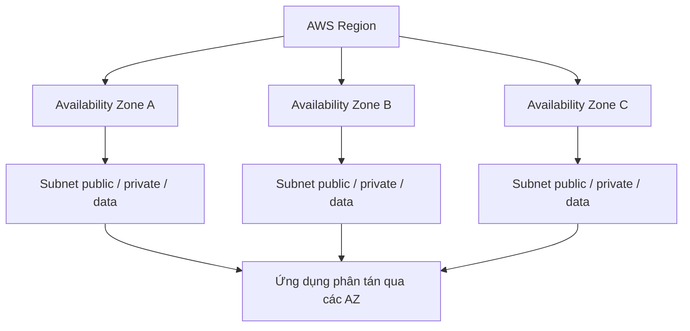
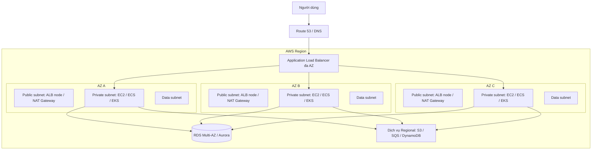

# Thiết kế dự phòng nhiều AZ và xử lý lỗi một AZ

Một ứng dụng chạy trên AWS có thể vẫn gặp gián đoạn dù từng máy chủ riêng lẻ đều được cấu hình tốt. Sự cố nguồn điện, mạng, làm mát hoặc hạ tầng trong một Availability Zone (AZ) có thể khiến nhiều tài nguyên cùng khu vực bị ảnh hưởng. Nếu toàn bộ máy chủ ứng dụng, cơ sở dữ liệu hoặc đường ra Internet đều tập trung tại AZ đó, một sự cố cục bộ có thể trở thành sự cố toàn hệ thống.

Thiết kế nhiều AZ phân tán các thành phần của ứng dụng qua những vùng lỗi độc lập trong cùng một AWS Region. Khi một AZ suy giảm hoặc ngừng hoạt động, các AZ còn lại tiếp tục phục vụ lưu lượng. Để đạt được điều này, kiến trúc cần phân tán compute, dữ liệu, mạng và các phụ thuộc; duy trì đủ năng lực dự phòng; phát hiện lỗi; chuyển lưu lượng; và kiểm chứng khả năng phục hồi. Amazon EC2 Auto Scaling, Elastic Load Balancing, Amazon RDS Multi-AZ, Amazon Aurora, Amazon Route 53 Application Recovery Controller (ARC), AWS Fault Injection Service (FIS) và AWS Backup là những thành phần có thể phối hợp trong thiết kế.

Trong hệ sinh thái AWS, dự phòng nhiều AZ là một phần của năng lực vận hành hạ tầng Region/AZ, mạng VPC, dịch vụ tính toán, lưu trữ, cơ sở dữ liệu và tích hợp. Mục tiêu là chọn đúng dịch vụ cho yêu cầu sẵn sàng, thiết kế an toàn, giám sát được, phục hồi có kiểm soát và cân bằng chi phí.

## Mục tiêu học tập

Sau bài học, bạn có thể:

- Giải thích AZ là ranh giới lỗi như thế nào và phân biệt dự phòng nhiều AZ với khôi phục nhiều Region.
- Thiết kế VPC, subnet, load balancer và tầng compute để tiếp tục phục vụ khi mất một AZ.
- Chọn cơ chế dự phòng dữ liệu phù hợp với EC2, EBS, EFS, S3, RDS, Aurora và các dịch vụ được quản lý.
- Tính toán năng lực còn lại sau khi một AZ ngừng phục vụ và hiểu nguyên tắc static stability.
- Lập quy trình phát hiện, chuyển lưu lượng, failover, kiểm chứng và khôi phục sau sự cố AZ.
- Sử dụng ARC zonal shift hoặc zonal autoshift và kiểm thử kịch bản lỗi bằng AWS FIS trong phạm vi an toàn.

## Availability Zone và ranh giới lỗi

AWS Region là một khu vực địa lý độc lập gồm nhiều Availability Zones. Mỗi AZ có hạ tầng vật lý riêng, bao gồm nguồn điện, hệ thống dự phòng điện, làm mát và kết nối mạng. Các AZ trong cùng Region đủ gần nhau để hỗ trợ kết nối độ trễ thấp và sao chép dữ liệu, nhưng được thiết kế để hạn chế sự cố tại một AZ lan sang AZ khác.

Một AZ thường có một hoặc nhiều trung tâm dữ liệu. Tên AZ như `ap-southeast-1a` là cách tài khoản tham chiếu đến AZ. Ở một số Region, tên AZ có thể được ánh xạ khác nhau giữa các tài khoản. **AZ ID** như `apse1-az1` xác định cùng một vị trí vật lý trên các tài khoản AWS. Khi phối hợp subnet hoặc tài nguyên chia sẻ giữa nhiều tài khoản, hãy dùng AZ ID để xác nhận các bên đang tham chiếu cùng một AZ.

Subnet thuộc đúng một AZ. Khi tạo subnet, bạn chọn AZ và CIDR; tài nguyên được triển khai trong subnet sẽ thuộc AZ đó. Vì vậy, muốn có kiến trúc ba AZ, bạn cần tạo các subnet tương ứng trong cả ba AZ cho từng tầng mạng.



### AZ failure có thể biểu hiện như thế nào?

Không phải sự cố nào cũng làm mọi tài nguyên trong một AZ tắt cùng lúc. Một AZ có thể gặp mất điện, mất kết nối mạng, suy giảm hiệu năng, lỗi dịch vụ phụ thuộc hoặc tình trạng chỉ một số loại tài nguyên không thể khởi tạo mới. Một số tài nguyên đang chạy có thể tiếp tục hoạt động trong khi control plane hoặc một phần data plane bị ảnh hưởng.

Khi thiết kế, hãy xem xét các tình huống sau:

- **Mất compute:** EC2 instance, ECS task hoặc EKS worker node trong AZ bị dừng hoặc không thể nhận yêu cầu.
- **Mất mạng:** subnet, NAT Gateway hoặc một số endpoint theo AZ không còn truy cập được.
- **Mất storage theo AZ:** EBS volume hoặc dữ liệu được đặt trong dịch vụ lưu trữ chỉ có phạm vi một AZ không thể truy cập.
- **Failover dữ liệu:** dịch vụ cơ sở dữ liệu Multi-AZ chuyển vai trò writer hoặc primary sang AZ khác; ứng dụng cần kết nối lại.
- **Suy giảm một phần:** tài nguyên vẫn báo trạng thái hoạt động nhưng độ trễ, timeout hoặc tỷ lệ lỗi tăng cao.

Ứng dụng cần xử lý cả tình huống lỗi hoàn toàn và tình huống suy giảm. Chỉ dựa vào trạng thái `running` của máy chủ là chưa đủ; cần đo khả năng phục vụ yêu cầu thực tế ở từng AZ.

## Multi-AZ và Multi-Region phục vụ hai mục tiêu khác nhau

Multi-AZ phân tán workload trong cùng Region để chống lại lỗi cục bộ của một AZ. Multi-Region đặt workload và dữ liệu ở các Region khác nhau để xử lý các sự cố có phạm vi lớn hơn, chẳng hạn sự cố Region, yêu cầu phục vụ gần người dùng ở khu vực khác hoặc yêu cầu tuân thủ về vị trí dữ liệu.

| Tiêu chí | Multi-AZ | Multi-Region |
|---|---|---|
| Phạm vi bảo vệ chính | Lỗi hạ tầng hoặc mạng trong một AZ | Sự cố ở phạm vi Region hoặc yêu cầu địa lý rộng hơn |
| Vị trí | Nhiều AZ trong cùng Region | Nhiều Region |
| Độ trễ sao chép | Thường thấp, có thể hỗ trợ sao chép đồng bộ tùy dịch vụ | Thường cao hơn, đa số kiến trúc dùng sao chép bất đồng bộ |
| Độ phức tạp | Thường thấp hơn | Cao hơn do định tuyến, dữ liệu, đồng bộ và vận hành giữa Region |
| Khi phù hợp | Yêu cầu HA thông thường của workload production | Yêu cầu DR cấp Region hoặc mục tiêu kinh doanh đặc biệt |

Multi-AZ không thay thế backup. Nếu người dùng xóa nhầm dữ liệu, ứng dụng ghi dữ liệu lỗi hoặc mã độc mã hóa dữ liệu, thay đổi có thể được sao chép sang standby hoặc các bản sao trong AZ khác. Cần kết hợp AWS Backup, snapshot, versioning, retention và bản sao lưu ngoài Region khi mục tiêu khôi phục yêu cầu.

## Xác định mục tiêu phục hồi trước khi thiết kế

Hai chỉ số cần được xác định với chủ sở hữu nghiệp vụ là Recovery Time Objective (RTO) và Recovery Point Objective (RPO):

- **RTO** là khoảng thời gian tối đa mà dịch vụ có thể gián đoạn trước khi ảnh hưởng vượt ngưỡng chấp nhận.
- **RPO** là lượng dữ liệu tối đa có thể chấp nhận mất, biểu diễn bằng khoảng thời gian giữa thời điểm khôi phục và thời điểm xảy ra sự cố.

Ví dụ, hệ thống đặt RTO 5 phút và RPO 1 phút cần kiến trúc, cơ chế phát hiện và kiểm thử khác với hệ thống có RTO 4 giờ và RPO 24 giờ. Không thể suy ra RTO/RPO chỉ từ việc bật tùy chọn Multi-AZ; thời gian failover thực tế phụ thuộc dịch vụ, tải, trạng thái dữ liệu, kết nối ứng dụng và cách hệ thống được cấu hình.

Trước khi chọn dịch vụ, hãy trả lời:

1. Ứng dụng phải tiếp tục xử lý yêu cầu trong suốt sự cố hay chấp nhận gián đoạn ngắn?
2. Có thể mất bao nhiêu dữ liệu đang ghi dở?
3. Lưu lượng đỉnh cần phục vụ là bao nhiêu khi một AZ bị loại khỏi hệ thống?
4. Những thành phần nào phải failover đồng thời, chẳng hạn writer database, cache, queue consumer và đường ra ngoài?
5. Ai có quyền kích hoạt chuyển lưu lượng và ai xác nhận dịch vụ đã ổn định?

## Kiến trúc tham chiếu nhiều AZ

Một kiến trúc phổ biến đặt load balancer ở phía trước, triển khai compute trong private subnets tại nhiều AZ, dùng dịch vụ dữ liệu có khả năng chịu lỗi AZ và tách các phụ thuộc mạng theo từng AZ.



Sơ đồ mô tả các thành phần logic; cách đặt load balancer, database và dịch vụ Regional phụ thuộc mô hình triển khai của từng dịch vụ. Không phải mọi dịch vụ đều yêu cầu khách hàng tự tạo một bản sao trong từng AZ.

### Phân bố VPC và subnet

Tạo ít nhất hai AZ cho workload production cần HA; cân nhắc ba AZ khi Region và loại tài nguyên hỗ trợ, ngân sách cho phép và yêu cầu chịu lỗi cao hơn. Với mỗi AZ, thường tạo các subnet riêng cho public, application/private và data tier. Phân bổ CIDR đủ lớn để chứa ENI, load balancer node, pod, task, instance và phần tăng trưởng dự kiến.

Không đặt toàn bộ private subnet hoặc data subnet ở cùng một AZ. Khi một AZ lỗi, các AZ còn lại phải có đủ địa chỉ IP trống để thay thế hoặc mở rộng tài nguyên. Cần kiểm tra giới hạn IP của subnet và giới hạn dịch vụ trước khi diễn tập.

### Dự phòng đường ra Internet và endpoint

NAT Gateway là tài nguyên theo AZ. Một NAT Gateway duy nhất có thể trở thành điểm lỗi chung nếu tất cả private subnet định tuyến qua nó. Với yêu cầu HA, triển khai NAT Gateway trong từng AZ và cấu hình private route table của AZ đó ưu tiên NAT Gateway cùng AZ. Khi một AZ lỗi, workload ở AZ khác vẫn có đường ra riêng.

Với VPC interface endpoints, tạo endpoint network interface trong các AZ mà workload cần truy cập để giảm phụ thuộc vào một AZ. Kiểm tra DNS settings và endpoint policy. Gateway endpoints cho S3 và DynamoDB có phạm vi khác interface endpoints; lựa chọn đúng loại endpoint theo dịch vụ.

Tránh thiết kế đường đi khiến mọi request từ AZ B phải qua NAT Gateway hoặc proxy ở AZ A. Cách làm đó tạo phụ thuộc liên AZ, tăng độ trễ, chi phí truyền dữ liệu và phạm vi ảnh hưởng khi AZ A gặp lỗi.

## Thiết kế tầng compute chịu lỗi AZ

### Amazon EC2 và Auto Scaling

Đặt Auto Scaling group trên các subnet thuộc nhiều AZ. Duy trì số lượng instance phân bố hợp lý giữa các AZ, gắn health check của load balancer nếu cần kiểm tra tình trạng ứng dụng và cấu hình thay thế instance bị lỗi. Cần hiểu chiến lược phân bố AZ của Auto Scaling:

- **Balanced best effort:** cố gắng giữ số instance cân bằng giữa các AZ; khi không thể khởi chạy ở một AZ, Auto Scaling có thể thử AZ khỏe mạnh khác.
- **Balanced only:** tiếp tục cố gắng duy trì cân bằng tại các AZ được chỉ định. Chiến lược này phù hợp với workload cần phân bố/quorum nhất định và đã có đủ năng lực dự phòng khi mất một AZ.

Hành vi cân bằng có thể thay đổi theo loại instance, capacity và trạng thái AZ. Hãy xem cấu hình thực tế của Auto Scaling group, subnet và instance requirements; không giả định mọi lần launch đều thành công.

### ECS và EKS

Với Amazon ECS, đặt capacity provider hoặc ECS service trên các subnet ở nhiều AZ. Dùng deployment configuration và minimum healthy percent phù hợp để tránh một lần triển khai làm mất quá nhiều task cùng lúc. Theo dõi số task đang chạy và phân bố theo AZ.

Với Amazon EKS, phân bố worker nodes qua nhiều AZ và dùng topology spread constraints hoặc pod anti-affinity để tránh đặt tất cả replica của một dịch vụ trên cùng một AZ. PodDisruptionBudget giúp kiểm soát một số gián đoạn chủ động như drain node; nó không thể ngăn việc mất đột ngột cả AZ. Cần đủ node capacity và địa chỉ IP ở các AZ còn lại để scheduler có nơi đặt pod thay thế.

### Ứng dụng stateless và stateful

Ưu tiên đưa session, trạng thái xử lý và dữ liệu nghiệp vụ ra khỏi instance. Instance có thể bị thay thế mà không làm mất trạng thái duy nhất. Có thể lưu session trong ElastiCache, DynamoDB hoặc cơ chế phù hợp với yêu cầu nhất quán và sẵn sàng.

Với thành phần stateful, cần xác định cách sao chép, quyền sở hữu dữ liệu, xử lý split-brain và thứ tự failover. Không chỉ tăng số replica nếu các replica đều phụ thuộc vào cùng một volume hoặc một AZ.

## Cân bằng tải và chuyển lưu lượng khỏi AZ lỗi

### Elastic Load Balancing

Khi tạo Application Load Balancer, bật các AZ chứa target và bảo đảm mỗi AZ được bật có target khỏe mạnh. ALB hỗ trợ cross-zone load balancing ở cấp load balancer mặc định; có thể điều chỉnh ở cấp target group. Network Load Balancer và Gateway Load Balancer tắt cross-zone load balancing theo mặc định và có thể bật tùy cấu hình.

Cross-zone load balancing giúp một node load balancer phân phối request đến target ở các AZ khác. Tuy nhiên, nó không thay thế việc triển khai target ở nhiều AZ. Nếu target chỉ tồn tại tại AZ A, workload vẫn có điểm lỗi tập trung tại AZ A. Nếu tắt cross-zone, cần duy trì số lượng và năng lực target phù hợp ở từng AZ vì mỗi node có thể chỉ gửi traffic đến target trong AZ tương ứng.

Với NLB, cross-zone và phân phối DNS theo AZ là các quyết định thiết kế liên quan đến độ trễ, chi phí liên AZ và khả năng chịu lỗi. Hãy cân bằng target capacity ở từng AZ và kiểm tra cách client phân phối kết nối.

### Route 53 và health check

Route 53 có thể hỗ trợ định tuyến DNS dựa trên health check, failover routing hoặc chính sách định tuyến phù hợp. Tuy nhiên, DNS caching ở client và resolver có thể khiến thay đổi DNS không có hiệu lực ngay lập tức. Không nên xem DNS failover là cơ chế duy nhất để chuyển traffic trong một AZ impairment.

Health check cần phản ánh khả năng phục vụ thật của ứng dụng. Một endpoint chỉ trả HTTP 200 dù database hoặc dependency chính đang lỗi có thể báo khỏe sai. Ngược lại, nếu health check phụ thuộc vào một dịch vụ phụ không thiết yếu, một lỗi nhỏ có thể khiến toàn bộ target bị loại khỏi load balancer. Hãy xác định rõ liveness, readiness và dependency health.

### ARC zonal shift và zonal autoshift

Amazon Route 53 Application Recovery Controller (ARC) cung cấp hai khả năng chuyển lưu lượng khỏi AZ cho các tài nguyên được hỗ trợ:

- **Zonal shift:** người vận hành chủ động chọn tài nguyên và AZ cần tránh, sau đó chuyển traffic đến các AZ còn lại. Zonal shift là biện pháp tạm thời, có thời hạn; có thể hủy hoặc gia hạn theo quy trình.
- **Zonal autoshift:** khi được bật, AWS dùng telemetry nội bộ để phát hiện một số dạng AZ impairment và tự động chuyển traffic khỏi AZ bị ảnh hưởng. AWS cũng có thể chạy practice runs để kiểm tra khả năng vận hành khi thiếu một AZ.

ARC không kiểm tra health của từng tài nguyên ứng dụng để quyết định autoshift. Một AZ có thể được đánh dấu impairment dù một workload cụ thể chưa thấy lỗi, vì vậy cần hiểu phạm vi và hành vi của tính năng. Chỉ các loại resource được ARC hỗ trợ mới dùng được zonal shift/autoshift; kiểm tra danh sách hỗ trợ và điều kiện của từng loại resource trước khi triển khai.

Trước khi bật hoặc chủ động chuyển traffic, phải đảm bảo các AZ còn lại đủ capacity để nhận toàn bộ lưu lượng. Không phụ thuộc vào việc Auto Scaling khởi tạo thêm instance sau khi sự cố bắt đầu. Với autoshift, cấu hình practice run và cửa sổ chặn phù hợp để kiểm tra sức chịu tải định kỳ.

## Thiết kế dữ liệu và lưu trữ cho một AZ failure

Khả năng chịu lỗi của tầng compute không có ý nghĩa nếu dữ liệu duy nhất vẫn nằm trong một AZ. Cần phân loại storage theo phạm vi AZ/Region và hiểu cách từng dịch vụ phục hồi.

| Dịch vụ | Phạm vi và hành vi liên quan đến AZ | Cách thiết kế |
|---|---|---|
| Amazon EBS | Volume gắn với EC2 trong cùng AZ; không thể gắn trực tiếp volume vào instance ở AZ khác | Dùng snapshot, AWS Backup hoặc Data Lifecycle Manager để tạo bản sao và khôi phục volume mới ở AZ cần thiết; cân nhắc Fast Snapshot Restore khi cần giảm thời gian khởi tạo hiệu năng |
| Amazon EFS Regional | Hệ thống tệp Regional được thiết kế để có thể truy cập từ nhiều AZ trong Region | Dùng mount target trong các AZ cần truy cập và kiểm tra security group, throughput, lifecycle |
| Amazon EFS One Zone | Dữ liệu được lưu trong một AZ | Chỉ dùng khi chấp nhận phạm vi lỗi một AZ và có chiến lược backup/restore phù hợp |
| Amazon S3 | Các lớp lưu trữ Regional như S3 Standard lưu dữ liệu dư thừa trên nhiều AZ | Dùng bucket Regional cho dữ liệu cần chịu lỗi AZ; cân nhắc versioning, replication và backup theo RPO/RTO |
| S3 One Zone-IA / S3 Express One Zone | Dữ liệu hoặc directory bucket có phạm vi một AZ theo đặc tính dịch vụ | Chỉ dùng khi ứng dụng chấp nhận rủi ro và có bản sao/khả năng tái tạo phù hợp |
| Amazon RDS Multi-AZ DB instance | Primary và standby đồng bộ ở hai AZ; standby không phục vụ read traffic | Dùng endpoint DB của RDS, xử lý reconnect và retry sau failover |
| RDS Multi-AZ DB cluster | Một writer và hai readable standby ở các AZ khác nhau đối với engine được hỗ trợ | Dùng endpoint phù hợp cho read/write, kiểm tra cơ chế failover và khả năng client reconnect |
| Amazon Aurora | Storage của cluster được phân tán bền vững qua nhiều AZ; reader có thể được promote khi writer lỗi | Triển khai reader ở AZ khác và dùng cluster/reader endpoint đúng mục đích |
| Amazon DynamoDB | Dịch vụ Regional được AWS quản lý để có tính sẵn sàng cao trong Region | Tránh phụ thuộc vào một endpoint hoặc compute node trong một AZ; cân nhắc Global Tables nếu cần nhiều Region |

### EBS: volume thuộc AZ, snapshot giúp phục hồi sang AZ khác

EBS volume phải được gắn với EC2 instance trong cùng AZ. Nếu AZ chứa instance và volume bị mất, không thể đơn giản detach volume rồi attach vào instance ở AZ khác. Snapshot EBS được lưu trữ độc lập với volume và có thể dùng để tạo volume mới trong AZ khác của cùng Region.

Snapshot là bản sao tại một thời điểm, không phải bản sao liên tục từng giao dịch. Xác định lịch snapshot theo RPO, retention theo yêu cầu kiểm toán và quy trình restore theo RTO. Với workload cần khởi động volume nhanh, cân nhắc Fast Snapshot Restore tại các AZ đích và kiểm thử thời gian phục hồi thực tế.

### Cơ sở dữ liệu: hiểu rõ từng kiểu Multi-AZ

**RDS Multi-AZ DB instance deployment** tự động duy trì một standby đồng bộ ở AZ khác. Khi primary gặp một số lỗi hạ tầng, RDS tự động failover và cập nhật DNS endpoint để trỏ đến primary mới. Standby này không phục vụ truy vấn đọc. Thời gian failover thường được AWS mô tả khoảng 60–120 giây, nhưng có thể lâu hơn tùy hoạt động database, transaction đang chạy và điều kiện phục hồi. Ứng dụng phải xử lý kết nối cũ bị đóng, phân giải lại DNS và retry giao dịch có thể thử lại an toàn.

**RDS Multi-AZ DB cluster** có kiến trúc khác: một writer và hai readable standby ở các AZ riêng biệt cho các engine được hỗ trợ. Cluster endpoint và reader endpoint có mục đích khác nhau; ứng dụng cần dùng đúng endpoint và hiểu hành vi chuyển writer.

**Aurora** lưu trữ dữ liệu cluster trên storage phân tán nhiều AZ. Khi writer gặp lỗi, Aurora có thể promote reader phù hợp hoặc tạo writer mới theo cấu hình cluster. Để giảm thời gian phục hồi, hãy duy trì reader ở AZ khác, dùng cluster endpoint cho hoạt động ghi và kiểm tra failover priority.

Không được coi mọi lỗi ứng dụng là lý do để database tự failover. Query chậm, deadlock, lỗi logic hoặc dữ liệu bị hỏng có thể không kích hoạt cơ chế failover của RDS. Cần giám sát database, tối ưu truy vấn, backup và quy trình ứng phó riêng.

## Năng lực dự phòng và static stability

Một thiết kế có ba AZ nhưng chỉ đủ compute để phục vụ lưu lượng khi cả ba AZ đều hoạt động sẽ bị quá tải khi mất một AZ. Auto Scaling có thể cần thời gian để phát hiện, yêu cầu capacity và khởi tạo instance; trong một sự cố lớn, việc cấp thêm tài nguyên ở AZ khỏe mạnh cũng có thể bị giới hạn.

**Static stability** là thiết kế có đủ năng lực dự phòng trước khi sự cố xảy ra. Khi một AZ bị loại bỏ, workload vẫn tiếp tục phục vụ bằng tài nguyên đã tồn tại. Phục hồi sau đó mới bổ sung tài nguyên và tái cân bằng.

### Ví dụ tính capacity

Giả sử hệ thống cần phục vụ 900 request/giây ở giờ cao điểm. Mỗi instance có thể xử lý ổn định 100 request/giây sau khi đã trừ headroom cho GC, retry và dao động tải. Nếu triển khai ba AZ và muốn tiếp tục chịu tải 900 request/giây khi mất một AZ, hai AZ còn lại phải có tổng năng lực tối thiểu 900 request/giây.

| Cách phân bố | Năng lực mỗi AZ | Tổng năng lực khi đủ 3 AZ | Năng lực còn lại khi mất 1 AZ |
|---|---:|---:|---:|
| 3 instance/AZ | 300 req/s | 900 req/s | 600 req/s |
| 5 instance/AZ | 500 req/s | 1.500 req/s | 1.000 req/s |

Phương án 3 instance/AZ không đáp ứng yêu cầu sau khi mất một AZ. Phương án 5 instance/AZ đáp ứng ví dụ 900 request/giây nhưng vẫn cần kiểm chứng CPU, memory, database connections, queue throughput và giới hạn downstream. Không chỉ tính số instance; phải kiểm tra toàn bộ đường đi của request.

Với ba AZ và tải phân bố đều, nếu muốn một AZ biến mất mà không giảm năng lực phục vụ, mỗi AZ phải có thể mang khoảng một nửa tải đỉnh toàn hệ thống. Với hai AZ, mỗi AZ phải có thể mang toàn bộ tải đỉnh nếu AZ còn lại mất. Đây là chi phí dự phòng cần so sánh với giá trị kinh doanh của tính sẵn sàng.

### Capacity phải được tính ở mọi tầng

Kiểm tra đồng thời:

- EC2 instance quota, instance type availability, Auto Scaling max size và subnet IP capacity.
- ECS task capacity, EKS node group, pod density, IP address capacity và quota của dịch vụ.
- ALB/NLB target capacity, connection limits và khả năng nhận lưu lượng dồn sang các AZ còn lại.
- Database connection limit, IOPS, throughput, storage, replica lag và khả năng chịu tải sau failover.
- NAT Gateway, VPC endpoint, DNS resolver và các dịch vụ tích hợp bên ngoài.
- Queue consumer concurrency, retry backlog và tốc độ xử lý message sau khi một AZ phục hồi.

Nếu chỉ tăng compute nhưng database chỉ chịu được tải hiện tại, failover có thể làm database trở thành nút thắt. Hãy đặt load shedding, rate limiting, queue buffering và giới hạn retry để tránh một AZ failure biến thành sự cố dây chuyền.

## Quy trình xử lý khi một AZ bị lỗi

Quy trình ứng phó cần được xác định trước và diễn tập. Có thể chia thành sáu giai đoạn.

### 1. Phát hiện và xác định phạm vi

Theo dõi availability, latency, error rate, health check theo AZ, số target khỏe mạnh, số instance/task/pod và sự kiện từ AWS Health. Dùng CloudWatch metrics, logs, traces, load balancer metrics và database events để xác định lỗi có tập trung tại một AZ hay không.

Không kết luận AZ failure chỉ từ một metric. Đối chiếu nhiều tín hiệu và kiểm tra các dependency chung. Ví dụ, lỗi DNS hoặc database có thể làm nhiều AZ cùng báo lỗi dù hạ tầng compute vẫn khỏe.

### 2. Bảo vệ lưu lượng và giới hạn tác động

Nếu có bằng chứng AZ đang gây lỗi và các AZ còn lại đủ capacity, loại AZ khỏi đường phục vụ theo cơ chế phù hợp: health-based routing, ARC zonal shift hoặc zonal autoshift. Kiểm tra target health và phân bố lưu lượng sau khi chuyển. Nếu ứng dụng chưa đủ capacity, cân nhắc rate limit hoặc từ chối một phần traffic theo mức ưu tiên nghiệp vụ.

### 3. Xác nhận failover dữ liệu và dependency

Theo dõi RDS/Aurora failover events, trạng thái replica, cache replication group, queue consumers và kết nối đến dịch vụ bên ngoài. Không tự ý promote hoặc thay đổi writer nếu dịch vụ được quản lý đã có cơ chế failover tự động, trừ khi runbook yêu cầu rõ ràng.

### 4. Giữ hệ thống ổn định

Ứng dụng cần retry có giới hạn với exponential backoff và jitter, timeout hữu hạn, circuit breaker và idempotency key cho thao tác có thể gửi lại. Tránh retry đồng loạt khiến database hoặc dependency còn khỏe bị quá tải.

Ví dụ minh họa retry có backoff trong Java:

```java
import java.time.Duration;
import java.util.concurrent.ThreadLocalRandom;

public final class RetryDelay {
    private RetryDelay() {}

    public static Duration delayForAttempt(int attempt) {
        int exponent = Math.min(Math.max(attempt, 0), 5);
        long baseMillis = 200L * (1L << exponent);
        long cappedMillis = Math.min(baseMillis, 5_000L);
        long jitterMillis = ThreadLocalRandom.current()
                .nextLong(0L, Math.max(1L, cappedMillis / 2));
        return Duration.ofMillis(cappedMillis / 2 + jitterMillis);
    }
}
```

Đoạn code chỉ minh họa cách tạo độ trễ tăng dần có jitter. Khi áp dụng, cần giới hạn tổng thời gian retry, chỉ retry lỗi tạm thời, không retry thao tác không idempotent nếu chưa có cơ chế chống ghi trùng và tôn trọng timeout còn lại của request.

### 5. Kiểm chứng dịch vụ và thông báo

Kiểm tra luồng giao dịch quan trọng từ đầu đến cuối: đăng nhập, đọc dữ liệu, ghi dữ liệu, thanh toán hoặc xử lý message. Xác nhận RTO/RPO thực tế, queue backlog, database connection pool và error rate đã trở lại ngưỡng mục tiêu. Thông báo cho chủ sở hữu dịch vụ và đội ứng phó theo quy trình.

### 6. Khôi phục và tái cân bằng

Khi AWS xác nhận AZ đã ổn định hoặc đội vận hành đủ bằng chứng để trả traffic, kết thúc zonal shift theo quy trình. Không chuyển traffic về ngay nếu instance, cache hoặc database vẫn đang warm-up. Theo dõi tải trong giai đoạn quay lại, tái cân bằng capacity và kiểm tra dữ liệu đã đồng bộ.

## Ví dụ thực tế: cửa hàng trực tuyến mất một AZ

Một cửa hàng trực tuyến triển khai ứng dụng trong ba AZ của một Region. ALB nhận request, ECS service chạy task trong private subnet của từng AZ, RDS Multi-AZ lưu dữ liệu giao dịch, S3 lưu ảnh sản phẩm và SQS tiếp nhận tác vụ gửi email. Mỗi AZ có NAT Gateway riêng. Hệ thống có CloudWatch alarm và EventBridge để thông báo sự cố.

Khi AZ B bị suy giảm:

1. CloudWatch cho thấy tỷ lệ 5xx và timeout của target ở AZ B tăng mạnh; AWS Health cũng có sự kiện ảnh hưởng AZ.
2. Nhóm vận hành kiểm tra target health, lưu lượng và capacity tại AZ A/C. Hai AZ này đã được pre-scale đủ để phục vụ tải đỉnh.
3. Nhóm kích hoạt ARC zonal shift cho load balancer được hỗ trợ để tạm thời chuyển traffic khỏi AZ B. Nếu đã bật zonal autoshift và sự kiện đáp ứng điều kiện telemetry, ARC có thể tự động thực hiện chuyển traffic.
4. ECS tiếp tục xử lý bằng task ở AZ A/C. Auto Scaling và ECS có thể tái tạo task sau đó khi AZ B đủ điều kiện; quá trình khởi tạo không phải điều kiện để tiếp tục phục vụ.
5. Nếu primary RDS ở AZ B, RDS thực hiện failover sang standby ở AZ khác. Connection pool cũ bị ngắt; ứng dụng phân giải lại endpoint, tạo kết nối mới và retry giao dịch an toàn.
6. SQS tiếp tục giữ message chưa xử lý. Consumer ở AZ khỏe mạnh tăng xử lý trong giới hạn database và downstream; message có thể được xử lý lại nên handler cần idempotent.
7. Ảnh sản phẩm trên S3 Regional tiếp tục được truy cập. Nếu ứng dụng lưu dữ liệu cần thiết trên EBS volume tại AZ B, nhóm vận hành phải khôi phục từ snapshot sang volume ở AZ khác theo runbook.
8. Khi AZ B phục hồi, nhóm kiểm tra sức khỏe task, database, route và latency trước khi kết thúc shift. Sau đó tái cân bằng ECS capacity và ghi nhận thời gian phục hồi, dữ liệu mất (nếu có) và bài học vận hành.

Tình huống cho thấy một AZ failure có thể kích hoạt nhiều hành vi khác nhau: load balancer chuyển traffic, compute tiếp tục chạy ở AZ khác, database failover, queue giữ backlog và storage theo AZ cần quy trình restore riêng. Một runbook tốt phải mô tả rõ từng hành vi thay vì giả định toàn bộ hệ thống tự chuyển sang AZ khác cùng lúc.

## Kiểm thử khả năng chịu lỗi AZ

Không thể chứng minh HA chỉ bằng sơ đồ kiến trúc. Cần kiểm tra thực tế với tải đại diện, quan sát được kết quả và có cơ chế dừng thử nghiệm.

### Kiểm thử theo lớp

- **Kiểm tra thiết kế:** xác nhận subnet, target, instance, task, pod, NAT Gateway, endpoint và database được phân bố đúng AZ.
- **Kiểm tra capacity:** mô phỏng tải đỉnh khi loại một AZ khỏi mô hình phân bổ.
- **Kiểm tra ứng dụng:** làm gián đoạn kết nối, buộc tạo lại connection pool, thử retry và xác nhận idempotency.
- **Kiểm tra dữ liệu:** thực hiện RDS failover, restore EBS snapshot, kiểm tra replication lag và xác nhận RPO.
- **Kiểm tra traffic shift:** diễn tập ARC zonal shift và xác nhận traffic thật sự rời AZ được chọn.
- **Kiểm tra phục hồi:** trả tài nguyên về, cân bằng lại tải và xác nhận không phát sinh lỗi thứ cấp.

### AWS Fault Injection Service

AWS Fault Injection Service (AWS FIS) hỗ trợ chạy thí nghiệm có kiểm soát. AWS cung cấp kịch bản AZ Availability: Power Interruption để mô phỏng nhiều triệu chứng của một sự cố mất điện AZ, bao gồm dừng EC2, ngắt kết nối subnet, failover RDS/ElastiCache và chuyển traffic qua ARC zonal autoshift nếu tài nguyên được cấu hình phù hợp.

Trước khi chạy FIS:

1. Chỉ thử nghiệm trong môi trường được phê duyệt và có chủ sở hữu trực tiếp theo dõi.
2. Gắn tag riêng cho đúng tài nguyên mục tiêu; kiểm tra danh sách target trước khi bắt đầu.
3. Cấu hình stop conditions dựa trên CloudWatch alarm cho error rate, latency hoặc mất dữ liệu vượt ngưỡng.
4. Kiểm tra quyền của experiment role và quyền gọi các action cần thiết.
5. Xác nhận có backup, runbook rollback và liên lạc ứng phó.
6. Bắt đầu ở quy mô nhỏ, ghi lại timeline và chỉ mở rộng sau khi kết quả ổn định.

Không chạy kịch bản phá vỡ hạ tầng trên production nếu chưa có phê duyệt và kiểm soát blast radius. Thí nghiệm phải chứng minh được cả khả năng duy trì dịch vụ lẫn khả năng khôi phục sau khi sự cố kết thúc.

## Giám sát và vận hành thường xuyên

Thiết kế nhiều AZ cần dashboard thể hiện trạng thái theo AZ. Nếu chỉ tổng hợp số liệu toàn Region, một AZ có thể suy giảm mà mức trung bình vẫn có vẻ bình thường.

Nên theo dõi:

- Request count, latency p50/p95/p99, 4xx/5xx và timeout theo target/AZ.
- Số target healthy/unhealthy, số task/pod/instance theo AZ và tỷ lệ phân bố tải.
- CPU, memory, network, queue depth, retry count và connection pool exhaustion.
- Database failover events, replica lag, database connections, IOPS và storage capacity.
- NAT Gateway errors, dropped packets, subnet IP availability và endpoint reachability.
- Sự kiện AWS Health, ARC shift/autoshift, FIS experiment và thay đổi cấu hình.

Mỗi alarm cần có người nhận, hành động tiếp theo và runbook. Cảnh báo về một AZ nên chứa Region, AZ ID hoặc AZ name, resource ID, thời điểm, tác động đến khách hàng và trạng thái shift. Sau mỗi lần failover, ghi lại RTO/RPO thực tế và cập nhật capacity plan.

## Chi phí và các đánh đổi thiết kế

Multi-AZ tăng chi phí vì cần thêm compute, database standby/replica, subnet, NAT Gateway, endpoint và dung lượng dự phòng. Truyền dữ liệu liên AZ có thể phát sinh chi phí tùy dịch vụ và đường truyền. Cross-zone load balancing có thể làm tăng lưu lượng giữa AZ; NLB tắt cross-zone mặc định để workload có thể giữ tính cục bộ và kiểm soát chi phí.

Để quản lý chi phí:

- Chọn hai hay ba AZ dựa trên mục tiêu sẵn sàng và mức thiệt hại khi gián đoạn.
- Tính capacity theo tải đỉnh khi mất một AZ, sau đó cân nhắc tỷ lệ headroom hợp lý.
- Dùng compute autoscaling cho tăng trưởng thông thường, nhưng giữ phần capacity cần thiết cho static stability.
- Đặt NAT Gateway theo AZ và route nội bộ hợp lý để tránh chi phí liên AZ không cần thiết.
- Chọn RDS Multi-AZ DB instance, DB cluster hoặc Aurora theo nhu cầu HA, đọc và chi phí.
- Dùng snapshot lifecycle, AWS Backup và retention để cân bằng thời gian phục hồi với chi phí lưu trữ.
- Kiểm tra chi phí thử nghiệm FIS, log, metrics, cross-AZ data transfer và tài nguyên nhàn rỗi.

Không nên giảm dự phòng chỉ dựa vào mức sử dụng trung bình. Hãy định giá dựa trên tải đỉnh và giá trị của thời gian hoạt động; một giờ downtime có thể đắt hơn nhiều tháng duy trì capacity dự phòng.

## Những lỗi thiết kế thường gặp

| Lỗi | Hậu quả | Cách khắc phục |
|---|---|---|
| Tạo load balancer nhiều AZ nhưng chỉ có target ở một AZ | AZ chứa target trở thành điểm lỗi duy nhất | Triển khai và duy trì target khỏe mạnh ở từng AZ |
| Chỉ dựa vào Auto Scaling để tạo capacity sau sự cố | Quá trình phục hồi phụ thuộc control plane và capacity còn trống | Pre-scale phần capacity cần thiết cho static stability |
| Dùng một NAT Gateway cho mọi private subnet | Mất AZ chứa NAT có thể làm workload AZ khác mất đường outbound | NAT Gateway riêng theo AZ và route table tương ứng |
| Đặt mọi replica database ở cùng một AZ | Mất AZ làm mất cả primary và replica | Dùng deployment Multi-AZ được dịch vụ hỗ trợ |
| Cho rằng RDS standby phục vụ truy vấn đọc | Ứng dụng thiết kế sai endpoint và kỳ vọng throughput | Phân biệt DB instance standby với Multi-AZ DB cluster/Aurora readers |
| Lưu trạng thái duy nhất trên EBS volume | Instance hoặc AZ lỗi làm ứng dụng không thể tiếp tục dùng dữ liệu | Snapshot/backup, replication hoặc chuyển state sang dịch vụ phù hợp |
| Dùng health check quá đơn giản | Target lỗi vẫn nhận traffic hoặc toàn bộ target bị loại oan | Thiết kế readiness và dependency health theo nghiệp vụ |
| Retry vô hạn khi database failover | Retry storm làm tăng tải và kéo dài sự cố | Backoff, jitter, timeout, circuit breaker và idempotency |
| Chuyển traffic mà không kiểm tra capacity | AZ còn lại quá tải sau khi nhận thêm request | Practice run, load test và static stability |
| Coi Multi-AZ là backup | Xóa nhầm hoặc corruption được sao chép | Backup độc lập, versioning, retention và restore test |

## Checklist triển khai production

- [ ] Xác định RTO, RPO, tải đỉnh và mức suy giảm dịch vụ được chấp nhận.
- [ ] Chọn các AZ trong cùng Region và xác minh AZ ID khi phối hợp nhiều tài khoản.
- [ ] Tạo subnet đủ lớn cho từng tầng mạng ở mỗi AZ.
- [ ] Phân bố load balancer, EC2/ECS/EKS và target khỏe mạnh qua các AZ.
- [ ] Tính năng lực còn lại sau khi loại bỏ một AZ và duy trì static stability theo mục tiêu.
- [ ] Thiết kế NAT Gateway, VPC endpoints, route table và DNS để tránh phụ thuộc đơn AZ.
- [ ] Chọn cơ chế Multi-AZ hoặc backup/restore phù hợp cho từng loại dữ liệu.
- [ ] Cấu hình retry, timeout, backoff, jitter và idempotency trong ứng dụng.
- [ ] Cấu hình CloudWatch alarm, AWS Health notifications, ARC shift/autoshift và runbook.
- [ ] Kiểm thử database failover, traffic shift, EBS restore và các dependency quan trọng.
- [ ] Diễn tập AZ impairment bằng AWS FIS trong phạm vi được phê duyệt, có stop conditions.
- [ ] Đo RTO/RPO thực tế, cập nhật capacity plan và kiểm soát chi phí định kỳ.

## Kết luận

Thiết kế dự phòng nhiều AZ đòi hỏi phân tán cả compute, dữ liệu, mạng và dependency trong cùng Region. Khi một AZ gặp sự cố, các AZ còn lại cần đủ năng lực để tiếp tục phục vụ; traffic phải được chuyển khỏi vùng lỗi; database và ứng dụng phải kết nối lại an toàn; dữ liệu theo AZ phải có phương án khôi phục phù hợp. Static stability, giám sát theo AZ, ARC zonal shift/autoshift và kiểm thử bằng AWS FIS giúp biến kiến trúc nhiều AZ thành khả năng phục hồi đã được chứng minh. Hãy kết hợp Multi-AZ với backup độc lập và Multi-Region khi RTO/RPO hoặc phạm vi thảm họa yêu cầu.

## Tài liệu tham khảo

- [AWS Availability Zones](https://docs.aws.amazon.com/global-infrastructure/latest/regions/aws-availability-zones.html)
- [REL10-BP01: Deploy the workload to multiple locations](https://docs.aws.amazon.com/wellarchitected/latest/framework/rel_fault_isolation_multiaz_region_system.html)
- [REL11-BP05: Use static stability to prevent bimodal behavior](https://docs.aws.amazon.com/wellarchitected/latest/framework/rel11-bp05.html)
- [Auto Scaling group Availability Zone distribution](https://docs.aws.amazon.com/autoscaling/ec2/userguide/ec2-auto-scaling-availability-zone-balanced.html)
- [Application Load Balancers](https://docs.aws.amazon.com/elasticloadbalancing/latest/application/application-load-balancers.html)
- [Network Load Balancer cross-zone load balancing](https://docs.aws.amazon.com/elasticloadbalancing/latest/network/edit-load-balancer-attributes.html)
- [Use zonal shift and zonal autoshift in ARC](https://docs.aws.amazon.com/r53recovery/latest/dg/multi-az.html)
- [About zonal autoshift](https://docs.aws.amazon.com/r53recovery/latest/dg/arc-zonal-autoshift.how-it-works.about.html)
- [Failing over a Multi-AZ DB instance for Amazon RDS](https://docs.aws.amazon.com/AmazonRDS/latest/UserGuide/Concepts.MultiAZ.Failover.html)
- [Multi-AZ DB instance deployments for Amazon RDS](https://docs.aws.amazon.com/AmazonRDS/latest/UserGuide/Concepts.MultiAZSingleStandby.html)
- [Amazon EBS snapshots](https://docs.aws.amazon.com/ebs/latest/userguide/ebs-snapshots.html)
- [AZ Availability: Power Interruption scenario in AWS FIS](https://docs.aws.amazon.com/fis/latest/userguide/az-availability-scenario.html)
