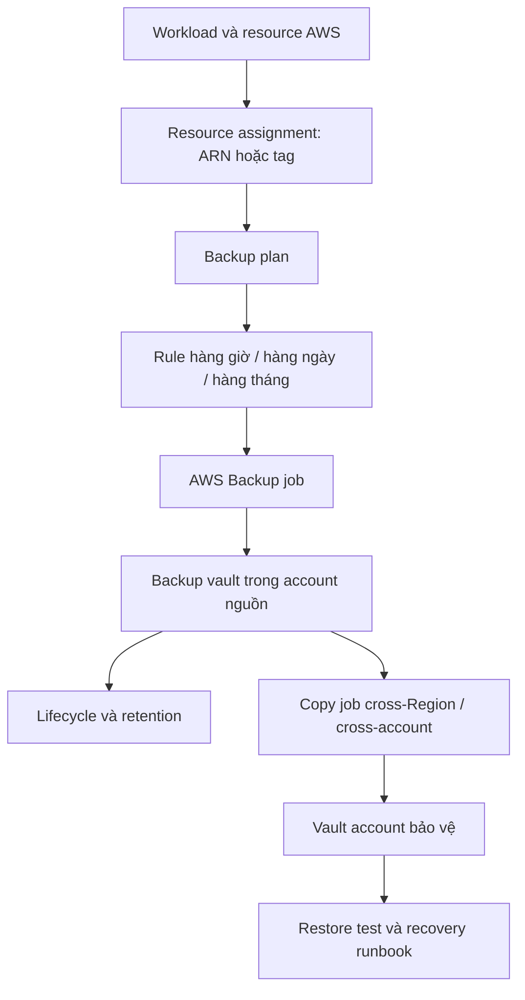

# Chiến lược backup-restore cho hệ thống AWS

Một hệ thống AWS có thể chạy trên nhiều dịch vụ và nhiều Region, nhưng dữ liệu vẫn có thể bị xóa nhầm, ghi đè bởi ứng dụng lỗi, mã hóa bởi ransomware hoặc mất khả năng truy cập khi tài khoản quản trị bị chiếm quyền. High availability giúp hệ thống tiếp tục phục vụ khi một thành phần gặp sự cố; replication giúp dữ liệu có mặt ở nơi khác; còn backup tạo ra các điểm khôi phục độc lập để quay về trạng thái trước khi sự cố xảy ra.

Một chiến lược backup-restore tốt bắt đầu từ mục tiêu kinh doanh, xác định dữ liệu nào phải bảo vệ và mức mất dữ liệu/thời gian gián đoạn có thể chấp nhận. Sau đó tổ chức lịch backup, retention, bản sao khác account/Region, quyền khôi phục và bài kiểm thử restore. Trong AWS, AWS Backup cung cấp quản lý tập trung cho nhiều dịch vụ, nhưng mỗi loại tài nguyên vẫn có đặc điểm backup và restore riêng. Hạ tầng, quyền IAM, KMS key, DNS, cấu hình ứng dụng và phụ thuộc bên ngoài cũng cần được đưa vào kế hoạch khôi phục.

## Mục tiêu học tập

Sau bài học, bạn có thể:

- Xác định RPO, RTO và mức ưu tiên khôi phục cho từng workload.
- Phân biệt backup, snapshot, replication, high availability và disaster recovery.
- Thiết kế backup plan, backup rule, resource assignment, vault và lifecycle bằng AWS Backup.
- Bảo vệ recovery point bằng mã hóa, cross-account copy, cross-Region copy, Vault Lock và tài khoản backup cô lập.
- Chọn phương pháp backup phù hợp cho EC2/EBS, RDS/Aurora, DynamoDB, S3, EFS, FSx và workload container.
- Kiểm tra tính nhất quán dữ liệu và khả năng khôi phục của ứng dụng nhiều tầng.
- Thiết kế restore testing, runbook, thứ tự phục hồi và mô hình DR theo RTO/RPO.
- Giám sát job, quản lý chi phí và xử lý lỗi backup/restore.

## 1. Xác định mục tiêu phục hồi: RPO và RTO

Backup không nên được thiết kế chỉ dựa trên lịch mặc định của dịch vụ. Trước hết cần xác định hậu quả kinh doanh nếu dữ liệu mất hoặc ứng dụng ngừng hoạt động.

**Recovery Point Objective (RPO)** là khoảng thời gian dữ liệu tối đa có thể mất, tính ngược từ thời điểm sự cố. Nếu RPO là 15 phút, tổ chức cần một cơ chế bảo vệ dữ liệu sao cho điểm dữ liệu khôi phục gần nhất không cũ hơn khoảng 15 phút trong điều kiện mục tiêu.

**Recovery Time Objective (RTO)** là thời gian tối đa được phép để đưa dịch vụ trở lại hoạt động sau sự cố. RTO không chỉ là thời gian AWS hoàn tất restore job. Nó còn gồm thời gian cấp hạ tầng, cấu hình network/IAM, khôi phục database, triển khai ứng dụng, kiểm thử và chuyển traffic.

Ví dụ:

| Workload | RPO mục tiêu | RTO mục tiêu | Ý nghĩa thiết kế |
|---|---:|---:|---|
| Thanh toán và đơn hàng | 5–15 phút | 1 giờ | Cần PITR/replication phù hợp, backup tần suất cao và runbook đã diễn tập |
| Cổng khách hàng | 1 giờ | 4 giờ | Backup định kỳ, bản sao khác Region và khả năng triển khai lại ứng dụng |
| Báo cáo nội bộ | 24 giờ | 24 giờ | Backup hàng ngày và restore theo yêu cầu có thể đủ |
| Dữ liệu lưu trữ dài hạn | 24 giờ hoặc theo chính sách | 2–5 ngày | Ưu tiên retention, immutability và chi phí lưu trữ |

Các con số trên chỉ là ví dụ. Owner của workload phải xác nhận RPO/RTO theo tác động kinh doanh, nghĩa vụ pháp lý, SLA với khách hàng và chi phí có thể chấp nhận.

### Thời gian phục hồi thực tế

Khi lập kế hoạch, phân rã RTO thành các phần:

\[
RTO_{total}=T_{detect}+T_{decide}+T_{provision}+T_{restore}+T_{validate}+T_{cutover}
\]

Trong đó, tổ chức phát hiện và tuyên bố sự cố, quyết định phương án, cấp hạ tầng, restore dữ liệu, xác minh ứng dụng rồi chuyển người dùng sang môi trường phục hồi. Nếu chỉ đo thời gian restore database, RTO sẽ bị đánh giá thấp.

## 2. Hiểu đúng backup, snapshot, replication và high availability

Các cơ chế bảo vệ dữ liệu giải quyết những loại lỗi khác nhau.

| Cơ chế | Mục tiêu | Điểm mạnh | Giới hạn |
|---|---|---|---|
| High availability (HA) | Duy trì dịch vụ khi một thành phần lỗi | Failover nhanh, giảm downtime | Có thể tiếp tục nhân bản lỗi logic hoặc thao tác xóa |
| Replication | Duy trì bản dữ liệu ở hệ thống/Region khác | RPO thấp, hỗ trợ failover | Xóa nhầm, corruption hoặc ransomware có thể lan sang replica |
| Snapshot | Chụp trạng thái dữ liệu tại một thời điểm | Tạo recovery point và thường hỗ trợ incremental | Phải hiểu tính nhất quán và thời gian restore |
| Backup | Giữ các recovery point theo lịch và retention | Khôi phục về thời điểm trước sự cố | Có độ trễ theo lịch, cần kiểm tra restore và bảo vệ quyền xóa |
| Disaster recovery (DR) | Khôi phục toàn bộ dịch vụ sau sự cố lớn | Có mục tiêu RTO/RPO và kiến trúc failover | Chi phí và độ phức tạp tùy chiến lược |

Replication không thay thế backup. Ví dụ, nếu một người dùng xóa nhầm bảng dữ liệu và thao tác được replicate ngay sang Region khác, bản sao cũng có thể mất dữ liệu. Backup có nhiều recovery point độc lập giúp quay lại trước thời điểm xóa.

Ngược lại, backup không tự tạo ra một hệ thống sẵn sàng nhận traffic. Sau khi restore, vẫn cần compute, network, identity, secrets, DNS, load balancer và quy trình cutover. HA, replication, backup và DR thường được kết hợp.

## 3. Phân loại dữ liệu và thiết kế chính sách bảo vệ

Không phải mọi dữ liệu đều cần cùng tần suất và thời gian lưu. Hãy phân loại theo mức quan trọng và khả năng tái tạo.

- **Tier 0 – dữ liệu và dịch vụ cốt lõi**: giao dịch, tài khoản, định danh, dữ liệu khách hàng. RPO/RTO thấp; backup liên tục hoặc thường xuyên; bản sao cross-account/Region; restore test định kỳ.
- **Tier 1 – workload quan trọng**: ứng dụng vận hành, dữ liệu nghiệp vụ chính. Backup hàng giờ hoặc hàng ngày tùy RPO; retention đủ cho chu kỳ phát hiện lỗi.
- **Tier 2 – dữ liệu có thể tái tạo**: cache, artifact tạm, log ngắn hạn. Có thể tái tạo từ nguồn hoặc lưu theo chính sách riêng.
- **Tier 3 – archive/compliance**: dữ liệu cần lưu nhiều năm. Ưu tiên retention, immutability, khả năng kiểm toán và chi phí lưu trữ.

Với mỗi workload, ghi nhận:

1. Business owner và technical owner.
2. Dữ liệu, resource ARN, account, Region và dependency.
3. RPO/RTO, retention, yêu cầu legal hold hoặc compliance.
4. Backup method, frequency, vault, encryption key và copy destination.
5. Quyền thực hiện backup, quyền xóa recovery point và quyền restore.
6. Quy trình restore, kiểm tra tính toàn vẹn và thời gian phục hồi đo được.

### Mẫu tư duy 3-2-1-1-0

Quy tắc 3-2-1-1-0 là một cách kiểm tra mức độ đa dạng và độ tin cậy của bản sao:

- 3 bản dữ liệu: bản production và ít nhất hai bản sao.
- 2 loại vị trí hoặc cơ chế lưu trữ khác nhau.
- 1 bản sao ở account hoặc Region độc lập với production.
- 1 bản sao immutable hoặc được cô lập khỏi quyền quản trị thông thường.
- 0 lỗi restore chưa được phát hiện qua kiểm thử và xác minh.

Đây là nguyên tắc thiết kế, không phải yêu cầu bắt buộc của AWS Backup. Trong môi trường cloud, cần đánh giá account boundary, KMS key, quyền xóa, Vault Lock và khả năng khôi phục độc lập để đáp ứng tinh thần của nguyên tắc này.

## 4. AWS Backup và các thành phần chính

AWS Backup là dịch vụ quản lý backup tập trung cho nhiều dịch vụ AWS và một số workload hybrid. Dịch vụ giúp định nghĩa lịch, retention, vault, copy action, resource assignment, giám sát job và restore từ một giao diện/API thống nhất.

Các thành phần quan trọng:

| Thành phần | Chức năng |
|---|---|
| Backup plan | Tập hợp quy tắc backup áp dụng cho workload |
| Backup rule | Lịch chạy, backup window, vault đích, lifecycle và copy action |
| Resource assignment | Chọn resource theo ARN hoặc tag |
| Backup job | Một lần thực hiện backup |
| Recovery point | Bản khôi phục được tạo trong backup vault |
| Backup vault | Container lưu recovery point, policy truy cập và encryption key |
| Copy job | Sao chép recovery point sang vault/Region/account khác |
| Restore job | Tạo lại resource hoặc dữ liệu từ recovery point |
| Backup policy | Chính sách AWS Organizations để triển khai backup plan trên nhiều account |
| Backup Audit Manager | Đánh giá và báo cáo tuân thủ chính sách backup |

Một backup plan có thể có nhiều rule. Ví dụ, một rule backup hàng ngày giữ 35 ngày và một rule backup hàng tháng giữ 7 năm. Resource assignment có thể chọn tất cả resource có tag `Backup=Critical`.



AWS Backup sử dụng service-linked role và IAM role để thực hiện thao tác trên resource. Khi cấu hình, phải bảo đảm role có quyền với dịch vụ nguồn, vault, KMS key và đích copy/restore. Không cấp quyền quản trị toàn account cho ứng dụng chỉ để tạo backup.

## 5. Tạo backup plan và gán tài nguyên

### Backup rule

Một rule xác định:

- **Schedule**: thời điểm hoặc tần suất backup.
- **Start window**: khoảng thời gian AWS Backup có thể bắt đầu job sau thời điểm lịch.
- **Completion window**: thời gian tối đa dự kiến để job hoàn tất.
- **Target backup vault**: nơi lưu recovery point.
- **Lifecycle**: thời gian chuyển sang cold storage nếu resource type hỗ trợ và thời điểm xóa.
- **Copy actions**: bản sao sang vault khác, có thể ở Region/account khác.
- **Recovery point tags**: tag để phân loại, audit và quản lý.

Lịch backup cần phù hợp tải hệ thống và cửa sổ vận hành. Nếu mọi account đều chạy backup cùng một thời điểm, có thể tạo tải tăng đột biến, cạnh tranh quota hoặc làm các job vượt completion window. Hãy phân tán lịch khi cần và theo dõi thời gian chạy thực tế.

### Resource assignment

Có thể gán resource theo ARN cụ thể hoặc tag. Tag giúp tự động áp dụng policy cho resource mới, nhưng chỉ đáng tin khi quy ước tag được thực thi.

Ví dụ:

| Tag | Ý nghĩa |
|---|---|
| `Backup=Critical` | Backup thường xuyên và copy cross-account/Region |
| `Backup=Standard` | Backup hàng ngày |
| `Backup=Archive` | Backup theo yêu cầu lưu dài hạn |
| `DataClass=Restricted` | Áp dụng retention và quyền truy cập nghiêm ngặt |
| `Owner=payments` | Xác định đội chịu trách nhiệm |

Không dùng tag duy nhất làm căn cứ compliance nếu principal có quyền tùy ý sửa tag. Kết hợp tag policy, SCP, IaC validation và kiểm tra coverage để hạn chế resource bị bỏ sót.

### Backup policies với AWS Organizations

AWS Backup policies cho phép quản trị viên định nghĩa backup plan ở cấp Organization, root hoặc OU. Policy có thể kế thừa xuống account theo cấu trúc Organizations và triển khai backup plan trong các account mục tiêu. Management account có thể chỉ định delegated administrator cho AWS Backup để quản lý backup tập trung.

Hãy tách policy theo OU và tier dữ liệu. Ví dụ Production nhận backup hàng ngày cùng copy cross-Region; Sandbox nhận retention ngắn hơn. Kiểm tra effective policy sau khi account chuyển OU, và xác minh backup plan thực sự được tạo trong account thành viên.

## 6. Backup vault và bảo vệ recovery point

Backup vault là nơi chứa recovery point và chính sách kiểm soát truy cập. Mỗi vault có encryption key và có thể có access policy. Thiết kế vault cần tính đến ranh giới bảo mật, quyền xóa, khả năng copy và quy trình restore.

### Mã hóa và KMS key

Recovery point được mã hóa theo cơ chế của dịch vụ nguồn và AWS Backup. Với các loại resource/vault cho phép chọn customer managed KMS key, cần bảo đảm key policy và IAM policy cho phép đúng AWS Backup role thực hiện encrypt/decrypt/copy/restore.

KMS key là dependency quan trọng của backup. Nếu key bị disable, scheduled deletion hoặc mất quyền sử dụng, recovery point có thể còn tồn tại nhưng không giải mã được. Đưa key ARN, owner, policy, rotation và quy trình bảo vệ key vào runbook DR. Không xóa KMS key chỉ vì workload nguồn đã bị xóa.

Khả năng dùng customer managed key, AWS owned key hoặc key của account đích phụ thuộc loại resource và luồng copy. Cross-account copy thường cần key ở đích mà account đích kiểm soát. Hãy kiểm tra yêu cầu riêng của từng dịch vụ trước khi thiết kế.

### Vault access policy và separation of duties

Tách các nhóm quyền:

- Backup operator: tạo và theo dõi backup job.
- Vault administrator: quản lý vault và policy; không mặc định có quyền xóa mọi recovery point.
- Restore operator: được restore vào account/OU đích đã phê duyệt.
- Security/compliance auditor: chỉ đọc trạng thái, báo cáo và lịch sử.
- Break-glass administrator: quyền khẩn cấp, bảo vệ bằng MFA, approval và audit.

SCP và IAM policy có thể giúp ngăn principal production xóa vault hoặc recovery point. Tuy nhiên, phải thiết kế ngoại lệ cho AWS Backup service role, delegated administrator và quy trình restore. Thử nghiệm policy trong account không quan trọng trước khi áp dụng rộng.

### AWS Backup Vault Lock

Vault Lock cung cấp cơ chế WORM (write once, read many) cho recovery point trong vault:

- **Governance mode**: principal có quyền phù hợp có thể thay đổi hoặc gỡ Vault Lock theo cơ chế quản trị.
- **Compliance mode**: sau thời gian thay đổi ban đầu được cấu hình, lock trở nên không thể bị thay đổi hoặc xóa trước khi hết các giới hạn retention đã khóa.

Vault Lock giúp giảm nguy cơ người có quyền quản trị xóa backup trong một cuộc tấn công. Trước khi bật compliance mode, cần xác nhận min/max retention, thời gian lưu, chi phí và yêu cầu pháp lý. Cấu hình sai có thể khiến recovery point không thể xóa trong thời gian dài và làm phát sinh chi phí ngoài dự kiến.

### Logically air-gapped vault

AWS Backup hỗ trợ logically air-gapped vault cho các tình huống cần cô lập recovery point khỏi account vận hành thông thường. Vault có thể được đặt trong account bảo vệ riêng và chia sẻ theo cơ chế được hỗ trợ để restore. Đây là lớp cô lập bổ sung; vẫn phải xác minh resource type, Region, encryption, quyền truy cập và quy trình restore thực tế.

## 7. Cross-account và cross-Region copy

Một bản backup chỉ nằm trong account production vẫn có thể bị ảnh hưởng nếu account đó bị chiếm quyền quản trị. Cross-account copy tạo ranh giới quản trị khác; cross-Region copy giảm rủi ro mất một Region. Với workload quan trọng, có thể kết hợp cả hai.

### Cross-account copy

Mô hình thường gặp:

1. Workload account tạo recovery point trong vault nguồn.
2. AWS Backup copy recovery point sang vault trong Backup account.
3. Backup account có policy riêng giới hạn quyền xóa và thay đổi vault.
4. Security team kiểm tra copy job và retention ở account đích.
5. Restore operator dùng role riêng để khôi phục từ backup account khi có sự cố.

Management account có thể đăng ký delegated administrator AWS Backup. Từ delegated administrator, tổ chức có thể quản lý backup và copy theo account/OU. Bản copy vẫn cần kiểm tra encryption, key policy, vault policy và quyền restore ở account đích.

### Cross-Region copy

Cross-Region copy giữ bản recovery point ở Region khác. Khi chọn Region đích, cân nhắc:

- Data residency và yêu cầu pháp lý.
- Dịch vụ/resource type có hỗ trợ copy đến Region đích không.
- KMS key có sẵn và đúng Region.
- Thời gian copy và chi phí data transfer/storage.
- Region đích có quota, network, IAM, AMI, image và dependency cần thiết không.

Copy job là bất đồng bộ. Không coi việc cấu hình copy action là bằng chứng bản copy đã sẵn sàng. Giám sát trạng thái job và xác minh recovery point tại vault đích.

### Không dùng replication thay cho bản backup độc lập

S3 Cross-Region Replication, DynamoDB Global Tables hoặc database replication có thể duy trì dữ liệu gần thời gian thực. Chúng hỗ trợ HA/DR nhưng không tự tạo retention độc lập chống xóa hoặc corruption. Hãy duy trì backup point-in-time và quyền xóa tách biệt.

## 8. Chọn phương pháp backup theo dịch vụ AWS

AWS Backup hỗ trợ nhiều dịch vụ, nhưng cách backup, consistency, retention, cold storage và restore khác nhau theo resource type. Luôn kiểm tra ma trận hỗ trợ hiện hành theo Region và tính năng.

| Dịch vụ | Cơ chế bảo vệ thường dùng | Điểm cần lưu ý khi restore |
|---|---|---|
| Amazon EC2 / EBS | EBS snapshots, AMI, AWS Backup | Snapshot có thể crash-consistent; cần phục hồi nhiều volume và cấu hình instance |
| Amazon RDS | Automated backups, PITR, manual snapshots, AWS Backup | Restore thường tạo DB instance mới; cập nhật endpoint, parameter group và secret |
| Amazon Aurora | Continuous backup/PITR, cluster snapshots, AWS Backup | Restore tạo cluster mới; kiểm tra writer/reader endpoint và subnet group |
| DynamoDB | Point-in-time recovery (PITR), on-demand backup, AWS Backup | Restore tạo table mới; kiểm tra index, stream, TTL, autoscaling và policy |
| Amazon S3 | Versioning, Object Lock, AWS Backup for S3, replication | Khôi phục object/version, bucket configuration và quyền truy cập |
| Amazon EFS | AWS Backup, replication khi cần | Restore có thể tạo file system mới; kiểm tra mount target, access point và POSIX permission |
| Amazon FSx | AWS Backup và snapshot/replication theo loại FSx | Kiểm tra loại FSx, throughput, subnet, AD và client connectivity |
| Amazon EKS | AWS Backup cho EKS khi resource/Region được hỗ trợ; backup volume riêng | Cần khôi phục Kubernetes resources, persistent data, secrets và cluster dependencies |

### EC2 và EBS

EBS snapshot là bản sao block-level theo cơ chế incremental. Snapshot bảo vệ nội dung volume, nhưng không tự bảo vệ mọi cấu hình của EC2 instance. Với workload cần khôi phục nhanh, có thể tạo AMI để lưu trạng thái boot volume và cấu hình instance được hỗ trợ, đồng thời bảo vệ các data volume riêng.

Trước khi backup database chạy trên EC2, cần xác định application consistency. Snapshot khi ứng dụng đang ghi có thể chỉ crash-consistent. Dừng ghi, flush buffer hoặc dùng cơ chế VSS/application-aware phù hợp nếu cần nhất quán giao dịch. Với multi-volume workload, dùng cơ chế multi-volume snapshot để các volume được chụp tại một thời điểm gần đồng nhất.

Khi restore, tạo volume hoặc instance mới, gắn volume đúng device mapping, khôi phục cấu hình instance, security group, subnet, IAM instance profile, user data và DNS. Kiểm tra filesystem và database trước khi mở traffic.

### RDS và Aurora

Automated backups của RDS hỗ trợ point-in-time recovery trong retention window được cấu hình. Manual snapshot được giữ cho đến khi bị xóa rõ ràng và phù hợp với mốc phát hành hoặc lưu trữ dài hạn. AWS Backup có thể quản lý backup plan và lifecycle cho các loại DB được hỗ trợ.

Restore từ snapshot hoặc PITR thường tạo database instance/cluster mới. Endpoint mới có thể khác endpoint cũ. Runbook cần cập nhật secret/config, kiểm tra subnet group, security group, parameter/option group, KMS key, engine version và read/write endpoint. Kiểm tra replication, read replica và kết nối ứng dụng trước cutover.

### DynamoDB

DynamoDB PITR cung cấp khả năng khôi phục bảng về thời điểm trong khoảng thời gian được dịch vụ hỗ trợ. On-demand backup tạo recovery point thủ công theo nhu cầu. Restore tạo bảng mới, vì vậy cần kiểm tra Global Secondary Index, Local Secondary Index, stream, TTL, autoscaling, tags, resource policy và encryption.

DynamoDB Global Tables giúp dữ liệu có mặt ở nhiều Region, nhưng thay đổi hoặc xóa dữ liệu có thể replicate giữa các Region. Vẫn cần PITR hoặc on-demand backup độc lập để quay về trước thời điểm lỗi logic.

### Amazon S3

S3 Versioning giữ nhiều version của object và giúp phục hồi sau ghi đè hoặc xóa. Delete marker có thể khiến object không hiển thị trong thao tác thông thường, nhưng version trước vẫn có thể tồn tại. Object Lock có thể bảo vệ object version theo retention hoặc legal hold.

AWS Backup for S3 có thể quản lý backup liên tục và định kỳ cho các bucket được hỗ trợ. Hãy kiểm tra yêu cầu IAM, resource assignment, S3 versioning, restore mode, object count, metadata, bucket configuration và chi phí. S3 replication giúp sao chép object sang bucket khác nhưng có thể replicate cả thao tác xóa theo cấu hình; không nên xem replication là bản backup bất biến.

Ngoài object, cần bảo vệ bucket policy, access point, lifecycle, replication configuration, notification, event, encryption, inventory và ownership settings. Các cấu hình bucket có thể phải tái tạo hoặc kiểm tra riêng sau restore.

### EFS và FSx

EFS có thể được bảo vệ bằng AWS Backup. Khi restore, cần xác định tạo file system mới hay khôi phục vào vị trí phù hợp, sau đó cấu hình mount target, security group, access point và policy. Kiểm tra owner/group, POSIX permission, file metadata và application path.

FSx có nhiều loại file system với yêu cầu phục hồi khác nhau. Với FSx for Windows File Server, cần kiểm tra Active Directory, DNS và quyền chia sẻ. Với FSx for Lustre hoặc OpenZFS, kiểm tra subnet, deployment type, throughput, data repository association và client mount. Không dùng một runbook restore chung cho tất cả loại FSx.

### EKS và workload container

Backup Kubernetes resources và persistent data là hai phần liên quan nhưng khác nhau. Với AWS Backup for EKS, xác nhận cluster, namespace, resource type và persistent volume được hỗ trợ ở Region hiện tại. Nếu dùng CSI snapshot hoặc công cụ backup khác, cần kiểm tra CRD, storage class, snapshot controller, volume encryption và khả năng restore sang cluster mới.

Container image nên được lưu trong ECR với tag/digest có thể truy vết; image có thể cần replication sang Region khác. Cấu hình cluster, add-on, IAM roles for service accounts, secrets, ConfigMaps, ingress, policy và GitOps source cũng phải có phương án tái tạo. Backup dữ liệu không thay thế việc lưu manifest/IaC và artifact triển khai.

## 9. Application consistency và thứ tự bảo vệ

Một recovery point hợp lệ về mặt storage chưa chắc là dữ liệu hợp lệ về mặt ứng dụng.

### Crash-consistent và application-consistent

- **Crash-consistent**: trạng thái giống như hệ thống vừa bị tắt đột ngột. Filesystem/journal có thể phục hồi, nhưng giao dịch đang chạy có thể chưa được commit.
- **Application-consistent**: ứng dụng đã flush dữ liệu và hoàn tất hoặc đóng băng giao dịch theo cách được hỗ trợ trước khi chụp backup.

Với database, ưu tiên native backup/PITR hoặc cơ chế application-aware mà dịch vụ hỗ trợ. Với ứng dụng nhiều volume, đồng bộ thời điểm snapshot để không tạo ra trạng thái dữ liệu lệch nhau.

### Nhất quán giữa nhiều dịch vụ

Giả sử ứng dụng gồm RDS, S3, DynamoDB và SQS. Nếu backup từng dịch vụ ở thời điểm khác nhau, dữ liệu có thể không còn tương quan. Một order có thể xuất hiện trong RDS nhưng file hóa đơn tương ứng ở S3 chưa tồn tại trong recovery point.

Thiết kế cần xác định:

1. Mốc giao dịch hoặc watermark dùng để đối chiếu các nguồn dữ liệu.
2. Cách tạm dừng write hoặc chuyển ứng dụng sang maintenance/read-only mode.
3. Thứ tự backup và thời điểm chốt dữ liệu.
4. Cách replay event/queue sau restore mà không tạo giao dịch trùng.
5. Kiểm tra tính toàn vẹn bằng count, checksum, foreign key và business invariant.

Nếu không thể tạo một snapshot nguyên tử xuyên dịch vụ, hãy dùng application-level checkpoint, log sequence, event replay và reconciliation để đưa các thành phần về một trạng thái nghiệp vụ nhất quán.

## 10. Retention, lifecycle và bảo vệ lâu dài

Retention cần đáp ứng cả nhu cầu vận hành lẫn nghĩa vụ lưu trữ. Ví dụ, backup hàng ngày giữ 35 ngày giúp khôi phục sau lỗi gần đây; backup hàng tháng giữ 13 tháng hỗ trợ lỗi được phát hiện muộn; archive theo năm có thể đáp ứng kiểm toán hoặc legal retention.

### Lifecycle

AWS Backup có thể chuyển recovery point sang cold storage nếu resource type và loại backup hỗ trợ. Chuyển cold storage có thể giảm chi phí lưu trữ nhưng thường có thời gian lưu tối thiểu và chi phí truy xuất/restore. Không phải mọi resource type đều hỗ trợ cold storage; hãy kiểm tra điều kiện theo dịch vụ.

Đặt lifecycle sao cho:

- Retention dài hơn thời gian tối đa có thể phát hiện lỗi logic hoặc dữ liệu hỏng.
- Recovery point quan trọng được copy sang vault độc lập trước khi hết hạn ở nguồn.
- Không xóa bản cuối cùng còn khả năng khôi phục dữ liệu cần lưu theo luật.
- Backup hết hạn được xóa theo policy và có audit trail.
- Legal hold hoặc yêu cầu điều tra có thể giữ bản sao theo quy trình được phê duyệt.

### Recovery point và thời gian phát hiện corruption

Nếu dữ liệu bị hỏng nhưng chỉ được phát hiện sau 45 ngày, backup giữ 30 ngày có thể không còn bản sạch. Với dữ liệu quan trọng, retention cần xét thời gian phát hiện sai lệch, chu kỳ đối soát, kỳ kế toán và thời gian audit. Tăng retention làm tăng chi phí, nhưng retention quá ngắn có thể khiến tổ chức không còn điểm phục hồi hợp lệ.

## 11. Restore testing và xác minh khả năng phục hồi

Một backup job thành công chỉ chứng minh dữ liệu đã được tạo theo cơ chế backup. Nó không chứng minh ứng dụng có thể khởi động, dữ liệu giải mã được hoặc RTO đạt mục tiêu.

AWS Backup hỗ trợ restore testing để lập kế hoạch kiểm thử restore theo lịch cho các resource type được hỗ trợ. Có thể chọn resource, vault/recovery point, lịch kiểm thử và khoảng thời gian kiểm tra. Tổ chức cần bổ sung kiểm tra ứng dụng và xác nhận kết quả theo runbook.

### Các lớp kiểm thử

| Lớp | Câu hỏi cần trả lời |
|---|---|
| Backup job | Job có hoàn tất và recovery point tồn tại không? |
| Copy job | Bản sao có mặt ở account/Region đích không? |
| Encryption | Role restore có giải mã được bằng KMS key không? |
| Resource restore | Resource mới có được tạo đúng cấu hình không? |
| Data integrity | Dữ liệu có đủ, đúng checksum/count và không lỗi không? |
| Application | Ứng dụng có kết nối được database, S3, queue và dependency không? |
| Business validation | Luồng nghiệp vụ quan trọng có chạy đúng không? |
| RTO/RPO | Thời gian và điểm dữ liệu phục hồi có đạt mục tiêu không? |

### Kế hoạch restore test

1. Chọn recovery point gần nhất và một recovery point cũ hơn để kiểm tra retention.
2. Restore vào account hoặc VPC cách ly, tránh ghi đè production.
3. Ghi lại thời gian bắt đầu, thời gian resource sẵn sàng và thời gian ứng dụng healthy.
4. Kiểm tra dữ liệu, permission, encryption, endpoint và application dependency.
5. Chạy business test, đối soát record và xác minh không có dữ liệu nhạy cảm bị mở public.
6. Xóa tài nguyên kiểm thử theo quy trình và lưu evidence.
7. Cập nhật RTO/RPO thực đo và sửa runbook nếu có bước chậm hoặc thiếu quyền.

Không restore test trên production resource nếu chưa có kế hoạch change và rollback rõ ràng. Restore thường tạo resource mới hoặc yêu cầu metadata riêng; hãy kiểm tra phí tài nguyên tồn tại trong thời gian test.

## 12. Các mô hình Disaster Recovery

Backup-restore là một trong nhiều chiến lược DR. Mô hình phù hợp phụ thuộc RTO/RPO và ngân sách.

| Chiến lược | Cách hoạt động | RTO/RPO tương đối | Chi phí/độ phức tạp |
|---|---|---|---|
| Backup and restore | Lưu backup; khi sự cố mới cấp hạ tầng và restore | RTO dài hơn; RPO phụ thuộc lịch/PITR | Thấp nhất |
| Pilot light | Duy trì các thành phần dữ liệu/cốt lõi tối thiểu ở Region DR; scale compute khi cần | RTO trung bình; RPO thấp nếu dữ liệu replicate | Trung bình |
| Warm standby | Một bản hệ thống thu nhỏ chạy sẵn ở Region DR | RTO ngắn hơn; RPO thấp | Cao hơn |
| Multi-site active/active | Nhiều Region cùng phục vụ traffic | RTO rất thấp; RPO có thể rất thấp tùy thiết kế | Cao nhất, phức tạp nhất |

### Backup and restore

Phù hợp workload có thể chấp nhận thời gian phục hồi dài hơn. Khi Region chính gặp sự cố, đội vận hành kích hoạt runbook, triển khai hạ tầng từ IaC, copy/restore dữ liệu, cấu hình endpoint và chuyển traffic. Cần giữ sẵn quota, AMI/container image, KMS key, network và IAM ở Region DR.

### Pilot light

Giữ các thành phần nền tảng tối thiểu, ví dụ database replica hoặc dữ liệu được đồng bộ, network và IAM đã chuẩn bị. Khi failover, scale compute, deploy application và chuyển traffic. Phải kiểm thử quá trình scale vì quota hoặc dependency có thể khiến hệ thống không khởi động đúng hạn.

### Warm standby

Chạy phiên bản đầy đủ nhưng ở capacity thấp tại Region DR. Khi failover, tăng capacity và chuyển traffic. Warm standby giảm thời gian cấp tài nguyên nhưng cần đồng bộ cấu hình, dữ liệu và phiên bản liên tục.

### Multi-site active/active

Nhiều Region cùng xử lý traffic. Đây không phải chỉ bật replication; cần giải quyết consistency, conflict, session, idempotency, routing, health check và dữ liệu dùng chung. Nếu ứng dụng không được thiết kế cho multi-writer, active/active có thể tạo lỗi dữ liệu khó khắc phục.

## 13. Hạ tầng phục hồi: IaC, IAM, network và dependency

Backup dữ liệu không đủ để khôi phục một hệ thống hoàn chỉnh. Các thành phần sau cần được quản lý dưới dạng mã nguồn hoặc inventory có thể tái tạo:

- VPC, subnet, route table, NAT, VPC endpoint, security group và NACL.
- IAM role, policy, instance profile, permission boundary và trust relationship.
- KMS key, key policy, alias và quy trình cấp quyền giải mã.
- Secrets Manager secret, Parameter Store parameter và quy trình rotation.
- EC2 launch template, AMI, ECR image, ECS task definition và EKS manifest.
- RDS parameter group, subnet group, option group và security group.
- Load balancer, target group, API Gateway, WAF, Route 53 record và certificate.
- SQS/SNS, EventBridge rules, Step Functions và cấu hình tích hợp.
- DNS domain, external SaaS endpoint, license, quota và third-party credential.

Infrastructure as Code như AWS CloudFormation, CDK hoặc Terraform giúp dựng lại môi trường theo version. Lưu source code, state, artifact và module ở nơi độc lập với account production. Thử triển khai IaC trong Region DR để xác nhận template không phụ thuộc resource ID hoặc secret chỉ tồn tại ở Region chính.

KMS key material không thể đơn giản được backup như một file. Thiết kế key availability, multi-Region keys nếu phù hợp, key policy và kế hoạch thay thế/khôi phục quyền sử dụng. Nếu key bị xóa vĩnh viễn, ciphertext có thể không thể khôi phục.

## 14. Runbook restore theo thứ tự phụ thuộc

Thứ tự khôi phục ảnh hưởng trực tiếp thời gian phục hồi. Một trình tự tổng quát:

1. **Tuyên bố sự cố và chọn recovery point**: xác định Region/account bị ảnh hưởng, thời điểm sạch cuối cùng và RPO.
2. **Chuẩn bị recovery account/Region**: xác nhận quota, role, KMS key, network và quyền truy cập.
3. **Dựng nền tảng**: VPC, subnet, routing, security group, endpoint, IAM và logging.
4. **Khôi phục dữ liệu nền**: database, file system, object storage và volume theo thứ tự dependency.
5. **Khôi phục ứng dụng**: EC2/ECS/EKS/Lambda, image, configuration và secret.
6. **Khôi phục tích hợp**: queue, event bus, scheduler, certificate, DNS và external endpoint.
7. **Xác minh**: health check, database consistency, permission, encryption và business transaction.
8. **Cutover**: cập nhật DNS/routing hoặc application endpoint theo runbook.
9. **Theo dõi**: lỗi, latency, backlog, duplicate event, data drift và traffic.
10. **Đóng sự cố**: lưu bằng chứng, ghi nhận RTO/RPO thực tế và lập kế hoạch failback.

Không chuyển traffic chỉ vì restore job đã hoàn tất. Ứng dụng phải vượt qua health check và business validation. Với queue/event, cần chống xử lý trùng bằng idempotency key và kiểm tra event chưa được xử lý.

## 15. AWS Backup Audit Manager và compliance

AWS Backup Audit Manager giúp đánh giá việc triển khai backup so với controls và framework. Tổ chức có thể kiểm tra backup plan, backup frequency, retention, copy, resource coverage và các yêu cầu bảo vệ khác theo framework được hỗ trợ.

Audit Manager hỗ trợ tạo báo cáo để theo dõi compliance theo account/Region. Nó không thay thế kiểm thử restore; một resource có thể đáp ứng lịch backup nhưng recovery point vẫn không dùng được do KMS key hoặc application dependency.

Hãy kết hợp:

- AWS Backup Audit Manager cho policy coverage và cấu hình.
- AWS Config/Organizations để kiểm tra trạng thái account và resource.
- CloudTrail để audit thay đổi plan, vault, policy và job.
- Restore testing để kiểm chứng dữ liệu và ứng dụng.
- Ticket/exception register để quản lý resource không thể backup hoặc có yêu cầu khác biệt.

## 16. CLI kiểm tra và vận hành AWS Backup

Các ví dụ sau minh họa một số thao tác cơ bản. Thực tế cần thay ARN, account, Region, role và metadata theo loại resource. Chạy bằng role có quyền tối thiểu.

### Tạo backup vault

```bash
aws backup create-backup-vault \
  --backup-vault-name prod-critical-vault \
  --encryption-key-arn arn:aws:kms:us-east-1:111122223333:key/00000000-1111-2222-3333-444444444444 \
  --region us-east-1
```

### Chạy backup job theo yêu cầu

```bash
aws backup start-backup-job \
  --backup-vault-name prod-critical-vault \
  --resource-arn arn:aws:ec2:us-east-1:111122223333:volume/vol-0123456789abcdef0 \
  --iam-role-arn arn:aws:iam::111122223333:role/AWSBackupDefaultServiceRole \
  --lifecycle DeleteAfterDays=35 \
  --region us-east-1
```

Backup job là bất đồng bộ; lệnh trả về job ID. Hãy theo dõi trạng thái đến khi hoàn tất hoặc thất bại.

### Liệt kê recovery point trong vault

```bash
aws backup list-recovery-points-by-backup-vault \
  --backup-vault-name prod-critical-vault \
  --region us-east-1
```

### Theo dõi backup job

```bash
aws backup list-backup-jobs \
  --by-state COMPLETED \
  --region us-east-1

aws backup describe-backup-job \
  --backup-job-id <backup-job-id> \
  --region us-east-1
```

### Lấy metadata và khởi chạy restore

Restore metadata khác nhau theo resource type. Trước tiên lấy metadata gốc của recovery point:

```bash
aws backup get-recovery-point-restore-metadata \
  --backup-vault-name prod-critical-vault \
  --recovery-point-arn <recovery-point-arn> \
  --region us-east-1
```

Sau khi tạo file `restore-metadata.json` với metadata đã kiểm tra và điều chỉnh theo hướng dẫn resource type:

```bash
aws backup start-restore-job \
  --recovery-point-arn <recovery-point-arn> \
  --metadata file://restore-metadata.json \
  --iam-role-arn arn:aws:iam::111122223333:role/AWSBackupDefaultServiceRole \
  --region us-east-1
```

Restore job thường tạo resource mới. Hãy kiểm tra tên resource, subnet, security group, KMS key, endpoint và quyền trước khi cho ứng dụng sử dụng. Không chạy ví dụ với ARN placeholder hoặc role chưa được cấu hình.

## 17. Giám sát backup và restore job

AWS Backup phát ra trạng thái job và sự kiện có thể được theo dõi qua console, API, CloudWatch và EventBridge. Nên tạo cảnh báo cho:

- Backup job thất bại hoặc vượt completion window.
- Copy job thất bại hoặc recovery point chưa xuất hiện ở vault đích.
- Resource trong scope không có recovery point mới hơn ngưỡng cho phép.
- Restore job thất bại hoặc kéo dài bất thường.
- Vault Lock, access policy, KMS key hoặc backup plan bị thay đổi.
- Backup coverage giảm sau khi account chuyển OU hoặc resource đổi tag.
- Restore test không đạt hoặc RTO/RPO thực tế vượt mục tiêu.

Metric quan trọng không chỉ là số backup job thành công. Cần đo tuổi của recovery point gần nhất, tỷ lệ resource có coverage, tỷ lệ copy thành công, tỷ lệ restore test thành công và thời gian phục hồi thực tế.

CloudTrail giúp truy vết ai đã tạo, sửa, xóa backup plan/vault, thay đổi policy hoặc khởi chạy restore. Với account backup độc lập, log quản trị cần được lưu ở nơi mà principal production không thể xóa.

## 18. Chi phí và tối ưu

Chi phí backup phụ thuộc số lượng recovery point, dung lượng thay đổi, retention, copy, cold storage, restore, data transfer và tài nguyên DR chạy trong thời gian phục hồi.

| Thành phần | Yếu tố chi phí |
|---|---|
| AWS Backup | Số lượng/dung lượng backup, resource type, backup management và tính năng sử dụng theo bảng giá |
| EBS snapshots | Dữ liệu snapshot lưu incremental, bản copy và thời gian retention |
| RDS/Aurora | Automated backup vượt mức miễn phí áp dụng, manual snapshot, copy và storage |
| DynamoDB | PITR, on-demand backup, restore và storage theo bảng giá |
| S3 | Object/version storage, AWS Backup for S3, replication, requests và retrieval |
| Cross-Region copy | Data transfer, storage ở Region đích và KMS key |
| Restore test | Resource được tạo trong thời gian test, compute/storage/network và cleanup |
| DR environment | Hạ tầng pilot light/warm standby/active-active và data replication |

Các cách tối ưu:

- Dùng tag/resource assignment để chỉ backup dữ liệu cần thiết.
- Tách plan theo tier và retention thay vì giữ mọi resource như nhau.
- Dùng lifecycle/cold storage khi resource type hỗ trợ và thời gian truy xuất phù hợp.
- Loại bỏ recovery point hết hạn theo policy, nhưng không xóa bản cuối cùng cần cho compliance.
- Phân tán lịch backup để giảm tải và tránh vượt quota.
- Chỉ copy cross-Region/account cho workload cần khả năng phục hồi tương ứng.
- Dùng restore test có lịch và dọn resource kiểm thử sau khi hoàn tất.
- Theo dõi cost allocation tag và báo cáo chi phí theo OU, account, workload owner.

Không tối ưu bằng cách giảm retention hoặc bỏ cross-account copy trước khi owner xác nhận RPO, RTO và yêu cầu compliance vẫn được đáp ứng.

## 19. Xử lý sự cố thường gặp

| Hiện tượng | Nguyên nhân có thể | Cách xử lý |
|---|---|---|
| Backup job không được tạo | Resource chưa opt-in, không thuộc assignment, tag sai hoặc lịch chưa đến | Kiểm tra service opt-in, Region, ARN, tag và effective backup plan |
| Backup job thất bại do AccessDenied | IAM role, service-linked role, SCP hoặc vault policy thiếu quyền | Xác minh principal/action/resource và quyền KMS liên quan |
| Recovery point không giải mã được | KMS key bị disable, policy thay đổi hoặc key không khả dụng ở account đích | Khôi phục quyền/key theo runbook; kiểm tra key state trước restore |
| Copy job cross-account thất bại | Vault access policy, destination vault, KMS key hoặc Organization policy chưa đúng | Kiểm tra quyền copy ở nguồn và quyền nhận ở đích |
| Copy job cross-Region không hoàn tất | Region/resource type không hỗ trợ, quota hoặc lỗi dịch vụ | Kiểm tra trạng thái job, Region availability, quota và retry có kiểm soát |
| Restore job thất bại | Metadata không hợp lệ, thiếu role permission hoặc dependency không tồn tại | Lấy metadata gốc, kiểm tra resource-specific restore requirements và KMS |
| Restore hoàn tất nhưng ứng dụng không chạy | Thiếu network, IAM, secret, DNS, endpoint hoặc cấu hình ứng dụng | Theo runbook dependency; kiểm tra health và business transaction |
| Dữ liệu restore không nhất quán | Backup crash-consistent hoặc nhiều dịch vụ được chụp ở thời điểm khác nhau | Dùng native PITR/application checkpoint, replay log và reconciliation |
| Vault Lock ngăn xóa recovery point | Retention đang được khóa theo governance/compliance mode | Xác nhận retention và quyền; không tìm cách bỏ qua immutability |
| Resource mới không được backup | Tag chưa gắn, OU policy chưa kế thừa hoặc assignment không bao phủ | Kiểm tra effective policy, tag compliance và coverage report |

## 20. Tình huống thiết kế thực tế

### Tình huống A: database đơn Region cần RPO 15 phút

Ứng dụng thanh toán chạy trên Amazon RDS. Nhóm chọn automated backups/PITR theo engine, backup plan bổ sung snapshot định kỳ và copy recovery point sang Backup account. KMS key được quản lý riêng, quyền xóa vault tách khỏi role vận hành. Mỗi tháng, nhóm restore vào VPC kiểm thử, chạy đối soát giao dịch và đo thời gian từ lúc yêu cầu đến khi ứng dụng healthy.

### Tình huống B: EC2 và EBS cần khôi phục Region

Workload dùng EC2 với nhiều EBS volume. Backup plan tạo recovery point thường xuyên và copy sang Region DR. AMI, launch template, IaC, security group và IAM role được quản lý riêng. Khi Region chính mất, đội vận hành dựng VPC ở Region DR, restore volume/AMI, kiểm tra filesystem/database, cập nhật secret/endpoint và chuyển traffic qua Route 53.

### Tình huống C: S3 bucket bị xóa nhầm

Bucket bật Versioning và AWS Backup for S3. Bản copy được giữ ở Backup account với Vault Lock phù hợp. Khi phát hiện xóa nhầm, đội dữ liệu xác định object/version bị ảnh hưởng, restore vào bucket phục hồi riêng, kiểm tra metadata và quyền, rồi đồng bộ có chọn lọc về bucket production. Không mở toàn bộ bucket phục hồi ra Internet trong lúc kiểm tra.

### Tình huống D: ransomware ảnh hưởng account production

Kẻ tấn công có quyền quản trị trong account production và cố xóa backup. Bản copy ở Backup account được bảo vệ bằng role khác, Vault Lock và policy ngăn principal production xóa recovery point. Đội ứng phó cô lập account, xác định recovery point sạch, kiểm tra KMS key và restore vào account/Region sạch. Trước khi cutover, phải xác minh image, secret, IAM credential và dữ liệu không chứa persistence của kẻ tấn công.

## 21. Bài thực hành: tạo vault, backup và restore EBS

Mục tiêu là tạo một recovery point cho EBS volume thử nghiệm, xác nhận bản backup và thực hiện restore vào một volume mới.

### Chuẩn bị

1. Một AWS account và Region dùng cho lab.
2. Một EBS volume không chứa dữ liệu production.
3. IAM role phù hợp cho AWS Backup.
4. KMS key được phép sử dụng nếu chọn customer managed key.
5. Một vault riêng cho lab.

### Thực hiện

1. Tạo backup vault bằng CLI hoặc console.
2. Xác nhận volume nằm trong Region và resource type đã được AWS Backup opt-in.
3. Chạy backup job theo yêu cầu hoặc tạo backup plan với lịch ngắn phù hợp lab.
4. Theo dõi job đến `COMPLETED` và ghi nhận recovery point ARN.
5. Lấy restore metadata của recovery point.
6. Tạo restore job với tên/metadata phù hợp để tạo volume mới.
7. Chờ restore job hoàn tất, sau đó kiểm tra volume state, encryption và AZ.
8. Gắn volume vào EC2 test instance trong AZ phù hợp.
9. Kiểm tra filesystem và nội dung dữ liệu.
10. Lưu kết quả kiểm thử và xóa resource lab theo đúng thứ tự.

### Kết quả cần đạt

- Backup job hoàn tất và recovery point tồn tại trong vault.
- Restore job tạo ra resource mới có thể truy cập.
- Dữ liệu sau restore vượt qua kiểm tra integrity.
- Thời gian backup/restore được ghi nhận.
- Không có tài nguyên lab còn chạy hoặc lưu trữ ngoài dự kiến sau cleanup.

## 22. Những hiểu lầm thường gặp

- **Có snapshot nghĩa là có DR**: vẫn cần hạ tầng, IAM, KMS, network, DNS và runbook để đưa ứng dụng trở lại.
- **Replication là backup**: lỗi logic và thao tác xóa có thể replicate; cần recovery point lịch sử độc lập.
- **Backup job thành công nghĩa là restore chắc chắn thành công**: chỉ restore test mới kiểm tra được toàn bộ chuỗi phụ thuộc.
- **Một lịch backup phù hợp mọi workload**: RPO/RTO, dữ liệu và retention khác nhau theo business tier.
- **AWS Backup bảo vệ toàn bộ cấu hình AWS**: cần IaC/inventory cho network, IAM, DNS, secret, image và dependency.
- **Backup account khác Region là đủ cô lập**: quyền quản trị, KMS key và policy xóa vẫn cần được tách biệt.
- **Vault Lock có thể bật rồi tùy ý sửa**: compliance mode có tính bất biến sau thời gian thay đổi ban đầu.
- **Restore ghi đè đúng resource cũ**: nhiều dịch vụ tạo resource mới; endpoint và ARN có thể thay đổi.
- **Dữ liệu được khôi phục là nhất quán nghiệp vụ**: cần kiểm tra giao dịch và quan hệ giữa nhiều dịch vụ.
- **RTO bằng thời gian restore job**: còn thời gian quyết định, cấp hạ tầng, validate và cutover.
- **Backup càng nhiều càng tốt**: backup không có phân loại, retention và restore test sẽ làm tăng chi phí mà chưa chắc giảm rủi ro.

## 23. Checklist vận hành production

Trước khi đưa chiến lược backup-restore vào production, hãy xác nhận:

- [ ] Mỗi workload có business owner, technical owner, RPO và RTO được phê duyệt.
- [ ] Dữ liệu được phân loại theo tier, retention và yêu cầu pháp lý.
- [ ] Backup plan bao phủ resource bằng ARN/tag và account/Region phù hợp.
- [ ] Backup policy AWS Organizations được áp dụng cho account mới và account chuyển OU.
- [ ] AWS Backup delegated administrator và quyền quản trị được tách biệt.
- [ ] Backup vault có access policy, encryption và owner rõ ràng.
- [ ] KMS key còn khả dụng trong toàn bộ retention và restore window.
- [ ] Recovery point quan trọng được copy sang account độc lập.
- [ ] Cross-Region copy đáp ứng yêu cầu DR và data residency.
- [ ] Vault Lock hoặc logically air-gapped vault được đánh giá cho dữ liệu quan trọng.
- [ ] Backup consistency được xác định cho database và workload nhiều volume.
- [ ] IaC, AMI, image, secret, IAM, network, DNS và dependency có phương án tái tạo.
- [ ] Job failure, stale recovery point và copy failure có cảnh báo.
- [ ] Restore testing chạy định kỳ ở môi trường cách ly.
- [ ] Business validation kiểm tra tính toàn vẹn dữ liệu sau restore.
- [ ] RTO/RPO thực tế được đo và so sánh với mục tiêu.
- [ ] Runbook có thứ tự phục hồi, owner, approval và phương án failback.
- [ ] Chi phí storage, copy, cold tier, restore test và DR environment được theo dõi.
- [ ] Đã diễn tập tình huống mất account, mất Region, xóa nhầm và ransomware.

## Kết luận

Chiến lược backup-restore cho AWS phải bắt đầu từ RPO/RTO và phân loại dữ liệu. AWS Backup giúp quản lý tập trung backup plan, vault, recovery point, lifecycle và copy, nhưng khả năng phục hồi còn phụ thuộc loại resource, consistency, KMS key, quyền truy cập và hạ tầng cần tái tạo.

Hãy giữ recovery point ở ranh giới account/Region phù hợp, bảo vệ bản sao bằng policy và immutability, rồi thường xuyên restore test trong môi trường cách ly. Kết hợp IaC, runbook theo dependency, kiểm tra nghiệp vụ và đo RTO/RPO thực tế để biết hệ thống có thể phục hồi khi sự cố xảy ra.

## Tài liệu tham khảo

- [AWS Backup Developer Guide](https://docs.aws.amazon.com/aws-backup/latest/devguide/whatisbackup.html)
- [Creating and managing backup plans](https://docs.aws.amazon.com/aws-backup/latest/devguide/creating-a-backup-plan.html)
- [Assigning resources to a backup plan](https://docs.aws.amazon.com/aws-backup/latest/devguide/assigning-resources.html)
- [Managing AWS Backup with AWS Organizations](https://docs.aws.amazon.com/aws-backup/latest/devguide/manage-cross-account.html)
- [Cross-Region backup](https://docs.aws.amazon.com/aws-backup/latest/devguide/cross-region-backup.html)
- [Cross-account backup](https://docs.aws.amazon.com/aws-backup/latest/devguide/create-cross-account-backup.html)
- [AWS Backup Vault Lock](https://docs.aws.amazon.com/aws-backup/latest/devguide/vault-lock.html)
- [Logically air-gapped vaults](https://docs.aws.amazon.com/aws-backup/latest/devguide/logicallyairgappedvault.html)
- [AWS Backup restore testing](https://docs.aws.amazon.com/aws-backup/latest/devguide/restore-testing.html)
- [AWS Backup Audit Manager](https://docs.aws.amazon.com/aws-backup/latest/devguide/aws-backup-audit-manager.html)
- [Supported AWS Backup features by resource](https://docs.aws.amazon.com/aws-backup/latest/devguide/backup-feature-availability.html)
- [Amazon EBS snapshots](https://docs.aws.amazon.com/ebs/latest/userguide/ebs-snapshots.html)
- [Amazon RDS backup and restore](https://docs.aws.amazon.com/AmazonRDS/latest/UserGuide/CHAP_CommonTasks.BackupRestore.html)
- [Amazon DynamoDB backup and restore](https://docs.aws.amazon.com/amazondynamodb/latest/developerguide/BackupRestore.html)
- [Amazon S3 Versioning](https://docs.aws.amazon.com/AmazonS3/latest/userguide/Versioning.html)
- [Amazon S3 Object Lock](https://docs.aws.amazon.com/AmazonS3/latest/userguide/object-lock.html)
- [Amazon EFS backup](https://docs.aws.amazon.com/efs/latest/ug/awsbackup.html)
- [AWS Well-Architected Framework: Reliability Pillar](https://docs.aws.amazon.com/wellarchitected/latest/reliability-pillar/welcome.html)
- [Disaster recovery options in the cloud](https://docs.aws.amazon.com/whitepapers/latest/disaster-recovery-workloads-on-aws/disaster-recovery-options-in-the-cloud.html)
