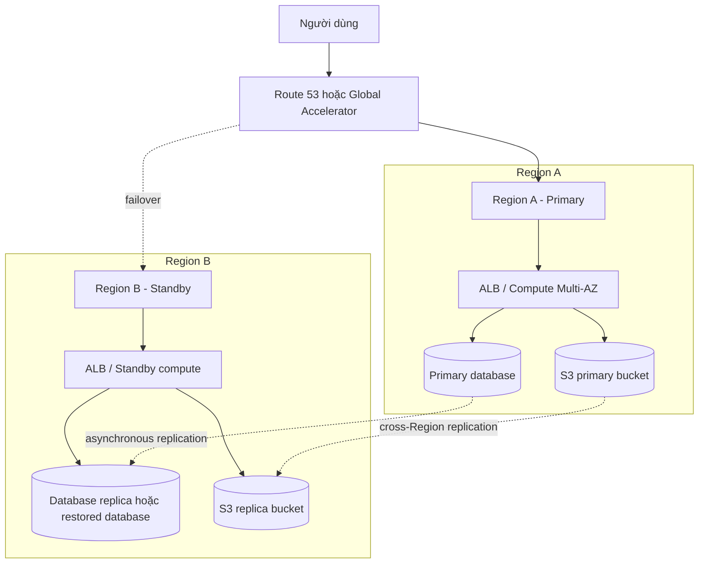
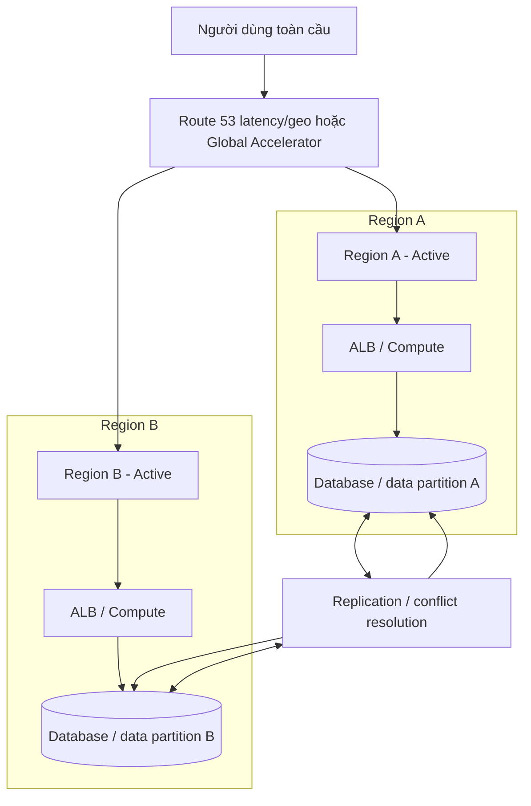

# Kiến trúc active-passive và active-active đa Region

Một ứng dụng quan trọng có thể cần tiếp tục phục vụ ngay cả khi toàn bộ một AWS Region gặp sự cố. Dự phòng nhiều Availability Zone (AZ) bảo vệ workload trước lỗi cục bộ trong một Region, nhưng không đủ để xử lý mọi tình huống như sự cố diện rộng của Region, mất kết nối đến Region hoặc yêu cầu duy trì dịch vụ ở một khu vực địa lý khác. Khi đó, kiến trúc đa Region (multi-Region) giúp workload có thể chuyển sang một Region khác.

Hai mô hình phổ biến là **active-passive** và **active-active**. Active-passive có một Region chính nhận lưu lượng, Region còn lại duy trì ở trạng thái dự phòng và chỉ nhận tải khi cần. Active-active cho phép nhiều Region cùng xử lý lưu lượng thường xuyên. Active-active có thể giảm độ trễ cho người dùng ở nhiều khu vực và tránh phải khởi động toàn bộ hệ thống sau sự cố, nhưng đòi hỏi thiết kế dữ liệu, định tuyến, đồng bộ và xử lý xung đột phức tạp hơn.

Trong hệ sinh thái AWS, lựa chọn giữa hai mô hình cần gắn với yêu cầu của ứng dụng về Region, dữ liệu, IAM, VPC, compute, storage, database, tích hợp, giám sát, phục hồi và chi phí. Không có một mẫu kiến trúc phù hợp cho mọi hệ thống. Cần bắt đầu từ RTO/RPO, phạm vi lỗi cần bảo vệ và hành vi dữ liệu khi hai Region cùng hoạt động.

## Mục tiêu học tập

Sau bài học, bạn có thể:

- Phân biệt active-passive, active-active, backup-and-restore, pilot light và warm standby.
- Chọn mô hình đa Region dựa trên RTO, RPO, độ trễ, tính nhất quán dữ liệu và ngân sách.
- Thiết kế định tuyến người dùng bằng Amazon Route 53, AWS Global Accelerator và Amazon Route 53 Application Recovery Controller (ARC).
- Chọn cơ chế sao chép hoặc phục hồi dữ liệu phù hợp với S3, RDS, Aurora, DynamoDB và các dịch vụ lưu trữ.
- Xử lý xung đột ghi, idempotency, replay và failback trong kiến trúc active-active.
- Thiết kế bảo mật, quan sát, kiểm thử và runbook cho sự cố cấp Region.

## Multi-Region giải quyết vấn đề gì?

AWS Region là một khu vực địa lý riêng biệt, gồm nhiều AZ. Một kiến trúc Multi-AZ phân tán tài nguyên trong cùng Region để chống lỗi AZ. Một kiến trúc Multi-Region triển khai hoặc sao chép workload sang các Region độc lập để tăng khả năng chịu lỗi ở phạm vi rộng hơn.

Các lý do thường gặp để triển khai nhiều Region:

- **Disaster recovery cấp Region:** duy trì hoặc khôi phục dịch vụ khi Region chính không thể hoạt động.
- **Yêu cầu địa lý:** phục vụ người dùng gần hơn, giảm độ trễ hoặc đáp ứng yêu cầu lưu trữ dữ liệu theo khu vực.
- **Tính liên tục kinh doanh:** giảm phụ thuộc vào một Region duy nhất và có phương án vận hành khi xảy ra sự cố diện rộng.
- **Phân phối tải:** phục vụ người dùng từ nhiều Region để giảm thời gian phản hồi và tăng năng lực tổng thể.
- **Kiểm soát rủi ro thay đổi:** có thể triển khai hoặc kiểm chứng phiên bản mới ở một Region trước khi mở rộng, nếu quy trình phát hành cho phép.

Multi-Region không tự động làm ứng dụng có tính sẵn sàng cao. Nếu cả hai Region dùng chung một hệ thống định danh, một nhà cung cấp DNS, một pipeline triển khai hoặc một dependency bên ngoài duy nhất, điểm lỗi chung vẫn có thể làm cả hai Region ngừng phục vụ. Cần lập bản đồ dependency và xác định những thành phần nào thực sự độc lập.

## Active-passive và active-active

### Active-passive

Trong mô hình active-passive, một Region là primary hoặc active, nhận lưu lượng production. Region còn lại là secondary hoặc standby, duy trì dữ liệu và một phần hoặc toàn bộ hạ tầng để sẵn sàng nhận traffic khi primary lỗi.

Secondary có thể ở nhiều mức sẵn sàng:

- **Backup and restore:** lưu backup, template và cấu hình; khi sự cố xảy ra mới tạo hạ tầng và khôi phục dữ liệu. Chi phí thường thấp hơn nhưng RTO dài hơn.
- **Pilot light:** duy trì những thành phần cốt lõi tối thiểu, thường là dữ liệu hoặc database replica và một phần cấu hình mạng/bảo mật. Compute và capacity còn lại được mở rộng khi failover.
- **Warm standby:** duy trì một bản sao nhỏ nhưng hoạt động đầy đủ ở Region dự phòng. Khi cần, tăng capacity và chuyển lưu lượng.
- **Hot standby:** duy trì hệ thống gần như sẵn sàng đầy đủ ở Region dự phòng, có thể chuyển traffic nhanh hơn nhưng chi phí cao hơn.

Các tên gọi này mô tả mức độ sẵn sàng và cách phân bổ tài nguyên. Chi tiết triển khai tùy workload; một số hệ thống kết hợp các mức khác nhau giữa tầng dữ liệu, compute và tích hợp.

### Active-active

Trong mô hình active-active, hai hoặc nhiều Region cùng phục vụ traffic production. Mỗi Region có đủ compute, network và dependency cần thiết để xử lý phần lưu lượng được phân bổ. Khi một Region gặp sự cố, traffic có thể được chuyển sang các Region còn lại.

Active-active có thể đem lại độ trễ thấp hơn nhờ định tuyến đến Region gần người dùng, tận dụng capacity ở nhiều Region và giảm thời gian khởi động dự phòng. Tuy nhiên, dữ liệu ghi từ nhiều Region có thể phát sinh xung đột. Cần xác định nơi ghi có thẩm quyền, cơ chế giải quyết conflict, thứ tự sự kiện, tính idempotent và cách xử lý khi một Region mất kết nối.

| Tiêu chí | Active-passive | Active-active |
|---|---|---|
| Region nhận traffic thường xuyên | Chủ yếu một Region | Nhiều Region |
| Tài nguyên ở Region dự phòng | Có thể nhỏ, tắt hoặc đầy đủ tùy mức standby | Thường phải đủ capacity phục vụ traffic thường ngày và tải failover |
| RTO | Phụ thuộc mức standby, tự động hóa và thời gian khôi phục | Có thể ngắn nếu routing và data plane đã sẵn sàng |
| RPO | Phụ thuộc độ trễ sao chép hoặc thời điểm backup | Phụ thuộc cơ chế đồng bộ và mô hình dữ liệu; không mặc định bằng 0 |
| Xung đột ghi | Thường đơn giản hơn nếu chỉ primary nhận ghi | Phải giải quyết nếu nhiều Region cùng ghi vào cùng dữ liệu |
| Chi phí | Có thể thấp hơn nếu standby dùng ít tài nguyên | Thường cao hơn do duy trì nhiều Region hoạt động |
| Độ phức tạp vận hành | Thấp hơn tương đối; cần runbook failover/failback | Cao hơn; cần điều phối dữ liệu, traffic và xung đột liên Region |
| Phù hợp | DR có mục tiêu rõ ràng, tải có thể chuyển sang một Region | Ứng dụng toàn cầu, yêu cầu latency thấp hoặc phục vụ liên tục ở nhiều khu vực |

### Chọn mô hình theo mục tiêu phục hồi

Không nên chọn active-active chỉ vì muốn RTO thấp. Nếu ứng dụng không cần ghi dữ liệu từ nhiều Region, active-passive với warm standby và quy trình failover đã kiểm thử có thể đáp ứng yêu cầu với chi phí và độ phức tạp thấp hơn.

Ngược lại, nếu người dùng cần phục vụ tại nhiều châu lục, cần giữ traffic hoạt động ở các khu vực trong điều kiện bình thường và có khả năng phân vùng dữ liệu, active-active có thể hợp lý. Phải đánh giá khả năng chịu tải khi một Region mất, không chỉ tải trung bình lúc cả hai Region đều hoạt động.

## Xác định RTO, RPO và phạm vi sự cố

Recovery Time Objective (RTO) là khoảng thời gian tối đa mà dịch vụ có thể gián đoạn. Recovery Point Objective (RPO) là lượng dữ liệu tối đa có thể chấp nhận mất, thường được biểu diễn bằng thời gian giữa điểm khôi phục và thời điểm xảy ra sự cố.

Ví dụ:

- RTO 15 phút nghĩa là ứng dụng phải khôi phục khả năng phục vụ trong tối đa 15 phút theo cách đo đã thống nhất.
- RPO 1 phút nghĩa là doanh nghiệp chấp nhận mất tối đa khoảng một phút dữ liệu, tùy định nghĩa điểm commit và cách đo.
- RTO 0 hoặc RPO 0 là mục tiêu rất khó và có chi phí cao; cần xác định chính xác phạm vi giao dịch, đồng bộ, dependency và điều kiện mạng trước khi cam kết.

RTO/RPO cần được định nghĩa cho từng capability, không chỉ cho toàn bộ ứng dụng. Ví dụ, đăng nhập, tra cứu sản phẩm, thanh toán, báo cáo và gửi email có thể có mục tiêu khác nhau. Một ứng dụng có thể phục vụ trang sản phẩm trong khi tạm dừng ghi đơn hàng, nếu đó là hành vi suy giảm đã được nghiệp vụ chấp nhận.

| Thành phần | Câu hỏi cần trả lời |
|---|---|
| Compute | Bao lâu để có đủ instance/task/pod ở Region dự phòng? |
| Database | Bao lâu để promote writer, cập nhật endpoint và kết nối lại? Dữ liệu mới nhất đã được sao chép đến đâu? |
| Object/file storage | Đối tượng mới nhất đã replicate chưa? Có thể truy cập bucket/volume ở Region đích không? |
| DNS/routing | Cơ chế chuyển traffic mất bao lâu và client có cache địa chỉ cũ không? |
| Identity/secrets | Region đích có thể xác thực workload và đọc secret/certificate cần thiết không? |
| Queue/event | Message đã được sao chép chưa? Có nguy cơ xử lý trùng hoặc mất thứ tự không? |
| Vận hành | Ai xác nhận sự cố, ai kích hoạt failover và ai được phép đưa primary trở lại? |

### Phân loại sự cố

Hãy xác định runbook tương ứng với từng tình huống:

1. Một AZ trong Region chính gặp lỗi, nhưng Region vẫn hoạt động.
2. Một dịch vụ Regional như database hoặc identity bị suy giảm.
3. Region chính mất khả năng phục vụ hoặc bị cô lập mạng.
4. Region chính vẫn hoạt động nhưng kết nối giữa các Region bị gián đoạn.
5. Một lỗi logic hoặc thao tác xóa nhầm làm hỏng dữ liệu và được sao chép sang Region khác.

Tình huống thứ tư đặc biệt quan trọng với active-active. Khi các Region không liên lạc được, cả hai có thể tiếp tục nhận ghi và tạo ra hai nhánh dữ liệu khác nhau. Kiến trúc phải có quy tắc xác định quyền ghi, phát hiện split-brain và hòa giải dữ liệu khi kết nối phục hồi.

## Kiến trúc active-passive tham chiếu



Region A nhận traffic trong điều kiện bình thường. Region B giữ bản sao dữ liệu và tài nguyên dự phòng. Khi xác nhận Region A không thể phục vụ và điều kiện failover được đáp ứng, nhóm vận hành hoặc cơ chế tự động promote database ở Region B, mở rộng compute, xác nhận dependency và chuyển traffic.

Thứ tự failover rất quan trọng. Chuyển traffic trước khi database đích có thể nhận ghi có thể gây lỗi giao dịch; promote database nhưng chưa ngăn primary cũ nhận ghi có thể tạo split-brain nếu Region cũ chỉ bị cô lập một phần. Runbook cần có bước fencing hoặc xác nhận primary cũ không còn được phép ghi trước khi bật writer mới.

## Kiến trúc active-active tham chiếu



Hai Region đều phục vụ request. Nếu cùng ghi một thực thể dữ liệu, lớp dữ liệu cần hỗ trợ multi-writer hoặc ứng dụng phải phân vùng quyền ghi. Nếu mỗi Region sở hữu một tập tenant hoặc shard riêng, cả hai Region vẫn có thể hoạt động active-active ở cấp ứng dụng trong khi mỗi bản ghi chỉ có một Region có thẩm quyền ghi. Cách này giảm xung đột và thường dễ kiểm soát hơn việc cho mọi Region ghi tự do vào cùng một bản ghi.

Active-active không nhất thiết nghĩa là mọi thành phần đều multi-writer. Có thể để frontend và read path hoạt động ở nhiều Region, trong khi một số nghiệp vụ ghi quan trọng được định tuyến đến Region chủ sở hữu dữ liệu hoặc một writer duy nhất.

## Định tuyến người dùng giữa các Region

### Amazon Route 53

Route 53 cung cấp các routing policy như failover, latency-based, weighted và geolocation. Có thể dùng health check để đánh giá endpoint và cấu hình failover sang Region dự phòng. Với active-active, latency-based routing hướng người dùng đến Region có độ trễ phù hợp; weighted routing giúp chia traffic theo tỷ lệ hoặc triển khai tăng dần; geolocation định tuyến theo vị trí địa lý.

DNS không phải cơ chế chuyển traffic tức thời. Resolver và client có thể cache câu trả lời theo TTL, một số client còn giữ kết nối lâu sau khi DNS thay đổi. Health check cũng phải đo khả năng phục vụ nghiệp vụ thay vì chỉ kiểm tra một endpoint tĩnh. Vì vậy, hãy đo thời gian chuyển traffic thực tế trên client đại diện.

### AWS Global Accelerator

Global Accelerator cung cấp hai địa chỉ IPv4 static anycast (hoặc địa chỉ IPv6 theo cấu hình) làm điểm vào toàn cầu. Người dùng kết nối đến địa chỉ gần nhất của AWS edge network, sau đó Global Accelerator định tuyến đến endpoint group trong Region phù hợp. Endpoint có thể là ALB, NLB, EC2 instance hoặc Elastic IP được hỗ trợ.

Global Accelerator hữu ích khi cần địa chỉ IP ổn định, chuyển traffic theo health và traffic dial giữa các Region, hoặc muốn giảm phụ thuộc vào DNS caching của client. Dịch vụ này không đồng bộ dữ liệu và không tự khôi phục database; cần phối hợp với tầng dữ liệu và ứng dụng.

### Amazon Route 53 Application Recovery Controller

ARC cung cấp routing controls để vận hành failover có kiểm soát. Routing control có thể bật/tắt trạng thái cho một đường phục vụ và liên kết với Route 53 health checks. Safety rules giúp tránh các tổ hợp trạng thái không an toàn, ví dụ vô tình tắt tất cả các Region đang phục vụ.

ARC có control plane và data plane. Khi thiết kế DR, cần dùng data plane endpoint và quy trình vận hành được AWS khuyến nghị để giảm phụ thuộc vào control plane trong lúc sự cố. ARC không tự quyết định dữ liệu nào mới nhất và không tự promote mọi loại database.

### Chọn cơ chế định tuyến

| Cơ chế | Điểm mạnh | Lưu ý |
|---|---|---|
| Route 53 failover | Dễ tích hợp với DNS và health check | TTL/cache khiến chuyển traffic có độ trễ; cần kiểm tra hành vi resolver |
| Route 53 latency-based | Hướng người dùng đến Region có độ trễ tốt | Cần health check và thiết kế data locality; latency không đồng nghĩa capacity |
| Route 53 weighted | Chia traffic theo tỷ lệ, hỗ trợ rollout và chuyển tải dần | Tỷ lệ DNS không bảo đảm tỷ lệ request chính xác do caching và connection reuse |
| Global Accelerator | IP anycast ổn định, health-based routing và traffic dial | Có chi phí riêng; vẫn cần data failover và kiểm thử endpoint |
| ARC routing controls | Chuyển đường phục vụ có kiểm soát, hỗ trợ safety rules | Cần runbook, phân quyền và kiểm tra data plane; không thay thế replication |

## Lựa chọn cơ chế dữ liệu đa Region

Dữ liệu thường là phần quyết định RPO và độ phức tạp của kiến trúc. Không nên chọn routing trước rồi mới tìm cách sao chép database. Hãy xác định mô hình dữ liệu, consistency, write ownership và khả năng khôi phục trước.

### Amazon S3 Cross-Region Replication

S3 Cross-Region Replication (CRR) sao chép object từ bucket nguồn sang bucket đích ở Region khác theo replication rule. Versioning phải được bật trên cả bucket nguồn và bucket đích. CRR sao chép bất đồng bộ; một object vừa được ghi có thể chưa xuất hiện ở bucket đích ngay lập tức.

Các điểm cần lưu ý:

- Chọn prefix, object tag hoặc toàn bucket làm phạm vi replication theo yêu cầu.
- Dùng IAM role replication và kiểm tra bucket policy, KMS key policy nếu object dùng SSE-KMS.
- Theo dõi replication status và replication metrics; không giả định mọi object đã replicate chỉ vì rule đang Enabled.
- CRR không mặc định sao chép delete marker trong mọi cấu hình; kiểm tra delete marker replication và hành vi xóa version trước khi thiết kế quy trình khôi phục.
- Dữ liệu đã tồn tại trước khi bật rule cần được xử lý bằng S3 Batch Replication nếu muốn sao chép lịch sử.
- S3 Replication Time Control có thể hỗ trợ mục tiêu thời gian replication được cam kết cho phần lớn object mới, nhưng không biến replication thành backup hoặc cơ chế đồng bộ giao dịch.

CRR phù hợp cho object, tài liệu và file cần có bản sao ở Region khác. Nếu ứng dụng ghi cùng object key từ cả hai Region, cần xác định quy tắc sở hữu và giải quyết phiên bản; CRR không phải cơ chế multi-writer đồng thời cho cùng một bucket.

### Amazon RDS cross-Region read replica

Với các engine và cấu hình được hỗ trợ, RDS có thể tạo cross-Region read replica. Dữ liệu được sao chép bất đồng bộ từ source sang replica. Khi Region nguồn lỗi, replica có thể được promote thành standalone database để nhận ghi. Sau promotion, replica không còn là read replica của source theo cách ban đầu; muốn thiết lập lại topology cần thực hiện theo quy trình riêng.

Cross-Region read replica phù hợp với active-passive hoặc read scaling. Hãy theo dõi replica lag, kiểm tra engine/version/Region support, KMS encryption và quyền truy cập. RPO phụ thuộc replication lag tại thời điểm sự cố; không cam kết RPO bằng 0 nếu dùng sao chép bất đồng bộ.

### Amazon Aurora Global Database

Aurora Global Database có một primary DB cluster ở Region chính và các secondary clusters ở các Region khác. Storage được sao chép giữa Region với độ trễ thấp thường ở mức dưới một giây, nhưng đây vẫn là sao chép bất đồng bộ và độ trễ có thể tăng trong một số điều kiện.

Secondary cluster phục vụ read traffic; writer của global database nằm ở primary Region. Khi cần chuyển Region, có thể dùng managed failover hoặc switchover theo tính năng và quy trình được hỗ trợ. Sau khi promote, ứng dụng phải kết nối đến endpoint ở Region mới và quản lý vai trò primary/secondary mới.

Aurora Global Database thường phù hợp với active-passive có khả năng đọc ở nhiều Region hoặc DR nhanh. Không nên mô tả nó như một database multi-writer active-active cùng lúc cho cùng một cluster; kiến trúc global database tiêu chuẩn có một primary writer tại một thời điểm.

### Amazon DynamoDB Global Tables

DynamoDB Global Tables sao chép bảng giữa các Region và cho phép ứng dụng đọc/ghi tại các Region được cấu hình. Đây là một lựa chọn cho mô hình active-active khi dữ liệu và thao tác phù hợp với khả năng replication của dịch vụ.

Cần phân biệt các consistency mode được hỗ trợ. Với multi-Region eventual consistency (MREC), cập nhật được sao chép bất đồng bộ và có thể xuất hiện độ trễ; khi cùng item được cập nhật đồng thời ở nhiều Region, cơ chế giải quyết xung đột của dịch vụ có thể khiến một cập nhật ghi đè cập nhật khác. Với multi-Region strong consistency (MRSC), các ràng buộc về Region topology, loại bảng, tính năng và latency cần được kiểm tra theo tài liệu hiện hành của AWS trước khi chọn. Không giả định mọi Region pair hoặc mọi tính năng đều hỗ trợ giống nhau.

Global Tables không loại bỏ nhu cầu thiết kế nghiệp vụ. Cần dùng conditional writes, version, idempotency key hoặc partition ownership khi thích hợp; tránh phụ thuộc vào thứ tự sự kiện xuyên Region nếu dịch vụ không bảo đảm thứ tự đó.

### Backup và bản sao lưu đa Region

AWS Backup có thể tạo backup và copy recovery point sang Region khác cho các resource type được hỗ trợ. Cross-Region backup hỗ trợ phục hồi khi Region chính gặp sự cố, nhưng thời gian restore thường dài hơn failover database replica đang chạy.

Với mỗi resource, kiểm tra:

- Resource type, Region và feature có hỗ trợ cross-Region copy hay không.
- Backup vault, encryption key và quyền truy cập ở Region đích.
- Vault Lock, lifecycle, retention và yêu cầu bảo vệ bản backup khỏi xóa trái phép.
- Thời gian copy, thời gian restore, thứ tự khôi phục và dependency cần có trước khi ứng dụng hoạt động.
- Cách kiểm thử restore định kỳ và cách xác nhận dữ liệu sau khôi phục.

Backup là bản khôi phục theo thời điểm; replication là cơ chế đưa thay đổi sang nơi khác. Hai cơ chế giải quyết hai lớp rủi ro khác nhau và thường cần kết hợp.

## Xử lý xung đột và nhất quán trong active-active

Active-active làm tăng khả năng phục vụ, nhưng cũng mở ra tình huống hai Region cập nhật cùng một dữ liệu khi không thể trao đổi trạng thái kịp thời. Nếu không có quy tắc rõ ràng, dữ liệu có thể bị ghi đè, mất cập nhật hoặc hiển thị khác nhau giữa các Region.

### Các chiến lược quản lý ghi

1. **Single-writer per entity:** mỗi bản ghi hoặc tenant có một Region có thẩm quyền ghi. Request từ Region khác được định tuyến về owner. Đây là cách đơn giản để tránh ghi đồng thời.
2. **Partitioned ownership:** chia khách hàng, tài khoản hoặc shard theo Region. Mỗi Region ghi phần dữ liệu của mình và replicate phần cần thiết sang nơi khác.
3. **Multi-writer với conflict resolution:** cho phép nhiều Region ghi cùng dữ liệu và dùng quy tắc nghiệp vụ để hòa giải xung đột. Cần xác định version, timestamp, thứ tự và hành vi khi một bản cập nhật bị loại.
4. **Append-only event log:** ghi sự kiện bất biến, sau đó xây dựng trạng thái bằng projection. Cách này giúp replay và audit nhưng cần xử lý event ordering, duplicate và eventual consistency.

### Ví dụ xung đột

Giả sử cùng một hồ sơ khách hàng có số điện thoại ban đầu là `0900000000`. Trong lúc kết nối giữa hai Region bị gián đoạn, Region A ghi số `0911111111`, còn Region B ghi số `0922222222`. Khi replication hoạt động lại, hệ thống cần một quy tắc đã thống nhất: Region nào có quyền ghi, phiên bản nào mới hơn, hoặc nghiệp vụ có cần người dùng xác nhận hay không. Không thể tùy tiện chọn bản ghi đến sau theo thời gian nhận message, vì thứ tự mạng không nhất thiết phản ánh thứ tự nghiệp vụ.

Một mô hình dữ liệu có thể dùng version tăng đơn điệu hoặc optimistic concurrency:

```json
{
  "customerId": "C-1042",
  "phone": "0911111111",
  "version": 18,
  "writeRegion": "ap-southeast-1",
  "updatedAt": "2026-11-20T05:30:00Z"
}
```

Khi cập nhật, ứng dụng gửi version mong đợi và chỉ ghi nếu version hiện tại vẫn bằng giá trị đó. Nếu điều kiện không thỏa, ứng dụng đọc lại và xử lý conflict theo nghiệp vụ. Timestamp hữu ích cho audit nhưng không nên là cơ chế duy nhất để giải quyết conflict vì clock skew và sự khác nhau giữa thời điểm tạo, thời điểm nhận có thể gây kết quả sai.

### Idempotency và xử lý message trùng

Trong hệ thống phân tán, retry và replication có thể khiến cùng một thao tác được gửi nhiều lần. Mỗi thao tác ghi quan trọng nên có idempotency key hoặc transaction identifier. Consumer lưu trạng thái đã xử lý để cùng một message không tạo thêm đơn hàng, thanh toán hoặc giao dịch lần thứ hai.

Nếu dùng event-driven replication, hãy xác định:

- Event ID duy nhất và cách deduplicate.
- Partition key để duy trì thứ tự trong phạm vi cần thiết.
- Retry policy, dead-letter queue và quy trình replay.
- Schema versioning và tương thích ngược giữa các Region.
- Cách xử lý event đến muộn, event sai thứ tự và event được phát lại.
- Cách đối soát hai Region sau thời gian mất kết nối.

### Split-brain và fencing

Split-brain xảy ra khi hai Region đều tin mình là primary và cùng nhận ghi cho dữ liệu cần một writer duy nhất. Một đợt mất kết nối liên Region có thể tạo ra tình trạng này dù cả hai Region vẫn hoạt động nội bộ.

Để ngăn split-brain, thiết kế cần có cơ chế fencing: chỉ một Region được cấp quyền ghi tại một thời điểm. Có thể dùng routing control, lease/epoch hoặc một nguồn điều phối có thẩm quyền, tùy mô hình. Khi promote Region dự phòng, cần thu hồi hoặc vô hiệu hóa quyền ghi của primary cũ trước khi cho phép writer mới nhận giao dịch. Nếu không thể xác nhận trạng thái primary cũ, phải có quy tắc an toàn để tránh ghi đồng thời.

## Bảo mật và quản lý cấu hình giữa các Region

Multi-Region làm tăng số lượng tài nguyên, key, role, endpoint và pipeline. Một cấu hình chỉ tồn tại ở Region chính sẽ không đủ khi failover. Cần quản lý cấu hình theo mã nguồn và triển khai có kiểm soát sang mọi Region.

### IAM và danh tính workload

- Tạo IAM role và policy cần thiết tại Region/account đích; kiểm tra trust policy và quyền cross-account.
- Dùng least privilege cho ứng dụng, replication role, backup role và automation role.
- Không nhúng access key tĩnh vào AMI, container image hoặc file cấu hình.
- Kiểm tra AWS Organizations SCP, permission boundary và resource policy có thể chặn hoạt động ở Region đích.
- Diễn tập xác thực từ Region dự phòng để bảo đảm workload có thể lấy credentials và gọi API.

### KMS và secrets

AWS KMS keys là tài nguyên theo Region. Một key ARN ở Region A không thể được dùng trực tiếp như một key cùng loại tại Region B. Có thể dùng multi-Region keys cho một số kịch bản mã hóa cần cùng key material ở nhiều Region, nhưng chúng vẫn là các key resource riêng và policy/grant cần được quản lý theo từng Region.

Với S3 CRR hoặc AWS Backup copy dùng SSE-KMS, kiểm tra key policy và quyền của replication/backup role trên key nguồn lẫn key đích. Secrets Manager có thể replicate secret sang Region khác; ứng dụng ở Region đích phải truy cập đúng replica ARN và có quyền IAM/KMS tương ứng. Certificate, trust store, parameter và cấu hình endpoint cũng cần được triển khai sẵn.

### Network và dependency

Mỗi Region có VPC, subnet, route table, security group, endpoint, NAT Gateway và kết nối riêng. Kiểm tra CIDR không chồng lấn nếu cần kết nối VPC giữa Region. Cấu hình private connectivity, Transit Gateway peering hoặc VPN/Direct Connect theo yêu cầu và xác nhận hệ thống vẫn hoạt động nếu kết nối liên Region bị mất.

Đừng để Region B phụ thuộc vào một API private chỉ tồn tại trong Region A nếu mục tiêu là Region B có thể hoạt động độc lập. Nếu cần dependency chung, hãy đánh giá nó như một điểm lỗi ngoài phạm vi Region và có phương án thay thế.

## Triển khai và quản lý thay đổi

Các Region phải có phiên bản ứng dụng và cấu hình tương thích. Dùng Infrastructure as Code như AWS CloudFormation, AWS CDK hoặc Terraform để mô tả VPC, IAM, load balancer, compute, database, alarm và routing. Tách cấu hình theo Region bằng parameter hoặc environment-specific values, nhưng giữ cùng một chuẩn bảo mật và kiểm soát drift.

Pipeline phát hành đa Region có thể theo thứ tự:

1. Build artifact một lần và gắn version/digest bất biến.
2. Triển khai vào Region ít traffic hoặc Region canary.
3. Chạy smoke test, kiểm tra database migration và dependency.
4. Mở traffic theo tỷ lệ có kiểm soát.
5. Theo dõi error rate, latency, saturation và business metrics.
6. Mở rộng sang Region còn lại nếu đạt tiêu chí.
7. Nếu lỗi, dừng rollout và rollback theo chiến lược tương thích dữ liệu.

Database schema migration cần tương thích ngược trong giai đoạn triển khai song song. Tránh triển khai một thay đổi phá vỡ schema ở Region A trong khi Region B vẫn chạy phiên bản ứng dụng cũ hoặc đang xử lý event chưa đồng bộ.

## Quy trình failover và failback

### Trước sự cố

- Xác định người có quyền tuyên bố disaster và kích hoạt failover.
- Duy trì danh sách resource, endpoint, database role, replication status và dependency theo Region.
- Kiểm tra backup, replica lag, KMS keys, secrets, IAM, quota và capacity ở Region dự phòng.
- Duy trì runbook có thứ tự thao tác, điều kiện dừng và cách liên lạc.
- Diễn tập định kỳ với tải đại diện và ghi nhận RTO/RPO thực tế.

### Khi Region chính gặp sự cố

1. **Declare:** xác nhận phạm vi ảnh hưởng, loại sự cố và quyết định kích hoạt DR theo tiêu chí đã phê duyệt.
2. **Fence:** ngăn primary cũ tiếp tục nhận ghi nếu có nguy cơ split-brain. Xác nhận quyền sở hữu dữ liệu.
3. **Assess data:** kiểm tra replication lag, backup point và dữ liệu cuối cùng có thể khôi phục. Ghi nhận RPO dự kiến.
4. **Promote/restore:** promote replica hoặc khôi phục database/storage ở Region đích. Chỉ thực hiện đúng một lần theo trạng thái đã xác minh.
5. **Activate dependencies:** mở rộng compute, kiểm tra IAM/KMS/secrets, queue, endpoint và dịch vụ tích hợp.
6. **Validate:** chạy smoke test và giao dịch nghiệp vụ; xác nhận read/write, consistency và capacity.
7. **Shift traffic:** cập nhật ARC routing control, Global Accelerator traffic dial hoặc Route 53 policy theo runbook.
8. **Observe:** theo dõi error rate, latency, replication, queue backlog và business metrics; thông báo trạng thái cho các nhóm liên quan.

Không chuyển traffic chỉ vì endpoint Region đích trả HTTP 200. Phải kiểm tra các luồng ghi và dependency nghiệp vụ quan trọng.

### Failback về Region ban đầu

Failback là quá trình đưa workload trở lại Region ban đầu sau khi Region đó đã phục hồi. Đây là một thay đổi kiến trúc và dữ liệu, cần được lên kế hoạch như một lần migration.

Trước khi failback:

1. Xác nhận Region cũ ổn định, mạng, security, quota và dịch vụ phụ thuộc hoạt động bình thường.
2. Chọn chiến lược đồng bộ dữ liệu từ Region đang active về Region cũ.
3. Đưa dữ liệu về trạng thái nhất quán; xác định writer hiện tại và thời điểm dừng ghi hoặc chuyển quyền ghi.
4. Kiểm tra phiên bản schema, ứng dụng, secret, key và cấu hình ở cả hai Region.
5. Thực hiện chuyển traffic theo tỷ lệ hoặc theo một lần chuyển có kiểm soát.
6. Theo dõi giao dịch, replication lag, lỗi và khả năng rollback.
7. Chỉ khôi phục chế độ active-passive ban đầu sau khi xác nhận Region chính đã nhận vai trò mới và Region còn lại trở về trạng thái dự phòng.

Không nên failback ngay khi Region cũ vừa online. Nếu hệ thống đang chạy ổn định ở Region DR, một lần chuyển ngược vội vàng có thể gây thêm downtime hoặc mất dữ liệu.

## Tình huống thực tế: nền tảng thương mại điện tử hai Region

Một nền tảng bán hàng phục vụ khách hàng ở Đông Nam Á. Region A đặt tại `ap-southeast-1`, Region B là Region DR được chọn theo yêu cầu latency, dịch vụ hỗ trợ và chính sách dữ liệu. Ứng dụng gồm API, database giao dịch, catalog, ảnh sản phẩm, queue xử lý đơn hàng và dịch vụ gửi thông báo.

### Phương án active-passive

- Region A chạy ALB, ECS service, RDS/Aurora primary, S3 bucket nguồn và SQS queue chính.
- Region B duy trì VPC, IAM, KMS, secrets, ALB và compute warm standby; database replica hoặc bản backup được cập nhật theo mục tiêu RPO.
- S3 CRR sao chép ảnh và tài liệu; AWS Backup copy các recovery point được hỗ trợ sang vault ở Region B.
- Route 53 failover hoặc ARC routing controls chuyển traffic sau khi nhóm ứng phó xác nhận primary không thể phục vụ.
- Khi failover, promote database, xác nhận queue và dependency, tăng ECS capacity, kiểm tra giao dịch rồi chuyển traffic.

Phương án này phù hợp nếu Region B chỉ cần nhận traffic khi Region A gặp sự cố và doanh nghiệp chấp nhận một bước failover có kiểm soát.

### Phương án active-active

- Cả hai Region chạy API và ECS service, Global Accelerator hoặc Route 53 định tuyến người dùng đến Region phù hợp.
- Catalog có thể đọc từ bản sao tại từng Region; dữ liệu cập nhật theo cơ chế replication.
- Ảnh sản phẩm dùng S3 CRR để phân phối object, với quy tắc sở hữu và xóa được thống nhất.
- Dữ liệu session hoặc giỏ hàng có thể dùng DynamoDB Global Tables nếu consistency và conflict semantics phù hợp.
- Đơn hàng được phân vùng theo tenant hoặc order ownership để một Region có quyền ghi chính cho từng nhóm dữ liệu. Thanh toán dùng idempotency key và đối soát giao dịch.
- Khi Region A lỗi, traffic dial chuyển sang Region B; Region B có capacity đã được kiểm thử để nhận thêm tải.

Phương án active-active giảm phụ thuộc vào thao tác khởi động Region dự phòng, nhưng cần thiết kế rõ quyền ghi và cách hòa giải trạng thái. Với nghiệp vụ thanh toán, không nên cho hai Region tự do tạo cùng một giao dịch nếu chưa có cơ chế chống trùng và đối soát.

## Kiểm thử DR và diễn tập định kỳ

Một kế hoạch DR chỉ đáng tin cậy khi đã được kiểm chứng. Kiểm thử cần bao gồm hạ tầng, dữ liệu, định tuyến, bảo mật và con người.

Các loại kiểm thử:

- **Tabletop exercise:** nhóm vận hành đi qua runbook, vai trò, quyết định và kênh liên lạc mà không tác động hạ tầng.
- **Backup restore test:** khôi phục dữ liệu từ backup sang môi trường riêng, đo thời gian và kiểm tra tính toàn vẹn.
- **Replica promotion test:** promote database replica trong môi trường thử nghiệm, kiểm tra endpoint, ứng dụng và RPO.
- **Traffic failover test:** chuyển một phần traffic sang Region DR hoặc dùng Global Accelerator/Route 53/ARC theo kịch bản.
- **Region isolation exercise:** mô phỏng mất kết nối đến Region chính bằng phương pháp được phê duyệt, kiểm tra fencing và split-brain prevention.
- **Failback exercise:** đồng bộ dữ liệu ngược và đưa traffic trở lại, kiểm tra tính nhất quán sau chuyển đổi.
- **Load test:** xác nhận Region còn lại chịu được tải dự kiến khi một Region mất.

AWS Fault Injection Service (FIS) có thể hỗ trợ các thí nghiệm lỗi được kiểm soát cho tài nguyên và kịch bản được hỗ trợ. FIS không thay thế kế hoạch DR cấp Region hoặc tự xác minh toàn bộ ứng dụng. Mọi thử nghiệm cần có blast radius rõ ràng, stop condition, người giám sát, backup và phương án dừng.

Sau mỗi lần diễn tập, ghi lại:

- Thời gian phát hiện, thời gian ra quyết định, thời gian promote/restore và thời gian chuyển traffic.
- RPO thực tế và replication lag tại điểm chuyển.
- Các dependency bị bỏ sót, quyền IAM/KMS thiếu và quota chưa đủ.
- Lỗi ứng dụng do connection pool, DNS cache, retry, event replay hoặc schema không tương thích.
- Tải và chi phí của Region còn lại khi nhận toàn bộ traffic.
- Những thay đổi cần đưa vào runbook, dashboard và automation.

## Giám sát đa Region

Dashboard và cảnh báo phải hiển thị trạng thái riêng của từng Region và khả năng DR tổng thể. Một dashboard chỉ hiển thị số liệu tổng hợp có thể che khuất việc một Region đang lỗi trong khi Region kia vẫn khỏe.

Theo dõi tối thiểu:

- Availability, latency, request/error rate và business transaction success theo Region.
- Compute capacity, healthy targets, task/pod count, CPU, memory và network.
- Database role, replication lag, failover events, connection count và storage capacity.
- S3 replication pending bytes/operations, failed replication và object replication status.
- Queue depth, message age, DLQ count, duplicate processing và event lag.
- DNS/Global Accelerator endpoint health, ARC routing control state và traffic dial.
- Backup job, cross-Region copy, vault access, restore test và KMS key availability.
- AWS Health events, CloudTrail changes và pipeline deployment status.

Mỗi cảnh báo cần có hành động cụ thể. Ví dụ, replica lag vượt ngưỡng có thể yêu cầu giảm tải ghi hoặc trì hoãn failover; backup copy thất bại cần xử lý trước khi tuyên bố DR readiness. Không chỉ cảnh báo khi sự cố xảy ra; hãy cảnh báo khi khả năng dự phòng bị suy giảm.

## Chi phí và đánh đổi

Multi-Region có thể làm tăng chi phí đáng kể vì cần duy trì compute, database, storage, replication, network transfer, load balancing, backup và observability ở nhiều Region.

Các yếu tố chi phí chính:

- Compute standby hoặc capacity hoạt động thường xuyên ở Region phụ.
- Database replica, Global Database, Global Tables và dung lượng storage.
- S3 replication, data transfer liên Region, request và replication metrics.
- Global Accelerator, Route 53 health checks, ARC và các dịch vụ định tuyến.
- AWS Backup cross-Region copy, backup storage, vault và restore testing.
- Log, metrics, traces, CloudTrail và lưu trữ bằng chứng ở nhiều Region.
- Chi phí vận hành: diễn tập, kiểm tra consistency, quản lý pipeline và hỗ trợ sự cố.

Để kiểm soát chi phí, hãy chọn mức standby theo RTO/RPO, dùng backup-and-restore cho workload ít quan trọng, pilot light hoặc warm standby cho workload cần RTO ngắn hơn, và active-active cho ứng dụng có yêu cầu latency/availability thực sự. Ước tính chi phí ở cả trạng thái bình thường lẫn trạng thái failover, vì Region DR phải có đủ năng lực khi nhận toàn bộ traffic.

## Những lỗi thiết kế thường gặp

| Lỗi | Hậu quả | Cách khắc phục |
|---|---|---|
| Cho rằng có bản sao Region khác đồng nghĩa có DR hoàn chỉnh | Thiếu compute, IAM, key, secret, DNS hoặc dependency để chạy ứng dụng | Kiểm thử phục hồi end-to-end và duy trì runbook |
| Không kiểm tra replication lag | RPO thực tế lớn hơn mục tiêu | Theo dõi lag và xác định ngưỡng cho phép trước failover |
| Chuyển traffic trước khi promote database | Request ghi lỗi hoặc ghi vào replica chỉ đọc | Xác định thứ tự promote, validate rồi mới chuyển traffic |
| Không fence primary cũ | Hai Region cùng nhận ghi và tạo split-brain | Thu hồi quyền ghi hoặc xác nhận primary cũ đã bị cô lập |
| Dùng active-active nhưng không có conflict policy | Dữ liệu bị ghi đè hoặc trạng thái không nhất quán | Single-writer per entity, partition ownership hoặc conflict resolution |
| Chỉ kiểm thử failover, không kiểm thử failback | Không thể trở về topology ban đầu an toàn | Diễn tập cả chiều chuyển đi và chuyển về |
| Dùng DNS failover mà không xét TTL/cache | Người dùng tiếp tục truy cập endpoint lỗi | Đo hành vi client và cân nhắc Global Accelerator/ARC |
| Không cấp KMS/IAM ở Region đích | Workload không giải mã được dữ liệu hoặc lấy secret | Chuẩn bị key, policy, role và grant tại Region đích |
| Region DR không đủ capacity | Sau failover, dịch vụ quá tải | Pre-scale hoặc load test với toàn bộ tải failover |
| Coi replication là backup | Xóa nhầm hoặc corruption lan sang bản sao | Backup độc lập, versioning, retention và restore test |

## Checklist thiết kế và vận hành

- [ ] Xác định phạm vi sự cố: AZ, Region, network isolation, data corruption hay lỗi logic.
- [ ] Chốt RTO/RPO cho từng capability và xác định cách đo.
- [ ] Chọn active-passive hay active-active theo nhu cầu kinh doanh và khả năng xử lý dữ liệu.
- [ ] Chọn Region dự phòng dựa trên latency, dịch vụ hỗ trợ, quota, chi phí và chính sách dữ liệu.
- [ ] Triển khai VPC, subnet, routing, security group, IAM, KMS và secrets tại mọi Region cần thiết.
- [ ] Chọn replication hoặc backup phù hợp cho từng database, object và file.
- [ ] Xác định write ownership, consistency, conflict resolution, idempotency và split-brain prevention.
- [ ] Cấu hình Route 53, Global Accelerator hoặc ARC với health check và safety rules phù hợp.
- [ ] Duy trì đủ compute/database/network capacity khi một Region không còn hoạt động.
- [ ] Quản lý cấu hình và phát hành bằng Infrastructure as Code và pipeline có kiểm soát.
- [ ] Giám sát replication lag, backup copy, endpoint health, queue backlog và business metrics theo Region.
- [ ] Viết runbook failover, failback, fencing, thông báo và quyền phê duyệt.
- [ ] Kiểm thử backup restore, replica promotion, traffic shift, load và failback định kỳ.
- [ ] Đo RTO/RPO thực tế, cập nhật tài liệu và rà soát chi phí thường xuyên.

## Kết luận

Active-passive phù hợp khi cần một Region dự phòng có thể tiếp nhận workload sau sự cố với mức chi phí và độ phức tạp được kiểm soát. Active-active phù hợp khi nhiều Region cần phục vụ đồng thời để giảm độ trễ hoặc duy trì hoạt động liên tục, nhưng đòi hỏi mô hình dữ liệu và conflict resolution rõ ràng. Cả hai mô hình đều cần định tuyến, replication hoặc backup, IAM/KMS, capacity, quan sát và runbook đã được kiểm thử. Hãy dùng RTO/RPO và các bài diễn tập thực tế để chứng minh rằng Region dự phòng có thể phục vụ đúng nghiệp vụ khi sự cố xảy ra.

## Tài liệu tham khảo

- [Disaster recovery options in the cloud](https://docs.aws.amazon.com/whitepapers/latest/disaster-recovery-workloads-on-aws/disaster-recovery-options-in-the-cloud.html)
- [AWS Well-Architected: REL 13 - How do you plan for disaster recovery (DR)?](https://docs.aws.amazon.com/wellarchitected/latest/framework/rel_planning_for_recovery.html)
- [Amazon Route 53 routing policies](https://docs.aws.amazon.com/Route53/latest/DeveloperGuide/routing-policy.html)
- [AWS Global Accelerator](https://docs.aws.amazon.com/global-accelerator/latest/dg/what-is-global-accelerator.html)
- [Amazon Route 53 Application Recovery Controller](https://docs.aws.amazon.com/r53recovery/latest/dg/what-is-route53-recovery.html)
- [Amazon S3 Cross-Region Replication](https://docs.aws.amazon.com/AmazonS3/latest/userguide/replication.html)
- [S3 Replication Time Control](https://docs.aws.amazon.com/AmazonS3/latest/userguide/replication-time-control.html)
- [Amazon RDS cross-Region read replicas](https://docs.aws.amazon.com/AmazonRDS/latest/UserGuide/USER_ReadRepl.XRgn.html)
- [Amazon Aurora Global Database](https://docs.aws.amazon.com/AmazonRDS/latest/AuroraUserGuide/aurora-global-database.html)
- [DynamoDB Global Tables](https://docs.aws.amazon.com/amazondynamodb/latest/developerguide/GlobalTables.html)
- [AWS Backup cross-Region backup](https://docs.aws.amazon.com/aws-backup/latest/devguide/cross-region-backup.html)
- [AWS Secrets Manager replication](https://docs.aws.amazon.com/secretsmanager/latest/userguide/replicate-secrets.html)
