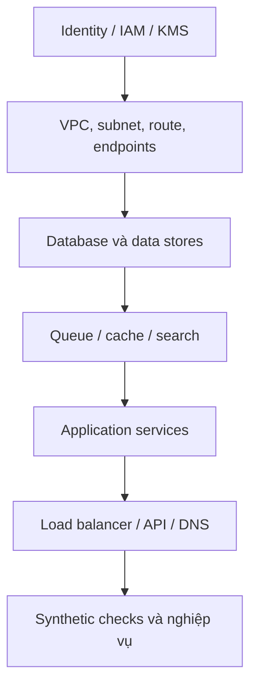

# Runbook DR, game day và đánh giá mục tiêu phục hồi

Một kế hoạch Disaster Recovery (DR) chỉ có giá trị khi đội vận hành có thể thực hiện được trong điều kiện áp lực, với người chịu trách nhiệm rõ ràng, dữ liệu có thể khôi phục và các bước đã được kiểm chứng. Việc bật backup hoặc sao chép dữ liệu sang Region khác mới chỉ là một phần của DR. Khi sự cố xảy ra, tổ chức còn phải quyết định khi nào kích hoạt DR, khôi phục các dependency theo đúng thứ tự, chuyển traffic, xác minh dữ liệu và ứng dụng, rồi đưa hệ thống trở lại trạng thái vận hành ổn định.

Bài học này tập trung vào ba năng lực liên kết với nhau: **runbook DR** mô tả cách ứng phó và khôi phục; **game day** kiểm tra con người, quy trình và kiến trúc trong một kịch bản có kiểm soát; **đánh giá mục tiêu phục hồi** xác nhận RTO/RPO thực tế có đáp ứng yêu cầu nghiệp vụ hay không. Trong module `CLOUD_PROVIDERS_AWS`, các năng lực này sử dụng AWS Backup, Amazon S3, EBS, RDS/Aurora, DynamoDB, AWS Elastic Disaster Recovery, IAM, KMS, Route 53, CloudWatch, AWS Fault Injection Service và các cơ chế hạ tầng dưới dạng mã.

Sau bài học, bạn có thể:

- Phân biệt RTO, RPO, MTPD và thời gian phục hồi thực tế.
- Chọn chiến lược DR phù hợp: backup and restore, pilot light, warm standby hoặc multi-site active/active.
- Thiết kế backup, replication và quyền khôi phục qua account/Region.
- Viết runbook có điều kiện kích hoạt, vai trò, thứ tự phục hồi, tiêu chí kiểm tra và phương án failback.
- Tổ chức game day và fault injection với phạm vi, guardrail và tiêu chí dừng rõ ràng.
- Đo RTO/RPO thực tế, kiểm tra khả năng phục hồi dữ liệu và lập kế hoạch cải tiến.
- Nhận biết các rủi ro như split-brain, thiếu quota, thiếu KMS key, DNS cache và backup không thể restore.

## 1. DR là gì và khi nào cần kích hoạt?

Disaster Recovery là khả năng khôi phục ứng dụng, dữ liệu và hoạt động nghiệp vụ sau một sự cố lớn khiến môi trường chính không còn đáp ứng yêu cầu. Sự cố có thể là:

- Mất khả năng hoạt động của một Availability Zone hoặc Region.
- Lỗi cấu hình làm gián đoạn nhiều dịch vụ hoặc xóa nhầm dữ liệu.
- Ransomware hoặc credential compromise khiến tài nguyên và backup bị đe dọa.
- Lỗi phần mềm hoặc triển khai làm dữ liệu sai lệch trên diện rộng.
- Mất kết nối tới hệ thống on-premises, nhà cung cấp danh tính hoặc dịch vụ bên ngoài.
- Hỏng storage, database hoặc control plane ở phạm vi vượt quá khả năng phục hồi thông thường.

DR thường được nhắc cùng High Availability (HA), nhưng hai mục tiêu khác nhau. HA giảm gián đoạn do lỗi thành phần hoặc hạ tầng bằng cách duy trì các bản sao và chuyển đổi tự động trong kiến trúc đang hoạt động. DR chuẩn bị cho tình huống cần khôi phục ở một môi trường hoặc Region khác, thường có quy trình kích hoạt và xác minh riêng.

Ví dụ, RDS Multi-AZ giúp database duy trì khả năng sẵn sàng trong cùng Region khi một AZ gặp sự cố. Nó không tự tạo một chiến lược DR đầy đủ cho tình huống mất toàn Region, xóa nhầm dữ liệu hoặc bị ransomware. Cần có backup, replication hoặc database recovery strategy ở phạm vi phù hợp.

### 1.1. Sự cố không đồng nghĩa với DR

Không phải mọi cảnh báo đều cần chuyển Region. Một instance hỏng có thể được thay thế bằng Auto Scaling; một task lỗi có thể được ECS tạo lại; một AZ gặp sự cố có thể được load balancer và dịch vụ Multi-AZ xử lý. Kích hoạt DR khi phạm vi và thời gian khôi phục dự kiến vượt quá khả năng của quy trình HA hoặc phương án phục hồi tại chỗ.

Runbook nên phân biệt:

| Tình huống | Phản ứng thường dùng |
|---|---|
| Một instance hoặc container lỗi | Thay thế workload, rollback hoặc self-healing |
| Một AZ mất khả năng phục vụ | Dùng Multi-AZ, chuyển traffic trong Region |
| Database lỗi nhưng còn khả năng khôi phục trong Region | Failover replica, restore/PITR hoặc quy trình database recovery |
| Region chính không còn đáp ứng mục tiêu | Kích hoạt DR Region theo runbook |
| Dữ liệu bị mã hóa/xóa trái phép | Cô lập, xác định mốc sạch, khôi phục từ backup bất biến hoặc bản sao sạch |
| Credential hoặc control plane bị chiếm | Incident response trước; chỉ khôi phục khi quyền và môi trường đã được xác minh |

Điểm quan trọng là quyết định DR dựa trên tác động nghiệp vụ, độ tin cậy của môi trường chính và thời gian khôi phục dự kiến. Chuyển traffic quá sớm có thể đưa người dùng tới môi trường chưa có dữ liệu nhất quán; chuyển quá muộn có thể vi phạm cam kết RTO.

## 2. Xác định RTO, RPO và giới hạn gián đoạn

RTO và RPO là hai mục tiêu cốt lõi để thiết kế DR. Chúng cần được xác định cùng business impact analysis (BIA), dependency map và yêu cầu dữ liệu.

### 2.1. Recovery Time Objective (RTO)

**RTO** là khoảng thời gian gián đoạn tối đa mà tổ chức đặt mục tiêu để khôi phục dịch vụ về mức hoạt động đã định sau sự cố. RTO không chỉ là thời gian khởi động EC2 hoặc restore database. Nó bao gồm phát hiện, ra quyết định, cô lập, cấp phát hạ tầng, phục hồi dữ liệu, triển khai ứng dụng, kiểm tra và chuyển traffic.

Một cách phân rã RTO:

```text
RTO =
  thời gian phát hiện
+ thời gian đánh giá và tuyên bố DR
+ thời gian cô lập / chuẩn bị môi trường
+ thời gian provision hạ tầng
+ thời gian restore hoặc đồng bộ dữ liệu
+ thời gian kiểm thử và xác nhận nghiệp vụ
+ thời gian chuyển traffic
```

Nếu mục tiêu RTO là 60 phút, runbook phải có ngân sách thời gian cho từng bước. Một database restore mất 50 phút sẽ không phù hợp nếu còn cần 20 phút để provision ứng dụng và xác minh.

### 2.2. Recovery Point Objective (RPO)

**RPO** là mức mất dữ liệu tối đa mà nghiệp vụ có thể chấp nhận, được biểu diễn bằng khoảng thời gian tính ngược từ thời điểm sự cố tới điểm dữ liệu nhất quán gần nhất có thể phục hồi.

Ví dụ, RPO 15 phút nghĩa là khi khôi phục, tổ chức chấp nhận mất tối đa khoảng 15 phút thay đổi dữ liệu trước thời điểm sự cố. RPO bằng 0 là yêu cầu rất khó và thường cần thiết kế đồng bộ/commit semantics phù hợp; không nên cam kết RPO 0 chỉ vì có hai bản sao dữ liệu.

RPO thực tế phụ thuộc vào:

- Tần suất backup hoặc snapshot.
- Độ trễ replication.
- Thời gian hoàn tất và khả năng truy cập recovery point.
- Transaction đang chạy và tính nhất quán giữa nhiều datastore.
- Khả năng phát hiện dữ liệu hỏng trước khi bản sao hỏng được replicate.

Lịch backup 15 phút không tự động bảo đảm RPO 15 phút trong mọi tình huống. Backup có thể thất bại, hoàn tất trễ hoặc không chứa transaction đã commit theo kỳ vọng. Cần đo timestamp của recovery point mới nhất có thể restore và xác minh.

### 2.3. MTPD, MAO và thời gian phục hồi thực tế

**Maximum Tolerable Period of Disruption (MTPD)** hoặc **Maximum Acceptable Outage (MAO)** là khoảng thời gian tối đa nghiệp vụ có thể chịu được trước khi hậu quả trở nên không thể chấp nhận. RTO phải nằm trong giới hạn này và nên có buffer cho tình huống xấu hơn dự kiến.

Cần thống nhất cách đo thời gian:

- `T0`: thời điểm dịch vụ thực sự bị gián đoạn hoặc sự cố được xác nhận theo quy ước của tổ chức.
- `Tdeclare`: thời điểm incident commander tuyên bố DR.
- `Trestore`: thời điểm dịch vụ đạt tiêu chí hoạt động đã định.
- `RTO_actual`: khoảng thời gian từ T0 tới Trestore theo cách đo đã thống nhất.
- `RPO_actual`: khoảng cách từ thời điểm sự cố tới timestamp của dữ liệu nhất quán mới nhất đã phục hồi.

Nếu chỉ đo từ lúc bắt đầu restore tới lúc instance chạy, kết quả sẽ thấp hơn thời gian gián đoạn mà người dùng thực sự trải qua. Hãy đo cả thời gian phát hiện và ra quyết định.

### 2.4. Ví dụ xác định mục tiêu

Một dịch vụ xử lý đơn hàng có các yêu cầu:

| Chỉ tiêu | Mục tiêu | Lý do |
|---|---:|---|
| MTPD | 4 giờ | Sau thời gian này, hoạt động xử lý đơn hàng bị ảnh hưởng nghiêm trọng |
| RTO | 60 phút | Cần phục hồi trước khi chạm MTPD, có buffer cho sự cố |
| RPO | 5 phút | Chỉ chấp nhận mất một lượng giao dịch rất nhỏ |
| RTO kiểm thử | 45 phút | Mục tiêu nội bộ thấp hơn RTO để tạo khoảng an toàn |

Để đạt RTO 60 phút, đội vận hành có thể phân bổ: 5 phút xác nhận, 5 phút tuyên bố DR, 5 phút fencing môi trường cũ, 20 phút khôi phục dữ liệu, 10 phút triển khai ứng dụng, 10 phút kiểm tra và 5 phút chuyển traffic. Đây là ngân sách giả định cần được đo trong game day.

Nếu backup chạy mỗi 30 phút, thiết kế đó khó đáp ứng RPO 5 phút nếu không có cơ chế replication hoặc transaction log/PITR phù hợp. Cần thay đổi kiến trúc dữ liệu hoặc điều chỉnh mục tiêu sau khi BIA đánh giá.

## 3. Business Impact Analysis và phân loại ứng dụng

BIA xác định tác động khi một quy trình nghiệp vụ ngừng hoạt động, mức ưu tiên phục hồi, dữ liệu cần bảo vệ và các dependency quan trọng. Không nên đặt cùng RTO/RPO cho mọi ứng dụng trong account.

Với mỗi ứng dụng, thu thập:

- Owner nghiệp vụ và technical owner.
- Quy trình nghiệp vụ được hỗ trợ.
- Người dùng, khu vực và thời gian hoạt động.
- Tác động tài chính, pháp lý, vận hành và uy tín khi gián đoạn.
- Loại dữ liệu, yêu cầu nhất quán và thời hạn lưu trữ.
- Dependency: identity provider, DNS, database, queue, object storage, KMS, network, external API.
- MTPD, RTO, RPO và mức dịch vụ tối thiểu có thể chấp nhận.
- Ràng buộc Region, data residency, compliance và quyền truy cập.
- Phương án thủ công hoặc degraded mode khi chưa thể phục hồi toàn bộ.

### 3.1. Phân tầng mức độ quan trọng

Ví dụ phân loại:

| Tier | Ví dụ | Mục tiêu phục hồi thường thấy |
|---|---|---|
| Tier 0 – Mission critical | Xử lý thanh toán, identity, giao dịch cốt lõi | RTO/RPO rất thấp; có thể cần warm standby hoặc active/active |
| Tier 1 – Business critical | Đơn hàng, inventory, customer portal | RTO thấp tới trung bình; pilot light/warm standby |
| Tier 2 – Important | Báo cáo nội bộ, analytics batch | Có thể chấp nhận RTO/RPO dài hơn; backup and restore |
| Tier 3 – Non-critical | Dev/test, dữ liệu có thể tái tạo | Khôi phục theo nhu cầu và chi phí |

Đây chỉ là mẫu. Một hệ thống analytics có thể trở thành Tier 0 nếu nó phục vụ quyết định an toàn hoặc nghĩa vụ pháp lý. Owner nghiệp vụ cần xác nhận tier và mục tiêu, không chỉ đội hạ tầng.

### 3.2. Xây dựng dependency map

Một ứng dụng có thể khôi phục thành công ở lớp compute nhưng vẫn không hoạt động nếu thiếu DNS, KMS, secret, IAM role, database schema, message queue hoặc kết nối đối tác. Dependency map cần thể hiện cả thứ tự khởi động và điểm lỗi chung.

Ví dụ:



Thứ tự cụ thể tùy kiến trúc. Có hệ thống cần DNS và identity trước khi restore; có hệ thống cần database sẵn sàng trước application. Runbook phải dựa trên dependency thực tế và kiểm thử thứ tự này.

## 4. Chọn chiến lược DR phù hợp

AWS thường được mô tả với bốn chiến lược DR chính. Chiến lược càng sẵn sàng trước thì RTO/RPO có thể càng thấp, nhưng chi phí và độ phức tạp thường cao hơn.

| Chiến lược | Cách chuẩn bị | RTO/RPO tương đối | Chi phí và độ phức tạp |
|---|---|---|---|
| Backup and restore | Backup dữ liệu/cấu hình; dựng hạ tầng khi sự cố | Cao hơn | Thấp hơn |
| Pilot light | Duy trì phần lõi và bản sao dữ liệu ở DR Region; scale compute khi cần | Trung bình | Trung bình |
| Warm standby | Môi trường DR chạy sẵn ở quy mô nhỏ | Thấp hơn | Cao hơn |
| Multi-site active/active | Nhiều Region cùng phục vụ traffic | Thấp nhất khi thiết kế tốt | Cao nhất |

Không có chiến lược tốt nhất cho mọi ứng dụng. Chọn dựa trên RTO/RPO, MTPD, chi phí downtime, độ phức tạp dữ liệu, khả năng vận hành và năng lực đội ngũ.

### 4.1. Backup and restore

Ở chiến lược này, tổ chức lưu backup ở nơi độc lập, sau đó tạo hạ tầng và restore khi DR được tuyên bố.

Phù hợp khi:
- Nghiệp vụ chấp nhận RTO từ vài giờ trở lên.
- Dữ liệu có thể khôi phục từ snapshot/backup.
- Hạ tầng có thể tạo lại bằng Infrastructure as Code.
- Chi phí duy trì môi trường DR luôn chạy không hợp lý.

Cần chuẩn bị:
- Backup theo lịch và copy sang Region/account khác.
- Hạ tầng dưới dạng mã, image, cấu hình, DNS và secret.
- IAM role có quyền restore nhưng được bảo vệ.
- Quota, IP, subnet, KMS key và capacity ở Region đích.
- Runbook restore dữ liệu và kiểm thử định kỳ.

Rủi ro chính là thời gian dựng hạ tầng, tải dữ liệu và cấu hình thủ công bị kéo dài. Nếu chỉ có backup mà chưa từng restore thử, tổ chức chưa có bằng chứng rằng chiến lược hoạt động.

### 4.2. Pilot light

Pilot light duy trì các thành phần cốt lõi ở DR Region, thường là dữ liệu được replicate hoặc backup định kỳ cùng một phần hạ tầng tối thiểu. Khi sự cố, đội vận hành mở rộng compute, triển khai service và chuyển traffic.

Phù hợp khi:
- Cần RTO thấp hơn backup and restore.
- Có thể duy trì data replication nhưng không cần full compute capacity.
- Hạ tầng có thể scale nhanh qua IaC/automation.

Cần kiểm tra:
- Database replica hoặc recovery point có theo kịp RPO không.
- Image, container, config và secret có sẵn ở Region đích không.
- Service quota và capacity đủ để scale.
- Dependency như queue, cache, identity và endpoint đã sẵn sàng.
- Runbook có thể chuyển replica thành writer hoặc promote database đúng cách.

### 4.3. Warm standby

Warm standby là bản sao của workload đang chạy ở DR Region nhưng có thể ở quy mô nhỏ hơn. Khi DR, hệ thống scale lên và chuyển traffic.

Ưu điểm:
- Hạ tầng, ứng dụng và dependency đã chạy, giảm thời gian provision.
- Có thể thực hiện health check và synthetic test thường xuyên.
- Dễ đo RTO hơn so với dựng toàn bộ từ đầu.

Thách thức:
- Phải giữ cấu hình hai Region tương thích.
- Chi phí compute, database, network và license cao hơn pilot light.
- Cần quản lý dữ liệu, queue, scheduled job và background worker để tránh xử lý trùng.
- Phải kiểm soát split-brain khi cả primary và standby cùng nhận ghi.

### 4.4. Multi-site active/active

Trong active/active, nhiều Region cùng phục vụ traffic. Một Region lỗi, traffic được định tuyến sang Region còn hoạt động. Cách này có thể giảm thời gian gián đoạn, nhưng đòi hỏi thiết kế dữ liệu và ứng dụng chịu lỗi phân tán.

Cần giải quyết:
- Data replication và conflict resolution.
- Idempotency, ordering và duplicate message.
- Session state và cache.
- Global routing, health check và traffic weighting.
- Consistency, latency và data residency.
- Quy trình xử lý khi hai Region mất liên lạc hoặc có partition.

Active/active không tự động bảo đảm RPO 0. Nếu dữ liệu được replicate bất đồng bộ, vẫn có thể mất hoặc xung đột các write gần thời điểm sự cố. Thiết kế cần định nghĩa rõ consistency model và hành vi khi một Region bị cô lập.

## 5. Phân biệt backup, replication và high availability

Ba khái niệm thường bị nhầm:

- **Backup** tạo recovery point để phục hồi dữ liệu ở một thời điểm trước đó.
- **Replication** sao chép thay đổi sang một vị trí khác, thường với độ trễ nhất định.
- **High availability** duy trì khả năng phục vụ khi một thành phần hoặc AZ gặp lỗi.

Replication có thể sao chép cả dữ liệu bị xóa nhầm, mã hóa bởi ransomware hoặc ghi sai. Backup có thể giữ lại recovery point sạch nếu được bảo vệ khỏi thao tác xóa/sửa và có retention phù hợp. HA có thể chuyển sang bản sao đã đồng bộ lỗi logic, vì vậy HA không thay thế backup.

Một chiến lược DR tốt thường kết hợp:
- HA cho lỗi thành phần/AZ.
- Replication cho RPO thấp và phục hồi nhanh.
- Backup bất biến/độc lập để khôi phục sau lỗi logic hoặc compromise.
- IaC và image chuẩn để dựng lại compute/network.
- Game day và restore test để chứng minh toàn bộ chuỗi hoạt động.

## 6. Thiết kế backup và bảo vệ recovery point trên AWS

AWS Backup cung cấp dịch vụ quản lý backup tập trung cho nhiều AWS resource. Có thể định nghĩa backup plan, schedule, lifecycle, backup vault, copy action và policy theo account/Region.

### 6.1. Backup plan và vault

Một backup plan nên xác định:

- Resource selection bằng tag hoặc resource ARN.
- Tần suất backup và cửa sổ thực hiện.
- Retention period.
- Lifecycle chuyển sang cold storage nếu loại resource hỗ trợ.
- Copy action sang Region khác hoặc account khác.
- Backup vault và encryption key.
- Owner, application tier và policy compliance.

Backup vault là nơi lưu recovery point. Có thể tách vault theo môi trường, mức độ nhạy cảm hoặc yêu cầu retention. Hạn chế quyền xóa recovery point và thay đổi backup plan; quyền tạo backup, restore và xóa backup nên được phân tách.

### 6.2. Cross-account và cross-Region backup

Backup trong cùng account có thể không đủ nếu attacker chiếm account và có quyền xóa cả production lẫn backup. Nên xem xét:

- Copy recovery point sang backup account riêng.
- Copy sang Region khác để chống mất Region.
- Dùng AWS Organizations và backup policies để áp dụng chuẩn.
- Dùng IAM role riêng cho backup/restore.
- Tách quyền quản trị production khỏi backup vault.
- Bảo vệ destination vault bằng Vault Lock hoặc cơ chế retention tương ứng.

Khi copy backup cross-account, cần cấu hình quyền và encryption key ở destination. Không phải mọi resource type đều hỗ trợ cùng cách copy hoặc cùng tùy chọn. Hãy kiểm tra khả năng hỗ trợ, Region, service và loại backup cụ thể trước khi chọn kiến trúc.

### 6.3. AWS Backup Vault Lock

AWS Backup Vault Lock giúp áp dụng chính sách WORM (write once, read many) cho recovery point. Vault Lock có chế độ governance và compliance với hành vi kiểm soát khác nhau.

- Governance mode cho phép principal có quyền phù hợp thay đổi hoặc gỡ cấu hình theo điều kiện dịch vụ.
- Compliance mode có grace period; sau khi lock settings được cố định và grace period kết thúc, các thiết lập bảo vệ không thể được thay đổi để xóa recovery point trước hạn retention theo cơ chế Vault Lock.

Cần thử nghiệm thời hạn tối thiểu/tối đa, retention và quy trình restore trước khi khóa compliance trong production. Vault Lock bảo vệ recovery point theo phạm vi cấu hình; nó không tự bảo đảm ứng dụng có thể restore, key giải mã còn tồn tại hoặc Region đích có đủ quota.

### 6.4. Bảo vệ backup khỏi ransomware

Một số nguyên tắc:
- Dùng backup account riêng với quyền truy cập giới hạn.
- Bật MFA và yêu cầu phê duyệt cho thao tác nhạy cảm.
- Hạn chế quyền `backup:DeleteRecoveryPoint`, xóa vault và thay retention.
- Bảo vệ CloudTrail và audit logs ở account độc lập.
- Dùng Vault Lock hoặc Object Lock khi phù hợp.
- Kiểm tra backup integrity và khả năng restore.
- Duy trì bản sao sạch trước thời điểm compromise; tránh chỉ giữ bản backup mới nhất.
- Định nghĩa quy trình cô lập trước khi restore để tránh đưa malware trở lại.

## 7. Mẫu DR theo từng dịch vụ AWS

DR không thể chỉ thiết kế ở cấp EC2. Mỗi dịch vụ dữ liệu và compute có cách backup, replication và restore riêng.

| Dịch vụ | Cơ chế bảo vệ/DR thường dùng | Điểm cần kiểm tra |
|---|---|---|
| EC2/EBS | AMI, EBS snapshots, AWS Backup, copy snapshot cross-Region | KMS key đích, boot mode, ENI/SG, quota, user data |
| Amazon S3 | Versioning, replication, AWS Backup, Object Lock | Delete marker, version recovery, replication status, bucket policy |
| RDS | Automated backups, snapshots, point-in-time recovery, cross-Region snapshot/backup copy khi engine hỗ trợ | Engine/version, parameter group, option group, KMS, endpoint |
| Aurora | Automated backup/PITR, cross-Region read replica hoặc Global Database | Promotion, writer endpoint, lag, failover order |
| DynamoDB | Point-in-time recovery, on-demand backup, Global Tables | Region replication, conflict behavior, IAM, stream/consumer |
| EFS | AWS Backup, replication phù hợp với use case | Destination file system, mount target, access point, POSIX permissions |
| FSx | Backup và replication/DR option theo loại FSx | Engine-specific recovery, throughput, DNS, client remount |
| Secrets Manager | Secret replication sang Region khác | KMS key, resource policy, rotation và consumer |
| ECR | Cross-Region/cross-account replication | Image digest, repository policy, lifecycle rule |
| SQS/SNS | IaC recreation, message archival/republish hoặc kiến trúc multi-Region | Queue ARN, redrive policy, duplicate handling, subscriptions |
| Route 53 | Health check, failover/weighted routing, ARC routing controls | TTL, record ownership, health signal và failback |
| KMS | Key policy, grants và key phù hợp ở Region đích | Region scope, key availability, permission để decrypt/restore |

### 7.1. EC2 và EBS

EBS snapshot là bản sao point-in-time của volume. Snapshot được lưu incremental; có thể copy sang Region khác. AMI giúp chuẩn hóa image và cấu hình khởi chạy. Khi khôi phục, cần chuẩn bị:

- Instance type có sẵn ở Region đích.
- VPC, subnet, route, SG và network interface.
- IAM instance profile và quyền SSM.
- KMS key dùng để mã hóa volume ở Region đích.
- EBS volume type, throughput/IOPS và quota.
- DNS, load balancer target và application config.

Snapshot không lưu mọi trạng thái runtime trong RAM. Nếu ứng dụng cần consistency giữa nhiều volume, cần phối hợp freeze/quiesce hoặc cơ chế backup application-aware.

### 7.2. S3

S3 Versioning giúp lưu nhiều phiên bản object và phục hồi khi object bị ghi đè hoặc xóa. Replication có thể sao chép object sang bucket ở Region/account khác; Object Lock hỗ trợ bảo vệ object theo retention/legal hold.

Replication không tự thay thế backup. Nếu thao tác xóa hoặc nội dung bị hỏng được replicate theo cấu hình, bản sao đích có thể cũng bị ảnh hưởng. Kết hợp versioning, retention, Object Lock và quyền quản trị tách biệt để bảo vệ recovery point.

### 7.3. RDS và Aurora

RDS automated backups hỗ trợ point-in-time recovery trong retention window. Có thể copy snapshot sang Region khác hoặc cấu hình cross-Region automated backup replication với engine/phiên bản được hỗ trợ. Khi restore, cần tạo database mới từ snapshot/PITR và kiểm tra parameter group, option group, subnet group, SG, KMS key và endpoint.

Aurora có các lựa chọn như cross-Region read replica và Aurora Global Database. Khi promote secondary Region, cần xác minh replication lag và trạng thái writer. Cập nhật connection string, secret và DNS theo runbook. RDS Multi-AZ chủ yếu tăng HA trong Region; đừng xem nó là phương án duy nhất cho regional DR.

### 7.4. DynamoDB

DynamoDB PITR hỗ trợ khôi phục table về thời điểm trong cửa sổ được hỗ trợ. On-demand backup tạo recovery point. Global Tables cung cấp replication đa Region cho use case multi-Region, nhưng cần hiểu cách xử lý conflict và eventual consistency của kiến trúc.

Nếu một thao tác xóa hoặc ghi sai được replicate, các Region khác có thể nhận thay đổi đó. Để chống lỗi logic hoặc compromise, kết hợp PITR/backup và quyền quản trị độc lập.

### 7.5. KMS và Secrets Manager

Backup được mã hóa cần có key mà quá trình restore có thể sử dụng. KMS key thông thường có phạm vi Region; khi copy recovery point sang Region khác, cần dùng key hợp lệ tại destination theo yêu cầu của dịch vụ. Multi-Region KMS key có thể giúp một số use case nhưng không làm mọi resource hoặc backup tự động dùng chung key.

Kiểm tra:
- Key destination còn Enabled và không Pending deletion.
- Key policy cho phép backup/restore role.
- Grant hoặc resource policy cần thiết.
- Secret đã được replicate hoặc có thể tạo lại an toàn.
- Ứng dụng có quyền đọc secret ở DR Region.
- Private CA/certificate và trust chain có sẵn khi cần.

Thiếu KMS key hoặc quyền decrypt là nguyên nhân phổ biến khiến recovery point tồn tại nhưng không thể restore.

## 8. Hạ tầng DR dưới dạng mã và chuẩn bị Region đích

Infrastructure as Code (IaC) giúp dựng lại hạ tầng có thể lặp lại và review được. Có thể dùng CloudFormation, CDK hoặc Terraform tùy quy trình của tổ chức.

Một DR baseline thường cần:
- VPC, subnet, route table, NAT/egress, endpoints và firewall.
- Security group, NACL và network ACL rules.
- IAM roles, trust policy, permissions boundary và break-glass access.
- KMS keys, aliases, key policy và grants.
- Load balancer, target group, listener và certificates.
- Database subnet group, parameter group, option group và secret.
- Compute cluster, service, task definition, launch template và Auto Scaling.
- Queue, topic, event source mapping và dead-letter queue.
- Monitoring, log destination, alarm, dashboard và alert routing.
- DNS record, health check, ARC routing control và certificate.
- Quota request, capacity reservation hoặc kế hoạch chọn instance type thay thế.

### 8.1. Tránh phụ thuộc vào resource ID cố định

Một số ID như subnet, security group, KMS key và ARN khác nhau giữa Region hoặc account. Hãy dùng output/parameter, mapping và naming convention rõ ràng. Tránh hardcode resource ID của primary Region trong image hoặc application config.

### 8.2. Quota và capacity

DR Region có thể không có đủ service quota hoặc capacity tại thời điểm sự cố. Kiểm tra trước:
- EC2 vCPU và instance family quota.
- Elastic IP, VPC, ENI, NAT Gateway và load balancer quota.
- RDS instance class, storage và cluster quota.
- EKS/ECS capacity, subnet IP address và ENI limits.
- EBS volume/snapshot và throughput quota.
- API throttling, account-level service limits và reserved concurrency.

Game day cần thử scale tới mức tải thực tế cần thiết, không chỉ kiểm tra một instance nhỏ. Nếu cần capacity bảo đảm, xem xét capacity reservation hoặc phương án instance family/size thay thế.

### 8.3. Chuẩn bị access và control plane

Runbook cần có một đường truy cập DR độc lập với identity system có thể bị ảnh hưởng. Ví dụ, break-glass role được bảo vệ bằng MFA, quyền tối thiểu, logging và quy trình phê duyệt. Không lưu access key khẩn cấp dạng plaintext trong tài liệu runbook.

Đảm bảo operator có quyền vào backup account và DR Region nhưng không thể tùy tiện xóa recovery point. Kiểm tra SCP, permission boundary, KMS key policy và trust policy không vô tình chặn hành động khôi phục.

## 9. Thiết kế runbook DR

Runbook là hướng dẫn vận hành có thể thực hiện được trong sự cố. Một runbook tốt không chỉ mô tả kiến trúc; nó phải cho biết ai làm gì, khi nào, với đầu vào nào, kết quả mong đợi ra sao và điều kiện dừng là gì.

### 9.1. Thành phần bắt buộc

| Thành phần | Nội dung |
|---|---|
| Mục tiêu | Ứng dụng, account, Region, tier và RTO/RPO |
| Điều kiện kích hoạt | Ngưỡng outage, lỗi Region, data corruption hoặc quyết định incident commander |
| Vai trò | Incident commander, DR lead, data owner, network, security, application, communications |
| Quyền truy cập | AWS account, role, MFA, break-glass, console/CLI profile |
| Dependency | DNS, IAM, KMS, secret, network, database, queue, compute, external provider |
| Recovery point | Vault, backup ARN, snapshot, timestamp và retention |
| Các bước thực hiện | Thứ tự restore, promotion, deployment, traffic shift |
| Kiểm tra | Health check, synthetic transaction, data consistency, security validation |
| Rollback/failback | Điều kiện, thứ tự và người phê duyệt |
| Liên lạc | Incident channel, stakeholder, customer update và escalation |
| Bằng chứng | Timeline, command output, event ID, approval và kết quả |

Mỗi bước nên có:
- Owner/role thực hiện.
- Preconditions.
- Lệnh hoặc thao tác cụ thể.
- Expected result.
- Cách xác minh.
- Thời gian dự kiến.
- Điều kiện dừng/escalation.
- Cách xử lý nếu thất bại.

### 9.2. Vai trò trong DR

Ví dụ mô hình trách nhiệm:

| Vai trò | Trách nhiệm |
|---|---|
| Incident Commander | Tuyên bố sự cố/DR, ưu tiên, quyết định failover/failback và truyền thông |
| DR Lead | Điều phối runbook, theo dõi RTO/RPO và dependency |
| Cloud Platform Lead | Network, IAM, compute, quota và IaC |
| Data Lead | Chọn recovery point, restore/promote database, xác minh consistency |
| Security Lead | Credential, KMS, log, evidence, clean-room và access approval |
| Application Lead | Deploy, config, health check và synthetic transaction |
| Business Owner | Xác nhận nghiệp vụ, mức dữ liệu chấp nhận và mở lại dịch vụ |
| Communications Lead | Cập nhật trạng thái cho người dùng, đối tác và quản lý |

Trong nhóm nhỏ, một người có thể giữ nhiều vai trò, nhưng quyền quyết định và xác minh nên được phân tách khi có thể.

### 9.3. Điều kiện kích hoạt DR

Định nghĩa tiêu chí khách quan, ví dụ:
- Primary Region mất khả năng phục vụ vượt ngưỡng thời gian.
- Nhiều AZ hoặc dependency quan trọng không thể phục hồi trong RTO.
- Có bằng chứng compromise khiến primary không còn đáng tin.
- Data corruption đã lan tới replica và cần restore từ recovery point sạch.
- Incident commander và business owner xác nhận tác động vượt ngưỡng.

Không kích hoạt chỉ dựa trên một alarm đơn lẻ. Kết hợp health signal, telemetry, AWS Health, service status, synthetic test và đánh giá nghiệp vụ. Với ransomware, cần security clearance trước khi mở DR environment.

## 10. Runbook failover từng bước

Thứ tự phụ thuộc kiến trúc, nhưng một trình tự phổ biến như sau.

### Bước 1 — Declare và mở incident

- Tạo incident ID và ghi T0 theo quy ước.
- Xác nhận primary Region, ứng dụng, account và phạm vi ảnh hưởng.
- Incident commander tuyên bố DR và ghi quyết định.
- Phân công DR lead, data lead, platform, security, application và communications.
- Ghi RTO/RPO mục tiêu và thời hạn quyết định tiếp theo.

### Bước 2 — Bảo vệ môi trường và xác định recovery point

- Kiểm tra primary có còn nhận write không.
- Nếu nghi ngờ compromise/corruption, cô lập nguồn gây hại và ngăn propagation.
- Chọn recovery point sạch theo timestamp, không chỉ chọn bản mới nhất.
- Xác minh backup vault, Region/account, KMS key và quyền restore.
- Ghi nhận data loss window dự kiến so với RPO.

### Bước 3 — Fence primary để tránh split-brain

Split-brain xảy ra khi primary và DR Region cùng nhận ghi cho một hệ thống dữ liệu vốn chỉ cho phép một writer. Điều này có thể tạo hai lịch sử giao dịch không thể hợp nhất.

Trước khi promote database hoặc mở traffic ghi ở DR:
- Ngăn primary nhận write hoặc xác minh primary đã thực sự unavailable.
- Tắt scheduled jobs, consumers và worker có thể xử lý cùng message ở cả hai nơi.
- Thu hồi/giới hạn credential của primary nếu nghi ngờ compromise.
- Ghi lại thời điểm fencing và bằng chứng xác minh.

Không dựa duy nhất vào DNS để fence primary; DNS cache có thể giữ đường cũ. Fencing cần được thực hiện ở database, network, application hoặc quyền write tùy kiến trúc.

### Bước 4 — Chuẩn bị nền tảng ở DR Region

- Xác minh VPC, subnet, route, endpoints và security controls.
- Kiểm tra IAM role, KMS key, secret và certificate.
- Xác nhận quota/capacity.
- Deploy hạ tầng từ IaC đã review.
- Khởi tạo monitoring, logging, alarm và alert routing.
- Xác minh operator có thể quản trị DR Region.

### Bước 5 — Restore hoặc promote dữ liệu

- Chọn snapshot/PITR/replica theo RPO và tình trạng dữ liệu.
- Restore database hoặc promote replica theo hướng dẫn dịch vụ.
- Khôi phục object/file cần thiết.
- Đồng bộ secret, key, schema và migration.
- Khởi tạo queue/stream và quyết định cách xử lý message đang chờ.
- Xác minh timestamp, record count, transaction marker và consistency.

Không cho ứng dụng ghi dữ liệu production vào database DR trước khi data lead xác nhận trạng thái writer và recovery point.

### Bước 6 — Khôi phục ứng dụng và dependency

- Deploy container/image hoặc EC2 từ artifact đã kiểm chứng.
- Cấu hình endpoint database, secret và service discovery.
- Khởi động queue consumers, scheduled jobs và background workers theo thứ tự.
- Kiểm tra KMS decrypt, IAM access và external dependency.
- Xác minh certificate, TLS, DNS và load balancer target.
- Chạy health check nội bộ và synthetic transaction.

### Bước 7 — Chuyển traffic

Tùy kiến trúc:
- Cập nhật Route 53 failover/weighted record.
- Dùng Route 53 Application Recovery Controller routing controls nếu đã thiết kế.
- Cập nhật CloudFront origin hoặc API endpoint nếu cần.
- Thực hiện traffic shift từng phần khi có thể.
- Kiểm tra TTL, resolver cache và DNS propagation.
- Giữ phương án quay lại nếu health check hoặc error rate vượt ngưỡng.

### Bước 8 — Xác nhận nghiệp vụ và theo dõi

- Business owner chạy giao dịch thử.
- Data lead xác minh dữ liệu và transaction sequence.
- Security lead xác nhận quyền, log và security controls.
- Application lead theo dõi error rate, latency, queue depth và saturation.
- Communications lead thông báo trạng thái đã phục hồi.
- Ghi RTO_actual, RPO_actual, điểm dữ liệu phục hồi và mọi sai lệch.

## 11. Failback: trở về Region chính

Failback là quá trình đưa dịch vụ từ DR Region trở về primary Region sau khi môi trường chính đã được sửa và kiểm chứng. Failback không đơn giản là đổi DNS về record cũ.

Trước failback:
- Xác định nguyên nhân khiến primary hỏng đã được khắc phục.
- Bảo đảm primary không còn bị compromise hoặc data corruption.
- Chọn hướng đồng bộ dữ liệu từ DR về primary.
- Kiểm tra replication lag và consistency.
- Chuẩn bị backup recovery point trước chuyển đổi.
- Xác định thời gian write freeze hoặc phương án chuyển writer.
- Phê duyệt bởi incident commander, data owner và business owner.

Trình tự tham khảo:
1. Provision lại primary từ IaC đã review.
2. Đồng bộ dữ liệu từ DR về primary bằng cơ chế được hỗ trợ.
3. Kiểm tra schema, transaction, sequence, object và queue.
4. Dừng hoặc pause write trong khoảng chuyển đổi theo kế hoạch.
5. Fence DR writer, promote primary writer và xác minh chỉ còn một writer.
6. Chuyển traffic theo từng bước.
7. Theo dõi lỗi, replication và dữ liệu.
8. Chỉ gỡ DR environment khi retention, backup và business owner cho phép.

Với hệ thống active/active, failback cần xử lý conflict và routing control theo thiết kế. Không tắt Region đang phục vụ trước khi chắc chắn Region còn lại có đủ capacity và dữ liệu nhất quán.

## 12. DNS, routing và traffic control

DNS thường là bước nhìn thấy rõ nhất trong failover, nhưng nó không phải toàn bộ cơ chế DR.

Route 53 có thể dùng:
- Failover routing với primary/secondary record.
- Weighted routing để chuyển một tỷ lệ traffic.
- Latency-based routing cho nhiều Region.
- Health check để đánh giá endpoint.
- Application Recovery Controller routing controls cho điều phối có kiểm soát trong kiến trúc hỗ trợ.

Cần lưu ý:
- TTL chỉ ảnh hưởng thời gian cache DNS, không bảo đảm mọi client cập nhật ngay.
- Resolver, browser, proxy và ứng dụng có thể cache DNS lâu hơn dự kiến.
- Health check có thể false positive/negative nếu chỉ kiểm tra một endpoint.
- DNS không fence writer hoặc thu hồi session đang mở.
- Certificate, WAF, CDN, API client và allowlist đối tác có thể cần cập nhật.
- Một số client lưu IP hoặc endpoint trong cấu hình; cần xác minh cách họ chuyển vùng.

Khi dùng ARC routing controls, cần thiết kế safety rules và kiểm soát quyền thay đổi control state. Game day phải kiểm tra cả trường hợp operator mất quyền hoặc control plane chính không sẵn sàng.

## 13. RTO/RPO theo dõi bằng chỉ số và bằng chứng

Đánh giá DR cần số liệu đo được, không chỉ trạng thái “backup successful” hoặc “service running”.

### 13.1. Chỉ số kỹ thuật

| Chỉ số | Cách đo | Mục đích |
|---|---|---|
| RTO target vs actual | Thời gian từ T0 đến dịch vụ đạt tiêu chí phục hồi | Kiểm tra cam kết downtime |
| RPO target vs actual | Khoảng cách từ T0 tới timestamp dữ liệu nhất quán mới nhất đã phục hồi | Kiểm tra mức mất dữ liệu |
| Backup success rate | Số job thành công / tổng job trong kỳ | Độ tin cậy backup |
| Restore test success rate | Số lần restore đạt / tổng lần thử | Khả năng sử dụng recovery point |
| Backup age | Thời gian từ recovery point mới nhất tới hiện tại | Phát hiện backup stale |
| Replication lag | Độ trễ dữ liệu giữa primary và secondary | Kiểm soát RPO |
| Failover completion rate | Số bước/đợt failover thành công | Độ lặp lại của runbook |
| Data validation result | Kiểm tra count, checksum, transaction và business invariant | Tính toàn vẹn dữ liệu |
| Recovery capacity | Tải thực tế DR Region xử lý được | Khả năng đáp ứng khi failover |
| Runbook step duration | Thời gian mỗi bước | Tìm bottleneck |

### 13.2. Đo RPO bằng dữ liệu

Ví dụ, sự cố xảy ra lúc 10:00 UTC. Sau restore, transaction marker cuối cùng được xác nhận nhất quán có timestamp 09:57 UTC. Khi đó RPO_actual là khoảng 3 phút. Nếu mục tiêu là 5 phút, lần thử đạt RPO.

Không chỉ so timestamp của backup job. Cần xác minh dữ liệu đã commit, các bảng liên quan và message queue có cùng mốc logic. Với hệ thống phân tán, có thể cần transaction ID, sequence number hoặc business reconciliation.

### 13.3. Đo RTO bằng service criterion

Ví dụ, DR được tuyên bố lúc 10:05 UTC, nhưng dịch vụ chỉ xử lý thành công giao dịch nghiệp vụ đầu tiên lúc 10:52 UTC. Nếu T0 được xác định là 10:00 UTC, RTO_actual là 52 phút, không phải 47 phút tính từ lúc tuyên bố DR.

Tổ chức cần định nghĩa rõ “phục hồi” nghĩa là:
- Endpoint trả HTTP 200?
- Database nhận kết nối?
- Người dùng đăng nhập được?
- Giao dịch đầu cuối hoàn tất và dữ liệu nhất quán?
- Tất cả background worker và downstream dependency hoạt động?

Với ứng dụng nghiệp vụ, nên dùng tiêu chí end-to-end thay vì chỉ health endpoint.

## 14. Game day là gì?

Game day là bài diễn tập có kế hoạch nhằm kiểm tra khả năng ứng phó với một tình huống lỗi thực tế. Nó có thể là tabletop exercise, mô phỏng quy trình, failover thử nghiệm hoặc fault injection trên hạ tầng.

Mục tiêu:
- Kiểm tra runbook có đủ rõ để operator thực hiện.
- Xác minh quyền, backup, KMS, quota và dependency.
- Đo RTO/RPO thực tế.
- Phát hiện bước thủ công, thiếu automation hoặc thiếu owner.
- Kiểm tra communication và quyết định của incident commander.
- Xác định rủi ro chưa được phát hiện trong thiết kế.

Game day không phải cuộc thi tìm lỗi hay hoạt động gây bất ngờ không kiểm soát. Người tham gia cần biết phạm vi, tiêu chí dừng và người có quyền abort. Với bài tập production, cần change approval, customer impact assessment và rollback plan.

### 14.1. Các cấp độ diễn tập

| Loại | Cách thực hiện | Phạm vi rủi ro |
|---|---|---|
| Tabletop | Thảo luận kịch bản và quyết định dựa trên runbook | Rất thấp |
| Simulation | Dùng môi trường test hoặc mock service để thực hiện các bước | Thấp |
| Component recovery | Restore database, snapshot hoặc workload riêng | Trung bình |
| Regional failover exercise | Chuyển ứng dụng thử nghiệm sang DR Region | Cao hơn |
| Fault injection | Tạo lỗi có chủ đích bằng AWS FIS hoặc công cụ tương ứng | Tùy action và blast radius |

Nên bắt đầu từ tabletop và component restore, sau đó tăng dần tới failover tích hợp. Không nên lần đầu thử khôi phục toàn Region trong một sự cố production.

## 15. Thiết kế một game day an toàn

Một game day cần có charter và kế hoạch rõ ràng.

### 15.1. Xác định mục tiêu và giả thuyết

Ví dụ:
- Mục tiêu: xác minh ứng dụng đơn hàng đáp ứng RTO 60 phút và RPO 5 phút khi primary Region không khả dụng.
- Giả thuyết: đội có thể restore database, deploy API ở DR Region và chuyển traffic trong 60 phút.
- Phạm vi: staging account, một ứng dụng và các dependency đã chọn.
- Ngoài phạm vi: hệ thống thanh toán thật và dữ liệu khách hàng production.

Giả thuyết cần có kết quả có thể đo. “Kiểm tra DR hoạt động” quá chung; “khôi phục 95% request thành công trong 60 phút và không mất quá 5 phút giao dịch đã xác nhận” rõ hơn.

### 15.2. Chuẩn bị safety controls

Trước khi diễn tập:
- Chỉ định game day lead và safety officer.
- Chọn account/Region/resource cụ thể.
- Ghi rõ action được phép và action bị cấm.
- Thiết lập stop conditions và abort mechanism.
- Xác minh backup gần nhất, restore point và rollback.
- Kiểm tra service quota, IAM role và KMS key.
- Thông báo các team phụ thuộc và người quan sát.
- Chuẩn bị dashboard, log query và đồng hồ đo thời gian.
- Xác định dữ liệu test và tiêu chí consistency.
- Xác minh không có thay đổi production ngoài kế hoạch.

### 15.3. Stop conditions

Dừng ngay thí nghiệm nếu:
- Customer impact vượt ngưỡng đã phê duyệt.
- Có dấu hiệu mất dữ liệu ngoài RPO cho phép.
- Một resource ngoài phạm vi bị ảnh hưởng.
- Logging/monitoring mất khả năng quan sát.
- Automation không thể rollback hoặc operator mất quyền kiểm soát.
- Primary và DR cùng nhận write ngoài thiết kế.
- Chi phí hoặc capacity vượt giới hạn.
- Security lead phát hiện credential hoặc dữ liệu nhạy cảm bị lộ.

Stop condition phải được tự động hóa khi có thể, chẳng hạn CloudWatch alarm làm dừng FIS experiment. Với tình huống cần con người đánh giá, safety officer phải có quyền dừng mà không cần chờ phê duyệt nhiều cấp.

## 16. AWS Fault Injection Service trong game day

AWS Fault Injection Service (AWS FIS) giúp tạo controlled experiments trên tài nguyên AWS để kiểm tra khả năng phục hồi. FIS dùng experiment template, IAM role, action, target, stop condition và log.

Các bước khái quát:
1. Xác định giả thuyết và phạm vi.
2. Chọn resource target bằng tag hoặc resource ID đã kiểm soát.
3. Chọn action được hỗ trợ cho service và loại lỗi cần mô phỏng.
4. Tạo IAM role với quyền tối thiểu để FIS thực hiện action.
5. Thiết lập stop condition bằng CloudWatch alarm.
6. Cấu hình experiment duration, action order và rollback nếu hỗ trợ.
7. Review template và phê duyệt.
8. Chạy trong môi trường an toàn.
9. Quan sát, dừng nếu vượt ngưỡng và thu thập kết quả.

FIS có thể thực hiện các action làm gián đoạn tài nguyên. Hãy đọc kỹ phạm vi action, target selection và yêu cầu của dịch vụ trước khi chạy. Không chọn tag quá rộng như `Environment=production` nếu template có thể tác động tới nhiều ứng dụng.

FIS không thay thế game day toàn diện. Một thí nghiệm có thể làm mất kết nối hoặc dừng instance, nhưng không tự kiểm tra incident commander có ra quyết định đúng, data owner có xác nhận recovery point hay customer communication có hoạt động.

## 17. Kịch bản game day mẫu

### Kịch bản A — Mất một AZ

**Mục tiêu:** xác minh HA trong Region.

- Tạo lỗi hoặc mô phỏng mất khả năng của một AZ trong môi trường test.
- Kiểm tra load balancer, Auto Scaling, database Multi-AZ và service scheduler.
- Đo thời gian chuyển đổi và error rate.
- Xác minh không cần kích hoạt regional DR nếu HA đáp ứng.
- Ghi các dependency vẫn phụ thuộc AZ bị ảnh hưởng.

### Kịch bản B — Mất primary Region

**Mục tiêu:** kiểm tra regional failover.

- Giả lập primary Region không phục vụ.
- Incident commander kích hoạt runbook.
- Fence primary theo kịch bản.
- Restore/promote dữ liệu ở DR Region.
- Deploy workload và xác minh KMS/secret/IAM.
- Chuyển traffic thử nghiệm.
- Chạy synthetic transaction và đối chiếu dữ liệu.
- Ghi RTO/RPO thực tế.

### Kịch bản C — Ransomware hoặc xóa nhầm dữ liệu

**Mục tiêu:** xác minh có thể phục hồi từ recovery point sạch.

- Chọn một dataset test và tạo thay đổi giả lập.
- Xác định mốc trước sự cố.
- Restore vào isolated recovery environment.
- Kiểm tra malware/integrity và data reconciliation.
- Xác minh backup account/vault không bị quyền của workload test xóa.
- Chỉ mở dữ liệu sau khi data/security owner xác nhận.

### Kịch bản D — Credential khôi phục không hoạt động

**Mục tiêu:** kiểm tra quyền DR độc lập.

- Dùng role diễn tập có quyền tương tự DR operator.
- Giả lập primary identity path không sẵn sàng.
- Kiểm tra break-glass MFA, trust policy, SCP và KMS access.
- Xác minh operator có thể restore nhưng không có quyền xóa backup vault.
- Ghi các bước phụ thuộc vào một người hoặc một thiết bị duy nhất.

### Kịch bản E — Replication lag vượt RPO

**Mục tiêu:** xác minh cách ra quyết định dữ liệu.

- Tạo replication lag trong môi trường test hoặc mô phỏng bằng metric.
- So sánh lag với RPO target.
- Xác định điểm dữ liệu có thể phục hồi.
- Quyết định tiếp tục chờ, dùng backup hoặc chuyển sang degraded mode.
- Xác minh business owner chấp thuận mức mất dữ liệu dự kiến.

## 18. Restore test: bằng chứng quan trọng nhất của backup

Backup job thành công chỉ chứng minh thao tác backup đã hoàn tất theo dịch vụ. Nó không chứng minh ứng dụng có thể chạy bằng recovery point đó.

Một restore test nên kiểm tra:
- Recovery point có thể truy cập và giải mã.
- IAM role có quyền restore và KMS key policy cho phép.
- Resource có thể tạo ở Region đích.
- Data integrity và consistency đạt yêu cầu.
- Application config, secret và endpoint được cập nhật.
- Service health và business transaction hoạt động.
- Thời gian thực tế nằm trong RTO.
- Dữ liệu phục hồi nằm trong RPO.

### 18.1. Môi trường phục hồi cách ly

Với ransomware hoặc dữ liệu nghi bị sửa, restore vào một VPC/account cách ly. Không gắn ngay restored resource vào production network. Thực hiện malware scanning, kiểm tra file, schema, transaction và quyền truy cập. Dùng credential sạch, KMS key phù hợp và không tái sử dụng secret nghi bị lộ.

### 18.2. Tần suất kiểm thử

Tần suất phụ thuộc tier và thay đổi kiến trúc:
- Tier 0: restore và failover test thường xuyên, có thể hàng tháng hoặc theo chu kỳ release.
- Tier 1: restore test định kỳ theo quý hoặc sau thay đổi lớn.
- Tier 2/3: theo lịch risk-based và trước các thay đổi quan trọng.
- Sau thay đổi KMS, IAM, backup plan, schema, Region hoặc dependency: chạy test tương ứng.

Đây là lịch tham khảo; BIA và chính sách tổ chức quyết định tần suất cuối cùng. Không nên chỉ chạy test khi audit sắp tới.

## 19. Đánh giá kết quả game day

Sau diễn tập, so sánh mục tiêu với kết quả có bằng chứng.

| Tiêu chí | Mục tiêu | Kết quả ghi nhận | Đạt? |
|---|---|---|---|
| RTO | 60 phút | 54 phút | Có |
| RPO | 5 phút | 3 phút | Có |
| Data consistency | Không có giao dịch sai lệch | 2 giao dịch cần đối chiếu | Chưa |
| IAM/KMS | Restore role truy cập đúng key | Đạt sau khi sửa policy | Chưa đạt ban đầu |
| DNS/traffic | Chuyển traffic trong 5 phút | 8 phút do TTL/cache | Chưa |
| Monitoring | Alarm và log hoạt động | Đạt | Có |
| Runbook clarity | Không cần quyết định ngoài quy trình | Thiếu owner ở bước promote | Chưa |

Ví dụ cho thấy RTO/RPO có thể đạt nhưng DR vẫn chưa hoàn toàn thành công nếu data consistency, IAM hoặc ownership chưa đạt. Hãy định nghĩa pass/fail theo tiêu chí tổng thể, không chỉ hai con số.

### 19.1. Phân tích bottleneck

Nhóm các khoảng trễ:
- Detect/declare: alarm không đủ rõ, thiếu người có quyền tuyên bố DR.
- Access: operator không có quyền vào account/Region hoặc thiếu MFA.
- Provision: IaC lỗi, quota thiếu, subnet hết IP.
- Data: backup cũ, replication lag, restore chậm.
- Dependency: thiếu KMS key, secret, certificate hoặc endpoint.
- Application: config hardcode Region, queue chưa sẵn sàng.
- Traffic: DNS TTL, health check hoặc partner allowlist.
- Validation: thiếu synthetic test hoặc business owner không sẵn sàng.

Mỗi bottleneck cần một action item cụ thể với owner, deadline và tiêu chí kiểm tra.

## 20. AWS Resilience Hub và các công cụ hỗ trợ

AWS cung cấp các dịch vụ hỗ trợ đánh giá và điều phối khả năng phục hồi:

- **AWS Resilience Hub**: đánh giá ứng dụng so với resilience policy, xem xét RTO/RPO và đưa ra khuyến nghị cải thiện. Kết quả phụ thuộc vào resource được khai báo và dữ liệu đánh giá; không thay thế game day thực tế.
- **AWS Backup**: quản lý backup plan, recovery point, copy và restore cho resource được hỗ trợ.
- **AWS Elastic Disaster Recovery (AWS DRS)**: hỗ trợ replication block-level và recovery cho máy chủ nguồn được hỗ trợ, gồm nhiều workload on-premises hoặc EC2; cần kiểm tra yêu cầu agent, staging area và supported source.
- **AWS Fault Injection Service**: thực hiện controlled fault injection để kiểm tra giả thuyết resilience.
- **Route 53 Application Recovery Controller (ARC)**: readiness checks và routing controls giúp kiểm tra readiness/điều phối traffic cho kiến trúc hỗ trợ.
- **CloudWatch**: metric, alarm, dashboard và composite alarm để giám sát.
- **CloudTrail**: audit thao tác AWS và thay đổi cấu hình.
- **AWS Config**: theo dõi cấu hình và compliance.
- **AWS Systems Manager Automation**: điều phối các bước phục hồi có thể lặp lại.

Công cụ chỉ cung cấp tín hiệu hoặc cơ chế. Tổ chức vẫn cần runbook, người ra quyết định, quyền phù hợp, backup có thể restore và tiêu chí nghiệp vụ.

## 21. Ví dụ runbook rút gọn cho ứng dụng đơn hàng

Một ứng dụng bán hàng chạy ở `ap-southeast-1`, DR Region ở `ap-southeast-2`. Kiến trúc gồm CloudFront, ALB, ECS, RDS, S3, SQS và Secrets Manager. Mục tiêu là RTO 60 phút, RPO 5 phút.

### 21.1. Chuẩn bị trước sự cố

- AWS Backup copy database snapshot và các resource hỗ trợ sang backup account/DR Region.
- RDS có cơ chế replication/backup đáp ứng RPO đã xác minh.
- S3 versioning và replication được cấu hình; backup giữ recovery point sạch.
- ECR image được replicate sang DR Region.
- ECS cluster/service và VPC được mô tả bằng IaC.
- Secrets Manager secret được replicate; KMS key destination và policy đã kiểm thử.
- Route 53 record và health check được cấu hình.
- IAM DR role được kiểm thử qua MFA.
- CloudWatch dashboard hiển thị replication lag, backup age, service health và queue depth.
- Runbook có owner, contact và thứ tự restore.

### 21.2. Khi DR được tuyên bố

| Thời gian mục tiêu | Người phụ trách | Hành động | Bằng chứng hoàn tất |
|---|---|---|---|
| 0–5 phút | Incident Commander | Declare DR, tạo incident và phân vai | Incident ID, T0, decision log |
| 5–10 phút | Security/Data | Xác định primary state, chọn recovery point, fence writer | Timestamp, primary fenced |
| 10–20 phút | Platform | Xác minh VPC, IAM, KMS, secret, quota và deploy IaC | Hạ tầng sẵn sàng |
| 20–35 phút | Data | Restore/promote database, xác minh consistency | DB healthy, recovery timestamp |
| 35–45 phút | Application | Deploy ECS service, queue và endpoint | Health check và synthetic transaction |
| 45–55 phút | Network/App | Shift Route 53/ARC traffic theo kế hoạch | Request tới DR endpoint |
| 55–60 phút | Business/Security | Xác nhận giao dịch, dữ liệu, quyền và logging | Business sign-off, RTO/RPO |

Thời gian trên là mục tiêu kế hoạch, không phải cam kết AWS. Game day cần đo và điều chỉnh theo loại database, dung lượng dữ liệu, capacity và tốc độ deploy.

### 21.3. Sau khi phục hồi

- Duy trì DR Region làm primary tạm thời theo quyết định.
- Tăng cường monitoring, kiểm tra data drift và replication.
- Giữ primary cũ ở trạng thái fenced cho tới khi được sửa và kiểm chứng.
- Lập kế hoạch failback có thời gian write freeze hoặc đồng bộ dữ liệu.
- Ghi lại RTO/RPO thực tế và action item.
- Không xóa recovery point hoặc forensic evidence trước retention deadline.

## 22. Quản trị chi phí và trade-off

Chi phí DR không chỉ là compute ở Region thứ hai. Các khoản cần tính:
- Backup storage và retention.
- Cross-Region data transfer và replication.
- Database replica, storage, IOPS và snapshot copy.
- Compute warm standby hoặc active/active.
- NAT Gateway, endpoint, load balancer và firewall.
- Monitoring, log ingestion và retention.
- License, support và nhân lực diễn tập.
- Chi phí game day và capacity reservation.

| Chiến lược | Chi phí thường gặp | Đánh đổi chính |
|---|---|---|
| Backup and restore | Backup storage, copy, restore compute khi sự cố | RTO dài, cần automation và restore test |
| Pilot light | Backup/replication, một phần tài nguyên DR | Cần scale/deploy trong sự cố |
| Warm standby | Compute/database chạy liên tục ở DR | Tốn chi phí nhưng giảm provision time |
| Active/active | Hạ tầng và vận hành đa Region đầy đủ | Chi phí/độ phức tạp cao, consistency khó |

Không nên giảm chi phí bằng cách bỏ restore test hoặc để backup chỉ ở cùng account/Region khi yêu cầu DR đòi hỏi bảo vệ trước compromise hoặc regional outage. Hãy so sánh chi phí với thiệt hại kỳ vọng khi không đạt RTO/RPO.

## 23. Những lỗi DR thường gặp

| Lỗi | Hậu quả | Cách phòng tránh |
|---|---|---|
| Có backup nhưng chưa restore thử | Recovery point có thể không dùng được | Restore test định kỳ và lưu bằng chứng |
| Nhầm Multi-AZ với regional DR | Mất Region vẫn có thể làm dịch vụ ngừng | Có bản sao và runbook ở Region khác |
| Chỉ dùng replication | Dữ liệu sai/xóa có thể lan sang bản sao | Kết hợp backup độc lập và retention |
| Không copy KMS key/quyền | Không giải mã hoặc restore được backup | Test KMS policy và key destination |
| Thiếu quota/Capacity | Không thể scale ở DR Region | Kiểm tra quota, subnet IP và capacity trước |
| Hardcode Region/ARN | Ứng dụng không khởi động ở DR | Parameterize IaC và config |
| Không fence primary | Split-brain và ghi dữ liệu xung đột | Fencing writer, queue và scheduled jobs |
| Chỉ chuyển DNS | Client vẫn cache endpoint cũ hoặc session cũ | Kiểm tra TTL, routing, connection và fencing |
| Không kiểm tra data consistency | Service chạy nhưng dữ liệu sai | Synthetic transaction và reconciliation |
| Không kiểm tra failback | Mất dữ liệu mới hoặc gián đoạn lần hai | Diễn tập failback riêng |
| Runbook thiếu owner | Chậm quyết định và bỏ sót bước | Gán role, escalation và contact rõ ràng |
| FIS target quá rộng | Ảnh hưởng ngoài phạm vi | Tag allowlist, stop condition và review template |

## 24. Checklist đánh giá DR định kỳ

- [ ] Ứng dụng có owner nghiệp vụ và technical owner.
- [ ] BIA đã xác định MTPD, RTO, RPO và tier.
- [ ] Dependency map được cập nhật.
- [ ] DR strategy phù hợp với mục tiêu.
- [ ] Backup plan có retention và copy đúng account/Region.
- [ ] Backup vault được bảo vệ khỏi quyền xóa trái phép.
- [ ] Recovery point có thể truy cập và giải mã bằng KMS.
- [ ] IAM DR role và break-glass access đã được kiểm thử.
- [ ] IaC, image, secret, certificate và DNS có sẵn ở DR Region.
- [ ] Quota, subnet IP và capacity đã được xác minh.
- [ ] Restore test đã thực hiện và lưu kết quả.
- [ ] Game day có mục tiêu, scope, owner, stop condition và rollback.
- [ ] RTO_actual/RPO_actual được đo từ mốc đã thống nhất.
- [ ] Data consistency và business transaction đã được xác minh.
- [ ] Failback đã được diễn tập hoặc review.
- [ ] Action item có owner, deadline và tiêu chí hoàn thành.

## 25. Tóm tắt kiến thức

DR cần được thiết kế từ mục tiêu nghiệp vụ. BIA xác định MTPD, tier và dependency; RTO giới hạn thời gian gián đoạn; RPO giới hạn lượng dữ liệu có thể mất. Các mục tiêu này quyết định chiến lược backup and restore, pilot light, warm standby hay active/active.

Trên AWS, hãy kết hợp AWS Backup, snapshot/PITR, replication, KMS, IAM, IaC, DNS và cơ chế traffic control. Backup, replication và HA giải quyết những loại lỗi khác nhau. Một recovery point chỉ có giá trị khi có thể truy cập, giải mã, restore và xác minh dữ liệu. Runbook cần chỉ rõ người quyết định, điều kiện kích hoạt, cách fencing primary, thứ tự phục hồi, tiêu chí mở traffic và quy trình failback.

Game day và AWS FIS giúp kiểm tra giả thuyết trong phạm vi có kiểm soát. Sau mỗi lần diễn tập, đo RTO/RPO thực tế, phân tích bottleneck, ghi bằng chứng và giao action item. Khả năng DR chỉ được chứng minh khi con người, dữ liệu, quyền truy cập, hạ tầng và ứng dụng cùng phục hồi theo mục tiêu đã cam kết.

## Tài liệu tham khảo

- [Disaster recovery options in the cloud](https://docs.aws.amazon.com/whitepapers/latest/disaster-recovery-workloads-on-aws/disaster-recovery-options-in-the-cloud.html)
- [AWS Backup Developer Guide](https://docs.aws.amazon.com/aws-backup/latest/devguide/whatisbackup.html)
- [AWS Backup Vault Lock](https://docs.aws.amazon.com/aws-backup/latest/devguide/vault-lock.html)
- [Cross-account backup](https://docs.aws.amazon.com/aws-backup/latest/devguide/create-cross-account-backup.html)
- [AWS Elastic Disaster Recovery](https://docs.aws.amazon.com/drs/latest/userguide/what-is-drs.html)
- [AWS Fault Injection Service](https://docs.aws.amazon.com/fis/latest/userguide/what-is.html)
- [AWS Resilience Hub](https://docs.aws.amazon.com/resilience-hub/latest/userguide/what-is.html)
- [Amazon Route 53 Application Recovery Controller](https://docs.aws.amazon.com/r53recovery/latest/dg/what-is-route53-recovery.html)
- [Amazon RDS backup and restore](https://docs.aws.amazon.com/AmazonRDS/latest/UserGuide/CHAP_CommonTasks.BackupRestore.html)
- [Amazon Aurora Global Database](https://docs.aws.amazon.com/AmazonRDS/latest/AuroraUserGuide/aurora-global-database.html)
- [Amazon DynamoDB backup and restore](https://docs.aws.amazon.com/amazondynamodb/latest/developerguide/Backup-and-Restore.html)
- [Amazon S3 replication](https://docs.aws.amazon.com/AmazonS3/latest/userguide/replication.html)

