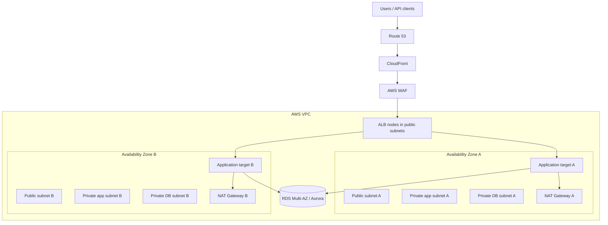

# Thiết kế kiến trúc ba lớp có tính sẵn sàng cao

## 1. Bài toán thiết kế hệ thống ba lớp

Kiến trúc ba lớp (three-tier architecture) tách ứng dụng thành ba phần có trách nhiệm riêng:

- **Presentation tier:** tiếp nhận request, xử lý kết nối HTTP/HTTPS và phân phối traffic.
- **Application tier:** thực thi nghiệp vụ, xác thực, điều phối request và giao tiếp với dịch vụ phụ thuộc.
- **Data tier:** lưu trữ dữ liệu lâu dài, cung cấp truy vấn, transaction và bảo vệ tính toàn vẹn.

Phân lớp giúp kiểm soát quyền truy cập, mở rộng từng phần độc lập và thay đổi một lớp mà ít ảnh hưởng đến lớp còn lại. Tuy nhiên, chia ứng dụng thành ba lớp chưa tự động tạo ra tính sẵn sàng cao. Nếu toàn bộ web server, application server hoặc database chỉ nằm trong một Availability Zone (AZ), sự cố tại AZ đó vẫn có thể làm ứng dụng ngừng hoạt động.

Để đạt high availability (HA), mỗi lớp cần chịu được lỗi của một thành phần hoặc một AZ trong phạm vi mục tiêu. Kiến trúc thường kết hợp:

- Amazon Route 53 và/hoặc Amazon CloudFront để định tuyến request.
- AWS WAF để lọc request không mong muốn.
- Application Load Balancer (ALB) trải rộng nhiều AZ.
- EC2 Auto Scaling, Amazon ECS hoặc Amazon EKS để duy trì application capacity.
- Amazon RDS Multi-AZ hoặc Amazon Aurora để duy trì khả năng truy cập dữ liệu.
- VPC với public, private application và isolated database subnets.
- Amazon CloudWatch, CloudTrail và AWS Config để quan sát và quản trị.

AWS Well-Architected khuyến nghị production workload triển khai trên ít nhất hai AZ khi cần chịu lỗi ở cấp vị trí. Thiết kế còn phải bảo đảm phần capacity còn lại xử lý được tải khi một AZ mất khả năng phục vụ. Multi-AZ giảm ảnh hưởng của lỗi cục bộ; nó không thay thế backup hoặc chiến lược disaster recovery cho sự cố cấp Region.

## 2. Mục tiêu học tập

Sau bài học, người học có thể:

1. Giải thích trách nhiệm và ranh giới của presentation, application và data tier.
2. Thiết kế VPC với public, private application và database subnets trên ít nhất hai AZ.
3. Chọn ALB, EC2 Auto Scaling, ECS/EKS và RDS/Aurora phù hợp với workload.
4. Thiết lập security group theo luồng giao tiếp giữa các lớp.
5. Phân tích health check, scaling, failover và capacity khi một AZ gặp sự cố.
6. Phân biệt RDS Multi-AZ DB instance, Multi-AZ DB cluster, Aurora và read replica.
7. Thiết kế kết nối outbound có khả năng chịu lỗi bằng NAT Gateway hoặc VPC endpoints.
8. Xây dựng timeout, retry, connection pooling và xử lý database failover trong application tier.
9. Theo dõi sức khỏe từng lớp bằng CloudWatch và xây dựng cảnh báo.
10. Đánh giá RTO, RPO, chi phí, security và giới hạn của kiến trúc Multi-AZ.
11. Kiểm tra cấu hình bằng AWS CLI và xây dựng kế hoạch kiểm thử lỗi.

## 3. Xác định yêu cầu trước khi chọn dịch vụ

Không nên bắt đầu bằng việc chọn EC2, RDS hoặc ALB trước khi hiểu yêu cầu của ứng dụng. Kiến trúc HA phải bắt nguồn từ mục tiêu kinh doanh và mức độ gián đoạn có thể chấp nhận.

### 3.1. Availability target

Availability target mô tả tỷ lệ thời gian dịch vụ cần sẵn sàng trong một khoảng đo. Ví dụ, 99,9% và 99,99% có ngân sách downtime khác nhau đáng kể.

Không nên tự suy ra availability của toàn hệ thống bằng cách lấy SLA của một dịch vụ AWS. Availability end-to-end phụ thuộc vào tất cả dependency, cấu hình, quy trình vận hành, lỗi ứng dụng và thời gian phục hồi.

### 3.2. RTO và RPO

| Chỉ tiêu | Ý nghĩa | Ví dụ câu hỏi |
|---|---|---|
| RTO (Recovery Time Objective) | Thời gian tối đa mục tiêu để khôi phục dịch vụ | Ứng dụng có thể gián đoạn tối đa bao lâu? |
| RPO (Recovery Point Objective) | Mức mất dữ liệu tối đa có thể chấp nhận, tính theo thời gian | Có thể mất tối đa bao nhiêu phút dữ liệu? |
| Availability target | Tỷ lệ sẵn sàng mục tiêu trong kỳ đo | Dịch vụ cần đáp ứng mức sẵn sàng nào? |
| MTTR | Thời gian trung bình để sửa chữa/khôi phục | Đội vận hành thường cần bao lâu để phục hồi? |
| MTBF | Thời gian trung bình giữa các lần lỗi | Thành phần thường gặp lỗi với tần suất nào? |

Multi-AZ thường giúp tự động chuyển sang tài nguyên ở AZ khác nhanh hơn so với quy trình restore từ backup. Tuy nhiên, failover vẫn có thời gian gián đoạn và có thể ảnh hưởng transaction đang chạy. Cần đo RTO/RPO bằng thử nghiệm thực tế.

### 3.3. Workload profile

Thu thập ít nhất:

- Request rate trung bình và đỉnh.
- Tỷ lệ đọc/ghi database.
- Kích thước payload và thời gian xử lý.
- Số session đồng thời và cách lưu session.
- Tác động của batch job, scheduled task và background worker.
- Dependency bên ngoài như payment gateway, email, identity provider.
- Yêu cầu mã hóa, lưu trữ dữ liệu và phân vùng mạng.
- Tăng trưởng dữ liệu và yêu cầu retention.

Các thông tin này quyết định số AZ, loại compute, database topology, cache, queue, network throughput và chi phí.

## 4. Mô hình kiến trúc ba lớp

### 4.1. Presentation tier

Lớp tiếp nhận request từ client. Trong kiến trúc web điển hình, ALB nằm trong public subnets ở nhiều AZ. CloudFront và AWS WAF có thể đứng trước ALB để phân phối nội dung, giảm latency và bảo vệ ứng dụng.

Lớp này chịu trách nhiệm nhận HTTP/HTTPS, kết thúc TLS tại điểm phù hợp, định tuyến theo host/path, kiểm tra target health và phân phối request đến application tier còn khỏe.

### 4.2. Application tier

Lớp này thực thi nghiệp vụ. Có thể triển khai bằng:

- EC2 instances trong Auto Scaling group.
- Amazon ECS services với EC2 hoặc Fargate launch type.
- Amazon EKS deployments trên managed node groups hoặc Fargate profiles.
- AWS Lambda nếu mô hình serverless phù hợp với cách xử lý request.

Application tier thường nằm trong private subnets, không nhận kết nối trực tiếp từ Internet. ALB chỉ chuyển request đến target group và port đã cho phép.

Để dễ thay thế và scale, application instance nên stateless. Session, cart hoặc dữ liệu tạm thời cần lưu ở dịch vụ dùng chung như ElastiCache hoặc DynamoDB thay vì chỉ nằm trong memory/local disk của một instance.

### 4.3. Data tier

Lớp dữ liệu có thể dùng:

- Amazon RDS Multi-AZ DB instance.
- Amazon RDS Multi-AZ DB cluster.
- Amazon Aurora.
- Amazon DynamoDB.
- Amazon ElastiCache cho cache hoặc session.
- Amazon S3 cho object/static files.

Database truyền thống thường nằm trong DB subnet group gồm các private subnets ở nhiều AZ. Database không cần public IP và security group chỉ cho phép application tier kết nối qua port cần thiết.

### 4.4. Sơ đồ tham khảo



Sơ đồ là mô hình logic. Trong thực tế, ALB tạo các node/network interface trong subnet đã bật; RDS Multi-AZ DB instance có primary và standby do RDS quản lý, còn Multi-AZ DB cluster có writer và hai reader ở ba AZ. Không nhất thiết phải tự tạo EC2 hoặc quản trị replica database bằng tay.

## 5. Thiết kế VPC và subnet cho HA

### 5.1. Phân vùng theo chức năng

Một VPC production thường chia subnet theo vai trò:

| Subnet | Đặt tài nguyên | Route điển hình |
|---|---|---|
| Public subnet A/B | ALB, NAT Gateway, bastion nếu còn nhu cầu | Có route tới Internet Gateway |
| Private application subnet A/B | EC2, ECS tasks, EKS nodes/pods | Route nội bộ; outbound qua NAT hoặc VPC endpoints |
| Isolated database subnet A/B | RDS/Aurora, database-related resources | Chỉ route nội bộ VPC hoặc network path riêng |
| Private endpoint subnet (nếu cần) | Interface VPC endpoints | Không cần public IP |

Mỗi AZ cần subnet riêng cho các lớp cần hoạt động tại AZ đó. Không đặt toàn bộ application targets trong một subnet/AZ rồi chỉ tạo ALB ở hai AZ; khi AZ của target bị lỗi, lớp compute vẫn là single point of failure.

### 5.2. Route table

Cấu hình route tham khảo:

- Public subnet: route `0.0.0.0/0` đến Internet Gateway.
- Private application subnet: route `0.0.0.0/0` đến NAT Gateway cùng AZ, hoặc Regional NAT Gateway nếu phù hợp và được hỗ trợ trong Region.
- Database subnet: không có default route ra Internet. Chỉ giữ VPC local route và các route riêng thật sự cần thiết.
- IPv6: nếu workload dùng IPv6 outbound-only, đánh giá Egress-only Internet Gateway và security policy tương ứng.

Không đặt database vào public subnet. Việc bật public accessibility trên RDS không phải cách để application tier truy cập database.

### 5.3. CIDR và khả năng mở rộng

Lập kế hoạch CIDR cho cả hiện tại và tương lai:

- ALB cần địa chỉ IP trống để scale và thay node.
- EKS có thể tiêu thụ nhiều IP trong subnet do ENI/pod networking.
- ECS tasks với awsvpc network mode cũng cần địa chỉ IP.
- Private endpoints tạo ENI trong subnet được chọn.
- Auto Scaling cần subnet còn địa chỉ để launch instance khi AZ khác gặp sự cố.

Với Application Load Balancer, AWS yêu cầu ít nhất hai AZ subnet khác nhau. Tài liệu hiện hành khuyến nghị subnet có CIDR tối thiểu /27 và còn ít nhất 8 địa chỉ IP khả dụng mỗi subnet để ALB có thể scale và thay thế node. Không để subnet gần cạn IP rồi mới xử lý.

### 5.4. VPC endpoints

VPC endpoints giúp workload private truy cập AWS services mà không cần đi qua Internet/NAT cho những dịch vụ được hỗ trợ.

Ví dụ:

- S3 Gateway endpoint.
- DynamoDB Gateway endpoint.
- Interface endpoints cho Systems Manager, ECR, Secrets Manager, CloudWatch Logs, KMS và các dịch vụ cần thiết.

Endpoint policy và security group của interface endpoint vẫn cần cấu hình đúng. Endpoint không tự động thay thế mọi route hoặc DNS requirement.

## 6. Presentation tier: Route 53, CloudFront, WAF và ALB

### 6.1. Route 53 và CloudFront

Route 53 quản lý DNS và có thể alias tới CloudFront hoặc ALB. CloudFront phân phối nội dung qua edge locations, giảm latency cho người dùng phân tán và giảm tải request đến origin.

Đối với ứng dụng có static assets:

- Lưu static assets trong S3.
- Phân phối qua CloudFront.
- Dùng Origin Access Control để giới hạn quyền đọc S3 origin.
- Cấu hình cache policy và invalidation phù hợp.
- Tách static content khỏi request động đến ALB.

CloudFront không thay thế khả năng HA của application/data tier. Nếu origin bị lỗi, cần thiết kế origin failover hoặc error response phù hợp.

### 6.2. AWS WAF

AWS WAF có thể bảo vệ CloudFront hoặc ALB khỏi một số mẫu request độc hại như SQL injection, XSS, bot hoặc rate abuse. Rule cần được kiểm thử ở Count trước khi bật Block để tránh false positive.

WAF giúp giảm traffic không mong muốn nhưng không thay thế authentication, authorization, secure coding hoặc network segmentation.

### 6.3. Application Load Balancer

ALB hỗ trợ:

- Listener HTTP/HTTPS.
- TLS certificates qua AWS Certificate Manager.
- Host-based và path-based routing.
- Target groups cho EC2, IP hoặc Lambda trong phạm vi hỗ trợ.
- Health checks.
- Slow start, deregistration delay và stickiness theo use case.

Bật ALB ở ít nhất hai AZ. Mỗi AZ được bật nên có target khỏe nếu có thể. Nếu một AZ mất, ALB có thể tiếp tục route tới target khỏe ở AZ còn lại.

### 6.4. Health check

Health check nên kiểm tra khả năng phục vụ request của application, ví dụ endpoint `/health/ready`. Không nên chỉ kiểm tra process còn chạy nếu application đã mất kết nối database hoặc không thể phục vụ nghiệp vụ.

Tách hai loại kiểm tra:

- **Liveness:** process có còn hoạt động hay bị deadlock/crash không?
- **Readiness:** instance có đủ dependency và capacity để nhận request không?

Cẩn trọng khi readiness phụ thuộc vào một dependency dùng chung. Nếu tất cả targets cùng bị đánh dấu unhealthy, ALB có thể fail open và route request đến tất cả targets bất kể health state. Vì vậy, health check không phải cơ chế bảo mật hoặc công tắc chặn tuyệt đối; cần có phương án maintenance/emergency routing và theo dõi trạng thái target.

## 7. Application tier: triển khai compute trên nhiều AZ

### 7.1. EC2 Auto Scaling group

Một EC2 Auto Scaling group nên:

- Chọn subnet thuộc ít nhất hai AZ.
- Dùng launch template chuẩn hóa AMI, instance type, IAM instance profile và bootstrap.
- Gắn với ALB target group.
- Đặt minimum, desired và maximum capacity.
- Bật health check type ELB nếu muốn ASG thay thế instance mà ALB đánh dấu unhealthy.
- Cấu hình instance refresh và rolling deployment.
- Chọn instance type có đủ capacity và cân nhắc nhiều loại instance nếu phù hợp.

Auto Scaling phân phối instance qua các AZ đã chọn và cố gắng duy trì cân bằng. Khi một AZ gặp vấn đề, ASG có thể launch instance thay thế ở AZ khỏe, tùy capacity, subnet IP, quota và chiến lược phân phối.

### 7.2. ECS và EKS

Với ECS:

- Chọn private subnets ở nhiều AZ cho service.
- Dùng Application Load Balancer target group.
- Đặt desired task count lớn hơn một và phân bố task qua AZ.
- Cấu hình deployment circuit breaker/rollback nếu phù hợp.
- Theo dõi service events và task placement.

Với EKS:

- Node groups nên trải rộng nhiều AZ.
- Deployment có replica count phù hợp.
- Dùng topology spread constraints hoặc pod anti-affinity để phân bố pod.
- Cấu hình Pod Disruption Budget cho voluntary disruptions.
- Kiểm tra storage class và volume topology vì EBS volume gắn với một AZ.
- Dùng managed node group hoặc cơ chế tự phục hồi node đã được thử nghiệm.

Không chỉ tạo nhiều replica. Nếu mọi replica cùng nằm một AZ hoặc phụ thuộc vào một node/storage/network endpoint duy nhất, workload vẫn có fault domain lớn.

### 7.3. Stateless application

Để instance có thể thay thế tự động:

- Không lưu session duy nhất trên local memory.
- Lưu file upload vào S3.
- Dùng ElastiCache/DynamoDB hoặc token-based session phù hợp.
- Dùng queue cho tác vụ dài hoặc cần retry.
- Externalize configuration và secrets.
- Không phụ thuộc vào local disk sau khi instance bị thay thế.

Sticky sessions có thể hữu ích trong một số trường hợp, nhưng không nên là điều kiện để ứng dụng hoạt động đúng khi target bị thay thế.

## 8. Data tier: chọn RDS Multi-AZ hay Aurora

Data tier là thành phần khó thay thế nhất vì dữ liệu cần duy trì tính toàn vẹn. Chọn topology theo engine, write/read profile, RTO, RPO, chi phí và khả năng vận hành.

### 8.1. RDS Multi-AZ DB instance deployment

Mô hình này gồm:

- Một primary DB instance.
- Một standby synchronous replica ở AZ khác.
- RDS quản lý replication và automatic failover.
- Standby không phục vụ read traffic thông thường.
- Application kết nối qua DB instance endpoint.

Khi primary hoặc AZ gặp lỗi phù hợp, RDS chuyển endpoint sang standby. Failover thường cần khoảng 60-120 giây nhưng không phải SLA cố định; transaction dài hoặc recovery có thể kéo dài hơn. Application phải reconnect và retry transaction phù hợp.

Đây là lựa chọn phổ biến khi cần HA cho một database instance mà không cần mở rộng read capacity bằng standby.

### 8.2. RDS Multi-AZ DB cluster

Multi-AZ DB cluster gồm:

- Một writer DB instance.
- Hai reader DB instances ở ba AZ khác nhau trong cùng Region.
- Semisynchronous replication.
- Reader instances có thể phục vụ read traffic.
- Một reader có thể được promote thành writer khi failover.

Topology này cung cấp HA và thêm read capacity. Engine/version/Region support và instance class bị giới hạn hơn so với lựa chọn RDS thông thường. Failover thường nhanh hơn Multi-AZ DB instance deployment, nhưng cần kiểm thử theo engine và workload.

### 8.3. Amazon Aurora

Aurora cluster có writer instance và có thể có nhiều reader instances. Storage layer được thiết kế phân tán qua nhiều AZ; reader có thể hỗ trợ read scaling và failover. Cần dùng cluster endpoint cho writer và reader endpoint cho read workload theo nhu cầu.

Aurora không đồng nghĩa với RDS Multi-AZ DB cluster. Đây là kiến trúc database riêng với storage và replication model riêng. Chọn Aurora khi engine compatibility, performance, storage scaling và operational requirements phù hợp.

### 8.4. Read replica không thay thế Multi-AZ standby

Read replica thường phục vụ read scaling và có thể hỗ trợ DR tùy cấu hình. Replication thường bất đồng bộ, có replication lag; promotion có thể cần thao tác hoặc quy trình riêng.

Không xem read replica là thay thế trực tiếp cho synchronous standby của Multi-AZ DB instance. Cần phân biệt mục tiêu HA trong Region với mục tiêu mở rộng read traffic hoặc DR sang Region khác.

### 8.5. Bảng chọn nhanh

| Yêu cầu | Lựa chọn cần đánh giá |
|---|---|
| Database instance cần automatic failover, standby không cần đọc | RDS Multi-AZ DB instance |
| Cần writer và hai readable replicas trên ba AZ | RDS Multi-AZ DB cluster nếu engine/Region hỗ trợ |
| Cần Aurora engine, distributed storage và reader endpoints | Amazon Aurora cluster |
| Cần mở rộng read traffic với replication lag chấp nhận được | Read replicas |
| Cần database NoSQL serverless và multi-AZ managed | DynamoDB |
| Cần cache/session với latency thấp | ElastiCache hoặc DynamoDB tùy access pattern |

## 9. Database subnet, security và connection management

### 9.1. DB subnet group

RDS Multi-AZ cần DB subnet group có subnet ở nhiều AZ trong cùng VPC. Database nên dùng private/isolated subnets và không bật public access trừ khi có yêu cầu đặc biệt được kiểm soát.

Database subnet group phải có đủ subnet và địa chỉ IP để RDS thực hiện maintenance/failover. Thiết kế subnet quá nhỏ có thể khiến thay đổi topology thất bại.

### 9.2. Security group giữa các lớp

Một mô hình rule đơn giản:

| Security group | Inbound cho phép | Source |
|---|---|---|
| ALB-SG | TCP 443 | Internet/CloudFront origin path theo thiết kế |
| App-SG | TCP 8080 hoặc port ứng dụng | ALB-SG |
| DB-SG | TCP 5432/3306 hoặc port engine | App-SG |
| Cache-SG | TCP 6379 hoặc port cache | App-SG |

Không mở database port từ `0.0.0.0/0`. Dùng security group reference để biểu diễn trust giữa các lớp. Egress rules cũng nên được giới hạn theo dependency và yêu cầu vận hành.

Nếu dùng CloudFront trước ALB, chỉ cho phép origin nhận traffic theo mô hình đã bảo vệ, ví dụ prefix list hoặc cơ chế xác thực origin phù hợp; không để client bypass CloudFront nếu chính sách yêu cầu tất cả traffic phải đi qua WAF/edge.

### 9.3. Connection pooling và retry

Database failover có thể làm các connection hiện tại bị ngắt. Application cần:

- Connection pool có validation và eviction phù hợp.
- DNS resolution không cache quá lâu.
- Retry với exponential backoff và jitter.
- Giới hạn số lần retry.
- Timeout cho connect, query và transaction.
- Phân biệt lỗi retryable với lỗi nghiệp vụ.
- Idempotency key cho request ghi có thể được retry.
- Không retry transaction không an toàn khi chưa biết kết quả commit.

Một retry storm có thể làm database vừa phục hồi lại quá tải. Cần giới hạn concurrency và áp dụng circuit breaker khi dependency không khỏe.

## 10. Tính toán capacity khi mất một AZ

Multi-AZ chỉ có ý nghĩa khi các AZ còn lại có đủ năng lực phục vụ tải cần thiết.

### 10.1. N-1 capacity

Giả sử hệ thống cần 8 application instances ở peak load và chạy trên hai AZ:

- Nếu mỗi AZ có 4 instance, khi mất một AZ chỉ còn 4 instance.
- Nếu workload cần đủ 8 instance sau khi mất một AZ, mỗi AZ phải có thể cung cấp đủ 8 instance, hoặc kiến trúc phải chấp nhận giảm chức năng/tải.
- Với ba AZ, phân bố capacity và khả năng tăng thêm ở hai AZ còn lại cũng cần được tính toán.

Không chỉ tính CPU. Cần tính network bandwidth, connection count, database capacity, NAT throughput, IP address, service quota và downstream rate limits.

### 10.2. Static stability

Static stability nghĩa là hệ thống đã có đủ capacity dự phòng để tiếp tục hoạt động trong failure mode mà không phụ thuộc vào việc scale out ngay lúc sự cố xảy ra.

Nếu cần độ sẵn sàng rất cao, cân nhắc giữ sẵn capacity dư ở các AZ. Scale out sau khi phát hiện lỗi có thể bị giới hạn bởi EC2 capacity, quota hoặc control plane impairment.

### 10.3. Capacity reservation và instance flexibility

Đối với workload quan trọng:

- Cân nhắc On-Demand Capacity Reservations hoặc zonal reservations.
- Dùng nhiều instance types tương thích trong mixed instances policy.
- Tránh phụ thuộc vào một instance family hoặc một AZ.
- Kiểm tra quota trước khi mở rộng.
- Duy trì AMI và launch template đã kiểm thử.

Không dùng Spot Instances làm toàn bộ capacity bắt buộc cho workload không thể chịu interruption. Có thể dùng Spot cho phần capacity linh hoạt, có On-Demand baseline và Capacity Rebalancing.

## 11. NAT Gateway và outbound availability

Application tier private thường cần outbound để tải package, gọi API bên ngoài hoặc truy cập dịch vụ không có VPC endpoint.

### 11.1. NAT Gateway theo AZ

NAT Gateway là tài nguyên zonal. Nếu các private subnets ở nhiều AZ cùng route qua một NAT Gateway và AZ chứa NAT gặp sự cố, các subnet ở AZ còn lại có thể mất outbound Internet.

Mô hình phổ biến để tăng resiliency:

- Tạo một NAT Gateway trong public subnet của mỗi AZ.
- Route private subnet của AZ đó qua NAT cùng AZ.
- Giữ route table độc lập để không phụ thuộc NAT ở AZ khác.

Điều này tăng chi phí nhưng giảm dependency xuyên AZ và tránh single point of failure ở outbound path.

### 11.2. Regional NAT Gateway

AWS có Regional NAT Gateway ở các Region hỗ trợ. Tính năng này tự mở rộng qua các AZ trong VPC và có thể giảm nhu cầu tạo/quản lý từng NAT Gateway zonal. Cần xác nhận khả năng hỗ trợ, đặc điểm routing, quota và chi phí trong Region mục tiêu trước khi chọn.

### 11.3. Giảm phụ thuộc Internet

Dùng VPC endpoints cho S3, DynamoDB, ECR, Systems Manager, CloudWatch Logs và Secrets Manager khi phù hợp. Giảm số request phải đi qua NAT giúp giảm chi phí data processing và hạn chế phụ thuộc vào Internet egress.

## 12. Health checks và self-healing

### 12.1. Health check ở nhiều lớp

| Lớp | Health signal | Phản ứng |
|---|---|---|
| ALB | Target health, HTTP status, timeout | Ngừng route đến target unhealthy nếu còn target healthy |
| EC2 | EC2 status checks | Auto Scaling thay instance khi health check type phù hợp |
| ECS/EKS | Task/pod health, service desired count | Scheduler thay task/pod hoặc node theo policy |
| RDS/Aurora | DB events, availability, connections, failover events | RDS failover hoặc operator xử lý |
| Application | Error rate, latency, dependency health | Alert, scale, shed load hoặc degrade feature |

### 12.2. Health check không nên quá nông hoặc quá sâu

Nếu health endpoint chỉ trả 200 khi web server process đang chạy, nó có thể không phát hiện application mất database. Nếu endpoint kiểm tra mọi dependency sâu, một dependency phụ trợ lỗi có thể khiến toàn bộ targets bị đánh dấu unhealthy.

Thiết kế readiness check phản ánh khả năng phục vụ request cốt lõi. Dùng metrics và alarms riêng cho dependency để tránh đánh dấu toàn bộ application fleet unhealthy vì một tính năng không trọng yếu.

### 12.3. Auto Scaling health check integration

EC2 Auto Scaling mặc định dựa vào EC2 health checks. Nếu muốn thay thế instance mà ELB/ALB đánh dấu unhealthy, bật ELB health check type và cấu hình grace period hợp lý.

Grace period quá ngắn có thể khiến instance mới bị thay thế liên tục khi đang khởi động; quá dài khiến instance lỗi nằm trong fleet lâu hơn.

## 13. Xử lý database failover trong application

RDS endpoint DNS có thể trỏ sang primary mới sau failover. Application phải chấp nhận connection reset và resolve endpoint lại.

Các nguyên tắc:

1. Dùng RDS endpoint hoặc Aurora cluster endpoint, không hardcode IP.
2. Thiết lập DNS cache TTL phù hợp với runtime.
3. Pool phải loại bỏ connection đã chết.
4. Retry connection có giới hạn và backoff.
5. Không gửi đồng thời nhiều retry từ mọi worker.
6. Xác định transaction nào có thể retry an toàn.
7. Theo dõi failover event và thời gian phục hồi.

Với RDS Multi-AZ DB instance, standby không phục vụ read traffic trước khi được promote. Với Multi-AZ DB cluster hoặc Aurora, reader endpoint có thể phục vụ read workload theo topology. Application cần phân biệt writer endpoint và reader endpoint.

## 14. Bảo vệ data tier và tính toàn vẹn dữ liệu

HA không thay thế backup. Replication có thể sao chép cả thao tác xóa hoặc dữ liệu đã bị sửa sai.

Cần kết hợp:

- Automated backups và point-in-time recovery.
- Manual snapshots trước thay đổi lớn.
- AWS Backup policies và backup vault phù hợp.
- KMS encryption at rest.
- TLS in transit.
- Database authentication và least privilege.
- Audit logs và CloudTrail.
- Kiểm tra restore định kỳ.
- Retention và immutable backup theo yêu cầu.

Đặt backup ở account/vault riêng khi cần giảm rủi ro attacker xóa cả workload và backup. Xác định RPO theo lịch backup và transaction log, không suy ra chỉ từ việc bật Multi-AZ.

## 15. Security architecture giữa ba lớp

### 15.1. Identity

- Mỗi compute workload dùng IAM role riêng.
- Không nhúng access key dài hạn vào AMI hoặc source code.
- Dùng Secrets Manager hoặc Parameter Store cho secret/config nhạy cảm.
- Dùng IAM database authentication nếu engine/use case hỗ trợ.
- Giới hạn quyền của CI/CD role và operator role.

### 15.2. Network

- Chỉ ALB nhận inbound từ nguồn được thiết kế.
- Application tier chỉ nhận traffic từ ALB security group.
- Database chỉ nhận kết nối từ application security group.
- Không gán public IP cho application/database targets nếu không cần.
- Dùng VPC Flow Logs để điều tra traffic.
- Dùng NACL như lớp kiểm soát subnet bổ sung, không thay security group.

### 15.3. Encryption và secrets

- Dùng ACM cho certificate TLS.
- Dùng KMS key theo phân quyền.
- Rotate secret và credential theo lịch.
- Không log Authorization header, password hoặc token.
- Đảm bảo snapshot và backup được mã hóa.
- Kiểm tra key policy trước khi triển khai Multi-AZ hoặc cross-account restore.

### 15.4. Application security

- Dùng AWS WAF cho lớp HTTP.
- Validate input và enforce authorization trong application.
- Bảo vệ dependency và package.
- Quản lý patch và AMI.
- Tách admin endpoint khỏi public listener.
- Dùng rate limiting và request size controls.

## 16. Observability và cảnh báo theo từng lớp

Một hệ thống HA cần phát hiện lỗi trước khi người dùng báo sự cố.

### 16.1. Presentation metrics

Theo dõi:

- ALB `HealthyHostCount` và `UnHealthyHostCount`.
- `TargetResponseTime`.
- `HTTPCode_ELB_5XX_Count`.
- `HTTPCode_Target_5XX_Count`.
- `RequestCount`.
- `RejectedConnectionCount`.
- WAF blocked/count metrics nếu dùng.

### 16.2. Application metrics

Theo dõi:

- CPU, memory, disk và network.
- Request rate, error rate và latency percentile.
- Thread pool, connection pool và queue depth.
- ECS task count/EKS pod availability.
- ASG desired, in-service và pending instances.
- Dependency timeout, retry và circuit breaker count.

### 16.3. Data metrics

Theo dõi:

- RDS CPUUtilization, DatabaseConnections và FreeStorageSpace.
- Read/Write latency và IOPS.
- Replica lag nếu dùng read replica.
- Deadlocks, lock wait và query latency.
- Aurora reader/writer health và failover events.
- Backup job status và restore test result.

### 16.4. Alarm và SLO

Đặt alarm theo tác động người dùng, không chỉ theo hạ tầng. Ví dụ, latency p95 vượt SLO hoặc tỷ lệ 5xx tăng trong một khoảng thời gian có ý nghĩa. Gắn alarm với runbook, owner và escalation path.

CloudWatch dashboard nên thể hiện ba lớp trên cùng timeline để đội vận hành biết lỗi bắt đầu ở edge, compute hay database.

## 17. Deployment và thay đổi cấu hình không gây downtime

High availability cần được duy trì cả trong lúc release và maintenance.

### 17.1. Rolling deployment

- Chia instance/task/pod thành từng batch.
- Giữ đủ healthy capacity trong mỗi wave.
- Dùng ALB deregistration delay và connection draining.
- Đặt health check grace period phù hợp.
- Không cập nhật tất cả AZ cùng lúc nếu làm mất N-1 capacity.

### 17.2. Blue/green deployment

Blue/green tạo environment mới, kiểm tra health rồi chuyển traffic. Có thể dùng ALB listener rules hoặc CodeDeploy cho các mô hình được hỗ trợ.

Cần kiểm soát database schema migration theo hướng backward-compatible. Nếu app mới yêu cầu schema chưa tồn tại hoặc app cũ không tương thích schema mới, blue/green vẫn có thể gây downtime.

### 17.3. Infrastructure as Code

Dùng AWS CloudFormation, AWS CDK hoặc Terraform để quản lý VPC, subnets, route tables, ALB, ASG, security groups và database subnet group. Code review và change set giúp phát hiện thay đổi trước khi áp dụng.

Tránh thay đổi thủ công ngoài IaC rồi để drift kéo dài. Kiểm tra drift và cập nhật source of truth.

## 18. Phân biệt Multi-AZ HA và Multi-Region DR

| Tiêu chí | Multi-AZ trong một Region | Multi-Region |
|---|---|---|
| Mục tiêu chính | Chịu lỗi ở AZ hoặc thành phần | Chịu lỗi ở cấp Region và thảm họa địa lý |
| Độ trễ replication | Thường thấp; có thể dùng synchronous/semisynchronous tùy dịch vụ | Phụ thuộc khoảng cách và cơ chế replication |
| Failover | Có thể được managed service tự động | Thường cần DNS/routing, data replication và quy trình điều phối |
| Chi phí | Tăng capacity và phí tài nguyên đa AZ | Cao hơn do duplicate stack, data transfer và vận hành |
| Độ phức tạp | Trung bình | Cao hơn đáng kể |
| RTO/RPO | Thường nhỏ hơn cho lỗi AZ | Phụ thuộc DR pattern và mức đồng bộ dữ liệu |

Không triển khai Multi-Region chỉ vì muốn có HA. AWS Well-Architected khuyến nghị chọn phạm vi fault isolation phù hợp; Multi-AZ thường đáp ứng phần lớn nhu cầu chịu lỗi hạ tầng. Multi-Region dành cho yêu cầu Region-level resilience, regulatory needs hoặc mục tiêu RTO/RPO mà Multi-AZ không đáp ứng.

## 19. Các tình huống lỗi và cách hệ thống phản ứng

| Sự cố | Phản ứng kiến trúc | Điều cần xác minh |
|---|---|---|
| Một EC2 instance lỗi | ALB loại target unhealthy; ASG launch replacement | HealthyHostCount, ASG health check |
| Một AZ lỗi | ALB route sang AZ còn lại; ASG duy trì capacity ở AZ khỏe | N-1 capacity, subnet IP, quota |
| ALB target group mất toàn bộ target khỏe | Có thể xảy ra fail-open routing | Cần emergency lever, không coi health check là chặn tuyệt đối |
| NAT Gateway/AZ lỗi | NAT cùng AZ lỗi; subnet khác vẫn dùng NAT riêng | Route table theo AZ |
| RDS primary lỗi | RDS Multi-AZ failover sang standby/reader | App reconnect, DNS cache, retry |
| Database quá tải | Scale/optimize, queue, cache, limit concurrency | CPU, connections, latency, locks |
| Dependency ngoài lỗi | Timeout, retry có giới hạn, circuit breaker, graceful degradation | Retry storm và thread exhaustion |
| Release lỗi | Rollback hoặc chuyển traffic về environment trước | Database compatibility và deployment health |
| Region lỗi | DR strategy được kích hoạt | Data replication, DNS, RTO/RPO |

## 20. Ví dụ thiết kế cho ứng dụng thương mại điện tử

Giả sử một ứng dụng thương mại điện tử có website và REST API, API tìm kiếm sản phẩm, giỏ hàng và thanh toán, ứng dụng Spring Boot, PostgreSQL và traffic tăng mạnh vào giờ khuyến mại.

Thiết kế tham khảo:

| Lớp | Dịch vụ | Cấu hình HA |
|---|---|---|
| Edge | Route 53, CloudFront, WAF | DNS, cache, bảo vệ request |
| Presentation | ALB public | Ít nhất hai AZ, HTTPS listener, health check |
| Application | EC2 Auto Scaling hoặc ECS | Private subnets ở hai/ba AZ, stateless, autoscaling |
| Cache/session | ElastiCache hoặc DynamoDB | Replication/failover phù hợp, session ngoài instance |
| Data | RDS PostgreSQL Multi-AZ hoặc Aurora PostgreSQL | Failover, backup, private DB subnets |
| Async | SQS + worker fleet | Buffer đơn hàng/email/background jobs |
| Static assets | S3 + CloudFront | Tách file khỏi application instance |
| Observability | CloudWatch, CloudTrail, Config | Dashboard, alarms, audit và configuration history |

Đối với thanh toán, không nên dựa vào retry mù quáng. Dùng idempotency key, trạng thái transaction rõ ràng và đối soát với payment provider để tránh charge hai lần khi request timeout hoặc database failover.

## 21. Kiểm tra kiến trúc bằng AWS CLI

Các lệnh dưới đây giúp xác minh cấu hình sau khi triển khai. Thay ID và Region bằng giá trị của môi trường thực tế.

### 21.1. Kiểm tra ALB và các AZ đã bật

```bash
aws elbv2 describe-load-balancers \
  --names orders-alb \
  --region ap-southeast-1 \
  --query "LoadBalancers[].{DNS:DNSName,Scheme:Scheme,AZs:AvailabilityZones[].ZoneName,Subnets:AvailabilityZones[].SubnetId,State:State.Code}"
```

Xác nhận ALB có subnet ở ít nhất hai AZ.

### 21.2. Kiểm tra target health

```bash
aws elbv2 describe-target-health \
  --target-group-arn arn:aws:elasticloadbalancing:ap-southeast-1:111122223333:targetgroup/orders/0123456789abcdef \
  --region ap-southeast-1
```

Kiểm tra target state, reason code và phân bố target theo AZ. Không chỉ nhìn số target đăng ký; cần xem số target healthy.

### 21.3. Kiểm tra Auto Scaling group

```bash
aws autoscaling describe-auto-scaling-groups \
  --auto-scaling-group-names orders-app-asg \
  --region ap-southeast-1 \
  --query "AutoScalingGroups[].{Min:MinSize,Desired:DesiredCapacity,Max:MaxSize,AZs:AvailabilityZones,Instances:Instances[].{Id:InstanceId,AZ:AvailabilityZone,Health:HealthStatus,State:LifecycleState}}"
```

Xác nhận group trải rộng nhiều AZ, desired capacity và trạng thái instance phù hợp với N-1 capacity plan.

### 21.4. Kiểm tra RDS Multi-AZ

```bash
aws rds describe-db-instances \
  --db-instance-identifier orders-db \
  --region ap-southeast-1 \
  --query "DBInstances[].{Status:DBInstanceStatus,MultiAZ:MultiAZ,AZ:AvailabilityZone,SecondaryAZ:SecondaryAvailabilityZone,Endpoint:Endpoint.Address,Public:PubliclyAccessible,SubnetGroup:DBSubnetGroup.DBSubnetGroupName}"
```

Với RDS Multi-AZ DB instance, kiểm tra MultiAZ=true và database không public. Với Multi-AZ DB cluster hoặc Aurora, dùng API describe-db-clusters để kiểm tra writer/readers và AZ.

### 21.5. Kiểm tra sự kiện RDS

```bash
aws rds describe-events \
  --source-identifier orders-db \
  --source-type db-instance \
  --duration 1440 \
  --region ap-southeast-1
```

Dùng event để kiểm tra failover, maintenance và thay đổi trạng thái. Kết hợp CloudWatch metrics để đo tác động tới application.

## 22. Kiểm thử HA và failure scenarios

Không thể khẳng định kiến trúc HA chỉ bằng sơ đồ hoặc cấu hình. Phải thử nghiệm failure modes.

Một kế hoạch kiểm thử có thể gồm:

1. Terminate một application instance trong staging.
2. Xác nhận ALB ngừng gửi request đến target unhealthy.
3. Xác nhận Auto Scaling tạo instance thay thế.
4. Dừng task/pod và kiểm tra scheduler phục hồi.
5. Mô phỏng AZ impairment bằng phương pháp được AWS hỗ trợ và đã đánh giá blast radius.
6. Thực hiện RDS failover trong môi trường thử nghiệm.
7. Kiểm tra application connection pool và retry sau failover.
8. Tạm ngắt dependency không trọng yếu để kiểm tra graceful degradation.
9. Tạo traffic spike để kiểm tra scaling và queue behavior.
10. Kiểm tra backup restore và quy trình DR riêng.

AWS Fault Injection Service có thể hỗ trợ thử nghiệm có kiểm soát. Chỉ thực hiện trên môi trường và phạm vi đã được phê duyệt; xác định stop condition, rollback và người theo dõi trước khi bắt đầu.

### 22.1. Tiêu chí pass

- Request vẫn được phục vụ trong giới hạn đã xác định.
- Error rate và latency không vượt ngưỡng cho phép quá lâu.
- Application capacity còn lại đáp ứng tải khi một AZ mất.
- Database failover hoàn tất và application tự reconnect.
- Không mất dữ liệu vượt RPO.
- Alarm và notification hoạt động.
- Runbook được thực hiện đúng và RTO đo được.
- Không phát sinh chi phí hoặc tài nguyên ngoài dự kiến sau bài test.

## 23. Chi phí và đánh đổi

HA luôn có chi phí. Các thành phần có thể làm tăng bill:

- ALB và LCU.
- EC2/ECS/EKS capacity dự phòng.
- NAT Gateway theo từng AZ và data processing.
- RDS Multi-AZ standby hoặc Multi-AZ DB cluster readers.
- Cross-AZ data transfer.
- CloudWatch metrics, logs, alarms và dashboards.
- Backup, snapshots, storage và cross-Region replication.
- WAF rules và request volume.

Tối ưu chi phí bằng cách:

- Dùng Auto Scaling cho workload có tải biến động.
- Chọn số AZ và capacity dự phòng theo RTO/SLO.
- Dùng VPC endpoints để giảm NAT traffic khi phù hợp.
- Chọn database topology theo read/write profile.
- Dùng Savings Plans/Reserved Instances cho baseline ổn định.
- Dùng Spot cho phần workload chịu interruption.
- Đặt retention log và backup phù hợp.
- Đo cross-AZ data transfer và tối ưu chatty traffic.

Không loại bỏ NAT redundancy, database standby hoặc capacity dự phòng chỉ dựa trên giá. Trước tiên xác định failure mode nào tổ chức chấp nhận và tác động kinh doanh của downtime.

## 24. Bài thực hành: thiết kế web application ba lớp Multi-AZ

### 24.1. Mục tiêu

Thiết kế một ứng dụng web có ALB, application fleet và database trên hai AZ. Học viên phải chứng minh luồng traffic, security boundary và khả năng tiếp tục phục vụ khi một AZ hoặc một instance gặp lỗi.

### 24.2. Điều kiện chuẩn bị

- AWS account lab.
- Một VPC CIDR đủ lớn.
- Hai AZ trong cùng Region.
- Hai public subnets, hai private application subnets và hai private database subnets.
- IAM role cho compute.
- Một ALB, target group và listener.
- Một EC2 Auto Scaling group hoặc ECS service.
- Một RDS Multi-AZ DB instance hoặc topology tương đương được hỗ trợ.
- CloudWatch metrics và alarms cơ bản.

### 24.3. Các bước

1. Chọn Region và hai AZ.
2. Thiết kế CIDR cho từng subnet, dành dư địa cho ENI và scale.
3. Tạo Internet Gateway và route table cho public subnets.
4. Tạo NAT Gateway theo AZ hoặc chọn Regional NAT nếu phù hợp.
5. Tạo private route tables cho application subnets.
6. Tạo database subnet group từ hai database subnets.
7. Tạo ALB trong hai public subnets.
8. Tạo target group với health check endpoint.
9. Tạo EC2 Auto Scaling group hoặc ECS service trên hai private application subnets.
10. Cấu hình security groups theo luồng ALB → App → DB.
11. Tạo RDS Multi-AZ database trong private subnets.
12. Cấu hình application endpoint và connection pool.
13. Bật CloudWatch dashboard/alarms cho ALB, ASG và RDS.
14. Kiểm tra request qua ALB và target health.
15. Terminate một instance lab và quan sát replacement.
16. Thực hiện failover database trong môi trường lab nếu phù hợp.
17. Đo thời gian phục hồi và ghi nhận lỗi ứng dụng.
18. Kiểm tra backup và dọn tài nguyên theo quy trình.

### 24.4. Tiêu chí hoàn thành

- ALB có subnet ở ít nhất hai AZ.
- Application targets phân bố trên nhiều AZ.
- Database không public và có Multi-AZ topology.
- Security group chỉ cho phép luồng cần thiết.
- Một instance lỗi được thay thế tự động.
- Application reconnect sau database failover.
- CloudWatch metrics và alarms phát hiện được tình trạng bất thường.
- Có ghi chép RTO/RPO và chi phí thực tế.

## 25. Câu hỏi tự kiểm tra

### Câu 1

Kiến trúc ba lớp gồm những lớp nào?

**Đáp án:** Presentation tier, application tier và data tier. Mỗi lớp có trách nhiệm, network boundary và khả năng scale riêng.

### Câu 2

Vì sao đặt ALB ở hai AZ nhưng application instances chỉ ở một AZ vẫn chưa phải HA đầy đủ?

**Đáp án:** Application tier vẫn là single point of failure. Nếu AZ chứa toàn bộ targets lỗi, ALB không có application capacity khỏe để phục vụ.

### Câu 3

RDS Multi-AZ DB instance standby có phục vụ read traffic thông thường không?

**Đáp án:** Không. Standby được RDS duy trì để failover; nó không phải read replica.

### Câu 4

RDS Multi-AZ DB cluster khác DB instance Multi-AZ ở điểm nào?

**Đáp án:** Multi-AZ DB cluster có writer và hai reader ở ba AZ; readers có thể phục vụ read traffic và là failover targets.

### Câu 5

Read replica có thay thế Multi-AZ standby không?

**Đáp án:** Không. Read replica chủ yếu mở rộng read workload và thường replication bất đồng bộ; mục tiêu khác với synchronous standby của Multi-AZ DB instance.

### Câu 6

Vì sao application tier nên stateless?

**Đáp án:** Để instance/task có thể được thay thế hoặc scale ngang mà không mất session/state cục bộ. State nên nằm ở dịch vụ dùng chung hoặc database phù hợp.

### Câu 7

Một NAT Gateway duy nhất đặt ở AZ-A có thể ảnh hưởng gì khi AZ-A lỗi?

**Đáp án:** Private subnets ở AZ khác nếu route qua NAT đó có thể mất outbound Internet. NAT Gateway theo từng AZ giúp cô lập dependency.

### Câu 8

Nếu ALB đánh dấu tất cả targets unhealthy, có thể chắc chắn ALB sẽ chặn mọi request không?

**Đáp án:** Không. ALB có thể fail open và route đến các targets unhealthy. Cần emergency control và monitoring riêng.

### Câu 9

Tại sao cần tính N-1 capacity?

**Đáp án:** Để phần capacity còn lại vẫn xử lý được tải cần thiết khi mất một AZ hoặc một fault domain.

### Câu 10

Sau RDS failover, application nên xử lý thế nào?

**Đáp án:** Dùng endpoint DNS, loại bỏ connection cũ, resolve lại, retry có giới hạn với backoff/jitter và xử lý transaction theo tính idempotent.

### Câu 11

Multi-AZ có thay thế backup và DR không?

**Đáp án:** Không. Multi-AZ giúp chịu lỗi hạ tầng trong Region; backup phục vụ phục hồi dữ liệu và Multi-Region DR bảo vệ trước sự cố cấp Region.

### Câu 12

Có nên triển khai Multi-Region cho mọi ứng dụng cần HA không?

**Đáp án:** Không. Multi-AZ thường đáp ứng nhiều nhu cầu HA với độ phức tạp thấp hơn. Multi-Region cần có yêu cầu Region-level resilience và RTO/RPO phù hợp.

## 26. Checklist thiết kế production

### Yêu cầu và capacity

- [ ] Availability target, RTO và RPO được xác định.
- [ ] Peak request rate và database workload được đo.
- [ ] Có capacity đủ chịu lỗi một AZ.
- [ ] Đã kiểm tra EC2 quota, subnet IP và database limits.
- [ ] Có kế hoạch tăng tải và graceful degradation.

### Network và presentation

- [ ] VPC có CIDR đủ lớn.
- [ ] Public/private/database subnets được tách rõ trên nhiều AZ.
- [ ] ALB bật ít nhất hai AZ.
- [ ] ALB subnet còn đủ IP để scale.
- [ ] Route table và NAT path không tạo single point of failure.
- [ ] Security Group theo luồng ALB → App → DB.
- [ ] WAF/TLS/CloudFront được cấu hình theo nhu cầu.
- [ ] Không public database hoặc application target không cần thiết.

### Application tier

- [ ] EC2 ASG/ECS/EKS trải rộng nhiều AZ.
- [ ] Application stateless hoặc session externalized.
- [ ] Health check phản ánh readiness phù hợp.
- [ ] Auto Scaling health check integration được cấu hình.
- [ ] Deployment không làm mất toàn bộ capacity cùng lúc.
- [ ] Timeout, retry, backoff và circuit breaker có giới hạn.
- [ ] Secrets và IAM role được quản lý an toàn.

### Data tier

- [ ] Database subnet group có nhiều AZ.
- [ ] RDS/Aurora topology đáp ứng yêu cầu HA.
- [ ] Đã phân biệt standby với read replica.
- [ ] Application dùng endpoint và connection retry phù hợp.
- [ ] Encryption, backup và restore test đã cấu hình.
- [ ] Có monitoring database và failover event.

### Observability và kiểm thử

- [ ] Có dashboard cho ALB, application và database.
- [ ] Có alarms gắn với SLO.
- [ ] CloudTrail và AWS Config được bật theo yêu cầu.
- [ ] Đã test instance failure, AZ impairment và database failover.
- [ ] RTO/RPO được đo và so sánh với mục tiêu.
- [ ] Có runbook, owner và rollback plan.
- [ ] Chi phí NAT, cross-AZ transfer, standby và logs được theo dõi.

## 27. Tài liệu tham khảo chính thức

Các tài liệu AWS dưới đây là nguồn tham khảo để kiểm tra chi tiết về kiến trúc, giới hạn dịch vụ và cấu hình theo Region/engine. Availability và failover time thực tế cần được kiểm thử với workload cụ thể.

### AWS Well-Architected và kiến trúc tham khảo

- [AWS Well-Architected Reliability Pillar](https://docs.aws.amazon.com/wellarchitected/latest/reliability-pillar/)
- [REL10-BP01: Deploy the workload to multiple locations](https://docs.aws.amazon.com/wellarchitected/latest/reliability-pillar/rel_fault_isolation_multiaz_region_system.html)
- [REL11: Design your workload to withstand component failures](https://docs.aws.amazon.com/wellarchitected/latest/framework/rel-11.html)
- [REL05: Design interactions in a distributed system to mitigate failures](https://docs.aws.amazon.com/wellarchitected/latest/framework/rel-05.html)
- [Example VPC with servers in private subnets and NAT](https://docs.aws.amazon.com/vpc/latest/userguide/vpc-example-private-subnets-nat.html)

### VPC, load balancing và Auto Scaling

- [VPC subnet and network design](https://docs.aws.amazon.com/vpc/latest/userguide/configure-subnets.html)
- [NAT Gateway basics](https://docs.aws.amazon.com/vpc/latest/userguide/nat-gateway-basics.html)
- [Regional NAT Gateway](https://docs.aws.amazon.com/vpc/latest/userguide/nat-gateways-regional.html)
- [Application Load Balancers](https://docs.aws.amazon.com/elasticloadbalancing/latest/application/application-load-balancers.html)
- [ALB target group health checks](https://docs.aws.amazon.com/elasticloadbalancing/latest/application/target-group-health-checks.html)
- [EC2 Auto Scaling group Availability Zone distribution](https://docs.aws.amazon.com/autoscaling/ec2/userguide/ec2-auto-scaling-availability-zone-balanced.html)
- [Auto Scaling group health checks](https://docs.aws.amazon.com/autoscaling/ec2/userguide/health-checks-overview.html)

### RDS và database availability

- [RDS Multi-AZ DB instance deployments](https://docs.aws.amazon.com/AmazonRDS/latest/UserGuide/Concepts.MultiAZSingleStandby.html)
- [RDS Multi-AZ DB cluster deployments](https://docs.aws.amazon.com/AmazonRDS/latest/UserGuide/multi-az-db-clusters-concepts.html)
- [Failing over a Multi-AZ DB instance](https://docs.aws.amazon.com/AmazonRDS/latest/UserGuide/Concepts.MultiAZ.Failover.html)
- [Failing over a Multi-AZ DB cluster](https://docs.aws.amazon.com/AmazonRDS/latest/UserGuide/multi-az-db-clusters-concepts-failover.html)
- [Amazon Aurora high availability](https://docs.aws.amazon.com/AmazonRDS/latest/AuroraUserGuide/Concepts.AuroraHighAvailability.html)
- [RDS scaling and high availability](https://docs.aws.amazon.com/AmazonRDS/latest/gettingstartedguide/scaling-ha.html)

### DNS, security và monitoring

- [Route 53 failover routing](https://docs.aws.amazon.com/Route53/latest/DeveloperGuide/dns-failover-types.html)
- [AWS WAF Developer Guide](https://docs.aws.amazon.com/waf/latest/developerguide/)
- [Amazon CloudWatch User Guide](https://docs.aws.amazon.com/AmazonCloudWatch/latest/monitoring/WhatIsCloudWatch.html)
- [AWS Config Developer Guide](https://docs.aws.amazon.com/config/latest/developerguide/WhatIsConfig.html)
- [AWS Fault Injection Service](https://docs.aws.amazon.com/fis/latest/userguide/what-is.html)

