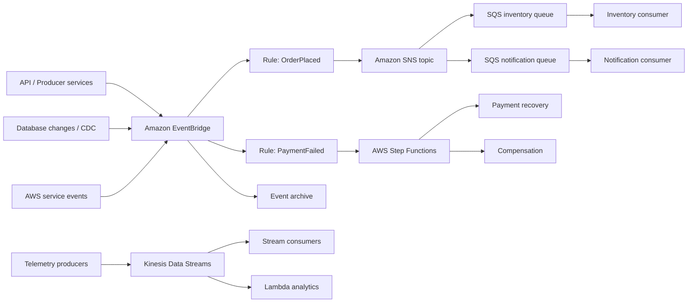
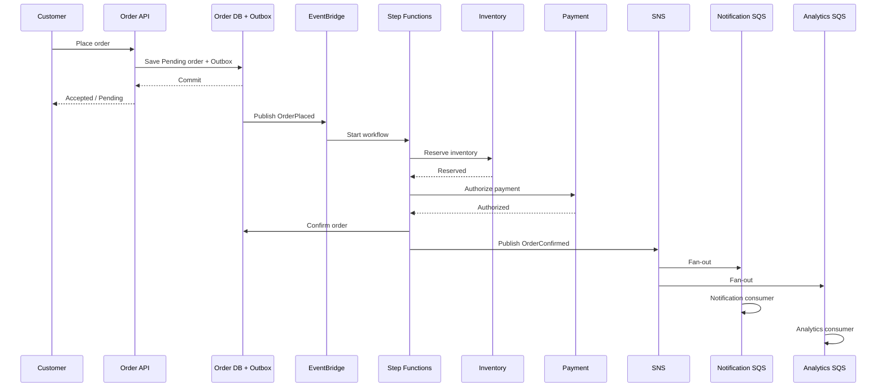

# Kiến trúc hướng sự kiện và giao tiếp bất đồng bộ

## 1. Vì sao hệ thống cần kiến trúc hướng sự kiện?

Trong hệ thống phân tán, một thao tác nghiệp vụ thường cần thông báo cho nhiều thành phần khác. Khi khách hàng đặt hàng, hệ thống có thể phải giữ tồn kho, xử lý thanh toán, gửi email, cập nhật phân tích và phát thông tin cho đối tác vận chuyển.

Nếu Order Service gọi đồng bộ tất cả dịch vụ này trong cùng một request, thời gian phản hồi phụ thuộc vào thành phần chậm nhất. Khi một dependency ngừng hoạt động, request đặt hàng có thể thất bại dù thao tác tạo đơn hàng đã hoàn tất. Các dịch vụ cũng bị phụ thuộc chặt vào API, địa chỉ và lịch hoạt động của nhau.

**Event-driven architecture (EDA)** cho phép một thành phần phát ra sự kiện mô tả điều đã xảy ra. Các thành phần quan tâm đăng ký nhận và xử lý sự kiện độc lập. Giao tiếp bất đồng bộ giúp tách thời điểm phát và xử lý, hấp thụ traffic burst, giảm phụ thuộc trực tiếp và hỗ trợ mở rộng từng consumer.

Trong AWS, một kiến trúc thường kết hợp:

- **Amazon EventBridge:** event bus, event pattern và routing đến nhiều target.
- **Amazon SNS:** publish/subscribe và fan-out tới nhiều subscriber.
- **Amazon SQS:** durable queue để lưu message, đệm tải và phân phối công việc cho consumer.
- **Amazon Kinesis Data Streams:** ingest và xử lý luồng dữ liệu liên tục.
- **AWS Lambda:** xử lý event theo kiểu serverless.
- **AWS Step Functions:** điều phối workflow nhiều bước và xử lý nhánh lỗi.
- **Amazon DynamoDB Streams hoặc database change data capture (CDC):** phát hiện thay đổi dữ liệu.
- **Amazon CloudWatch và AWS X-Ray:** quan sát độ trễ, lỗi, backlog và luồng xử lý.

EDA không phải lựa chọn thay thế mọi API đồng bộ. Request cần kết quả ngay, ví dụ xác thực thông tin đăng nhập hoặc đọc số dư tức thời, vẫn có thể dùng API đồng bộ. Những công việc có thể hoàn tất sau, cần fan-out hoặc cần chịu tải dao động thường phù hợp với giao tiếp bất đồng bộ.

## 2. Mục tiêu học tập

Sau bài học, người học có thể:

1. Phân biệt event, command và message.
2. Giải thích lợi ích, giới hạn và eventual consistency của giao tiếp bất đồng bộ.
3. Chọn EventBridge, SNS, SQS, Kinesis Data Streams hoặc Step Functions theo nhu cầu.
4. Thiết kế event envelope, schema version và correlation identifiers.
5. Xây dựng fan-out, queue-based load leveling và streaming pipeline.
6. Xử lý duplicate delivery, retry, visibility timeout, poison message và dead-letter queue (DLQ).
7. Thiết kế idempotent consumer, ordering và transactional outbox.
8. Dùng saga choreography hoặc orchestration để phối hợp transaction giữa nhiều dịch vụ.
9. Tích hợp Lambda với SQS, EventBridge và Kinesis một cách an toàn.
10. Theo dõi event age, queue depth, iterator age, delivery failure và end-to-end latency.
11. Bảo vệ event payload bằng IAM, resource policy, KMS và data minimization.
12. Đánh giá HA, throughput, retention, replay, chi phí và khả năng phục hồi.

## 3. Phân biệt event, command và message

Các thuật ngữ này thường được dùng lẫn nhau nhưng có ý nghĩa khác nhau.

| Khái niệm | Ý nghĩa | Ví dụ |
|---|---|---|
| Event | Sự kiện mô tả một điều đã xảy ra | OrderPlaced, PaymentCaptured |
| Command | Yêu cầu một thành phần thực hiện hành động | ReserveInventory, CapturePayment |
| Message | Đơn vị dữ liệu được truyền giữa các thành phần; có thể mang event hoặc command | SQS message chứa ReserveInventory |
| Notification | Thông báo cho thành phần khác biết một sự kiện hoặc trạng thái | CustomerRegistered |
| Stream record | Bản ghi trong luồng dữ liệu có vị trí/thứ tự theo shard hoặc partition | ClickEvent, DeviceTelemetry |

Event nên dùng thì quá khứ vì nó mô tả sự thật đã xảy ra: `OrderPlaced`, `PaymentFailed`. Event không nên chứa yêu cầu điều khiển một consumer cụ thể. Command thường mang ý định và hướng đến một handler: `ShipOrder` hoặc `RefundPayment`.

Một event có thể có nhiều subscriber. Mỗi subscriber quyết định cách phản ứng dựa trên trách nhiệm của nó. Ví dụ, `OrderPlaced` có thể được Inventory Service, Notification Service và Analytics Service tiêu thụ độc lập.

Một command thường có một owner chịu trách nhiệm thực hiện. Nếu cần yêu cầu thực hiện hành động và chờ kết quả, nên xác định rõ command ID, trạng thái xử lý và correlation ID để theo dõi.

## 4. Giao tiếp đồng bộ và bất đồng bộ

### 4.1. Giao tiếp đồng bộ

Trong giao tiếp đồng bộ, caller gửi request và chờ response trước khi tiếp tục.

Ưu điểm:

- Luồng điều khiển dễ hiểu.
- Caller nhận kết quả ngay.
- Phù hợp với truy vấn hoặc thao tác cần phản hồi trực tiếp.

Hạn chế:

- Caller phụ thuộc vào availability và latency của dependency.
- Timeout hoặc lỗi dây chuyền có thể lan qua nhiều dịch vụ.
- Khó hấp thụ traffic burst nếu downstream không đủ capacity.
- Caller thường phải biết endpoint và contract của dịch vụ đích.

### 4.2. Giao tiếp bất đồng bộ

Trong giao tiếp bất đồng bộ, producer gửi message/event đến broker hoặc stream. Consumer xử lý vào thời điểm phù hợp.

Ưu điểm:

- Producer và consumer không cần hoạt động cùng thời điểm.
- Queue có thể hấp thụ burst và điều tiết tốc độ xử lý.
- Consumer có thể scale độc lập.
- Một event có thể kích hoạt nhiều workflow.
- Lỗi downstream có thể được retry hoặc chuyển vào DLQ.

Đổi lại, hệ thống cần xử lý eventual consistency, duplicate delivery, retry, ordering, DLQ, replay và observability. Người dùng cũng cần biết trạng thái nghiệp vụ có thể là `Pending` hoặc `Processing` trước khi hoàn tất.

### 4.3. Eventual consistency

Giả sử Order Service ghi đơn hàng thành công và phát `OrderPlaced`. Inventory Service có thể cập nhật tồn kho sau vài giây. Trong khoảng đó, hai dịch vụ có trạng thái khác nhau nhưng hệ thống sẽ hội tụ nếu event được xử lý thành công.

Thiết kế phải xác định:

- Trạng thái nào được coi là đã xác nhận với người dùng.
- Consumer nào là nguồn dữ liệu có thẩm quyền cho từng loại thông tin.
- Cách hiển thị trạng thái đang xử lý.
- Cách xử lý event đến trễ hoặc sai thứ tự.
- Cách sửa dữ liệu khi một consumer thất bại lâu dài.

Không dùng eventual consistency để che giấu việc thiếu quy trình đối soát. Với nghiệp vụ tài chính hoặc tồn kho, cần có reconciliation job để phát hiện và xử lý sai lệch.

## 5. Event contract và cấu trúc dữ liệu

Một event contract ổn định giúp producer và consumer phát triển độc lập.

### 5.1. Các trường nên có

| Trường | Mục đích |
|---|---|
| eventId | Định danh duy nhất của event |
| eventType | Tên loại sự kiện |
| source | Dịch vụ hoặc hệ thống phát event |
| occurredAt | Thời điểm nghiệp vụ xảy ra, thường chuẩn hóa UTC |
| schemaVersion | Phiên bản cấu trúc payload |
| aggregateId | ID của đối tượng nghiệp vụ, ví dụ orderId |
| correlationId | Liên kết nhiều thao tác trong cùng workflow |
| causationId | Event/command đã gây ra event hiện tại |
| traceparent | Trace context nếu có distributed tracing |
| data | Payload nghiệp vụ |

Không phải dịch vụ AWS nào cũng yêu cầu chính xác envelope trên. EventBridge có envelope riêng gồm các trường như `version`, `id`, `source`, `detail-type`, `time`, `region`, `resources` và `detail`. Khi tự thiết kế event, cần giữ contract nhất quán giữa producer, broker và consumer.

### 5.2. Ví dụ event OrderPlaced

```json
{
  "eventId": "evt-01J9M5A7K3Q8",
  "eventType": "com.example.orders.order-placed",
  "schemaVersion": "1.0",
  "source": "orders-service",
  "occurredAt": "2026-11-20T05:30:00Z",
  "aggregateId": "order-20261120-10025",
  "correlationId": "checkout-8f3a",
  "causationId": "cmd-place-order-771",
  "data": {
    "orderId": "order-20261120-10025",
    "customerId": "customer-482",
    "currency": "VND",
    "totalAmount": 1250000,
    "items": [
      {
        "sku": "SKU-100",
        "quantity": 2
      }
    ]
  }
}
```

Ví dụ chỉ mang dữ liệu cần cho consumer. Không đưa access token, password, payment card data hoặc toàn bộ hồ sơ khách hàng vào event nếu consumer không cần chúng. Nếu payload lớn, lưu dữ liệu trong S3 và truyền object reference có quyền truy cập được kiểm soát.

### 5.3. Schema evolution

Khi thay đổi event contract:

- Ưu tiên thêm field optional với default rõ ràng.
- Không đổi ý nghĩa field hiện có.
- Không tái sử dụng tên field cho kiểu dữ liệu khác.
- Duy trì backward compatibility trong khoảng thời gian consumer nâng cấp.
- Có kế hoạch deprecate schema cũ.
- Kiểm thử producer và consumer với cả version cũ và mới.
- Cân nhắc AWS Glue Schema Registry cho streaming use cases cần quản lý schema.

Nếu thay đổi breaking, tạo event version/type mới hoặc dùng versioning rõ ràng. Không giả định tất cả consumer được deploy đồng thời.

## 6. Kiến trúc tổng quan hướng sự kiện trên AWS

Một hệ thống có thể kết hợp event bus, queue, stream và workflow tùy từng luồng nghiệp vụ.



Các thành phần không nhất thiết phải xuất hiện trong mọi ứng dụng. Chọn ít dịch vụ nhất có thể đáp ứng yêu cầu về routing, durability, fan-out, ordering, throughput và workflow.

## 7. Chọn dịch vụ giao tiếp phù hợp

| Nhu cầu | Dịch vụ phù hợp | Đặc điểm chính |
|---|---|---|
| Routing event theo source/type/content đến nhiều target | EventBridge event bus | Event patterns, rules, target routing, archive/replay |
| Tích hợp point-to-point từ một source đến một target với filter/enrichment | EventBridge Pipes | Managed source-to-target integration |
| Fan-out một notification tới nhiều subscriber | SNS | Pub/sub, filter policy, delivery retry |
| Buffer công việc và phân phối cho worker | SQS | Durable queue, visibility timeout, DLQ |
| Giữ thứ tự theo message group | SQS FIFO | Ordering trong group và deduplication |
| Ingest telemetry/event volume lớn và stream processing | Kinesis Data Streams | Shards, partition key, retention, consumers |
| Điều phối workflow nhiều bước và compensation | Step Functions | State machine, retry, catch, execution history |
| Theo dõi thay đổi item trong DynamoDB | DynamoDB Streams | Change records theo thứ tự của stream |
| Phát thay đổi từ relational database | AWS DMS CDC hoặc cơ chế CDC phù hợp | Capture thay đổi và chuyển đến stream/target |

### 7.1. EventBridge hay SNS?

Dùng EventBridge khi cần routing dựa trên event metadata và nội dung, tích hợp nhiều AWS services/SaaS/custom sources, hoặc muốn archive và replay.

Dùng SNS khi cần publish một notification tới nhiều subscriber theo mô hình fan-out. SNS subscription có thể dùng filter policy để mỗi subscriber chỉ nhận message phù hợp.

### 7.2. SNS hay SQS?

SNS là publisher-driven fan-out: publisher gửi một lần đến topic và SNS chuyển tiếp đến subscribers.

SQS là queue do consumer đọc: message nằm trong queue cho đến khi được consumer xử lý và xóa. SQS phù hợp khi cần đệm tải, kiểm soát concurrency, giữ message trong lúc consumer offline và tách tốc độ producer khỏi consumer.

Mô hình SNS → nhiều SQS queues kết hợp fan-out với durable buffer cho từng consumer.

### 7.3. SQS hay Kinesis?

SQS phù hợp với task/message processing độc lập, nơi consumer nhận và xác nhận từng message. Kinesis phù hợp với dữ liệu streaming cần lưu trong một khoảng retention, đọc theo shard/sequence và có thể cho nhiều consumer xử lý luồng dữ liệu.

Không dùng Kinesis chỉ vì muốn có queue. Cần xác định có thật sự cần stream retention, partition ordering, replay theo sequence/time và nhiều stream consumers hay không.

## 8. Amazon EventBridge event bus

### 8.1. Cách hoạt động

EventBridge event bus nhận event từ AWS services, custom applications hoặc SaaS partners. Rules trên event bus so khớp event pattern và gửi event đến target tương ứng.

Một event có thể match nhiều rule. Mỗi rule có thể route tới các target được hỗ trợ như Lambda, SQS, SNS, Step Functions hoặc một event bus khác.

Event bus giúp producer không phải biết subscriber cụ thể. Producer chỉ cần gửi event theo contract; owner của từng consumer quản lý rule và target của mình.

### 8.2. Event pattern

Ví dụ rule chỉ nhận event `OrderPlaced` từ Orders Service:

```json
{
  "source": ["com.example.orders"],
  "detail-type": ["OrderPlaced"],
  "detail": {
    "status": ["CONFIRMED"],
    "totalAmount": [
      {
        "numeric": [">=", 1000000]
      }
    ]
  }
}
```

Event pattern kiểm tra các trường trong event. Dùng EventBridge Sandbox để thử pattern với sample events trước khi triển khai. Kiểm tra cả trường hợp thiếu field, kiểu dữ liệu không đúng và event version mới.

### 8.3. Event bus và rule design

- Dùng custom event bus để phân tách domain hoặc nhóm workload.
- Dùng naming convention nhất quán cho source và detail-type.
- Tạo rule có mục đích rõ ràng, tránh pattern quá rộng.
- Giới hạn quyền PutEvents theo producer.
- Đặt target execution role/resource policy đúng phạm vi.
- Theo dõi FailedInvocations, Invocations và DLQ metrics.
- Tránh rule loop, ví dụ rule bắt event thay đổi policy rồi target lại sửa policy theo cách phát ra cùng event.

Một event không match rule nào trên event bus sẽ không được route tới target. Nếu cần lưu để kiểm tra hoặc replay, cấu hình archive phù hợp.

### 8.4. Cross-account và cross-Region

EventBridge hỗ trợ gửi event sang event bus khác bằng resource policy và IAM role theo thiết kế. Cần xác định rõ account owner, Region, source trust và target permissions. Không mở quyền PutEvents cho toàn bộ account hoặc principal nếu chỉ một producer cần gửi event.

## 9. EventBridge Pipes, archive và replay

### 9.1. EventBridge Pipes

Pipes phù hợp với tích hợp point-to-point: một source, xử lý filter/enrichment và một target. Source có thể là SQS, Kinesis, DynamoDB Streams hoặc các nguồn được hỗ trợ.

Pipes giúp giảm code polling/forwarding tự quản. Tuy nhiên, cần hiểu semantics của source, batching, retry, checkpoint và target trước khi chọn. Pipe không phải event bus fan-out; nếu cần nhiều consumer độc lập, event bus hoặc pub/sub thường phù hợp hơn.

### 9.2. Archive

EventBridge archive lưu event đã match archive filter trong khoảng retention được cấu hình. Archive hữu ích cho:

- Điều tra sự cố.
- Phục hồi consumer sau bug.
- Replay một khoảng event để xây lại projection.
- Kiểm thử consumer mới với dữ liệu lịch sử.

Archive không tự động là backup toàn bộ database. Nó chỉ lưu những event được gửi vào event bus và match archive configuration.

### 9.3. Replay

EventBridge replay gửi lại event đã lưu trong archive về chính event bus nguồn. Có thể chọn khoảng thời gian và rule được phép nhận replay.

Trước khi replay production:

- Xác định consumer sẽ nhận event replay.
- Kiểm tra idempotency và khả năng duplicate.
- Dùng event time và event ID để tránh áp dụng lại nghiệp vụ không mong muốn.
- Đánh giá backlog và downstream capacity.
- Cân nhắc replay vào môi trường staging hoặc bus riêng trước.

Replay event không đồng nghĩa reset dữ liệu. Consumer cần có logic phân biệt live và replay nếu nghiệp vụ yêu cầu.

### 9.4. Retry và DLQ của EventBridge

Khi target invocation thất bại, EventBridge áp dụng retry policy. Cấu hình maximum event age, retry attempts và SQS DLQ cho target khi cần lưu event không giao được.

Nếu không cấu hình DLQ, event có thể bị loại bỏ sau khi hết retry. DLQ phải cho phép EventBridge gửi message bằng resource policy phù hợp. Với target FIFO hoặc yêu cầu giữ thứ tự, cần chọn DLQ và quy trình redrive tương ứng.

DLQ message của EventBridge có thể kèm metadata về lần giao thất bại; cấu trúc phụ thuộc loại event bus và target integration. Không giả định body luôn giống raw event ban đầu. Khi xử lý, đọc format được tài liệu hóa, lấy event identifier và metadata lỗi, sau đó replay event gốc theo quy trình phù hợp.

## 10. Amazon SNS: publish/subscribe và fan-out

### 10.1. Mô hình topic

Producer publish message tới SNS topic. SNS chuyển message đến từng subscription:

- SQS queue.
- Lambda function.
- HTTP/S endpoint.
- Email/SMS hoặc các protocol khác trong phạm vi hỗ trợ.

Một topic có thể phát một thông báo đến nhiều hệ thống mà producer không cần biết số lượng subscriber.

### 10.2. SNS filter policy

Filter policy cho phép mỗi subscription chỉ nhận message có message attributes hoặc body thỏa điều kiện.

Ví dụ:

- Billing subscriber nhận event PaymentCaptured.
- Notification subscriber nhận OrderPlaced hoặc ShipmentDispatched.
- Analytics subscriber nhận event có region/business unit cụ thể.

Filter giúp giảm invocation và traffic không cần thiết. Cần kiểm thử filter khi schema thay đổi vì filter sai có thể làm mất notification của subscriber.

### 10.3. SNS và SQS fan-out

Mô hình phổ biến:

1. Producer publish một event đến SNS topic.
2. SNS chuyển một bản message đến mỗi SQS subscription.
3. Mỗi consumer đọc queue riêng.
4. Consumer chậm không làm consumer khác phải chờ.
5. Queue giữ message trong thời gian consumer phục hồi.

Mỗi subscription có thể gắn DLQ riêng để điều tra lỗi delivery đến endpoint. Đây là khác biệt với DLQ của SQS consumer: SNS subscription DLQ giữ message SNS không giao được tới subscriber; SQS queue DLQ giữ message consumer xử lý thất bại nhiều lần.

### 10.4. SNS FIFO

SNS FIFO topic hỗ trợ ordering và deduplication theo message group/deduplication configuration, kết hợp với SQS FIFO subscription khi cần fan-out có thứ tự. Cần thiết kế message group để giữ thứ tự cho cùng một aggregate nhưng vẫn cho phép xử lý song song giữa các aggregate.

Không giả định mọi subscriber protocol đều hỗ trợ các semantics giống FIFO. Kiểm tra loại topic, loại subscription và giới hạn dịch vụ trước khi triển khai.

### 10.5. Ordering và subscription failure

Với FIFO topic và FIFO queue subscription, giữ nhất quán MessageGroupId xuyên suốt fan-out. Nếu subscriber bị lỗi giao message, gắn DLQ ở cấp subscription và theo dõi delivery failure. Việc redrive một message lỗi cần xem xét thứ tự nghiệp vụ của group; không replay một message cũ sau khi các message mới hơn đã được xử lý nếu điều đó làm trạng thái aggregate sai lệch.

## 11. Amazon SQS: durable queue và load leveling

### 11.1. Standard queue

SQS Standard queue phù hợp với throughput cao và consumer xử lý độc lập. Semantics chính:

- At-least-once delivery: message có thể được giao nhiều hơn một lần.
- Best-effort ordering: thứ tự nhận không được bảo đảm tuyệt đối.
- Message có thể được nhận lại nếu consumer không xóa trước khi visibility timeout hết hạn.
- Consumer cần idempotent.

Dùng Standard queue khi thứ tự không phải điều kiện bắt buộc và hệ thống có thể xử lý duplicate.

### 11.2. FIFO queue

SQS FIFO queue hỗ trợ:

- Ordering nghiêm ngặt trong cùng MessageGroupId.
- Deduplication ID hoặc content-based deduplication.
- Throughput cao hơn khi dùng high-throughput mode trong phạm vi hỗ trợ.
- Consumer xử lý tuần tự từng message trong một group, trong khi các group khác có thể xử lý song song.

FIFO không tự giải quyết mọi duplicate nghiệp vụ. Deduplication của SQS có cửa sổ thời gian giới hạn; nếu producer retry sau cửa sổ hoặc consumer đã commit side effect nhưng chưa xóa message, ứng dụng vẫn cần idempotency.

Nếu message trong một FIFO group liên tục lỗi và bị chuyển sang DLQ, các message tiếp theo trong group có thể tiếp tục được xử lý. Điều này có thể tạo khoảng trống trong chuỗi nghiệp vụ. Khi redrive, cần kiểm tra sequence/version và trạng thái aggregate trước khi cho message cũ chạy lại. Với FIFO source queue, DLQ cũng phải là FIFO queue.

### 11.3. Visibility timeout

Khi consumer nhận message, SQS tạm ẩn message khỏi consumer khác trong thời gian visibility timeout.

- Nếu xử lý và DeleteMessage thành công, message bị xóa.
- Nếu consumer lỗi hoặc timeout, message có thể hiển thị lại.
- Nếu xử lý lâu, consumer có thể dùng ChangeMessageVisibility để gia hạn.
- Visibility timeout không được vượt quá giới hạn tối đa 12 giờ tính từ lúc message được nhận đầu tiên.

Đặt timeout đủ dài cho processing time, nhưng không quá dài khiến message lỗi mất nhiều thời gian mới được retry. Với job dài hơn giới hạn, chia nhỏ công việc hoặc dùng Step Functions.

### 11.4. Dead-letter queue

DLQ nhận message sau khi source queue đã giao quá số lần được cấu hình trong redrive policy.

DLQ giúp:

- Cô lập poison message.
- Tránh một message lỗi làm consumer retry vô hạn.
- Giữ dữ liệu để phân tích.
- Hỗ trợ redrive sau khi sửa lỗi.

Đặt maxReceiveCount theo failure profile. Retention của DLQ nên đủ dài cho quá trình điều tra; với Standard queue, nên cân nhắc retention DLQ dài hơn source queue. Kiểm tra RedriveAllowPolicy để chỉ queue được phép gửi vào DLQ.

### 11.5. Long polling và batching

Long polling giảm số lần ReceiveMessage trả về rỗng và giảm chi phí polling. Batch receive/send/delete giúp tăng throughput và giảm API calls.

Batch lớn không phải lúc nào cũng tốt: nó tăng memory, thời gian xử lý, payload size và blast radius nếu batch lỗi. Chọn batch size theo processing time, message size và concurrency.

## 12. Ordering, deduplication và delivery semantics

### 12.1. Ba kiểu delivery semantics

| Semantics | Ý nghĩa | Hệ quả thiết kế |
|---|---|---|
| At-most-once | Message được giao không quá một lần nhưng có thể mất | Phù hợp khi bỏ sót có thể chấp nhận |
| At-least-once | Message được giao một hoặc nhiều lần | Consumer phải xử lý duplicate |
| Exactly-once | Hệ thống cung cấp semantics xử lý đúng một lần trong phạm vi được định nghĩa | Cần hiểu rõ phạm vi guarantee; side effect ngoài hệ thống vẫn cần idempotency |

Trong hệ thống phân tán, "exactly once" không phải lời hứa chung cho mọi side effect. Ví dụ, SQS FIFO deduplicates send trong khoảng thời gian nhất định, nhưng nếu consumer trừ tồn kho thành công rồi crash trước DeleteMessage, message có thể được nhận lại. Consumer cần ghi nhận eventId hoặc commandId đã xử lý.

### 12.2. Idempotency

Một thao tác idempotent khi thực hiện nhiều lần với cùng input vẫn cho kết quả nghiệp vụ tương đương thực hiện một lần.

Ví dụ:

- Lưu bảng ProcessedEvents với eventId là unique key.
- Ghi nhận payment operation bằng idempotency key.
- Dùng conditional write hoặc transaction để chống cập nhật trùng.
- Kiểm tra aggregate version trước khi áp dụng event.
- Thiết kế command handler trả lại kết quả cũ khi nhận command ID đã xử lý.

Mẫu xử lý:

1. Nhận event.
2. Bắt đầu database transaction.
3. Insert eventId vào bảng inbox/processed-events có unique constraint.
4. Nếu eventId đã tồn tại, không lặp side effect và xác nhận message.
5. Nếu mới, cập nhật nghiệp vụ và commit cùng transaction.
6. Chỉ sau khi commit thành công mới acknowledge/delete message.

Không ghi dấu processed trước khi side effect hoàn tất; nếu process crash giữa hai bước, event có thể bị bỏ qua dù nghiệp vụ chưa được cập nhật.

### 12.3. Ordering

Ordering có thể cần theo orderId, customerId hoặc accountId thay vì toàn hệ thống. Chọn message group/partition key theo aggregate để giữ thứ tự trong phạm vi cần thiết và cho phép xử lý song song giữa các aggregate.

Khi event đến sai thứ tự:

- Kiểm tra aggregate version hoặc sequence number.
- Bỏ qua event cũ đã áp dụng.
- Buffer event đến sớm nếu thiếu event trước.
- Retry hoặc yêu cầu rebuild projection khi phát hiện gap.
- Không dựa vào timestamp đơn lẻ để quyết định thứ tự nếu clock của producer có thể lệch.

## 13. Tích hợp Lambda với SQS

Lambda event source mapping poll SQS và gọi function theo batch. Khi function xử lý thành công toàn batch, Lambda xóa message. Nếu invocation lỗi, message có thể quay lại sau visibility timeout.

### 13.1. Cấu hình timeout và batch

- Function timeout phải nhỏ hơn hoặc bằng queue visibility timeout.
- AWS khuyến nghị visibility timeout ít nhất sáu lần function timeout để Lambda có thời gian retry khi bị throttling.
- Chọn batch size theo thời gian xử lý và payload.
- Đặt reserved concurrency hoặc maximum concurrency để bảo vệ downstream database/API.
- Cấu hình redrive policy và DLQ.
- Theo dõi queue age và ApproximateNumberOfMessagesVisible.

### 13.2. Partial batch response

Mặc định, nếu một record trong batch lỗi, cả batch có thể được trả lại để retry. Bật `ReportBatchItemFailures` để function trả danh sách item lỗi; message đã xử lý thành công không cần xử lý lại.

Ví dụ response khi một message lỗi:

```json
{
  "batchItemFailures": [
    {
      "itemIdentifier": "message-id-2"
    }
  ]
}
```

Với FIFO queue, khi một record lỗi, nên dừng xử lý các record tiếp theo trong cùng batch và trả về record lỗi cùng những record chưa xử lý để giữ thứ tự. Có thể dùng AWS Lambda Powertools Batch Processor để giảm code xử lý batch failure.

### 13.3. Concurrency và backpressure

Consumer không nên scale nhanh hơn khả năng database hoặc downstream API. Đặt maximum concurrency, reserved concurrency hoặc poller limits theo capacity thực tế.

Nếu queue backlog tăng, cần phân biệt:

- Producer tăng traffic.
- Consumer chậm do xử lý nặng.
- Downstream dependency chậm.
- Consumer bị throttle.
- Poison message lặp lại.
- Queue visibility timeout không phù hợp.

Không tăng concurrency vô hạn để xóa backlog; điều đó có thể làm downstream sập theo.

## 14. Amazon Kinesis Data Streams

Kinesis Data Streams phù hợp với dữ liệu streaming liên tục như clickstream, telemetry, application logs, IoT events và event analytics.

### 14.1. Stream, record, shard và partition key

- Stream chứa nhiều shard.
- Mỗi record có sequence number, partition key và data blob.
- Partition key quyết định record được đặt vào shard nào trong mô hình user-managed partition key.
- Records cùng partition key được đặt vào cùng shard, giúp consumer giữ thứ tự tương đối theo key.
- Một shard là đơn vị throughput và ordering.

Hot partition key có thể làm một shard quá tải dù toàn stream còn capacity. Chọn partition key có phân bố đều nhưng vẫn giữ ordering theo entity cần thiết.

### 14.2. Capacity mode

Kinesis Data Streams có provisioned mode và on-demand mode:

- Provisioned: chọn số shard, quản lý capacity và scaling.
- On-demand: dịch vụ tự quản lý capacity theo traffic pattern trong phạm vi hỗ trợ.

Chọn mode theo traffic predictability, burst, throughput, chi phí và khả năng quản trị shard. Kiểm tra quota/Region support trước khi triển khai.

### 14.3. Retention và replay

Retention mặc định của stream là 24 giờ và có thể tăng đến 365 ngày. Consumer có thể đọc lại record trong retention window bằng cách bắt đầu từ sequence/timestamp phù hợp.

Kinesis retention không thay thế data lake hoặc archival lâu dài. Nếu cần lưu lịch sử dài, dùng Firehose/S3 hoặc pipeline lưu trữ phù hợp.

### 14.4. Consumer và enhanced fan-out

Consumer có thể dùng GetRecords với shared read throughput hoặc enhanced fan-out để nhận throughput riêng theo shard. Enhanced fan-out hữu ích khi nhiều consumer độc lập cùng đọc stream và cần độ trễ thấp hơn.

Dùng Kinesis Client Library (KCL) nếu cần quản lý shard leases, checkpoint và failover giữa consumer instances. Khi consumer xử lý record, checkpoint phải phản ánh tiến độ đã commit để tránh mất hoặc xử lý lại dữ liệu không mong muốn.

### 14.5. Khi nào chọn Kinesis thay vì SQS?

Chọn Kinesis nếu cần:

- Lưu stream record để nhiều consumer đọc độc lập.
- Ordering theo partition key/shard.
- Replay trong retention period.
- Streaming analytics hoặc near-real-time processing.
- Tích hợp KCL, Lambda, Managed Service for Apache Flink hoặc Firehose.

Chọn SQS nếu mỗi task cần được phân phối cho worker, có acknowledge/delete và DLQ theo queue semantics.

## 15. AWS Step Functions cho workflow bất đồng bộ

Step Functions điều phối một workflow gồm nhiều bước, nhánh, retry, timeout, catch và compensation.

Ví dụ đặt hàng:

1. Validate order.
2. Reserve inventory.
3. Authorize payment.
4. Confirm order.
5. Request shipment.
6. Send notification.

Nếu bước payment thất bại sau khi inventory đã reserve, workflow có thể gọi ReleaseInventory để bù trừ.

### 15.1. Standard và Express workflows

| Thuộc tính | Standard | Express |
|---|---|---|
| Use case | Workflow dài, cần audit/execution history | Event processing volume cao, thời gian ngắn |
| Thời lượng tối đa | Tối đa một năm | Tối đa năm phút |
| Semantics | Exactly-once workflow execution; retry khai báo có thể chạy lại task | Async Express at-least-once; Sync Express at-most-once |
| Lịch sử | Execution history chi tiết | Dựa vào CloudWatch Logs theo cấu hình |
| Tính phí | State transitions | Số execution, thời lượng và memory |

Exactly-once của Standard nói về semantics thực thi workflow/state trong dịch vụ. Nó không tự làm cho side effect bên ngoài như charge thẻ hoặc ghi database trở thành exactly-once. Task vẫn cần idempotency key và xử lý timeout không rõ kết quả.

### 15.2. Retry và Catch

Dùng Retry cho lỗi tạm thời như throttling hoặc service unavailable. Dùng Catch để điều hướng lỗi không thể retry hoặc sau khi hết retry.

Thiết lập:

- ErrorEquals cụ thể.
- IntervalSeconds và BackoffRate.
- MaxAttempts phù hợp.
- Timeout cho task.
- Catch path và compensation.
- Execution role least privilege.

Không retry lỗi validation hoặc business rule không thể tự phục hồi. Retry quá rộng có thể tạo duplicate side effect hoặc chi phí cao.

## 16. Transactional outbox và CDC

### 16.1. Vấn đề dual write

Giả sử Order Service:

1. Ghi đơn hàng vào database.
2. Publish `OrderPlaced` lên EventBridge hoặc SQS.

Nếu database commit thành công nhưng publish thất bại, downstream không biết đơn hàng đã được tạo. Nếu publish thành công nhưng database rollback, downstream nhận event không có dữ liệu tương ứng.

Đây là dual-write problem.

### 16.2. Transactional outbox

Outbox lưu event trong cùng database transaction với dữ liệu nghiệp vụ.

Quy trình:

1. Bắt đầu transaction.
2. Insert/update Order.
3. Insert event record vào Outbox table.
4. Commit một lần.
5. Publisher/CDC process đọc outbox và gửi event tới broker.
6. Đánh dấu hoặc checkpoint event đã publish.
7. Consumer xử lý idempotently.

Nếu transaction rollback, cả Order và Outbox record đều không tồn tại. Nếu publisher gửi thành công nhưng crash trước khi đánh dấu, event có thể gửi lại; consumer vẫn cần idempotency.

### 16.3. CDC

CDC đọc thay đổi từ database log/stream và chuyển chúng đến downstream. Với DynamoDB, DynamoDB Streams có thể kích hoạt Lambda khi item thay đổi. Với relational database, AWS DMS có thể capture CDC và đưa dữ liệu đến các target được hỗ trợ.

CDC giảm nhu cầu polling outbox nhưng cần hiểu retention, checkpoint, schema mapping, duplicate và ordering semantics của nguồn.

## 17. Saga: phối hợp transaction nhiều dịch vụ

Khi workflow cập nhật nhiều database độc lập, không thể mặc định dùng một ACID transaction xuyên tất cả dịch vụ. Saga chia workflow thành local transactions và định nghĩa compensating actions.

Ví dụ đặt hàng:

| Bước | Local transaction | Compensation |
|---|---|---|
| 1 | Tạo order Pending | Cancel order |
| 2 | Reserve inventory | Release inventory |
| 3 | Authorize payment | Void authorization |
| 4 | Confirm order | Cancel order nếu còn khả thi |
| 5 | Create shipment | Cancel shipment |

Compensation không nhất thiết là rollback vật lý. Nếu payment đã captured, compensation có thể là refund. Nếu shipment đã gửi, có thể tạo return workflow.

### 17.1. Choreography

Mỗi service lắng nghe event và phát event tiếp theo. Phù hợp với workflow ít participant và các domain có ownership rõ ràng.

Ưu điểm: ít central coordinator, các service độc lập.

Hạn chế: khi participant tăng, luồng nghiệp vụ phân tán khó quan sát và debug.

### 17.2. Orchestration

Một orchestrator điều phối các bước và xử lý lỗi. AWS Step Functions là lựa chọn phổ biến.

Ưu điểm: workflow hiển thị tập trung, dễ theo dõi trạng thái và compensation.

Hạn chế: cần quản lý state machine, permission và logic điều phối; không nên để mọi business rule tập trung thành một orchestrator quá lớn.

Chọn choreography cho event reactions đơn giản; chọn orchestration cho transaction nhiều bước cần trạng thái, timeout, human approval hoặc compensation rõ ràng.

## 18. Retry, backoff và poison messages

### 18.1. Retry có kiểm soát

Retry phù hợp với lỗi tạm thời như network timeout, throttling hoặc service unavailable. Dùng exponential backoff và jitter để tránh nhiều consumer retry đồng thời.

Ví dụ chiến lược:

- Lần 1: chờ ngắn.
- Lần 2: tăng khoảng chờ.
- Các lần sau: tăng theo exponential backoff, có giới hạn tối đa.
- Dừng khi hết retry budget hoặc deadline nghiệp vụ.

Không retry liên tục với validation error, permission denied hoặc schema mismatch nếu chưa có thay đổi khắc phục.

### 18.2. Poison message

Poison message là message luôn thất bại do payload không hợp lệ, bug, schema không tương thích hoặc dữ liệu nghiệp vụ bất thường.

Biện pháp:

- Giới hạn receive count.
- Đưa message sang DLQ.
- Ghi eventId, error type và correlationId.
- Tạo alarm cho DLQ depth.
- Phân tích và sửa nguyên nhân.
- Redrive có kiểm soát sau khi consumer được sửa.
- Giữ audit trail về replay.

Không tự động redrive liên tục khi nguyên nhân chưa được sửa. Việc đó tạo vòng lặp lỗi và có thể làm queue backlog tăng mạnh.

### 18.3. Retry budget và deadline

Một request nghiệp vụ có thể đi qua nhiều service. Nếu mỗi service tự retry 5 lần, tổng số lần downstream call có thể tăng theo cấp số nhân. Thiết kế deadline/correlation context để các service biết thời gian còn lại và tránh retry sau khi kết quả không còn hữu ích.

## 19. Backpressure, batching và queue depth

Queue là buffer, không phải năng lực xử lý vô hạn. Nếu producer liên tục tạo message nhanh hơn consumer, backlog sẽ tăng.

Theo dõi:

- ApproximateNumberOfMessagesVisible.
- ApproximateNumberOfMessagesNotVisible.
- ApproximateAgeOfOldestMessage.
- NumberOfMessagesSent/Received/Deleted.
- Lambda concurrent executions và throttles.
- Consumer processing duration.
- Downstream database/API saturation.

Đặt giới hạn concurrency để bảo vệ dependency. Dùng batch processing khi overhead API lớn nhưng cân nhắc latency và failure isolation. Với Kinesis, theo dõi IncomingBytes/Records, Read/WriteProvisionedThroughputExceeded và IteratorAgeMilliseconds.

Một queue có thể giúp hấp thụ burst ngắn. Nếu tốc độ producer luôn cao hơn consumer, queue chỉ trì hoãn sự cố; cần tăng capacity, giảm workload, giới hạn producer hoặc thiết kế admission control.

## 20. Observability cho event-driven systems

### 20.1. Correlation và tracing

Mỗi event nên mang eventId và correlationId. Propagate trace context qua producer, broker và consumer nếu integration hỗ trợ. Ghi log có cấu trúc gồm:

- eventId.
- eventType.
- source.
- aggregateId.
- correlationId.
- consumer name/version.
- attempt count.
- processing duration.
- outcome/error category.

Không log toàn bộ payload nếu có PII, secret hoặc dữ liệu nhạy cảm.

### 20.2. Metrics theo dịch vụ

| Dịch vụ | Metrics cần theo dõi |
|---|---|
| EventBridge | Invocations, FailedInvocations, ThrottledRules, DeadLetterInvocations, MatchedEvents |
| SNS | NumberOfMessagesPublished, NumberOfNotificationsDelivered, NumberOfNotificationsFailed |
| SQS | ApproximateNumberOfMessagesVisible, ApproximateAgeOfOldestMessage, NumberOfMessagesSent/Received/Deleted |
| Lambda | Invocations, Errors, Throttles, Duration, ConcurrentExecutions |
| Kinesis | IncomingRecords, IncomingBytes, Read/Write throughput exceptions, IteratorAgeMilliseconds |
| Step Functions | ExecutionsStarted, ExecutionsFailed, ExecutionsTimedOut, ExecutionThrottled |

Metrics cụ thể phụ thuộc dịch vụ, Region và dimension. Đặt alarm theo tác động nghiệp vụ, ví dụ oldest message age vượt SLA hoặc DLQ có message mới.

### 20.3. Distributed tracing

AWS X-Ray hoặc OpenTelemetry có thể giúp nối trace qua service calls. Với queue, producer và consumer không chạy cùng request context; cần truyền trace/correlation metadata trong message và tạo consumer span riêng.

Không giả định trace tự động nối xuyên mọi broker. Kiểm tra integration instrumentation và propagate context theo định dạng đã chọn.

## 21. Security cho event bus, topic, queue và stream

### 21.1. IAM và resource policies

- Producer chỉ có quyền publish vào event bus/topic/queue cần thiết.
- Consumer chỉ có quyền nhận message từ queue/stream của mình.
- EventBridge target role chỉ được gọi đúng target.
- SNS topic policy chỉ cho phép publisher/subscriber phù hợp.
- SQS queue policy giới hạn service principal hoặc account được gửi.
- Kinesis producer/consumer có quyền theo stream và operation cần thiết.

Dùng resource policy cho cross-account integration và kiểm tra cả IAM identity policy lẫn resource policy. Không cấp quyền wildcard nếu không cần.

### 21.2. Encryption

- Dùng TLS cho API calls và endpoints.
- Bật server-side encryption cho SQS/SNS/Kinesis theo yêu cầu.
- Dùng KMS key policy cho producer/consumer.
- Kiểm tra quyền KMS decrypt khi Lambda đọc encrypted queue.
- Bảo vệ archive và DLQ vì chúng có thể chứa payload nhạy cảm.

### 21.3. Data minimization

Event thường được nhân bản đến nhiều subscriber. Vì vậy:

- Chỉ phát field cần thiết.
- Tránh secret, password, payment credentials.
- Dùng object reference thay vì payload lớn.
- Có retention policy cho archive, queue và stream.
- Phân loại dữ liệu trước khi cho phép fan-out cross-account.
- Không để DLQ hoặc log thành nơi lưu PII không kiểm soát.

## 22. Availability, durability và disaster recovery

### 22.1. Chọn durability theo nhu cầu

SQS/SNS/EventBridge/Kinesis có durability và retention model khác nhau. Đọc rõ guarantee của từng dịch vụ, thời gian retention, retry policy và behavior khi target lỗi.

Không coi broker là backup vĩnh viễn. Nếu event cần lưu nhiều năm hoặc phục vụ audit, thiết kế archival sang S3/data lake hoặc hệ thống lưu trữ có retention riêng.

### 22.2. Failure domains

- Tách event bus, queue và stream theo domain hoặc workload.
- Tránh một queue chung cho tất cả loại công việc.
- Có DLQ và alert.
- Giới hạn concurrency để downstream không bị quá tải.
- Thiết kế producer retry có idempotency.
- Đánh giá cross-Region replication và replay nếu cần DR.

### 22.3. Khôi phục sau outage

Khi consumer ngừng hoạt động:

1. Xác định queue age/backlog và lỗi downstream.
2. Khôi phục dependency trước khi tăng consumer concurrency.
3. Kiểm tra DLQ và event retention.
4. Chạy canary consumer để xác minh.
5. Scale consumer theo từng bước.
6. Theo dõi age of oldest message và processing rate.
7. Nếu replay archive/stream, kiểm tra duplicate và tác động side effect.

Đừng xóa queue hoặc archive để xử lý backlog khi chưa xác định message nào cần giữ.

## 23. Anti-patterns thường gặp

| Anti-pattern | Hậu quả | Cách cải thiện |
|---|---|---|
| Dùng event bus như queue cho task cần acknowledge từng message | Khó kiểm soát worker backlog và per-message state | Dùng SQS |
| Dùng SQS Standard nhưng giả định ordering | Sai trạng thái nghiệp vụ khi event đến sai thứ tự | FIFO/group hoặc sequence/version handling |
| Consumer không idempotent | Duplicate gây charge/trừ tồn kho nhiều lần | Inbox table/idempotency key |
| Publish event sau DB commit mà không outbox | Mất event khi publish lỗi | Transactional outbox hoặc CDC |
| Retry vô hạn | Poison message và backlog tăng | Retry budget, DLQ, alert |
| Queue dùng chung cho workload không liên quan | Một consumer chậm ảnh hưởng các nhóm khác | Queue theo consumer/domain |
| Event payload chứa toàn bộ entity | Coupling và data exposure tăng | Event nhỏ, versioned, reference khi cần |
| Một event kích hoạt lại chính nó vô hạn | Loop và chi phí tăng | Event pattern chính xác, idempotent rule |
| Scale consumer không giới hạn | Downstream database bị quá tải | Maximum concurrency/backpressure |
| Chọn Kinesis nhưng không quản lý partition key | Hot shard và throttling | Phân tích key distribution |
| Saga không có compensation | Trạng thái dở dang khó khôi phục | Thiết kế forward/compensating actions |
| Replay không kiểm soát | Side effect bị thực hiện lại | Idempotency, replay scope và canary |

## 24. Ví dụ kiến trúc: xử lý đơn hàng bất đồng bộ

Một website thương mại điện tử nhận request đặt hàng. API chỉ cần xác nhận yêu cầu đã được tiếp nhận; các bước còn lại chạy bất đồng bộ.

Luồng tham khảo:

1. API Gateway/Lambda hoặc Order Service xác thực request.
2. Order Service ghi order Pending và outbox record trong cùng database transaction.
3. Publisher gửi `OrderPlaced` tới EventBridge.
4. EventBridge route event tới Step Functions để điều phối quy trình đơn hàng.
5. Workflow yêu cầu Inventory Service reserve hàng.
6. Payment Service authorize payment.
7. Khi cả hai thành công, workflow xác nhận order.
8. Event `OrderConfirmed` được publish tới SNS.
9. SNS fan-out đến SQS queues cho Notification, Analytics và Fulfillment.
10. Mỗi consumer xử lý độc lập, có DLQ và idempotency.
11. Nếu payment thất bại, saga release inventory và cập nhật order Failed/Cancelled.

### 24.1. Sơ đồ sequence



### 24.2. Khi payment thất bại

- Step Functions nhận lỗi.
- Workflow gọi ReleaseInventory.
- Order Service cập nhật trạng thái Cancelled hoặc PaymentFailed.
- Phát event OrderPaymentFailed.
- Notification Service gửi thông báo phù hợp.
- Incident/metrics ghi lại failure để theo dõi.

Không hoàn tiền nếu payment chỉ mới authorize và chưa capture; compensation phải tương ứng với trạng thái thực tế của payment provider.

## 25. AWS CLI: tạo queue và kiểm tra event flow

Các lệnh dưới đây là ví dụ. Thay Region, account ID và tên tài nguyên bằng giá trị môi trường. IAM role/policy và resource policy cần được cấu hình riêng.

### 25.1. Tạo SQS dead-letter queue

```bash
aws sqs create-queue \
  --queue-name orders-dlq \
  --attributes MessageRetentionPeriod=1209600 \
  --region ap-southeast-1
```

Lấy QueueUrl và QueueArn bằng get-queue-attributes. DLQ retention cần đủ dài cho điều tra và xử lý.

### 25.2. Tạo Standard queue với redrive policy

```json
{
  "VisibilityTimeout": "120",
  "ReceiveMessageWaitTimeSeconds": "20",
  "RedrivePolicy": "{\"deadLetterTargetArn\":\"arn:aws:sqs:ap-southeast-1:111122223333:orders-dlq\",\"maxReceiveCount\":\"5\"}"
}
```

Áp dụng attributes khi tạo queue hoặc dùng set-queue-attributes. Queue policy của DLQ cần cho phép source queue gửi message theo RedriveAllowPolicy.

### 25.3. Gửi test message

```bash
aws sqs send-message \
  --queue-url https://sqs.ap-southeast-1.amazonaws.com/111122223333/orders \
  --message-body '{"eventId":"evt-1001","eventType":"OrderPlaced","orderId":"order-1001"}' \
  --region ap-southeast-1
```

### 25.4. Nhận message

```bash
aws sqs receive-message \
  --queue-url https://sqs.ap-southeast-1.amazonaws.com/111122223333/orders \
  --max-number-of-messages 10 \
  --wait-time-seconds 20 \
  --attribute-names All \
  --message-attribute-names All \
  --region ap-southeast-1
```

Sau khi xử lý thành công, gọi DeleteMessage với receipt handle mới nhất. Không xóa message trước khi side effect đã commit.

### 25.5. Tạo EventBridge custom event bus

```bash
aws events create-event-bus \
  --name commerce-domain \
  --region ap-southeast-1
```

Gửi event thử nghiệm:

```bash
aws events put-events \
  --entries '[{"Source":"com.example.orders","DetailType":"OrderPlaced","Detail":"{\"orderId\":\"order-1001\",\"status\":\"CONFIRMED\"}","EventBusName":"commerce-domain"}]' \
  --region ap-southeast-1
```

PutEvents có thể trả kết quả theo từng entry; kiểm tra FailedEntryCount và ErrorCode/ErrorMessage thay vì chỉ kiểm tra exit code của CLI.

### 25.6. Xem queue attributes

```bash
aws sqs get-queue-attributes \
  --queue-url https://sqs.ap-southeast-1.amazonaws.com/111122223333/orders \
  --attribute-names All \
  --region ap-southeast-1
```

Kiểm tra VisibilityTimeout, RedrivePolicy, ApproximateNumberOfMessages và KMS configuration nếu dùng encryption.

## 26. Bài thực hành: event-driven order processing

### 26.1. Mục tiêu

Xây dựng một luồng xử lý đơn hàng bất đồng bộ với EventBridge, SQS, Lambda và DLQ. Học viên phải chứng minh consumer xử lý duplicate an toàn và message lỗi được cô lập.

### 26.2. Điều kiện chuẩn bị

- AWS account lab.
- Một custom EventBridge event bus.
- Một Standard SQS queue và một DLQ.
- Một Lambda function consumer.
- IAM role có quyền tối thiểu.
- CloudWatch Logs và metrics.
- Database hoặc DynamoDB table để lưu trạng thái order và processed event IDs.

### 26.3. Các bước

1. Tạo custom event bus `commerce-domain`.
2. Tạo SQS queue `orders-processing` và `orders-dlq`.
3. Cấu hình redrive policy và queue resource policy.
4. Tạo EventBridge rule match source `com.example.orders` và detail-type `OrderPlaced`.
5. Gắn SQS queue làm target với target role phù hợp.
6. Tạo Lambda function xử lý message từ SQS bằng event source mapping.
7. Cấu hình visibility timeout ít nhất sáu lần Lambda timeout.
8. Bật ReportBatchItemFailures nếu xử lý batch.
9. Trong consumer, ghi eventId vào bảng inbox với unique constraint.
10. Gửi một event hợp lệ và xác minh order được xử lý.
11. Gửi cùng eventId hai lần và xác minh side effect chỉ xảy ra một lần.
12. Gửi payload lỗi để thử retry và DLQ.
13. Kiểm tra ApproximateAgeOfOldestMessage và DLQ depth.
14. Sửa consumer rồi redrive message lỗi trong phạm vi kiểm soát.
15. Kiểm tra log có eventId, correlationId và processing result.
16. Ghi lại latency, retry count và chi phí cơ bản.

### 26.4. Tiêu chí hoàn thành

- Event pattern chỉ route đúng loại event.
- Queue nhận message và consumer xử lý thành công.
- Duplicate event không tạo side effect lặp.
- Poison message chuyển vào DLQ sau số lần thử đã cấu hình.
- Consumer có partial batch response khi dùng batch.
- CloudWatch metrics và logs giúp xác định backlog/lỗi.
- Có quy trình redrive sau khi khắc phục nguyên nhân.
- IAM/resource policy không cấp quyền rộng không cần thiết.

## 27. Câu hỏi tự kiểm tra

### Câu 1

Event khác command ở điểm nào?

**Đáp án:** Event mô tả điều đã xảy ra; command yêu cầu một thành phần thực hiện hành động.

### Câu 2

Khi nào nên dùng EventBridge thay vì SQS?

**Đáp án:** Dùng EventBridge khi cần routing theo event pattern đến nhiều target hoặc tích hợp nhiều nguồn/đích. Dùng SQS khi cần durable queue, buffer, consumer acknowledgement và kiểm soát backlog.

### Câu 3

SNS → SQS fan-out giải quyết vấn đề gì?

**Đáp án:** SNS phát một event tới nhiều subscriber; mỗi SQS queue giữ buffer độc lập để consumer xử lý theo tốc độ riêng.

### Câu 4

SQS Standard có bảo đảm thứ tự tuyệt đối không?

**Đáp án:** Không. Standard queue có at-least-once delivery và best-effort ordering. Nếu cần strict ordering theo group, xem xét FIFO.

### Câu 5

Visibility timeout có tác dụng gì?

**Đáp án:** Tạm ẩn message sau khi consumer nhận để consumer có thời gian xử lý. Nếu không xóa trước khi timeout hết, message có thể được giao lại.

### Câu 6

Vì sao consumer cần idempotent dù dùng FIFO queue?

**Đáp án:** Deduplication của FIFO có phạm vi thời gian và queue delivery không bảo vệ mọi side effect bên ngoài. Consumer có thể commit side effect rồi crash trước khi acknowledge/delete message.

### Câu 7

DLQ của SNS subscription khác DLQ của SQS source queue thế nào?

**Đáp án:** SNS subscription DLQ giữ message không giao được tới subscriber; SQS queue DLQ giữ message consumer xử lý thất bại quá số lần cho phép.

### Câu 8

Kinesis partition key ảnh hưởng điều gì?

**Đáp án:** Nó xác định shard nhận record, từ đó ảnh hưởng ordering theo key, phân bố tải và nguy cơ hot shard.

### Câu 9

Khi nào nên dùng Step Functions Standard?

**Đáp án:** Workflow dài, cần execution history/audit, có nhiều bước, retry/catch/compensation và có thể chạy lâu.

### Câu 10

Transactional outbox giải quyết dual-write problem như thế nào?

**Đáp án:** Ghi dữ liệu nghiệp vụ và event vào cùng database transaction. Publisher/CDC gửi event sau commit; consumer vẫn cần idempotency vì publish có thể lặp.

### Câu 11

Saga compensation có phải rollback ACID không?

**Đáp án:** Không. Compensation là một transaction nghiệp vụ mới nhằm đưa hệ thống về trạng thái chấp nhận được, ví dụ refund thay vì xóa lịch sử payment.

### Câu 12

Khi queue backlog tăng, có nên tăng concurrency không giới hạn?

**Đáp án:** Không. Cần kiểm tra downstream capacity và nguyên nhân backlog, sau đó scale có giới hạn để tránh làm dependency quá tải.

## 28. Checklist thiết kế production

### Event contract

- [ ] Event mô tả fact đã xảy ra; command mô tả ý định.
- [ ] Có eventId, eventType, source, occurredAt và schemaVersion.
- [ ] Có correlationId/causationId để trace workflow.
- [ ] Payload chỉ chứa dữ liệu consumer cần.
- [ ] Có backward compatibility và quy trình deprecation.

### Chọn dịch vụ

- [ ] EventBridge dùng cho routing theo pattern.
- [ ] SNS dùng cho fan-out.
- [ ] SQS dùng cho durable task queue và load leveling.
- [ ] Kinesis dùng cho streaming/retention/partition ordering.
- [ ] Step Functions dùng cho workflow nhiều bước và compensation.
- [ ] Không dùng nhiều broker trùng chức năng nếu không có lý do.

### Reliability

- [ ] Producer có retry và xử lý publish result.
- [ ] Có transactional outbox/CDC nếu DB update và event publish cần nhất quán.
- [ ] Consumer idempotent.
- [ ] Delivery semantics và ordering được ghi rõ.
- [ ] Visibility timeout và processing timeout phù hợp.
- [ ] Có DLQ, maxReceiveCount và quy trình redrive.
- [ ] Retry có exponential backoff, jitter và budget.
- [ ] Có backpressure và concurrency limit.
- [ ] Replay có scope và kiểm soát duplicate.

### Security và observability

- [ ] IAM least privilege và resource policies.
- [ ] Encryption in transit/at rest và KMS key policy.
- [ ] Không đưa secret/PII không cần thiết vào event.
- [ ] Có logs có cấu trúc với eventId/correlationId.
- [ ] Có alarm cho queue age, DLQ depth và delivery failure.
- [ ] Có tracing qua producer/consumer khi phù hợp.
- [ ] Retention/archive phù hợp compliance và DR.

### Vận hành

- [ ] Có runbook khi consumer outage hoặc backlog tăng.
- [ ] Có kiểm thử duplicate, poison message và out-of-order event.
- [ ] Có quy trình redrive/replay sau khi sửa lỗi.
- [ ] Có reconciliation job cho eventual consistency.
- [ ] Có kiểm thử tải, burst và downstream saturation.
- [ ] Đã đánh giá chi phí broker, request, retention, logging và data transfer.

## 29. Tài liệu tham khảo chính thức

Các tài liệu AWS dưới đây là nguồn tham khảo để kiểm tra semantics, quota và cấu hình theo Region. Khi thiết kế production, cần kiểm tra giới hạn mới nhất và thử nghiệm với workload thực tế.

### EventBridge

- [Amazon EventBridge event buses](https://docs.aws.amazon.com/eventbridge/latest/userguide/eb-event-bus.html)
- [EventBridge event patterns](https://docs.aws.amazon.com/eventbridge/latest/userguide/eb-event-patterns.html)
- [EventBridge rules](https://docs.aws.amazon.com/eventbridge/latest/userguide/eb-rules.html)
- [EventBridge retry policies and dead-letter queues](https://docs.aws.amazon.com/us_en/eventbridge/latest/userguide/eb-custom-bus-retry.html)
- [Creating EventBridge archives](https://docs.aws.amazon.com/eventbridge/latest/userguide/eb-archive-event.html)
- [Replaying archived events](https://docs.aws.amazon.com/eventbridge/latest/userguide/eb-replay-archived-event.html)
- [EventBridge Pipes](https://docs.aws.amazon.com/eventbridge/latest/userguide/eb-pipes.html)

### SNS và SQS

- [Amazon SNS message filtering](https://docs.aws.amazon.com/sns/latest/dg/sns-message-filtering.html)
- [Amazon SNS message delivery and retries](https://docs.aws.amazon.com/sns/latest/dg/message-delivery.html)
- [Amazon SNS dead-letter queues](https://docs.aws.amazon.com/sns/latest/dg/sns-dead-letter-queues.html)
- [Amazon SQS visibility timeout](https://docs.aws.amazon.com/AWSSimpleQueueService/latest/SQSDeveloperGuide/sqs-visibility-timeout.html)
- [Amazon SQS FIFO queues](https://docs.aws.amazon.com/AWSSimpleQueueService/latest/SQSDeveloperGuide/sqs-fifo-queues.html)
- [Exactly-once processing in SQS FIFO queues](https://docs.aws.amazon.com/AWSSimpleQueueService/latest/SQSDeveloperGuide/FIFO-queues-exactly-once-processing.html)
- [Amazon SQS dead-letter queues](https://docs.aws.amazon.com/AWSSimpleQueueService/latest/SQSDeveloperGuide/sqs-dead-letter-queues.html)

### Lambda, Kinesis và Step Functions

- [Using Lambda with Amazon SQS](https://docs.aws.amazon.com/lambda/latest/dg/with-sqs.html)
- [Configuring an SQS event source mapping](https://docs.aws.amazon.com/lambda/latest/dg/services-sqs-configure.html)
- [Handling errors for an SQS event source](https://docs.aws.amazon.com/lambda/latest/dg/services-sqs-errorhandling.html)
- [Kinesis Data Streams concepts](https://docs.aws.amazon.com/streams/latest/dev/key-concepts.html)
- [Kinesis enhanced fan-out consumers](https://docs.aws.amazon.com/streams/latest/dev/enhanced-consumers.html)
- [Choosing a Step Functions workflow type](https://docs.aws.amazon.com/step-functions/latest/dg/choosing-workflow-type.html)

### Distributed systems patterns

- [Transactional outbox pattern](https://docs.aws.amazon.com/prescriptive-guidance/latest/cloud-design-patterns/transactional-outbox.html)
- [Saga patterns](https://docs.aws.amazon.com/prescriptive-guidance/latest/cloud-design-patterns/saga-patterns.html)
- [Saga orchestration pattern](https://docs.aws.amazon.com/prescriptive-guidance/latest/cloud-design-patterns/saga-orchestration.html)
- [Choosing a coordination approach for microservices](https://docs.aws.amazon.com/prescriptive-guidance/latest/modernization-integrating-microservices/choosing-approach.html)

