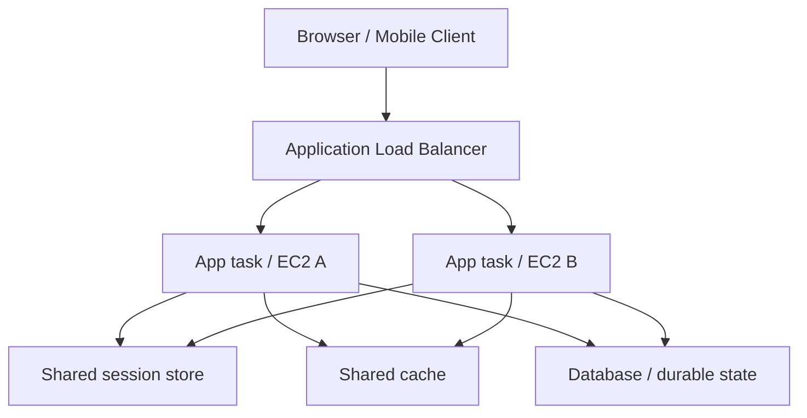
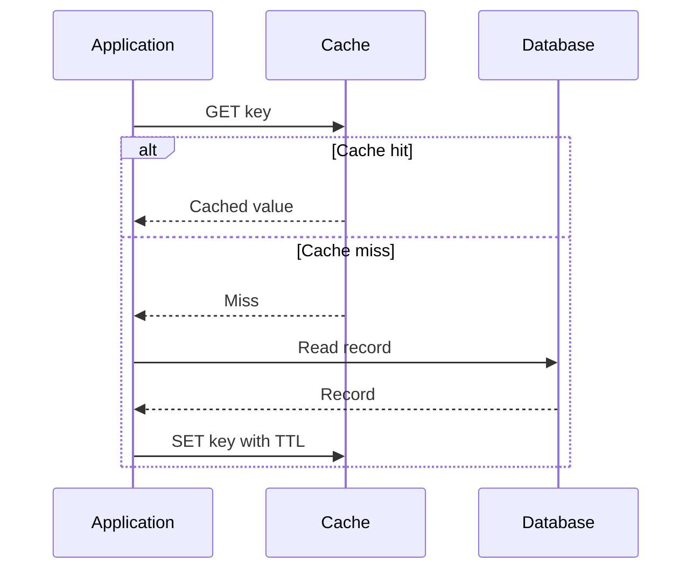
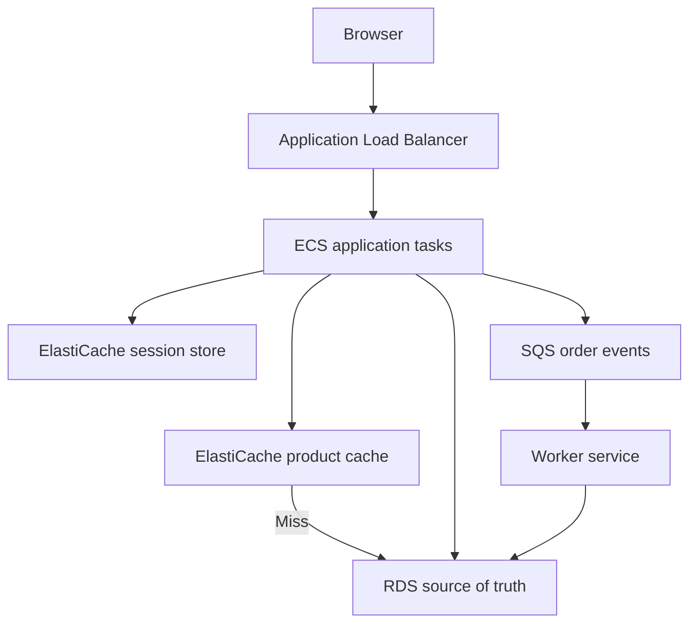

# Quản lý session, cache và trạng thái ứng dụng

Ứng dụng chạy trên AWS thường được mở rộng bằng nhiều EC2 instance, ECS task, EKS pod hoặc Lambda execution environment. Khi một request bất kỳ có thể được xử lý bởi một instance khác, dữ liệu phiên đăng nhập và trạng thái nghiệp vụ không thể phụ thuộc vào bộ nhớ của một máy cụ thể. Đồng thời, đọc database cho mọi request có thể làm tăng độ trễ và chi phí. Vì vậy, kiến trúc cần phân biệt rõ **session**, **cache** và **trạng thái ứng dụng**, sau đó chọn nơi lưu trữ, thời hạn, cơ chế đồng bộ và cách phục hồi phù hợp.

Session giữ ngữ cảnh tương tác của người dùng hoặc client qua nhiều request. Cache giữ bản sao dữ liệu để tăng tốc truy cập. Trạng thái ứng dụng mô tả tiến trình nghiệp vụ, chẳng hạn đơn hàng đang thanh toán hoặc một tác vụ đang chờ xử lý. Ba loại dữ liệu này có thể dùng chung một số dịch vụ AWS, nhưng có yêu cầu khác nhau về độ bền, tính nhất quán, bảo mật và thời gian lưu.

Trong module `CLOUD_PROVIDERS_AWS`, bài học liên kết các khái niệm này với Elastic Load Balancing, Amazon ElastiCache for Valkey/Redis OSS/Memcached, Amazon DynamoDB, Amazon RDS, Amazon SQS, AWS Step Functions, IAM, VPC và Amazon CloudWatch. Mục tiêu là xây dựng ứng dụng có thể scale ngang, chịu lỗi khi một compute instance bị thay thế, bảo vệ dữ liệu phiên và kiểm soát hiệu năng.

Sau bài học, bạn có thể:

- Phân biệt session state, cache và trạng thái nghiệp vụ cần lưu bền vững.
- Thiết kế ứng dụng stateless để scale trên EC2, ECS, EKS và Lambda.
- Chọn giữa server-side session, cookie session và token-based session.
- Sử dụng ElastiCache hoặc DynamoDB để lưu session theo yêu cầu về latency, durability và khả năng mở rộng.
- Chọn cache-aside, write-through, write-behind hoặc refresh-ahead cho từng loại dữ liệu.
- Xử lý TTL, cache invalidation, stale data, cache stampede và hot key.
- Bảo vệ session và cache bằng IAM, VPC, TLS, encryption at rest và quyền truy cập tối thiểu.
- Theo dõi cache hit rate, latency, eviction, replication lag và lỗi session.
- Kiểm thử hành vi khi cache hoặc session store bị lỗi, failover hoặc mất kết nối.

## 1. Phân biệt session, cache và trạng thái ứng dụng

Các loại dữ liệu có thể cùng chứa thông tin về một người dùng hoặc một giao dịch, nhưng mục đích và cách khôi phục khác nhau.

| Loại dữ liệu | Ví dụ | Nguồn dữ liệu chuẩn | Có thể mất không? |
|---|---|---|---|
| Session state | User ID, trạng thái đăng nhập, giỏ hàng tạm, CSRF token, thời điểm hoạt động | Session store hoặc cơ chế identity | Tùy nghiệp vụ; mất session có thể buộc đăng nhập lại hoặc làm mất thao tác chưa lưu |
| Cache | Product detail, cấu hình đọc nhiều, kết quả truy vấn, token introspection | Database hoặc service gốc | Thường có thể tái tạo, nhưng mất cache có thể gây tải đột biến |
| Trạng thái nghiệp vụ | Đơn hàng, thanh toán, inventory reservation, workflow status | Database, event store hoặc workflow service | Không được tùy tiện mất; cần backup và consistency |
| Trạng thái xử lý tạm | Message đang xử lý, retry count, checkpoint | Queue, workflow engine hoặc durable store | Phải có cơ chế retry/recovery và chống xử lý trùng |
| Process-local state | Connection pool, local memoization, dữ liệu tạm trong RAM | Chỉ là bản sao trong process | Có thể mất khi process restart; không dùng làm nguồn chuẩn dùng chung |

Một nguyên tắc quan trọng: **cache không phải database và session không phải nơi lưu duy nhất dữ liệu nghiệp vụ quan trọng**. Ví dụ, giỏ hàng có thể bắt đầu trong session nhưng khi người dùng xác nhận đơn hàng, nội dung cần được lưu thành order record bền vững. Nếu chỉ lưu giỏ hàng trong RAM của một EC2 instance, việc scale hoặc thay instance có thể làm mất dữ liệu.

### 1.1. Trạng thái bền vững và trạng thái có thể tái tạo

Trước khi chọn dịch vụ, hãy trả lời:

- Dữ liệu có thể tái tạo từ database hoặc nguồn khác không?
- Nếu mất dữ liệu, người dùng có thể đăng nhập lại hay phải khôi phục giao dịch?
- Có cần giữ dữ liệu sau khi logout hoặc hết hạn session không?
- Có nhiều instance cùng đọc/ghi dữ liệu này không?
- Có yêu cầu đọc mới nhất ngay lập tức hay chấp nhận dữ liệu cũ vài giây?
- Dữ liệu có nhạy cảm như access token, PII hoặc thông tin thanh toán không?
- Khi store không khả dụng, ứng dụng nên fail closed, fail open hay degraded mode?

Các câu trả lời này quyết định nơi lưu, TTL, backup, replication và hành vi fallback.

## 2. Thiết kế ứng dụng stateless để scale ngang

Một ứng dụng stateless không phụ thuộc vào trạng thái chỉ tồn tại trong bộ nhớ của một instance để xử lý request tiếp theo. Mỗi instance có thể nhận request từ người dùng bất kỳ vì session và dữ liệu cần chia sẻ nằm ở một store dùng chung hoặc được gửi kèm dưới dạng credential/token có thể xác minh.

Ví dụ kiến trúc:



Khi instance A bị thay thế, instance B vẫn có thể xác minh session bằng shared store. Khi Auto Scaling thêm instance C, không cần sao chép session thủ công từ A hoặc B sang C.

Các nguyên tắc triển khai:

- Không giữ session duy nhất trong process memory.
- Không dùng local disk làm nơi lưu trạng thái cần tồn tại qua lần deploy hoặc thay instance.
- Dùng shared session store hoặc token có thể xác minh ở mọi instance.
- Lưu dữ liệu nghiệp vụ vào database hoặc workflow store bền vững.
- Dùng cache dùng chung khi nhiều instance cần cùng một cache view.
- Thiết kế request và background job có tính idempotent.
- Xử lý lỗi store theo chính sách rõ ràng, không âm thầm tạo session mới khi không xác minh được session cũ.

### 2.1. Sticky session không thay thế shared session store

Application Load Balancer có thể bật stickiness để ưu tiên gửi request của một client tới cùng target trong thời gian nhất định. Điều này hữu ích cho một số ứng dụng cũ, nhưng không giải quyết đầy đủ vấn đề lưu session:

- Target có thể bị unhealthy hoặc bị thay thế.
- Auto Scaling và deployment có thể làm thay đổi target.
- Request có thể đến target khác sau khi cookie stickiness hết hạn hoặc bị mất.
- Một AZ hoặc target group có thể gặp sự cố.
- Session trong RAM không được chia sẻ hoặc khôi phục tự động.

Nếu ứng dụng cần session bền qua việc thay instance, hãy lưu session ở một store chung. Sticky session chỉ là tối ưu định tuyến, không phải cơ chế durability.

## 3. Chọn mô hình session

Có hai mô hình phổ biến: server-side session với session ID opaque và client-side token như JWT. Một số hệ thống kết hợp cả hai.

### 3.1. Server-side session

Client nhận một session ID ngẫu nhiên, còn dữ liệu session được lưu ở server-side store. Mỗi request gửi session ID qua cookie hoặc header; ứng dụng tra cứu session, kiểm tra thời hạn và quyền.

Ví dụ bản ghi session:

```json
{
  "sessionId": "random-high-entropy-id",
  "userId": "user-123",
  "createdAt": "2026-11-20T08:00:00Z",
  "lastSeenAt": "2026-11-20T08:14:00Z",
  "idleExpiresAt": "2026-11-20T08:44:00Z",
  "absoluteExpiresAt": "2026-11-20T20:00:00Z",
  "authLevel": "mfa",
  "csrfToken": "server-generated-value"
}
```

Đây là dữ liệu minh họa. Không lưu password plaintext, private key hoặc thông tin thẻ thanh toán trong session. Nếu session cần tham chiếu dữ liệu nhạy cảm, hãy lưu ID và truy xuất dữ liệu từ nguồn có kiểm soát.

Ưu điểm:
- Có thể thu hồi session ngay bằng cách xóa hoặc đánh dấu revoked ở store.
- Có thể cập nhật quyền, trạng thái MFA hoặc metadata mà không cần chờ token hết hạn.
- Cookie chỉ chứa ID ngẫu nhiên, không chứa toàn bộ thông tin phiên.
- Dễ quản lý nhiều phiên cho cùng một user.

Đánh đổi:
- Mỗi request cần truy cập session store, có thể tăng latency.
- Session store trở thành dependency quan trọng.
- Cần xử lý failover, eviction, TTL và capacity.
- Store phải được bảo vệ như một tài nguyên bảo mật.

### 3.2. Client-side token và JWT

Với token-based session, client giữ token có chữ ký; server xác minh chữ ký và claims thay vì tra cứu session đầy đủ ở mọi request. JWT thường chứa các claims như:

- `iss`: issuer.
- `sub`: subject/user identifier.
- `aud`: audience.
- `iat`: thời điểm phát hành.
- `exp`: thời điểm hết hạn.
- `jti`: token identifier nếu cần định danh token riêng.

JWT ký số không đồng nghĩa dữ liệu bên trong được mã hóa. Payload thường có thể đọc được; không đặt secret hoặc PII nhạy cảm vào claim chỉ vì token đã ký.

Ưu điểm:
- Xác minh token có thể thực hiện cục bộ bằng public key đã tin cậy.
- Giảm truy vấn session store cho mỗi request.
- Phù hợp với API phân tán và federation.

Đánh đổi:
- Khó thu hồi ngay một token đã phát hành nếu không có denylist, token version hoặc kiểm tra trạng thái bổ sung.
- Token bị đánh cắp có thể dùng tới khi hết hạn.
- Key rotation, issuer/audience validation và clock skew cần được xử lý đúng.
- Token dài làm tăng kích thước request và bề mặt rò rỉ qua log.

Một mô hình phổ biến là access token ngắn hạn và refresh token được bảo vệ chặt. Refresh token nên được lưu an toàn, có rotation/reuse detection nếu hệ thống hỗ trợ, và có thể bị thu hồi khi logout hoặc phát hiện compromise.

### 3.3. So sánh server-side session và JWT

| Tiêu chí | Server-side session | JWT/token |
|---|---|---|
| Thu hồi ngay | Dễ hơn khi có shared store hoặc revoke list | Khó hơn nếu không kiểm tra trạng thái bổ sung |
| Mỗi request cần store | Thường có | Không nhất thiết |
| Kích thước client credential | Session ID nhỏ | Token thường lớn hơn |
| Cập nhật quyền | Có thể cập nhật session tại store | Thường cần token mới hoặc kiểm tra policy ngoài token |
| Khả năng hoạt động khi store lỗi | Phụ thuộc session store | Có thể tiếp tục xác minh token nếu key/cache còn |
| Phù hợp | Web app cần logout/revoke và session mutable | API/federation, service-to-service hoặc token-based identity |

Không có mô hình nào luôn tốt hơn. Hệ thống có thể dùng token để xác thực danh tính và server-side store để quản lý refresh token, logout, risk state hoặc session revocation.

## 4. Bảo vệ cookie và vòng đời session

Nếu dùng cookie để truyền session ID, hãy thiết lập thuộc tính bảo mật rõ ràng. Ví dụ header:

```http
Set-Cookie: __Host-app_session=<opaque-session-id>; Path=/; Secure; HttpOnly; SameSite=Lax
```

- `Secure`: chỉ gửi cookie qua HTTPS.
- `HttpOnly`: JavaScript phía client không đọc được cookie.
- `SameSite=Lax`: giảm một số request cross-site; lựa chọn cần phù hợp với luồng đăng nhập và tích hợp.
- `Path=/`: cookie áp dụng trong toàn host.
- Prefix `__Host-`: yêu cầu Secure, Path=/ và không có Domain attribute trong trình duyệt hỗ trợ.

Nếu cần `SameSite=None` cho luồng cross-site, cookie phải có `Secure`. Cookie HttpOnly không tự ngăn CSRF; hãy dùng CSRF token, kiểm tra Origin/Referer hoặc cơ chế phù hợp với kiến trúc.

### 4.1. Chống session fixation và đánh cắp session

Các biện pháp quan trọng:

1. Sinh session ID bằng cryptographically secure random generator với entropy đủ lớn.
2. Rotate session ID sau login, nâng quyền, thay đổi MFA state hoặc các sự kiện bảo mật quan trọng.
3. Không đưa session ID vào URL, query string, analytics event hoặc log.
4. Dùng HTTPS toàn bộ đường truyền.
5. Hạn chế thời hạn idle và absolute lifetime.
6. Hủy session phía server khi logout hoặc account bị khóa.
7. Có thể ràng buộc session với risk signal như thiết bị hoặc mức xác thực, nhưng tránh phụ thuộc cứng vào IP vì mobile/network có thể thay đổi.
8. Giám sát session bất thường, nhiều vị trí, user agent thay đổi hoặc hành vi khó giải thích.

Không dùng IP address làm secret hoặc bằng chứng xác thực duy nhất. IP có thể dùng làm tín hiệu rủi ro, nhưng NAT, VPN và mạng di động khiến IP thay đổi thường xuyên.

### 4.2. Idle timeout và absolute timeout

Hai thời hạn phục vụ mục đích khác nhau:

- **Idle timeout**: hết hạn nếu session không có hoạt động trong khoảng thời gian quy định.
- **Absolute timeout**: session hết hạn sau một thời gian tối đa kể từ lúc tạo, kể cả khi liên tục hoạt động.

Ví dụ, một ứng dụng có idle timeout 30 phút và absolute timeout 12 giờ. Người dùng hoạt động liên tục vẫn phải xác thực lại sau 12 giờ. Với giao dịch nhạy cảm, có thể yêu cầu re-authentication hoặc MFA step-up thay vì chỉ dựa trên session hiện tại.

### 4.3. Logout và thu hồi session

Logout cần vô hiệu hóa session ở server-side store hoặc thu hồi refresh token. Chỉ xóa cookie trên browser là chưa đủ nếu session ID bị sao chép trước đó vẫn hợp lệ.

Với JWT access token, logout có thể:
- Chờ access token ngắn hạn hết hạn.
- Thu hồi refresh token để không cấp access token mới.
- Dùng token denylist hoặc token version nếu cần thu hồi sớm.
- Thu hồi credential tại identity provider nếu account bị compromise.

Hãy xác định hành vi khi session store không truy cập được. Với thao tác nhạy cảm, fail closed thường an toàn hơn việc tự tạo session mới hoặc cho phép request tiếp tục mà không xác minh.

## 5. Chọn session store trên AWS

Lựa chọn store phụ thuộc latency, durability, access pattern, TTL, khả năng mở rộng và chi phí.

| Dịch vụ | Điểm mạnh | Hạn chế/cân nhắc | Use case |
|---|---|---|---|
| Amazon ElastiCache for Valkey/Redis OSS | Độ trễ thấp, thao tác key-value phong phú, TTL, atomic operation, replication | Cần quản lý memory, eviction, failover và persistence/backup theo engine | Session store, cache nóng, rate-limit counter, distributed lock có thiết kế phù hợp |
| Amazon ElastiCache for Memcached | Cache đơn giản, phân tán, dễ scale ngang | Không có replication/persistence như Redis-compatible engine; node loss làm mất cache | Cache dữ liệu có thể tái tạo |
| Amazon DynamoDB | Managed durable key-value/document store, scale, conditional write, TTL, backup/PITR | Latency và chi phí theo request/capacity; TTL deletion không tức thời | Session cần độ bền cao hơn cache thuần, idempotency record, workflow metadata |
| Amazon RDS/Aurora | Transaction và query quan hệ, durability, backup | Thường có latency/throughput khác cache in-memory; cần connection management | Trạng thái nghiệp vụ, session phức tạp cần transaction/query |
| Cookie/token phía client | Không cần truy vấn session store cho mỗi request nếu token tự xác minh | Thu hồi và bảo vệ client credential phức tạp hơn | Stateless authentication, API/federation |

### 5.1. Khi nào chọn ElastiCache?

ElastiCache phù hợp khi session cần truy cập nhanh, cấu trúc đơn giản và có thể đặt ở dạng key-value. Một Redis-compatible store có thể dùng TTL tự hết hạn, hash, set hoặc atomic command để cập nhật dữ liệu.

Thiết kế production nên cân nhắc:
- Replication group có primary và read replica.
- Multi-AZ và automatic failover nếu yêu cầu availability.
- Cluster mode disabled hoặc enabled tùy dung lượng và throughput cần thiết.
- Encryption in transit và at rest.
- Authentication/RBAC theo engine và phiên bản.
- Subnet group và security group trong VPC private.
- Snapshot/backup nếu dữ liệu cần phục hồi.
- Memory headroom và eviction policy.

Nếu session bị eviction, người dùng có thể bị logout. Đây có thể là hành vi chấp nhận được với một số ứng dụng, nhưng cần được xác nhận theo nghiệp vụ. Không nên dùng cùng một Redis cluster cho session critical và cache có thể bị evict hàng loạt mà không phân vùng capacity hoặc policy.

### 5.2. Khi nào chọn DynamoDB?

DynamoDB phù hợp nếu session hoặc state record cần durability, scale và truy cập theo key. Có thể thiết kế partition key là `sessionId`, lưu user ID, metadata, version và expiry timestamp.

DynamoDB TTL:
- Dùng một attribute dạng Number chứa Unix epoch time tính bằng giây.
- Dịch vụ xóa item hết hạn ở chế độ nền, không bảo đảm xóa đúng tại giây expiry.
- Ứng dụng phải tự kiểm tra expiry trước khi chấp nhận session.
- Item đã hết hạn có thể vẫn xuất hiện trong query/get cho tới khi TTL deletion hoàn tất.
- TTL deletion không thay thế logic logout/revocation.

Dùng conditional write hoặc version attribute để ngăn hai request đồng thời ghi đè dữ liệu session theo cách mất cập nhật. Nếu cần query theo user để logout mọi session, thiết kế GSI hoặc index phù hợp và đánh giá chi phí.

### 5.3. Không dùng cache làm nguồn chuẩn cho trạng thái quan trọng

Nếu một giỏ hàng, order hoặc payment state cần tồn tại qua sự cố cache, hãy lưu nó trong database bền vững. Cache có thể giữ bản sao đọc nhanh, nhưng phải có cách tái tạo từ nguồn chuẩn.

Một ví dụ:
- Redis lưu session ID và trạng thái đăng nhập.
- DynamoDB hoặc RDS lưu giỏ hàng đã được lưu.
- RDS lưu order và payment transaction.
- SQS lưu công việc cần xử lý bất đồng bộ.
- ElastiCache giữ product catalog cache để giảm tải database.

## 6. Quản lý session trên ElastiCache

Với server-side session, ứng dụng có thể dùng một key theo namespace, ví dụ `sess:<session-id>`. Giá trị chứa user ID, thời điểm tạo, thời điểm hết hạn và các claim tối thiểu cần thiết.

Ví dụ lệnh Redis minh họa:

```text
SET sess:random-session-id "{...session-json...}" EX 1800
GET sess:random-session-id
DEL sess:random-session-id
TTL sess:random-session-id
```

- `EX 1800` đặt TTL 30 phút.
- `GET` đọc session.
- `DEL` thu hồi session.
- `TTL` kiểm tra thời gian còn lại.

Không lưu cookie value hoặc session ID thật vào log. Nếu cần tìm session theo user, dùng index có kiểm soát hoặc lưu danh sách session ID theo user; tránh dùng scan toàn keyspace trong request path.

### 6.1. Cập nhật session an toàn

Hai request đồng thời có thể đọc cùng một session rồi ghi lại dữ liệu dựa trên snapshot cũ. Ví dụ, một request cập nhật giỏ hàng trong khi request khác cập nhật locale. Nếu ứng dụng ghi đè toàn bộ JSON, một thay đổi có thể mất.

Có thể giảm rủi ro bằng:
- Cập nhật từng field bằng hash/atomic operation phù hợp.
- Dùng optimistic locking với version.
- Dùng Lua script hoặc transaction khi cần nhiều thao tác nguyên tử.
- Giữ session nhỏ, tránh dùng session như document database.
- Đưa dữ liệu nghiệp vụ quan trọng ra store chuyên dụng.

### 6.2. Redis failover và mất session

Khi primary node lỗi, ElastiCache có thể failover sang replica nếu replication group được cấu hình phù hợp. Tuy vậy, replica có thể có replication lag; một số cập nhật gần thời điểm failover có thể chưa được sao chép. Ứng dụng cần:
- Retry có giới hạn và exponential backoff với jitter.
- Xử lý connection reset và DNS endpoint thay đổi theo cơ chế client.
- Không coi timeout là bằng chứng session không tồn tại.
- Xác minh session trước khi tạo mới để tránh cấp danh tính sai.
- Có hành vi fallback rõ ràng khi store unavailable.

Nếu mất session làm người dùng phải đăng nhập lại, đó có thể là lựa chọn phù hợp hơn việc chấp nhận request không xác thực. Với thao tác giao dịch, trạng thái cần khôi phục phải nằm trong durable store riêng.

## 7. Cache pattern và cách chọn

Cache là bản sao dữ liệu được giữ gần nơi sử dụng để giảm latency hoặc tải lên nguồn dữ liệu. Cách cập nhật cache ảnh hưởng tới consistency và độ phức tạp.

### 7.1. Cache-aside (lazy loading)

Ứng dụng đọc cache trước. Nếu miss, đọc database, sau đó ghi kết quả vào cache với TTL.



Ưu điểm:
- Chỉ cache dữ liệu được truy cập.
- Dễ áp dụng cho database hiện hữu.
- Cache có thể bị xóa và tái tạo.

Nhược điểm:
- Cache miss gây thêm một lần đọc database.
- Có thể xuất hiện stampede khi key phổ biến hết hạn.
- Cache invalidation sau update cần được xử lý.

### 7.2. Write-through

Khi ghi dữ liệu, ứng dụng cập nhật nguồn chuẩn và cache theo một quy trình phối hợp. Read path có cache mới ngay sau khi write thành công nếu cả hai cập nhật thành công.

Cần xử lý trường hợp database commit thành công nhưng cache update thất bại, hoặc ngược lại. Không có transaction nguyên tử mặc định giữa RDS và ElastiCache. Có thể dùng outbox/event để phát thông báo invalidation/update sau commit, và dựa vào TTL để giới hạn stale window.

### 7.3. Write-behind (write-back)

Ứng dụng ghi cache trước, sau đó cập nhật database bất đồng bộ. Pattern này có thể tăng throughput nhưng có rủi ro mất dữ liệu nếu cache hoặc worker lỗi trước khi flush xuống nguồn bền vững.

Chỉ dùng khi nghiệp vụ chấp nhận eventual persistence, có durable queue/log, retry, idempotency và reconciliation. Không dùng write-behind đơn giản cho payment, inventory hoặc order state nếu chưa có cơ chế bảo đảm dữ liệu.

### 7.4. Refresh-ahead

Ứng dụng làm mới cache trước khi TTL hết hạn dựa trên tần suất truy cập hoặc lịch refresh. Pattern này giảm cache miss cho dữ liệu phổ biến, nhưng cần kiểm soát refresh load và tránh refresh quá nhiều key không còn được dùng.

### 7.5. Bảng chọn pattern

| Pattern | Read path | Write path | Phù hợp |
|---|---|---|---|
| Cache-aside | Cache, miss thì database | Update database rồi invalidate/update cache | General purpose, dữ liệu đọc nhiều |
| Write-through | Đọc từ cache | Cập nhật nguồn và cache theo quy trình phối hợp | Cần cache mới sau write |
| Write-behind | Đọc từ cache | Ghi cache rồi persist bất đồng bộ | Workload chấp nhận eventual persistence |
| Refresh-ahead | Đọc cache đã được refresh trước | Background refresh | Dữ liệu nóng, refresh có thể dự đoán |

## 8. TTL, eviction và cache invalidation

### 8.1. Chọn TTL

TTL quyết định cache entry tồn tại bao lâu nếu không được cập nhật hoặc xóa. TTL quá dài làm tăng stale data; TTL quá ngắn làm tăng miss rate và tải database.

Chọn TTL theo:
- Tần suất thay đổi dữ liệu gốc.
- Mức độ chấp nhận stale data của nghiệp vụ.
- Chi phí đọc lại nguồn.
- Tác động khi dữ liệu cũ được dùng.
- Cơ chế invalidation chủ động.
- Đặc điểm của dữ liệu cá nhân hoặc quyền truy cập.

Có thể thêm jitter ngẫu nhiên vào TTL để tránh hàng nghìn key hết hạn cùng lúc. Ví dụ TTL cơ sở 300 giây cộng/trừ một khoảng nhỏ theo random distribution.

### 8.2. Cache invalidation

Khi dữ liệu gốc thay đổi, cache có thể được xử lý theo nhiều cách:
- Delete key ngay sau commit.
- Ghi giá trị mới vào cache.
- Phát domain event để consumer invalidate.
- Dùng versioned key, ví dụ `product:v42:123`.
- Chờ TTL nếu stale window được nghiệp vụ chấp nhận.

Vấn đề thường gặp là database commit thành công nhưng ứng dụng crash trước khi invalidate cache. Transactional outbox giúp ghi event cùng transaction database; worker đọc outbox và phát event tới consumer để invalidate. TTL là lớp bảo vệ cuối cùng nếu event bị trễ hoặc thất lạc.

### 8.3. Eviction policy

Khi cache hết memory, Redis-compatible engine có thể áp dụng eviction policy. Một số lựa chọn thường gặp gồm:
- `allkeys-lru`: loại key ít được dùng gần đây trên toàn keyspace.
- `allkeys-lfu`: ưu tiên giữ key được truy cập thường xuyên.
- `volatile-ttl`: ưu tiên loại key có TTL còn lại ngắn trong tập key có expiry.
- `noeviction`: từ chối write khi đạt giới hạn memory theo hành vi engine.

Tên và hỗ trợ policy phụ thuộc engine/version. Hãy kiểm tra cấu hình thực tế. Nếu session và cache chung một cluster, eviction có thể làm mất session ngoài dự kiến. Tách cluster hoặc phân vùng dữ liệu theo criticality giúp kiểm soát blast radius.

## 9. Các vấn đề cache thường gặp

### 9.1. Cache stampede / thundering herd

Một key phổ biến hết hạn, nhiều request cùng miss và đồng thời truy vấn database. Điều này tạo tải đột biến lên nguồn dữ liệu.

Giải pháp:
- TTL jitter để phân tán thời điểm hết hạn.
- Single-flight/request coalescing để chỉ một request làm refresh.
- Distributed lock có thời hạn và cơ chế xử lý lock owner chết.
- Serve stale-while-revalidate nếu dữ liệu cho phép.
- Pre-warm cache cho key quan trọng.
- Giới hạn concurrency và bảo vệ database bằng queue/bulkhead.

### 9.2. Cache penetration

Client liên tục hỏi key không tồn tại, làm mọi request đi xuống database. Có thể dùng:
- Validation đầu vào và rate limiting.
- Negative caching với TTL ngắn cho kết quả not found.
- Bloom filter hoặc danh sách key hợp lệ cho tập dữ liệu lớn.
- WAF/API throttling nếu truy cập có dấu hiệu tự động bất thường.

Negative cache cần được invalidate khi record mới được tạo, nếu không dữ liệu mới có thể bị che bởi kết quả not found cũ.

### 9.3. Hot key

Một key được truy cập quá nhiều làm một node/shard trở thành điểm nghẽn. Giải pháp gồm:
- Replicate read hoặc local in-process cache có TTL rất ngắn.
- Shard key logic nếu có thể phân mảnh.
- Dùng request coalescing.
- Precompute hoặc materialize dữ liệu.
- Phân tích top keys và phân phối traffic.

Local cache có thể làm dữ liệu stale khác nhau giữa instance; chỉ dùng cho dữ liệu có consistency tolerance rõ ràng.

### 9.4. Cache poisoning và key collision

Không cho client tự chọn cache key tùy ý mà không kiểm tra. Cache key nên bao gồm tenant, locale, authorization scope hoặc version nếu các yếu tố này làm thay đổi kết quả. Nếu cache response riêng tư chỉ dùng URL làm key, một người dùng có thể nhận dữ liệu của người khác.

Ví dụ:
`product:v3:tenant-42:locale-vi:product-123`

Không đưa access token hoặc PII vào cache key dạng plaintext nếu không cần thiết. Với dữ liệu nhạy cảm, giới hạn quyền truy cập cache và thời hạn.

## 10. Bảo mật session và cache trên AWS

Session store và cache có thể chứa dữ liệu nhạy cảm hoặc dữ liệu dùng để quyết định quyền truy cập. Hãy áp dụng nhiều lớp bảo vệ.

### 10.1. Network isolation

- Đặt ElastiCache trong private subnet của VPC.
- Không gán public IP hoặc mở endpoint cache ra Internet.
- Dùng security group chỉ cho phép inbound từ SG của application workload trên port cần thiết.
- Dùng subnet group và routing phù hợp.
- Với workload đa account, chọn mô hình kết nối riêng phù hợp và kiểm soát principal.

### 10.2. Authentication và encryption

- Bật encryption in transit để bảo vệ dữ liệu giữa app và cache.
- Bật encryption at rest khi dịch vụ/engine hỗ trợ và yêu cầu bảo mật cần.
- Dùng auth token hoặc RBAC/user group theo engine và phiên bản.
- Quản lý credential qua Secrets Manager hoặc cơ chế secret store phù hợp.
- Rotate credential định kỳ và khi nghi ngờ compromise.
- Giới hạn quyền truy cập theo application role và environment.

TLS bảo vệ đường truyền nhưng không thay thế authorization. Một workload có thể kết nối được tới cache vẫn chỉ nên được phép thao tác trên namespace hoặc keyspace mà nó sở hữu.

### 10.3. Phân tách dữ liệu và tenant

- Prefix key theo service, environment và tenant.
- Không dùng chung session namespace giữa production và development.
- Tránh để cache key có thể đoán được dẫn tới truy cập chéo tenant.
- Dùng role và security group riêng cho workload nhạy cảm.
- Không lưu password, full payment data hoặc private key trong cache.
- Đặt TTL ngắn cho dữ liệu có quyền truy cập nhạy cảm.

### 10.4. Quản lý secret và token

Không lưu refresh token hoặc access token có quyền cao trong cache không được bảo vệ. Nếu phải lưu, cần mã hóa/giới hạn truy cập, TTL, rotation và audit. Log không được chứa session cookie, Authorization header hoặc secret. Khi có incident, cần có khả năng revoke session hoặc rotate signing key theo quy trình.

## 11. Session và cache trong kiến trúc đa AZ/đa Region

### 11.1. Multi-AZ trong một Region

Với ElastiCache replication group, cấu hình replica ở AZ khác và Multi-AZ automatic failover có thể tăng availability. Tuy nhiên:
- Failover có thể làm gián đoạn kết nối trong thời gian chuyển đổi.
- Client phải xử lý reconnect và retry.
- Replica có thể có replication lag.
- Không phải mọi write gần thời điểm lỗi đều chắc chắn đã được replica nhận.
- Snapshot/backup vẫn cần nếu dữ liệu cần phục hồi sau lỗi logic hoặc xóa nhầm.

Với cache thuần, mất entry có thể được chấp nhận nếu tái tạo được. Với session, cần xác định liệu người dùng phải đăng nhập lại có được chấp nhận hay không.

### 11.2. Multi-Region

Một session store đa Region cần quyết định:
- User được route tới home Region hay có thể truy cập ở mọi Region?
- Session update có cần strong consistency không?
- Nếu hai Region cùng cập nhật session thì xử lý conflict thế nào?
- Logout/revoke cần lan truyền trong bao lâu?
- Khi mất kết nối giữa Region, ứng dụng fail open hay fail closed?

ElastiCache Global Datastore cho Redis OSS/Valkey có thể hỗ trợ replication giữa các Region theo cơ chế bất đồng bộ được dịch vụ hỗ trợ; không nên mặc định đây là đồng bộ tức thời hoặc bảo đảm mọi session write đã tới secondary trước failover. Hãy xác định RPO chấp nhận được và kiểm thử tình huống promote secondary.

Với DynamoDB Global Tables, cần hiểu replication và conflict resolution của cấu hình đang dùng. Nếu logout hoặc revoke phải có hiệu lực ngay toàn cầu, một bản ghi revoke được replicate bất đồng bộ có thể tạo cửa sổ chấp nhận session đã bị thu hồi. Cần chọn thiết kế phù hợp với mức bảo mật, chẳng hạn token ngắn hạn, kiểm tra revoke centrally hoặc định tuyến session về home Region.

### 11.3. Không để cache quyết định quyền truy cập lâu hơn policy

Nếu quyền của user bị thu hồi, cache chứa authorization result cũ có thể tiếp tục cho phép truy cập. Hãy đặt TTL ngắn, phát invalidation event hoặc kiểm tra policy quan trọng ở nguồn chuẩn. Dữ liệu cache không được trở thành cơ chế bypass quyền IAM hoặc authorization của ứng dụng.

## 12. Trạng thái ứng dụng và workflow bền vững

Không phải mọi state đều nên nằm trong session. Trạng thái của quy trình dài cần được lưu ở durable store hoặc workflow engine.

Ví dụ:
- Order status: database.
- Payment workflow: Step Functions hoặc database state machine.
- Background job: SQS và durable job record.
- Inventory reservation: database transaction/conditional update với expiration logic.
- User preference: database, có thể cache đọc.
- Search result: cache hoặc search index, có thể tái tạo.

AWS Step Functions lưu trạng thái execution theo workflow service và phù hợp điều phối các bước dài, retry, timeout và compensation. SQS giữ message để xử lý bất đồng bộ; consumer cần idempotency vì message có thể được giao lại. Cache có thể giảm truy vấn trạng thái workflow nhưng không thay thế execution history hoặc record chuẩn.

### 12.1. Idempotency

Khi retry request hoặc xử lý message, cùng một thao tác không được tạo ra nhiều hiệu ứng ngoài ý muốn. Có thể dùng idempotency key:
- Client gửi key duy nhất cho một thao tác.
- Server lưu key và kết quả trong durable store.
- Request lặp lại trả về kết quả đã ghi thay vì tạo giao dịch mới.
- Record idempotency có TTL/retention theo thời hạn nghiệp vụ.
- Cập nhật record và trạng thái nghiệp vụ bằng transaction hoặc conditional write khi cần.

Không chỉ lưu idempotency key trong cache dễ eviction nếu việc xử lý trùng có thể gây charge tiền hoặc tạo đơn hàng trùng.

## 13. Ví dụ kiến trúc: session và cache cho website thương mại điện tử

Một website chạy trên ECS sau Application Load Balancer. Người dùng đăng nhập, xem sản phẩm, thêm giỏ hàng và tạo đơn hàng.

Thiết kế:
- ALB phân phối request tới nhiều ECS task.
- Cookie `__Host-app_session` chứa session ID opaque.
- ElastiCache for Valkey/Redis OSS lưu server-side session với idle TTL.
- RDS lưu user, cart đã lưu, order và payment state.
- ElastiCache cache product detail theo key có version và TTL.
- SQS xử lý email/fulfillment bất đồng bộ.
- Secrets Manager lưu database credential và cache auth material nếu cần.
- CloudWatch theo dõi session store, cache và ứng dụng.

Luồng request:



Khi user thêm sản phẩm vào cart:
1. App xác minh session ID trong session store.
2. App đọc cart record từ RDS hoặc store nghiệp vụ phù hợp.
3. App cập nhật cart bằng transaction/conditional logic.
4. App invalidate cache liên quan nếu có.
5. App trả response và refresh session idle timeout theo policy.

Khi user tạo order:
1. App xác minh session và authorization.
2. Dùng idempotency key để tránh tạo order trùng.
3. Ghi order/payment intent vào durable store.
4. Phát event qua transactional outbox hoặc cơ chế tin cậy.
5. Worker xử lý message và cập nhật trạng thái.
6. Cache product detail được invalidate khi inventory/price thay đổi theo domain event.

Session không phải nơi lưu duy nhất cart/order; nếu Redis restart, order đã ghi trong RDS vẫn tồn tại.

## 14. Mẫu pseudocode xử lý session và cache

Ví dụ dưới đây mô tả luồng logic, không gắn với một SDK cụ thể:

```text
function handleRequest(request):
    sessionId = readCookie(request, "__Host-app_session")

    if sessionId is missing:
        return unauthenticated

    session = sessionStore.get(sessionId)

    if session is missing:
        return unauthenticated

    if now() >= session.absoluteExpiresAt:
        sessionStore.delete(sessionId)
        return unauthenticated

    if now() >= session.idleExpiresAt:
        sessionStore.delete(sessionId)
        return unauthenticated

    if session.revoked:
        return unauthenticated

    authorize(session.userId, request.action, request.resource)

    refreshIdleExpiry(sessionId, boundedBy=session.absoluteExpiresAt)

    return continueRequest()
```

Một cache-aside read:

```text
function getProduct(productId):
    key = "product:v3:" + productId
    value = cache.get(key)

    if value exists:
        return value

    value = database.getProduct(productId)

    if value does not exist:
        cache.set(key, NOT_FOUND, ttl=shortNegativeTtl)
        return notFound

    cache.set(key, value, ttl=baseTtl + randomJitter())
    return value
```

Cần bảo đảm `NOT_FOUND` không bị nhầm với dữ liệu hợp lệ và cache key có đủ tenant/authorization scope nếu kết quả phụ thuộc người dùng. Với session expiry, việc store tự xóa key không thay thế kiểm tra expiry trong ứng dụng.

## 15. Quan sát session store và cache

Dùng CloudWatch metrics, application metrics và log có cấu trúc để phát hiện sự cố trước khi người dùng báo.

| Nhóm | Chỉ số cần theo dõi | Dấu hiệu cần điều tra |
|---|---|---|
| Cache effectiveness | Cache hit rate, miss rate | Hit rate giảm đột ngột, database load tăng |
| Latency | Cache latency, app p95/p99, command latency | Tail latency tăng, timeout |
| Memory | Engine memory, freeable memory, evictions | Memory pressure, eviction bất thường |
| Capacity | Connections, CPU, network bytes, shards | Connection saturation, hot shard |
| Availability | Failover events, node health, replication lag | Session loss, reconnect storm |
| DynamoDB | Throttled requests, consumed capacity, latency | Session lookup throttling |
| Application session | Login failure, session not found, logout/revoke, expired session | Người dùng bị logout hàng loạt hoặc session không hết hạn |
| Security | Invalid token, session anomaly, authorization deny | Credential abuse hoặc session hijack |

Một số metric cụ thể phụ thuộc engine và loại node. Hãy chọn metric tương ứng với ElastiCache engine/version và workload, không dùng một ngưỡng chung cho mọi cluster.

### 15.1. Log an toàn

Log nên ghi:
- Request ID/correlation ID.
- Session lookup success/failure và reason code.
- Cache hit/miss và latency.
- Store endpoint/cluster identifier ở mức không nhạy cảm.
- User ID đã được pseudonymize nếu cần phân tích.
- Error code, retry count và dependency status.

Không log session ID, cookie, access token, refresh token, password hoặc nội dung session nhạy cảm. Khi cần liên kết sự kiện, dùng hash có key hoặc correlation identifier riêng thay vì log credential gốc.

### 15.2. Cảnh báo và SLO

Có thể đặt SLO cho:
- Tỷ lệ request xác thực thành công.
- p95/p99 session lookup latency.
- Cache dependency availability.
- Cache hit rate theo nhóm key.
- Tỷ lệ login/session refresh failure.
- Database load khi cache suy giảm.
- Thời gian phục hồi sau failover.

Cảnh báo cần gắn với hành động cụ thể: scale cluster, xử lý hot key, kiểm tra deploy, rollback hoặc kích hoạt degraded mode. Hit rate thấp không phải lúc nào cũng là incident nếu dữ liệu vừa được invalidate hợp lệ.

## 16. Xử lý sự cố thường gặp

| Triệu chứng | Nguyên nhân có thể | Cách xử lý |
|---|---|---|
| Người dùng bị logout hàng loạt | Cache failover, eviction, flush hoặc TTL sai | Kiểm tra node events, memory, TTL và deployment; khôi phục session nếu có durable backup phù hợp |
| Session còn hiệu lực sau logout | Chỉ xóa cookie, revoke không tới store, JWT chưa hết hạn | Hủy server-side session/refresh token; kiểm tra revoke path và token lifetime |
| Một số request nhận session cũ | Nhiều instance cache local, replication lag hoặc invalidation event trễ | Kiểm tra topology, TTL, event delivery và source of truth |
| Database CPU tăng đột ngột | Cache miss/stampede hoặc cluster unavailable | Kiểm tra hit rate, key expiry, request coalescing và scale nguồn có kiểm soát |
| Cache memory đầy | TTL thiếu, key leak, object quá lớn hoặc capacity thấp | Kiểm tra key cardinality, eviction, memory fragmentation và lifecycle |
| Cache hit nhưng dữ liệu sai tenant | Cache key thiếu tenant/authorization scope | Sửa key design, invalidate dữ liệu sai và rà soát exposure |
| Session không hết hạn trong DynamoDB | Ứng dụng phụ thuộc TTL deletion | Kiểm tra expiry trong code trên mọi request |
| Redis reconnect storm sau failover | Client retry đồng loạt hoặc pool không được cấu hình phù hợp | Exponential backoff + jitter, connection pooling và kiểm thử failover |
| Hot shard/key | Phân phối key không đều hoặc một record quá nóng | Phân tích top key, replicate/read cache, shard logic hoặc coalesce request |
| JWT vẫn được chấp nhận sau revoke | Access token còn hạn và không có revoke check | Giảm token lifetime, revoke refresh token, denylist/version check cho use case cần |

### 16.1. Quy trình điều tra cache degradation

1. Xác định thời điểm bắt đầu và các deployment/config change gần đó.
2. So sánh cache hit/miss, latency, memory, eviction và connection count.
3. Kiểm tra node health, failover event, replication lag và network.
4. Xác định keyspace hoặc tenant chịu ảnh hưởng.
5. Đánh giá database có chịu được cache miss load không.
6. Giảm concurrency hoặc bật rate limit nếu nguồn bị quá tải.
7. Khôi phục cache theo cách có kiểm soát; tránh flush toàn bộ khi chưa đánh giá stampede.
8. Xác minh dữ liệu nguồn và invalidation.
9. Theo dõi metric sau khi ổn định.

Không xóa toàn bộ cache như bước đầu tiên nếu chưa biết nguồn dữ liệu có chịu được tải tái tạo hay không.

## 17. Kiểm thử session và cache

Kiểm thử cần bao gồm cả chức năng, bảo mật, tải và lỗi dependency.

### 17.1. Functional tests

- Session được tạo sau login và rotate sau khi xác thực.
- Logout vô hiệu hóa session ở server.
- Idle timeout và absolute timeout được áp dụng.
- Token có issuer, audience, signature và expiry hợp lệ.
- Session không thể dùng giữa tenant hoặc môi trường.
- Cache miss trả dữ liệu đúng từ source of truth.
- Update dữ liệu invalidates hoặc refresh cache đúng cách.
- Negative cache được xóa khi record mới được tạo.

### 17.2. Security tests

- Cookie có Secure, HttpOnly và SameSite phù hợp.
- Session ID không xuất hiện trong URL/log.
- CSRF được kiểm tra với request thay đổi trạng thái.
- TLS được dùng giữa application và cache.
- Chỉ SG của workload cần thiết truy cập cache.
- Credential cache được lưu và rotate an toàn.
- JWT key rotation không làm chấp nhận token không hợp lệ.
- Session revoke có hiệu lực trong khoảng thời gian cam kết.

### 17.3. Resilience/load tests

- Scale app task từ ít lên nhiều instance; session vẫn hoạt động.
- Restart task/instance; không mất durable state.
- Failover ElastiCache; client reconnect và retry đúng.
- Tạo cache miss đồng thời; database không bị stampede.
- Simulate DynamoDB throttling hoặc timeout; app có degraded mode.
- Kiểm tra memory pressure và eviction.
- Kiểm tra replication lag và hành vi khi mất Region.
- Đo p95/p99 dưới tải đỉnh.

Với test failover hoặc fault injection, dùng môi trường và phạm vi đã phê duyệt, đặt stop condition và chuẩn bị rollback. Không thử nghiệm bằng cách flush production cache hoặc xóa session thật.

## 18. Hướng dẫn chọn kiến trúc

| Yêu cầu | Thiết kế gợi ý |
|---|---|
| Web app cần logout/revoke ngay | Opaque session ID + shared server-side store |
| API phân tán cần xác minh token nhanh | Short-lived signed token + refresh/revoke strategy |
| Session latency rất thấp, dữ liệu có thể tái tạo | ElastiCache Valkey/Redis OSS với Multi-AZ phù hợp |
| Session cần durability/conditional update | DynamoDB với expiry check trong ứng dụng |
| Dữ liệu nghiệp vụ phải tồn tại qua cache loss | RDS/DynamoDB làm source of truth; cache chỉ là bản sao |
| Dữ liệu đọc nhiều, stale vài phút chấp nhận được | Cache-aside với TTL/jitter và invalidation |
| Cần cache nhất quán sau update | Write-through hoặc event-driven invalidation |
| Nhiều Region, revoke phải lan nhanh | Đánh giá central session authority, short token lifetime và consistency requirement |
| Workflow dài, retry nhiều bước | Step Functions hoặc durable state machine, không lưu toàn bộ workflow trong session |
| Background processing | SQS + durable job state + idempotency |

## 19. Những nhầm lẫn cần tránh

| Nhầm lẫn | Cách hiểu đúng |
|---|---|
| Sticky session bảo đảm session không mất | Stickiness chỉ ưu tiên routing tới target; target có thể lỗi hoặc bị thay |
| JWT đã ký thì payload bí mật | Chữ ký bảo đảm integrity/authenticity; payload thường vẫn đọc được |
| Xóa cookie đồng nghĩa logout hoàn toàn | Server-side session hoặc refresh token cần được revoke |
| DynamoDB TTL xóa item đúng thời điểm expiry | TTL deletion chạy nền; ứng dụng phải tự kiểm tra expiry |
| Cache luôn có thể dùng thay database | Cache có thể evict hoặc mất; dữ liệu quan trọng cần durable source |
| ElastiCache Multi-AZ bảo đảm không mất write | Failover có thể có replication lag; cần hiểu consistency và test |
| Cache hit rate càng cao càng tốt | Hit rate phải cân bằng với freshness, correctness và cost |
| Local memory cache chia sẻ giữa các task | Mỗi process có cache riêng, có thể khác nhau |
| HttpOnly ngăn mọi kiểu CSRF | HttpOnly ngăn JavaScript đọc cookie, không thay thế CSRF protection |
| Redis lock tự động bảo đảm distributed correctness | Lock cần lease, fencing token, expiry và xử lý owner chết |
| Logout một Region sẽ lập tức revoke ở mọi Region | Replication có thể trễ; cần thiết kế revoke propagation rõ ràng |

## 20. Checklist thiết kế và vận hành

- [ ] Phân loại dữ liệu thành session, cache, durable business state và workflow state.
- [ ] Xác định source of truth cho từng loại dữ liệu.
- [ ] Ứng dụng không phụ thuộc process-local session để scale ngang.
- [ ] Chọn server-side session hoặc token model theo yêu cầu revoke.
- [ ] Cookie có Secure, HttpOnly, SameSite và thời hạn phù hợp.
- [ ] Session ID được sinh ngẫu nhiên, rotate và không log.
- [ ] Idle timeout và absolute timeout được áp dụng ở ứng dụng.
- [ ] Logout/revocation xử lý cả server-side store và refresh token.
- [ ] ElastiCache/DynamoDB được đặt trong kiến trúc mạng riêng và quyền tối thiểu.
- [ ] Encryption in transit/at rest và credential rotation đã cấu hình.
- [ ] Cache pattern, TTL, jitter, invalidation và eviction policy được xác định.
- [ ] Cache key bao gồm tenant/authorization scope khi cần.
- [ ] Có phương án chống stampede, hot key và cache penetration.
- [ ] Backup/replication phù hợp với durability requirement.
- [ ] Failover và client reconnect đã được kiểm thử.
- [ ] CloudWatch dashboard và alarm theo dõi latency, memory, eviction, hit rate và errors.
- [ ] Log không chứa session cookie, token hoặc secret.
- [ ] Functional, security, load và resilience tests có bằng chứng.
- [ ] Runbook mô tả degraded mode khi session/cache store không khả dụng.

## 21. Tóm tắt kiến thức

Session giữ ngữ cảnh tương tác, cache tăng tốc truy cập dữ liệu và application state lưu tiến trình nghiệp vụ. Ứng dụng chạy trên nhiều instance nên externalize session và trạng thái cần chia sẻ; process memory chỉ nên giữ dữ liệu tạm có thể tái tạo. Server-side session giúp thu hồi nhanh nhưng cần shared store; JWT giảm truy vấn store nhưng cần quản lý expiry, refresh, key rotation và revocation.

Trên AWS, ElastiCache phù hợp với session/cache có yêu cầu latency thấp; DynamoDB phù hợp với record cần durability và conditional update; RDS hoặc DynamoDB giữ trạng thái nghiệp vụ; SQS và Step Functions hỗ trợ workflow bền vững. Cache-aside là pattern phổ biến, nhưng cần TTL, invalidation, jitter và chống stampede. ElastiCache Multi-AZ tăng availability nhưng không thay backup hoặc kiểm thử failover. DynamoDB TTL xóa item bất đồng bộ nên ứng dụng phải tự kiểm tra expiry.

Cuối cùng, session và cache là một phần của security boundary. Hãy dùng cookie an toàn, TLS, VPC private, SG hạn chế, IAM/credential tối thiểu, log không chứa token và giám sát bằng CloudWatch. Kiến trúc chỉ được xem là hoàn chỉnh sau khi đã kiểm thử scale-out, logout, failover, cache miss, store outage và khả năng khôi phục trạng thái nghiệp vụ.

## Tài liệu tham khảo

- [Amazon ElastiCache User Guide](https://docs.aws.amazon.com/AmazonElastiCache/latest/dg/WhatIs.html)
- [ElastiCache for Valkey and Redis OSS](https://docs.aws.amazon.com/AmazonElastiCache/latest/dg/WhatIs.core.html)
- [ElastiCache Multi-AZ](https://docs.aws.amazon.com/AmazonElastiCache/latest/dg/AutoFailover.html)
- [ElastiCache security](https://docs.aws.amazon.com/AmazonElastiCache/latest/dg/Clusters.security.html)
- [Amazon DynamoDB Time to Live](https://docs.aws.amazon.com/amazondynamodb/latest/developerguide/TTL.html)
- [DynamoDB conditional writes](https://docs.aws.amazon.com/amazondynamodb/latest/developerguide/Expressions.ConditionExpressions.html)
- [DynamoDB Global Tables](https://docs.aws.amazon.com/amazondynamodb/latest/developerguide/GlobalTables.html)
- [Application Load Balancer sticky sessions](https://docs.aws.amazon.com/elasticloadbalancing/latest/application/edit-target-group-attributes.html)
- [Amazon Cognito user pools](https://docs.aws.amazon.com/cognito/latest/developerguide/cognito-user-pools.html)
- [AWS Well-Architected Framework: Performance Efficiency](https://docs.aws.amazon.com/wellarchitected/latest/performance-efficiency-pillar/welcome.html)
- [AWS Well-Architected Framework: Security](https://docs.aws.amazon.com/wellarchitected/latest/security-pillar/welcome.html)
- [AWS Step Functions Developer Guide](https://docs.aws.amazon.com/step-functions/latest/dg/welcome.html)
- [Amazon SQS Developer Guide](https://docs.aws.amazon.com/AWSSimpleQueueService/latest/SQSDeveloperGuide/welcome.html)

