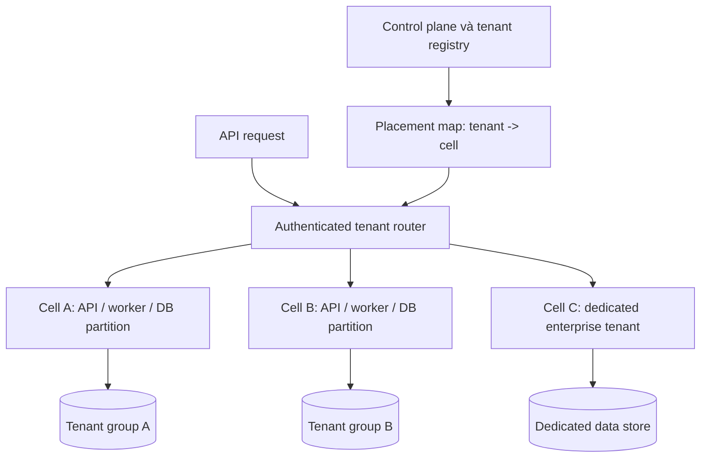

# Thiết kế nền tảng SaaS nhiều tenant trên AWS

Một nền tảng Software as a Service (SaaS) phục vụ nhiều khách hàng trên cùng một sản phẩm. Mỗi khách hàng là một **tenant** có người dùng, dữ liệu, cấu hình, quyền truy cập, hạn mức và vòng đời riêng. Các tenant có thể dùng chung một phần hạ tầng để tối ưu chi phí, hoặc được đặt trên tài nguyên tách biệt khi yêu cầu bảo mật, hiệu năng hay tuân thủ đòi hỏi mức cô lập cao hơn.

Thiết kế SaaS trên AWS cần giải quyết đồng thời ba bài toán: cung cấp một sản phẩm có thể vận hành liên tục cho nhiều khách hàng; bảo đảm tenant này không thể truy cập dữ liệu hay tài nguyên của tenant khác; và cho phép đội vận hành onboarding, cập nhật, đo lường mức sử dụng, xử lý sự cố và phục hồi mà không phải thao tác thủ công cho từng khách hàng.

AWS cung cấp các thành phần để xây dựng nền tảng đó: AWS Organizations và AWS Control Tower cho quản trị account; Amazon Cognito và các cơ chế federation cho danh tính; API Gateway, CloudFront, WAF, Lambda, ECS và EKS cho lớp ứng dụng; DynamoDB, RDS, S3 và các dịch vụ lưu trữ cho dữ liệu; IAM, STS và KMS cho quyền truy cập và mã hóa; EventBridge, SQS và Step Functions cho xử lý bất đồng bộ; CloudWatch và các công cụ observability cho vận hành. Kiến trúc tốt kết hợp các dịch vụ này theo mô hình cô lập phù hợp với từng tenant và từng loại dữ liệu.

## Mục tiêu học tập

Sau bài học, bạn có thể:

- Giải thích đặc điểm của SaaS và phân biệt control plane với application plane.
- So sánh ba mô hình cô lập tenant: silo, pool và bridge.
- Thiết kế tenant identity, tenant context và authorization xuyên suốt request.
- Chọn cách phân vùng dữ liệu cho DynamoDB, RDS/Aurora và S3.
- Thiết kế cô lập compute, network, queue, encryption key và account theo mức rủi ro.
- Xây dựng quy trình onboarding, nâng cấp, tạm ngừng và offboarding tenant.
- Kiểm soát noisy neighbor, quota, metering, billing và observability theo tenant.
- Lập kế hoạch triển khai, phục hồi, kiểm thử và quản trị nền tảng SaaS nhiều tenant.

## 1. SaaS và khái niệm tenant

SaaS là mô hình cung cấp phần mềm như một dịch vụ được vận hành tập trung. Khách hàng đăng ký và sử dụng sản phẩm qua giao diện web, API hoặc tích hợp. Nhà cung cấp chịu trách nhiệm triển khai, bảo trì, bảo mật, mở rộng và cập nhật nền tảng.

Trong kiến trúc SaaS:

- **Tenant** là một khách hàng hoặc một đơn vị thuê bao có ranh giới dữ liệu và cấu hình riêng. Tenant có thể là một doanh nghiệp, một tổ chức hoặc một đơn vị kinh doanh tùy mô hình sản phẩm.
- **Tenant user** là người dùng thuộc tenant. Một người có thể có nhiều vai trò trong cùng tenant; một số sản phẩm còn cho phép một danh tính tham gia nhiều tenant.
- **Tenant administrator** quản lý người dùng, cấu hình và quyền trong tenant của mình.
- **SaaS operator** là đội vận hành nền tảng, có quyền quản trị ở cấp dịch vụ nhưng phải tuân thủ quy trình truy cập dữ liệu khách hàng.
- **Tenant context** là thông tin xác định tenant đang được xử lý trong một request, job hoặc message.
- **Tenant isolation** là tập hợp cơ chế bảo đảm một tenant chỉ truy cập đúng dữ liệu, workload và chức năng được cấp.

Tenant không đồng nghĩa với AWS account. Một tenant có thể dùng chung account với nhiều tenant khác, có một database riêng trong account dùng chung, hoặc được đặt trong một account AWS riêng. Việc chọn ranh giới phụ thuộc yêu cầu cô lập, chi phí, mức độ tùy chỉnh, data residency và khả năng vận hành.

### Đặc điểm của một nền tảng SaaS thực thụ

Một sản phẩm có nhiều khách hàng đăng nhập vào cùng một website chưa chắc đã có kiến trúc SaaS hoàn chỉnh. Nền tảng SaaS cần quản lý tenant xuyên suốt vòng đời:

1. Tenant được đăng ký, xác thực và cấp cấu hình qua một quy trình chuẩn.
2. Nền tảng biết tenant nào đang dùng tài nguyên, tính năng và dữ liệu nào.
3. Các thay đổi sản phẩm được triển khai có kiểm soát trên nhiều tenant.
4. Đội vận hành có thể quan sát tình trạng và mức sử dụng theo tenant.
5. Tenant có thể được chuyển tier, tách dữ liệu, tạm ngừng hoặc offboard theo chính sách.
6. Sự cố của một tenant không gây ảnh hưởng ngoài dự kiến đến toàn bộ khách hàng.

## 2. Kiến trúc control plane và application plane

Một cách tổ chức phổ biến là tách **control plane** và **application plane**.

### Control plane

Control plane quản lý tenant và vòng đời của tenant. Nó thường cung cấp API hoặc portal cho các thao tác:

- Đăng ký tenant, xác minh domain và tạo tenant ID.
- Tạo tenant registry record, gán tier, Region, quota và cấu hình sản phẩm.
- Thiết lập identity provider, user pool/client hoặc kết nối SAML/OIDC.
- Provision database, storage, compute, encryption key và network nếu cần.
- Cấp tenant admin, mời người dùng và gán role.
- Theo dõi trạng thái provisioning, nâng cấp, tạm ngừng và xóa tenant.
- Quản lý feature flag, entitlement, usage plan và metering.

Control plane có quyền rộng hơn application plane nên cần được bảo vệ riêng. Không nên để request nghiệp vụ thông thường có thể gọi trực tiếp các API provisioning hoặc thay đổi tenant registry.

### Application plane

Application plane xử lý request và dữ liệu nghiệp vụ của tenant:

- Xác thực access token và xác định tenant context.
- Kiểm tra entitlement và authorization cho từng thao tác.
- Đọc/ghi dữ liệu đúng partition hoặc database của tenant.
- Gửi event/job với tenant context được xác thực.
- Áp dụng quota, rate limit và giới hạn tài nguyên.
- Ghi log, metric và trace có thông tin tenant phù hợp.

Application plane có thể là một pool compute dùng chung, nhiều cell hoặc các stack riêng cho từng tenant. Control plane quyết định request/job cần đi đến cell hoặc stack nào.

```mermaid
flowchart TB
    U[Người dùng / API client] --> EDGE[Route 53 / CloudFront / AWS WAF]
    EDGE --> AUTH[Amazon Cognito hoặc OIDC IdP]
    AUTH --> API[API Gateway / ALB]
    API --> APP[Application plane: ECS / EKS / Lambda]
    APP --> REG[Tenant registry và entitlement cache]
    APP --> DATA[(DynamoDB / RDS / S3)]
    APP --> MSG[SQS / EventBridge]
    MSG --> WORK[Worker có tenant context]
    CP[Control plane: onboarding / lifecycle / policy]
    CP --> REG
    CP --> PROV[Provisioning: account / DB / key / config]
    PROV --> DATA
    OBS[CloudWatch / tracing / audit] --- APP
    OBS --- CP
```



Tách control plane và application plane giúp giới hạn quyền và blast radius. Nếu control plane bị lỗi, request nghiệp vụ đang chạy vẫn có thể tiếp tục trong phạm vi cho phép; nếu application plane của một cell bị lỗi, control plane có thể điều phối tenant sang cell khác theo thiết kế DR.

## 3. Chọn mô hình cô lập: silo, pool và bridge

AWS SaaS Lens thường mô tả ba mô hình cô lập chính. Đây là các mẫu kiến trúc, không phải ba dịch vụ AWS riêng biệt.

### Silo model

Mỗi tenant có một tập tài nguyên riêng. Tài nguyên có thể gồm AWS account, VPC, cluster, database, bucket hoặc stack ứng dụng.

Ưu điểm:

- Ranh giới dữ liệu và quyền truy cập rõ ràng.
- Có thể tùy chỉnh phiên bản, cấu hình, KMS key và chính sách theo tenant.
- Dễ đáp ứng yêu cầu data residency, audit hoặc hợp đồng có mức cô lập cao.
- Sự cố tài nguyên của một tenant ít ảnh hưởng đến tenant khác.

Đổi lại, chi phí và số lượng tài nguyên tăng theo số tenant. Đội vận hành phải quản lý provisioning, quota, patching, backup, monitoring và nâng cấp trên nhiều stack.

### Pool model

Nhiều tenant dùng chung một tập tài nguyên. Ứng dụng phân vùng dữ liệu và authorization theo tenant context.

Ưu điểm:

- Tận dụng tốt compute, database và storage.
- Dễ triển khai một phiên bản sản phẩm cho nhiều tenant.
- Chi phí trên mỗi tenant thường thấp hơn khi số lượng tenant lớn.
- Có thể mở rộng ngang bằng cách tăng capacity hoặc chia partition/cell.

Pool yêu cầu kiểm soát tenant context chặt chẽ. Một lỗi thiếu điều kiện `tenant_id` trong truy vấn có thể làm lộ dữ liệu giữa khách hàng. Một tenant có lưu lượng cao cũng có thể gây noisy neighbor cho các tenant khác.

### Bridge model

Bridge kết hợp tài nguyên dùng chung và tài nguyên tách riêng. Ví dụ:

- Dùng chung CloudFront, API Gateway và compute nhưng mỗi tenant có database riêng.
- Dùng chung database cluster nhưng tenant lớn có schema hoặc database riêng.
- Dùng chung application plane nhưng tenant có KMS key, S3 bucket hoặc queue riêng.
- Dùng chung control plane nhưng mỗi tenant enterprise được provision một account hoặc cell riêng.

Bridge cho phép đưa mức cô lập vào đúng lớp có rủi ro cao. Tuy nhiên, nền tảng cần tenant registry đủ tốt để biết tenant nào thuộc cấu hình nào.

### So sánh mô hình

| Tiêu chí | Silo | Pool | Bridge |
|---|---|---|---|
| Cô lập | Cao nếu ranh giới tài nguyên được thiết kế đúng | Chủ yếu ở lớp ứng dụng/dữ liệu | Theo từng lớp |
| Chi phí cơ bản | Cao hơn | Thấp hơn | Trung bình đến cao |
| Tùy chỉnh theo tenant | Dễ | Hạn chế hơn | Linh hoạt |
| Vận hành nhiều tenant | Cần automation mạnh | Ít tài nguyên hơn nhưng cần guardrail chặt | Phức tạp do nhiều loại placement |
| Noisy neighbor | Ít hơn giữa các stack riêng | Cần quota và fairness | Có thể cô lập tenant lớn |
| Phù hợp | Enterprise, regulated, yêu cầu dedicated | Nhiều tenant nhỏ/vừa | SaaS có nhiều tier và yêu cầu khác nhau |

Không có một mô hình tốt nhất cho mọi sản phẩm. Có thể bắt đầu với pool, sau đó đưa tenant lớn hoặc tenant có yêu cầu đặc biệt sang bridge/silo bằng quy trình migration đã chuẩn bị.

## 4. Thiết kế tenant identity và tenant context

Xác thực danh tính trả lời câu hỏi “ai đang gọi?”. Tenant authorization trả lời “người đó đang hành động trong tenant nào và được phép làm gì?”. Hai câu hỏi này cần được xử lý riêng.

### Identity provider

Một nền tảng SaaS có thể dùng Amazon Cognito User Pools, IAM Identity Center cho người vận hành, hoặc identity provider bên ngoài qua OIDC/SAML. Lựa chọn phụ thuộc cách khách hàng quản lý danh tính:

- **Shared user pool**: nhiều tenant dùng chung Cognito User Pool; ứng dụng liên kết user với tenant trong tenant registry. Cách này giảm số lượng pool và đơn giản hóa vận hành.
- **Pool/client riêng theo tenant**: phù hợp khi tenant cần branding, domain, callback URL, federation hoặc policy đăng nhập khác nhau. Số lượng pool/client và quota phải được tính trước.
- **Federation theo tenant**: mỗi tenant có thể kết nối IdP doanh nghiệp qua SAML/OIDC; control plane lưu issuer, metadata, client và mapping domain tương ứng.

Không nên dùng Cognito group như ranh giới bảo mật duy nhất giữa tenant. Group phù hợp để biểu diễn role/nhóm trong một user pool; tenant membership và quyền truy cập dữ liệu vẫn cần được kiểm tra ở backend.

### Token và tenant membership

Sau khi đăng nhập, backend xác minh chữ ký, issuer, audience/client ID, thời hạn và các claim của token. Tenant ID phải được lấy từ membership đã được xác thực trong tenant registry hoặc claim do hệ thống identity tin cậy phát hành.

Không tin một `tenantId` do client gửi trong query string, JSON body hoặc HTTP header nếu chưa kiểm tra người dùng có membership và quyền trên tenant đó. Nếu một người dùng tham gia nhiều tenant, họ phải chọn tenant active; backend xác thực lựa chọn này với membership trước khi tạo tenant context.

Tenant context tối thiểu có thể gồm:

```json
{
  "tenantId": "t-8f2a",
  "subject": "user-42",
  "roles": ["tenant-admin"],
  "plan": "enterprise",
  "region": "ap-southeast-1",
  "correlationId": "req-91d2"
}
```

Đây là ví dụ dữ liệu nội bộ đã được xác thực, không phải token có thể tự tin cậy chỉ vì client gửi đúng cấu trúc. `tenantId`, `roles`, `plan` và `region` cần đến từ nguồn xác thực.

### Propagate tenant context

Tenant context phải được truyền qua toàn bộ luồng đồng bộ và bất đồng bộ:

1. API gateway/authorizer xác thực token.
2. Middleware backend xác minh membership và tạo context bất biến cho request.
3. Service gọi service khác truyền context qua cơ chế nội bộ có xác thực.
4. Message SQS/EventBridge chứa tenant identifier và correlation ID đã được service tạo.
5. Worker kiểm tra lại tenant context và quyền trước khi truy cập dữ liệu.
6. Log/trace ghi tenant identifier theo chính sách bảo vệ dữ liệu.

Không dùng header `X-Tenant-Id` từ Internet làm bằng chứng authorization. Nếu cần header để routing, gateway phải ghi đè giá trị client và backend vẫn xác thực context. Với hệ thống Java, tránh giữ tenant context trong `ThreadLocal` qua thread pool mà không dọn context sau request; tốt hơn là truyền context tường minh qua service boundary hoặc dùng cơ chế context propagation đã được kiểm thử.

## 5. Thiết kế authorization theo tenant

Authentication xác nhận danh tính; authorization xác nhận quyền trên tenant, resource và hành động cụ thể. Một người có thể là `tenant-admin` trong tenant A nhưng chỉ là `viewer` trong tenant B.

Một quyết định authorization nên xét:

- Principal: user, service hoặc workload role.
- Tenant: tenant context đã xác minh.
- Resource: object thuộc tenant nào và có trạng thái gì.
- Action: read, create, update, delete, export hoặc administer.
- Entitlement: plan/tier có cho phép chức năng đó không.
- Context: Region, trạng thái tenant, thời điểm hoặc approval cần thiết.

Áp dụng deny-by-default. Backend phải kiểm tra quyền ở mỗi API và mỗi thao tác trên object, kể cả khi frontend đã ẩn nút. Đây là cách giảm rủi ro Insecure Direct Object Reference (IDOR), trong đó người dùng thay ID trên URL để đọc object của tenant khác.

### RBAC và ABAC

- **RBAC** (Role-Based Access Control) gán quyền theo vai trò như tenant-admin, billing-admin, operator và viewer.
- **ABAC** (Attribute-Based Access Control) quyết định theo thuộc tính như tenant ID, data classification, Region, environment hoặc resource tag.

Nền tảng thường kết hợp cả hai. RBAC biểu diễn vai trò trong tenant; ABAC giúp áp dụng policy theo tenant context và thuộc tính tài nguyên. Tránh tạo một role IAM cho mọi người dùng cuối nếu backend có thể thực hiện authorization ở tầng ứng dụng với quyền workload tối thiểu.

### IAM principal tags và STS session tags

Với một số kiến trúc, backend có thể dùng STS session tags để gắn thuộc tính tenant vào role session. IAM policy có thể tham chiếu principal tags để giới hạn tài nguyên. Ví dụ, một role được cấp session tag `tenantId=t-8f2a` có thể được giới hạn vào prefix tương ứng trong S3.

Điều kiện quan trọng là chỉ thành phần tin cậy mới được phép gắn session tag. Hạn chế `sts:TagSession`, kiểm soát giá trị tag, không cho client tự chọn tag tùy ý và kiểm tra trust policy. Session tag không thay thế authorization nghiệp vụ và không tự bảo vệ các truy vấn database không có tenant predicate.

## 6. Chọn ranh giới AWS account và cell

AWS account là ranh giới quản trị và quota quan trọng. Đặt mỗi tenant trong account riêng giúp cô lập IAM, service quotas, logging và một phần blast radius, nhưng tăng số lượng account, chi phí vận hành và thời gian provisioning.

Các cách bố trí thường gặp:

- **Shared services account**: chứa control plane, identity integration, tenant registry và dịch vụ quản trị.
- **Application accounts**: chứa application plane theo môi trường hoặc theo cell.
- **Tenant-dedicated accounts**: dành cho tenant cần silo, data residency hoặc quyền quản trị riêng.
- **Log/archive/security accounts**: giữ audit, log và công cụ bảo mật độc lập với workload.

AWS Organizations và AWS Control Tower có thể hỗ trợ account vending, OU, guardrails và baseline. Control plane gọi quy trình account provisioning, sau đó triển khai stack theo tenant tier. Không nên tạo account trực tiếp trong request HTTP đồng bộ; provisioning thường mất thời gian và cần trạng thái, retry, approval.

### Cell-based architecture

Cell là một đơn vị triển khai có giới hạn về compute, data partition, queue và capacity. Một cell phục vụ một nhóm tenant. Nếu cell gặp sự cố, số tenant bị ảnh hưởng được giới hạn trong nhóm đó.



Cell giúp kiểm soát blast radius, scale theo nhóm tenant và nâng cấp theo từng ring. Tuy nhiên, cần có tenant placement service, migration giữa cell, capacity management và routing nhất quán. Không để client tự chỉ định cell.

## 7. Cô lập dữ liệu: DynamoDB, RDS và S3

Dữ liệu là lớp có rủi ro rò rỉ tenant cao. Mọi truy vấn phải được ràng buộc bởi tenant context đã xác thực.

### DynamoDB pooled table

Với mô hình pool, có thể dùng một table cho nhiều tenant và đưa tenant ID vào partition key:

```text
PK = TENANT#t-8f2a
SK = ORDER#2026-00091

PK = TENANT#t-8f2a
SK = CUSTOMER#c-102
```

Ưu điểm là một table có thể chứa nhiều loại entity và truy vấn theo tenant. Cần thiết kế access pattern từ đầu: tenant nào, truy vấn theo khóa nào, cần sort key hay GSI nào. GSI cũng phải giữ được tenant boundary; không tạo index chỉ theo email/order ID nếu truy vấn có thể trả dữ liệu nhiều tenant mà backend không lọc đúng.

Một số nguyên tắc:

- Mọi key được tạo ở server từ tenant context; không lấy tenant partition tùy ý từ client.
- Mọi `Query`, `GetItem`, `UpdateItem`, `DeleteItem` và batch operation đều kiểm tra tenant.
- GSI, stream, export, backup restore và data pipeline phải giữ tenant ID.
- Theo dõi hot partition nếu một tenant tạo phần lớn traffic.
- Có thể dùng table riêng cho tenant lớn hoặc dữ liệu nhạy cảm.

DynamoDB IAM fine-grained access control có điều kiện như `dynamodb:LeadingKeys` trong một số mô hình, nhưng policy phải phù hợp với key design và cách cấp credentials. Với backend role dùng chung cho nhiều tenant, ứng dụng vẫn phải kiểm tra tenant ở service layer.

### RDS/Aurora pooled database

Một database quan hệ dùng chung có thể phân vùng tenant theo:

- Một schema chung với cột `tenant_id` trên mỗi bảng nghiệp vụ.
- Một schema riêng cho từng tenant.
- Một database riêng cho từng tenant trong cùng cluster.
- Một cluster riêng cho tenant cần silo.

Với shared schema, mọi bảng chứa dữ liệu tenant cần `tenant_id` và index phù hợp. Các khóa ngoại nên bao gồm tenant ID khi cần bảo đảm record không tham chiếu sang tenant khác. Query repository phải yêu cầu tenant context thay vì cho phép gọi phương thức đọc dữ liệu không có tenant filter.

PostgreSQL Row-Level Security (RLS) có thể bổ sung lớp kiểm soát ở database. Ứng dụng đặt tenant ID trong transaction, policy RLS dùng giá trị đó để lọc row. Ví dụ minh họa:

```sql
ALTER TABLE orders ENABLE ROW LEVEL SECURITY;
ALTER TABLE orders FORCE ROW LEVEL SECURITY;

CREATE POLICY tenant_orders_policy ON orders
  USING (tenant_id = current_setting('app.tenant_id', true))
  WITH CHECK (tenant_id = current_setting('app.tenant_id', true));

BEGIN;
SET LOCAL app.tenant_id = 't-8f2a';
SELECT order_id, status FROM orders;
COMMIT;
```

Ví dụ giả định backend đã xác thực tenant trước khi mở transaction. Dùng `SET LOCAL` trong transaction để giá trị tenant không rò sang request khác khi connection được trả về pool. Database role của ứng dụng không nên là superuser, table owner có quyền bypass RLS hoặc role có `BYPASSRLS`. RLS là lớp phòng thủ bổ sung; vẫn cần kiểm tra authorization ở ứng dụng và kiểm thử truy vấn.

Schema/database riêng giúp quản lý quyền và migration theo tenant rõ hơn nhưng tăng số lượng object, connection, migration và backup. Cluster riêng cho tenant có mức cô lập cao hơn nhưng chi phí lớn hơn.

### S3 pooled bucket và tenant prefix

Một bucket có thể chứa object theo prefix:

```text
s3://saas-data/tenant/t-8f2a/documents/...
s3://saas-data/tenant/t-91bc/documents/...
```

Prefix giúp tổ chức dữ liệu nhưng bản thân prefix không phải ranh giới bảo mật. Cần bucket policy, IAM policy, access point hoặc session policy giới hạn principal vào prefix phù hợp. Server phải tạo object key từ tenant context; không tin đường dẫn object do client tự cung cấp.

S3 Access Points có thể cung cấp policy và network origin riêng cho từng nhóm truy cập. Với tenant có yêu cầu cao, có thể dùng access point hoặc bucket riêng. Cần tính đến quota số access point, policy size, lifecycle, replication, Object Lock và chi phí.

### Mã hóa và KMS theo tenant

Các lựa chọn gồm:

- Một KMS key dùng chung cho nhiều tenant, với quyền và encryption context được thiết kế phù hợp.
- Một customer managed key cho mỗi tenant hoặc nhóm tenant.
- Silo account với key riêng trong account tenant.
- Envelope encryption, trong đó KMS bảo vệ data key dùng để mã hóa dữ liệu.

Encryption context có thể chứa tenant ID và resource ID không bí mật để ràng buộc ngữ cảnh mã hóa/giải mã và hỗ trợ audit. Không đưa secret hoặc dữ liệu cá nhân vào encryption context. Với key riêng từng tenant, phải quản lý quota KMS, số lượng key, rotation, policy, chi phí và quy trình xóa key khi offboard.

## 8. Cô lập compute và runtime

Mô hình compute quyết định mức độ tenant có thể ảnh hưởng lẫn nhau.

### Shared compute pool

Một ECS service, EKS deployment hoặc Lambda function xử lý request của nhiều tenant. Cách này tận dụng tài nguyên tốt nhưng cần:

- Tenant context bất biến và được kiểm tra ở mọi service boundary.
- Không lưu state của tenant vào biến global hoặc cache không có tenant key.
- Cache key phải bao gồm tenant ID khi dữ liệu có phạm vi tenant.
- Giới hạn concurrency, CPU, memory, request rate và queue backlog theo tenant.
- Không để một tenant gửi payload khiến worker đọc object hoặc secret của tenant khác.

### Dedicated compute

Tenant có ECS service/task, Lambda function, EKS node group/cluster hoặc account riêng. Cách này phù hợp tenant enterprise hoặc workload cần resource reservation, custom configuration và blast radius nhỏ. Đổi lại, deployment và monitoring phải scale theo số stack.

### EKS multi-tenancy

Kubernetes namespace hỗ trợ tổ chức workload, nhưng namespace đơn lẻ không phải ranh giới bảo mật đủ mạnh cho mọi threat model. Cần kết hợp RBAC, NetworkPolicy, Pod Security, admission control, resource quota, node isolation, IAM role cho service account/Pod Identity và kiểm soát secret. Tenant không tin cậy nhau hoặc có yêu cầu compliance cao có thể cần node group, cluster hoặc AWS account riêng.

### Lambda và ECS

Với Lambda shared function, execution role thường là role của function, không phải role riêng cho từng tenant user. Do đó, code phải kiểm tra tenant authorization trước khi gọi AWS API. Nếu function dùng role có quyền truy cập nhiều tenant, một lỗi logic có thể mở rộng blast radius. Với ECS, task role nên chỉ cấp quyền mà service cần; không nhúng credential tenant vào image hoặc environment dùng chung nếu có thể lấy secret theo runtime.

## 9. Network và edge security

CloudFront, AWS WAF, API Gateway và Application Load Balancer là các thành phần thường dùng ở edge. Một kiến trúc tham khảo:

- Route 53 định tuyến domain của sản phẩm hoặc custom domain tenant.
- CloudFront phân phối nội dung và giảm tải origin.
- AWS WAF lọc request độc hại, bot và rate-based traffic.
- API Gateway hoặc ALB định tuyến request đến application plane.
- VPC, private subnet, security group và VPC endpoint giới hạn đường truy cập nội bộ.
- Network Firewall hoặc egress proxy kiểm soát traffic ra ngoài khi threat model yêu cầu.

Custom domain của tenant cần được xác minh quyền sở hữu và ánh xạ vào tenant registry. Không cho phép domain mapping tự do khiến một tenant có thể chiếm hostname của tenant khác. Certificate và DNS validation phải gắn với quy trình onboarding/offboarding.

Rate-based rule của WAF có thể chặn traffic theo IP hoặc aggregation key được hỗ trợ; nó không tự hiểu quota nghiệp vụ của tenant. Muốn giới hạn theo tenant, backend hoặc API gateway layer cần xác định tenant context sau authentication và áp dụng token bucket/quota riêng. Không dùng API key làm cơ chế authentication chính.

## 10. Xử lý bất đồng bộ và tenant context

Job và message thường được xử lý sau request gốc. Nếu tenant context bị mất khi gửi SQS, EventBridge hoặc Step Functions, worker có thể không biết dữ liệu thuộc tenant nào hoặc dùng nhầm quyền.

Một message nên chứa định danh cần thiết:

```json
{
  "eventId": "evt-2026-00091",
  "tenantId": "t-8f2a",
  "eventType": "invoice.created",
  "resourceId": "inv-109",
  "correlationId": "req-91d2",
  "occurredAt": "2026-11-20T08:15:00Z"
}
```

Worker không được tin payload chỉ vì message đến từ queue. Nó phải xác minh producer, tenant, resource ownership và loại event. Với shared queue, cần giới hạn concurrency và fair scheduling để một tenant không làm nghẽn tenant khác.

### Chọn queue và event bus

- **Shared SQS queue**: đơn giản, chi phí thấp; worker phải xử lý tenant context và fairness.
- **Queue riêng theo tenant**: cô lập backlog và DLQ tốt hơn; số queue tăng theo tenant và cần automation.
- **SQS FIFO**: `MessageGroupId` có thể dùng để tuần tự hóa theo tenant hoặc entity; cần cân nhắc throughput và ordering.
- **EventBridge bus/rules**: phù hợp routing event theo loại, account hoặc thuộc tính; kiểm soát event permissions và schema.
- **Step Functions**: điều phối workflow dài như onboarding, export dữ liệu hoặc offboarding; state machine cần idempotency và compensation.

## 11. Onboarding và lifecycle của tenant

Onboarding là workflow có nhiều bước và có thể kéo dài. Hãy triển khai như một state machine thay vì một API đồng bộ thực hiện tất cả.

### Quy trình onboarding tham khảo

1. Nhận yêu cầu tạo tenant và xác minh hợp đồng/owner.
2. Sinh tenant ID ổn định, duy nhất; tạo record trạng thái `PENDING` trong registry.
3. Chọn placement: pool, cell, bridge hay silo theo tier và policy.
4. Tạo identity configuration, domain mapping và membership admin.
5. Provision database/schema, S3 prefix/bucket, queue, KMS key hoặc account nếu cần.
6. Gán quota, feature entitlement, backup policy và monitoring.
7. Seed cấu hình mặc định, tạo resource baseline và kiểm tra quyền truy cập.
8. Chạy smoke test xác nhận tenant chỉ truy cập đúng tài nguyên.
9. Đổi trạng thái thành `ACTIVE`, phát event hoàn tất và thông báo cho khách hàng.

Mỗi bước cần idempotent. Nếu bước 6 thất bại sau khi database đã tạo, retry không được tạo database trùng. Dùng idempotency key, trạng thái từng bước, retry có backoff và compensation action để dọn tài nguyên chưa hoàn tất.

### Tenant registry

Tenant registry là nguồn dữ liệu chuẩn về tenant. Có thể lưu trong DynamoDB hoặc RDS tùy access pattern. Các trường thường gặp:

| Trường | Mục đích |
|---|---|
| `tenant_id` | ID ổn định, không tái sử dụng |
| `status` | PENDING, ACTIVE, SUSPENDED, MIGRATING, OFFBOARDING |
| `tier` | Plan/entitlement và mức dịch vụ |
| `placement` | Cell, account, Region, database hoặc stack |
| `identity_config` | IdP, issuer, domain và mapping |
| `quota_profile` | Hạn mức API, storage, compute và concurrency |
| `data_classification` | Phân loại dữ liệu và yêu cầu bảo vệ |
| `created_at` / `updated_at` | Audit lifecycle |
| `retention_policy` | Retention, export và deletion requirements |

Tenant ID phải bất biến. Đổi tên doanh nghiệp hoặc domain không nên làm thay đổi tenant ID đang dùng trong partition key, audit và event.

### Suspend và offboarding

Khi tenant bị tạm ngừng, nền tảng cần xác định có chặn đăng nhập, API, background jobs, export hay không. Không nên xóa dữ liệu ngay khi suspend. Cần lưu trạng thái, lý do, người phê duyệt và thời hạn.

Offboarding cần:

- Xác minh hợp đồng, legal hold, retention và quyền export.
- Ngừng cấp session/token và vô hiệu hóa federation/domain mapping.
- Dừng job, queue consumer và scheduled task thuộc tenant.
- Export dữ liệu theo định dạng đã thỏa thuận và kiểm tra tính toàn vẹn.
- Xóa hoặc ẩn dữ liệu theo retention/legal policy.
- Thu hồi key/secret và xóa tài nguyên silo sau khi được phê duyệt.
- Giữ audit evidence theo thời hạn bắt buộc.

Không xóa KMS key trước khi dữ liệu đã hết retention và không còn yêu cầu restore; xóa key có thể làm dữ liệu không thể giải mã vĩnh viễn.

## 12. Noisy neighbor, quota và fairness

Trong pool model, một tenant có thể sử dụng quá nhiều CPU, connection, request hoặc storage và làm giảm chất lượng dịch vụ của tenant khác. Đây là vấn đề noisy neighbor.

Các lớp kiểm soát gồm:

- **API rate limit**: giới hạn request/giây hoặc burst theo tenant.
- **Concurrency quota**: giới hạn số request/job đồng thời của tenant.
- **Storage quota**: giới hạn dung lượng, số object, số record hoặc retention.
- **Database quota**: giới hạn connection, query cost, throughput và transaction size.
- **Queue fairness**: giới hạn số message/worker slot của một tenant và ưu tiên theo tier.
- **Compute isolation**: chuyển tenant lớn sang service, task, node hoặc cell riêng.
- **Cost guardrail**: cảnh báo usage tăng bất thường và chặn hành vi gây chi phí ngoài dự kiến theo hợp đồng.

Quota phải được thực thi ở backend và các lớp hạ tầng liên quan. Một trường `plan=basic` trong frontend không thể bảo vệ hệ thống nếu backend không kiểm tra entitlement.

## 13. Metering, billing và cost allocation

SaaS thường thu phí theo subscription cố định, số người dùng, API request, dung lượng, compute time hoặc tổ hợp các đơn vị. Nền tảng cần ghi nhận usage theo tenant một cách đáng tin cậy.

### Metering pipeline

1. Service tạo usage event sau khi hoàn thành thao tác tính phí.
2. Event chứa tenant ID, metric name, quantity, unit, timestamp và idempotency key.
3. Event được gửi đến stream/queue để xử lý bất đồng bộ.
4. Aggregator loại bỏ event trùng, tổng hợp theo billing period và tenant.
5. Billing service áp dụng entitlement, free tier, rate card và adjustment.
6. Kết quả được lưu để đối soát và xuất invoice.

Không tính phí trực tiếp từ số lần frontend gửi request vì retry hoặc thao tác lỗi có thể tạo số liệu sai. Định nghĩa rõ event nào được tính billable, cách xử lý refund, duplicate, late event và timezone.

### AWS cost allocation

Cost allocation tags, AWS Cost Categories, CUR/AWS Data Exports và account structure giúp phân tích chi phí hạ tầng. Tuy nhiên, một ECS cluster hoặc DynamoDB table dùng chung không tự tạo ra chi phí AWS riêng cho từng tenant. Với pool model, cần application metering hoặc phân bổ theo usage metric như CPU time, request, storage và throughput.

Với tenant silo account, account-level cost thường dễ quy thuộc hơn. Với bridge, có thể phân bổ chi phí shared platform theo công thức minh bạch. Không trình bày số liệu phân bổ nội bộ như hóa đơn AWS chính xác nếu không có cơ chế đo lường tương ứng.

## 14. Observability theo tenant

Đội vận hành cần trả lời được: tenant nào bị lỗi, lỗi xảy ra ở cell/Region nào, mức ảnh hưởng bao nhiêu người dùng và có tenant nào gây quá tải không.

### Logging

Log có cấu trúc nên chứa các trường như:

- `tenant_id` đã xác minh.
- `request_id` và `correlation_id`.
- `user_subject` hoặc service principal ở dạng được phép ghi log.
- `service`, `operation`, `cell`, `region` và `result`.
- `latency_ms`, `error_code` và `resource_id` phù hợp.

Không ghi access token, password, secret, dữ liệu cá nhân hoặc payload nhạy cảm chỉ để thuận tiện điều tra. Áp dụng retention, masking và quyền truy cập log theo phân loại dữ liệu.

### Metrics và cardinality

Tenant ID có thể có cardinality rất cao. Không nên thêm `tenant_id` làm dimension cho mọi custom metric nếu số tenant lớn vì sẽ làm tăng số time series và chi phí. Có thể:

- Dùng metric tổng hợp theo service, cell, Region và tier.
- Ghi tenant ID trong log/trace để drill down khi điều tra.
- Tạo metric riêng cho tenant enterprise hoặc tenant có SLA cao.
- Dùng percentile/aggregate theo nhóm thay vì tạo dashboard metric cho hàng chục nghìn tenant.
- Theo dõi tenant usage qua metering store thay vì metric backend cho mọi sự kiện.

### Tracing

Trace context nên đi xuyên qua API, service call và message consumer. Có thể thêm tenant ID vào trace attribute/baggage theo chính sách dữ liệu, nhưng cần giới hạn cardinality và không chứa PII. CloudWatch, AWS X-Ray hoặc OpenTelemetry có thể hỗ trợ trace; tenant context giúp truy vết request mà không cần đưa toàn bộ payload vào log.

## 15. Deployment, upgrade và migration

Một thay đổi sản phẩm có thể tác động hàng trăm hoặc hàng nghìn tenant. Cần triển khai theo ring/cell để giới hạn blast radius.

### Deployment rings

- Internal/canary tenant: tenant nội bộ hoặc nhóm thử nghiệm.
- Early adopter: nhóm tenant đồng ý nhận bản mới sớm.
- General availability: mở rộng theo cell hoặc phần trăm tenant.
- Long-tail: tenant có cấu hình đặc biệt hoặc cần cửa sổ bảo trì riêng.

Mỗi ring cần health metric, error budget, rollback condition và người chịu trách nhiệm. Không rollout toàn bộ tenant nếu canary đang có lỗi tăng.

### Database migration

Dùng mô hình expand-and-contract:

1. Thêm cột/index/schema mới nhưng vẫn tương thích phiên bản ứng dụng cũ.
2. Deploy code đọc/ghi được cả cấu trúc cũ và mới.
3. Backfill dữ liệu theo batch có throttle và checkpoint.
4. Xác minh số lượng, checksum và business invariant.
5. Chuyển read path sang schema mới.
6. Sau thời gian quan sát, xóa cấu trúc cũ ở một release riêng.

Với database/schema riêng theo tenant, migration cần quản lý trạng thái từng tenant, retry và giới hạn concurrency. Với pool table lớn, backfill cần tránh hot partition và ảnh hưởng query latency.

### Di chuyển tenant giữa cell hoặc mô hình cô lập

Migration từ pool sang silo thường cần copy dữ liệu, đồng bộ delta, xác minh, chuyển routing và giữ phương án rollback. Quy trình tham khảo:

1. Đánh dấu tenant `MIGRATING` và giới hạn thay đổi schema.
2. Provision đích và kiểm tra policy/key/network.
3. Copy snapshot hoặc export dữ liệu ban đầu.
4. Đồng bộ thay đổi mới phát sinh qua CDC/event log hoặc write journal.
5. Đối chiếu dữ liệu và kiểm tra quyền.
6. Chuyển tenant placement map sang đích trong cửa sổ cutover.
7. Theo dõi lỗi; giữ nguồn read-only theo thời hạn rollback.
8. Xóa nguồn khi đã được phê duyệt và hoàn tất retention.

## 16. Resilience và disaster recovery

SaaS phải xác định RPO/RTO cho cả control plane lẫn application plane. Nếu tenant registry hoặc identity mapping không sẵn sàng, application plane có thể không biết request thuộc tenant nào dù database vẫn hoạt động.

Các thành phần cần bảo vệ:

- Tenant registry, membership và entitlement.
- Identity configuration, signing keys và federation metadata.
- Database, object storage, queue và event log.
- KMS keys, secrets và certificate.
- Control plane workflow state và placement map.
- IaC, container image, deployment artifact và schema migration.
- DNS, custom domain mapping và routing.

Với pooled data store, cần có phương án restore toàn bộ và phương án phục hồi riêng một tenant nếu yêu cầu hợp đồng đòi hỏi. Restore toàn bộ database rồi trích xuất một tenant có thể tốn thời gian; hãy thử trước cách export/import theo tenant hoặc khôi phục vào môi trường tạm.

Với cell architecture, có thể giới hạn DR theo cell. Một cell có thể được restore hoặc failover độc lập nếu tenant placement map và dữ liệu đã được đồng bộ. Nếu nhiều tenant dùng chung một database cluster, cần đánh giá blast radius và khả năng phục hồi đồng thời.

Thực hiện restore test, failover drill và kiểm tra tenant isolation sau phục hồi. Một bản backup đúng dữ liệu nhưng thiếu tenant registry hoặc key có thể không sử dụng được.

## 17. Bảo mật, privacy và compliance

Thiết kế SaaS cần bảo vệ dữ liệu ở nhiều lớp:

- TLS cho kết nối bên ngoài và service-to-service.
- Encryption at rest bằng KMS hoặc cơ chế mã hóa của dịch vụ.
- Tenant-aware authorization và kiểm tra object ownership.
- IAM least privilege cho workload role và control plane.
- Audit trail cho truy cập dữ liệu, thay đổi membership và thao tác operator.
- Secret management và rotation.
- Backup, retention, immutability và deletion policy.
- Data residency và phân vùng Region theo yêu cầu hợp đồng.
- Quy trình truy cập khẩn cấp có approval, session recording hoặc audit phù hợp.

### Operator access

SaaS operator có thể cần hỗ trợ khách hàng, nhưng không nên mặc định có quyền đọc mọi dữ liệu tenant. Dùng just-in-time access, ticket/approval, thời hạn session, lý do truy cập và audit. Nếu sản phẩm hỗ trợ customer-managed keys, khách hàng có thể kiểm soát thêm quyền giải mã theo mô hình đã thỏa thuận.

### Kiểm thử tenant isolation

Thêm kiểm thử bảo mật để xác nhận:

- User tenant A không đọc/sửa/xóa object của tenant B bằng cách thay ID.
- Token tenant A không thể truy cập hostname hoặc API tenant B.
- Queue worker không xử lý message với tenant context bị giả mạo.
- Cache không trả dữ liệu của tenant khác.
- Export/report chỉ chứa dữ liệu của tenant được yêu cầu.
- Backup/restore, search index, analytics và data lake vẫn giữ tenant boundary.
- Operator không thể truy cập tenant ngoài approval scope.

Kiểm thử cần bao gồm positive và negative cases. Một API trả `404` thay vì `403` có thể giảm tiết lộ sự tồn tại của resource, nhưng không thay thế kiểm tra authorization.

## 18. Ví dụ policy S3 theo tenant

Trong một kiến trúc pooled, backend có thể cấp STS role session với principal tag `tenantId` đã được xác thực. Policy minh họa sau giới hạn thao tác object vào prefix có cùng tag:

```json
{
  "Version": "2012-10-17",
  "Statement": [
    {
      "Sid": "AllowTenantObjects",
      "Effect": "Allow",
      "Action": [
        "s3:GetObject",
        "s3:PutObject",
        "s3:DeleteObject"
      ],
      "Resource": "arn:aws:s3:::saas-data/tenant/${aws:PrincipalTag/tenantId}/*"
    }
  ]
}
```

Đây là ví dụ policy cần được kết hợp với bucket policy, quyền STS, trust policy và các điều kiện phù hợp. Chỉ backend tin cậy mới được phép gắn session tag; không cho client yêu cầu tùy ý `tenantId`. Cần kiểm thử cả quyền list bucket, access point, multipart upload, object tagging, replication và các API S3 khác để tránh đường truy cập ngoài dự kiến.

## 19. Tình huống kiến trúc thực tế

### Tình huống A: SaaS quản lý đơn hàng cho hàng nghìn doanh nghiệp nhỏ

Mỗi tenant có hàng chục người dùng và dùng chung một bộ tính năng. Kiến trúc có thể dùng shared Cognito User Pool, API Gateway, ECS service theo cell, DynamoDB pooled table với partition key theo tenant, S3 bucket dùng prefix và SQS shared queue. Backend xác minh membership, áp quota theo tenant và ghi metering event. Cell tách nhóm tenant để giới hạn blast radius.

### Tình huống B: khách hàng enterprise cần database riêng

Các tenant nhỏ tiếp tục dùng pool. Tenant enterprise được chuyển sang bridge: compute dùng chung, nhưng mỗi tenant có RDS database hoặc cluster riêng, KMS key riêng và backup vault/copy theo hợp đồng. Tenant registry lưu placement; router chọn database tương ứng. Control plane quản lý migration, backup và upgrade theo tenant.

### Tình huống C: dữ liệu phải ở một Region cụ thể

Tenant được gán Region theo hợp đồng và data residency. Control plane chỉ provision resource trong Region được phép, lưu placement và domain mapping theo Region. Request router kiểm tra tenant Region trước khi gửi traffic; không dùng cross-Region replication nếu điều đó vi phạm yêu cầu dữ liệu. Backup và DR phải tuân theo cùng ràng buộc.

### Tình huống D: một tenant gây quá tải

Một tenant gửi batch import lớn làm database connection và queue backlog tăng. Nền tảng áp concurrency quota, queue fairness, rate limit và storage/compute limit. Nếu mức sử dụng vẫn cao, control plane chuyển tenant sang cell hoặc dedicated worker pool. Dashboard theo tenant giúp nhận diện tác động và giải thích cách tính phí.

## 20. Quy trình thiết kế từ yêu cầu đến kiến trúc

Khi bắt đầu thiết kế nền tảng SaaS, hãy đi theo trình tự:

1. **Phân loại tenant**: số lượng dự kiến, kích thước, tier, yêu cầu compliance, Region và mức tùy chỉnh.
2. **Xác định threat model**: dữ liệu nào nhạy cảm, ai có thể truy cập, blast radius chấp nhận được và các ranh giới tin cậy.
3. **Chọn isolation model**: pool, silo hoặc bridge theo từng lớp compute/data/network/account.
4. **Thiết kế identity**: IdP, federation, membership, tenant context và role.
5. **Thiết kế data plane**: partition key, database placement, S3 access, encryption và backup.
6. **Thiết kế control plane**: tenant registry, onboarding, lifecycle, provisioning và placement.
7. **Thiết kế quota và metering**: API, compute, storage, queue, billing event và cost allocation.
8. **Thiết kế observability**: log, metric, trace, tenant dashboard, SLA và alert.
9. **Thiết kế deployment/DR**: cell, ring, migration, backup, restore, failover và failback.
10. **Kiểm thử isolation**: negative test giữa tenant, abuse test, load test và restore test.

## 21. Những lỗi thiết kế thường gặp

- **Tin tenant ID do client gửi**: attacker có thể thay ID để truy cập dữ liệu tenant khác. Tenant context phải được xác thực từ identity/membership.
- **Chỉ kiểm tra quyền ở frontend**: backend và data access layer phải thực thi authorization.
- **Dùng prefix làm ranh giới bảo mật S3**: cần IAM/bucket/access point policy giới hạn đúng prefix.
- **Quên tenant filter trong GSI hoặc report**: truy vấn phụ, export và analytics cũng phải giữ tenant boundary.
- **Dùng shared cache mà thiếu tenant ID trong cache key**: có thể trả nhầm dữ liệu giữa tenant.
- **Coi Kubernetes namespace là isolation tuyệt đối**: cần RBAC, network policy, pod security, IAM và có thể dedicated cluster/account.
- **Dùng một IAM role quá rộng cho mọi tenant**: một lỗi ứng dụng có thể làm lộ toàn bộ dữ liệu. Giảm quyền và chia cell/tài nguyên khi cần.
- **Không giới hạn noisy neighbor**: một tenant có thể chiếm hết connection, concurrency hoặc queue capacity.
- **Tính phí từ frontend request**: retry và request lỗi làm usage sai; metering phải có idempotency và quy tắc billable.
- **Ghi tenant ID làm dimension cho mọi metric**: cardinality cao làm tăng chi phí và khó vận hành.
- **Onboarding không idempotent**: retry có thể tạo database, key hoặc account trùng.
- **Offboarding xóa key quá sớm**: dữ liệu còn retention có thể không giải mã được.
- **Không kiểm thử tenant restore riêng**: pooled database có thể khôi phục toàn bộ nhưng khó tách một tenant.
- **Triển khai cùng lúc cho mọi tenant**: một lỗi release có thể gây sự cố diện rộng; cần canary và deployment rings.

## 22. Bài thực hành: xây dựng tenant-aware API

Mục tiêu là mô phỏng một API xử lý đơn hàng cho hai tenant và chứng minh request không thể truy cập chéo dữ liệu.

### Chuẩn bị

1. Một AWS account sandbox.
2. API Gateway hoặc ALB và một backend Lambda/ECS thử nghiệm.
3. Cognito User Pool hoặc JWT test issuer.
4. DynamoDB table có partition key chứa tenant ID.
5. Hai tenant test `t-alpha` và `t-beta`, mỗi tenant có một user.

### Thực hiện

1. Tạo tenant registry record cho hai tenant.
2. Đăng nhập user thuộc `t-alpha` và lấy access token.
3. Backend xác minh token và tra membership để tạo tenant context `t-alpha`.
4. Ghi một order có partition key `TENANT#t-alpha`.
5. Thử request với token `t-alpha` nhưng thay `tenantId` trong body thành `t-beta`; backend phải từ chối hoặc bỏ qua giá trị client và dùng tenant context đã xác thực.
6. Đăng nhập user `t-beta` và xác nhận không đọc được order của `t-alpha`.
7. Thử query, update, delete và export để bảo đảm tất cả access path đều tenant-aware.
8. Gửi một SQS message và xác nhận worker kiểm tra tenant context trước khi xử lý.
9. Ghi log có tenant ID, request ID và kết quả mà không ghi token/secret.
10. Kiểm tra quota/rate limit bằng cách gửi request vượt ngưỡng cho một tenant.

### Kết quả cần đạt

- Hai tenant dùng chung endpoint nhưng dữ liệu được phân vùng.
- Backend không tin tenant ID do client tự chọn.
- Không có API path nào bỏ qua tenant authorization.
- Worker bất đồng bộ giữ đúng tenant context.
- Log và dashboard hỗ trợ điều tra theo tenant.
- Negative tests chứng minh tenant A không truy cập dữ liệu tenant B.

## 23. Checklist vận hành production

Trước khi đưa nền tảng SaaS nhiều tenant vào production, hãy xác nhận:

- [ ] Có tenant model, tenant ID bất biến và tenant registry được bảo vệ.
- [ ] Control plane tách quyền khỏi application plane.
- [ ] Isolation model được xác định theo compute, data, network, account và encryption.
- [ ] Token được xác minh đầy đủ; tenant membership được kiểm tra ở backend.
- [ ] Tenant context được truyền an toàn qua API, service, queue và worker.
- [ ] Mọi query, cache, export, search và report đều tenant-aware.
- [ ] IAM role, STS session tags và KMS key policy được giới hạn theo least privilege.
- [ ] S3 prefix/access point có policy kiểm soát; prefix không được xem là security boundary độc lập.
- [ ] RDS RLS hoặc cơ chế phân vùng tương đương đã được kiểm thử nếu sử dụng.
- [ ] EKS/ECS/Lambda isolation và workload role phù hợp threat model.
- [ ] Có quota, rate limit, fairness và cơ chế chống noisy neighbor.
- [ ] Onboarding/lifecycle workflow idempotent và có trạng thái/compensation.
- [ ] Offboarding tuân thủ export, retention, legal hold và key deletion policy.
- [ ] Metering event có idempotency và quy tắc billable rõ ràng.
- [ ] Observability theo tenant không tạo metric cardinality hoặc log exposure ngoài dự kiến.
- [ ] Deployment có canary/ring, schema migration và rollback.
- [ ] Backup, restore, tenant-level recovery và DR được diễn tập.
- [ ] Có negative tests chống IDOR và cross-tenant data leakage.
- [ ] Operator access có approval, thời hạn và audit.
- [ ] Cost allocation phân biệt chi phí shared pool và tenant silo.

## Kết luận

Thiết kế nền tảng SaaS nhiều tenant trên AWS là bài toán về isolation, vận hành và vòng đời sản phẩm. Pool giúp tối ưu chi phí khi số lượng tenant lớn; silo phù hợp yêu cầu cô lập cao; bridge cho phép kết hợp hai cách theo từng lớp. Dù chọn mô hình nào, tenant identity và tenant context phải được xác thực và giữ nguyên qua mọi request, query, message và workflow.

Hãy xây dựng control plane để quản lý tenant, application plane để phục vụ workload, tenant registry để lưu placement/entitlement, và các guardrail để bảo vệ dữ liệu, quota, encryption, backup và audit. Kiểm thử cross-tenant access, đo noisy neighbor, rollout theo cell/ring và diễn tập restore thường xuyên để nền tảng có thể mở rộng mà vẫn giữ được ranh giới của từng khách hàng.

## Tài liệu tham khảo

- [AWS Well-Architected SaaS Lens](https://docs.aws.amazon.com/wellarchitected/latest/saas-lens/welcome.html)
- [SaaS architecture fundamentals on AWS](https://docs.aws.amazon.com/whitepapers/latest/saas-architecture-fundamentals/saas-architecture-fundamentals.html)
- [SaaS tenant isolation strategies](https://docs.aws.amazon.com/whitepapers/latest/saas-tenant-isolation-strategies/saas-tenant-isolation-strategies.html)
- [AWS Organizations](https://docs.aws.amazon.com/organizations/latest/userguide/orgs_introduction.html)
- [AWS Control Tower](https://docs.aws.amazon.com/controltower/latest/userguide/what-is-control-tower.html)
- [Amazon Cognito user pools](https://docs.aws.amazon.com/cognito/latest/developerguide/cognito-user-pools.html)
- [API Gateway throttling](https://docs.aws.amazon.com/apigateway/latest/developerguide/api-gateway-request-throttling.html)
- [IAM tags for access control](https://docs.aws.amazon.com/IAM/latest/UserGuide/access_iam-tags.html)
- [STS session tags](https://docs.aws.amazon.com/IAM/latest/UserGuide/id_session-tags.html)
- [DynamoDB partition key design](https://docs.aws.amazon.com/amazondynamodb/latest/developerguide/bp-partition-key-design.html)
- [Amazon S3 access points](https://docs.aws.amazon.com/AmazonS3/latest/userguide/access-points.html)
- [Amazon S3 access point policies](https://docs.aws.amazon.com/AmazonS3/latest/userguide/access-points-policies.html)
- [KMS encryption context](https://docs.aws.amazon.com/kms/latest/developerguide/encrypt_context.html)
- [Amazon ECS task IAM roles](https://docs.aws.amazon.com/AmazonECS/latest/developerguide/task-iam-roles.html)
- [Amazon EKS best practices](https://docs.aws.amazon.com/eks/latest/best-practices/introduction.html)
- [Amazon SQS queue types](https://docs.aws.amazon.com/AWSSimpleQueueService/latest/SQSDeveloperGuide/sqs-queue-types.html)
- [EventBridge cross-account events](https://docs.aws.amazon.com/eventbridge/latest/userguide/eb-cross-account.html)
- [AWS WAF rate-based rules](https://docs.aws.amazon.com/waf/latest/developerguide/waf-rate-based-rules.html)
- [CloudWatch Embedded Metric Format](https://docs.aws.amazon.com/AmazonCloudWatch/latest/monitoring/CloudWatch_Embedded_Metric_Format.html)
