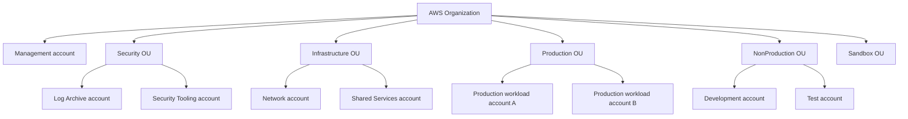
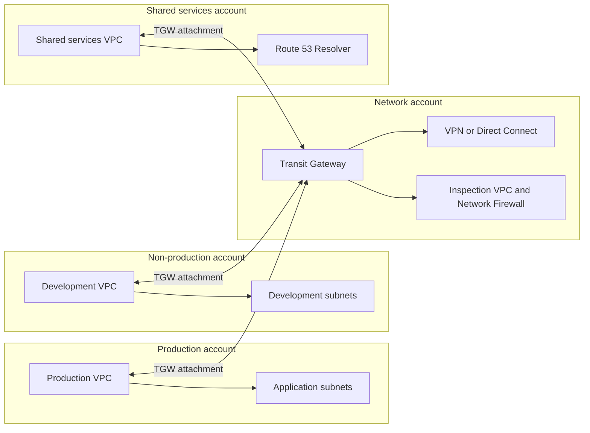

# Kiến trúc nhiều tài khoản và cô lập blast radius

Một AWS account là ranh giới quản trị và bảo mật quan trọng: account có IAM principals, tài nguyên, quota, billing và cấu hình dịch vụ riêng. Tổ chức nhiều account đúng cách giúp tách môi trường, đội ngũ, dữ liệu và quyền quản trị; khi một workload hoặc credential bị xâm nhập, phạm vi ảnh hưởng có thể được giới hạn trong account hoặc miền tin cậy đã xác định.

Kiến trúc nhiều tài khoản (multi-account architecture) là cách tổ chức AWS Organizations thành các account có mục đích rõ ràng, áp dụng guardrail thống nhất và thiết kế luồng truy cập có kiểm soát giữa chúng. Mục tiêu không phải tạo account cho mọi thành phần nhỏ, mà tạo ranh giới phù hợp với mức độ rủi ro, quyền sở hữu, vòng đời và yêu cầu tuân thủ.

Sau bài học, người học có thể:

- Giải thích vai trò của AWS account, AWS Organizations, Organizational Unit (OU), management account và delegated administrator.
- Thiết kế cấu trúc OU/account cho security, log archive, network, shared services, production và non-production.
- Dùng Service Control Policy (SCP), Resource Control Policy (RCP) và IAM để tạo guardrail nhiều lớp.
- Thiết kế truy cập liên tài khoản bằng IAM role, AWS IAM Identity Center và resource policy.
- Phân đoạn network, data, encryption key và pipeline để giảm blast radius.
- Xây dựng quy trình cấp mới, giám sát, ứng phó và đóng account an toàn.

## 1. Vì sao cần kiến trúc nhiều tài khoản?

### 1.1. Account là ranh giới cô lập quan trọng

Trong AWS, account tạo ra một phạm vi quản trị riêng cho resource, IAM, service quota và chi phí. Resource trong account khác không tự động được phép truy cập; việc chia sẻ phải đi qua cơ chế xác thực và ủy quyền như IAM role, resource policy, AWS Resource Access Manager (AWS RAM), VPC sharing hoặc dịch vụ chia sẻ dữ liệu tương ứng.

Tách account có thể giảm tác động của các tình huống sau:

- Một IAM role của ứng dụng production bị lộ credential.
- Một kỹ sư vô tình xóa resource hoặc thay đổi network policy.
- Một workload thử nghiệm tạo chi phí lớn hoặc tiêu thụ hết quota.
- Một bucket, database hoặc KMS key bị cấu hình sai.
- Một tài khoản workload bị xâm nhập và cần cô lập để điều tra.
- Một nhóm cần quyền quản trị độc lập hoặc dữ liệu có yêu cầu tuân thủ riêng.

VPC giúp chia mạng trong account, nhưng không tạo cùng ranh giới quản trị với account. Nếu mọi môi trường dùng chung một account, một principal có quyền IAM rộng hoặc một lỗi ở lớp quản trị có thể ảnh hưởng nhiều VPC và workload. Tách account làm giảm số resource mà một bộ credential có thể tác động, miễn là quyền liên tài khoản cũng được giới hạn.

### 1.2. Account, OU và VPC giải quyết các bài toán khác nhau

| Thành phần | Phạm vi | Vai trò chính |
|---|---|---|
| AWS account | Resource, IAM, quota, billing và cấu hình dịch vụ của account | Ranh giới quản trị, bảo mật và chi phí |
| Organizational Unit (OU) | Nhóm account trong AWS Organizations | Áp dụng policy và quản trị theo nhóm |
| VPC | Mạng logic trong một Region của một account | Cô lập network và định tuyến |
| Subnet | Phạm vi IP trong một AZ của VPC | Phân đoạn mạng theo chức năng |
| IAM role | Tập quyền có thể được principal assume | Cấp quyền tạm thời cho người hoặc workload |
| Resource policy | Chính sách gắn vào resource | Cho phép hoặc từ chối principal truy cập resource |

Không nên dùng OU như một nhóm network hoặc xem VPC như ranh giới IAM. Một account có thể chứa nhiều VPC; một OU có thể chứa nhiều account; một VPC có thể được chia sẻ với account khác bằng AWS RAM theo mô hình được hỗ trợ.

### 1.3. Phân biệt blast radius

Blast radius là phạm vi tài nguyên, dữ liệu, người dùng và hoạt động có thể bị ảnh hưởng khi một lỗi hoặc sự cố xảy ra. Phân tích blast radius theo ít nhất năm chiều:

- **Identity:** principal bị chiếm quyền có thể assume role nào, truy cập account nào, sửa policy nào?
- **Network:** workload có thể kết nối đến subnet, VPC, endpoint hoặc Internet nào?
- **Data:** credential có thể đọc, sửa, xóa hoặc giải mã tập dữ liệu nào?
- **Control plane:** ai có thể thay đổi Organizations, SCP, CloudTrail, KMS, network hub hoặc pipeline?
- **Operations:** sự cố ở Region, quota, CI/CD hoặc dịch vụ dùng chung ảnh hưởng bao nhiêu workload?

Account boundary là một lớp giảm blast radius. Nó không tự ngăn một principal được cấp quyền assume role sang account khác, một pipeline triển khai sai vào nhiều account hoặc một control plane dùng chung bị xâm nhập. Vì vậy phải thiết kế cả quyền liên tài khoản, quyền quản trị trung tâm và quy trình khôi phục.

## 2. Nguyên tắc thiết kế

Một cấu trúc account tốt nên tuân theo các nguyên tắc:

1. **Tách theo ranh giới tin cậy và quyền sở hữu.** Production, non-production, security và log archive thường cần account riêng.
2. **Dùng account cho isolation, OU cho policy grouping.** OU nên phản ánh mục đích quản trị và mức độ kiểm soát tương đồng.
3. **Mặc định từ chối quyền không cần thiết.** IAM role và resource policy chỉ cấp action/resource tối thiểu; SCP/RCP đặt guardrail ở cấp tổ chức.
4. **Giữ control plane trung tâm nhỏ và được bảo vệ mạnh.** Management account không chạy workload ứng dụng thông thường.
5. **Chia sẻ có chủ đích.** Network hub, artifact, image, DNS và data platform chỉ được chia sẻ qua cơ chế có audit và owner.
6. **Tự động hóa baseline.** Account mới phải có logging, security services, identity, network và tagging trước khi nhận workload.
7. **Thiết kế khả năng phục hồi độc lập.** Backup, log archive và recovery account không phụ thuộc hoàn toàn vào credential của workload cần phục hồi.
8. **Đo lường chi phí và vận hành.** Account mới làm tăng số lượng policy, quota, log và pipeline cần quản trị; cần tự động hóa để tránh cấu hình lệch.

Không có một số lượng account tối ưu cho mọi tổ chức. Quyết định tách account nên dựa trên mức độ nhạy cảm, blast radius, quyền sở hữu, vòng đời, quota, billing và chi phí vận hành.

## 3. Cấu trúc AWS Organizations và OU

### 3.1. Management account và member account

AWS Organizations quản lý nhiều AWS account trong một organization. Account tạo organization ban đầu là **management account**. Account được mời hoặc tạo vào organization là **member account**.

Management account có quyền quản trị organization và có vị trí đặc biệt trong thanh toán, policy và thiết lập dịch vụ. SCP không giới hạn quyền trong management account, vì vậy phải bảo vệ account này bằng identity control, MFA, role separation, logging và quy trình thay đổi nghiêm ngặt.

Member account chịu các SCP được áp dụng từ root, OU và account. Tài nguyên trong member account vẫn cần IAM/resource policy để cấp quyền thực tế. Không dùng management account làm account chạy ứng dụng hoặc workload thông thường; hãy giữ account này cho tác vụ quản trị Organizations và billing cần thiết.

### 3.2. Ví dụ OU tham chiếu

Cấu trúc đơn giản có thể bắt đầu như sau:



Vai trò thường gặp:

| Account/OU | Trách nhiệm | Quyền truy cập cần giới hạn |
|---|---|---|
| Management account | Organizations, billing và quản trị cấp tổ chức | Số ít administrator; không chạy workload |
| Log Archive | Lưu CloudTrail, Config và log bảo mật tập trung | Ghi từ account nguồn; đọc theo role điều tra |
| Security Tooling | Delegated administrator cho dịch vụ bảo mật, tổng hợp finding | Security team và service-linked role |
| Network | Transit Gateway, Network Firewall, DNS resolver, egress/ingress hub | Network engineering và workload attachment |
| Shared Services | Directory, artifact, image, CI/CD runner hoặc dịch vụ dùng chung | Chỉ workload/đội được phê duyệt |
| Production | Workload và dữ liệu production | Runtime role, deploy role, break-glass role |
| Non-production | Dev, test, staging | Tách dữ liệu, credential và quyền khỏi production |
| Sandbox | Thử nghiệm có giới hạn | Quota, budget, thời hạn và SCP chặt |

Đây là mô hình tham chiếu, không phải sơ đồ bắt buộc. Tổ chức nhỏ có thể gộp network và shared services; tổ chức lớn có thể tách theo business unit, data sensitivity hoặc regulatory boundary. Không nên gộp log archive với workload production chỉ để giảm số account.

### 3.3. OU nên phản ánh chính sách

OU thường được phân theo môi trường, chức năng hoặc mức độ kiểm soát. Ví dụ, production OU có thể cấm tắt CloudTrail, thay đổi log archive bucket hoặc tạo public resource ngoài baseline. Sandbox OU có thể giới hạn Region, instance type và dịch vụ có chi phí cao.

Tránh tạo OU chỉ theo tên phòng ban nếu các account trong đó cần guardrail khác nhau. Tránh lồng OU quá sâu khiến việc xác định effective policy trở nên khó khăn. Đặt tên nhất quán, xác định owner và ghi rõ mục đích của mỗi OU.

## 4. Guardrail bằng AWS Organizations

### 4.1. SCP đặt giới hạn quyền tối đa

Service Control Policy (SCP) là policy của AWS Organizations dùng để đặt giới hạn quyền tối đa cho principal trong member account. SCP không cấp quyền. Một API call chỉ thành công khi IAM/resource policy cho phép và không có explicit deny từ policy áp dụng.

SCP có thể gắn ở organization root, OU hoặc account. Quyền hiệu lực của member account chịu ảnh hưởng bởi chuỗi policy từ root đến OU/account. Khi nhiều SCP được gắn ở cùng cấp, các Allow cần được xem xét theo phép hợp nhất phù hợp; một explicit Deny ở bất kỳ policy áp dụng nào đều chặn request.

Các điểm cần nhớ:

- SCP áp dụng cho member account trong organization; không áp dụng cho management account.
- SCP không giới hạn service-linked role.
- SCP không tự cấp quyền cho IAM user/role.
- SCP có thể giới hạn root user của member account, nhưng không thay thế bảo vệ root credential.
- Thay đổi SCP có thể ảnh hưởng nhiều account cùng lúc; cần thử ở OU kiểm thử và có kế hoạch rollback.
- Khi account rời organization, SCP của organization không còn là guardrail áp dụng cho account đó.

### 4.2. Ví dụ SCP giới hạn Region

Ví dụ sau từ chối tạo hoặc thay đổi resource ngoài hai Region cho phép, đồng thời giữ một số global service/action cần thiết trong allowlist ngoại lệ. Đây là mẫu minh họa; danh sách ngoại lệ phải được xác minh theo service catalog và nhu cầu thực tế của tổ chức.

```json
{
  "Version": "2012-10-17",
  "Statement": [
    {
      "Sid": "DenyOutsideApprovedRegions",
      "Effect": "Deny",
      "NotAction": [
        "acm:*",
        "aws-portal:*",
        "budgets:*",
        "ce:*",
        "cloudfront:*",
        "iam:*",
        "organizations:*",
        "route53:*",
        "support:*"
      ],
      "Resource": "*",
      "Condition": {
        "StringNotEquals": {
          "aws:RequestedRegion": [
            "ap-southeast-1",
            "ap-southeast-2"
          ]
        }
      }
    }
  ]
}
```

Danh sách `NotAction` ở trên chỉ để minh họa cách xử lý API global và không nên sao chép nguyên trạng. Một số service có endpoint global nhưng tạo resource theo Region; một số API control plane có hành vi khác nhau. Hãy kiểm tra từng dịch vụ, thử policy bằng account không production và theo dõi CloudTrail trước khi áp dụng diện rộng.

### 4.3. Ví dụ SCP bảo vệ audit log

Mẫu sau từ chối các hành động có thể vô hiệu hóa hoặc xóa trail trong member account. Trong môi trường thật, cần rà soát thêm các API cập nhật trail, event selector, log bucket, Config recorder và delivery channel theo baseline của tổ chức.

```json
{
  "Version": "2012-10-17",
  "Statement": [
    {
      "Sid": "ProtectCloudTrail",
      "Effect": "Deny",
      "Action": [
        "cloudtrail:StopLogging",
        "cloudtrail:DeleteTrail"
      ],
      "Resource": "*"
    }
  ]
}
```

SCP này không tự bảo đảm log bất biến. Log archive account vẫn cần bucket policy, KMS key policy, versioning/Object Lock khi phù hợp, quyền xóa tách biệt và cảnh báo khi delivery thất bại. Security team cần một quy trình break-glass có kiểm soát để xử lý ngoại lệ hợp lệ.

### 4.4. Resource Control Policy

Resource Control Policy (RCP) là loại policy của AWS Organizations dùng để đặt guardrail tối đa đối với quyền truy cập resource trong các dịch vụ được hỗ trợ. SCP tập trung giới hạn quyền của principal trong member account; RCP tập trung giới hạn quyền tối đa mà resource trong account có thể cấp cho principal.

RCP không thay thế resource policy hoặc IAM policy và chỉ có hiệu lực với loại resource/service được AWS hỗ trợ. Trước khi dùng, kiểm tra danh sách service/action hỗ trợ hiện tại và đánh giá ảnh hưởng đến truy cập từ account khác, AWS service principal và dịch vụ tích hợp.

Có thể kết hợp:

- SCP để ngăn principal trong workload account thực hiện hành động nguy hiểm.
- RCP để giới hạn resource không được chia sẻ ra ngoài trust boundary đã định.
- IAM policy để cấp quyền cho role cụ thể.
- Resource policy để định nghĩa principal được truy cập bucket, key, queue hoặc resource khác.
- Permission boundary/session policy để thu hẹp quyền của role/session.

### 4.5. Triển khai policy an toàn

Một policy tổ chức cần có owner, mục tiêu, phạm vi, kiểm thử và kế hoạch rollback. Quy trình đề xuất:

1. Viết yêu cầu bằng ngôn ngữ nghiệp vụ, ví dụ “workload production chỉ được tạo resource ở Region đã phê duyệt”.
2. Xác định API action, principal, resource và condition bị tác động.
3. Dùng IAM Access Analyzer, policy simulator phù hợp và account thử nghiệm để đánh giá.
4. Gắn policy vào OU thử nghiệm có workload đại diện.
5. Kiểm tra CloudTrail, application log, pipeline và các dịch vụ AWS tích hợp.
6. Mở rộng theo từng OU; theo dõi lỗi AccessDenied và phản hồi từ owner.
7. Lưu policy version, người phê duyệt, thời điểm thay đổi và cách rollback.

Không dùng SCP như công cụ sửa nhanh một lỗi ứng dụng. Một Deny rộng có thể làm hỏng backup, deployment, logging hoặc hoạt động của AWS service.

## 5. Identity và quyền truy cập liên tài khoản

### 5.1. AWS IAM Identity Center

AWS IAM Identity Center giúp quản lý truy cập workforce vào nhiều AWS account từ một nơi. Người dùng xác thực qua identity source đã cấu hình, sau đó được gán permission set vào account hoặc application. Permission set tạo role tương ứng trong account đích; người dùng nhận session tạm thời khi đăng nhập.

Nguyên tắc thiết kế:

- Dùng federation với identity provider doanh nghiệp khi phù hợp; bật MFA và quy trình offboarding đồng bộ.
- Gán permission set theo vai trò công việc, ví dụ ReadOnly, Developer, NetworkAdmin, SecurityAudit và Billing.
- Tách quyền production khỏi quyền sandbox; yêu cầu phê duyệt hoặc JIT access cho quyền nhạy cảm.
- Dùng nhóm identity để gán quyền nhất quán, tránh gán thủ công từng người.
- Rà soát account assignment, permission set và session duration định kỳ.
- Giữ emergency access độc lập, giới hạn người giữ credential và kiểm tra thường xuyên.

IAM Identity Center giải quyết workforce access; workload vẫn nên dùng IAM role, task role, instance profile hoặc service role thay vì credential người dùng.

### 5.2. AssumeRole giữa hai account

Một account workload có thể assume role trong account dịch vụ dùng chung để lấy quyền giới hạn. Việc này cần hai phía:

1. Trust policy của role đích cho phép principal/account nguồn gọi `sts:AssumeRole`.
2. Identity policy của principal nguồn cho phép gọi `sts:AssumeRole` trên ARN role đích.

Role đích chỉ cấp action/resource cần thiết. Session có thời hạn; ứng dụng dùng STS credentials thay cho access key dài hạn.

Ví dụ trust policy cho phép một deployment role từ account CI/CD assume role triển khai vào account production:

```json
{
  "Version": "2012-10-17",
  "Statement": [
    {
      "Sid": "TrustDeploymentRole",
      "Effect": "Allow",
      "Principal": {
        "AWS": "arn:aws:iam::111122223333:role/ReleasePipeline"
      },
      "Action": "sts:AssumeRole"
    }
  ]
}
```

Identity policy phía account CI/CD cần cho phép `sts:AssumeRole` trên ARN role đích. Trust policy chỉ xác định ai có thể assume; nó không cấp quyền triển khai nếu role đích chưa có policy cho phép thao tác đó.

Khi tích hợp nhà cung cấp bên thứ ba, dùng `sts:ExternalId` theo hướng dẫn AWS để giảm nguy cơ confused deputy. ExternalId không phải mật khẩu và không thay thế kiểm tra trust principal. Với workload nội bộ, dùng principal ARN cụ thể, source identity/session tag nếu cần audit và giới hạn session duration.

### 5.3. Quyền người dùng và quyền workload

| Nhu cầu | Cơ chế nên xem xét |
|---|---|
| Kỹ sư đăng nhập console/CLI vào nhiều account | IAM Identity Center và permission set |
| EC2 gọi S3/KMS | Instance profile với IAM role |
| ECS task gọi database secret | Task role, secret resource policy nếu cần |
| Lambda gọi queue | Execution role tối thiểu |
| CI/CD triển khai vào workload account | Role đích được pipeline assume |
| Account khác đọc object S3 | Bucket policy + IAM policy ở account gọi, và KMS policy nếu SSE-KMS |
| Chia sẻ subnet hoặc Transit Gateway | AWS RAM và quyền quản trị network tương ứng |

Không chia sẻ một role quản trị toàn quyền cho mọi đội. Tách quyền đọc, vận hành, triển khai, bảo mật và quản trị tổ chức để một credential bị lộ không thể vừa thay đổi workload vừa xóa log hoặc vô hiệu hóa guardrail.

## 6. Cô lập network giữa các account

### 6.1. Mô hình hub-and-spoke

Trong tổ chức có nhiều workload account, mỗi account có thể sở hữu VPC riêng. Một network account trung tâm có thể quản lý Transit Gateway, Network Firewall, DNS resolver, VPN/Direct Connect và các luồng egress/ingress dùng chung.

Transit Gateway (TGW) hoạt động như router trung tâm để kết nối VPC và network attachment. TGW route table quyết định attachment nào có thể trao đổi traffic. Việc attach một VPC vào TGW không tự động có nghĩa mọi VPC khác có thể truy cập; cần cấu hình association, propagation và route cụ thể.

Mô hình hub-and-spoke thường có:

- VPC workload ở từng account, tách theo môi trường hoặc sản phẩm.
- Network account sở hữu TGW, inspection VPC và các kết nối on-premises.
- AWS RAM chia sẻ TGW cho account hoặc organization được phê duyệt.
- TGW route table tách production, non-production, shared services và on-premises.
- Network Firewall hoặc appliance kiểm tra traffic ở các luồng cần inspection.
- VPC endpoint và private DNS giúp workload gọi AWS service qua private path.

### 6.2. Sơ đồ kết nối tham chiếu



Sơ đồ chỉ minh họa kết nối. Route table, security group, NACL, DNS resolver rule và firewall policy vẫn cần cấu hình riêng. Không nên cho development truy cập production chỉ vì cả hai cùng kết nối TGW.

### 6.3. Phân tách TGW route table

Có thể dùng TGW route table riêng cho production, non-production và shared services. Ví dụ:

| Route table | Attachment được association | Route được phép |
|---|---|---|
| Production | Production VPC | Shared services cần thiết, inspection, on-premises được duyệt |
| Non-production | Development/test VPC | Shared services giới hạn, Internet egress qua inspection |
| Shared services | Shared services VPC | Chỉ các workload account cần dịch vụ dùng chung |
| Inspection | Inspection VPC | Route đối xứng đến nguồn và đích được kiểm tra |

Dùng route propagation có chọn lọc. Nếu bật propagation mọi attachment vào một route table dùng chung, các VPC có thể học route của nhau ngoài dự kiến. Kiểm thử đường đi hai chiều và luồng return traffic trước khi đưa vào production.

### 6.4. AWS RAM và chia sẻ network

AWS Resource Access Manager (AWS RAM) cho phép chia sẻ tài nguyên được hỗ trợ giữa account trong organization hoặc với account cụ thể. Một số tài nguyên network thường được chia sẻ gồm Transit Gateway, subnet của VPC và resolver rule.

Khi chia sẻ subnet qua RAM, account participant có thể tạo resource trong subnet được chia sẻ nhưng VPC owner vẫn quản lý VPC, route table và một số cấu hình network cấp VPC. Participant không trở thành owner của VPC. Xác định rõ ai quản lý security group, IP address, quota và lifecycle của resource.

Trước khi chia sẻ:

- Xác định resource owner và participant account.
- Chỉ chia sẻ subnet/attachment cần thiết.
- Định nghĩa naming, tagging, IPAM và quy trình thu hồi quyền.
- Kiểm tra quyền tạo resource và quota của participant.
- Bật log và quy trình xử lý sự cố giữa network owner với workload owner.

### 6.5. DNS, egress và VPC endpoint

Route 53 Resolver inbound/outbound endpoint và resolver rule có thể chia sẻ để phân giải DNS giữa VPC và on-premises. Cần kiểm soát domain được forward, nguồn truy vấn và account được dùng rule. DNS query log giúp điều tra domain bất thường nhưng cần giới hạn quyền đọc và retention.

Đối với egress, có thể định tuyến outbound qua inspection VPC, Network Firewall và NAT Gateway. Dùng VPC endpoint cho S3, DynamoDB và các AWS service hỗ trợ để giảm phụ thuộc Internet/NAT. Endpoint policy giới hạn service/resource qua endpoint, nhưng IAM/resource policy vẫn phải cấp quyền.

Không phải mọi traffic đều cần đi qua một hub trung tâm. Với workload cần độ trễ thấp hoặc dữ liệu nhạy cảm, cân nhắc endpoint/PrivateLink, VPC peering hoặc service-specific private connectivity. VPC peering không hỗ trợ transitive routing; TGW phù hợp hơn khi cần topology nhiều VPC, nhưng làm tăng chi phí và độ phức tạp định tuyến.

## 7. Cô lập dữ liệu, khóa và backup

### 7.1. S3 cross-account

Bucket dữ liệu production nên thuộc account sở hữu dữ liệu. Account khác chỉ nhận quyền cần thiết thông qua bucket policy, IAM policy và KMS key policy nếu bucket dùng SSE-KMS.

Ví dụ bucket policy cho phép một role trong account phân tích đọc một prefix đã công bố:

```json
{
  "Version": "2012-10-17",
  "Statement": [
    {
      "Sid": "AllowAnalyticsReadPublishedData",
      "Effect": "Allow",
      "Principal": {
        "AWS": "arn:aws:iam::444455556666:role/AnalyticsReader"
      },
      "Action": [
        "s3:GetObject"
      ],
      "Resource": "arn:aws:s3:::company-data/published/*"
    }
  ]
}
```

Role ở account phân tích cũng cần IAM policy cho phép `s3:GetObject` trên ARN tương ứng. Nếu object dùng SSE-KMS customer managed key, role cần quyền giải mã phù hợp và key policy ở account sở hữu phải cho phép principal/account đó. Nếu chỉ cần chia sẻ dữ liệu đã xử lý, hãy xuất bản vào bucket/prefix riêng thay vì cấp quyền đọc toàn bộ raw data.

### 7.2. Database và data platform

Đối với database, ưu tiên để resource và credential trong account sở hữu workload. Chỉ chia sẻ qua API, data export, snapshot hoặc cơ chế native của dịch vụ khi có nhu cầu rõ ràng.

- Dùng private subnet và security group chỉ cho workload được phép.
- Tách database user theo service; không chia sẻ master credential giữa account.
- Dùng Secrets Manager resource policy và KMS key policy nếu cần đọc secret cross-account.
- Với snapshot chia sẻ, kiểm tra giới hạn của engine, Region, encryption và quyền KMS; không giả định mọi snapshot mã hóa đều chia sẻ trực tiếp được.
- Dùng data lake/resource sharing của dịch vụ phù hợp nếu cần chia sẻ bảng hoặc dataset mà không sao chép dữ liệu thô.
- Ghi lại owner, consumer, purpose, retention và quy trình thu hồi quyền.

### 7.3. KMS key boundary

Customer managed KMS key nên có owner rõ ràng. Key policy xác định quyền nền tảng; IAM policy ở account gọi xác định principal được dùng quyền đã chia sẻ. Không chia sẻ quyền `kms:Decrypt` rộng nếu consumer chỉ cần `GenerateDataKey` hoặc chỉ đọc một dataset cụ thể.

Tách key theo account hoặc miền dữ liệu khi cần ranh giới quản trị độc lập. Chú ý:

- Key trong một Region không tự động dùng được như cùng một key ở Region khác; multi-Region key có thiết kế riêng.
- Quyền KMS không thay thế quyền truy cập resource chứa ciphertext.
- Nếu key bị disable, schedule deletion hoặc policy bị sửa, ứng dụng và backup có thể không giải mã được.
- CloudTrail ghi lại thao tác KMS; cần giữ log độc lập với account workload.
- Không đặt secret hoặc PII trong encryption context; context không được mã hóa và có thể xuất hiện trong log.

### 7.4. Backup account và recovery boundary

Backup account hoặc vault account riêng giúp giảm nguy cơ workload administrator xóa cả dữ liệu production lẫn bản sao lưu. AWS Backup hỗ trợ backup policy tập trung, cross-account/cross-Region copy cho resource được hỗ trợ và vault controls theo loại resource/Region.

Thiết kế nên gồm:

- Account nguồn tạo recovery point theo lịch và retention.
- Backup account nhận bản sao qua policy/copy action được cho phép.
- Backup vault dùng KMS key có owner độc lập và quyền restore được giới hạn.
- AWS Backup Vault Lock ở chế độ phù hợp khi cần WORM và yêu cầu compliance; đánh giá governance/compliance mode trước khi khóa.
- Role restore chỉ được cấp cho nhóm recovery; workload runtime không được xóa vault hoặc sửa retention.
- Diễn tập restore để xác minh dữ liệu, key, dependency, DNS và thời gian phục hồi.

Bản sao cross-account không tự bảo đảm recovery. Nếu key, catalog, runbook hoặc identity của backup account phụ thuộc account production bị xâm nhập, blast radius vẫn có thể lan rộng.

## 8. Cô lập workload và pipeline triển khai

### 8.1. Chọn ranh giới workload account

Có thể chọn một account cho mỗi môi trường của một sản phẩm, hoặc một account cho mỗi sản phẩm/mức độ nhạy cảm. Cần cân bằng giữa isolation và chi phí vận hành.

| Tiêu chí | Tách account riêng khi |
|---|---|
| Mức độ nhạy cảm | Dữ liệu hoặc workload có yêu cầu kiểm soát khác biệt |
| Quyền sở hữu | Team có owner, on-call và vòng đời độc lập |
| Môi trường | Production cần tách credential, quota và billing khỏi dev/test |
| Tuân thủ | Cần log, retention, Region hoặc quyền truy cập riêng |
| Blast radius | Một workload bị compromise không được ảnh hưởng workload khác |
| Chi phí/quota | Cần budget, quota và cost allocation riêng |

Không cần tạo account riêng cho từng microservice nếu các service cùng trust boundary, cùng owner và cùng chính sách vận hành. Tuy nhiên, các service có dữ liệu nhạy cảm hoặc quyền quản trị khác nhau nên được xem xét tách account hoặc ít nhất tách IAM role, VPC, key và resource policy.

### 8.2. Account vending và baseline tự động

Account mới cần được cấp qua quy trình chuẩn, thường gọi là account vending. AWS Control Tower Account Factory hoặc quy trình tự động dựa trên AWS Organizations có thể tạo account và áp baseline.

Một account baseline nên có:

- Owner, cost center, environment, data classification và contact metadata.
- IAM Identity Center assignment hoặc cơ chế workforce access.
- SCP/OU guardrail đúng môi trường.
- Organization CloudTrail, AWS Config và log delivery đến account tập trung.
- Delegated security services, GuardDuty, Security Hub và các dịch vụ được chọn.
- VPC/subnet/IPAM theo tiêu chuẩn hoặc quy trình network attachment.
- KMS key, secret store, backup policy và resource policy cần thiết.
- Budget, cost anomaly alert, tag policy và quy trình đóng account.

Không cấp account trống cho team rồi để họ tự thiết lập bảo mật sau. Workload chỉ nên được triển khai khi account đã đạt baseline và owner xác nhận trách nhiệm.

### 8.3. CI/CD account và deployment role

Một CI/CD account trung tâm có thể xây dựng artifact một lần rồi triển khai vào nhiều workload account. Pipeline assume role ở account đích; role đích chỉ cho phép thao tác cần thiết trên stack, service hoặc resource cụ thể.

Các nguyên tắc:

- Tách build role khỏi deployment role và runtime role.
- Artifact có checksum, version, provenance và retention rõ ràng.
- Dùng OIDC/federated identity hoặc role tạm thời cho runner; tránh access key dài hạn.
- Giới hạn trust policy của deployment role theo pipeline principal, source identity và điều kiện phù hợp.
- Triển khai theo wave: dev → test → staging → production; production có approval và canary.
- Không cho pipeline account quyền quản trị Organizations hoặc xóa log archive.
- Ghi nhận ai phê duyệt release, artifact nào được triển khai, vào account/Region nào.

Một lỗi pipeline có thể lan ra nhiều account dù workload account đã cô lập tốt. Giới hạn concurrency, phạm vi target, quyền rollback và khả năng dừng rollout là một phần của blast-radius design.

### 8.4. Resource sharing và service catalog

Các dịch vụ dùng chung như artifact repository, container registry, DNS, directory, observability hoặc API nội bộ nên có service owner và consumer contract.

Chọn cơ chế chia sẻ phù hợp:

- AWS RAM cho resource được hỗ trợ như subnet, Transit Gateway hoặc resolver rule.
- Resource policy cho S3 bucket, KMS key, SNS topic, SQS queue và resource hỗ trợ.
- IAM role assumption cho tác vụ cần quyền thực thi trong account owner.
- PrivateLink cho service endpoint private với consumer VPC.
- Data sharing native của database/data lake khi cần chia sẻ dataset.

Đừng dùng một bucket hoặc role shared với quyền rộng cho mọi account. Chia theo purpose, dataset, environment và consumer; định kỳ rà soát danh sách account được chia sẻ và thu hồi quyền hết hạn.

## 9. Cô lập blast radius theo kịch bản

### 9.1. Workload credential bị lộ

Nếu access key hoặc role session của ứng dụng production bị lộ, attacker có thể thực hiện mọi action được cho phép trong session và resource policy liên quan.

Giảm tác động bằng cách:

- Dùng role tạm thời, session duration ngắn phù hợp và không lưu access key lâu dài.
- Tách role theo service; không dùng chung một role cho nhiều workload có rủi ro khác nhau.
- Hạn chế `iam:PassRole`, `sts:AssumeRole`, `kms:Decrypt`, `s3:*` và quyền thay đổi security group.
- Không cho runtime role assume role quản trị account khác.
- Theo dõi CloudTrail và GuardDuty; có quy trình thu hồi credential, disable role path và cô lập workload.

### 9.2. Workload account bị xâm nhập

Account bị xâm nhập có thể cần cô lập nhanh. Network account có thể thu hồi TGW route/attachment hoặc áp firewall containment; security team có thể chặn role, session, endpoint hoặc resource policy theo runbook.

Không nên lập tức xóa account hoặc resource nếu cần giữ bằng chứng. Quy trình containment nên xác định:

1. Ai có quyền cô lập account/VPC và ai phê duyệt?
2. Làm thế nào chặn egress mà vẫn giữ đường điều tra?
3. Log có được lưu ở account độc lập không?
4. Backup và KMS key có còn truy cập được?
5. Có workload khác dùng chung secret, subnet, role hoặc pipeline không?
6. Điều kiện nào cho phép kết nối lại account?

SCP có thể là guardrail, nhưng không phải công cụ cô lập network tức thời. Cần có thao tác cụ thể ở IAM, TGW, security group, firewall, DNS và service endpoint.

### 9.3. Management hoặc security account bị xâm nhập

Management account và security account có blast radius lớn vì có quyền quản trị hoặc quan sát nhiều account. Hãy bảo vệ bằng:

- Số lượng principal rất nhỏ, MFA mạnh và hardware security key cho quyền nhạy cảm.
- Permission set tách riêng; không dùng daily admin cho tác vụ quản trị organization.
- Break-glass role có giám sát, thời hạn và quy trình phê duyệt.
- CloudTrail log được chuyển đến log archive account độc lập.
- Cảnh báo thay đổi Organizations, SCP, delegated administrator, trail và log destination.
- Runbook khôi phục access từ identity provider và credential dự phòng.

Không đặt tất cả công cụ điều tra, log, backup và identity recovery trong một account có thể bị cùng một principal quản trị xóa.

### 9.4. Sự cố ở dịch vụ dùng chung

Network hub, DNS, CI/CD, artifact registry và directory có thể ảnh hưởng nhiều workload cùng lúc. Cần giảm blast radius của shared services:

- Chia control plane và data plane; không để service owner có quyền tùy ý vào dữ liệu production.
- Tách production và non-production endpoint, secret và artifact.
- Có multi-AZ, backup/restore và phương án bypass/isolated operation.
- Giới hạn consumer bằng endpoint policy, resource policy, security group và authentication.
- Đặt SLO, change window và rollback plan cho thay đổi dùng chung.
- Thử nghiệm failure mode như DNS resolver lỗi, TGW route sai, artifact registry không truy cập hoặc pipeline phát hành nhầm.

## 10. Logging, delegated administration và security operations

### 10.1. Account tập trung cho log và security

Log archive account nên nhận log từ organization trail, AWS Config và các nguồn telemetry quan trọng. Bucket policy chỉ cho phép dịch vụ/account nguồn ghi theo prefix; quyền đọc dành cho security/audit role; quyền xóa được tách biệt và giám sát.

Security Tooling account có thể là delegated administrator cho GuardDuty, Security Hub, IAM Access Analyzer hoặc dịch vụ hỗ trợ delegated administration. Delegated administrator giúp security team quản lý findings trên nhiều account mà không cần dùng management account hằng ngày.

Delegated admin không có nghĩa account đó tự động có toàn quyền với mọi resource. Kiểm tra quyền service-specific, trusted access, Region enablement và phạm vi member account được quản lý.

### 10.2. Baseline giám sát tổ chức

| Tín hiệu | Nguồn | Hành động |
|---|---|---|
| Account mới hoặc account rời organization | CloudTrail/Organizations EventBridge | Kiểm tra owner, baseline và access |
| SCP/RCP thay đổi | CloudTrail | Review policy, đánh giá account bị ảnh hưởng |
| CloudTrail/Config bị tắt | CloudTrail/Config/Security Hub | Cảnh báo mức nghiêm trọng và khôi phục logging |
| Cross-account AssumeRole bất thường | CloudTrail STS events | Xác minh principal, source identity và session |
| Bucket/KMS policy thay đổi | CloudTrail | Đánh giá nguy cơ public access hoặc mất quyền giải mã |
| TGW route/attachment thay đổi | CloudTrail/VPC telemetry | Kiểm tra network isolation và route propagation |
| GuardDuty/Security Hub finding | Security services | Triage, containment, owner và SLA |

Đặt owner cho từng finding. Một dashboard nhiều account nhưng không có quy trình xử lý sẽ không giảm rủi ro. Cần xác định severity, SLA, escalation, bằng chứng và cách đóng finding.

### 10.3. AWS Config và drift

AWS Config ghi nhận cấu hình resource và đánh giá Config Rules/conformance pack theo khả năng dịch vụ. Dùng aggregator để xem trạng thái nhiều account/Region từ account giám sát. Config giúp phát hiện drift như bucket public, security group mở rộng hoặc resource không bật encryption.

Config không tự sửa mọi drift và không thay thế IaC review. Với remediation tự động, giới hạn action, kiểm thử trong non-production và giữ audit trail. Khi resource thay đổi ngoài pipeline, xác định owner và nguyên nhân trước khi tự động revert để tránh phá vỡ thay đổi khẩn cấp hợp lệ.

## 11. Vòng đời account và quản trị thay đổi

### 11.1. Tạo account

Một yêu cầu tạo account nên nêu rõ business owner, technical owner, environment, data classification, cost center, Region, network requirement và ngày dự kiến đưa vào sử dụng.

Quy trình cấp account:

1. Xác minh nhu cầu và chọn OU theo mục đích/guardrail.
2. Tạo account bằng Control Tower Account Factory hoặc quy trình Organizations đã chuẩn hóa.
3. Gắn owner, cost allocation tag và contact.
4. Áp SCP/RCP, IAM Identity Center assignment và baseline logging/security.
5. Đăng ký account vào delegated security services, Config aggregator và backup policy.
6. Cấp network attachment, DNS và shared service access theo yêu cầu.
7. Kiểm tra baseline bằng Config, Security Hub và checklist trước khi cho phép deploy.

### 11.2. Thay đổi OU hoặc policy

Di chuyển account giữa OU có thể làm thay đổi SCP hiệu lực ngay sau khi cập nhật. Trước khi move account:

- So sánh policy nguồn và policy đích.
- Kiểm tra quyền deploy, backup, logging, network và service integration.
- Thử trên account đại diện hoặc OU thử nghiệm.
- Thông báo owner và đặt change window.
- Theo dõi AccessDenied, security finding và service health sau thay đổi.
- Giữ lại phương án đưa account về OU cũ nếu có lỗi.

Không dùng OU move để cô lập account bị xâm nhập mà không hiểu policy mới có thể ảnh hưởng việc giữ log, truy cập điều tra hoặc backup.

### 11.3. Đóng account

Đóng account cần quy trình có owner và thời gian lưu trữ rõ ràng. Trước khi close:

- Xác nhận workload đã migrate hoặc decommission.
- Xuất và giữ log, bằng chứng, dữ liệu và backup theo retention.
- Thu hồi cross-account trust, RAM share, TGW attachment, DNS record và service integration.
- Xử lý KMS key dependency, secret, certificate, domain và billing.
- Hủy credential và permission set assignment không còn cần.
- Xác nhận không còn consumer phụ thuộc resource của account.
- Thực hiện đóng account theo quy trình AWS Organizations và chính sách nội bộ.

Không xóa account chỉ để kết thúc một incident. Account bị xâm nhập có thể cần giữ nguyên để bảo toàn bằng chứng, cô lập network và phục hồi có kiểm soát.

## 12. Chi phí, quota và vận hành nhiều account

Tách account hỗ trợ cost allocation và quota isolation nhưng tăng chi phí vận hành. Mỗi account có thể phát sinh chi phí cho CloudTrail data events, AWS Config, GuardDuty, Security Hub, VPC endpoints, NAT Gateway, Transit Gateway, Network Firewall, log ingestion và backup copy.

Quản trị chi phí:

- Dùng consolidated billing và Cost Explorer để xem chi phí theo account, OU, tag và service.
- Thiết lập AWS Budgets theo account/workload và cảnh báo vượt ngưỡng.
- Dùng cost allocation tags nhất quán; theo dõi resource không tag hoặc owner không rõ.
- Đánh giá chi phí data transfer qua TGW, NAT, firewall và inter-Region.
- Đặt retention/lifecycle cho log và artifact; không tắt audit log chỉ để giảm chi phí.
- Dùng Service Quotas để theo dõi quota account/Region; xin tăng quota trước khi rollout.
- Kiểm soát sandbox bằng budget, allowed Region, service restriction và TTL cho resource.

Không phải quota nào cũng được chia sẻ giữa account; tách account có thể giúp tránh một workload chiếm quota của workload khác. Tuy nhiên, một pipeline hoặc shared service có thể vẫn có quota/throughput dùng chung.

## 13. Kiến trúc mẫu: công ty thương mại điện tử

Giả sử doanh nghiệp vận hành website và API đơn hàng ở nhiều môi trường. Dữ liệu thanh toán và khách hàng cần mức bảo vệ cao; đội network và security quản trị tập trung; developer cần tự triển khai trong phạm vi account được giao.

Một thiết kế có thể gồm:

| Account | Thành phần | Ranh giới và kiểm soát |
|---|---|---|
| Management | AWS Organizations, billing | Không chạy workload; admin rất hạn chế, MFA và alert |
| Log Archive | Organization CloudTrail, Config logs | Bucket policy, KMS, retention/Object Lock, quyền đọc tách biệt |
| Security Tooling | GuardDuty, Security Hub, Access Analyzer | Delegated admin, finding workflow và incident response |
| Network | TGW, Network Firewall, DNS resolver | Route table tách prod/nonprod, egress inspection |
| Shared Services | CI/CD, artifact, container registry, directory | Consumer allowlist, role assumption và audit |
| Production Commerce | Web/API, RDS, S3 dữ liệu đơn hàng | IAM role riêng, private subnet, KMS, backup |
| Production Analytics | Data lake/warehouse | Chỉ nhận dataset đã công bố, key và resource policy riêng |
| Development/Test | Môi trường thử nghiệm | Dữ liệu giả lập, quota/budget, không dùng secret production |
| Sandbox | Thử nghiệm cá nhân | SCP giới hạn service/Region, budget và thời hạn |

Luồng triển khai: developer đăng nhập qua IAM Identity Center; pipeline ở Shared Services build artifact đã ký/định danh version; pipeline assume deployment role trong Development; sau test và approval, pipeline assume role riêng trong Production. Runtime role của ứng dụng chỉ truy cập secret, queue, bucket prefix và database cần thiết.

Luồng dữ liệu phân tích: production xuất bản dataset đã giảm thiểu thông tin nhạy cảm sang bucket/prefix riêng; AnalyticsReader role được cấp quyền đọc đúng prefix; KMS key policy cho phép giải mã theo mục đích; CloudTrail ghi nhận hoạt động. Khi consumer không còn nhu cầu, owner thu hồi bucket policy, IAM policy và KMS access.

Khi production account bị compromise, security team giữ log ở Log Archive, dùng Network account cô lập route/egress, thu hồi session/role và phục hồi từ backup account. Việc kết nối lại chỉ thực hiện sau khi xác minh credential, image, policy và dữ liệu.

## 14. Những lỗi thiết kế thường gặp

| Lỗi | Hệ quả | Cách xử lý |
|---|---|---|
| Chạy workload trong management account | Tăng blast radius của account quản trị organization | Chuyển workload sang member account |
| Một account chứa production, dev và sandbox | Credential, quota và lỗi có thể ảnh hưởng chéo | Tách account theo trust boundary |
| SCP được hiểu nhầm là quyền Allow | Principal không có IAM permission vẫn không gọi được API | Dùng SCP làm maximum permission guardrail; IAM/resource policy cấp quyền |
| Một OU có policy quá khác nhau giữa các account | Policy khó dự đoán và khó review | Chia OU theo mục đích và guardrail |
| Dùng TGW route table chung cho mọi VPC | VPC có thể truy cập nhau ngoài dự kiến | Tách route table và propagation |
| Chia sẻ role/bucket với wildcard | Một consumer có thể truy cập dữ liệu ngoài phạm vi | Principal/resource/prefix allowlist |
| Mọi workload assume cùng admin role | Credential một workload có thể quản trị toàn hệ thống | Role theo workload và action tối thiểu |
| CI/CD có quyền Organizations hoặc log archive | Pipeline compromise có thể phá guardrail/bằng chứng | Tách build/deploy/security admin |
| Log và backup nằm cùng account workload | Attacker có thể xóa cả dữ liệu và bằng chứng | Account log archive và backup riêng |
| Chia sẻ KMS key nhưng quên key policy hoặc IAM policy | Cross-account request bị AccessDenied | Kiểm tra cả hai phía và resource policy |
| Tách quá nhiều account mà không tự động hóa | Drift, chi phí và gánh nặng vận hành tăng | Account vending, baseline và policy-as-code |
| Cô lập incident bằng cách xóa account ngay | Mất bằng chứng và làm gián đoạn recovery | Containment theo runbook, giữ log và backup |

## 15. Bài thực hành: thiết kế tổ chức nhiều account

### Bối cảnh

Một doanh nghiệp có ba team: Commerce, Analytics và Platform. Commerce chạy API production và database khách hàng; Analytics cần đọc dữ liệu báo cáo đã được phê duyệt; Platform quản lý network và CI/CD. Công ty cần tách dev khỏi production, lưu audit log độc lập và giới hạn tác động khi một workload bị xâm nhập.

### Nhiệm vụ

1. Đề xuất OU và account cho management, security, log archive, network, shared services, production, non-production và sandbox.
2. Xác định account nào sở hữu Transit Gateway, log bucket, KMS key, artifact và dataset.
3. Viết SCP guardrail giới hạn Region và bảo vệ CloudTrail ở member account.
4. Tạo IAM Identity Center permission set cho Developer, ProductionOperator và SecurityAudit.
5. Thiết kế deployment role cross-account từ CI/CD account sang production.
6. Thiết kế TGW route table để dev không truy cập production; chỉ cho phép shared services được phê duyệt.
7. Thiết kế bucket policy và KMS key policy cho AnalyticsReader đọc dataset đã xuất bản.
8. Xây dựng quy trình account vending, logging baseline, backup copy và close account.
9. Mô tả cách cô lập production account khi phát hiện credential bị lộ.
10. Xác định metric/SLA để theo dõi account baseline, finding, cost và thời gian containment.

### Tiêu chí hoàn thành

- Mỗi account có owner, mục đích, OU và cost allocation.
- Management account không chạy workload thông thường.
- SCP/RCP và IAM/resource policy có vai trò rõ ràng.
- Cross-account access dùng role hoặc resource policy giới hạn.
- Production, non-production, log archive và backup có ranh giới phù hợp.
- TGW route table không tự động mở kết nối giữa mọi VPC.
- Security finding và log có account owner, retention và workflow.
- Có thể cô lập account mà vẫn giữ bằng chứng và khả năng phục hồi.

## 16. Câu hỏi tự kiểm tra

1. Vì sao AWS account tạo ranh giới isolation mạnh hơn chỉ tạo thêm một VPC?
2. Management account khác member account ở điểm nào?
3. SCP có cấp quyền cho IAM role không? Vì sao?
4. SCP và RCP tập trung giới hạn những phía nào?
5. Vì sao cần cả trust policy ở account đích và identity policy ở account nguồn khi assume role?
6. Khi nào dùng IAM Identity Center thay vì tạo IAM user riêng cho từng account?
7. Vì sao TGW attachment không đồng nghĩa mọi VPC có thể truy cập nhau?
8. Khi chia sẻ S3 SSE-KMS cross-account, cần kiểm tra những policy nào?
9. Vì sao log archive và backup account cần độc lập với workload account?
10. Pipeline trung tâm có thể trở thành nguồn blast radius như thế nào?
11. Khi account bị compromise, vì sao không nên xóa account ngay?
12. Những yếu tố nào quyết định có nên tách thêm một account?

### Gợi ý trả lời

1. Account tách IAM, resource namespace, quota và billing; VPC chỉ phân đoạn network trong account. Quyền cross-account vẫn phải được cấp rõ ràng.
2. Management account quản trị organization và có ngoại lệ với SCP; member account chịu guardrail từ organization.
3. Không. SCP đặt maximum permission boundary; IAM/resource policy mới cấp quyền, và explicit deny vẫn có hiệu lực.
4. SCP giới hạn quyền tối đa của principal trong member account; RCP giới hạn quyền tối đa resource có thể cấp cho principal trên dịch vụ được hỗ trợ.
5. Trust policy cho phép principal được tin cậy assume role; identity policy cho phép principal nguồn gọi STS AssumeRole.
6. Workforce cần đăng nhập vào nhiều account với federation, MFA, nhóm và permission set tập trung.
7. TGW route table association, propagation và route quyết định traffic; attachment chỉ tạo kết nối.
8. Bucket policy, IAM policy ở account gọi, KMS key policy/grant và endpoint policy nếu có.
9. Để workload administrator bị xâm nhập không dễ xóa log/bằng chứng hoặc backup cùng lúc.
10. Pipeline có thể triển khai sai hàng loạt, lộ artifact/credential hoặc assume role quá rộng.
11. Có thể mất bằng chứng, log, backup và khả năng điều tra; cần containment và preservation trước.
12. Data sensitivity, owner, lifecycle, quota, compliance, blast radius và chi phí vận hành.

## 17. Checklist kiến trúc nhiều account

- [ ] Management account chỉ dành cho quản trị tổ chức và billing cần thiết.
- [ ] OU phản ánh mục đích và guardrail nhất quán.
- [ ] Production, non-production, security, log archive và backup có ranh giới phù hợp.
- [ ] Account mới được cấp qua account vending và baseline tự động.
- [ ] IAM Identity Center quản lý workforce access; workload dùng role tạm thời.
- [ ] SCP/RCP được thử nghiệm và có owner/rollback.
- [ ] Cross-account trust chỉ định principal cụ thể và session phù hợp.
- [ ] TGW route table, propagation và firewall policy phân đoạn đúng luồng.
- [ ] AWS RAM/resource sharing có owner, consumer và quy trình thu hồi.
- [ ] S3/database/KMS/data sharing giới hạn theo dataset và purpose.
- [ ] Log archive và backup không phụ thuộc quyền quản trị của workload.
- [ ] CI/CD role không có quyền quản trị Organizations hoặc xóa log.
- [ ] GuardDuty, Security Hub, Config và CloudTrail có delegated admin/owner.
- [ ] Budget, cost allocation tag và Service Quotas được quản lý.
- [ ] Có runbook containment, evidence preservation và recovery.
- [ ] Account close có quy trình thu hồi trust, share, network và dữ liệu.

## 18. Tài liệu tham khảo

- [AWS Organizations User Guide](https://docs.aws.amazon.com/organizations/latest/userguide/orgs_introduction.html)
- [AWS multi-account strategy](https://docs.aws.amazon.com/prescriptive-guidance/latest/transitioning-to-multiple-aws-accounts/welcome.html)
- [AWS Control Tower User Guide](https://docs.aws.amazon.com/controltower/latest/userguide/what-is-control-tower.html)
- [AWS Security Reference Architecture](https://docs.aws.amazon.com/prescriptive-guidance/latest/security-reference-architecture/welcome.html)
- [Service control policies](https://docs.aws.amazon.com/organizations/latest/userguide/orgs_manage_policies_scps.html)
- [Resource control policies](https://docs.aws.amazon.com/organizations/latest/userguide/orgs_manage_policies_rcps.html)
- [AWS IAM Identity Center](https://docs.aws.amazon.com/singlesignon/latest/userguide/what-is.html)
- [Cross-account role access](https://docs.aws.amazon.com/IAM/latest/UserGuide/tutorial_cross-account-with-roles.html)
- [AWS Resource Access Manager](https://docs.aws.amazon.com/ram/latest/userguide/what-is.html)
- [Transit Gateway](https://docs.aws.amazon.com/vpc/latest/tgw/what-is-transit-gateway.html)
- [AWS Network Firewall](https://docs.aws.amazon.com/network-firewall/latest/developerguide/what-is-aws-network-firewall.html)
- [AWS CloudTrail organization trails](https://docs.aws.amazon.com/awscloudtrail/latest/userguide/creating-trail-organization.html)
- [AWS Config aggregators](https://docs.aws.amazon.com/config/latest/developerguide/aggregate-data.html)
- [AWS Backup cross-account management](https://docs.aws.amazon.com/aws-backup/latest/devguide/manage-cross-account.html)
- [AWS Backup Vault Lock](https://docs.aws.amazon.com/aws-backup/latest/devguide/vault-lock.html)
- [AWS KMS key policies](https://docs.aws.amazon.com/kms/latest/developerguide/key-policies.html)
- [AWS Well-Architected Framework - Security Pillar](https://docs.aws.amazon.com/wellarchitected/latest/security-pillar/welcome.html)
- [AWS Well-Architected Framework - Reliability Pillar](https://docs.aws.amazon.com/wellarchitected/latest/reliability-pillar/welcome.html)
