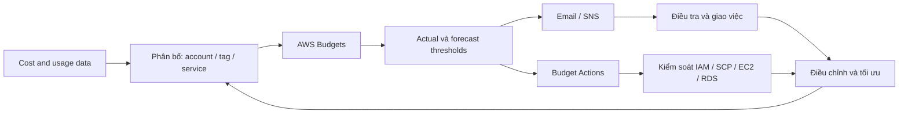

# AWS Budgets, cảnh báo và kiểm soát ngân sách

Chi phí AWS thay đổi theo mức sử dụng tài nguyên, lưu lượng, vùng triển khai, lựa chọn dịch vụ và các cam kết giảm giá. Một ứng dụng có thể tăng chi phí nhanh khi đội ngũ mở rộng môi trường thử nghiệm, quên xóa tài nguyên, tăng lưu lượng ngoài dự kiến hoặc phát sinh dịch vụ mới. Nếu chỉ xem hóa đơn vào cuối tháng, tổ chức thường phát hiện vấn đề quá muộn để điều chỉnh.

AWS Budgets giúp đặt ngân sách cho chi phí, mức sử dụng và hiệu quả của các cam kết như Reserved Instances (RI) và Savings Plans. Dịch vụ có thể gửi cảnh báo khi chi phí thực tế chạm ngưỡng hoặc khi dự báo cho thấy có khả năng vượt ngân sách. Với Budget Actions, tổ chức còn có thể tự động hoặc yêu cầu phê duyệt trước khi áp dụng một số biện pháp kiểm soát quyền và tài nguyên.

Trong hệ sinh thái AWS, Budgets là một công cụ quan trọng của FinOps: giúp kỹ thuật, tài chính và chủ sở hữu sản phẩm cùng nhìn thấy mức tiêu thụ, dự báo và trách nhiệm chi phí. Budgets hỗ trợ phát hiện và phản ứng; tổ chức vẫn cần Cost Explorer, Cost and Usage Reports, cost allocation tags, Cost Categories, quy trình phê duyệt và tối ưu kiến trúc để quản lý chi phí xuyên suốt.

## Mục tiêu học tập

Sau bài học, bạn có thể:

- Giải thích AWS Budgets theo dõi những chỉ số nào và phân biệt ngân sách với giới hạn chi tiêu cứng.
- Chọn cost, usage, RI utilization/coverage và Savings Plans utilization/coverage budgets.
- Thiết kế chu kỳ, phương pháp lập ngân sách, bộ lọc và cách tính chi phí phù hợp.
- Phân biệt cảnh báo actual và forecasted, lựa chọn ngưỡng và kênh thông báo.
- Cấu hình Budget Actions có kiểm soát, hiểu quyền IAM và giới hạn tác động.
- Xây dựng mô hình ngân sách theo tài khoản, dịch vụ, môi trường và nhóm sản phẩm.
- Vận hành cảnh báo, điều tra chênh lệch, kiểm thử và cải tiến quy trình FinOps.

## AWS Budgets trong quy trình FinOps

FinOps là cách tổ chức phối hợp giữa tài chính, kỹ thuật và nghiệp vụ để tạo giá trị từ chi tiêu cloud. Một vòng lặp FinOps thường gồm:

1. **Inform:** phân bổ và hiển thị chi phí theo tài khoản, sản phẩm, môi trường, nhóm hoặc chủ sở hữu.
2. **Plan:** xây dựng ngân sách và dự báo theo mục tiêu kinh doanh, kế hoạch phát hành và tăng trưởng.
3. **Optimize:** tìm cơ hội giảm lãng phí, thay đổi cấu hình, chọn dịch vụ phù hợp hoặc điều chỉnh cam kết sử dụng.
4. **Operate:** theo dõi ngưỡng, cảnh báo, phân công người xử lý và đánh giá kết quả.

AWS Budgets chủ yếu hỗ trợ các hoạt động lập kế hoạch và vận hành kiểm soát. Một budget có thể theo dõi tổng chi phí tài khoản, chi phí của một dịch vụ, usage của một loại tài nguyên hoặc tỷ lệ sử dụng cam kết giảm giá. Budget có thể có nhiều ngưỡng cảnh báo và các hành động tương ứng.



### Budget không phải hard spending limit

AWS Budgets theo dõi chi phí và gửi cảnh báo khi dữ liệu thanh toán cho thấy ngưỡng đã đạt hoặc dự báo có thể vượt. Việc tạo budget không tự động ngăn tài nguyên mới được tạo và không khóa hóa đơn ở đúng số tiền đã đặt.

Budget Actions có thể thực hiện một số hành động như áp dụng IAM policy, gắn Service Control Policy (SCP), hoặc nhắm đến một số EC2/RDS instance được chỉ định. Các hành động này vẫn có phạm vi và điều kiện cụ thể; chúng không phải cơ chế giới hạn mọi loại chi phí trong tài khoản. Dữ liệu billing cũng có độ trễ, vì vậy chi phí có thể tiếp tục tăng trước khi cảnh báo hoặc action được thực thi.

Nếu doanh nghiệp cần giới hạn quyền tạo tài nguyên, hãy kết hợp IAM, SCP, service quotas, quy trình cấp phát, policy-as-code và giám sát. Không dựa riêng vào một ngưỡng Budgets để bảo đảm không vượt chi.

## Các loại ngân sách AWS Budgets

AWS Budgets cung cấp bốn nhóm chính:

| Loại budget | Chỉ số theo dõi | Ví dụ sử dụng |
|---|---|---|
| Cost budget | Chi phí theo kỳ và phạm vi bộ lọc | Tổng chi phí production mỗi tháng không vượt 20.000 USD |
| Usage budget | Lượng sử dụng của một hoặc nhiều usage type có cùng đơn vị | EC2 running hours, data transfer hoặc mức sử dụng dịch vụ theo giờ |
| Savings Plans budget | Savings Plans utilization hoặc coverage | Cảnh báo khi utilization giảm dưới 80% hoặc coverage giảm dưới mục tiêu |
| Reservation budget | Reserved Instance utilization hoặc coverage | Phát hiện cam kết RI đang nhàn rỗi hoặc tỷ lệ usage được bao phủ giảm |

### Cost budget

Cost budget so sánh chi phí phát sinh hoặc dự báo với ngân sách đặt ra. Đây là loại thường dùng để theo dõi tổng chi tiêu, một tài khoản, một sản phẩm hoặc một dịch vụ.

Ví dụ, ngân sách production tháng là 15.000 USD. Có thể đặt cảnh báo actual ở 70%, 90% và 100%, đồng thời đặt forecasted alert ở 90% để đội ngũ biết sớm khi xu hướng chi tiêu dự kiến vượt kế hoạch.

### Usage budget

Usage budget theo dõi lượng sử dụng theo đơn vị của dịch vụ, chẳng hạn số giờ chạy, GB lưu trữ hoặc một nhóm usage type. Các usage type cần cùng đơn vị đo để so sánh có ý nghĩa. Không nên cộng giờ EC2 với GB data transfer trong cùng một ngưỡng usage.

Usage budget hữu ích khi chi phí phụ thuộc trực tiếp vào một lượng tiêu thụ dễ quan sát. Ví dụ, một nhóm phát triển có thể đặt ngân sách số giờ EC2 cho môi trường thử nghiệm để phát hiện máy chủ chạy liên tục ngoài lịch.

### Savings Plans và Reserved Instances budgets

Hai loại budget này tập trung vào hiệu quả sử dụng cam kết:

- **Utilization** cho biết tỷ lệ cam kết đã được sử dụng trong kỳ. Utilization thấp có thể cho thấy tổ chức đã mua cam kết lớn hơn nhu cầu thực tế hoặc workload giảm.
- **Coverage** cho biết phần usage đủ điều kiện đang được hưởng lợi từ cam kết. Coverage thấp có thể cho thấy một phần usage vẫn chịu mức On-Demand dù tổ chức có thể xem xét cam kết phù hợp.

Ví dụ, Savings Plans utilization dưới 80% trong nhiều ngày có thể là tín hiệu cần rà soát cam kết và mức sử dụng. Coverage giảm có thể báo hiệu workload tăng nhanh hoặc thay đổi loại instance/compute khiến cam kết không bao phủ như dự kiến.

Utilization thấp không tự động có nghĩa phải mua thêm cam kết; ngược lại, coverage thấp cũng không đủ để kết luận nên mua ngay. Cần xem workload có ổn định, thời hạn cam kết, phạm vi áp dụng, tính linh hoạt và chi phí nếu nhu cầu thay đổi.

## Chu kỳ ngân sách và phương pháp lập kế hoạch

### Chu kỳ

Tùy loại budget, bạn có thể chọn các kỳ theo dõi như:

- **Daily:** theo dõi biến động hằng ngày, phù hợp với usage hoặc utilization cần phản ứng nhanh.
- **Monthly:** phổ biến cho ngân sách vận hành và hóa đơn hằng tháng.
- **Quarterly:** phù hợp với kế hoạch tài chính theo quý.
- **Annually:** theo dõi ngân sách năm.
- **Custom:** xác định ngày bắt đầu và kết thúc riêng, ví dụ theo dự án, hợp đồng hoặc năm tài chính.

Budget có thể là recurring để tự đặt lại theo chu kỳ hoặc expiring cho một khoảng thời gian một lần. Thời gian của budget sử dụng UTC; cần kiểm tra ngày bắt đầu/kết thúc khi doanh nghiệp lập ngân sách theo múi giờ địa phương.

### Phương pháp xác định số tiền

Cost và usage budgets hỗ trợ ba cách xác định ngân sách:

| Phương pháp | Cách hoạt động | Khi phù hợp |
|---|---|---|
| Fixed | Dùng một mức ngân sách cho mỗi kỳ | Chi phí tương đối ổn định hoặc có giới hạn cố định |
| Planned | Đặt mức khác nhau cho từng tháng hoặc quý trong kế hoạch | Dự án có giai đoạn tăng tải, mùa cao điểm hoặc kế hoạch mở rộng |
| Auto-adjusting | Tự điều chỉnh ngân sách dựa trên dữ liệu lịch sử hoặc khoảng thời gian cơ sở đã chọn | Workload có xu hướng biến động theo chu kỳ và cần baseline tự cập nhật |

Planned budgets hỗ trợ tối đa 12 tháng hoặc 4 quý trong kế hoạch; sau khoảng thời gian đó, mức cuối cùng trở thành mức cố định. Auto-adjusting cần chọn baseline phù hợp. Nếu baseline chứa các kỳ chi tiêu bất thường cao hoặc thấp, ngân sách tự điều chỉnh có thể không phản ánh kỳ vọng hiện tại.

Ví dụ một dự án ra mắt dịch vụ có kế hoạch tăng tải:

| Tháng | Ngân sách planned |
|---|---:|
| Tháng 1: thử nghiệm | 2.000 USD |
| Tháng 2: beta | 3.500 USD |
| Tháng 3: mở rộng | 5.000 USD |
| Tháng 4: vận hành | 4.000 USD |

Ngân sách planned cho phép đặt ngưỡng phù hợp với từng giai đoạn, thay vì cảnh báo liên tục khi mức chi tiêu tăng đúng theo kế hoạch.

## Phạm vi và bộ lọc ngân sách

Một budget hữu ích cần xác định rõ chi phí nào thuộc phạm vi theo dõi. Bộ lọc giúp phân tách ngân sách theo tổ chức, tài khoản, dịch vụ, Region hoặc nhóm chi phí.

Các bộ lọc thường dùng gồm:

- **Linked account:** theo dõi một member account trong AWS Organizations từ management/payer account.
- **Service:** theo dõi EC2, S3, RDS, Lambda hoặc một dịch vụ cụ thể.
- **Region và Availability Zone:** tìm chi phí phát sinh ở khu vực triển khai.
- **Tag:** phân bổ chi phí theo `Environment`, `Product`, `Team`, `CostCenter` hoặc mã dự án.
- **Cost Category:** dùng nhóm chi phí đã định nghĩa để gom nhiều tài khoản, tag hoặc dịch vụ theo quy tắc nghiệp vụ.
- **Usage type / usage type group:** theo dõi một loại tiêu thụ cụ thể hoặc nhóm usage cùng đơn vị.
- **Purchase option, instance family/type, platform, tenancy:** phân tích chi phí theo loại tài nguyên hoặc cách mua.
- **Charge type, billing entity, API operation và các thuộc tính khác:** lọc sâu hơn tùy loại budget và dữ liệu hỗ trợ.

Không phải bộ lọc nào cũng khả dụng với mọi loại budget. Ví dụ, Linked account filter được thiết kế cho budget ở tài khoản tổng hợp và không dùng trong một member account theo cách tương tự. Hãy kiểm tra danh sách filter được hiển thị cho loại budget đã chọn.

### Cost allocation tags và Cost Categories

Tag chỉ giúp phân bổ chi phí khi tag đó đã được kích hoạt làm cost allocation tag trong Billing and Cost Management. Tạo tag trên tài nguyên chưa đồng nghĩa chi phí sẽ lập tức xuất hiện theo tag trong báo cáo. Cần thống nhất key/value, áp dụng tag cho tài nguyên được hỗ trợ và kiểm tra dữ liệu sau khi tag được kích hoạt.

Ví dụ quy ước:

```text
Environment = production | staging | development
Product     = checkout | catalog | identity
Team        = platform | commerce | data
CostCenter  = CC-1001 | CC-1002
Owner       = team-alias
```

Cost Categories gom chi phí thành nhóm theo quy tắc. Ví dụ, nhóm `Commerce` có thể bao gồm tài khoản production và các tag sản phẩm `checkout`, `catalog`; nhóm `Shared Platform` có thể bao gồm logging, networking và CI/CD dùng chung. Khi thay đổi quy tắc Cost Category, hãy kiểm tra tác động đến báo cáo và budget đang sử dụng category đó.

### Chọn cách tính chi phí

Cost budget có thể sử dụng các cách tổng hợp như blended, unblended, net unblended, amortized và net amortized costs. Chọn cách tính phù hợp với câu hỏi tài chính:

| Kiểu chi phí | Ý nghĩa khái quát | Tình huống |
|---|---|---|
| Unblended | Chi phí theo mức giá và dòng usage được ghi nhận cho tài nguyên/tài khoản | Theo dõi chi phí theo usage ở cấp tài khoản |
| Blended | Phân bổ giá trung bình trong môi trường consolidated billing theo cách áp dụng RI/Savings Plans benefits | Xem góc nhìn tổng hợp khi chia sẻ lợi ích cam kết |
| Net unblended | Unblended sau khi áp dụng các discount/credit phù hợp | Theo dõi chi phí ròng theo mức ghi nhận |
| Amortized | Phân bổ upfront và recurring commitment charges theo thời gian | Đánh giá chi phí workload đã tính cả cam kết |
| Net amortized | Amortized sau các discount/credit phù hợp | Phân tích chi phí ròng dài hạn |

Bạn cũng có thể quyết định bao gồm hoặc loại trừ các khoản như tax, refunds, credits, support fees, upfront/recurring reservation charges và một số loại subscription. Hai budget dùng cách tính khác nhau có thể cho số liệu khác nhau mà không có nghĩa một trong hai bị sai. Hãy ghi rõ định nghĩa chi phí trong tên, mô tả và tài liệu ngân sách.

## Actual và forecasted alerts

AWS Budgets hỗ trợ hai loại cảnh báo chính:

- **Actual:** gửi cảnh báo khi chi phí hoặc usage đã ghi nhận chạm ngưỡng.
- **Forecasted:** gửi cảnh báo khi dự báo cho kỳ hiện tại cho thấy chi phí hoặc usage có thể vượt ngưỡng.

Ví dụ ngân sách tháng là 10.000 USD:

| Cảnh báo | Loại | Ngưỡng | Ý nghĩa |
|---|---|---:|---|
| Theo dõi sớm | Actual | 50% | Đã ghi nhận 5.000 USD chi phí |
| Chuẩn bị xử lý | Actual | 80% | Đã ghi nhận 8.000 USD |
| Vượt kế hoạch | Actual | 100% | Đã ghi nhận ít nhất 10.000 USD |
| Dự báo rủi ro | Forecasted | 90% | Dự báo cuối kỳ có thể đạt ít nhất 9.000 USD |

Forecasted alert giúp đội ngũ phản ứng trước khi chi phí thực tế chạm ngưỡng. Tuy nhiên, dự báo phụ thuộc dữ liệu lịch sử và mô hình dự báo. AWS cần khoảng năm tuần dữ liệu usage để tạo dự báo; tài khoản mới hoặc workload vừa thay đổi mạnh có thể chưa có forecast đáng tin cậy.

Actual alert thường chỉ gửi một lần cho mỗi budget, mỗi kỳ khi ngưỡng actual lần đầu được chạm. Forecasted alert có thể gửi nhiều lần trong cùng kỳ nếu dự báo vượt ngưỡng, giảm xuống rồi lại vượt. Điều này phản ánh dự báo có thể thay đổi khi dữ liệu mới được ghi nhận.

### Độ trễ dữ liệu billing

AWS Budgets dựa trên dữ liệu billing/cost usage, không phải telemetry real-time. Thông tin budget thường được cập nhật nhiều lần trong ngày; tài liệu AWS mô tả dữ liệu có thể cập nhật tối đa ba lần mỗi ngày và thường cách nhau khoảng 8–12 giờ. Việc sử dụng tài nguyên và thời điểm khoản phí được ghi nhận có thể có độ trễ.

Do đó:

- Không dùng Budgets làm cơ chế phát hiện tức thời cho một tài nguyên vừa được tạo hoặc tăng tải.
- Không kỳ vọng cảnh báo xuất hiện đúng giây hoặc đúng phút khi chi phí chạm ngưỡng.
- Chi phí thực tế có thể tiếp tục tăng sau khi đã nhận cảnh báo.
- Với workload có rủi ro chi phí tăng nhanh, bổ sung quota, policy cấp phát, CloudWatch metrics, service-specific alarms và quy trình phê duyệt.

## Kênh thông báo và người nhận

Một ngưỡng cảnh báo có thể gửi đến email và Amazon SNS topic. Email recipient phải xác minh địa chỉ trước khi nhận thông báo. Nếu dùng SNS, subscription cần được xác nhận; nếu không, topic có thể không chuyển thông báo đến subscriber.

SNS giúp fan-out đến nhiều subscriber, chẳng hạn email, Lambda, SMS hoặc hệ thống xử lý bên ngoài. Khi tích hợp Lambda hoặc ticketing, hãy thiết kế idempotency và lưu log để tránh tạo ticket trùng khi notification được gửi lại.

Mỗi budget hỗ trợ tối đa năm alert; mỗi alert có thể gửi đến tối đa mười email recipients và một SNS topic. Hãy đặt người nhận theo trách nhiệm xử lý, không gửi mọi cảnh báo đến một danh sách quá rộng. Ngưỡng 50% có thể chỉ cần thông báo cho chủ sở hữu nhóm; ngưỡng 90–100% có thể cần thêm FinOps hoặc quản lý dịch vụ.

### Cấu trúc thông báo hữu ích

Khi thiết kế kênh xử lý downstream, hãy chuẩn hóa các trường sau trong ticket hoặc message nội bộ:

- Tên budget, account ID, period và loại cảnh báo.
- Actual/forecasted value, threshold và budget limit.
- Service, Region, tag hoặc Cost Category đang được theo dõi.
- Owner/team, cost center và liên kết đến Cost Explorer/Budgets console.
- Hành động cần làm, thời hạn phản hồi và người chịu trách nhiệm.

Budget notification không thay thế quy trình phân tích nguyên nhân. Một thông báo chỉ nói “đạt 80%” mà không cho biết tài khoản hoặc owner sẽ khó tạo ra hành động hiệu quả.

## Budget Actions: biến ngưỡng thành biện pháp kiểm soát

Budget Action là hành động AWS Budgets thực hiện thay mặt người dùng khi budget đạt ngưỡng. Action có thể được cấu hình chạy tự động hoặc chờ người có thẩm quyền phê duyệt.

Các nhóm hành động được hỗ trợ gồm:

1. **Áp dụng IAM policy:** gắn policy để hạn chế quyền của user, group hoặc role được chọn, ví dụ hạn chế khả năng tạo thêm tài nguyên.
2. **Áp dụng Service Control Policy:** gắn SCP để giới hạn quyền ở phạm vi account/OU theo chính sách Organizations. Hành động áp dụng SCP từ management account; cần hiểu tác động lên các workload trong phạm vi bị áp dụng.
3. **Nhắm đến EC2 hoặc RDS instance cụ thể:** thực hiện hành động được hỗ trợ như stop các instance đã chọn khi ngưỡng bị vượt.

Management account có thể áp dụng SCP cho một account khác trong tổ chức, nhưng không thể dùng Budget Action để nhắm trực tiếp EC2/RDS instance thuộc account khác theo cách tương tự. Với member account, phạm vi hành động tài nguyên là account đó.

### Chọn automatic hay manual approval

| Chế độ | Cách hoạt động | Phù hợp khi |
|---|---|---|
| Automatic | AWS Budgets thực hiện action khi điều kiện được thỏa | Tác động nhỏ, có thể đảo ngược và đã kiểm thử kỹ |
| Manual approval | Action chờ người có quyền xem xét và xác nhận | Có thể ảnh hưởng production hoặc gây gián đoạn dịch vụ |

Ví dụ: khi forecasted cost của tài khoản sandbox vượt 120% ngân sách, có thể tự động áp dụng policy ngăn tạo thêm instance loại lớn. Với production, nên gửi cảnh báo và yêu cầu người phụ trách phê duyệt trước khi dừng tài nguyên.

### IAM role cho Budget Actions

Budgets cần service role có quyền thực hiện action thay mặt bạn. Role phải có trust policy cho phép `budgets.amazonaws.com` assume role và permission policy chỉ cấp các thao tác cần thiết. AWS cung cấp managed policies cho một số nhóm Budget Actions; hãy xem phiên bản và phạm vi quyền hiện hành trước khi gắn.

Các nguyên tắc bảo mật:

- Dùng role riêng cho Budget Actions, không tái sử dụng role ứng dụng.
- Giới hạn `aws:SourceAccount` và `aws:SourceArn` trong trust policy khi phù hợp để giảm nguy cơ confused deputy.
- Chỉ cấp quyền attach/detach policy hoặc stop resource trong phạm vi đã duyệt.
- Hạn chế người có quyền tạo, sửa hoặc phê duyệt Budget Actions.
- Ghi nhận thay đổi và kết quả action bằng AWS CloudTrail và lịch sử action.
- Kiểm thử action ở tài khoản phi production trước khi bật automatic.

### Ví dụ trust policy minh họa

Đây là ví dụ rút gọn về trust policy cho phép AWS Budgets assume role trong cùng account. Thay account ID bằng giá trị thực và điều chỉnh phạm vi budget ARN theo thiết kế; permission policy cho action phải được cấu hình riêng.

```json
{
  "Version": "2012-10-17",
  "Statement": [
    {
      "Effect": "Allow",
      "Principal": {
        "Service": "budgets.amazonaws.com"
      },
      "Action": "sts:AssumeRole",
      "Condition": {
        "StringEquals": {
          "aws:SourceAccount": "123456789012"
        },
        "ArnLike": {
          "aws:SourceArn": "arn:aws:budgets::123456789012:budget/*"
        }
      }
    }
  ]
}
```

### Cẩn trọng khi dừng EC2/RDS

Budget Action có thể dừng EC2 hoặc RDS instance được chọn, nhưng việc dừng không phải lúc nào cũng giảm chi phí về 0. EBS volume, snapshot, Elastic IP, storage, backup, data transfer và một số thành phần khác vẫn có thể phát sinh chi phí.

Đặc biệt, nếu dừng một EC2 instance thuộc Auto Scaling group, Auto Scaling có thể khởi chạy instance thay thế để duy trì desired capacity. Vì vậy, dừng instance riêng lẻ không phải cách kiểm soát phù hợp cho workload được quản lý bởi ASG. Hãy điều chỉnh desired capacity, lịch scaling hoặc cấu hình workload qua quy trình được phê duyệt.

Không tự động dừng database production chỉ vì vượt một ngưỡng chi phí. Hãy xem dependency, transaction đang chạy, backup, khả năng khởi động lại và tác động khách hàng. Budget Action cần có owner, điều kiện, cách đảo ngược và runbook.

### Trạng thái và lịch sử action

Trong Budgets console, có thể xem action đang chờ phê duyệt, đã hoàn thành hoặc đã được đảo ngược. AWS Budgets hiển thị lịch sử action trong khoảng thời gian giới hạn trên giao diện; để điều tra dài hơn, dùng CloudTrail hoặc API lịch sử action phù hợp. Khi đảo ngược action, hãy xác minh policy hoặc trạng thái resource thực sự đã trở lại như mong muốn.

## Thiết kế ngân sách trong AWS Organizations

Trong mô hình consolidated billing, management/payer account có thể tạo budget theo linked account để theo dõi chi phí từng member account. Tổ chức nên kết hợp budget tổng và budget chi tiết:

- Budget toàn tổ chức để theo dõi tổng chi phí.
- Budget theo linked account; nếu cần xem theo OU, có thể gom các account thuộc OU bằng Cost Category hoặc quy tắc phân bổ phù hợp.
- Budget theo service để theo dõi dịch vụ có mức tăng chi phí đáng chú ý.
- Budget theo Cost Category hoặc tag để phân bổ theo sản phẩm và cost center.
- Budget cho RI/Savings Plans utilization và coverage để theo dõi hiệu quả cam kết.

Ví dụ ma trận ngân sách:

| Phạm vi | Ngân sách tháng | Owner | Cảnh báo chính |
|---|---:|---|---|
| Toàn tổ chức | 50.000 USD | FinOps | Forecast 90%, actual 100% |
| Production | 30.000 USD | Platform | Actual 80%, 100% |
| Development | 8.000 USD | Engineering leads | Forecast 90%, actual 100% |
| Data platform | 7.000 USD | Data team | Actual 80%, forecast 100% |
| Sandbox | 2.000 USD | Developer enablement | Forecast 100%, action theo phê duyệt |

Các budget chi tiết có thể chồng lấn với budget tổng. Không cộng tất cả budget thành tổng chi phí; chúng là các góc nhìn quản lý khác nhau trên cùng dữ liệu. Cần quy định rõ budget nào dùng để báo cáo, budget nào giao trách nhiệm cho team và budget nào kích hoạt hành động.

Budget được tạo trong một account và chỉ người có quyền truy cập account/budget đó mới nhìn thấy. Management account có thể tạo budget theo linked account, nhưng member account không tự động nhìn thấy budget của management account. Hãy thiết kế IAM permissions và quyền truy cập Billing and Cost Management phù hợp.

## Quy trình tạo cost budget trong Console

Một quy trình tạo monthly cost budget điển hình:

1. Mở Billing and Cost Management console và chọn **Budgets**.
2. Chọn **Create budget** rồi chọn **Customize (advanced)** nếu cần cấu hình chi tiết.
3. Chọn loại **Cost budget**.
4. Đặt tên dễ hiểu, ví dụ `prod-monthly-total-cost`.
5. Chọn kỳ Monthly, loại recurring và phương pháp Fixed/Planned/Auto-adjusting.
6. Nhập ngân sách và chọn phạm vi bằng account, service, Region, tag hoặc Cost Category.
7. Chọn kiểu tổng hợp chi phí và xác định các khoản phí được bao gồm hoặc loại trừ.
8. Tạo alert threshold cho actual và/hoặc forecasted. Có thể dùng số tiền tuyệt đối hoặc phần trăm ngân sách.
9. Chọn email recipients hoặc SNS topic; xác nhận email/SNS subscription.
10. Nếu cần, cấu hình Budget Action, chọn loại action, tài nguyên/policy đích và automatic hoặc manual approval.
11. Kiểm tra lại budget scope, thời gian, threshold, recipient, role và action rồi tạo budget.
12. Sau khi tạo, xác minh budget xuất hiện, notification subscriber đã xác nhận và action có trạng thái mong muốn.

### Ví dụ tính ngưỡng

Giả sử ngân sách development là 4.000 USD/tháng:

- 50% tương đương 2.000 USD: nhắc owner xem tốc độ tiêu thụ.
- 80% tương đương 3.200 USD: yêu cầu kiểm tra tài nguyên không dùng và workload mới.
- 100% tương đương 4.000 USD: báo FinOps và quản lý nhóm.
- Forecasted 90% tương đương dự báo 3.600 USD: cảnh báo sớm để xem xu hướng cuối tháng.

Ngưỡng nên gắn với hành động. Nếu mọi ngưỡng đều gửi cùng một cảnh báo cho cùng một danh sách, người nhận có thể bỏ qua thông báo. Tốt hơn là chia cấp độ và chỉ định người chịu trách nhiệm cụ thể.

## Kết hợp Budgets với công cụ quản lý chi phí khác

AWS Budgets không thay thế các công cụ phân tích và tối ưu khác:

| Công cụ | Vai trò | Cách kết hợp với Budgets |
|---|---|---|
| AWS Cost Explorer | Phân tích chi phí theo thời gian, service, account, Region, tag và dimension | Dùng để điều tra budget vượt ngưỡng và tìm cost driver |
| Cost and Usage Reports / Data Exports | Cung cấp dữ liệu chi phí chi tiết cho phân tích, BI và chargeback | Xây dựng báo cáo chi tiết và đối soát ngân sách |
| AWS Cost Anomaly Detection | Phát hiện chi phí bất thường so với mô hình lịch sử | Bổ sung cảnh báo bất thường ngoài các ngưỡng cố định |
| AWS Cost Categories | Gom chi phí theo cấu trúc tổ chức hoặc sản phẩm | Tạo budget theo nhóm chi phí nghiệp vụ |
| Cost allocation tags | Gắn chi phí với team, product, environment hoặc owner | Tạo budget theo tag đã kích hoạt |
| Cost Optimization Hub | Tổng hợp cơ hội tối ưu chi phí | Dùng sau cảnh báo để xác định hành động tối ưu |
| AWS Billing Conductor | Mô hình hóa chi phí và phân bổ cho nhóm/khách hàng theo quy tắc | Hỗ trợ mô hình showback/chargeback phù hợp |

### Từ cảnh báo đến điều tra

Khi nhận cảnh báo 80% budget:

1. Mở budget và xác nhận actual hay forecasted, kỳ theo dõi và phạm vi filter.
2. Dùng Cost Explorer để so sánh chi phí theo service, Region, linked account và usage type.
3. So sánh với kỳ trước và với forecast/budget plan để xác định khoản tăng mới.
4. Kiểm tra tag, Cost Category và owner để xác định nhóm chịu trách nhiệm.
5. Xem CloudTrail hoặc lịch sử thay đổi để tìm resource được tạo, cấu hình được sửa hoặc workload tăng tải.
6. Xác định nguyên nhân: tăng traffic hợp lệ, mở rộng theo kế hoạch, cấu hình sai, tài nguyên nhàn rỗi, data transfer bất thường hay cam kết chưa được tận dụng.
7. Chọn hành động: tối ưu, dừng tài nguyên không dùng, điều chỉnh lịch, thay đổi kiến trúc hoặc cập nhật ngân sách nếu kế hoạch kinh doanh đã thay đổi.
8. Ghi nhận quyết định và theo dõi kết quả trong kỳ tiếp theo.

## Tình huống thực tế: kiểm soát chi phí nền tảng thương mại điện tử

Một doanh nghiệp vận hành ứng dụng thương mại điện tử trên ba AWS accounts: `prod`, `staging` và `dev`. FinOps đặt ngân sách tổng 50.000 USD/tháng và muốn từng nhóm chịu trách nhiệm chi phí của mình.

### Thiết kế budget

- Tạo budget tổng ở management account theo consolidated billing.
- Tạo budget riêng theo linked account cho prod, staging và dev.
- Tạo budget theo Cost Category `Commerce` để theo dõi API, database, storage và network của sản phẩm.
- Tạo usage budget cho EC2 running hours trong dev để phát hiện instance chạy ngoài lịch.
- Tạo Savings Plans utilization/coverage budgets để phát hiện cam kết đang nhàn rỗi hoặc workload mới chưa được bao phủ.

### Ngưỡng và thông báo

- Forecasted 90%: gửi SNS đến FinOps và owner để điều tra trước cuối tháng.
- Actual 80%: gửi email cho owner và engineering lead.
- Actual 100%: thông báo quản lý dịch vụ và mở ticket theo dõi.
- Sandbox forecasted 100%: yêu cầu phê duyệt trước khi tiếp tục cấp tài nguyên có chi phí cao.

### Phản ứng khi dev tăng chi phí

Cost Explorer cho thấy EC2 và NAT Gateway trong dev tăng mạnh. Nhóm kiểm tra tag và CloudTrail, phát hiện một thử nghiệm tải tạo nhiều EC2 instance nhưng không có lịch dọn dẹp. Owner dừng thử nghiệm, xóa tài nguyên không dùng, cập nhật lịch tự động tắt môi trường và bổ sung budget action có phê duyệt để hạn chế cấp thêm tài nguyên trong sandbox.

Nhóm không dừng instance trong ASG trực tiếp vì ASG có thể tạo instance thay thế. Thay vào đó, nhóm điều chỉnh desired capacity hoặc lịch scaling theo quy trình. Chi phí giảm trong các kỳ tiếp theo và budget alert trở lại trạng thái bình thường.

## Vận hành, kiểm thử và quản trị

### Phân công trách nhiệm

Mỗi budget cần có owner chịu trách nhiệm giải thích biến động và phản hồi cảnh báo. Một mô hình RACI đơn giản:

| Vai trò | Trách nhiệm |
|---|---|
| FinOps | Thiết kế chuẩn ngân sách, tổng hợp, rà soát ngưỡng và điều phối |
| Finance | Xác nhận baseline, forecast, kỳ tài chính và cách tính chi phí |
| Engineering owner | Điều tra nguyên nhân kỹ thuật và thực hiện tối ưu |
| Account/platform admin | Quản lý IAM, SCP, budget action role và guardrails |
| Product owner | Xác nhận thay đổi chi phí có phù hợp với kế hoạch sản phẩm |

### Kiểm thử cảnh báo và action

Không nên đợi chi phí thật vượt ngưỡng để biết notification có hoạt động. Hãy kiểm tra:

- Email recipient đã xác minh và có thể nhận thư.
- SNS topic policy cho phép Budgets publish; subscriber đã confirm.
- Lambda hoặc ticket integration xử lý message idempotent.
- Budget Action role có trust policy và permission cần thiết.
- Manual approval được gửi đến đúng người và có hướng dẫn phê duyệt.
- Action đảo ngược được theo quy trình và không làm mất trạng thái mong muốn.
- Các cảnh báo không tạo vòng lặp hoặc quá nhiều ticket trùng.

### Rà soát định kỳ

- Hằng tuần: xem budget sắp chạm ngưỡng, forecast và anomaly.
- Hằng tháng: so sánh actual với budget, giải thích variance và cập nhật forecast.
- Hằng quý: xem lại cost allocation, tag, Cost Categories, account ownership và ngưỡng.
- Khi ra mắt sản phẩm: tạo budget riêng, xác định baseline và thời hạn budget nếu dự án có ngày kết thúc.
- Khi thay đổi kiến trúc hoặc cam kết: đánh giá lại usage, RI/Savings Plans coverage và budget amount.

## Giới hạn và lưu ý

- Budgets dựa trên dữ liệu chi phí/usage có độ trễ; không phải bộ ngắt chi phí tức thời.
- Forecasted alert cần đủ dữ liệu lịch sử, thường khoảng năm tuần, và có thể thay đổi khi dữ liệu mới được ghi nhận.
- Actual alerts thường chỉ gửi một lần cho mỗi budget trong mỗi kỳ tại lần đầu chạm ngưỡng; forecasted alerts có thể gửi lại khi dự báo thay đổi.
- Budget scope phụ thuộc loại budget; không phải mọi filter có sẵn ở mọi loại.
- Cost allocation tags phải được kích hoạt và dữ liệu phân bổ cần thời gian cập nhật.
- Budget Action chỉ hỗ trợ một số loại IAM/SCP/EC2/RDS action; không phải hard spending limit cho toàn bộ dịch vụ.
- Budget Action dừng EC2 trong Auto Scaling group có thể khiến ASG tạo instance thay thế.
- Cost và utilization metrics có thể thay đổi do credits, refunds, discounts, support, tax và cách amortization.
- Với RI utilization/coverage, AWS lưu ý metrics có thể mất đến 48 giờ để tạo; không nên dùng các chỉ số này như cảnh báo real-time. Kiểm tra độ mới dữ liệu riêng cho Savings Plans trước khi đặt cam kết phản hồi.
- Cần kiểm tra pricing hiện hành cho action-enabled budgets và budget reports. Monitoring budgets thông thường không phát sinh phí, nhưng Budget Actions và báo cáo có thể có chi phí riêng theo biểu giá hiện tại.

## Checklist triển khai production

- [ ] Xác định chủ sở hữu, cost center, baseline và kỳ ngân sách.
- [ ] Chọn đúng loại budget: cost, usage, Savings Plans hoặc RI.
- [ ] Chọn recurring/expiring, daily/monthly/quarterly/annual/custom và phương pháp fixed/planned/auto-adjusting.
- [ ] Xác định filter theo account, service, Region, tag hoặc Cost Category.
- [ ] Kích hoạt cost allocation tags cần thiết và kiểm tra coverage của tag.
- [ ] Chọn kiểu chi phí và xác định khoản phí được bao gồm/loại trừ.
- [ ] Đặt actual và forecasted thresholds theo cấp độ hành động.
- [ ] Xác minh email, SNS topic và subscriber.
- [ ] Nếu dùng Budget Actions, kiểm tra IAM role, trust policy, permissions, phạm vi và chế độ phê duyệt.
- [ ] Không tự động dừng workload production nếu chưa đánh giá dependency và khả năng khôi phục.
- [ ] Kiểm tra budget notifications và action bằng quy trình thử nghiệm an toàn.
- [ ] Thiết lập owner, runbook, lịch rà soát và quy trình điều tra variance.
- [ ] Kết hợp Budgets với Cost Explorer, Cost Anomaly Detection, CUR/Data Exports và Cost Optimization Hub.
- [ ] Rà soát lại ngưỡng, filter và budget amount khi workload hoặc kế hoạch kinh doanh thay đổi.

## Kết luận

AWS Budgets giúp chuyển mục tiêu tài chính thành các ngưỡng có thể theo dõi cho chi phí, usage và hiệu quả cam kết. Actual alerts cho biết chi phí đã phát sinh đến đâu; forecasted alerts cảnh báo sớm theo xu hướng dự báo. Bộ lọc, tag và Cost Categories giúp gắn trách nhiệm ngân sách với đúng tài khoản, dịch vụ và nhóm nghiệp vụ. Budget Actions có thể hỗ trợ kiểm soát quyền hoặc tài nguyên khi vượt ngưỡng, nhưng cần IAM least privilege, phạm vi rõ ràng, phê duyệt và kiểm thử. Khi kết hợp Budgets với Cost Explorer, dữ liệu billing chi tiết, anomaly detection và quy trình FinOps, tổ chức có thể phát hiện chênh lệch sớm và điều chỉnh chi tiêu theo mục tiêu kinh doanh.

## Tài liệu tham khảo

- [Managing your costs with AWS Budgets](https://docs.aws.amazon.com/cost-management/latest/userguide/budgets-managing-costs.html)
- [Best practices for AWS Budgets](https://docs.aws.amazon.com/cost-management/latest/userguide/budgets-best-practices.html)
- [Creating a cost budget](https://docs.aws.amazon.com/cost-management/latest/userguide/create-cost-budget.html)
- [Creating a usage budget](https://docs.aws.amazon.com/cost-management/latest/userguide/create-usage-budget.html)
- [Budget methods](https://docs.aws.amazon.com/cost-management/latest/userguide/budget-methods.html)
- [Budget filters](https://docs.aws.amazon.com/cost-management/latest/userguide/budgets-create-filters.html)
- [Creating a Savings Plans budget](https://docs.aws.amazon.com/cost-management/latest/userguide/create-savingsplans-budget.html)
- [Creating a reservation budget](https://docs.aws.amazon.com/cost-management/latest/userguide/create-reservation-budget.html)
- [Configuring budget actions](https://docs.aws.amazon.com/cost-management/latest/userguide/budgets-controls.html)
- [Setting up a role for AWS Budgets to run budget actions](https://docs.aws.amazon.com/cost-management/latest/userguide/budgets-action-role.html)
- [Reviewing and approving your budget action](https://docs.aws.amazon.com/cost-management/latest/userguide/budgets-action-review.html)
- [AWS Budgets pricing](https://aws.amazon.com/aws-cost-management/aws-budgets/pricing/)
