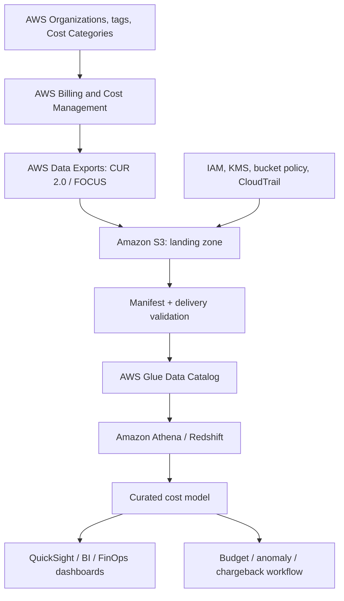

# Cost and Usage Report, AWS Data Exports và dữ liệu chi phí

Muốn quản trị chi phí AWS theo tài khoản, ứng dụng, nhóm kỹ thuật hoặc từng tài nguyên, đội FinOps cần dữ liệu chi tiết hơn tổng số tiền trên hóa đơn. **AWS Cost and Usage Report (CUR)** cung cấp các dòng chi phí và mức sử dụng; **AWS Data Exports** là cơ chế tạo, tùy chỉnh và phân phối những bảng dữ liệu thanh toán tới Amazon S3; còn Athena, Redshift và các công cụ BI giúp truy vấn, đối chiếu và biến dữ liệu đó thành quyết định.

Trong module `CLOUD_PROVIDERS_AWS`, chủ đề này nối kiến thức về Organizations, account, Region, compute, storage, database, tagging, IAM và kiểm soát chi phí. Một pipeline dữ liệu chi phí tốt phải trả lời được: tài khoản nào phát sinh chi phí, dịch vụ và loại usage nào tạo ra chi phí, tài nguyên hoặc nhóm nào sở hữu, mức chi phí được tính theo cách nào, dữ liệu đã cập nhật tới thời điểm nào và số liệu có thể đối chiếu với hóa đơn ra sao.

Sau bài học, bạn có thể:

- Phân biệt CUR truyền thống, CUR 2.0 và AWS Data Exports.
- Chọn bảng, độ chi tiết, cột và bộ lọc phù hợp với mục tiêu phân tích.
- Hiểu cấu trúc line item, cost/usage columns và các loại phí phổ biến.
- Tổ chức dữ liệu trên S3, theo dõi manifest, refresh và xử lý bản ghi cập nhật.
- Phân tích dữ liệu bằng Athena hoặc Redshift, sử dụng Glue và định dạng Parquet.
- Phân bổ chi phí bằng AWS Organizations, cost allocation tags, Cost Categories và split cost allocation data.
- Chọn FOCUS khi cần chuẩn hóa dữ liệu chi phí giữa nhiều nhà cung cấp.
- Xây dựng pipeline có bảo mật, kiểm tra chất lượng và quy trình đối chiếu số liệu.

## 1. Vì sao cần dữ liệu chi phí chi tiết?

Billing dashboard hoặc hóa đơn tổng hợp cho biết tổ chức đã chi bao nhiêu trong kỳ. Tuy nhiên, một con số tổng không trả lời được nguyên nhân:

- Chi phí tăng do số lượng EC2 instance, thời gian chạy hay loại instance?
- S3 tăng do dung lượng lưu trữ, request, retrieval hay data transfer?
- RDS tăng do instance class, storage, IOPS, backup hay Multi-AZ?
- Tài khoản production nào đang dùng nhiều NAT Gateway hoặc cross-Region data transfer?
- Một ứng dụng có chi phí tăng vì traffic thật hay vì tài nguyên bỏ quên?
- Savings Plans/Reserved Instances đã bao phủ usage tới đâu và còn phần commitment chưa dùng?
- Chi phí dùng chung của nền tảng được phân bổ cho các nhóm nghiệp vụ như thế nào?

CUR lưu các dòng chi phí và usage với nhiều chiều phân tích. Khi kết hợp account, service, Region, usage type, operation, resource ID, tag và cost category, đội FinOps có thể phân tích chi phí từ góc nhìn tài chính tới góc nhìn kỹ thuật.

### 1.1. Các cấp độ dữ liệu chi phí

| Nguồn | Mục đích | Mức chi tiết |
|---|---|---|
| AWS Bills / Billing dashboard | Theo dõi số tiền phải trả và trạng thái hóa đơn | Tổng hợp theo kỳ, dịch vụ và tài khoản |
| AWS Cost Explorer | Phân tích xu hướng, lọc và nhóm chi phí nhanh | Tổng hợp theo dimension và metric |
| CUR / CUR 2.0 | Phân tích line item, usage, pricing, discount và resource | Chi tiết nhất trong dữ liệu billing |
| AWS Data Exports | Chọn bảng, cột, bộ lọc, cấu hình và xuất dữ liệu định kỳ | Tùy chỉnh theo nhu cầu phân tích |
| Athena / Redshift / BI | Truy vấn, mô hình hóa, dashboard và phân tích lịch sử | Theo mô hình dữ liệu do tổ chức xây dựng |

Cost Explorer phù hợp để trả lời nhanh các câu hỏi phổ biến. CUR/Data Exports phù hợp khi cần xây dashboard riêng, phân tích chi tiết, chargeback/showback, đối chiếu hoặc tích hợp vào data lake. Các nguồn có thể có thời điểm cập nhật và định nghĩa metric khác nhau; hãy ghi rõ metric được dùng trong từng báo cáo.

## 2. CUR là gì?

AWS Cost and Usage Report (CUR) là báo cáo chi tiết về chi phí và mức sử dụng AWS. CUR chia hóa đơn thành các line item, mỗi dòng mô tả một khoản usage, fee, discount, credit, tax hoặc loại charge khác trong một khoảng thời gian.

Một line item có thể chứa:

- Tài khoản sử dụng và tài khoản thanh toán.
- Dịch vụ, sản phẩm, Region, Availability Zone.
- Loại usage, operation và thời điểm bắt đầu/kết thúc.
- Số lượng usage, đơn vị đo và giá áp dụng.
- Resource ID nếu loại usage hỗ trợ và đã bật resource-level data.
- Discount, Reserved Instance, Savings Plans và thông tin amortization.
- Cost allocation tags và Cost Categories nếu đã cấu hình.
- Currency, billing period và thông tin hóa đơn.

CUR hữu ích vì dữ liệu được biểu diễn ở cấp dòng, cho phép tổng hợp theo nhiều chiều mà báo cáo tổng hợp không cung cấp. Ví dụ, một hóa đơn EC2 có thể được tách theo instance usage, EBS, data transfer, public IPv4, Savings Plans, RI fee và các khoản điều chỉnh khác.

### 2.1. CUR truyền thống và CUR 2.0

AWS hiện hỗ trợ CUR 2.0 thông qua AWS Data Exports. CUR truyền thống vẫn có thể được duy trì dưới dạng legacy export để tương thích với pipeline hiện hữu.

| Đặc điểm | CUR truyền thống (legacy) | CUR 2.0 |
|---|---|---|
| Cách tạo mới | Trang Cost and Usage Reports cũ hoặc legacy export | Standard export trong AWS Data Exports |
| Schema | Có thể thay đổi theo usage, tag và cost category xuất hiện | Schema cố định hơn, các nhóm dữ liệu dùng cột nested |
| Tùy chỉnh dữ liệu | Ít khả năng chọn cột/lọc ngay tại bước export | SQL chọn cột, lọc dòng và đổi alias |
| Dữ liệu lồng nhau | Thường trải thành nhiều cột riêng | Một số nhóm dữ liệu dùng MAP/STRUCT như `resource_tags`, `cost_category`, `product`, `discount` |
| Cấu hình granularity | Chọn ở thiết lập báo cáo | HOURLY, DAILY hoặc MONTHLY |
| Resource-level data | Có thể bật resource IDs | Dùng cấu hình `INCLUDE_RESOURCES` |
| Phân tích | S3, Athena, Redshift, QuickSight và công cụ ngoài | S3, Athena, Redshift, QuickSight và công cụ ngoài |

CUR 2.0 cung cấp thông tin tương đương CUR với schema ổn định hơn, các cột bổ sung và dữ liệu nested giúp giảm tình trạng nhiều cột rỗng. Các nested attributes có thể được chọn thành cột riêng trong truy vấn Data Exports khi cần giữ tương thích với pipeline CUR cũ.

Nếu đang chuyển từ CUR legacy sang CUR 2.0, không nên chỉ đổi tên bảng rồi chạy pipeline cũ. Hãy kiểm tra tên cột, kiểu dữ liệu, nested attributes, null values, line item types, định dạng file và quy tắc cập nhật dữ liệu.

## 3. AWS Data Exports là gì?

AWS Data Exports là cơ chế trong Billing and Cost Management để tạo các bản export từ những bảng dữ liệu chi phí do AWS cung cấp. Với CUR 2.0, Data Exports cho phép xác định:

1. **Bảng dữ liệu** cần xuất, ví dụ `COST_AND_USAGE_REPORT`.
2. **SQL query** để chọn cột, lọc dòng và đổi tên cột.
3. **Table configurations** để điều chỉnh granularity và bổ sung dữ liệu tùy chọn.
4. **Destination** là S3 bucket và prefix.
5. **Delivery options** như CSV/GZIP hoặc Parquet, chế độ ghi file và tích hợp Athena/Redshift nếu được hỗ trợ.

Data Exports không phải một cơ sở dữ liệu truy vấn trực tiếp. Dữ liệu được tạo và phân phối tới S3; sau đó Athena, Redshift hoặc công cụ khác đọc dữ liệu này.

### 3.1. Các bảng và loại export thường gặp

Tùy khả năng hỗ trợ theo thời điểm và Region, Data Exports có thể cung cấp:

- **Cost and Usage Report 2.0**: dữ liệu cost/usage chi tiết nhất.
- **FOCUS 1.0 with AWS columns** và **FOCUS 1.2 with AWS columns**: dữ liệu theo schema chuẩn hóa FOCUS, kèm một số cột riêng của AWS.
- **Cost Optimization Recommendations**: khuyến nghị tối ưu từ Cost Optimization Hub.
- **Cost and usage dashboard**: export và tích hợp dashboard dựng sẵn.
- **Carbon emissions**: dữ liệu phát thải carbon theo phạm vi dịch vụ hỗ trợ.

Hãy chọn bảng theo câu hỏi cần trả lời. CUR 2.0 phù hợp khi cần line item chi tiết và phân tích sâu. FOCUS phù hợp khi cần so sánh chi phí nhiều nhà cung cấp theo một schema chung. Cost Optimization Recommendations phục vụ quy trình hành động theo khuyến nghị, không thay thế dữ liệu billing thực tế.

### 3.2. CUR 2.0 có schema cố định và dữ liệu nested

CUR 2.0 có các nhóm cột về bill, identity, line item, product, pricing, reservation, Savings Plans, discounts, cost categories, resource tags, capacity reservations và split line items.

Một số nhóm được gom thành cột nested:

- `resource_tags`: tag nguồn tài nguyên.
- `cost_category`: các Cost Category áp dụng cho line item.
- `product`: thuộc tính sản phẩm và dịch vụ.
- `discount`: thông tin discount.

Ví dụ, thay vì có một cột riêng cho từng thuộc tính product, có thể truy vấn một attribute của cột `product`. Trong Data Exports SQL, dùng dấu chấm để chọn nested attribute:

```sql
SELECT product.from_location AS product_from_location
FROM COST_AND_USAGE_REPORT
```

Tên attribute phải tồn tại trong table dictionary và phân biệt chữ hoa/chữ thường theo định nghĩa. Trước khi viết pipeline, hãy xem schema thực tế và manifest của export.

## 4. Chọn độ chi tiết và table configuration

Độ chi tiết càng cao thì dữ liệu càng hữu ích cho phân tích sâu, nhưng số dòng, dung lượng S3, thời gian crawl và chi phí truy vấn cũng tăng.

### 4.1. Time granularity

CUR 2.0 hỗ trợ các mức:

| Granularity | Khi nên dùng | Đánh đổi |
|---|---|---|
| HOURLY | Phân tích spike, workload theo giờ, hiệu quả autoscaling | Nhiều dòng và dung lượng hơn |
| DAILY | Theo dõi xu hướng ngày, vận hành FinOps thường nhật | Không nhìn thấy biến động trong ngày |
| MONTHLY | Báo cáo cấp tháng và phân tích dài hạn | Không phù hợp điều tra spike ngắn |

Ví dụ, đội vận hành muốn xác định vì sao EC2 tăng chi phí vào ban đêm nên dùng HOURLY. Báo cáo showback hàng tháng có thể dùng DAILY hoặc MONTHLY tùy mức cần đối chiếu.

### 4.2. Resource-level granularity

Cấu hình `INCLUDE_RESOURCES=TRUE` bổ sung `line_item_resource_id` và tạo line item ở cấp resource cho các loại usage hỗ trợ. Điều này giúp tìm instance, volume, database hoặc bucket tạo chi phí.

Không phải mọi line item đều có resource ID. Data transfer, API request, discount, credit, tax và một số khoản dùng chung có thể không gắn với một resource cụ thể. Vì vậy, resource-level data không đồng nghĩa mọi đồng chi phí đều truy ra được một ARN.

Bật resource-level granularity có thể làm số dòng và dung lượng export tăng mạnh. Chỉ bật khi có use case rõ ràng; nếu không, dùng account/service/usage type trước để khoanh vùng rồi mới tạo export chi tiết.

### 4.3. Split cost allocation data

Cấu hình `INCLUDE_SPLIT_COST_ALLOCATION_DATA=TRUE` bổ sung các cột `split_line_item_*` và dòng dữ liệu thể hiện cách phân bổ mức sử dụng của một số tài nguyên dùng chung cho workload hoặc nhóm khác nhau.

Ví dụ, một EC2 instance chạy nhiều container. Thay vì xem toàn bộ chi phí instance thuộc một ứng dụng, split cost allocation data có thể hỗ trợ phân bổ usage cho các container theo dữ liệu được dịch vụ hỗ trợ.

Đây là khái niệm khác với **Cost Category split charge rules**. Split cost allocation data cung cấp dữ liệu phân bổ usage ở cấp resource/workload trong CUR 2.0. Cost Category split charge rules phân bổ chi phí dùng chung giữa các giá trị category theo tỷ lệ, cố định hoặc chia đều; kết quả split charge được xem trên trang chi tiết Cost Categories và không tự động trở thành line item trong CUR hoặc Cost Explorer.

### 4.4. Các cấu hình CUR 2.0 khác

| Cấu hình | Tác dụng | Lưu ý |
|---|---|---|
| `TIME_GRANULARITY` | HOURLY, DAILY, MONTHLY | Chọn theo mục tiêu và khối lượng dữ liệu |
| `INCLUDE_RESOURCES` | Thêm resource-level data và `line_item_resource_id` | Có thể tăng mạnh số dòng |
| `INCLUDE_SPLIT_COST_ALLOCATION_DATA` | Thêm split allocation columns/rows | Phù hợp use case phân bổ shared workload |
| `INCLUDE_CAPACITY_RESERVATION_DATA` | Thêm thông tin capacity reservation | Dữ liệu mới áp dụng từ 01-11-2025 |
| `INCLUDE_IAM_PRINCIPAL_DATA` | Thêm `line_item_iam_principal` cho chi phí Bedrock inference | Dữ liệu này hiện áp dụng cho Amazon Bedrock; có thể tăng số dòng |
| `INCLUDE_STANDARDIZED_COST_AND_RATE` | Thêm 14 cột `cost_analytics_*` cho các cost/rate chuẩn hóa | So sánh billed, list, contracted, effective và public-equivalent cost/rate |
| `INCLUDE_MANUAL_DISCOUNT_COMPATIBILITY` | Thay đổi cách biểu diễn discount | Chỉ áp dụng cho khách hàng đã tham gia Discount Automation theo điều kiện AWS |

Khi bật cấu hình mới, cần kiểm tra schema, ETL và downstream consumers. AWS đã bổ sung khả năng cập nhật table configurations cho export CUR 2.0 hiện có qua console và SDK/CLI từ tháng 6-2026; thay đổi được áp dụng từ lần delivery theo lịch tiếp theo. Hãy kiểm tra trạng thái và schema sau khi cập nhật trước khi chạy pipeline production.

## 5. Hiểu cấu trúc line item

Line item là đơn vị phân tích cơ bản của CUR. Không phải dòng nào cũng đại diện cho một resource đang chạy; một dòng có thể là usage, phí subscription, discount, credit, refund hoặc tax.

Các nhóm cột thường dùng:

| Nhóm | Cột ví dụ | Ý nghĩa |
|---|---|---|
| Billing | `bill_billing_period_start_date`, `bill_billing_period_end_date`, `bill_payer_account_id` | Kỳ billing và tài khoản thanh toán |
| Account | `line_item_usage_account_id`, `line_item_usage_account_name` | Tài khoản sử dụng dịch vụ |
| Product | `line_item_product_code`, `product_product_family`, `product_servicecode` | Mã dịch vụ và nhóm sản phẩm |
| Region/AZ | `product_region_code`, `line_item_availability_zone` | Vị trí phát sinh usage |
| Usage | `line_item_usage_type`, `line_item_operation`, `line_item_usage_amount` | Loại hoạt động và số lượng usage |
| Time | `line_item_usage_start_date`, `line_item_usage_end_date` | Khoảng thời gian line item |
| Resource | `line_item_resource_id` | ID tài nguyên nếu có và đã bật |
| Cost | `line_item_unblended_cost`, `line_item_blended_cost` | Giá trị chi phí theo phương pháp tính |
| Pricing | `pricing_unit`, `pricing_public_on_demand_rate` | Đơn vị và giá niêm yết theo schema |
| Discount | `discount`, `reservation_*`, `savings_plan_*` | Discount, RI và Savings Plans |

Tên cột và mức độ có mặt của cột phụ thuộc bảng, table configuration và dữ liệu của tài khoản. Không nên viết ETL dựa trên một danh sách cột lấy từ một tháng rồi giả định tất cả kỳ sau giống hệt.

### 5.1. Các line item type phổ biến

| `line_item_line_item_type` | Ý nghĩa |
|---|---|
| `Usage` | Usage tính theo On-Demand rate |
| `DiscountedUsage` | Usage được hưởng Reserved Instance benefit |
| `SavingsPlanCoveredUsage` | Usage được Savings Plan bao phủ |
| `SavingsPlanNegation` | Dòng bù trừ cho Savings Plan Covered Usage |
| `RIFee` | Phí định kỳ của Reserved Instance |
| `Fee` | Phí upfront hoặc subscription tùy loại |
| `SavingsPlanRecurringFee` | Phí định kỳ của Savings Plan |
| `SavingsPlanUpfrontFee` | Phí upfront của Savings Plan |
| `Discount` | Discount áp dụng cho usage |
| `Credit` | Credit được AWS ghi nhận |
| `Refund` | Khoản hoàn tiền |
| `Tax` | Thuế |
| `BundledDiscount` | Discount theo gói usage hoặc tính năng |

Một số loại line item có thể được thêm hoặc thay đổi theo dịch vụ và chương trình billing. Hãy dựa trên table dictionary và giá trị thực tế, không parse chuỗi mô tả tự do để suy ra loại charge.

### 5.2. Vì sao phải hiểu line item type?

Khi tính tổng chi phí, nếu chỉ lọc `Usage`, báo cáo có thể bỏ sót RI fee, Savings Plans fee, credit, refund, tax hoặc các điều chỉnh khác. Nếu cộng `SavingsPlanCoveredUsage` mà bỏ `SavingsPlanNegation`, chi phí có thể bị tính trùng phần đã được Savings Plan bù trừ.

Khi phân tích chi phí commitment:
- Xem usage được bao phủ.
- Xem dòng negation tương ứng.
- Xem phí định kỳ và upfront.
- Xem phần commitment chưa sử dụng.
- Chọn cách tính amortized phù hợp.

Không nên cộng tất cả cột cost khác nhau trong cùng một truy vấn. Chọn một cost basis cho từng báo cáo và ghi rõ định nghĩa.

## 6. Phân biệt các loại cost measure

CUR có nhiều cách biểu diễn cost. Chúng phục vụ mục tiêu khác nhau và không thể thay thế cho nhau trong mọi báo cáo.

| Cost measure | Ý nghĩa tổng quát | Dùng khi |
|---|---|---|
| Unblended cost | Chi phí theo rate riêng của tài khoản sử dụng, nhân usage | Phân tích line item và chi phí theo account |
| Blended cost | Chi phí theo blended rate ở cấp consolidated billing | Một số báo cáo phân bổ nội bộ theo blended rate |
| Net unblended cost | Unblended cost sau discount áp dụng khi có dữ liệu | Phân tích chi phí sau discount |
| Amortized cost | Phân bổ upfront/recurring commitment theo thời gian sử dụng | So sánh chi phí vận hành theo kỳ |
| Net amortized cost | Amortized cost sau các discount áp dụng | FinOps showback/chargeback sau discount |
| Public On-Demand cost/rate | Giá niêm yết On-Demand tham chiếu | So sánh mức tiết kiệm với giá niêm yết |

### 6.1. Unblended và blended

Unblended cost thường được tính từ unblended rate nhân usage amount. Trong consolidated billing, unblended rate gắn với account sử dụng line item.

Blended rate là mức trung bình của SKU trên phạm vi organization trong các tình huống consolidated billing hỗ trợ blended rates. Nó có thể làm chi phí được phân bổ khác với chi phí thực tế theo từng account. Khi dùng blended cost, hãy ghi rõ mục đích phân bổ và không nhầm nó với số tiền hóa đơn cuối cùng.

### 6.2. Net cost và discount

Net unblended cost thể hiện chi phí sau discount khi có cột tương ứng trong report. Cột net có thể chỉ xuất hiện khi account có discount trong kỳ áp dụng. Do đó, pipeline cần xử lý trường hợp cột không có trong schema hoặc giá trị null.

Không nên mặc định `line_item_unblended_cost` luôn bằng số tiền thực trả sau mọi thỏa thuận thương mại. Hãy xác định report có net cost columns hay không và đối chiếu với Billing/Invoice.

### 6.3. Amortized cost

Với Reserved Instances và Savings Plans, upfront fee và recurring fee có thể được phân bổ theo thời gian để phản ánh chi phí kinh tế của usage trong kỳ.

Ví dụ, doanh nghiệp mua RI trả trước một phần trong một năm. Nếu chỉ nhìn khoản upfront ở tháng mua, tháng đầu có vẻ rất đắt và các tháng sau có vẻ rẻ bất thường. Amortization phân bổ phần upfront theo kỳ để so sánh mức tiêu thụ và hiệu quả commitment.

Các trường amortized liên quan có thể gồm:
- `reservation_effective_cost`
- `reservation_amortized_upfront_fee_for_billing_period`
- `reservation_unused_amortized_upfront_fee_for_billing_period`
- `savings_plan_savings_plan_effective_cost`
- Các trường net tương ứng khi có.

Cách tính net amortized có thể cần kết hợp nhiều line item type. Không dùng một phép `SUM(line_item_unblended_cost)` rồi gọi kết quả là amortized cost. Dùng công thức và view đã được review theo AWS billing semantics hoặc công cụ FinOps đã kiểm chứng.

## 7. Tạo export CUR 2.0

Để tạo CUR 2.0, người có quyền Billing and Cost Management thực hiện trong AWS Management Console:

1. Mở Billing and Cost Management.
2. Chọn **Data Exports**.
3. Chọn tạo standard data export.
4. Chọn bảng **Cost and Usage Report 2.0**.
5. Chọn các cột cần thiết và table configurations.
6. Xác định SQL query nếu cần lọc dòng hoặc đổi tên cột.
7. Chọn S3 bucket, prefix, file format và delivery options.
8. Chọn tích hợp Athena hoặc Redshift nếu phù hợp với quy trình.
9. Review quyền truy cập, bucket policy, encryption và export settings.
10. Tạo export và theo dõi trạng thái delivery.

Nếu tạo export qua SDK/CLI, bucket đích và bucket policy cần được chuẩn bị trước theo hướng dẫn Data Exports. Không giả định service có thể ghi vào mọi bucket chỉ vì caller có quyền `s3:PutObject`.

### 7.1. Ví dụ Data Exports query

Data Exports SQL dùng để chọn cột, lọc dòng và alias. Đây không phải toàn bộ ngôn ngữ SQL của Athena; query export hỗ trợ cấu trúc SELECT/FROM/WHERE/LIMIT theo tài liệu dịch vụ.

Ví dụ chỉ lấy một số cột EC2:

```sql
SELECT
  line_item_usage_account_id,
  line_item_product_code,
  line_item_usage_type,
  line_item_operation,
  line_item_unblended_cost
FROM COST_AND_USAGE_REPORT
WHERE line_item_product_code = 'AmazonEC2'
LIMIT 100
```

Để chọn trực tiếp nested attribute, dùng dấu chấm và alias:

```sql
SELECT
  product.from_location AS product_from_location
FROM COST_AND_USAGE_REPORT
LIMIT 100
```

Tên attribute là ví dụ theo table dictionary; phải xác minh attribute có trong dữ liệu cần xuất. Data Exports query không phải nơi thực hiện đầy đủ phép tổng hợp `GROUP BY`, join nhiều bảng hay window function. Hãy để Athena hoặc Redshift thực hiện các phép phân tích đó sau khi dữ liệu được phân phối.

### 7.2. Ví dụ table configuration

Một cấu hình minh họa cho export theo giờ, có resource ID và split allocation:

```json
{
  "COST_AND_USAGE_REPORT": {
    "TIME_GRANULARITY": "HOURLY",
    "INCLUDE_RESOURCES": "TRUE",
    "INCLUDE_SPLIT_COST_ALLOCATION_DATA": "TRUE"
  }
}
```

Chỉ bật những cấu hình thực sự cần. Nếu thêm resource IDs và split allocation, export có thể lớn hơn nhiều. Hãy kiểm tra schema mới và khả năng xử lý của Glue/Athena sau khi thay đổi.

## 8. Tổ chức file export trong Amazon S3

Data Exports phân phối dữ liệu vào S3 theo cấu trúc có thư mục data và metadata.

Một đường dẫn CUR 2.0 có dạng:

```text
s3://<bucket>/<prefix>/<export-name>/data/BILLING_PERIOD=YYYY-MM/
```

Metadata manifest có dạng:

```text
s3://<bucket>/<prefix>/<export-name>/metadata/BILLING_PERIOD=YYYY-MM/<export-name>-Manifest.json
```

Manifest chứa danh sách cột, các file dữ liệu, khoảng thời gian và thông tin export. Với export lớn, một billing period có thể được chia thành nhiều file/chunk. Pipeline ingestion nên đọc manifest để xác định file cần xử lý, không tự giả định luôn chỉ có một file hoặc tên file không đổi.

### 8.1. Manifest và thứ tự delivery

AWS chỉ phân phối `Manifest.json` sau khi các file dữ liệu của lần export đó đã được phân phối xong. Vì vậy, manifest có thể dùng như tín hiệu rằng một lần delivery đã hoàn tất.

Một pipeline nên:
1. Phát hiện manifest mới hoặc được cập nhật.
2. Đọc danh sách file trong manifest.
3. Xác định billing period và execution/version tương ứng.
4. Ingest tất cả file được liệt kê.
5. Kiểm tra số file, schema và record count.
6. Ghi nhận execution đã xử lý để tránh ingest lặp.
7. Chỉ công bố partition sau khi kiểm tra hoàn tất.

### 8.2. Refresh dữ liệu và điều chỉnh sau kỳ billing

Data Exports có thể cần tới 24 giờ để bắt đầu delivery sau khi tạo export. Sau khi bắt đầu, dữ liệu billing/cost được refresh ít nhất mỗi ngày; thời điểm thực tế có thể thay đổi.

CUR 2.0 của billing period hiện tại tiếp tục được refresh khi source data cập nhật. Sau khi kỳ billing kết thúc, AWS có thể cập nhật export của kỳ trước trong hai tuần đầu. Credit, refund hoặc điều chỉnh billing cũng có thể làm thay đổi số liệu đã xem trước đó.

Vì vậy:
- Không coi dữ liệu ngày đầu là số cuối cùng của tháng.
- Không đóng sổ tài chính chỉ dựa trên một lần export tạm thời.
- Ghi nhận thời điểm refresh cuối cùng và manifest.
- Có quy trình xử lý backfill/correction.
- Tái tính các partition liên quan khi AWS cập nhật dữ liệu cũ.

### 8.3. Overwrite và create new

Khi cấu hình delivery, có thể chọn cách xử lý các lần refresh:

| Chế độ | Hành vi | Đánh đổi |
|---|---|---|
| Overwrite | File của cùng billing period được ghi đè theo refresh mới nhất | Tiết kiệm dung lượng; downstream cần phát hiện và xử lý lại partition |
| Create new | Mỗi lần refresh tạo đường dẫn execution mới | Giữ lịch sử các lần delivery; tốn thêm S3 storage |

Với overwrite, không nên chỉ ingest một lần rồi bỏ qua partition. Nếu manifest thay đổi, cần xử lý lại dữ liệu để phản ánh correction. Với create new, phải xác định manifest nào là bản mới nhất và tránh cộng tất cả snapshot của cùng kỳ như thể đó là các chi phí độc lập.

## 9. Athena, Glue và Redshift

### 9.1. Amazon Athena

Athena cho phép truy vấn dữ liệu trong S3 bằng SQL mà không cần quản lý cluster. Phù hợp cho:
- Truy vấn ad hoc.
- Dashboard FinOps.
- Đối chiếu chi phí theo account/service/tag.
- Tạo view chuẩn hóa cost metrics.
- Phân tích resource-level hoặc hourly data.

CUR 2.0 có thể tích hợp Athena trực tiếp trong Data Exports. AWS cung cấp metadata và tài nguyên hỗ trợ như CloudFormation template, SQL tạo bảng và status folder. Từ tháng 6-2026, CUR 2.0 cũng có tích hợp Athena/Redshift giúp phân phối định dạng phù hợp cho query engine và tự cập nhật bảng theo các lần refresh, không cần tự xây toàn bộ ETL cho luồng cơ bản.

Nếu tự cấu hình Athena:
1. Đặt export Parquet vào S3.
2. Tạo Glue Data Catalog table bằng Glue crawler hoặc DDL.
3. Cấu hình partition theo billing period.
4. Truy vấn bằng Athena.
5. Tối ưu partition pruning, projection và cột cần đọc.
6. Mã hóa và bảo vệ S3 query result location.

### 9.2. AWS Glue

Glue Data Catalog lưu metadata của table, schema và partition để Athena/Redshift Spectrum hoặc dịch vụ khác đọc dữ liệu.

Glue crawler có thể phát hiện schema từ file trong S3. Tuy nhiên, crawler không thay thế schema governance:
- Schema thay đổi cần được review.
- Nested MAP/STRUCT cần hiểu đúng kiểu dữ liệu.
- File mới phải được phân vùng chính xác.
- Partition cập nhật phải được đồng bộ.
- Không để crawler vô tình tạo bảng khác do prefix lẫn lộn.

Với pipeline production, có thể dùng schema contract và kiểm tra manifest trước khi cập nhật catalog.

### 9.3. Amazon Redshift

Redshift phù hợp khi cần data warehouse, join dữ liệu billing với dữ liệu kinh doanh hoặc chạy báo cáo có nhiều người dùng. CUR 2.0 có tích hợp Redshift, cung cấp file lệnh và hướng dẫn load. Một quy trình tự quản lý có thể dùng S3 làm landing zone, Redshift COPY để nạp dữ liệu và dbt/SQL để tạo mô hình dữ liệu.

Hãy cân nhắc chi phí compute, storage, concurrency và refresh cadence. Nếu chỉ cần truy vấn thỉnh thoảng, Athena có thể đơn giản hơn. Nếu cần dashboard doanh nghiệp với nhiều join và dữ liệu nhiều nguồn, Redshift có thể phù hợp.

## 10. Truy vấn dữ liệu CUR 2.0 bằng Athena

Sau khi Glue Catalog có table, Athena hỗ trợ SQL đầy đủ hơn Data Exports query. Ví dụ sau tổng hợp unblended line-item amount theo account và service trong một tháng.

```sql
SELECT
    line_item_usage_account_id,
    line_item_product_code,
    SUM(line_item_unblended_cost) AS unblended_line_item_cost
FROM finops_db.cur2_table
WHERE line_item_usage_start_date >= TIMESTAMP '2026-11-01 00:00:00'
  AND line_item_usage_start_date <  TIMESTAMP '2026-12-01 00:00:00'
GROUP BY
    line_item_usage_account_id,
    line_item_product_code
ORDER BY
    unblended_line_item_cost DESC
LIMIT 50;
```

Đây là tổng line item theo unblended basis, không phải mặc định là số invoice cuối cùng hoặc net amortized cost. Nếu cần cost basis khác, phải xây metric theo line item type và các trường discount/commitment tương ứng.

### 10.1. Phân tích theo line item type

Truy vấn sau giúp xem thành phần chi phí theo loại dòng:

```sql
SELECT
    line_item_line_item_type,
    SUM(line_item_unblended_cost) AS unblended_amount,
    COUNT(*) AS line_count
FROM finops_db.cur2_table
WHERE line_item_usage_start_date >= TIMESTAMP '2026-11-01 00:00:00'
  AND line_item_usage_start_date <  TIMESTAMP '2026-12-01 00:00:00'
GROUP BY line_item_line_item_type
ORDER BY unblended_amount DESC;
```

Bảng kết quả giúp phát hiện phí commitment, usage, credit, refund hoặc tax. Hãy đối chiếu với các line item type và cost measure trước khi diễn giải.

### 10.2. Phân tích theo usage type

```sql
SELECT
    line_item_product_code,
    line_item_usage_type,
    line_item_operation,
    SUM(line_item_usage_amount) AS usage_amount,
    SUM(line_item_unblended_cost) AS unblended_amount
FROM finops_db.cur2_table
WHERE line_item_usage_start_date >= TIMESTAMP '2026-11-01 00:00:00'
  AND line_item_usage_start_date <  TIMESTAMP '2026-12-01 00:00:00'
GROUP BY
    line_item_product_code,
    line_item_usage_type,
    line_item_operation
ORDER BY unblended_amount DESC
LIMIT 100;
```

Usage type và operation giúp liên hệ số tiền với hành vi kỹ thuật. Ví dụ, một dịch vụ có thể tăng do storage usage, request, data transfer hoặc loại instance. Đừng chỉ xem product code rồi kết luận nguyên nhân.

### 10.3. Resource-level query

Nếu export đã bật `INCLUDE_RESOURCES`, có thể nhóm theo resource ID:

```sql
SELECT
    line_item_usage_account_id,
    line_item_product_code,
    line_item_resource_id,
    SUM(line_item_unblended_cost) AS unblended_amount
FROM finops_db.cur2_resource_table
WHERE line_item_resource_id IS NOT NULL
  AND line_item_usage_start_date >= TIMESTAMP '2026-11-01 00:00:00'
  AND line_item_usage_start_date <  TIMESTAMP '2026-12-01 00:00:00'
GROUP BY
    line_item_usage_account_id,
    line_item_product_code,
    line_item_resource_id
ORDER BY unblended_amount DESC
LIMIT 100;
```

Tên database/table trong ví dụ là giá trị minh họa. Thay bằng tên Glue Catalog thực tế. Một số line item không có resource ID nên truy vấn này không đại diện toàn bộ chi phí; cần theo dõi phần unallocated/unattributed riêng.

### 10.4. Tránh đọc dữ liệu sai hoặc tính trùng

Các nguyên tắc quan trọng:
- Không cộng cả nhiều lần refresh của chế độ create new.
- Không cộng riêng SavingsPlanCoveredUsage mà bỏ SavingsPlanNegation.
- Không dùng unblended cost làm net amortized cost.
- Không giả định mọi line item có resource ID.
- Không parse `line_item_line_item_description` bằng regex làm khóa logic; đây là trường mô tả có thể thay đổi.
- Không cộng nhiều currency trước khi chuẩn hóa tiền tệ.
- Không dùng usage start date thay cho billing period trong mọi phân tích; correction có thể liên quan kỳ cũ.
- Không giả định mọi cost category hoặc tag đều đã được kích hoạt và xuất hiện.

## 11. Cost allocation tags

Tag là cặp key-value gắn với resource hoặc principal để mô tả owner, project, environment, cost center và workload.

Ví dụ:
- `Environment=production`
- `Application=checkout`
- `Team=payments`
- `CostCenter=CC-042`
- `Owner=platform`

Để tag xuất hiện trong billing data dưới dạng cost allocation tag, tổ chức cần kích hoạt tag key trong Billing and Cost Management. Việc gắn tag lên resource và kích hoạt cost allocation tag là hai thao tác khác nhau.

### 11.1. Quy trình sử dụng tag cho FinOps

1. Xây dựng taxonomy thống nhất: key, value, owner và quy tắc đặt tên.
2. Áp dụng tag lên resource qua IaC, Tag Editor hoặc quy trình provisioning.
3. Xác định tag key cần dùng cho cost allocation.
4. Kích hoạt tag key trong Cost allocation tags.
5. Chờ dữ liệu được xử lý và kiểm tra trong CUR/Cost Explorer.
6. Xây dashboard theo project, team, environment hoặc cost center.
7. Theo dõi tỷ lệ chi phí chưa được gắn tag và giao owner xử lý.

Tag key mới có thể mất tới 24 giờ để xuất hiện trong trang activation; sau khi kích hoạt có thể mất thêm tới 24 giờ để tag được đưa vào dữ liệu billing. Không nên kỳ vọng tag vừa gắn sẽ xuất hiện tức thời trong CUR.

### 11.2. Tag coverage và unallocated cost

Một tổ chức nên đo:
- Phần trăm chi phí có Application tag.
- Phần trăm chi phí có Owner/Team/CostCenter.
- Chi phí không gắn tag.
- Chi phí thuộc shared platform.
- Tỷ lệ resource vi phạm taxonomy.

Không phải mọi charge đều có thể gắn trực tiếp với resource. Data transfer, support, tax, marketplace hoặc commitment fee có thể cần phân bổ bằng Cost Categories hoặc quy tắc riêng.

Không đưa thông tin nhạy cảm, secret, email cá nhân hoặc dữ liệu khách hàng vào tag. Tag có thể xuất hiện trong báo cáo và được nhiều nhóm có quyền billing đọc.

## 12. AWS Cost Categories

Cost Categories giúp ánh xạ chi phí AWS vào cấu trúc nội bộ như department, product, business unit, environment hoặc project. Trong AWS Organizations, management account quản lý Cost Categories cho organization; tài khoản độc lập cũng có thể quản lý category theo mô hình billing của mình. Quy tắc có thể dựa trên:
- AWS account.
- Cost allocation tag.
- Service.
- Region.
- Usage type.
- Charge type.
- Billing entity.
- Cost category khác.

Ví dụ:
- Account của team Alpha và Beta → Engineering.
- Tag `Project=Gamma` → Marketing.
- Chi phí không khớp quy tắc → Shared IT.

Cost Categories có thể xuất hiện như dimension trong Cost Explorer và dữ liệu CUR. Các rule được đánh giá theo thứ tự; cần có default category để tránh bỏ sót chi phí chưa phân loại.

### 12.1. Split charge rules

Cost Categories có thể phân bổ chi phí dùng chung cho nhiều nhóm theo:
- Proportional: theo tỷ trọng chi phí của target.
- Fixed: theo tỷ lệ phần trăm được xác định.
- Even split: chia đều.

Ví dụ, chi phí nền tảng dùng chung là 10.000 USD, phân bổ Engineering 70% và Marketing 30%:
- Engineering: 7.000 USD.
- Marketing: 3.000 USD.

Split charge rules giúp showback/chargeback theo cấu trúc tổ chức. Lưu ý kết quả split charge được trình bày ở trang chi tiết Cost Categories; không tự động thay đổi line item trong CUR hoặc số liệu Cost Explorer. Khi xây báo cáo, cần xác định rõ báo cáo dùng cost category gốc hay kết quả phân bổ split charge.

### 12.2. Thời gian áp dụng

Sau khi tạo hoặc chỉnh sửa Cost Category, có thể mất tới 24 giờ để dữ liệu usage/cost được cập nhật. Có thể chọn effective date trong quá khứ theo giới hạn và hành vi dịch vụ để áp dụng quy tắc từ đầu tháng hoặc thời điểm được hỗ trợ. Kiểm tra trạng thái Applied/Processing trước khi dùng làm số liệu chargeback.

## 13. Phân bổ chi phí cho container và workload dùng chung

Một EC2 instance hoặc cluster có thể chạy nhiều workload. Nếu chỉ nhìn chi phí EC2 ở cấp instance, khó xác định team nào tạo ra mức sử dụng CPU/memory.

CUR 2.0 split cost allocation data có thể hỗ trợ phân bổ chi phí của một số tài nguyên dùng chung cho container hoặc workload. Các cấu hình và loại resource được hỗ trợ phụ thuộc dịch vụ và tài liệu AWS hiện hành.

Để sử dụng hiệu quả:
- Chuẩn hóa tag cho cluster, namespace, service và team.
- Xác định cách đo CPU/memory hoặc usage được dùng để phân bổ.
- Bật split cost allocation data trong export khi phù hợp.
- Kiểm tra các dòng split allocation và đối chiếu tổng với resource cost gốc.
- Không cộng cả parent line item và split rows như hai khoản chi phí độc lập.
- Ghi rõ đây là phân bổ chi phí dùng chung, không phải hóa đơn AWS mới.

Khi phân bổ chi phí Kubernetes/ECS, cần hiểu giới hạn dữ liệu và cách workload được nhận diện. Tag hoặc label không nhất quán sẽ làm kết quả phân bổ không đáng tin cậy.

## 14. FOCUS và chuẩn hóa dữ liệu chi phí

FOCUS (FinOps Open Cost and Usage Specification) là đặc tả mở nhằm chuẩn hóa dữ liệu cost/usage giữa nhiều cloud provider và nhà cung cấp dịch vụ. Thay vì viết một mô hình riêng cho AWS, Azure, Google Cloud và SaaS, tổ chức có thể dùng các cột chuẩn chung để xây báo cáo đa cloud.

AWS Data Exports có các bảng FOCUS kèm cột AWS-specific. Tùy phiên bản bảng và Region hỗ trợ, tổ chức có thể chọn FOCUS 1.0 hoặc FOCUS 1.2.

### 14.1. Một số cột cost trong FOCUS

| Cột | Ý nghĩa |
|---|---|
| `ListCost` | Chi phí tính theo giá niêm yết của nhà cung cấp |
| `ContractedCost` | Chi phí theo đơn giá hợp đồng trước một số commitment discounts khác |
| `BilledCost` | Chi phí làm cơ sở lập hóa đơn, theo định nghĩa của FOCUS |
| `EffectiveCost` | Chi phí hiệu dụng sau phân bổ amortization và discount theo định nghĩa FOCUS |

FOCUS chuẩn hóa tên cột và cách mô tả để so sánh đa cloud. Tuy nhiên, không nên giả định mọi provider có cùng dữ liệu chi tiết, cùng thời điểm cập nhật hoặc cùng cách xử lý discount. Cần xem conformance gaps, AWS-specific columns và định nghĩa từng phiên bản.

### 14.2. Khi nào chọn CUR 2.0 và khi nào chọn FOCUS?

| Nhu cầu | Lựa chọn phù hợp |
|---|---|
| Điều tra line item, usage type, operation, resource ID | CUR 2.0 |
| Tính toán RI/Savings Plans và discount chi tiết | CUR 2.0 |
| So sánh cost model giữa nhiều cloud provider | FOCUS |
| Cần cột riêng của AWS để phân tích chi tiết | CUR 2.0 hoặc FOCUS with AWS columns |
| Dashboard tài chính chuẩn hóa cho lãnh đạo | FOCUS hoặc mô hình curated từ CUR 2.0 |
| Phân tích nguyên nhân kỹ thuật của một service AWS | CUR 2.0 |

Có thể duy trì cả hai export: CUR 2.0 làm nguồn chi tiết và FOCUS làm lớp chuẩn hóa cho báo cáo đa cloud. Hãy quản lý chi phí lưu trữ và refresh để tránh nhân đôi pipeline không cần thiết.

## 15. Tích hợp AWS Organizations

Trong mô hình consolidated billing, management account có thể tạo export chứa dữ liệu chi phí của management account và các member accounts trong organization. Member account có thể tạo export riêng nhưng dữ liệu chỉ bao gồm account đó.

Điều này quan trọng khi thiết kế pipeline:
- Central FinOps thường tạo export ở management/payer account.
- Bucket đích có thể nằm trong data/FinOps account theo kiến trúc cross-account.
- Member account cần quyền truy cập đúng phạm vi nếu tự tạo export.
- Khi account rời organization hoặc chuyển sang organization khác, phạm vi dữ liệu export theo thời gian membership có thể thay đổi.
- Quyền đọc S3 export cũ vẫn phụ thuộc bucket policy và IAM.

Không nhầm payer account với usage account. Một line item có thể được thanh toán qua management account nhưng usage phát sinh từ member account. Dùng `bill_payer_account_id` và `line_item_usage_account_id` đúng mục đích.

## 16. Kiến trúc pipeline dữ liệu chi phí

Một pipeline tham khảo:



### 16.1. Landing zone

S3 landing zone nên:
- Có bucket/prefix riêng cho billing exports.
- Dùng encryption theo tiêu chuẩn tổ chức.
- Bật versioning hoặc cơ chế bảo vệ phù hợp với yêu cầu audit.
- Có bucket policy giới hạn Data Exports writer và reader roles.
- Tách raw data khỏi curated data.
- Có lifecycle policy dựa trên retention và yêu cầu tài chính.
- Ghi log truy cập và thay đổi policy.

### 16.2. Raw, curated và semantic layers

Một mô hình dữ liệu có thể chia ba lớp:

| Layer | Nội dung | Quy tắc |
|---|---|---|
| Raw | File gốc từ Data Exports, manifest và metadata | Giữ nguyên, không sửa nội dung |
| Curated | Chuẩn hóa schema, deduplicate, xử lý correction và chuẩn hóa cost measure | Có version, lineage và kiểm tra chất lượng |
| Semantic | View theo account, team, application, service, cost center và thời gian | Định nghĩa metric rõ ràng cho dashboard |

Giữ raw layer giúp có thể tái xử lý khi schema, rule phân bổ hoặc định nghĩa metric thay đổi. Curated layer là nơi thực hiện chuẩn hóa, không nên sửa file nguồn trong S3.

## 17. Bảo mật và quản trị dữ liệu billing

Dữ liệu chi phí có thể tiết lộ:
- Tên ứng dụng, môi trường và dự án.
- Cấu trúc account và tổ chức.
- Tên resource hoặc resource ID.
- Khối lượng usage và thời điểm triển khai.
- Hoạt động AI/model inference hoặc dịch vụ nhạy cảm.
- Mức chi tiêu và thỏa thuận discount.

Vì vậy, cần bảo vệ như dữ liệu nội bộ quan trọng.

Các nguyên tắc:
- Dùng IAM role riêng cho tạo export, đọc raw, truy vấn và quản trị.
- Chỉ cho phép đúng account/role đọc bucket.
- Dùng KMS encryption và kiểm soát key policy.
- Bảo vệ Glue Catalog, Athena workgroup và S3 query results.
- Không cho dashboard consumer truy cập raw bucket nếu chỉ cần curated view.
- Bật CloudTrail để audit thao tác Billing, S3, Glue, Athena và IAM.
- Giới hạn quyền sửa Cost Categories, export settings và bucket policy.
- Không dùng tag chứa thông tin bí mật hoặc dữ liệu cá nhân.
- Định nghĩa retention và quy trình chia sẻ dữ liệu với nhà cung cấp BI.

Trong Organizations, nên tách quyền quản trị billing khỏi quyền quản trị workload. Một role ứng dụng không cần quyền đọc toàn bộ cost export hoặc thay đổi export destination.

## 18. Kiểm tra chất lượng và đối chiếu dữ liệu

Một export có trạng thái Healthy không đồng nghĩa dữ liệu đã được mô hình hóa đúng. Pipeline cần kiểm tra:

### 18.1. Kiểm tra delivery

- Export đã bắt đầu delivery chưa?
- Manifest có tồn tại và mới nhất không?
- Tất cả file trong manifest đã được ingest chưa?
- Partition billing period có đúng không?
- Có file chunk bị thiếu hoặc trùng không?
- Refresh overwrite có làm thay đổi partition đã xử lý không?

### 18.2. Kiểm tra schema

- Cột bắt buộc có tồn tại không?
- Kiểu dữ liệu có thay đổi không?
- Nested attributes có còn trong schema không?
- Cột optional có thể null hoặc vắng mặt không?
- Resource ID có xuất hiện cho loại usage cần phân tích không?
- Table configuration có được áp dụng đúng không?

### 18.3. Kiểm tra số liệu

- Tổng line item theo kỳ có hợp lý không?
- Currency có đồng nhất không?
- Credits/refunds/taxes có được tính đúng không?
- RI/Savings Plans có bị tính trùng không?
- Net/amortized cost có đúng định nghĩa không?
- Chi phí unallocated có được theo dõi không?
- Kết quả có thể đối chiếu với Bills/Cost Explorer theo cùng cost basis và thời điểm không?

CUR và Cost Explorer có thể khác nhau nếu dùng metric, granularity, filters hoặc thời điểm refresh khác nhau. Hãy thống nhất cost basis và billing period trước khi so sánh.

## 19. Theo dõi export và xử lý lỗi

Data Exports cung cấp trạng thái export như Healthy hoặc Unhealthy dựa trên lần delivery gần nhất. Khi export Unhealthy:
1. Xác định export name và bảng.
2. Kiểm tra S3 destination, bucket policy và KMS key.
3. Kiểm tra quyền tạo export và quyền ghi.
4. Xem thời điểm refresh cuối cùng và manifest.
5. Kiểm tra cấu hình query/table configuration.
6. Kiểm tra service quota hoặc giới hạn export.
7. Khôi phục delivery và xác nhận dữ liệu mới tới S3.
8. Chạy lại ingestion cho partition liên quan.

Các nguyên nhân phổ biến:
- Bucket policy không cho phép delivery.
- KMS key policy không cho phép encryption.
- Bucket hoặc Region destination không phù hợp.
- Export query tham chiếu cột không tồn tại.
- Schema downstream chưa được cập nhật.
- Glue crawler không đọc được prefix.
- Athena query vượt giới hạn hoặc đọc partition chưa hoàn chỉnh.
- Data Exports đang refresh nhưng pipeline đọc file quá sớm.

Không xóa export và tạo lại ngay khi gặp lỗi. Trước tiên, lưu trạng thái, manifest và thông báo lỗi; sau đó sửa nguyên nhân và xác minh có thể tiếp tục xử lý.

## 20. Tình huống thực tế: FinOps phân tích chi phí ứng dụng thương mại điện tử

Một tổ chức có AWS Organizations với các account:
- `111122223333`: production.
- `222233334444`: development.
- `333344445555`: shared services.

Ứng dụng checkout chạy trên ECS, RDS, S3, CloudFront và SQS. FinOps cần báo cáo chi phí theo team và application, đồng thời tìm nguyên nhân tăng chi phí trong tháng.

### 20.1. Thiết kế dữ liệu

1. Management account tạo CUR 2.0 export cho organization.
2. Chọn HOURLY granularity để điều tra spike.
3. Bật resource-level data cho use case cần tìm resource cụ thể.
4. Kích hoạt tag keys `Application`, `Team`, `Environment`, `CostCenter`.
5. Tạo Cost Categories theo Department và Environment.
6. Export vào S3 landing zone ở data account.
7. Dùng Athena/Glue để tạo curated tables.
8. Tạo dashboard theo account, service, Region, usage type và application.
9. Theo dõi chi phí shared services chưa được phân bổ.

### 20.2. Điều tra chi phí tăng

Dashboard cho thấy chi phí EC2 tăng 35% trong ba ngày. Đội FinOps:
- Lọc theo usage account production.
- Nhóm theo usage type và operation.
- Chuyển sang hourly granularity.
- Xem resource-level IDs.
- Đối chiếu với deployment và Auto Scaling events.
- Phát hiện một ECS service scale quá mức do retry storm.
- Kiểm tra CPU/memory, request rate và task count.
- Khắc phục retry policy và giới hạn autoscaling.

CUR giúp tìm dòng chi phí và usage; CloudWatch/Container Insights giúp giải thích nguyên nhân runtime. Kết hợp dữ liệu billing và telemetry mới cho phép đi từ “chi phí tăng” tới “thay đổi kỹ thuật gây tăng chi phí”.

### 20.3. Showback và chargeback

FinOps dùng tag và Cost Categories để gán chi phí trực tiếp cho team. Shared services được phân loại riêng, sau đó áp dụng split charge rules cho mục đích showback. Báo cáo phải phân biệt:
- Chi phí trực tiếp theo CUR.
- Chi phí được nhóm bằng Cost Category.
- Chi phí shared được phân bổ theo split charge.
- Số tiền invoice/billed và số liệu amortized dùng cho quản trị.

Không cộng chi phí đã phân bổ vào tổng CUR gốc lần thứ hai. Bảng showback cần ghi rõ cost basis và cách phân bổ.

## 21. Thực hành: xây export và query pipeline

Một bài thực hành trong môi trường lab có thể triển khai theo trình tự:

**Bước 1 — Tạo export**
- Tạo CUR 2.0 standard export.
- Chọn DAILY granularity để giảm dung lượng.
- Chọn các cột account, service, usage type, Region, cost và time.
- Bật resource IDs nếu lab cần phân tích resource.
- Chọn Parquet và S3 destination.

**Bước 2 — Xác minh S3**
- Chờ delivery bắt đầu.
- Kiểm tra data partition và metadata manifest.
- Đọc danh sách file trong manifest.
- Xác nhận file format và billing period.

**Bước 3 — Tạo bảng Athena**
- Chọn Athena integration hoặc dùng Glue crawler/DDL.
- Kiểm tra schema và partition.
- Chạy truy vấn giới hạn dữ liệu trước.

**Bước 4 — Tạo báo cáo**
- Tổng hợp chi phí theo account và service.
- Phân tích theo usage type.
- Xác định resource có chi phí cao.
- Kiểm tra line item type và discount.

**Bước 5 — Kiểm tra chất lượng**
- Đối chiếu số dòng và manifest.
- Kiểm tra refresh mới.
- Chạy lại partition khi file bị overwrite.
- Ghi lại metric definition và thời điểm cập nhật.

Lab không nên dùng account production hoặc dữ liệu billing thật nếu chưa có quyền và kiểm soát truy cập phù hợp. Có thể dùng sample dataset để thực hành SQL trước khi kết nối export thật.

## 22. Tối ưu hiệu năng và chi phí truy vấn

CUR có thể tạo hàng triệu hoặc hàng tỷ dòng tùy tổ chức, granularity và thời gian lưu. Chi phí Athena phụ thuộc lượng dữ liệu quét; thiết kế dữ liệu tốt giúp giảm thời gian và tiền truy vấn.

Các nguyên tắc:
- Ưu tiên Parquet khi workload phân tích dùng Athena/Redshift.
- Chọn đúng billing period partition.
- Chỉ SELECT các cột cần thiết.
- Tránh `SELECT *` trên toàn bộ lịch sử.
- Dùng predicate trên cột thời gian và partition.
- Tạo curated table hoặc view cho dashboard lặp lại.
- Cân nhắc CTAS/Iceberg hoặc mô hình dữ liệu phù hợp nếu cần lịch sử chuẩn hóa.
- Dùng lifecycle policy cho raw export theo retention.
- Theo dõi Athena bytes scanned và query history.
- Tránh bật hourly/resource-level/split allocation nếu không có nhu cầu.

Đừng tối ưu bằng cách loại bỏ cột quan trọng trước khi hiểu nhu cầu audit và điều tra. Hãy giữ raw data đầy đủ theo chính sách, còn curated export/query có thể chọn cột gọn hơn.

## 23. Những nhầm lẫn cần tránh

| Nhầm lẫn | Cách hiểu đúng |
|---|---|
| Data Exports là dashboard truy vấn trực tiếp | Data Exports phân phối bảng dữ liệu; Athena/Redshift/BI dùng để phân tích |
| CUR 2.0 và CUR legacy có schema giống hệt | CUR 2.0 có schema cố định hơn và nested columns |
| CUR là số hóa đơn cuối cùng ngay khi có file đầu tiên | Dữ liệu có thể được refresh và điều chỉnh sau kỳ billing |
| Mọi line item đều có resource ID | Nhiều khoản shared/service-level không có resource ID |
| `Usage` là toàn bộ chi phí | Còn fee, commitment, discount, credit, refund, tax và các line item khác |
| Unblended cost là net amortized cost | Đây là các cost basis khác nhau |
| Cộng SavingsPlanCoveredUsage là đủ | Cần hiểu SavingsPlanNegation và commitment fee để tránh tính trùng |
| Gắn tag là tag tự xuất hiện trong CUR | Cần kích hoạt cost allocation tag key và chờ dữ liệu cập nhật |
| Cost Category split charge xuất hiện như line item CUR | Split charge rule hiển thị trong Cost Categories details; CUR không tự nhận các dòng phân bổ đó |
| Split cost allocation data và Cost Category split charge là một | Một loại phân bổ usage/resource; loại kia phân bổ category shared cost |
| Manifest chỉ là file phụ | Manifest giúp xác định file, cột và kỳ dữ liệu của từng delivery |
| Export overwrite chỉ cần ingest một lần | Refresh có thể ghi đè partition; pipeline cần phát hiện và xử lý lại |
| CUR 2.0 chỉ dành cho báo cáo AWS | Có thể dùng CUR2 làm nguồn chi tiết và FOCUS để chuẩn hóa đa cloud |

## 24. Checklist triển khai dữ liệu chi phí

- [ ] Xác định owner FinOps và account quản lý billing.
- [ ] Chọn CUR 2.0, FOCUS hoặc cả hai theo mục tiêu.
- [ ] Chọn granularity và resource-level/split allocation phù hợp.
- [ ] Chuẩn hóa tag taxonomy và kích hoạt cost allocation tags.
- [ ] Xây Cost Categories và default category.
- [ ] Tạo S3 landing zone với encryption và bucket policy.
- [ ] Phân quyền export, read raw, query và quản trị riêng.
- [ ] Thiết lập Athena/Glue hoặc Redshift.
- [ ] Xử lý manifest, partition, refresh và overwrite/create new.
- [ ] Kiểm tra schema và nested columns.
- [ ] Chuẩn hóa line item type và cost measure.
- [ ] Đối chiếu với Bills/Cost Explorer theo cùng kỳ và metric.
- [ ] Theo dõi unallocated cost và tag coverage.
- [ ] Xây pipeline correction/backfill.
- [ ] Theo dõi export status, delivery lag và query cost.
- [ ] Bảo vệ dữ liệu raw, query results và dashboard.

## 25. Tóm tắt kiến thức

CUR là nguồn dữ liệu line item chi tiết về chi phí và usage AWS. CUR 2.0 trong AWS Data Exports cung cấp schema ổn định hơn, nested columns và khả năng tùy chỉnh cột/dòng qua query cùng table configurations. Data Exports phân phối dữ liệu tới S3, có manifest, partition theo billing period và các lần refresh có thể cập nhật dữ liệu của kỳ hiện tại hoặc kỳ vừa kết thúc.

Muốn phân tích đúng, cần hiểu line item type và cost basis. Usage, RI, Savings Plans, fee, discount, credit, refund và tax có semantics khác nhau. Unblended, blended, net và amortized cost không thể cộng lẫn tùy tiện. Resource IDs, tags, Cost Categories và split allocation giúp gắn chi phí với workload và tổ chức, nhưng mỗi cơ chế có giới hạn riêng.

Một pipeline FinOps đáng tin cậy gồm raw S3 export, manifest-aware ingestion, Glue/Athena hoặc Redshift, curated cost model, dashboard và quy trình kiểm tra chất lượng. Bảo mật bucket, KMS, IAM và audit logs; đo refresh lag; xử lý correction; đối chiếu số liệu và ghi rõ cost metric. Khi có dữ liệu tốt, đội ngũ có thể chuyển từ xem tổng hóa đơn sang hiểu nguyên nhân, phân bổ trách nhiệm và đưa ra quyết định tối ưu có căn cứ.

## Tài liệu tham khảo

- [Cost and Usage Report (CUR) 2.0](https://docs.aws.amazon.com/cur/latest/userguide/table-dictionary-cur2.html)
- [Creating data exports](https://docs.aws.amazon.com/cur/latest/userguide/dataexports-create.html)
- [Data query and table configurations](https://docs.aws.amazon.com/cur/latest/userguide/dataexports-data-query.html)
- [Understanding export delivery and refresh](https://docs.aws.amazon.com/cur/latest/userguide/dataexports-export-delivery.html)
- [Migrating from CUR to CUR 2.0](https://docs.aws.amazon.com/cur/latest/userguide/dataexports-migrate.html)
- [Processing data exports with Athena and Redshift](https://docs.aws.amazon.com/cur/latest/userguide/dataexports-processing.html)
- [Using Data Exports with AWS Organizations](https://docs.aws.amazon.com/cur/latest/userguide/dataexports-organizations.html)
- [Line item columns](https://docs.aws.amazon.com/cur/latest/userguide/table-dictionary-cur2-line-item.html)
- [Activating user-defined cost allocation tags](https://docs.aws.amazon.com/awsaccountbilling/latest/aboutv2/activating-tags.html)
- [Creating cost categories](https://docs.aws.amazon.com/awsaccountbilling/latest/aboutv2/create-cost-categories.html)
- [Splitting charges within cost categories](https://docs.aws.amazon.com/awsaccountbilling/latest/aboutv2/splitcharge-cost-categories.html)
- [FOCUS 1.2 with AWS columns](https://docs.aws.amazon.com/cur/latest/userguide/table-dictionary-focus-1-2-aws-columns.html)
- [CUR 2.0 Athena and Redshift integration — June 2, 2026](https://aws.amazon.com/about-aws/whats-new/2026/06/aws-cur2.0-athena-redshift/)
- [CUR 2.0 table configuration updates — June 10, 2026](https://aws.amazon.com/about-aws/whats-new/2026/06/aws-cost-usage-report/)

