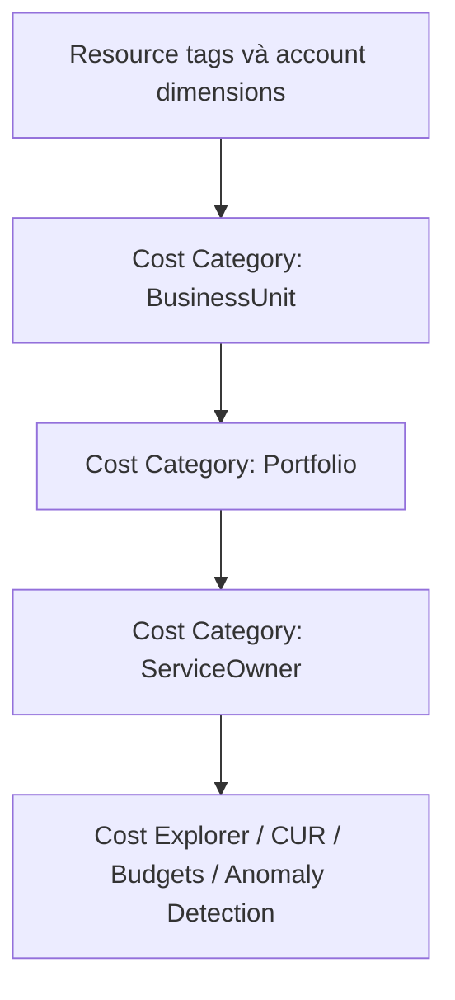

# Cost allocation tag và Cost Category

Một tổ chức AWS có thể có hàng trăm account, hàng nghìn resource và nhiều đội cùng sử dụng dịch vụ nền tảng. Hóa đơn tổng hợp cho biết tổ chức đã chi bao nhiêu, nhưng chưa trả lời đầy đủ các câu hỏi quản trị: sản phẩm nào đang tiêu thụ chi phí, đội nào chịu trách nhiệm, môi trường nào tăng bất thường, khách hàng nào dùng nhiều tài nguyên và phần chi phí dùng chung cần phân bổ cho đơn vị nào.

AWS cung cấp hai cơ chế quan trọng để tổ chức dữ liệu chi phí: **cost allocation tags** và **AWS Cost Categories**. Cost allocation tag là nhãn gắn với resource hoặc account để nhận diện chi phí theo ngữ cảnh vận hành. Cost Category là lớp phân loại được tính từ dữ liệu billing theo các rule, có thể kết hợp account, service, Region, usage type, charge type, tag và category khác. Kết hợp hai cơ chế giúp FinOps xây dựng góc nhìn chi phí theo ứng dụng, môi trường, dự án, cost center và business unit.

Hai cơ chế này không tự làm giảm hóa đơn. Chúng giúp xác định ai hoặc workload nào tạo ra chi phí, phát hiện phần chi phí chưa phân bổ, hỗ trợ showback/chargeback và cung cấp dữ liệu đáng tin cậy cho quyết định tối ưu.

## Mục tiêu học tập

Sau bài học, bạn có thể:

- Giải thích cost allocation tag, AWS-generated tag, account tag và Cost Category.
- Thiết kế taxonomy tag nhất quán theo business unit, application, environment, owner và cost center.
- Kích hoạt cost allocation tags trong management account và kiểm tra thời gian dữ liệu xuất hiện.
- Dùng AWS Organizations tag policies, IAM, SCP và AWS Config để quản trị chất lượng tag.
- Xây dựng Cost Categories bằng regular rule, inherited value, default value và rule hierarchy.
- Phân bổ shared cost bằng split charge và hiểu giới hạn nơi dữ liệu phân bổ xuất hiện.
- Dùng Cost Explorer, CUR 2.0, AWS Data Exports, Budgets và Cost Anomaly Detection để phân tích chi phí.
- Thiết kế quy trình showback/chargeback, xử lý unallocated cost và vận hành FinOps định kỳ.

## 1. Bài toán phân bổ chi phí trong AWS

Giả sử một doanh nghiệp có các nhóm Payments, Retail, Data Platform và Corporate IT. Mỗi nhóm chạy nhiều ứng dụng trên EC2, EKS, RDS, S3, Lambda và các dịch vụ quản trị dùng chung. Tổ chức có thể dùng một AWS Organization với consolidated billing, nhiều OU và nhiều member account.

Nếu chỉ xem tổng chi phí theo service hoặc account, một số câu hỏi vẫn chưa có lời giải:

- EC2/RDS/S3 nào thuộc ứng dụng `orders` và ứng dụng nào thuộc `analytics`?
- Chi phí production khác development bao nhiêu?
- Đội nào chịu trách nhiệm cho resource chưa có owner?
- Chi phí mạng, logging, CI/CD và shared database được chia cho các business unit thế nào?
- Chi phí của account mới đã được gắn vào cost center đúng chưa?
- Phần chi phí tăng là do usage, giá, thay đổi discount hay do resource bị bỏ quên?

Một hệ thống cost allocation tốt cần ba lớp dữ liệu:

1. **Resource/account context**: tag cho biết resource thuộc ứng dụng, môi trường, owner và cost center nào; account tag cung cấp ngữ cảnh cho cả account.
2. **Billing classification**: Cost Categories chuyển line item thành các nhóm mà Finance và business unit hiểu được.
3. **Usage and cost evidence**: Cost Explorer và CUR/Data Exports cung cấp số liệu chi phí/usage để phân tích, đối soát và lưu trữ.

## 2. Phân biệt cost allocation tag và Cost Category

| Tiêu chí | Cost allocation tag | AWS Cost Category |
|---|---|---|
| Bản chất | Key/value gắn vào resource hoặc account | Nhóm chi phí được tính theo rule trên billing data |
| Ai định nghĩa | Đội quản trị resource; AWS tạo một số tag hệ thống | Quản trị viên Billing/FinOps trong management account |
| Ví dụ | `CostCenter=CC-204`, `Environment=Production` | `BusinessUnit=Payments`, `Portfolio=CustomerApps` |
| Phạm vi | Resource hoặc account được hỗ trợ | Các billing line item phù hợp với điều kiện rule |
| Cần activation | Có, trước khi dùng như cost allocation tag | Tạo category và rule; không cần kích hoạt từng resource tag riêng ngoài yêu cầu tag dimension |
| Mục đích | Gắn ngữ cảnh chi phí ở nguồn | Chuẩn hóa và tổng hợp chi phí theo cấu trúc tổ chức |
| Dùng cho | Cost Explorer, Cost and Usage Reports/Data Exports và các công cụ Cost Management được hỗ trợ | Cost Explorer, Budgets, Cost Anomaly Detection, CUR/Data Exports và trang Cost Category details theo khả năng từng tính năng |

Ví dụ: EC2 instance được gắn `CostCenter=CC-204`, `Application=orders`, `Environment=Production`. Một Cost Category `BusinessUnit` có thể ánh xạ `CostCenter=CC-204` sang `Payments`. Khi đó tag giữ chi tiết ở resource, còn Cost Category cung cấp cách nhìn theo đơn vị kinh doanh.

Cost Category không tự gắn tag lên EC2, S3 hay RDS. Ngược lại, tag không tự hiểu rằng một số chi phí dùng chung cần được phân bổ cho nhiều business unit. Hai cơ chế giải quyết hai lớp khác nhau và thường được dùng cùng nhau.

## 3. Thiết kế taxonomy tag

Taxonomy là từ điển các tag key, ý nghĩa, giá trị hợp lệ, owner và quy tắc áp dụng. Hãy thống nhất taxonomy trước khi tạo hàng loạt tag và Cost Category.

### Bộ tag khuyến nghị

| Tag key | Mục đích | Giá trị ví dụ | Bắt buộc ở đâu |
|---|---|---|---|
| `CostCenter` | Trung tâm chi phí chịu trách nhiệm | `CC-204`, `CC-310` | Resource tính phí hoặc account |
| `Application` | Sản phẩm/ứng dụng sử dụng resource | `orders`, `customer-portal` | Resource ứng dụng |
| `Environment` | Môi trường triển khai | `Production`, `Staging`, `Development`, `Sandbox` | Resource ứng dụng |
| `BusinessUnit` | Đơn vị kinh doanh | `Payments`, `Retail`, `Data` | Resource hoặc account theo mô hình |
| `Owner` | Đội hoặc nhóm chịu trách nhiệm | `team-payments` | Resource vận hành |
| `Project` | Dự án hoặc initiative | `checkout-v2`, `data-lake` | Resource thuộc dự án |
| `ManagedBy` | Cách quản lý resource | `Terraform`, `CloudFormation`, `Console` | Resource có lifecycle quản trị |
| `DataClass` | Phân loại dữ liệu | `Public`, `Internal`, `Confidential` | Resource chứa dữ liệu |

Không cần gắn mọi tag vào mọi resource. Xác định tag bắt buộc theo loại resource, trách nhiệm và cách phân tích chi phí. Ví dụ, `Application` phù hợp với resource workload; `BusinessUnit` có thể lấy từ account tag nếu account được dành riêng cho một business unit.

### Quy tắc đặt tên

- Chọn một cách viết hoa thống nhất, ví dụ `CostCenter`, và giữ nguyên ở mọi account.
- Key và value có phân biệt chữ hoa/chữ thường trong nhiều luồng tag/policy; `Production` và `production` có thể thành hai giá trị khác nhau.
- Không dùng key có ý nghĩa chồng lấn như `Team`, `OwnerTeam`, `ApplicationTeam` nếu không có định nghĩa rõ.
- Không dùng tag để lưu password, token, email cá nhân hoặc dữ liệu nhạy cảm.
- Không đưa ngày tháng hoặc trạng thái tạm thời vào key; nếu cần, dùng value có taxonomy rõ ràng.
- Không đổi tên key tùy tiện sau khi đã đưa vào CUR, dashboard, budget và Cost Category rule.

### Ví dụ cấu hình resource

```text
CostCenter=CC-204
Application=orders
Environment=Production
BusinessUnit=Payments
Owner=team-payments
ManagedBy=Terraform
```

Với nhiều account, có thể gắn `BusinessUnit`, `CostCenter` và `Environment` ở cấp AWS account. Resource tags bổ sung `Application`, `Owner` và `Project` để phân tích sâu hơn. Khi dùng account tags cho cost allocation, dữ liệu account tag được đưa vào báo cáo theo namespace/prefix riêng để tránh xung đột với resource tag cùng tên.

## 4. Các loại cost allocation tag

AWS Billing and Cost Management hỗ trợ hai nhóm cost allocation tag chính.

### User-defined tags

Đây là tag do tổ chức định nghĩa, tạo và gắn vào resource. Ví dụ `CostCenter=CC-204`. User-defined tag có thể được gắn khi tạo resource hoặc cập nhật sau đó, tùy dịch vụ và resource type.

Các điểm cần nhớ:

- Tag phải được gắn vào resource được hỗ trợ và cost allocation tag key phải được activate.
- Prefix `aws:` được dành riêng cho AWS; không dùng prefix này cho user-defined tag.
- Một resource chỉ có một value cho mỗi key.
- Không phải mọi AWS service, resource type hoặc loại charge đều hỗ trợ resource tag trong billing data.
- Tag gắn vào resource giữa kỳ billing có thể khiến chi phí trước và sau thời điểm cập nhật xuất hiện thành các line item riêng.
- Tag mới không tự xuất hiện trên resource đã tồn tại; cần tag các resource hiện hữu bằng Tag Editor, API, IaC hoặc quy trình phù hợp.

### AWS-generated tags

AWS hoặc AWS Marketplace ISV có thể tạo tag hệ thống cho một số resource/charge. Ví dụ tag `aws:createdBy` giúp nhận diện principal đã tạo resource được hỗ trợ. Tag hệ thống được AWS quản lý, không thể sửa/xóa như user-defined tag và chỉ xuất hiện trong Billing/Cost Management reports.

Một số điểm quan trọng:

- Chỉ management account có thể activate AWS-generated cost allocation tags cho Organization.
- Khi activate trong management account, tag được activate cho các member accounts.
- `aws:createdBy` được tạo từ dữ liệu CloudTrail và chỉ áp dụng cho resource/Region được hỗ trợ; không giả định mọi resource đều có giá trị.
- Tag `awsApplication` được AWS tự động kích hoạt khi áp dụng theo tích hợp AppRegistry và không tính vào quota active tag key.
- AWS-generated tags có thể có giới hạn Region và điều kiện dữ liệu riêng.

### Account tags

AWS Organizations account tags cho phép gắn ngữ cảnh lên chính AWS account, ví dụ `BusinessUnit=Payments` hoặc `CostCenter=CC-204`. Khi được activate cho cost allocation, account tags giúp phân loại usage và một số khoản phí ở cấp account, kể cả một số chi phí không thể gắn tag trực tiếp lên resource như một số credit, refund hoặc charge dịch vụ.

Account tags phù hợp với mô hình một account phục vụ một business unit hoặc một môi trường. Nếu một account chứa nhiều ứng dụng thuộc các đơn vị khác nhau, account tag không đủ chi tiết; cần resource tags hoặc Cost Category rules bổ sung.

## 5. Kích hoạt cost allocation tags

Tạo tag trên resource chưa đủ để tag xuất hiện trong báo cáo chi phí. Key cần được activate trong Billing and Cost Management.

### Điều kiện và quyền quản trị

- Trong AWS Organization dùng consolidated billing, management account quản lý việc activate cost allocation tags cho payer/organization.
- Member account có thể tạo và gắn resource tags theo quyền được cấp, nhưng không quản lý danh sách cost allocation tags của toàn Organization.
- AWS-generated tags chỉ management account có thể activate.
- Cost allocation tag manager yêu cầu quyền Billing/Cost Management tương ứng; quyền xem danh sách có thể cần `ce:ListCostAllocationTags`, còn thao tác cập nhật cần quyền API tương ứng.

### Quy trình trên console

1. Đăng nhập management account của Organization. Nếu dùng billing transfer, làm theo vai trò bill source/bill transfer được AWS quy định cho cost allocation tags.
2. Mở AWS Billing and Cost Management console.
3. Vào **Cost allocation tags**.
4. Chọn tab user-defined tags, AWS-generated tags hoặc account tags phù hợp.
5. Kiểm tra key, trạng thái và thời điểm sử dụng gần nhất.
6. Chọn key cần dùng cho phân tích và chọn **Activate**.
7. Đợi trạng thái chuyển sang Active, sau đó kiểm tra dữ liệu trong Cost Explorer/CUR.

Sau khi tạo và gắn user-defined tag, key có thể mất đến 24 giờ để xuất hiện trong trang Cost allocation tags; sau khi activate, việc kích hoạt cũng có thể mất đến 24 giờ. Không coi trạng thái vừa bấm Activate là dữ liệu đã xuất hiện ngay.

### Thời điểm bắt đầu có dữ liệu

Phải phân biệt ba thời điểm:

1. Resource được gắn tag.
2. Key được activate làm cost allocation tag.
3. Billing data được xử lý và hiển thị trong công cụ phân tích.

Chi phí chỉ có thể được phân loại theo tag khi resource/usage có tag tương ứng và tag key được activate. Tag không thể gán ngược cho một resource đã không có tag tại thời điểm usage phát sinh. Nếu tag được cập nhật giữa billing period, report có thể tách chi phí trước và sau thay đổi thành các dòng riêng. Với Cost Category, quản trị viên có thể chọn effective date/lookback để áp dụng rule ngược về tháng trước trong phạm vi tùy chọn của dịch vụ; đây là cơ chế riêng với việc gắn tag lên resource.

### Quota active tag keys

Billing and Cost Management giới hạn số active cost allocation tag keys cho mỗi payer account; tài liệu hiện hành nêu mức mặc định tối đa 500 key active. Mỗi request API/console có giới hạn số key có thể activate/deactivate cùng lúc. Một số tag tự động kích hoạt như `awsApplication` không tính vào quota này. Hãy dùng tag key có giá trị phân tích rõ ràng và tránh tạo một key cho từng dự án/tenant nếu value có thể biểu diễn được bằng một taxonomy chung.

## 6. Xây dựng tag governance bằng AWS Organizations

Tag governance cần duy trì cả tính nhất quán lẫn tính đầy đủ. Một key viết sai hoa/thường hoặc value tùy ý sẽ làm báo cáo bị chia nhỏ.

### AWS Organizations tag policies

Tag policies giúp chuẩn hóa cách viết key/value và xác định giá trị được chấp nhận cho các resource type được hỗ trợ. Policy có thể được gắn vào root, OU hoặc account và được kế thừa theo cấu trúc Organization.

Ví dụ chính sách nội bộ:

| Key | Allowed values | Ý nghĩa |
|---|---|---|
| `Environment` | `Production`, `Staging`, `Development`, `Sandbox` | Tránh `prod`, `Prod`, `production` bị tách thành nhóm khác |
| `BusinessUnit` | `Payments`, `Retail`, `Data`, `Corporate` | Phân loại theo đơn vị kinh doanh |
| `ManagedBy` | `Terraform`, `CloudFormation`, `Manual` | Xác định công cụ quản trị |

Tag policy có khả năng reporting và enforcement trên một số loại resource/hoạt động. Enforcement cho basic compliance rules có thể chặn giá trị không phù hợp hoặc sai capitalization khi tag được gửi trong request, nhưng không tự bảo đảm mọi resource đều phải có tag. Với required tag keys cho IaC, cần bật cơ chế enforcement/validation được hỗ trợ cho công cụ triển khai như CloudFormation, Terraform hoặc Pulumi. Kiểm tra danh sách resource type và mode được hỗ trợ trước khi áp dụng.

### IAM conditions và SCP

Với API/service hỗ trợ tag-on-create, IAM policy có thể yêu cầu `aws:RequestTag/CostCenter` hoặc giới hạn `aws:TagKeys`. SCP có thể đặt guardrail cho member account đối với một số API tạo resource. Điều kiện tag phụ thuộc authorization support của từng service; không giả định mọi API đều hỗ trợ cùng một condition key.

### AWS Config và kiểm tra sau triển khai

AWS Config managed rule `required-tags` có thể phát hiện resource thiếu tag key được chỉ định trên resource type hỗ trợ. Đây là cơ chế detective: nó báo resource không compliant sau khi được tạo/ghi nhận. Có thể kết hợp EventBridge/Systems Manager Automation hoặc quy trình ticket để yêu cầu owner bổ sung tag.

### Tagging trong IaC

Đặt tag mặc định ở module/template dùng chung. Với Terraform, tạo module yêu cầu `CostCenter`, `Application`, `Environment`, `Owner`; với CloudFormation, dùng parameter/tag map và validation phù hợp. Pipeline nên fail khi resource bắt buộc thiếu tag hoặc value không nằm trong taxonomy.

Không chỉ dựa vào tag mặc định của IaC: resource tạo từ console, service tự tạo resource con, hoặc API ngoài pipeline có thể không kế thừa tag như mong đợi. Cần inventory và compliance report định kỳ.

## 7. Thiết kế account structure cho cost allocation

Account structure là một chiều phân bổ quan trọng, đặc biệt khi Organization dùng nhiều OU và consolidated billing.

Một mô hình tham khảo:

| OU/account | Vai trò | Account tag |
|---|---|---|
| `ou-production/payments-prod` | Workload thanh toán production | `BusinessUnit=Payments`, `Environment=Production` |
| `ou-production/retail-prod` | Workload bán lẻ production | `BusinessUnit=Retail`, `Environment=Production` |
| `ou-nonprod/shared-dev` | Tài nguyên phát triển dùng chung | `BusinessUnit=Engineering`, `Environment=Development` |
| `ou-platform/network` | Network, DNS, connectivity | `BusinessUnit=SharedPlatform` |
| `ou-platform/observability` | Logging, metrics, tracing | `BusinessUnit=SharedPlatform` |

Account tags giúp gán ngữ cảnh cho chi phí của cả account, bao gồm một số line item không có resource tag. Resource tags phân tách sâu hơn bên trong account. Cost Categories có thể kết hợp account name/ID, tag và service để tạo cách nhìn theo business unit hoặc portfolio.

Tránh dùng một account duy nhất cho mọi team nếu mục tiêu là chargeback rõ ràng mà không có hệ thống tag và metering đáng tin cậy. Ngược lại, không cần tạo account riêng cho mọi dự án nhỏ chỉ để có báo cáo; account vending và vận hành nhiều account cũng có chi phí.

## 8. AWS Cost Categories là gì?

Cost Category là một cấu trúc phân loại chi phí trong AWS Billing and Cost Management. Mỗi category có tên, các giá trị category và tập rule xác định line item nào thuộc giá trị nào.

Ví dụ:

- `BusinessUnit`: Payments, Retail, Data, Corporate.
- `Environment`: Production, NonProduction, Sandbox.
- `Portfolio`: CustomerApps, InternalPlatform, DataPlatform.
- `SupportModel`: ProductTeam, SharedPlatform, CentralIT.

Cost Categories phù hợp khi cấu trúc báo cáo tài chính không trùng với tag hoặc account structure. Ví dụ, nhiều cost center có thể cùng thuộc Payments; một account shared platform có thể phục vụ Payments và Retail; hoặc một service charge cần gom theo portfolio.

Cost Categories được quản lý trong management account của AWS Organizations. Billing transfer có một số khác biệt về account quản trị và tính năng; kiểm tra tài liệu hiện hành nếu Organization sử dụng bill transfer.

## 9. Các dimension và operator của Cost Category

Cost Category regular rules có thể sử dụng một hoặc nhiều dimension để phân loại line item.

| Dimension | Dùng để phân loại | Ví dụ |
|---|---|---|
| Accounts | AWS account | `payments-prod`, `data-prod` |
| Cost allocation tags | Tag key/value của resource | `CostCenter=CC-204` |
| Charge Type | Loại charge | Usage, credit, refund, recurring fee |
| Service | AWS service | Amazon EC2, Amazon RDS, Amazon S3 |
| Region | AWS Region | `ap-southeast-1`, `us-east-1` |
| Usage Type | Đơn vị usage cụ thể | EC2 instance hours, NAT Gateway bytes |
| Billing Entity | Đơn vị xuất hóa đơn | AWS hoặc AWS Marketplace |
| Cost Category | Một category khác | `BusinessUnit` dùng làm dimension cho `Portfolio` |

Các operator thường gặp gồm `Is`, `Is not`, `Is absent`, `Contains`, `Starts with` và `Ends with`. Các operator gần đúng như Contains/Starts with/Ends with chỉ được hỗ trợ cho một số dimension, đáng chú ý là Account và Tag. Khi dùng operator với Accounts, việc so khớp có thể dựa trên account name thay vì account ID. Hãy kiểm tra behavior theo dimension trong console/API.

Rule có thể kết hợp nhiều điều kiện theo logic AND/OR (all/any conditions). Dùng điều kiện rõ ràng và tránh chuỗi Contains quá rộng, vì rule có thể khớp nhầm resource hoặc làm preview khó dự đoán.

## 10. Regular rule, inherited value và default value

Cost Categories hỗ trợ các kiểu rule chính để nhóm chi phí.

### Regular rule

Regular rule ánh xạ điều kiện vào một category value cố định.

Ví dụ cho `BusinessUnit`:

| Thứ tự | Điều kiện | Category value |
|---:|---|---|
| 1 | `CostCenter=CC-204` | `Payments` |
| 2 | `CostCenter=CC-310` | `Retail` |
| 3 | Account thuộc nhóm `data-*` | `Data` |
| 4 | Service thuộc nhóm shared platform và account là platform | `Corporate` |

### Inherited value rule

Inherited value rule lấy category value trực tiếp từ một dimension như Account hoặc Cost allocation tag key. Ví dụ, chọn tag `BusinessUnit` làm inherited value để giá trị Payments/Retail/Data tự tạo thành các category values tương ứng.

Inherited value hữu ích khi taxonomy tag đã sạch và value được quản trị tốt. Nếu resource có tag tùy ý, category có thể phát sinh nhiều value ngoài dự kiến. Hãy chuẩn hóa value trước khi dùng inherited rule.

### Default value

Default value gom các line item không khớp rule nào vào một nhóm như `Unallocated` hoặc `Other`. Không nên để mọi chi phí không khớp biến mất khỏi báo cáo. Nhóm Unallocated tạo danh sách công việc để FinOps tìm owner và cải thiện coverage.

### Rule order và first match

Cost Category rules được xử lý theo thứ tự. Nếu một line item khớp nhiều rule, rule đầu tiên khớp sẽ quyết định category value. Vì vậy, đặt rule cụ thể trước rule tổng quát.

Ví dụ, nếu rule `Service=Amazon EC2` đứng trước rule `CostCenter=CC-204`, chi phí EC2 thuộc CC-204 có thể bị phân loại theo rule EC2 trước. Hãy sắp xếp theo mức độ cụ thể và kiểm tra preview.

## 11. Xây dựng Cost Category phân cấp

Cost Category có thể tham chiếu một Cost Category khác như dimension, tạo cấu trúc phân cấp.

Ví dụ:



Một thiết kế mẫu:

| Category | Rule đầu vào | Values |
|---|---|---|
| `BusinessUnit` | CostCenter hoặc account tag | Payments, Retail, Data, Corporate |
| `Portfolio` | BusinessUnit + Application tag | CustomerApps, DataPlatform, SharedPlatform |
| `Environment` | Environment tag hoặc account dimension | Production, NonProduction, Sandbox |
| `ServiceOwner` | Application/Owner tag | team-payments, team-retail, team-data |

Không cần tạo quá nhiều category. Mỗi category nên trả lời một câu hỏi quản trị riêng. Nếu một chiều đã có thể biểu diễn bằng tag và không cần rule biến đổi, giữ nó ở tag có thể đơn giản hơn.

### Effective date và lookback

Khi tạo hoặc sửa Cost Category, có thể chọn effective date/lookback để áp dụng rule từ tháng trước thay vì chỉ từ tháng hiện tại. Đây là khả năng retroactive của phân loại billing data, hữu ích khi taxonomy hoặc rule được sửa giữa kỳ.

Hãy ghi lại ngày hiệu lực và lý do thay đổi. Thay đổi rule có thể làm lịch sử báo cáo được phân loại lại trong khoảng lookback, khiến số liệu đã xem trước đó thay đổi. Đối với báo cáo đã chốt kỳ, nên lưu snapshot/export và version rule để giữ dấu vết đối soát.

## 12. Split charge: phân bổ chi phí dùng chung

Một số chi phí khó gắn trực tiếp vào một business unit: network egress, NAT Gateway, shared EKS cluster, logging, security tooling, CI/CD, shared database hoặc platform team. Cost Categories có split charge rules để phân bổ một category value nguồn sang các category value đích.

Ví dụ: category `SharedPlatform` có chi phí 10.000 USD trong kỳ. Tổ chức muốn phân bổ cho Payments 60% và Retail 40%.

| Source value | Target values | Allocation method | Kết quả ví dụ |
|---|---|---|---|
| SharedPlatform | Payments, Retail | Fixed | Payments 6.000 USD; Retail 4.000 USD |

Ba phương pháp allocation:

- **Proportional**: phân bổ theo tỷ trọng chi phí hiện tại của các target. Nếu Payments chiếm 70% và Retail 30% trong nhóm đích, shared cost được phân bổ theo tỷ trọng đó.
- **Fixed**: phân bổ theo tỷ lệ phần trăm do tổ chức định nghĩa, ví dụ 60/40.
- **Even split**: chia đều cho các target, ví dụ ba nhóm nhận mỗi nhóm một phần ba.

### Giới hạn cần hiểu rõ

- Phải phân loại shared cost vào source category value trước khi split.
- Một category value chỉ có thể được dùng làm source một lần trong các split charge rules; value dùng làm source không thể đồng thời làm target, và ngược lại.
- Một target value có thể nhận phân bổ từ nhiều rule theo điều kiện dịch vụ.
- Nếu category value được tạo từ inherited value rule, đợi Cost Category chuyển sang trạng thái `Applied` trước khi dùng value đó làm source hoặc target.
- AWS hiện giới hạn tối đa 10 split charge rules cho một Cost Category.
- Split charge được thể hiện trên trang Cost Category details và báo cáo tải xuống tương ứng; phần chi phí phân bổ này không xuất hiện trong Cost Explorer, CUR và các công cụ Cost Management khác như một thay đổi của line item gốc.
- Split charge là lớp phân bổ phục vụ quản trị nội bộ; nó không thay đổi hóa đơn AWS hoặc charge thực tế của service.

Do giới hạn hiển thị, hãy dùng split charge để giải thích cách phân bổ nội bộ và duy trì một bảng allocation riêng nếu cần đưa số đã phân bổ vào data warehouse, báo cáo tài chính hoặc chargeback. Không giả định CUR đã chứa số split charge sau phân bổ.

## 13. Ví dụ thiết kế Cost Category cho doanh nghiệp

Giả sử tổ chức có các cost center:

| Cost center | Business unit | Application | Environment |
|---|---|---|---|
| `CC-204` | Payments | orders | Production |
| `CC-205` | Payments | checkout | Production |
| `CC-310` | Retail | catalog | Production |
| `CC-311` | Retail | storefront | Production |
| `CC-900` | Corporate | shared-platform | Production |

Thiết kế category:

1. `BusinessUnit`: ánh xạ CostCenter sang Payments/Retail/Corporate.
2. `Application`: inherited value từ tag `Application` nếu taxonomy được chuẩn hóa.
3. `Environment`: inherited value từ tag `Environment`.
4. `Portfolio`: rule kết hợp BusinessUnit và Application để gom các ứng dụng thành nhóm báo cáo.
5. `SharedCost`: phân loại account/service shared platform; split charge sang BusinessUnit theo công thức được Finance phê duyệt.

Trong dashboard, FinOps có thể xem chi phí theo BusinessUnit rồi drill down Application và Environment. Finance có thể xem cùng category trong Budgets hoặc Cost Anomaly Detection để theo dõi mức chi tiêu theo đơn vị kinh doanh.

## 14. Cost allocation tag và Cost Category trong Cost Explorer

Cost Explorer giúp phân tích chi phí theo thời gian và dimension. Sau khi tag key được activate và billing data được cập nhật, có thể group/filter theo tag. Cost Categories cũng xuất hiện như dimension để phân tích theo category value.

Một số phân tích thường dùng:

- Group by `CostCenter` để xem chi phí theo trung tâm chi phí.
- Group by `Application` để so sánh ứng dụng.
- Filter `Environment=Production` để loại non-production.
- Group by Cost Category `BusinessUnit` để báo cáo theo đơn vị kinh doanh.
- So sánh net amortized cost và unblended cost khi cần góc nhìn khác nhau về discount/commitment.
- Drill down theo Service, Usage Type và Region để tìm driver tăng chi phí.

Khi so sánh kỳ, dùng cùng cost metric, granularity, filter và time range. Nếu đổi Cost Category rule hoặc tag giữa kỳ, hãy ghi chú thời điểm thay đổi để giải thích vì sao dữ liệu lịch sử được phân loại lại hoặc chi phí tách thành line item.

## 15. CUR 2.0 và AWS Data Exports

Cost and Usage Report (CUR) và AWS Data Exports cung cấp dữ liệu billing chi tiết ở cấp line item để phân tích trong data warehouse hoặc query engine. CUR 2.0 có cấu trúc cột linh hoạt hơn và hỗ trợ các cột tags, cost categories cùng nhiều thuộc tính billing.

### Vì sao cần CUR/Data Exports?

- Lưu lịch sử chi phí/usage ở dạng chi tiết để audit và đối soát.
- Kết hợp billing data với CMDB, deployment metadata, product usage và ownership.
- Tạo dashboard hoặc chargeback report riêng trong Athena/Glue/QuickSight/warehouse.
- Tính unit economics như cost per order, cost per tenant hoặc cost per GB.
- Phát hiện line item không có tag hoặc không được gán Cost Category.

### Lưu ý về tag trong billing export

User-defined tags có thể được biểu diễn trong cột tags theo cấu trúc của export; AWS-generated tags và account tags có namespace/prefix phân biệt. Cost Category có cột riêng hoặc thuộc tính tương ứng trong export schema. Kiểm tra schema của CUR 2.0/Data Exports đang dùng trước khi viết SQL, vì tên và cấu trúc cột khác với CUR legacy.

Không phải mọi khoản phí đều có resource tag. Subscription, AWS Support, một số Marketplace fee, credit/refund, upfront fee hoặc charge không gắn resource có thể không được phân loại bằng resource tag. Account tag hoặc Cost Category rule dựa trên account/service/charge type có thể giúp phân loại một phần khoản phí đó.

### Ví dụ SQL minh họa

Ví dụ giả định bảng CUR 2.0 đã được catalog trong Athena và cột/struct đã được chuẩn hóa thành `line_item_unblended_cost`, `resource_tags_costcenter`, `cost_category_businessunit`.

```sql
SELECT
  cost_category_businessunit AS business_unit,
  resource_tags_costcenter AS cost_center,
  SUM(line_item_unblended_cost) AS unblended_cost
FROM cur2_view
WHERE billing_period = DATE '2026-11-01'
GROUP BY 1, 2
ORDER BY unblended_cost DESC;
```

Đây là SQL minh họa với tên cột đã chuẩn hóa trong view nội bộ, không phải tên cột bắt buộc của mọi CUR 2.0 export. Hãy kiểm tra schema thật và dùng partition predicate để giảm lượng dữ liệu Athena phải đọc.

## 16. Account tags giúp phân bổ chi phí không gắn resource

Resource tags rất hữu ích nhưng không thể gắn lên mọi line item. Account tags trong AWS Organizations cung cấp một dimension bổ sung ở cấp account.

Ví dụ, account `payments-prod` được gắn:

```text
BusinessUnit=Payments
CostCenter=CC-204
Environment=Production
```

Sau khi activate account tags trong Billing and Cost Management, usage và một số charge trong account có thể được phân loại theo account tags. Điều này hữu ích cho một số khoản phí không thể gắn tag trực tiếp lên resource như credits, refunds và một số service charges.

Account tags yêu cầu AWS Organizations management account với consolidated billing và quyền truy cập Organizations/Billing. Trong CUR 2.0, tag từ resource, account, user attributes và Cost Category được phân biệt bằng prefix/namespace để tránh xung đột khi key trùng nhau. Tránh đặt key bắt đầu bằng chuỗi `accountTag` vì AWS dùng prefix này để biểu diễn account tags trong báo cáo.

## 17. Tích hợp Cost Categories với Budgets và Cost Anomaly Detection

Sau khi taxonomy và category ổn định, có thể dùng chúng để giám sát ngân sách và biến động chi phí.

### AWS Budgets

AWS Budgets có thể lọc ngân sách theo linked account, service, tag và Cost Category trong các trường hợp được hỗ trợ. Ví dụ:

- Budget theo BusinessUnit=Payments.
- Budget theo Application=orders.
- Budget riêng cho Environment=Production.
- Budget cho account shared platform.

Có thể cấu hình actual/forecast threshold và thông báo qua SNS hoặc kênh tích hợp. Budget không tự ngăn resource tạo ra chi phí trừ khi tổ chức xây dựng action/automation có kiểm soát.

### AWS Cost Anomaly Detection

Cost Anomaly Detection có thể tạo monitor theo AWS services, linked accounts, cost allocation tag hoặc Cost Category. Monitor theo tag key có thể theo dõi các value khác nhau; monitor theo Cost Category có thể theo dõi category values.

Dữ liệu Cost Explorer có độ trễ và Cost Anomaly Detection chạy theo chu kỳ xử lý; không nên kỳ vọng cảnh báo xuất hiện tức thì sau khi usage xảy ra. Một monitor mới cũng cần thời gian và lịch sử dữ liệu để phát hiện baseline.

### Quy tắc thiết kế

- Dùng Cost Category để nhóm theo business owner; dùng tag để drill down đến resource/application.
- Đặt budget threshold theo lịch tài chính và mùa vụ.
- Tách anomaly monitor theo business unit hoặc tag key quan trọng.
- Gửi cảnh báo đến owner tương ứng; tránh gửi mọi cảnh báo vào một mailbox chung.
- Định kỳ kiểm tra tag activation, category status và coverage trước khi tin dashboard.

## 18. Showback và chargeback

**Showback** cung cấp cho từng đội báo cáo chi phí họ tạo ra mà chưa nhất thiết thu lại ngân sách. **Chargeback** phân bổ chi phí vào ngân sách hoặc sổ sách của business unit theo chính sách tài chính.

Một quy trình tốt:

1. FinOps định nghĩa taxonomy và category model cùng Finance.
2. Platform team bảo đảm tag được gắn đúng trong IaC và resource lifecycle.
3. Billing team activate tag và cấu hình Cost Categories.
4. Data team xây pipeline CUR/Data Exports và kiểm tra chất lượng dữ liệu.
5. FinOps đối soát unallocated cost, shared cost và credit/discount.
6. Business owner xác nhận phân bổ và giải thích biến động.
7. Finance chốt phương pháp chargeback và thời điểm khóa kỳ.

### Chi phí trực tiếp và chi phí dùng chung

- **Direct cost**: resource có thể quy trực tiếp cho một application/team/account.
- **Shared cost**: resource phục vụ nhiều application/team như network, security, logging, CI/CD và platform database.
- **Unallocated cost**: line item chưa xác định được owner hoặc thiếu dữ liệu phân loại.
- **Central cost**: khoản chi phí được tổ chức giữ ở cấp Corporate/IT theo chính sách.

Không phân bổ shared cost chỉ vì có thể làm được. Công thức phải phản ánh cách tiêu thụ hoặc quyết định quản trị đã thống nhất. Ví dụ, NAT cost có thể phân bổ theo bytes/GB qua NAT, shared EKS theo CPU/memory requests, logging theo ingest volume, hoặc chia đều khi không có usage metric đáng tin cậy.

## 19. Quy trình xử lý unallocated cost

Unallocated cost là chỉ số quan trọng của chất lượng cost allocation. Hãy theo dõi tỷ lệ unallocated theo tháng và theo service/account.

Quy trình:

1. Lọc line item chưa có tag/category value hoặc thuộc default `Unallocated`.
2. Phân loại nguyên nhân: resource không hỗ trợ tag, thiếu tag, tag chưa activate, charge không gắn resource, account chưa có account tag hoặc Cost Category rule chưa bao phủ.
3. Tìm owner từ account, service, resource ARN, deployment record hoặc CloudTrail nếu phù hợp.
4. Quyết định cách xử lý: bổ sung resource tag, account tag, category rule, central cost hoặc exception có thời hạn.
5. Cập nhật taxonomy/IaC/policy để ngăn lỗi tái diễn.
6. Theo dõi unallocated ratio và aging của exception.

Ví dụ dashboard:

| Chỉ số | Ý nghĩa |
|---|---|
| Tagged spend % | Tỷ lệ chi phí có resource tag hợp lệ |
| Categorized spend % | Tỷ lệ chi phí được gán Cost Category value |
| Unallocated spend | Chi phí nằm trong nhóm chưa phân bổ |
| Missing CostCenter | Resource/account thiếu cost center |
| Unknown tag value | Value ngoài taxonomy |
| Shared cost ratio | Tỷ lệ chi phí dùng chung |
| Exception aging | Số ngày exception chưa được xử lý |

Không ép tag lên các khoản phí không thể gắn tag trực tiếp. Dùng account tags, Cost Category theo account/service/charge type hoặc central cost để thể hiện đúng bản chất.

## 20. CLI và API tham khảo

AWS Cost Explorer API được cung cấp qua AWS CLI namespace `ce`. Các ví dụ dưới đây minh họa truy vấn và kích hoạt tag. Cần dùng quyền Billing/Cost Management phù hợp, management account khi thao tác activation cho Organization và ngày bắt đầu/kết thúc hợp lệ.

### Liệt kê cost allocation tags

```bash
aws ce list-cost-allocation-tags \
  --time-period Start=2026-11-01,End=2026-12-01 \
  --tag-key CostCenter \
  --region us-east-1
```

### Activate tag key

```bash
aws ce update-cost-allocation-tags-status \
  --cost-allocation-tags-status '[{"TagKey":"CostCenter","Status":"Active"}]' \
  --region us-east-1
```

API có giới hạn số tag key trong một request. Khi kích hoạt nhiều key, phân batch và kiểm tra trạng thái sau khi cập nhật.

### Group cost theo tag trong Cost Explorer API

```bash
aws ce get-cost-and-usage \
  --time-period Start=2026-11-01,End=2026-12-01 \
  --granularity MONTHLY \
  --metrics UnblendedCost \
  --group-by Type=TAG,Key=CostCenter \
  --region us-east-1
```

### Group cost theo Cost Category

```bash
aws ce get-cost-and-usage \
  --time-period Start=2026-11-01,End=2026-12-01 \
  --granularity MONTHLY \
  --metrics UnblendedCost \
  --group-by Type=COST_CATEGORY,Key=BusinessUnit \
  --region us-east-1
```

Cost Explorer API có giới hạn số group-by và kích thước response; automation cần xử lý `NextPageToken` nếu có. Không ghi cứng tên Cost Category nếu môi trường có nhiều Organization hoặc thay đổi taxonomy.

## 21. Bảo mật và phân quyền Billing/FinOps

Cost data có thể tiết lộ mức sử dụng, kiến trúc, dự án, business unit và hoạt động của khách hàng. Hãy phân quyền theo vai trò:

- Billing administrator: quản lý cost allocation tags, Cost Categories và billing configuration.
- FinOps analyst: xem Cost Explorer, Budgets, CUR và Cost Category details.
- Resource owner: gắn tag resource trong phạm vi account/team.
- Platform governance: quản lý tag policies, IaC modules và required-tag checks.
- Finance approver: phê duyệt taxonomy, split charge và chargeback method.
- Auditor: đọc báo cáo, lịch sử thay đổi và evidence.

Cost Categories hỗ trợ tag resource category để kiểm soát quyền chỉnh sửa thông qua IAM condition theo resource tag. Dùng policy riêng để giới hạn ai có thể tạo/sửa category. Không cấp quyền billing admin rộng cho mọi người chỉ vì họ cần xem báo cáo.

CloudTrail và audit log nên được dùng để truy vết thay đổi policy, category, tag activation và quyền truy cập billing. Bảo vệ CUR/Data Exports bucket bằng encryption, bucket policy, retention và quyền đọc tối thiểu.

## 22. Chi phí, giới hạn và vận hành

Cost allocation tags và Cost Categories là công cụ quản trị billing data; chúng không thay thế các dịch vụ tạo chi phí. Một số giới hạn/vận hành cần theo dõi:

- Tối đa 500 active cost allocation tag keys theo quota mặc định hiện hành cho payer account; có thể kiểm tra Service Quotas nếu cần thay đổi.
- Tag key có thể mất đến 24 giờ để xuất hiện sau khi được tạo/gắn; activation cũng có thể mất đến 24 giờ.
- Không phải mọi resource/service/charge đều có resource tag.
- Tag values có thể phân mảnh nếu capitalization và taxonomy không thống nhất.
- Cost Category rule được đánh giá theo thứ tự; rule rộng đặt trước có thể che rule cụ thể.
- Cost Category preview là ước tính; cần kiểm tra category details sau khi lưu.
- Split charge có giới hạn rule và không ghi lại chi phí đã phân bổ vào CUR/Cost Explorer.
- Thay đổi Cost Category effective date có thể phân loại lại dữ liệu lịch sử trong khoảng lookback.
- Account chuyển sang Organization khác có thể cần activate lại user-defined cost allocation tags trong management account mới.

### Các biện pháp tối ưu

- Dùng ít key nhưng có ý nghĩa; ưu tiên value taxonomy thay vì tạo nhiều key tương tự.
- Chọn tag bắt buộc theo resource type và business owner.
- Dùng account tags để phân loại charge ở cấp account khi phù hợp.
- Dùng inherited value để giảm số rule thủ công khi tag đã chuẩn hóa.
- Giữ default value `Unallocated` để không bỏ sót line item.
- Dùng split charge cho shared cost khi công thức được Finance phê duyệt.
- Lưu snapshot/export của kỳ đã chốt trước khi thay đổi rule lớn.
- Rà soát active tags và category definitions định kỳ.

## 23. Xử lý sự cố thường gặp

| Hiện tượng | Nguyên nhân có thể | Cách kiểm tra/xử lý |
|---|---|---|
| Tag không xuất hiện trong Cost allocation tags | Tag chưa được gắn vào resource, resource type chưa hỗ trợ hoặc billing data chưa cập nhật | Kiểm tra resource tag, service support và chờ dữ liệu xử lý |
| Tag có trong console nhưng không thấy trong Cost Explorer | Key chưa Active, tag value null, dữ liệu chưa cập nhật hoặc filter/time range sai | Kiểm tra activation status, tag value và time range |
| Chỉ một số account có tag | Account ngoài Organization, tag không được gắn ở member resource hoặc tag chưa được activate bởi management account | Kiểm tra payer/management account và resource inventory |
| Tag value bị tách thành `prod`, `Prod`, `Production` | Taxonomy không thống nhất/case-sensitive | Chuẩn hóa tag policy và sửa resource hiện có |
| Chi phí không được gán Cost Category | Không rule nào khớp, category chưa Applied hoặc default value chưa được cấu hình | Kiểm tra rule order, dimension, tag activation và default |
| Một line item khớp sai category | Rule tổng quát đứng trước rule cụ thể | Sắp xếp lại rule và kiểm tra preview/details |
| Cost Category không thấy trong Cost Explorer | Category chưa Applied, chọn sai thời gian hoặc filter | Kiểm tra category status, effective date và refresh dữ liệu |
| Split charge không xuất hiện trong CUR | Split charge chỉ hiển thị ở Cost Category details/report tương ứng | Xuất báo cáo split riêng hoặc tính allocation trong data warehouse |
| Một số charge không có resource tag | Subscription, credit/refund hoặc charge không gắn resource | Dùng account tags, category rule theo account/service/charge type hoặc central cost |
| Tag activation bị mất sau khi account chuyển Organization | Tag activation gắn với management account của Organization | Activate lại key trong management account mới |
| IaC vẫn tạo resource thiếu tag | Resource type/tool chưa được hỗ trợ enforcement hoặc template không truyền tag | Kiểm tra tag policy mode, IAM/SCP conditions và pipeline validation |

## 24. Bài thực hành: phân bổ chi phí theo BusinessUnit

Mục tiêu là xây dựng một luồng cost allocation cơ bản cho ba đơn vị Payments, Retail và Data.

### Chuẩn bị

1. Một AWS Organization dùng consolidated billing.
2. Quyền quản trị Cost allocation tags và Cost Categories trong management account.
3. Một số resource thử nghiệm có chi phí phát sinh và có thể gắn tag.
4. Taxonomy đã thống nhất với Finance.

### Thực hiện

1. Gắn `CostCenter`, `Application`, `Environment` và `Owner` vào resource test.
2. Gắn account tags `BusinessUnit` và `CostCenter` cho account test trong Organizations.
3. Vào Billing and Cost Management, activate các cost allocation tag keys cần dùng.
4. Chờ tag chuyển Active và billing data cập nhật.
5. Trong Cost Explorer, group by `CostCenter` và kiểm tra các value xuất hiện.
6. Tạo Cost Category `BusinessUnit` với regular rules ánh xạ CC-204 sang Payments, CC-310 sang Retail, CC-410 sang Data.
7. Thêm default value `Unallocated`.
8. Kiểm tra rule order và cost preview; lưu category.
9. Tạo Cost Category `Environment` bằng inherited value từ tag `Environment` nếu phù hợp.
10. Tạo budget theo `BusinessUnit=Payments` và theo dõi chi phí.
11. Kiểm tra line item chưa phân loại và ghi lại nguyên nhân.
12. Xuất CUR 2.0/Data Exports để xác minh tag/category columns trong schema thật.

### Kết quả cần đạt

- Resource có tag đúng taxonomy.
- Tag key được activate trong management account.
- Cost Explorer hiển thị chi phí theo tag sau khi dữ liệu cập nhật.
- Cost Category phân loại đúng BusinessUnit.
- Chi phí không khớp rule nằm trong `Unallocated`.
- Báo cáo thể hiện rõ chi phí trực tiếp, shared cost và khoản chưa phân bổ.

## 25. Tình huống thiết kế thực tế

### Tình huống A: nhiều ứng dụng trong một account

Một account Production chạy `orders`, `checkout` và `catalog`. Account tag chỉ thể hiện `BusinessUnit=CustomerApps`, còn resource tags phân tách `Application` và `CostCenter`. Cost Category `BusinessUnit` gom cost center về Payments/Retail; Cost Category `Portfolio` gom các ứng dụng thành Customer Experience. Đây là cách giữ account structure gọn nhưng vẫn có phân tích chi tiết.

### Tình huống B: chi phí shared network

NAT Gateway, Transit Gateway và connectivity phục vụ nhiều business unit. Đội FinOps tạo source category `SharedNetwork`, sau đó split charge sang Payments/Retail/Data theo tỷ lệ usage hoặc tỷ lệ cố định được phê duyệt. Báo cáo split được lưu riêng vì số phân bổ không thay thế line item gốc trong CUR.

### Tình huống C: account mới thiếu tag

Account mới được tạo nhưng resource chưa có `CostCenter`. Pipeline IaC kiểm tra tag policy trước khi deploy; AWS Config required-tags phát hiện resource tồn tại nhưng thiếu key; FinOps đưa chi phí vào `Unallocated` và mở ticket cho owner. Sau khi bổ sung tag, báo cáo các kỳ sau được cải thiện.

### Tình huống D: khoản phí không gắn resource

AWS Support, một số subscription, credit hoặc refund không có resource ARN để tag. Tổ chức gắn account tags hoặc viết Cost Category rule theo account, billing entity và charge type để phân loại. Nếu khoản phí phục vụ toàn công ty, có thể giữ ở Corporate/Shared cost thay vì cố gắn vào một ứng dụng.

## 26. Những hiểu lầm thường gặp

- **Gắn tag là đủ để thấy chi phí**: cost allocation tag key còn phải được activate và billing data cần thời gian cập nhật.
- **Activate tag sẽ gắn tag lên resource cũ**: activation chỉ bật dùng key trong billing; resource hiện hữu vẫn cần được tag riêng.
- **Mọi AWS charge đều có resource tag**: nhiều khoản phí không gắn resource hoặc service chưa hỗ trợ tag.
- **Tag policy tự động bắt buộc mọi resource có tag**: khả năng enforcement phụ thuộc mode, tool và resource type; cần IAM/SCP/Config bổ sung.
- **Cost Category là resource tag**: category được tính từ billing rule, không gắn lên resource.
- **Rule nào khớp cũng được cộng vào category**: first matching rule quyết định category value.
- **Inherited value tự làm sạch tag**: value tùy ý có thể tạo nhiều category values ngoài dự kiến.
- **Default value có thể bỏ qua**: default `Unallocated` giúp nhìn thấy khoản chi phí chưa được phân loại.
- **Split charge thay đổi hóa đơn AWS**: split charge chỉ phục vụ phân bổ nội bộ và không thay đổi line item gốc.
- **Split charge sẽ xuất hiện trong CUR**: số đã split không được ghi vào CUR/Cost Explorer như chi phí gốc sau phân bổ.
- **Account tag và resource tag là một**: chúng có namespace và phạm vi khác nhau trong billing export.
- **Chi phí thấp hơn nghĩa là tag tốt hơn**: tag cải thiện khả năng quan sát; tối ưu chi phí cần hành động riêng.

## 27. Checklist vận hành production

Trước khi đưa cost allocation vào vận hành chính thức, hãy xác nhận:

- [ ] Taxonomy có owner, định nghĩa, value hợp lệ và quy tắc viết hoa/thường.
- [ ] CostCenter, Application, Environment, BusinessUnit và Owner được gắn theo resource type phù hợp.
- [ ] Account tags được sử dụng cho account có ranh giới business rõ ràng.
- [ ] Cost allocation tag keys đã được activate trong management account.
- [ ] AWS-generated tags cần thiết đã được activate và hiểu rõ phạm vi hỗ trợ.
- [ ] Quota active tag keys được theo dõi.
- [ ] Tag policies được gắn đúng OU/account và thử enforcement ở phạm vi nhỏ.
- [ ] IaC modules/pipelines truyền tag bắt buộc và kiểm tra allowed values.
- [ ] IAM/SCP conditions chỉ áp dụng cho API/resource type được hỗ trợ.
- [ ] AWS Config hoặc inventory phát hiện resource thiếu tag.
- [ ] Cost Categories có regular/inherited rules, rule order và default value rõ ràng.
- [ ] Effective date/lookback được ghi lại trước khi thay đổi rule.
- [ ] Shared cost có source category, target và split method được Finance phê duyệt.
- [ ] Người dùng hiểu split charge không thay đổi hóa đơn và không xuất hiện trong CUR/Cost Explorer.
- [ ] Cost Explorer dashboards group/filter đúng tag và category.
- [ ] CUR 2.0/Data Exports được catalog, bảo vệ và kiểm tra schema.
- [ ] Budgets/Cost Anomaly Detection theo dõi business unit hoặc application quan trọng.
- [ ] Unallocated spend có owner, SLA và quy trình xử lý.
- [ ] Showback/chargeback có định nghĩa direct/shared/central cost và quy tắc đối soát.
- [ ] Kỳ billing đã chốt có snapshot/export và lịch sử rule để audit.

## Kết luận

Cost allocation tags cung cấp ngữ cảnh chi phí ở resource/account; AWS Cost Categories biến dữ liệu billing thành các nhóm phù hợp với cấu trúc tài chính và vận hành. Tag taxonomy tốt giúp phân tích đến application, environment, project và owner. Cost Categories giúp gom theo business unit, portfolio, service owner và xử lý các line item không thể gắn resource tag trực tiếp.

Hãy quản trị taxonomy cùng Finance và Platform, activate cost allocation tags trong management account, kiểm tra coverage và dùng default `Unallocated` để nhìn thấy phần chi phí chưa được giải thích. Với shared cost, chọn split method có căn cứ và ghi nhận rõ giới hạn dữ liệu. Kết hợp Cost Explorer, CUR 2.0, Budgets và Cost Anomaly Detection để biến cost allocation thành quy trình FinOps có thể đo lường, đối soát và cải tiến liên tục.

## Tài liệu tham khảo

- [Organizing and tracking costs using AWS cost allocation tags](https://docs.aws.amazon.com/awsaccountbilling/latest/aboutv2/cost-alloc-tags.html)
- [Using user-defined cost allocation tags](https://docs.aws.amazon.com/awsaccountbilling/latest/aboutv2/custom-tags.html)
- [Activating user-defined cost allocation tags](https://docs.aws.amazon.com/awsaccountbilling/latest/aboutv2/activating-tags.html)
- [Activating AWS-generated cost allocation tags](https://docs.aws.amazon.com/awsaccountbilling/latest/aboutv2/activate-built-in-tags.html)
- [Using AWS-generated tags](https://docs.aws.amazon.com/awsaccountbilling/latest/aboutv2/aws-tags.html)
- [Quotas and restrictions for cost allocation tags](https://docs.aws.amazon.com/awsaccountbilling/latest/aboutv2/billing-limits.html)
- [Understanding dates for cost allocation tags](https://docs.aws.amazon.com/awsaccountbilling/latest/aboutv2/cost-allocation-tags-timeline.html)
- [Using account tags for cost allocation](https://docs.aws.amazon.com/awsaccountbilling/latest/aboutv2/account-tags-cost-allocation.html)
- [Creating Cost Categories](https://docs.aws.amazon.com/awsaccountbilling/latest/aboutv2/create-cost-categories.html)
- [Organizing costs using AWS Cost Categories](https://docs.aws.amazon.com/awsaccountbilling/latest/aboutv2/manage-cost-categories.html)
- [Splitting charges within Cost Categories](https://docs.aws.amazon.com/awsaccountbilling/latest/aboutv2/splitcharge-cost-categories.html)
- [AWS Organizations tag policies best practices](https://docs.aws.amazon.com/organizations/latest/userguide/orgs_manage_policies_tag-policies-best-practices.html)
- [Enforcing tagging consistency with tag policies](https://docs.aws.amazon.com/organizations/latest/userguide/orgs_manage_policies_tag-policies-enforcement.html)
- [Enforcing required tag keys with IaC](https://docs.aws.amazon.com/organizations/latest/userguide/enforce-required-tag-keys-iac.html)
- [AWS Config required-tags managed rule](https://docs.aws.amazon.com/config/latest/developerguide/required-tags.html)
- [Using the monthly cost allocation report](https://docs.aws.amazon.com/awsaccountbilling/latest/aboutv2/configurecostallocreport.html)
- [AWS Cost Anomaly Detection](https://docs.aws.amazon.com/cost-management/latest/userguide/manage-ad.html)
- [Getting started with AWS Cost Anomaly Detection](https://docs.aws.amazon.com/cost-management/latest/userguide/getting-started-ad.html)
- [AWS Cost Explorer API reference](https://docs.aws.amazon.com/aws-cost-management/latest/APIReference/Welcome.html)
- [AWS Data Exports User Guide](https://docs.aws.amazon.com/cur/latest/userguide/what-is-data-exports.html)
