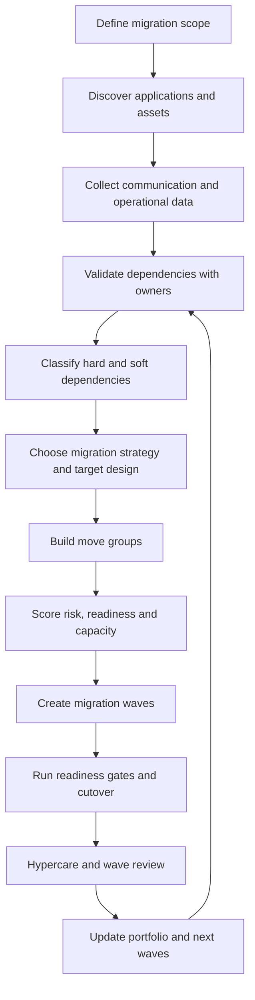
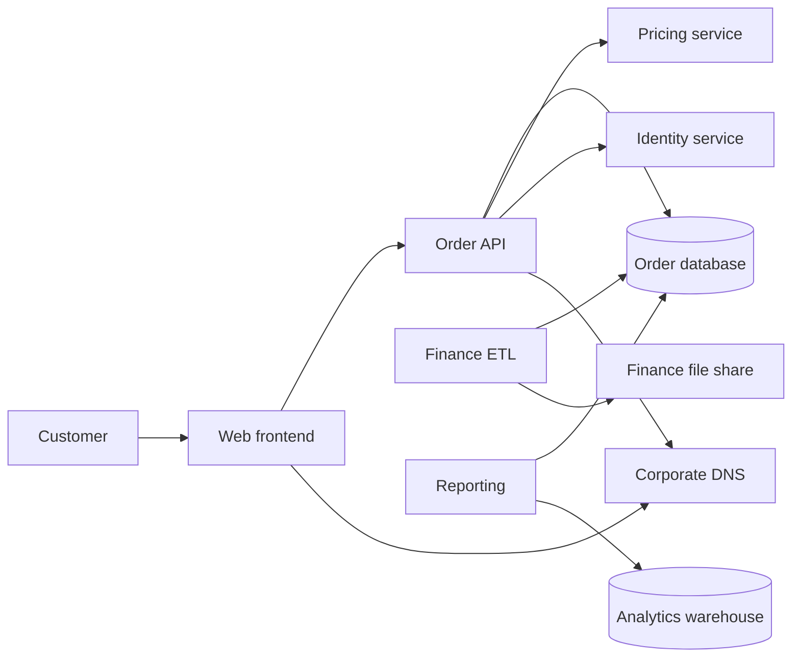

# Đánh giá phụ thuộc và lập kế hoạch migration wave

Một ứng dụng hiếm khi chỉ gồm một máy chủ. Nó có thể phụ thuộc vào cơ sở dữ liệu dùng chung, DNS, Active Directory, hệ thống tệp, hàng đợi, API của đối tác, lịch batch, hệ thống xác thực và các nhóm vận hành khác. Nếu chỉ lập danh sách máy chủ rồi chia đều theo số lượng, nhóm migration có thể đưa ứng dụng lên AWS nhưng làm gián đoạn luồng nghiệp vụ hoặc khiến hiệu năng không đạt yêu cầu.

Đánh giá phụ thuộc (dependency assessment) giúp xác định thành phần nào giao tiếp với nhau, quan hệ nào bắt buộc phải giữ gần nhau, quan hệ nào có thể duy trì qua kết nối hybrid và quan hệ nào cần được thiết kế lại. Lập kế hoạch migration wave (wave planning) dùng kết quả đó để nhóm ứng dụng thành các đợt có phạm vi, lịch, nguồn lực, tiêu chí sẵn sàng và phương án quay lui rõ ràng.

Trong hệ sinh thái AWS, kế hoạch đích cần xem xét Region và Availability Zone, IAM, VPC, compute, storage, database, integration và serverless. Mỗi wave phải chuẩn bị đủ nền tảng bảo mật, network, giám sát, phục hồi và kiểm soát chi phí để workload có thể vận hành ổn định sau khi chuyển.

Sau bài học, người học có thể:

- Xây dựng inventory ứng dụng, máy chủ, database, storage, network flow và owner.
- Thu thập, xác minh và phân loại phụ thuộc kỹ thuật, nghiệp vụ và vận hành.
- Phân biệt hard dependency với soft dependency và quyết định move group phù hợp.
- Chọn migration strategy theo từng application, không áp một phương pháp cho toàn bộ portfolio.
- Tạo migration wave dựa trên mức độ phức tạp, rủi ro, ưu tiên nghiệp vụ và năng lực đội ngũ.
- Xây dựng readiness gate, cutover runbook, rollback plan và hypercare.
- Theo dõi tiến độ bằng số liệu và cập nhật wave plan khi có thông tin mới.

## 1. Tư duy portfolio trước khi lập wave

### 1.1. Phạm vi đánh giá

Migration portfolio là tập hợp các ứng dụng và thành phần hạ tầng nằm trong phạm vi chuyển đổi. Trước khi chia wave, hãy thống nhất đơn vị quản lý. Một ứng dụng nghiệp vụ có thể bao gồm nhiều application component, máy chủ, database, file share, batch job và endpoint bên ngoài.

Các khái niệm cần phân biệt:

| Khái niệm | Ý nghĩa | Ví dụ |
|---|---|---|
| Business application | Khả năng nghiệp vụ người dùng nhận được | Quản lý đơn hàng |
| Application component | Thành phần phần mềm tham gia cung cấp ứng dụng | Web, API, worker, scheduler |
| Infrastructure asset | Tài nguyên chạy hoặc lưu trữ component | EC2 source server, VM, database, NAS |
| Dependency | Quan hệ cần thiết giữa hai thành phần hoặc với một điều kiện | API cần database, job cần file share |
| Move group | Nhóm thành phần phải được chuyển cùng nhau theo quy tắc dependency | API và database có yêu cầu latency thấp |
| Migration wave | Đợt triển khai chứa một hoặc nhiều move group | Wave 2: nhóm ứng dụng nội bộ |
| Cutover event | Thời điểm chuyển hoạt động từ môi trường nguồn sang AWS | Chuyển DNS và mở traffic đến target |

Không đồng nhất một server với một application. Một server có thể chạy nhiều ứng dụng; một ứng dụng có thể chạy trên nhiều server và dùng một database được chia sẻ. Nếu không lập quan hệ giữa application và asset, kế hoạch có thể bỏ sót thành phần hoặc di chuyển nhầm tài nguyên dùng chung.

### 1.2. Kết quả cần có trước khi chọn wave

Một portfolio đủ tin cậy cần tối thiểu:

- Danh mục ứng dụng, component, server, database, storage và endpoint.
- Owner nghiệp vụ, owner kỹ thuật, đội hỗ trợ và bên thứ ba liên quan.
- Mức độ quan trọng, số người dùng, thời gian hoạt động và lịch nghiệp vụ.
- Kiến trúc hiện tại, hệ điều hành, runtime, phiên bản database và license.
- Dòng giao tiếp giữa các component: nguồn, đích, protocol, port, tần suất, latency và dung lượng.
- Dung lượng dữ liệu, tốc độ thay đổi dữ liệu và băng thông cần để replicate.
- RTO, RPO, downtime cho phép, yêu cầu bảo mật và tuân thủ.
- Migration strategy dự kiến, AWS target design và mức độ sẵn sàng.
- Rủi ro, giả định, điểm chưa biết và người chịu trách nhiệm xác minh.

Đừng coi một CMDB cũ hoặc một bản sơ đồ kiến trúc là nguồn sự thật duy nhất. Dữ liệu cần được đối chiếu bằng telemetry, discovery, phỏng vấn owner và kiểm thử. Mỗi thuộc tính quan trọng nên có nguồn, ngày cập nhật và mức độ tin cậy.

### 1.3. Quy trình từ discovery đến wave



Wave plan là tài liệu sống. Discovery sau khi bắt đầu replication có thể phát hiện một batch job chỉ chạy cuối tháng hoặc một ứng dụng khác đang dùng chung database. Cần cập nhật dependency register và đánh giá lại wave khi có dữ liệu mới.

## 2. Thu thập inventory và dữ liệu discovery

### 2.1. Các nguồn dữ liệu

Kết hợp nhiều nguồn để giảm điểm mù:

| Nguồn | Dữ liệu hữu ích | Giới hạn cần lưu ý |
|---|---|---|
| CMDB và asset inventory | Owner, server, môi trường, license, quan hệ đã khai báo | Có thể lỗi thời hoặc thiếu quan hệ runtime |
| Hypervisor/cloud inventory | CPU, RAM, disk, VM, host, network adapter | Không cho biết đầy đủ luồng nghiệp vụ |
| Network flow/firewall logs | Source/destination, port, protocol, bytes, thời gian | Không tự giải thích ý nghĩa nghiệp vụ hoặc hard dependency |
| APM và distributed tracing | Call graph, latency, error, transaction path | Có thể không quan sát được batch hoặc traffic ngoài giờ |
| DNS và load balancer logs | Tên dịch vụ, client, endpoint và tần suất | Có thể thiếu kết nối dùng IP tĩnh hoặc cache |
| Database catalog/audit | Schema, client, session, query, object và consumer | Cần kiểm soát quyền đọc và dữ liệu nhạy cảm |
| Scheduler/job logs | Batch schedule, file input/output, thứ tự job | Lịch chạy bất thường có thể không xuất hiện trong cửa sổ quan sát |
| Workshop với owner | Business flow, downtime, criticality, ngoại lệ | Cần xác minh bằng dữ liệu kỹ thuật |
| Vendor/support contract | License, support matrix, SLA, ngày hết hạn | Điều khoản có thể thay đổi theo hợp đồng |

AWS Transform cung cấp workflow hỗ trợ discovery, phân tích dependency, wave planning, landing zone và network migration cho dự án mới. AWS Transform MGN là công nghệ replication được tích hợp trong workflow và hỗ trợ rehost server vào EC2. Với dự án đã sử dụng AWS Migration Hub trước đây, dịch vụ đó tiếp tục phục vụ khách hàng hiện hữu; AWS đã ngừng nhận khách hàng Migration Hub mới từ ngày 7-11-2025 và khuyến nghị AWS Transform cho dự án mới. AWS Application Migration Service được đổi tên thành AWS Transform MGN, vì vậy cần dùng tên hiện hành khi lập kế hoạch và đọc tài liệu.

### 2.2. Thu thập theo thời gian đủ dài

Một snapshot ngắn có thể bỏ sót traffic cuối tháng, cuối quý, cuối tuần hoặc các batch theo mùa. Thời gian quan sát phải bao phủ chu kỳ nghiệp vụ quan trọng và đợt tải cao.

Ví dụ:

- Hệ thống đơn hàng có peak vào cuối tuần hoặc chiến dịch bán hàng.
- Job đối soát chỉ chạy sau ngày chốt sổ.
- Backup và batch ETL chạy vào ban đêm.
- Hệ thống báo cáo truy cập database theo lịch hàng tuần.
- Một ứng dụng chỉ gọi dịch vụ đối tác vào ngày làm việc.

Ghi rõ khoảng thời gian quan sát, nguồn telemetry, thời điểm mất log và các giả định. Nếu không thể quan sát đủ chu kỳ, đánh dấu dependency chưa xác minh và đưa vào risk register.

### 2.3. Application fact sheet

Tạo một hồ sơ chuẩn cho mỗi ứng dụng. Có thể dùng các trường sau:

| Trường | Nội dung cần ghi |
|---|---|
| Application ID/name | Mã định danh và tên ứng dụng |
| Business capability | Nghiệp vụ được hỗ trợ |
| Business/technical owner | Người chịu trách nhiệm |
| Environment | Dev, test, staging, production |
| Criticality | Mức ảnh hưởng khi gián đoạn |
| Users and peak | Số user, peak concurrency hoặc request rate |
| Components/assets | Server, DB, storage, queue, API |
| Dependencies | Upstream, downstream và shared service |
| Data profile | Dung lượng, loại dữ liệu, change rate |
| Availability | SLA, maintenance window, RTO/RPO |
| Security/compliance | Data classification, identity, encryption, audit |
| Strategy | Rehost, relocate, replatform, refactor, repurchase, retain hoặc retire |
| Target | AWS account, Region, AZ, service và network path |
| Readiness/confidence | Trạng thái kiểm chứng và nguồn bằng chứng |

Mỗi hồ sơ nên có một owner xác nhận. Trường chưa biết không được tự điền bằng phỏng đoán; ghi `Unknown`, người xử lý và ngày cần xác minh.

## 3. Đánh giá và phân loại dependency

### 3.1. Các nhóm dependency thường gặp

Phân loại quan hệ giúp biết ai cần xác minh và liệu hai thành phần có phải di chuyển cùng nhau hay không.

| Nhóm | Ví dụ | Câu hỏi cần trả lời |
|---|---|---|
| Compute/runtime | Web gọi API, service gọi worker, shared runtime | Component nào phải chạy trước? Có tương thích OS/runtime không? |
| Database | Ứng dụng dùng DB riêng hoặc DB dùng chung | Có thể duy trì kết nối hybrid không? Latency và consistency yêu cầu ra sao? |
| Network | DNS, firewall, route, proxy, IP allowlist | Đường đi nào thay đổi khi một đầu chuyển sang AWS? |
| Identity | Active Directory, LDAP, SSO, service account | Authentication có tiếp tục hoạt động trong giai đoạn hybrid không? |
| Storage/file | NFS, SMB, NAS, object store, shared disk | Có thể truy cập xuyên môi trường hay phải chuyển cùng đợt? |
| Integration | API, message broker, queue, event bus, partner endpoint | Giao thức, retry, ordering và certificate có tương thích không? |
| Batch/data pipeline | Scheduler, ETL, file exchange, report | Thứ tự job, lịch và điểm kiểm tra dữ liệu là gì? |
| Security | PKI, KMS, secrets, firewall, endpoint allowlist | Credential, key và trust chain có sẵn ở target không? |
| Operational | Backup, monitoring, patch, support, on-call | Đội nào hỗ trợ hai đầu trong giai đoạn coexistence? |
| Business/time | Ngày chốt sổ, mùa cao điểm, release freeze | Khi nào có thể chấp nhận downtime hoặc thay đổi? |

Không phải mọi quan hệ đều là dependency cứng. Một ứng dụng có thể gọi một API qua WAN trong giai đoạn hybrid; một file share có thể được đồng bộ trước rồi chuyển quyền ghi ở cutover. Điều quan trọng là xác định điều kiện để ứng dụng vẫn hoạt động đúng.

### 3.2. Hard dependency và soft dependency

**Hard dependency** là quan hệ mà việc tách vị trí hoặc thời điểm chuyển đổi sẽ làm ứng dụng không hoạt động, vi phạm SLA hoặc gây rủi ro dữ liệu không thể chấp nhận. Ví dụ, application server và database trao đổi đồng bộ với latency rất thấp; một cluster dùng shared disk không thể tách node tùy ý; hai hệ thống chỉ hỗ trợ giao thức nội bộ khi cùng LAN.

**Soft dependency** là quan hệ có thể duy trì trong thời gian hai môi trường cùng tồn tại. Ví dụ, ứng dụng AWS gọi một API còn ở data center qua VPN/Direct Connect, hoặc người dùng truy cập hệ thống qua DNS đã chuyển dần.

| Tình huống | Phân loại ban đầu | Điều kiện cần kiểm tra |
|---|---|---|
| API và DB dùng kết nối đồng bộ, latency nhạy cảm | Có thể là hard | Đo RTT, connection pool, timeout, throughput |
| Ứng dụng gọi API qua HTTPS có timeout/retry phù hợp | Có thể là soft | Độ trễ WAN, firewall, DNS, certificate, SLA |
| Hai ứng dụng dùng chung database schema và transaction | Thường là hard hoặc cần tách dữ liệu | Transaction boundary, lock, schema ownership |
| Ứng dụng dùng chung Active Directory | Thường là shared dependency có thể phục vụ hybrid | DNS, site topology, replication, auth path |
| ETL chuyển file qua SFTP mỗi đêm | Có thể là soft | Thời gian transfer, file size, lịch, retry, encryption |
| Cluster dùng shared storage đồng bộ | Hard cho đến khi có thiết kế thay thế | Quorum, fencing, storage semantics và recovery |

Phân loại cần bằng chứng. Không gán hard chỉ vì hai máy chủ đang ở cùng subnet; không gán soft chỉ vì hai hệ thống dùng TCP/IP. Hãy hỏi điều gì xảy ra khi latency tăng, kết nối gián đoạn, DNS thay đổi hoặc một bên chuyển trước bên còn lại.

### 3.3. Mô tả dependency có đủ metadata

Mỗi cạnh trong dependency map nên có các trường:

- Source component và target component.
- Direction: ai khởi tạo kết nối hoặc trao đổi dữ liệu.
- Type: network, database, identity, storage, API, batch, business hoặc operational.
- Protocol/port, hostname, DNS name và endpoint.
- Tần suất, thời lượng, bytes, request rate và thời điểm hoạt động.
- Latency hiện tại, latency tối đa có thể chấp nhận và timeout.
- Sync/async, retry, ordering, transaction và consistency requirement.
- Hard/soft, criticality, impact khi mất kết nối.
- Owner hai phía, nguồn bằng chứng, ngày quan sát và confidence.
- Cách xử lý: migrate together, prepare shared service, hybrid bridge, decouple hoặc retire.

Ví dụ dependency register:

| Source | Target | Type | Criticality | Hard/soft | Evidence | Action |
|---|---|---|---|---|---|---|
| Order API | Order DB | Database | Critical | Hard | Trace + DBA workshop | Same move group hoặc DB migration đồng bộ |
| Order API | Pricing API | API | High | Soft | APM + firewall logs | Giữ kết nối hybrid có kiểm thử |
| Nightly ETL | Finance share | File | Medium | Soft/unknown | Scheduler + owner | Test DataSync và xác minh lịch |
| All apps | Corporate AD | Identity | Critical | Shared service | DNS/AD logs | Chuẩn bị AD hybrid trước các wave |
| Report service | Analytics DB | Database | Medium | Hard/soft pending | DB audit | Tách consumer hoặc chuyển DB cùng nhóm |

### 3.4. Xây dependency graph

Biểu diễn ứng dụng và thành phần dưới dạng node; quan hệ giao tiếp hoặc phụ thuộc là edge. Đồ thị giúp nhận ra cụm phụ thuộc, điểm kết nối trung tâm và thành phần có thể trở thành bottleneck.



Đồ thị trên chỉ minh họa quan hệ. Khi xây đồ thị thực tế, cần phân biệt traffic quan sát được với quan hệ nghiệp vụ được owner xác nhận. Một kết nối hiếm nhưng thiết yếu có thể không xuất hiện trong dữ liệu network của vài ngày.

Nếu nhiều node tạo thành vòng phụ thuộc, hãy xác định đây có phải vòng giao tiếp thực sự hay chỉ là shared service. Nhóm có hard dependency hai chiều thường cần được xử lý như một move group hoặc được decouple trước. Với node có nhiều ứng dụng phụ thuộc, đánh giá xem đó là shared platform cần sẵn sàng trước hay điểm nghẽn phải tách.

### 3.5. Tách shared dependency khỏi move group

Shared service như Active Directory, DNS, NTP, monitoring, backup, PKI hoặc proxy có thể kết nối với hầu hết ứng dụng. Nếu đưa tất cả ứng dụng dùng cùng dịch vụ vào một move group, wave sẽ quá lớn và mất khả năng kiểm soát.

Thay vào đó:

1. Xác định service có thể mở rộng sang AWS hoặc duy trì hybrid.
2. Chuẩn bị endpoint, routing, identity, replication và monitoring trước khi chuyển ứng dụng.
3. Kiểm tra cả đường đi từ on-premises đến AWS và AWS về on-premises.
4. Xác định owner chịu trách nhiệm vận hành service trong giai đoạn coexistence.
5. Chỉ gom các consumer vào cùng move group nếu có hard dependency không thể giải quyết bằng shared service hybrid.

Ví dụ: Active Directory có thể được mở rộng hoặc triển khai domain controller trong AWS trước khi chuyển member server. Các ứng dụng không nhất thiết phải chuyển cùng một wave, nhưng phải kiểm thử DNS, site selection, authentication, time sync và replication.

## 4. Chọn migration strategy theo dependency

### 4.1. Bảy chiến lược phổ biến

Một portfolio có thể dùng nhiều chiến lược khác nhau. Chọn theo mục tiêu kinh doanh, mức độ phụ thuộc, compatibility, downtime, chi phí và khả năng thay đổi ứng dụng.

| Strategy | Ý nghĩa | Khi phù hợp | Tác động đến dependency |
|---|---|---|---|
| Rehost | Chuyển workload gần như nguyên trạng | Cần rời data center nhanh, ứng dụng cũ khó sửa | Giữ nhiều dependency hiện tại; cần kiểm tra network, OS và storage |
| Relocate | Di chuyển workload/platform sang hạ tầng đích tương thích mà ít thay đổi | Nền tảng hỗ trợ relocation, cần giảm thay đổi ứng dụng | Giữ kiến trúc và kết nối ở mức lớn; kiểm tra giới hạn nền tảng |
| Replatform | Tối ưu một phần nền tảng, ít sửa code | Có thể đổi DB engine, runtime hoặc storage mà không viết lại ứng dụng | Có thể thay đổi protocol, driver, latency và operational dependency |
| Refactor/re-architect | Thiết kế lại ứng dụng | Cần cloud-native, scale, resilience hoặc giảm coupling | Dependency thay đổi đáng kể; thường cần project riêng |
| Repurchase | Thay bằng SaaS/COTS | Sản phẩm thay thế đáp ứng nghiệp vụ và chi phí phù hợp | Tích hợp identity, data migration, API và vendor contract cần đánh giá |
| Retain | Giữ nguyên ở môi trường hiện tại trong giai đoạn này | Có ràng buộc kỹ thuật, pháp lý hoặc business | Phải thiết kế hybrid connectivity và support lâu dài |
| Retire | Ngừng ứng dụng hoặc thành phần không còn giá trị | Không có consumer hoặc đã được thay thế | Loại bỏ dependency sau khi xác minh consumer và retention |

Đừng chọn strategy chỉ dựa trên loại server. Một application có thể rehost web tier, replatform database và retire một batch job trong cùng chương trình. Strategy cần được xác định ở cấp application component, sau đó xem xét tác động tổng thể đến move group.

### 4.2. Kiểm tra strategy bằng dependency

Ví dụ, một ứng dụng web gồm frontend, API, database và file share:

- Rehost toàn bộ: ít thay đổi code nhưng cần đảm bảo routing, DNS, identity và storage hoạt động khi chuyển.
- Rehost API nhưng giữ database on-premises: cần đo latency, throughput, firewall path, connection limit và thời gian mất kết nối.
- Replatform database sang dịch vụ quản lý: cần assessment schema, data type, stored procedure, replication lag, transaction và cutover.
- Chuyển file share sang Amazon FSx hoặc Amazon S3: cần xác minh semantics của file locking, permissions, path, throughput và consumer.
- Refactor API sang asynchronous messaging: giảm coupling đồng bộ nhưng cần thiết kế retry, idempotency, ordering và observability.

Nếu strategy làm thay đổi một dependency quan trọng, hãy cập nhật graph và đánh giá lại move group. Không giữ nguyên wave plan sau khi thay đổi kiến trúc đích.

### 4.3. Công cụ AWS hỗ trợ assessment và migration

| Công cụ/dịch vụ | Vai trò trong kế hoạch | Điểm cần kiểm tra |
|---|---|---|
| AWS Transform | Workflow hỗ trợ discovery, phân tích dependency, wave planning và các hoạt động migration/modernization | Kiểm tra phạm vi hỗ trợ, quyền truy cập, nguồn dữ liệu và workflow tổ chức |
| AWS Transform MGN | Rehost máy chủ vật lý/ảo vào Amazon EC2 bằng replication ở cấp OS | OS support, agent/agentless, network/storage throughput, replication lag, cluster handling |
| AWS Database Migration Service (AWS DMS) | Full load và change data capture cho database migration/replication | Engine compatibility, schema conversion, data types, primary key, LOB, CDC lag |
| DMS Schema Conversion | Đánh giá và hỗ trợ chuyển đổi schema giữa engine khác nhau | Object tự động convert, object cần chỉnh tay, stored procedure và code |
| AWS DataSync | Chuyển file/object giữa on-premises storage và AWS storage | NFS/SMB access, task schedule, bandwidth, metadata, verification |
| AWS Storage Gateway | Cung cấp mô hình storage hybrid cho file/volume/tape tùy gateway type | Cache, bandwidth, application semantics và kế hoạch chuyển đổi lâu dài |
| AWS Direct Connect / Site-to-Site VPN | Kết nối mạng hybrid trong giai đoạn coexistence và migration | Routing, encryption, redundancy, latency, throughput và failover |
| AWS Snow Family | Hỗ trợ truyền dữ liệu khi network transfer không khả thi hoặc không kinh tế, tùy sản phẩm/Region hiện hành | Logistics, thiết bị được hỗ trợ, encryption, import/export và thời gian vận chuyển |

AWS Migration Hub từng cung cấp vị trí tập trung để theo dõi migration tasks; từ 7-11-2025 dịch vụ không nhận khách hàng mới. Khách hàng hiện hữu có thể tiếp tục hoàn tất dự án đang chạy; dự án mới nên đánh giá AWS Transform. AWS Application Migration Service được đổi tên thành AWS Transform MGN; khi đọc tài liệu cũ có thể gặp tên cũ, nhưng cần đối chiếu với hướng dẫn hiện hành.

### 4.4. DMS assessment trước khi lập cutover

Với database, đừng chỉ ghi “DB sẽ chuyển bằng DMS”. Cần làm rõ:

- Source và target engine/version, extension và feature sử dụng.
- Schema object, data type, primary/unique key, index, partition và LOB.
- Stored procedure, trigger, view, function và application SQL compatibility.
- Full load duration, CDC change rate, replication lag và bandwidth.
- Table mapping, filter, large object mode và target table preparation.
- Validation strategy, reconciliation query và business owner sign-off.
- Cutover sequence: stop writes, drain transaction, wait for CDC, validate, switch endpoint và resume traffic.

AWS DMS có premigration assessment runs để đánh giá các thành phần của task và phát hiện vấn đề như data type hoặc primary key không phù hợp. DMS Schema Conversion có assessment report để chỉ ra database object có thể convert tự động và object cần xử lý thủ công. Chạy assessment sớm để đưa remediation vào backlog trước khi xếp wave.

### 4.5. Rehost assessment và replication readiness

Với server rehost bằng AWS Transform MGN, kiểm tra OS support, agent installation, connectivity đến replication endpoint, disk layout, boot mode, driver, license và launch template. MGN hỗ trợ agent-based cho VMware và non-VMware; agentless chỉ hỗ trợ VMware theo hướng dẫn dịch vụ hiện hành.

Đo network bandwidth và storage change rate trước khi scale replication. Nếu tốc độ ghi dữ liệu lớn hơn khả năng truyền ổn định, replication lag có thể tăng và kéo dài thời gian cutover. Server có IOPS/throughput cao có thể cần replication resource phù hợp. MGN làm việc ở cấp server, không tự hiểu đầy đủ cluster topology; clustered workload cần kế hoạch riêng cho quorum, shared storage và thứ tự khởi chạy node.

### 4.6. Hybrid connectivity là dependency có vòng đời

Trong giai đoạn migration, source và target thường cùng hoạt động. Cần thiết kế:

- AWS Direct Connect hoặc Site-to-Site VPN với redundancy theo yêu cầu.
- Route propagation, CIDR không overlap, DNS forwarding và firewall allowlist.
- Identity federation hoặc domain connectivity giữa hai môi trường.
- Latency/throughput đủ cho API, database, file transfer và replication.
- Monitoring cho tunnel/BGP, packet loss, retransmission, DNS failure và connection saturation.
- Kế hoạch khi một bên mất kết nối: queue, retry, read-only mode hoặc business fallback.

Một kết nối hybrid chỉ là giải pháp chuyển tiếp nếu mục tiêu cuối cùng là đóng data center. Mỗi dependency giữ lại on-premises phải có owner, lý do, thời hạn và exit plan.

## 5. Từ dependency group đến migration wave

### 5.1. Xác định move group

Move group là tập hợp server/application cần chuyển cùng nhau do hard dependency, business constraint hoặc cutover coordination. Đây là đơn vị nhỏ để xếp vào wave.

Quy tắc tạo move group:

1. Bắt đầu từ application inventory và dependency graph đã được owner xác minh.
2. Chọn dependency thực sự yêu cầu cùng thời điểm chuyển; không gom mọi consumer của shared service.
3. Kiểm tra server nào host nhiều ứng dụng và database nào phục vụ nhiều application.
4. Xác định component có thể duy trì hybrid và điều kiện cần để làm điều đó.
5. Ghi quy tắc move group theo thứ tự ưu tiên, có ví dụ và owner xác nhận.
6. Khi phát hiện dependency mới, cập nhật rule và đánh giá lại các group liên quan.

Ví dụ quy tắc:

- Các application dùng chung một database không hỗ trợ coexistence phải chuyển trong cùng move group.
- Các node của cluster có shared storage phải được chuyển theo kế hoạch cluster đã kiểm chứng.
- Các ứng dụng có thể dùng chung AD hybrid không cần gom toàn bộ vào một group; domain controller và DNS nền tảng phải sẵn sàng trước.
- Các ứng dụng cùng owner chỉ nên gom khi lịch cutover hoặc nguồn lực owner thực sự yêu cầu.
- Các batch job đọc/ghi cùng một bộ file phải có quy tắc về thứ tự, ownership và thời điểm chuyển quyền ghi.

### 5.2. Phân biệt dependency với lịch trình

Có những thành phần liên quan về mặt nghiệp vụ nhưng không nhất thiết phải migrate cùng lúc. Ví dụ, ứng dụng báo cáo đọc bản sao dữ liệu có thể chuyển sau khi pipeline export đã hoạt động. Ngược lại, hai server ít giao tiếp nhưng phải cùng dừng trong một maintenance window có thể cần một move group do ràng buộc vận hành.

Phân loại constraint:

| Constraint | Ví dụ | Cách xử lý |
|---|---|---|
| Technical hard dependency | Transaction đồng bộ, shared disk, cluster quorum | Cùng move group hoặc thiết kế lại trước |
| Technical soft dependency | API qua HTTPS, queue, file transfer | Có thể tách wave nếu hybrid path được kiểm thử |
| Business dependency | Cùng đợt ra mắt, end-of-month, campaign | Chọn lịch phù hợp, có thể gom vào cùng wave |
| Operational dependency | Một owner/on-call team, patch/backup window | Điều phối lịch hoặc phân bổ người thay thế |
| Regulatory dependency | Data residency, audit evidence, approval | Hoàn tất control và sign-off trước cutover |
| Capacity dependency | Giới hạn bandwidth, engineer, test environment | Giảm kích thước wave hoặc giãn lịch |

Không gom mọi ứng dụng của cùng business domain theo mặc định. Một wave quá lớn có thể làm tăng blast radius khi cutover lỗi. Nếu một domain chứa nhiều move group độc lập, hãy chia theo mức criticality và khả năng phục hồi.

### 5.3. Tiêu chí chọn wave

Sau khi có move group, chọn nhóm phù hợp để tạo wave. Các tiêu chí phổ biến:

- Business priority và deadline.
- Criticality, user base và mức downtime có thể chấp nhận.
- Application complexity và số lượng dependency bên ngoài.
- Readiness của target architecture, landing zone và security controls.
- Data volume, storage change rate, replication throughput và bandwidth.
- Migration pattern và mức độ lặp lại của công cụ/runbook.
- Khả năng của migration team, application owner, DBA, network, security và operations.
- Mức độ sẵn sàng của test, monitoring, backup và rollback.
- Khả năng phối hợp với các wave trước/sau và shared service.

Wave đầu tiên nên nhỏ, ít criticality và ít dependency để kiểm chứng landing zone, replication, test và cutover process. AWS Prescriptive Guidance cho large migration khuyến nghị các wave đầu có thể dưới 10 server, sau đó tăng dần theo kinh nghiệm và năng lực. Đây là điểm khởi đầu tham khảo; không phải giới hạn cứng cho mọi chương trình.

### 5.4. Ma trận scoring minh họa

Có thể chấm mỗi move group theo thang 1–5. Điểm cao ở complexity/risk nghĩa là khó hơn; điểm cao ở readiness nghĩa là sẵn sàng hơn.

| Tiêu chí | Trọng số ví dụ | Điểm 1 | Điểm 5 |
|---|---:|---|---|
| Business priority | 20% | Giá trị thấp, không có deadline | Deadline/giá trị kinh doanh cao |
| Dependency complexity | 20% | Ít quan hệ, đã xác minh | Nhiều hard/unknown dependency |
| Technical complexity | 15% | Pattern chuẩn, ít tùy biến | Legacy, cluster, unsupported component |
| Readiness | 20% | Target/tool/test chưa sẵn sàng | Landing zone, owner, runbook và test sẵn sàng |
| Migration effort | 10% | Dữ liệu nhỏ, ít server | Dữ liệu lớn, change rate cao |
| Operational capacity | 15% | Owner/đội chưa sắp xếp | Đủ người, lịch và hỗ trợ |

Công thức minh họa để tạo chỉ số ưu tiên:

```text
Priority score =
  0.20 * Business priority
+ 0.20 * Readiness
+ 0.15 * Operational capacity
+ 0.20 * (6 - Dependency complexity)
+ 0.15 * (6 - Technical complexity)
+ 0.10 * (6 - Migration effort)
```

Trước khi tính, chuẩn hóa các tiêu chí về cùng thang điểm và định nghĩa rõ ý nghĩa từng mức. Công thức trên chỉ là ví dụ để thảo luận; tổ chức cần điều chỉnh trọng số theo mục tiêu. Không dùng điểm tổng để bỏ qua một hard dependency hoặc điều kiện tuân thủ chưa đạt. Readiness gate là điều kiện bắt buộc, không phải phần điểm có thể bù bằng business priority.

### 5.5. Ví dụ phân nhóm

Giả sử có các thành phần:

| Application/move group | Thành phần | Dependency | Đặc điểm |
|---|---|---|---|
| MG-A | Internal portal | AD, DNS, API catalog | Ít user, có thể hybrid |
| MG-B | Order API + Order DB | DB đồng bộ, pricing API | Hard dependency giữa API và DB |
| MG-C | Finance ETL + file share | File batch, lịch chốt sổ | Cần kiểm thử DataSync và lịch |
| MG-D | Reporting service | Analytics DB, order data | Có thể chuyển sau khi data pipeline sẵn sàng |
| MG-E | Legacy billing cluster | Shared storage, license, vendor | Critical, phức tạp, cần assessment riêng |

Một wave tham chiếu:

| Wave | Nhóm | Mục tiêu | Lý do |
|---|---|---|---|
| Wave 0 | Foundation/shared services | Kết nối hybrid, DNS, identity, logging, security và target landing zone | Chuẩn bị nền tảng dùng chung |
| Wave 1 | MG-A | Kiểm chứng migration và vận hành ứng dụng ít rủi ro | Tạo kinh nghiệm và runbook |
| Wave 2 | MG-B | Chuyển order API và DB theo cùng cutover | Bảo toàn transaction và latency |
| Wave 3 | MG-C | Chuyển ETL/file flow trong maintenance window | Cần test data consistency và lịch |
| Wave 4 | MG-D | Chuyển reporting sau khi pipeline dữ liệu ổn định | Tránh chuyển trước consumer data |
| Wave riêng | MG-E | Pilot kỹ thuật, thiết kế cluster và vendor sign-off | Không phù hợp gom vào wave chuẩn |

Wave 0 là nền tảng chuẩn bị, không nhất thiết là wave chuyển ứng dụng. MG-E có thể được tách thành workstream kỹ thuật riêng thay vì cố ép vào lịch của các wave khác.

### 5.6. Lịch trình và năng lực wave

Wave cần có ngày bắt đầu, ngày cutover, duration, dependency group, owner và capacity. AWS Prescriptive Guidance đề xuất wave plan có thể được tổ chức trong khoảng 6–10 tuần tùy mức độ phức tạp; một số dự án có thể ngắn hoặc dài hơn. Nên duy trì tầm nhìn trước khoảng 4–5 wave nhưng cập nhật liên tục, không cố khóa toàn bộ lịch ngay từ đầu.

Có thể overlap các wave nếu các đội khác nhau xử lý song song phần chuẩn bị hạ tầng, replication và cutover. Chỉ overlap khi:

- Các wave không tranh chấp cùng môi trường test, network path hoặc migration resource.
- DBA, network, security và application owner có đủ năng lực.
- Cutover windows không xung đột và có incident commander.
- Một wave lỗi không làm mất năng lực xử lý wave khác.
- Rollback và hypercare của wave trước không bị thiếu người.

## 6. Thiết kế readiness gate cho từng wave

### 6.1. Các giai đoạn của wave

Một wave nên có các phase và đầu ra cụ thể:

| Phase | Hoạt động | Đầu ra cần có |
|---|---|---|
| Design | Xác nhận target architecture, migration strategy và dependency | Architecture decision, dependency register đã duyệt |
| Cutover planning | Xây runbook, thứ tự, thời gian, rollback và communication | Cutover/rollback runbook, RACI, contact list |
| Pre-migration | Provision landing zone, network, IAM, security, tooling và replication | Target environment sẵn sàng, replication ổn định |
| Cutover | Freeze thay đổi, đồng bộ cuối, switch traffic và business validation | Go-live evidence, owner sign-off |
| Hypercare | Theo dõi lỗi, hiệu năng, data consistency và hỗ trợ người dùng | Issue log, operational handover |
| Wave closure | Đánh giá kết quả, cập nhật portfolio và lessons learned | Closure report, metrics, backlog wave sau |

### 6.2. Readiness gate trước khi cho phép cutover

Không dùng ngày lịch làm bằng chứng rằng ứng dụng đã sẵn sàng. Mỗi wave phải vượt qua các gate:

**Dependency gate**

- Các dependency critical đã được xác minh với owner hai phía.
- Hard dependency đã được gom cùng move group hoặc có thiết kế thay thế được kiểm thử.
- Soft dependency có kết nối hybrid, route, DNS, firewall, certificate và SLA phù hợp.
- Shared service như AD, DNS, PKI, monitoring và backup đã sẵn sàng.
- Không còn dependency unknown mức critical/high mà chưa có owner và phương án xử lý.

**Target readiness gate**

- AWS account, Region, VPC, subnet, routing và security group đã được phê duyệt.
- IAM role, secrets, KMS key, certificate và resource policy đã được kiểm thử.
- Compute, storage, database, load balancer và integration target có capacity.
- Logging, metrics, tracing, alarm, backup và restore đã hoạt động.
- Quota, budget, license và support model được xác nhận.

**Migration tooling gate**

- Agent/connector, endpoint và permission đã sẵn sàng.
- Network/storage benchmark đáp ứng replication throughput.
- Replication lag nằm trong ngưỡng cutover được phê duyệt.
- DMS premigration assessment hoặc schema conversion report đã được xử lý.
- DataSync task, checksum/verification và lịch chuyển dữ liệu đã được thử.
- Test launch hoặc rehearsal thành công với cấu hình gần production.

**Business and operations gate**

- Business owner, application owner, DBA, network, security và on-call có mặt trong cutover window.
- UAT và integration test pass; test data và test account đã chuẩn bị.
- RTO/RPO, downtime, acceptance criteria và rollback trigger được duyệt.
- Người dùng và bên liên quan đã nhận thông báo.
- Change record, approval và incident channel đã sẵn sàng.

### 6.3. Go/no-go criteria

Go/no-go là quyết định có bằng chứng và người chịu trách nhiệm. Ví dụ:

| Điều kiện | GO khi | NO-GO khi |
|---|---|---|
| Dependency | Tất cả hard dependency đã có phương án và test | Còn dependency critical chưa rõ |
| Replication | Lag/data sync đạt ngưỡng đã định | Lag tăng hoặc không đủ thời gian đồng bộ |
| Target health | Compute, DB, storage, network healthy | Có lỗi launch, capacity hoặc security |
| Business test | Critical user journey pass | Transaction, auth hoặc reconciliation fail |
| Recovery | Rollback path khả thi trong cửa sổ | Không thể khôi phục nguồn hoặc dữ liệu |
| Staffing | Đủ owner và approver | Thiếu người có quyền quyết định |

Ngưỡng cụ thể phải được xác định theo workload. Không đặt một giá trị replication lag hoặc error rate chung cho mọi ứng dụng.

## 7. Cutover, rollback và coexistence

### 7.1. Chuẩn bị cutover runbook

Một runbook có thể được tổ chức theo timeline:

1. Mở bridge call, xác nhận người tham gia và ghi lại thời điểm bắt đầu.
2. Kiểm tra health của source, target, network, DNS, identity, database và replication.
3. Xác nhận backup/snapshot/recovery point và điểm khôi phục cuối cùng.
4. Bật change freeze; dừng deployment, schema change và batch ngoài kế hoạch.
5. Thông báo downtime và chặn traffic mới theo kế hoạch.
6. Drain request/session, dừng writer và xác nhận không còn transaction đang chạy.
7. Đồng bộ dữ liệu cuối cùng; chờ CDC hoặc file transfer hoàn tất.
8. Chạy reconciliation và kiểm tra data integrity.
9. Chuyển endpoint/DNS/route hoặc load balancer target theo thứ tự.
10. Khởi động component theo dependency order; xác minh identity, secret, certificate và connection.
11. Chạy smoke test, integration test và critical business journey.
12. Mở traffic theo canary hoặc từng phần nếu kiến trúc hỗ trợ.
13. Theo dõi metric, log, trace, error rate và user feedback.
14. Chuyển quyền vận hành và ghi nhận go-live approval.

Runbook phải ghi rõ lệnh/thao tác, người thực hiện, người xác nhận, expected result, timeout và hành động nếu bước thất bại. Không để một bước quan trọng chỉ có mô tả chung như “kiểm tra database”.

### 7.2. Rollback cần có trigger và giới hạn

Rollback không chỉ là đổi DNS về server cũ. Cần xác định:

- Điều kiện kích hoạt: business transaction lỗi, data mismatch, latency vượt ngưỡng, replication hoặc identity failure.
- Người có quyền quyết định rollback và thời điểm cuối cùng còn an toàn để quay lại.
- Cách khôi phục endpoint, route, DNS, secret, certificate và connection string.
- Cách xử lý dữ liệu đã ghi ở target sau cutover.
- Cách ngăn split-brain hoặc hai môi trường cùng nhận write.
- RTO/RPO khi rollback và ảnh hưởng đến giao dịch đã phát sinh.
- Bằng chứng cần giữ và cách thông báo người dùng.

Nếu target đã nhận write, rollback có thể yêu cầu reverse replication, data reconciliation hoặc chấp nhận mất một phần thay đổi theo RPO đã duyệt. Không bật lại source writer một cách tự động khi chưa xác định hướng dữ liệu có thẩm quyền.

### 7.3. Coexistence trong hybrid period

Khi một phần application ở AWS và phần còn lại ở on-premises, cần kiểm soát:

- DNS resolution và split-horizon DNS.
- Routing, firewall, NAT, proxy và IP allowlist.
- Identity federation, AD trust, LDAP, Kerberos và certificate chain.
- Database connection, API endpoint, message queue và file exchange.
- Time synchronization, monitoring, log correlation và incident ownership.
- Data ownership, write authority, replication direction và conflict resolution.
- SLA giữa hai môi trường và phương án khi Direct Connect/VPN gián đoạn.

Coexistence cần có ngày kết thúc hoặc điều kiện đóng. Nếu không, một temporary hybrid dependency có thể trở thành kiến trúc vĩnh viễn mà không có owner và budget.

### 7.4. Hypercare và operational handover

Trong hypercare, migration team và operations cùng theo dõi workload. Thời gian phụ thuộc criticality và độ phức tạp; không kết thúc chỉ vì ứng dụng trả HTTP 200.

Xác minh:

- Transaction thực tế, batch, report, integration và reconciliation.
- CPU, memory, disk IOPS, network, database connection và queue depth.
- Latency percentile, error rate, timeout và retry.
- Backup completion, restore path, monitoring alarm và on-call routing.
- IAM access, secret rotation, vulnerability/patch status và audit log.
- Cost trend, data transfer và resource sizing.

Kết thúc hypercare khi owner vận hành chấp nhận, critical issue đã đóng hoặc có kế hoạch, runbook đã bàn giao và SLO đạt ngưỡng đã duyệt.

## 8. Quản trị wave, metric và thay đổi kế hoạch

### 8.1. Wave tracker

Một wave tracker cần thể hiện được trạng thái, blocker, owner và quyết định. Ví dụ:

| Trường | Ví dụ |
|---|---|
| Wave ID | W-02 |
| Move groups | MG-ORDER-01 |
| Applications/assets | Order API, Order DB, 6 source servers |
| Migration strategy | Rehost API, database replication và cutover có đồng bộ |
| Dependency owner | Application lead, DBA, Network |
| Target | Production account, Region và VPC đã duyệt |
| Cutover window | Ngày/giờ đã được business owner duyệt |
| Readiness | Design PASS, tooling PASS, business test pending |
| Risks/blockers | CDC lag, DNS TTL, partner allowlist |
| Go/no-go owner | Migration lead và business owner |
| Rollback trigger | Transaction mismatch hoặc latency vượt ngưỡng |
| Hypercare owner | Operations team |

Trạng thái nên phản ánh bằng chứng: `Not started`, `In progress`, `Blocked`, `Ready`, `Cutover`, `Hypercare`, `Closed`. Mỗi trạng thái cần định nghĩa điều kiện chuyển tiếp để các team báo cáo nhất quán.

### 8.2. Metric đánh giá

| Metric | Ý nghĩa | Cách sử dụng |
|---|---|---|
| Inventory coverage | Tỷ lệ application/asset có hồ sơ đầy đủ | Đo độ tin cậy của portfolio |
| Dependency validation | Tỷ lệ dependency critical đã được owner xác nhận | Xác định rủi ro chưa biết |
| Unknown dependency count | Số dependency chưa phân loại hoặc thiếu owner | Không cho phép cutover nếu còn unknown critical |
| Wave readiness | Tỷ lệ gate đã PASS | Theo dõi khả năng bắt đầu cutover |
| Replication lag | Độ trễ dữ liệu source-target | Xác định khả năng đáp ứng RPO |
| Data transfer throughput | Tốc độ chuyển dữ liệu | Đánh giá bandwidth và thời gian đồng bộ |
| Cutover duration | Thời gian từ freeze đến service active | So với downtime window |
| Change failure/rollback rate | Tỷ lệ cutover phải rollback hoặc gây incident | Cải thiện runbook và wave sizing |
| Post-migration defect | Lỗi phát sinh trong hypercare | Đo chất lượng migration |
| Operational acceptance | Tỷ lệ workload được operations nhận bàn giao | Tránh đóng wave khi chưa có owner |
| Cost variance | Chênh lệch chi phí thực tế và forecast | Điều chỉnh sizing và kế hoạch tiếp theo |

Không tối ưu chỉ theo số server đã chuyển. Một wave hoàn thành cần ứng dụng hoạt động đúng, dữ liệu được xác nhận, owner vận hành nhận bàn giao và dependency còn lại có kế hoạch.

### 8.3. Quản lý thay đổi và dependency mới

Khi phát hiện dependency mới hoặc thay đổi scope:

1. Ghi nhận source, target, bằng chứng và người báo.
2. Xác định dependency hard/soft, criticality và impact.
3. Kiểm tra move group hiện tại và wave downstream có bị ảnh hưởng không.
4. Đánh giá lại target design, migration strategy, capacity và cutover sequence.
5. Cập nhật risk/issue log, runbook, owner và lịch.
6. Phê duyệt thay đổi theo governance; thông báo các team liên quan.
7. Rehearse lại các bước bị ảnh hưởng trước cutover.

Wave planning nên duy trì tầm nhìn nhiều wave phía trước nhưng cập nhật theo kết quả từng đợt. Không giữ một wave chỉ vì đã được đưa vào slide nếu dependency hoặc readiness đã thay đổi.

## 9. Ví dụ thực tế: chuyển hệ thống đặt hàng sang AWS

### 9.1. Bối cảnh

Một doanh nghiệp có hệ thống đặt hàng on-premises gồm:

- Web frontend chạy trên hai VM.
- Order API chạy trên ba VM.
- Order database chạy trên một cụm database.
- Pricing service do một team khác vận hành.
- Active Directory và DNS dùng chung.
- Finance ETL đọc dữ liệu đơn hàng ban đêm và ghi file vào SMB share.
- Reporting service đọc dữ liệu từ database và analytics warehouse.

Mục tiêu là chuyển ứng dụng lên AWS theo nhiều wave, giữ hệ thống hoạt động trong giai đoạn hybrid và giới hạn downtime cho giao dịch.

### 9.2. Kết quả dependency assessment

| Dependency | Phân loại | Bằng chứng cần có | Quyết định |
|---|---|---|---|
| Web → Order API | Hard trong cùng user journey | APM, latency, owner | Chuyển cùng application wave |
| Order API → Order DB | Hard do transaction/latency | DB trace, connection metrics | Cùng move group hoặc đồng bộ DB cutover |
| Order API → Pricing API | Soft nếu WAN đáp ứng | Network benchmark, timeout/retry | Cho phép hybrid tạm thời |
| Order API → AD/DNS | Shared foundation | DNS/AD test, route | Chuẩn bị dịch vụ hybrid trước |
| Finance ETL → SMB share | Batch dependency | Job logs, file size, schedule | Test DataSync hoặc FSx path; chuyển theo wave dữ liệu |
| Reporting → Analytics warehouse | Có thể tách | Data freshness và owner | Chuyển sau khi data pipeline target ổn định |

### 9.3. Wave đề xuất

**Foundation:** chuẩn bị AWS account, VPC, subnet, VPN/Direct Connect, DNS, identity, security baseline, monitoring và backup. Kiểm thử đường đi hai chiều giữa AWS và on-premises.

**Wave 1:** chuyển web frontend và một môi trường test của Order API. Kiểm tra TLS, DNS, load balancing, authentication, tracing và kết nối đến Pricing API/AD còn ở source.

**Wave 2:** chuyển production Order API cùng Order DB theo move group đã xác định. Rehearse transaction freeze, final data sync, reconciliation, endpoint switch và rollback.

**Wave 3:** chuyển Finance ETL và file workflow sau khi DataSync hoặc storage target đã được kiểm thử. Xác nhận file count, size, checksum, permissions, job schedule và duplicate handling.

**Wave 4:** chuyển Reporting sau khi warehouse/data pipeline có nguồn dữ liệu ổn định ở AWS. Xác nhận freshness, access policy và kết quả đối soát.

Wave thực tế có thể được gộp hoặc tách theo capacity và business window. Không được chuyển Order API trước database nếu dependency đồng bộ không chịu được latency hybrid.

### 9.4. Điều kiện hoàn tất wave Order

- Web và API phục vụ được critical user journey.
- Database không có transaction mismatch; reconciliation đạt tiêu chí đã thống nhất.
- Pricing, AD và DNS hoạt động trong giai đoạn hybrid.
- Replication lag và cutover duration nằm trong ngưỡng được duyệt.
- Backup, restore, alarms, logs và on-call đã được xác minh.
- Business owner ký xác nhận; operations nhận bàn giao.
- Source writer được xử lý theo kế hoạch và không còn nguy cơ split-brain.

## 10. Những lỗi lập kế hoạch thường gặp

| Lỗi | Hệ quả | Cách xử lý |
|---|---|---|
| Chia wave theo số server | Application dependency bị tách | Xây application map và move group trước |
| Chỉ dựa vào CMDB | Thiếu traffic hoặc batch dependency | Kết hợp telemetry và owner workshop |
| Quan sát network quá ngắn | Bỏ sót batch cuối tháng hoặc peak | Quan sát đủ chu kỳ nghiệp vụ |
| Coi mọi kết nối là hard dependency | Wave quá lớn, khó điều phối | Đánh giá latency, sync/async và hybrid option |
| Coi mọi kết nối là soft dependency | Ứng dụng lỗi khi tách vị trí | Test latency, throughput, timeout và failover |
| Quên shared service | Authentication, DNS hoặc monitoring lỗi | Chuẩn bị shared service trước wave |
| Chọn migration strategy trước assessment | Phải đổi thiết kế khi phát hiện incompatibility | Assessment dependency và compatibility trước |
| Xếp production critical vào wave đầu | Blast radius lớn khi quy trình chưa ổn định | Pilot nhỏ, tăng dần complexity |
| Không kiểm tra capacity và quota | Replication hoặc cutover bị nghẽn | Benchmark và kiểm tra service quota |
| Không có rollback/data reconciliation | Không thể quay lại an toàn | Định nghĩa write authority và rollback trigger |
| Không có owner sau cutover | Incident không ai xử lý | Operational acceptance là gate bắt buộc |
| Không cập nhật wave plan | Lịch không còn phản ánh thực tế | Quản lý thay đổi và review định kỳ |

## 11. Bài thực hành: đánh giá dependency và tạo wave plan

### Bối cảnh

Một công ty có 12 ứng dụng đang chạy trong data center. Các ứng dụng dùng chung Active Directory, DNS, monitoring và backup. Ba ứng dụng có database dùng chung; hai ứng dụng trao đổi file qua SMB; một hệ thống có cluster database; một API gọi dịch vụ đối tác qua IP allowlist. Công ty muốn chuyển workload lên AWS trong 6 tháng nhưng phải giữ hoạt động nghiệp vụ liên tục.

### Nhiệm vụ

1. Tạo application fact sheet cho từng ứng dụng và inventory server/database/storage.
2. Liệt kê nguồn dữ liệu discovery và thời gian quan sát cần thiết để bao phủ batch/peak.
3. Vẽ dependency graph và ghi metadata cho mỗi edge.
4. Phân loại hard/soft dependency; đánh dấu shared service và dependency chưa xác minh.
5. Xác định migration strategy theo application/component.
6. Viết move group rules cho shared database, SMB, cluster và API đối tác.
7. Đề xuất foundation phase và ít nhất ba migration wave.
8. Chấm điểm readiness, complexity, business priority và capacity.
9. Viết readiness gate, cutover sequence, rollback trigger và hypercare plan.
10. Chọn metric để đo tiến độ và điều kiện đóng wave.

### Tiêu chí hoàn thành

- Mỗi application có owner, business criticality, target và strategy.
- Dependency critical có bằng chứng và owner xác nhận.
- Hard dependency được gom hoặc có phương án decouple đã kiểm thử.
- Shared service được chuẩn bị trước và không kéo mọi application vào một wave.
- Wave đầu nhỏ, ít rủi ro và có mục tiêu học hỏi rõ.
- Mỗi wave có capacity, cutover window, runbook và rollback.
- Có tiêu chí go/no-go và operational acceptance.
- Wave plan có thể cập nhật khi dependency hoặc readiness thay đổi.

## 12. Câu hỏi tự kiểm tra

1. Vì sao không thể chia migration wave chỉ dựa trên số lượng server?
2. Hard dependency khác soft dependency ở điểm nào?
3. Những dữ liệu nào giúp xác định dependency kỹ thuật?
4. Vì sao phải quan sát traffic qua nhiều chu kỳ nghiệp vụ?
5. Khi nào shared service nên được chuẩn bị trước thay vì gom mọi consumer vào cùng move group?
6. Những điều kiện nào khiến API-to-database trở thành hard dependency?
7. Vì sao cần đánh giá migration strategy ở cấp component?
8. AWS Transform MGN phù hợp với kiểu migration nào và cần benchmark gì?
9. DMS premigration assessment giúp phát hiện những rủi ro nào?
10. Wave readiness gate nên bao gồm những nhóm kiểm tra nào?
11. Vì sao rollback không đơn giản là đổi DNS về source?
12. Những metric nào chứng minh wave đã hoàn tất thành công?

### Gợi ý trả lời

1. Server có thể thuộc cùng application hoặc dùng chung DB/storage; chia theo số lượng có thể tách hard dependency.
2. Hard dependency không thể tách vị trí/thời điểm mà vẫn đáp ứng chức năng/SLA; soft dependency có thể duy trì qua network hoặc quy trình hybrid đã kiểm thử.
3. CMDB, flow/firewall logs, APM/tracing, DNS, DB audit, scheduler, storage logs và workshop với owner.
4. Batch, peak, end-of-month và seasonal workload có thể không xuất hiện trong một snapshot ngắn.
5. Khi đó là nền tảng dùng chung như AD, DNS, monitoring, backup và có thể phục vụ cả hai môi trường trong giai đoạn hybrid.
6. Khi transaction đồng bộ hoặc latency/throughput/consistency không đáp ứng nếu API và DB nằm xa nhau.
7. Một ứng dụng có thể kết hợp rehost, replatform, refactor hoặc retire theo component; dependency thay đổi theo strategy.
8. AWS Transform MGN dùng cho rehost server vào EC2; cần kiểm tra OS/agent, network bandwidth, storage change rate, replication lag và cluster behavior.
9. DMS assessment kiểm tra các vấn đề tương thích của source/target và task như data type, key, index, mapping và các yếu tố được hỗ trợ.
10. Dependency, target infrastructure/security, migration tooling/replication, business/operations và recovery readiness.
11. Target có thể đã nhận write; cần xác định write authority, reverse sync/reconciliation, split-brain và RPO.
12. Cutover duration, replication lag, business test, data reconciliation, error/latency, rollback rate, operational acceptance và cost variance.

## 13. Checklist migration wave

- [ ] Portfolio inventory có owner, environment, criticality và nguồn dữ liệu.
- [ ] Application-to-asset mapping đã được xác minh.
- [ ] Dependency graph có direction, protocol, latency, frequency và confidence.
- [ ] Hard/soft dependency được phân loại và owner xác nhận.
- [ ] Shared service có kế hoạch hybrid hoặc target trước khi migrate consumer.
- [ ] Migration strategy được chọn theo application/component và compatibility.
- [ ] Move group rules rõ ràng, có thứ tự ưu tiên.
- [ ] Wave sizing phù hợp với risk appetite, capacity, bandwidth và cutover window.
- [ ] Wave đầu đủ nhỏ để kiểm chứng quy trình.
- [ ] Target account, Region, VPC, IAM, security và observability sẵn sàng.
- [ ] Replication benchmark, premigration assessment và test launch đã hoàn tất.
- [ ] Cutover runbook có timeline, owner, expected result và escalation.
- [ ] Rollback trigger, write authority và data reconciliation đã được duyệt.
- [ ] Business owner, operations và on-call xác nhận readiness.
- [ ] Hypercare và operational handover có owner.
- [ ] Metric, lessons learned và quy trình cập nhật wave plan được duy trì.

## 14. Tài liệu tham khảo

- [AWS Prescriptive Guidance - Wave planning](https://docs.aws.amazon.com/prescriptive-guidance/latest/application-portfolio-assessment-guide/wave-planning.html)
- [AWS Prescriptive Guidance - Large migration portfolio playbook: Wave planning](https://docs.aws.amazon.com/prescriptive-guidance/latest/large-migration-portfolio-playbook/wave-planning.html)
- [AWS Transform User Guide](https://docs.aws.amazon.com/transform/latest/userguide/what-is-service.html)
- [AWS Migration Hub availability change](https://docs.aws.amazon.com/mhj/latest/userguide/migrationhub-availability-change.html)
- [AWS Transform MGN - Migration at scale](https://docs.aws.amazon.com/mgn/latest/ug/migration_at_scale.html)
- [AWS Transform MGN - General questions](https://docs.aws.amazon.com/mgn/latest/ug/General-Questions-FAQ.html)
- [AWS DMS - Premigration assessments](https://docs.aws.amazon.com/dms/latest/userguide/CHAP_Tasks.AssessmentReport.html)
- [AWS DMS - Premigration assessment runs](https://docs.aws.amazon.com/dms/latest/userguide/CHAP_Tasks.PremigrationAssessmentRuns.html)
- [AWS DMS - Schema conversion assessment reports](https://docs.aws.amazon.com/dms/latest/userguide/assessment-reports.html)
- [AWS DataSync User Guide](https://docs.aws.amazon.com/datasync/latest/userguide/what-is-datasync.html)
- [AWS Storage Gateway User Guide](https://docs.aws.amazon.com/storagegateway/latest/userguide/WhatIsStorageGateway.html)
- [AWS Direct Connect User Guide](https://docs.aws.amazon.com/directconnect/latest/UserGuide/Welcome.html)
- [AWS Site-to-Site VPN User Guide](https://docs.aws.amazon.com/vpn/latest/s2svpn/VPC_VPN.html)
- [AWS Well-Architected Framework - Migration Lens](https://docs.aws.amazon.com/wellarchitected/latest/migration-lens/welcome.html)
