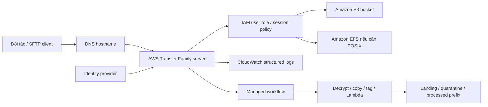

# AWS Transfer Family và tích hợp SFTP

Nhiều doanh nghiệp trao đổi tệp với ngân hàng, nhà cung cấp, đối tác logistics, hệ thống ERP và trung tâm dữ liệu tại chỗ. Những hệ thống này thường sử dụng SFTP để gửi báo cáo, đơn hàng, dữ liệu thanh toán hoặc tệp đối soát theo lịch. Nếu tự vận hành máy chủ SFTP trên EC2, đội ngũ phải quản lý hệ điều hành, bản vá, tài khoản, SSH key, dung lượng lưu trữ, tính sẵn sàng, nhật ký và quy trình trao đổi tệp. Những công việc đó dễ tạo ra khác biệt cấu hình giữa môi trường và làm tăng gánh nặng vận hành.

AWS Transfer Family là dịch vụ được quản lý để truyền tệp qua các giao thức tiêu chuẩn như SFTP, FTPS, FTP và AS2, lưu dữ liệu trực tiếp vào Amazon S3 hoặc Amazon EFS. Với SFTP, dịch vụ cung cấp endpoint tương thích với ứng dụng khách SSH/SFTP hiện có, quản lý danh tính người dùng, kiểm soát quyền truy cập vào thư mục, ghi log và tự động xử lý tệp sau khi tải lên. SFTP connectors còn cho phép AWS chủ động gửi hoặc lấy tệp từ máy chủ SFTP từ xa.

Trong hệ sinh thái AWS, Transfer Family giúp kết nối hệ thống on-premises và đối tác với storage, IAM, KMS, Secrets Manager, VPC, CloudWatch, EventBridge và các ứng dụng xử lý dữ liệu. Dịch vụ phù hợp khi cần tiếp nhận hoặc phân phối tệp an toàn mà không muốn tự vận hành máy chủ giao thức truyền tệp.

## Mục tiêu học tập

Sau bài học, bạn có thể:

- Giải thích vai trò của AWS Transfer Family và phân biệt SFTP với FTP/FTPS.
- Chọn endpoint public, VPC internet-facing hoặc VPC internal theo mô hình kết nối.
- Chọn service-managed, Directory Service hoặc custom identity provider.
- Thiết kế IAM role, session policy, home directory và logical directory mapping cho S3/EFS.
- Cấu hình SSH key, host key, bảo mật mạng, mã hóa dữ liệu và nhật ký.
- Tự động xử lý tệp bằng managed workflows và kết nối đến máy chủ SFTP từ xa bằng SFTP connectors.
- Vận hành, giám sát, xử lý sự cố và ước tính chi phí của giải pháp truyền tệp.

## AWS Transfer Family là gì?

AWS Transfer Family cung cấp endpoint truyền tệp được AWS quản lý. Người dùng hoặc đối tác kết nối bằng client tiêu chuẩn như OpenSSH `sftp`, WinSCP, FileZilla hoặc phần mềm MFT tương thích. Transfer Family xác thực người dùng, áp dụng quyền truy cập và chuyển thao tác đọc/ghi thành hoạt động trên S3 hoặc EFS.

Transfer Family hỗ trợ nhiều giao thức và khả năng:

| Giao thức/khả năng | Mục đích |
|---|---|
| SFTP | Truyền tệp qua SSH; phù hợp trao đổi tệp an toàn qua mạng công cộng hoặc riêng tư |
| FTPS | FTP được bảo vệ bằng TLS; thường dùng khi đối tác yêu cầu mô hình FTP/TLS |
| FTP | Giao thức FTP truyền thống; chỉ nên dùng trong mạng riêng hoặc khi có yêu cầu tương thích đặc biệt vì thông tin xác thực và dữ liệu không được mã hóa ở lớp giao thức |
| AS2 | Trao đổi thông điệp B2B có chữ ký/mã hóa và biên nhận theo chuẩn AS2 |
| SFTP connector | Kết nối outbound đến máy chủ SFTP khác để gửi, lấy, liệt kê hoặc quản lý tệp từ xa |
| Managed workflows | Tự động hóa các bước sau khi tệp được tải lên hoàn tất hoặc tải lên một phần |
| Transfer Family web apps | Cung cấp giao diện web được quản lý để người dùng trao đổi tệp với S3; đây là mô hình truy cập khác với endpoint SFTP |

**SFTP và FTPS không phải cùng một giao thức.** SFTP chạy trên SSH và thường dùng TCP port 22. FTPS dùng giao thức FTP kết hợp TLS, với yêu cầu cổng điều khiển và kênh dữ liệu khác. FTP thuần không mã hóa thông tin đăng nhập và nội dung truyền. Khi đối tác nói “FTP”, hãy xác nhận họ muốn SFTP, FTPS hay FTP trước khi thiết kế endpoint.

Transfer Family là dịch vụ managed; khách hàng không có shell access vào máy chủ SFTP bên dưới và không thể cài package hoặc chạy lệnh hệ điều hành trên endpoint. Nếu cần logic xử lý tệp, hãy dùng managed workflows, Lambda hoặc dịch vụ xử lý phía sau.

## Kiến trúc inbound SFTP

Mẫu triển khai phổ biến là đối tác kết nối đến Transfer Family server, dịch vụ xác thực user và ghi tệp vào một bucket S3. Tệp hoàn chỉnh có thể kích hoạt workflow để kiểm tra, giải mã, gắn tag hoặc chuyển sang vùng xử lý.



Các thành phần cần được thiết kế cùng nhau:

- **Server endpoint:** nơi client kết nối, gồm protocol, endpoint type, hostname và network access.
- **Identity provider:** xác minh username, password hoặc SSH public key và trả về cấu hình quyền.
- **User role:** cho phép Transfer Family truy cập đúng bucket, prefix hoặc file system.
- **Home directory:** xác định thư mục người dùng nhìn thấy khi đăng nhập.
- **Storage:** S3 phù hợp lưu trữ object và xử lý theo event; EFS phù hợp ứng dụng cần semantics filesystem/POSIX.
- **Workflow và logging:** xử lý tệp sau khi upload và cung cấp bằng chứng vận hành.

Một server có thể phục vụ nhiều user. Mỗi user có thể có home directory, role, session policy, SSH public keys và tag riêng. Hãy phân chia user theo đối tác hoặc mục đích nghiệp vụ để dễ kiểm soát quyền và điều tra.

## Endpoint type và lựa chọn mạng

Khi tạo Transfer Family server, endpoint type quyết định client kết nối qua Internet hay mạng riêng, có thể gắn địa chỉ IP tĩnh hay không và giao thức nào được hỗ trợ.

| Endpoint | Khả năng truy cập | Địa chỉ IP và kiểm soát nguồn | Giao thức chính |
|---|---|---|---|
| Public | Truy cập qua Internet, không cần cấu hình endpoint trong VPC | AWS cấp IP có thể thay đổi; không hỗ trợ source IP allow list bằng security group | SFTP |
| VPC hosted - Internet-facing | Truy cập qua Internet và từ mạng VPC/VPC-connected | Có thể gắn Elastic IP tĩnh; kiểm soát source IP bằng security group và network ACL | SFTP, FTPS |
| VPC hosted - Internal | Chỉ truy cập từ VPC hoặc mạng kết nối như VPN/Direct Connect | Private IP endpoint ổn định; kiểm soát bằng security group và network ACL | SFTP, FTP, FTPS, AS2 |
| VPC_ENDPOINT | Kiểu endpoint cũ | Không dùng cho server mới | Đã deprecated; dùng VPC hosted thay thế |

### Public endpoint

Public endpoint là lựa chọn đơn giản khi đối tác cần kết nối qua Internet và không cần địa chỉ IP tĩnh để allowlist. Endpoint sử dụng hostname do Transfer Family cung cấp, dạng:

```text
server-id.server.transfer.region.amazonaws.com
```

Địa chỉ IP của public endpoint có thể thay đổi. Vì vậy, phía đối tác nên allowlist hostname theo hướng dẫn của AWS thay vì cố định một IP cũ. Public endpoint không hỗ trợ security group để giới hạn source IP. Nếu cần chỉ cho phép một số IP nguồn, cân nhắc VPC hosted endpoint internet-facing.

### VPC hosted - Internet-facing

Endpoint internet-facing được đặt trong VPC và có thể gắn Elastic IP cho các AZ/subnet đã chọn. Đối tác có thể allowlist các EIP ổn định; security group giới hạn inbound traffic từ dải IP được phép. Đây thường là lựa chọn phù hợp khi đối tác yêu cầu IP tĩnh hoặc tổ chức muốn kiểm soát nguồn kết nối ở lớp mạng.

Với SFTP, port mặc định là TCP 22. VPC hosted endpoint có thể hỗ trợ các cổng SFTP khác như 2222, 2223 hoặc 22000 theo cấu hình. Đừng đổi cổng nếu đối tác không thể cấu hình lại client hoặc firewall. Internet-facing VPC endpoint hiện hỗ trợ SFTP và FTPS; kiểm tra ma trận giao thức hiện hành trước khi bật nhiều protocol.

### VPC hosted - Internal

Internal endpoint chỉ có private IP và không mở trực tiếp ra Internet. Client cần nằm trong VPC hoặc mạng có kết nối đến VPC, ví dụ site-to-site VPN, AWS Direct Connect, Transit Gateway hoặc kết nối mạng riêng phù hợp. Mô hình này phù hợp khi chỉ hệ thống nội bộ hoặc đối tác kết nối qua private network được phép truyền tệp.

Internal endpoint không hỗ trợ custom hostname theo cùng cách như endpoint public/internet-facing. Nếu cần hostname nội bộ thân thiện, có thể thiết kế DNS private phù hợp với cách client phân giải endpoint, đồng thời kiểm tra giới hạn cấu hình của dịch vụ.

### Phân bố AZ và security group

Với VPC hosted endpoint, chọn các subnet ở tối đa ba AZ được hỗ trợ. Nên phân bố endpoint qua nhiều AZ để giảm phụ thuộc vào một AZ. Kiểm tra CIDR và IP còn trống trong từng subnet trước khi tạo endpoint.

Security group inbound nên chỉ cho phép nguồn thực sự cần kết nối, thường là TCP 22 cho SFTP. Nếu dùng cổng khác, đồng bộ với cấu hình server và firewall của đối tác. Hạn chế mở `0.0.0.0/0` nếu đối tác có dải IP cố định. Kiểm tra network ACL, route table, firewall on-premises và DNS cùng lúc khi kết nối thất bại.

### Custom hostname và DNS

Với endpoint hỗ trợ custom hostname, có thể dùng Route 53 hoặc DNS provider bên ngoài để tạo alias trỏ đến endpoint. Custom hostname giúp đối tác dùng tên ổn định như `sftp.example.com` dù hạ tầng backend thay đổi. Cần quản lý TTL, kiểm tra phân giải DNS từ mạng đối tác và lên kế hoạch chuyển đổi hostname khi thay server.

## Identity provider và xác thực người dùng

Transfer Family hỗ trợ ba nhóm identity provider chính. Mỗi server sử dụng một loại identity provider đã chọn khi tạo server; hãy chọn theo hệ thống danh tính và phương thức xác thực mà đối tác hỗ trợ.

| Identity provider | Giao thức | Phương thức xác thực | Khi phù hợp |
|---|---|---|---|
| Service-managed | SFTP | SSH public key | Danh sách user nhỏ/vừa, muốn quản lý user và key trực tiếp trong Transfer Family |
| AWS Managed Microsoft AD | SFTP, FTPS, FTP | Thông tin đăng nhập Active Directory | Tổ chức đã quản lý user và group trong Microsoft AD |
| Custom identity provider qua Lambda hoặc API Gateway | SFTP, FTPS, FTP | Password, public key hoặc kết hợp theo cấu hình SFTP | Cần tích hợp IdP hiện có, Secrets Manager, LDAP hoặc logic xác thực riêng |

### Service-managed users

Với service-managed, username và SSH public key được lưu trong Transfer Family. User xác thực bằng private key tương ứng; dịch vụ không lưu password để xác thực theo mô hình service-managed. Mỗi user có thể có một hoặc nhiều SSH public key để hỗ trợ thay key theo giai đoạn.

Ưu điểm là triển khai đơn giản, ít thành phần phụ thuộc. Nhược điểm là tổ chức cần quản lý vòng đời user và public key thông qua Transfer Family API/console hoặc IaC. Với số lượng đối tác lớn, nên tự động hóa provisioning và thu hồi key.

### AWS Managed Microsoft AD

Directory Service cho phép xác thực user bằng thông tin đăng nhập Active Directory và quản lý quyền theo group. Cách này phù hợp khi người dùng nội bộ đã có tài khoản AD. Cần cấp quyền Directory Service cần thiết và kiểm tra kết nối, DNS, group membership cùng cấu hình server.

### Custom identity provider

Custom identity provider có thể dùng Lambda trực tiếp hoặc API Gateway tích hợp Lambda. Khi client kết nối, Transfer Family gửi thông tin yêu cầu xác thực đến provider. Provider kiểm tra thông tin đăng nhập, chính sách user, địa chỉ IP nguồn nếu cần, rồi trả về cấu hình như IAM role, home directory, session policy và POSIX profile cho EFS.

Với custom identity provider cho SFTP, có thể cấu hình:

- `PUBLIC_KEY`: chỉ xác thực bằng SSH key.
- `PASSWORD`: chỉ xác thực bằng password.
- `PUBLIC_KEY_OR_PASSWORD`: chấp nhận một trong hai phương thức.
- `PUBLIC_KEY_AND_PASSWORD`: yêu cầu cả SSH key và password.

Chế độ AND yêu cầu client thực hiện hai bước xác thực; custom provider phải trả về phản hồi đầy đủ cho từng bước. Đây là lựa chọn hữu ích khi cần thêm lớp xác thực, nhưng phải kiểm tra khả năng tương thích của client và quy trình quản lý password. Nếu dùng password, áp dụng chính sách độ mạnh, giới hạn lần đăng nhập sai, giám sát brute force và quy trình đổi/thu hồi mật khẩu.

### Vòng đời SSH key

SSH key xác thực client với server. Người dùng giữ private key; Transfer Family hoặc custom identity provider lưu/tra cứu public key. Không gửi private key cho AWS hoặc đối tác khác. Dùng passphrase bảo vệ private key trên client và giới hạn quyền truy cập file key.

Quy trình quản lý key nên bao gồm:

1. Tạo key pair theo thuật toán và độ dài được security policy của server hỗ trợ.
2. Trao public key qua kênh đã xác thực và liên kết với đúng username.
3. Xác nhận fingerprint và kiểm thử bằng client thật.
4. Khi xoay vòng, thêm public key mới trước, kiểm tra kết nối, sau đó thu hồi key cũ.
5. Khi đối tác rời hệ thống, xóa key và vô hiệu hóa user/credential.
6. Lưu lịch sử thay đổi key, người phê duyệt và thời điểm có hiệu lực.

Server cũng có SSH host key để client xác minh danh tính máy chủ. Khi chuyển endpoint hoặc thay host key, cần thông báo fingerprint mới cho đối tác qua kênh tin cậy để tránh cảnh báo host key mismatch hoặc nguy cơ man-in-the-middle. Không yêu cầu người dùng bỏ qua cảnh báo fingerprint một cách tùy tiện.

## Lưu trữ: Amazon S3 hay Amazon EFS?

Transfer Family hỗ trợ S3 và EFS làm storage domain. Lựa chọn phụ thuộc semantics truy cập, quyền, ứng dụng phía sau và cách tổ chức thư mục.

| Tiêu chí | Amazon S3 | Amazon EFS |
|---|---|---|
| Mô hình dữ liệu | Object trong bucket và prefix | Filesystem với thư mục, file và POSIX semantics |
| Quyền truy cập | IAM role, bucket policy và session policy | POSIX UID/GID, secondary groups và filesystem policy |
| Quy mô và tích hợp | Tốt cho data lake, event-driven processing, lifecycle và object sharing | Tốt cho ứng dụng cần filesystem, file locking/permissions theo POSIX |
| Home directory | PATH hoặc LOGICAL mapping đến bucket/prefix | PATH hoặc LOGICAL mapping đến filesystem path |
| Mã hóa | SSE-S3 hoặc SSE-KMS; mã hóa client-side/PGP nếu cần | Encryption at rest và in transit theo cấu hình EFS |
| Tích hợp | S3 events, EventBridge, Lambda, Glue, Athena | EC2, ECS/EKS, Linux applications cần shared filesystem |

### S3 path và logical directory

Với S3, đường dẫn thư mục là cách biểu diễn bucket và prefix. Transfer Family cung cấp hai kiểu home directory:

- **PATH:** user nhìn thấy đường dẫn S3 đầy đủ theo cấu hình, ví dụ bucket và prefix.
- **LOGICAL:** user nhìn thấy cấu trúc thư mục ảo được định nghĩa bằng các cặp `Entry` và `Target`. Ví dụ, `/inbound` có thể ánh xạ đến `/partner-a/dropbox` trong bucket. Người dùng không cần biết tên bucket hoặc prefix thật.

Logical mapping thường phù hợp khi cần cô lập user và cung cấp cấu trúc thư mục dễ hiểu. Mapping `Entry: "/"` đến target riêng của user tạo một root ảo, giúp giới hạn giao diện file transfer vào thư mục được chỉ định. IAM role vẫn phải có quyền trên target thực tế.

Ví dụ mapping:

```json
[
  {
    "Entry": "/",
    "Target": "/company-transfer/partners/partner-a"
  },
  {
    "Entry": "/processed",
    "Target": "/company-transfer/partners/partner-a/processed"
  }
]
```

Trong ví dụ, bucket là `company-transfer`; user nhìn thấy root và thư mục `processed`, còn S3 object thực nằm dưới prefix tương ứng. Hãy kiểm tra không tạo mapping trùng lặp hoặc target nằm ngoài phạm vi IAM role cho phép.

### IAM user role và session policy cho S3

Mỗi Transfer Family user được gán IAM role. Transfer Family assume role đó khi user thực hiện thao tác trên S3. Role cần quyền tối thiểu như `s3:ListBucket`, `s3:GetObject`, `s3:PutObject` và chỉ cấp `s3:DeleteObject` nếu user thật sự cần xóa. Nếu dùng multipart upload, cần quyền bổ sung tương ứng. Nếu bucket dùng SSE-KMS, role cần quyền KMS phù hợp và key policy phải cho phép.

Session policy có thể thu hẹp quyền của một user trong phạm vi IAM role chung. Policy này chỉ áp dụng cho S3, không dùng cho EFS. Biến như `${transfer:HomeBucket}`, `${transfer:HomeDirectory}` và `${transfer:UserName}` có thể giúp tạo policy động theo user. Session policy có giới hạn kích thước, nên giữ policy ngắn và rõ ràng.

Ví dụ trust policy rút gọn cho user role:

```json
{
  "Version": "2012-10-17",
  "Statement": [
    {
      "Effect": "Allow",
      "Principal": { "Service": "transfer.amazonaws.com" },
      "Action": "sts:AssumeRole",
      "Condition": {
        "StringEquals": {
          "aws:SourceAccount": "123456789012"
        },
        "ArnLike": {
          "aws:SourceArn": "arn:aws:transfer:ap-southeast-1:123456789012:user/*"
        }
      }
    }
  ]
}
```

Thay account, Region và phạm vi ARN bằng giá trị thực. Nếu role chỉ dành cho một server, thu hẹp `SourceArn` đến server ID cụ thể. Điều kiện `aws:SourceAccount` và `aws:SourceArn` giúp giảm rủi ro confused deputy.

### EFS và POSIX profile

Với EFS, Transfer Family dùng POSIX profile gồm UID, GID và secondary GIDs để áp dụng quyền filesystem. User role và filesystem policy cần cho phép thao tác cần thiết. Quyền POSIX trên thư mục và file vẫn được áp dụng, vì vậy user có thể đăng nhập thành công nhưng không đọc/ghi được nếu UID/GID không có quyền.

Hãy thiết kế UID/GID ổn định theo user hoặc nhóm nghiệp vụ, tránh cấp cùng UID cho các đối tác không liên quan nếu cần cô lập. Kiểm tra mount target EFS ở các AZ, security group, filesystem policy và encryption trước khi mở endpoint cho đối tác.

## Bảo mật dữ liệu và mạng

SFTP mã hóa kênh truyền bằng SSH. Tuy nhiên, mã hóa kênh truyền không thay thế mã hóa dữ liệu lưu trữ hoặc bảo vệ dữ liệu khi được xử lý phía sau.

### Bảo vệ khi truyền và khi lưu

- Dùng SFTP/SSH với security policy cho phép thuật toán hiện đại và tương thích với client đối tác.
- Với S3, bật server-side encryption bằng SSE-S3 hoặc SSE-KMS theo yêu cầu; với dữ liệu nhạy cảm, kiểm soát key policy, rotation và quyền decrypt.
- Với EFS, bật encryption at rest và in-transit theo cấu hình filesystem/mount.
- Nếu đối tác yêu cầu end-to-end encryption trước khi file đến AWS, dùng PGP để mã hóa file ở phía đối tác và giải mã bằng managed workflow sau upload.
- Không ghi password, private key, nội dung file hoặc dữ liệu cá nhân nhạy cảm vào log ứng dụng.

### PGP và managed decryption

PGP bảo vệ nội dung file độc lập với kênh SFTP. Đối tác mã hóa file bằng public key của bên nhận; Transfer Family workflow dùng private key tương ứng để giải mã sau khi upload. Private key PGP được quản lý qua AWS Secrets Manager theo cấu trúc secret mà Transfer Family yêu cầu. Giới hạn quyền đọc secret và quản lý vòng đời key như một tài sản bảo mật.

PGP decryption chỉ hỗ trợ các thuật toán và định dạng được Transfer Family công bố. Khi tạo file, đối tác cần chỉ định recipient phù hợp; file mã hóa ẩn danh có thể khiến workflow không xác định được key. Hãy kiểm thử bằng file mẫu, xác nhận thuật toán hai bên hỗ trợ và lưu riêng bản gốc đã mã hóa nếu chính sách yêu cầu bảo toàn bằng chứng.

### Security policy và host key

Transfer Family server sử dụng security policy để kiểm soát các thuật toán SSH được phép. Chọn policy phù hợp với yêu cầu bảo mật và client của đối tác. Tránh duy trì thuật toán yếu chỉ để hỗ trợ client cũ nếu có thể nâng cấp client. Nếu phải hỗ trợ ngoại lệ, ghi nhận thời hạn và kế hoạch loại bỏ.

Quản lý server host key và fingerprint theo quy trình thay đổi. Đối tác cần xác minh host key để chắc chắn đang kết nối đúng endpoint. Khi thay server hoặc host key, thực hiện chuyển đổi có kế hoạch và thông báo fingerprint qua kênh độc lập.

### Network hardening

- Ưu tiên internal VPC endpoint nếu đối tác kết nối qua VPN hoặc Direct Connect.
- Nếu cần Internet, dùng VPC internet-facing endpoint và allowlist IP nguồn trong security group.
- Chỉ mở cổng và protocol thực sự cần thiết.
- Tách subnet và security group cho endpoint, workload xử lý và các dịch vụ backend.
- Dùng bucket policy hoặc filesystem policy để giới hạn đường truy cập dữ liệu; cân nhắc VPC endpoint policy nếu mô hình S3 yêu cầu.
- Bảo vệ custom identity provider bằng IAM least privilege, API authorization, throttling và logging.
- Dùng AWS WAF khi custom identity provider qua API Gateway cần bảo vệ lớp HTTP; WAF không áp dụng trực tiếp cho giao thức SFTP trên endpoint.

## Managed workflows: tự động xử lý tệp sau upload

Managed workflows cho phép Transfer Family thực hiện chuỗi bước khi file được upload hoàn tất hoặc khi phiên truyền kết thúc với file upload một phần. Điều này giúp chuẩn hóa quy trình B2B mà không cần tự vận hành server xử lý file riêng cho mọi đối tác.

Các bước dựng sẵn gồm:

| Bước | Mục đích |
|---|---|
| COPY | Sao chép file đến bucket/prefix khác |
| TAG | Gắn tag cho object |
| DELETE | Xóa file nguồn sau khi xử lý theo chính sách |
| DECRYPT | Giải mã PGP bằng private key được quản lý |
| CUSTOM | Gọi Lambda để thực hiện xử lý nghiệp vụ tùy chỉnh |

Một workflow inbound điển hình:

1. Đối tác upload file vào prefix `landing/partner-a`.
2. Transfer Family phát hiện upload hoàn tất và bắt đầu workflow.
3. Workflow kiểm tra/giải mã PGP nếu file được mã hóa.
4. Gắn tag `partner=partner-a`, `status=received`.
5. Gọi Lambda kiểm tra tên file, schema hoặc checksum.
6. Nếu hợp lệ, copy file sang prefix `ready/`; nếu không hợp lệ, chuyển vào `quarantine/` và thông báo nhóm xử lý.
7. Lưu log workflow và kết quả để phục vụ audit.

Workflow cần execution role riêng cho phép Transfer Family gọi các dịch vụ và Lambda cần thiết. Chỉ cấp quyền với bucket, prefix, secret và function cụ thể. Custom Lambda step cần hỗ trợ mô hình bất đồng bộ của workflow và phải xử lý timeout, retry và idempotency.

### Upload hoàn tất và upload một phần

Server có thể cấu hình workflow riêng cho `OnUpload` và `OnPartialUpload`. Không nên xử lý file chưa hoàn tất như file hợp lệ. Workflow partial upload có thể dùng để cách ly, dọn dẹp hoặc phát cảnh báo; chỉ quy trình nghiệp vụ mới quyết định có thể tiếp tục/resume file hay cần yêu cầu đối tác gửi lại.

### Giới hạn workflow cần tính đến

Theo giới hạn dịch vụ được AWS công bố, một số ràng buộc quan trọng gồm:

- Tối đa 10 workflows cho mỗi account, mỗi Region.
- Tối đa 8 bước trong một workflow.
- Custom step có timeout tối đa 30 phút.
- File được giải mã có giới hạn kích thước tối đa 10 GB.
- Mỗi workflow có giới hạn số lượng tag và số lần thực thi đồng thời cho bước decrypt.
- File 0 byte không kích hoạt workflow.
- Các bucket S3 được workflow truy cập phải ở cùng Region với workflow.
- Lambda custom step cross-account hoặc cross-Region không được hỗ trợ; copy cross-account có thể thực hiện nếu IAM/bucket policy phù hợp.
- Gắn workflow vào server AS2 không có nghĩa AS2 message sẽ chạy workflow post-upload của Transfer Family.

Các quota có thể thay đổi theo Region và thời điểm. Kiểm tra trang quotas và workflow documentation trước khi thiết kế cho khối lượng lớn.

## SFTP connectors: gửi và lấy tệp từ máy chủ từ xa

Transfer Family server xử lý kết nối inbound từ client đến AWS. SFTP connector xử lý chiều ngược lại: AWS kết nối đến một máy chủ SFTP từ xa để gửi hoặc lấy tệp. Mỗi connector đại diện cho một remote SFTP server.

Các thao tác connector hỗ trợ gồm:

- Gửi object từ S3 đến thư mục trên remote SFTP server.
- Lấy file từ remote SFTP server về S3.
- Liệt kê file và thư mục ở remote server.
- Xóa, đổi tên hoặc di chuyển file/thư mục trên remote server.

### Xác thực connector

Credential để kết nối remote server được lưu trong AWS Secrets Manager. Khi tạo connector, chỉ định secret ARN, URL remote server hoặc resource configuration ARN, security policy và IAM access role. Access role cho phép connector đọc secret và truy cập đúng object S3 cần gửi/nhận. Không nhúng password hoặc private key vào script, template công khai hay command history.

Trước khi vận hành, kiểm thử connector để xác nhận kết nối, host key, credential, đường dẫn và quyền trên remote server. Phía đối tác có thể yêu cầu allowlist IP nguồn; chọn egress type phù hợp để cung cấp địa chỉ ổn định.

### Egress type: service-managed và VPC Lattice

| Egress type | Đường đi | Khi phù hợp |
|---|---|---|
| Service-managed | AWS Transfer Family dùng hạ tầng egress do AWS quản lý để kết nối ra Internet; cung cấp các static IP để remote server allowlist | Remote SFTP server công khai trên Internet, không cần kết nối private hoặc NAT riêng |
| VPC Lattice | Connector đi qua VPC bằng Amazon VPC Lattice Cross-VPC Resource Access; có thể dùng NAT Gateway/EIP và network controls của tổ chức | Remote SFTP private trong VPC, on-premises qua Direct Connect/VPN hoặc cần egress tập trung |

Với VPC Lattice egress, cần chuẩn bị VPC, subnet, route, security group, Resource Gateway triển khai tối thiểu hai AZ và Resource Configuration trỏ đến remote SFTP server. Cấu hình này giúp connector truy cập tài nguyên private mà không mở endpoint ra Internet.

Service-managed egress có giới hạn băng thông và IP theo cấu hình dịch vụ; hãy kiểm tra quotas và pricing. Nếu remote server chỉ chấp nhận IP nguồn do doanh nghiệp quản lý, dùng VPC Lattice với NAT Gateway và Elastic IP của tổ chức.

### Gửi file bằng CLI

Sau khi tạo connector và cấp quyền, có thể dùng `StartFileTransfer` để gửi hoặc lấy file. Ví dụ gửi object trong S3 đến remote server:

```bash
aws transfer start-file-transfer \
  --connector-id c-0123456789abcdef0 \
  --send-file-paths /company-transfer/outbound/report-2026-11.csv
```

Đường dẫn trong `--send-file-paths` là đường dẫn object trong bucket được cấu hình cho connector. Với thao tác retrieve, chỉ định remote file path và local S3 directory theo cú pháp CLI/API hiện hành. Connector cũng cung cấp API riêng cho liệt kê và xóa file từ xa. Kiểm tra response transfer ID và log tương ứng để theo dõi kết quả; lệnh khởi tạo thành công không đồng nghĩa remote server đã nhận và xử lý file cuối cùng.

### Idempotency và xác nhận giao nhận

Truyền tệp qua mạng có thể bị gián đoạn sau khi remote server đã nhận file nhưng trước khi client nhận được phản hồi cuối cùng. Khi retry, file có thể được gửi lại. Thiết kế quy ước tên file, checksum, manifest hoặc acknowledgement để đối tác phát hiện file trùng. Không xóa file nguồn ngay khi bắt đầu transfer; chỉ xóa sau khi có xác nhận nghiệp vụ và chính sách lưu trữ cho phép.

## Ví dụ triển khai SFTP server bằng AWS CLI

Các lệnh dưới đây minh họa tạo server SFTP public sử dụng service-managed identity provider và S3. Thay các giá trị mẫu bằng account, Region, bucket và IAM role của môi trường thực tế.

### Tạo server

```bash
aws transfer create-server \
  --protocols SFTP \
  --identity-provider-type SERVICE_MANAGED \
  --endpoint-type PUBLIC \
  --domain S3
```

Lệnh trả về `ServerId`. Với yêu cầu IP allowlist hoặc private access, tạo server với endpoint type VPC và cấu hình access/subnets/security groups theo endpoint mode đã chọn.

### Tạo user với logical home directory

Tạo file `home-mapping.json`:

```json
[
  {
    "Entry": "/",
    "Target": "/company-transfer/partners/partner-a"
  }
]
```

Sau khi tạo IAM role với trust policy và quyền S3 phù hợp, tạo user:

```bash
aws transfer create-user \
  --server-id s-0123456789abcdef0 \
  --user-name partner-a \
  --role arn:aws:iam::123456789012:role/TransferPartnerAAccess \
  --home-directory-type LOGICAL \
  --home-directory-mappings file://home-mapping.json \
  --ssh-public-key-body "ssh-ed25519 AAAAC3NzaC1lZDI1NTE5AAAAIExamplePublicKey partner-a"
```

Trong môi trường thực, `ssh-public-key-body` phải là public key hợp lệ do đối tác cung cấp qua kênh an toàn. Không dùng chuỗi ví dụ trong lệnh như một key thật.

### Kiểm tra trạng thái server

```bash
aws transfer describe-server \
  --server-id s-0123456789abcdef0

aws transfer list-users \
  --server-id s-0123456789abcdef0
```

Khi server ở trạng thái `ONLINE`, thử kết nối từ client được phép:

```bash
sftp -i ./partner-a-private-key partner-a@server-id.server.transfer.ap-southeast-1.amazonaws.com
```

Private key phải được giữ trên máy client và được bảo vệ bằng quyền file phù hợp. Đối tác cần dùng đúng hostname, username, port và fingerprint host key.

## Giám sát, nhật ký và kiểm toán

AWS Transfer Family hỗ trợ CloudWatch logging. Với server và managed workflows mới, nên dùng JSON structured logging để có trường dữ liệu nhất quán và truy vấn bằng CloudWatch Logs Insights. Connectors dùng logging role theo cơ chế hỗ trợ của connector.

Các sự kiện log có thể cho biết:

- Kết nối thành công/thất bại, username và session.
- Hoạt động file như OPEN, CLOSE, DELETE, RENAME, MKDIR và các thao tác liên quan.
- Số byte upload/download, thời gian và lỗi truyền.
- Cipher/thuật toán SSH đã thương lượng trong session.
- Workflow execution, step started/completed/failed và lỗi Lambda.
- Connector operation, transfer ID, file path và kết quả gửi/nhận.

Không nên chỉ dựa vào log đăng nhập. Cần đối chiếu log file operation với S3 data events hoặc EFS audit mechanism nếu yêu cầu kiểm toán cần bằng chứng sâu hơn. CloudTrail ghi nhận các thay đổi control plane như tạo server, sửa cấu hình, tạo user và connector; CloudWatch ghi nhận hoạt động truyền file/session theo cấu hình logging.

### Chỉ số và cảnh báo

Thiết kế dashboard theo server, đối tác và môi trường. Theo dõi số kết nối, số phiên, số lần xác thực thất bại, bytes in/out, workflow failure, connector transfer failure, thời gian truyền và backlog xử lý phía sau. Tạo cảnh báo khi:

- Tỷ lệ authentication failure tăng đột biến.
- Một đối tác không gửi file theo lịch đã cam kết.
- Workflow hoặc Lambda xử lý file thất bại.
- Connector không kết nối được remote server hoặc transfer bị lỗi.
- Dung lượng S3/EFS hoặc chi phí lưu trữ tăng bất thường.
- Số lượng file trong landing/quarantine vượt ngưỡng.

Sử dụng CloudWatch Logs Insights để tìm theo username, server ID, session ID, connector ID, transfer ID và activity type. Log retention cần phù hợp yêu cầu audit; hạn chế người có quyền đọc log vì metadata có thể chứa username, tên file và thông tin đối tác.

## Xử lý sự cố thường gặp

| Triệu chứng | Nguyên nhân thường gặp | Cách kiểm tra |
|---|---|---|
| Connection timeout | Security group, NACL, route, firewall, sai hostname/port hoặc endpoint internal không có đường kết nối | Kiểm tra DNS, TCP reachability, source IP, subnet, VPN/DX và port |
| Connection refused | Server không online, client dùng sai port hoặc protocol | Kiểm tra server state, protocol, port và endpoint type |
| Authentication failed | Username sai, public key không khớp, password hết hạn, IdP lỗi hoặc phương thức auth không đúng | Xem Transfer Family logs, custom IdP logs và fingerprint/key mapping |
| Đăng nhập thành công nhưng không thấy file | Home directory mapping sai hoặc user role không có quyền ListBucket | Kiểm tra PATH/LOGICAL mapping, target path và IAM session policy |
| Upload bị AccessDenied | Thiếu PutObject, bucket policy chặn, KMS key policy thiếu quyền hoặc session policy thu hẹp quá mức | Kiểm tra role policy, bucket policy, KMS permissions và object prefix |
| Download thất bại | Thiếu GetObject, object không tồn tại hoặc KMS decrypt bị từ chối | Kiểm tra object key, IAM và CloudTrail/KMS events |
| EFS báo Permission denied | UID/GID hoặc POSIX permission không phù hợp, filesystem policy/security group | Kiểm tra PosixProfile, ownership, mount target và NFS access |
| Workflow không chạy | Upload chưa hoàn tất, file 0 byte, workflow chưa gắn, execution role thiếu quyền hoặc quota/throttle | Kiểm tra OnUpload/OnPartialUpload, workflow log, execution role và giới hạn |
| PGP decrypt thất bại | Sai private key, recipient ẩn danh, thuật toán không hỗ trợ hoặc file không đúng định dạng | Kiểm tra PGP key secret, recipient và client/algorithm |
| Connector không gửi/nhận file | Secret sai, remote host key thay đổi, remote path/permission sai hoặc egress route lỗi | Test connector, xem connector log, Secrets Manager và VPC Lattice/NAT path |

Khi điều tra, ghi nhận thời điểm UTC, server/connector ID, username, remote IP, session/transfer ID, object path và mã lỗi. Không gửi private key, password hoặc nội dung nhạy cảm vào ticket/log.

## Tình huống thực tế: nhận báo cáo đối soát từ ngân hàng

Một doanh nghiệp thương mại điện tử nhận file đối soát giao dịch từ ngân hàng mỗi ngày. Ngân hàng chỉ hỗ trợ SFTP và yêu cầu allowlist IP nguồn. File được mã hóa PGP trước khi gửi và cần được giải mã, kiểm tra cấu trúc rồi chuyển vào hệ thống dữ liệu.

Thiết kế đề xuất:

1. Tạo Transfer Family server với VPC hosted endpoint internet-facing, gắn Elastic IP ổn định và security group chỉ cho phép IP của ngân hàng truy cập TCP 22.
2. Tạo custom hostname như `bank-sftp.example.com` nếu endpoint mode hỗ trợ và cấu hình DNS.
3. Dùng service-managed user nếu chỉ cần SSH key, hoặc custom identity provider nếu cần tích hợp user store và xác thực password/key theo chính sách.
4. Tạo IAM role riêng cho user ngân hàng, giới hạn `PutObject` vào `landing/bank-a/` và chỉ cấp quyền đọc nếu hợp đồng yêu cầu.
5. Dùng logical home directory để đối tác chỉ nhìn thấy thư mục upload, không nhìn thấy bucket hoặc prefix khác.
6. Bật SSE-KMS cho bucket; quản lý PGP private key trong Secrets Manager và giới hạn quyền đọc cho workflow execution role.
7. Gắn workflow OnUpload: decrypt, tag, gọi Lambda kiểm tra tên file/checksum/schema, sau đó copy sang `ready/` hoặc đưa vào `quarantine/`.
8. Bật JSON structured logs, CloudTrail và cảnh báo khi không nhận file đúng lịch hoặc workflow thất bại.
9. Kiểm thử với file mẫu, file sai chữ ký/định dạng, file trùng tên, file 0 byte và upload bị ngắt giữa chừng.
10. Định kỳ xoay SSH key/PGP key, rà soát IP allowlist, quyền IAM, retention và chi phí.

Nếu doanh nghiệp cần chủ động lấy báo cáo từ máy chủ SFTP của ngân hàng thay vì chờ ngân hàng upload, có thể dùng SFTP connector với service-managed egress hoặc VPC Lattice tùy yêu cầu allowlist và kết nối private. Khi đó, lưu credential remote trong Secrets Manager và thiết kế xác nhận giao nhận để tránh xử lý trùng.

## Chi phí và tối ưu

Chi phí Transfer Family phụ thuộc protocol/endpoint được bật, thời gian endpoint hoạt động, lượng dữ liệu upload/download qua SFTP/FTPS/FTP, connector calls và lượng dữ liệu xử lý bằng workflows. Với web apps, chi phí tính theo số web app units. Ngoài phí Transfer Family, còn có chi phí S3/EFS storage và request, data transfer, KMS, Secrets Manager, Lambda, API Gateway, CloudWatch Logs, EventBridge, Route 53 và VPC Lattice/NAT Gateway nếu sử dụng.

Các cách kiểm soát chi phí:

- Chỉ bật protocol thực sự cần thiết; mỗi protocol được bật có thể tạo thành phần chi phí riêng.
- Rà soát số server endpoint và thời gian endpoint tồn tại, đặc biệt môi trường thử nghiệm.
- Dùng S3 lifecycle để chuyển hoặc xóa file theo retention policy; không giữ file landing mãi mãi.
- Tối ưu số lần connector gọi API và kích thước file; tránh polling/listing quá thường xuyên.
- Chỉ chạy workflow khi file hoàn tất và cần xử lý; tối ưu số bước và Lambda duration.
- Thiết lập log retention phù hợp; lưu log audit cần thiết nhưng tránh giữ log debug vô thời hạn.
- Đánh giá S3/EFS theo kiểu truy cập, kích thước file và yêu cầu filesystem.
- Dùng AWS Pricing Calculator và trang pricing hiện hành theo Region để ước tính endpoint hours, data volume, connector usage và dịch vụ phụ trợ.

Không nên giảm logging, mã hóa hoặc kiểm soát quyền chỉ để tiết kiệm chi phí khi dữ liệu có yêu cầu bảo mật/tuân thủ. Hãy tối ưu retention, workflow và tài nguyên phụ trợ trước.

## Thực hành tốt

- Xác nhận chính xác đối tác yêu cầu SFTP, FTPS, FTP hay AS2 trước khi tạo server.
- Ưu tiên VPC internal cho mạng riêng; dùng VPC internet-facing với EIP và source allowlist khi đối tác cần kết nối Internet có IP tĩnh.
- Dùng SSH public key cho service-managed user; dùng custom identity provider khi cần password hoặc xác thực nhiều yếu tố.
- Mỗi đối tác hoặc nhóm user có role, home directory và prefix riêng.
- Dùng logical directory mapping và session policy để thu hẹp phạm vi nhìn thấy/được phép truy cập.
- Giới hạn IAM role, bucket policy, KMS key policy và POSIX profile theo least privilege.
- Xoay SSH key, host key và PGP key theo lịch; thu hồi ngay khi credential bị lộ hoặc đối tác kết thúc hợp đồng.
- Dùng managed workflow để chuẩn hóa decrypt, validate, tag, copy và quarantine; xử lý partial upload riêng.
- Dùng SFTP connector cho trao đổi outbound; lưu credential trong Secrets Manager và chọn egress type phù hợp.
- Bật JSON structured logging, CloudTrail và cảnh báo theo đối tác, transfer ID và lịch gửi file.
- Kiểm thử file trùng, file rỗng, file lớn, upload gián đoạn, key hết hạn và workflow failure.
- Dùng lifecycle/retention cho file landing, processed, quarantine và log.
- Theo dõi quota, throughput, workflow concurrency và connector egress trước khi mở rộng.

## Checklist triển khai production

- [ ] Xác nhận protocol, đối tác, hướng truyền và tần suất trao đổi file.
- [ ] Chọn S3 hoặc EFS theo semantics dữ liệu và ứng dụng phía sau.
- [ ] Chọn endpoint public, VPC internet-facing hoặc VPC internal.
- [ ] Thiết kế subnet đa AZ, security group, NACL, route, DNS và IP allowlist.
- [ ] Chọn identity provider và phương thức auth; kiểm tra tương thích client.
- [ ] Thiết kế user role, trust policy, session policy, bucket policy/KMS hoặc POSIX profile.
- [ ] Thiết lập home directory và logical mappings cho từng đối tác.
- [ ] Xác minh SSH host key, client public key, security policy và quy trình rotation.
- [ ] Cấu hình mã hóa at rest và PGP nếu cần bảo vệ end-to-end.
- [ ] Cấu hình managed workflow, execution role, xử lý partial upload và quarantine.
- [ ] Nếu dùng connector, tạo Secrets Manager secret, access role, egress type và kiểm thử remote server.
- [ ] Bật structured logging, CloudTrail, dashboard, alarms và retention.
- [ ] Kiểm thử upload/download, quyền truy cập, lỗi mạng, credential sai, file trùng và workflow failure.
- [ ] Ước tính chi phí endpoint, data transfer, storage, workflow, connector và dịch vụ phụ trợ.
- [ ] Viết runbook vận hành, ứng phó credential compromise, khôi phục file và liên hệ đối tác.

## Kết luận

AWS Transfer Family giúp xây dựng cổng truyền tệp SFTP được quản lý, tích hợp trực tiếp với S3 hoặc EFS. Endpoint type quyết định cách client truy cập; identity provider quyết định cách xác thực; IAM role, session policy, logical home directory và POSIX profile quyết định phạm vi dữ liệu. Managed workflows tự động hóa xử lý sau upload, còn SFTP connectors giúp gửi và lấy tệp từ máy chủ từ xa. Khi kết hợp mạng VPC phù hợp, SSH/PGP/KMS, Secrets Manager, CloudWatch và quy trình vận hành rõ ràng, tổ chức có thể tích hợp đối tác và hệ thống on-premises an toàn mà không phải tự quản lý máy chủ SFTP.

## Tài liệu tham khảo

- [AWS Transfer Family User Guide](https://docs.aws.amazon.com/transfer/latest/userguide/what-is-aws-transfer-family.html)
- [Configuring an SFTP, FTPS, or FTP server endpoint](https://docs.aws.amazon.com/transfer/latest/userguide/sftp-for-transfer-family.html)
- [Create an SFTP-enabled server](https://docs.aws.amazon.com/transfer/latest/userguide/create-server-sftp.html)
- [Create a server in a VPC](https://docs.aws.amazon.com/transfer/latest/userguide/create-server-in-vpc.html)
- [Identity provider options](https://docs.aws.amazon.com/transfer/latest/userguide/custom-idp-intro.html)
- [Managing users for server endpoints](https://docs.aws.amazon.com/transfer/latest/userguide/create-user.html)
- [Create an IAM role and policy](https://docs.aws.amazon.com/transfer/latest/userguide/requirements-roles.html)
- [Creating a session policy for an Amazon S3 bucket](https://docs.aws.amazon.com/transfer/latest/userguide/users-policies-session.html)
- [AWS Transfer Family managed workflows](https://docs.aws.amazon.com/transfer/latest/userguide/transfer-workflows.html)
- [Using SFTP connectors](https://docs.aws.amazon.com/transfer/latest/userguide/transfer-sftp-connectors.html)
- [VPC connectivity for SFTP connectors](https://docs.aws.amazon.com/transfer/latest/userguide/sftp-connectors-vpc-overview.html)
- [Amazon CloudWatch logging for AWS Transfer Family servers](https://docs.aws.amazon.com/transfer/latest/userguide/structured-logging.html)
- [AWS Transfer Family pricing](https://aws.amazon.com/aws-transfer-family/pricing/)
