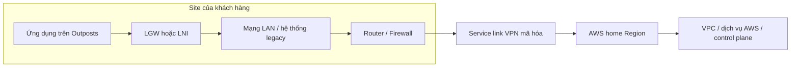

# AWS Outposts, cutover, rollback và vận hành sau di chuyển

AWS Outposts đưa hạ tầng và một số dịch vụ AWS đến trung tâm dữ liệu, nhà máy hoặc địa điểm vận hành của tổ chức. Mục tiêu thường là chạy workload gần hệ thống on-premises, đáp ứng độ trễ thấp, xử lý dữ liệu tại chỗ hoặc duy trì kết nối với thiết bị và ứng dụng hiện hữu. Outposts là phần mở rộng của một Availability Zone thuộc AWS Region đã chọn; nó vẫn cần kết nối service link về Region để nhận quản lý, điều khiển và trao đổi traffic với các dịch vụ AWS trong Region.

Đưa workload lên Outposts không kết thúc ở việc khởi chạy EC2 hoặc tạo subnet. Đội dự án phải chuẩn bị mạng, nguồn điện, dung lượng, dữ liệu, danh tính, quan sát và phương án phục hồi trước khi chuyển traffic. Cutover cần có điều kiện vào/ra rõ ràng, người ra quyết định, kiểm tra nghiệp vụ và cách quay lại an toàn. Sau cutover, đội vận hành tiếp tục theo dõi service link, local gateway, capacity, phần cứng, backup và các thay đổi ứng dụng.

Bài học tập trung vào vòng đời sau khi chọn Outposts làm đích triển khai hoặc một phần của kiến trúc hybrid: chuẩn bị site và workload, đồng bộ dữ liệu, chuyển traffic, rollback khi cần và vận hành ổn định sau di chuyển.

## Mục tiêu học tập

Sau bài học, bạn có thể:

- Phân biệt Outposts rack và Outposts server, service link, local gateway và local network interface.
- Đánh giá workload có phù hợp với Outposts hay không và xác minh dịch vụ được hỗ trợ theo form factor.
- Thiết kế mạng, capacity, bảo mật, backup và observability cho môi trường hybrid.
- Lập migration wave, cutover plan và rollback plan có thể diễn tập.
- Chọn chiến lược chuyển traffic bằng DNS, load balancer hoặc định tuyến mạng.
- Kiểm soát write freeze, replication lag, split-brain và tính nhất quán dữ liệu trong cutover/rollback.
- Vận hành Outposts sau di chuyển, bao gồm service link, power, hardware maintenance, capacity và incident response.
- Đo RTO/RPO thực tế và xác nhận workload đạt tiêu chí vận hành.

## 1. Outposts trong kiến trúc hybrid

AWS Outposts là một pool tài nguyên AWS được triển khai tại site của khách hàng và gắn với một AWS Region. VPC trong Region có thể mở rộng đến Outpost bằng cách tạo subnet trên Outpost. Người dùng tiếp tục quản lý tài nguyên qua AWS Management Console, CLI và API quen thuộc.

Outposts phù hợp khi workload cần một hoặc nhiều đặc tính sau:

- Độ trễ thấp tới thiết bị, hệ thống điều khiển, máy chủ hoặc cơ sở dữ liệu ở cùng địa điểm.
- Xử lý dữ liệu tại chỗ vì yêu cầu residency, chủ quyền dữ liệu hoặc chính sách nội bộ.
- Tích hợp với mạng on-premises, thiết bị công nghiệp, hệ thống legacy hoặc giao thức nội bộ.
- Dùng cùng công cụ AWS và mô hình vận hành AWS trong môi trường hybrid.
- Duy trì xử lý tại chỗ khi kết nối tới Region bị gián đoạn, trong phạm vi chức năng mà dịch vụ hỗ trợ.

Outposts không phải một AWS Region độc lập. Một số thao tác quản lý, API và dịch vụ phụ thuộc vào Region thông qua service link. Vì vậy, cần thiết kế cả đường chạy workload tại chỗ và đường quản trị/đồng bộ về Region.

### Outpost là phần mở rộng của Availability Zone

Khi tạo Outpost, tổ chức chọn một Availability Zone trong Region làm home AZ. Outpost được liên kết với AZ đó và đặt tại địa điểm vật lý của khách hàng. Để tăng khả năng chịu lỗi ở cấp site hoặc AZ, có thể triển khai nhiều Outposts tại các địa điểm độc lập và liên kết với các AZ khác nhau, sau đó thiết kế replication/failover giữa chúng.

Một rack hoặc server đơn lẻ không tự tạo ra tính sẵn sàng cao cho toàn ứng dụng. Cần xét các miền lỗi: host, rack, network device, nguồn điện, site, service link, home Region và hệ thống phụ thuộc bên ngoài.

## 2. Outposts rack và Outposts server

Outposts có các form factor khác nhau. Chọn đúng form factor ảnh hưởng trực tiếp đến network design, dịch vụ có thể triển khai và runbook vận hành.

| Tiêu chí | Outposts rack | Outposts server |
|---|---|---|
| Hình thức | Rack tiêu chuẩn, có compute, storage và network equipment | Server đặt trong rack hiện hữu của khách hàng |
| Kết nối về Region | Service link | Service link |
| Kết nối LAN tại chỗ | Local gateway (LGW) | Local network interface (LNI) trên server |
| Compute | EC2 và các dịch vụ được hỗ trợ theo rack/configuration | EC2 và các dịch vụ được hỗ trợ theo server |
| Storage | Có thể có EBS và S3 on Outposts tùy cấu hình | Instance store; không có EBS trên server form factor |
| Dịch vụ quản lý | Có thể hỗ trợ thêm dịch vụ như RDS, EKS nodes, ALB tùy cấu hình | Danh sách dịch vụ hẹp hơn; không giả định có RDS/EKS node |
| Mạng | Local gateway route table, VIF/VIF group và BGP | LNI cung cấp kết nối trực tiếp tới LAN tại chỗ |

Danh sách dịch vụ hỗ trợ thay đổi theo form factor, thế hệ rack, cấu hình và Region. Trước khi chốt thiết kế, kiểm tra ma trận dịch vụ hiện hành cho chính Outpost đã đặt. Không suy luận rằng dịch vụ chạy được trong Region thì chắc chắn chạy được trên mọi Outposts.

### Chọn form factor theo yêu cầu

- Nếu cần các dịch vụ rack như EBS, S3 on Outposts, RDS on Outposts hoặc EKS nodes, xác minh rack configuration có hỗ trợ.
- Nếu cần một lượng compute nhỏ tại chi nhánh hoặc site có sẵn rack/network, Outposts server có thể phù hợp hơn.
- Nếu cần kết nối LAN, xác định rõ LGW (rack) hay LNI (server); hai cơ chế không thể hoán đổi trong runbook.
- Nếu cần dữ liệu lưu tại chỗ, kiểm tra nơi lưu snapshot, backup, log, metric, metadata và dữ liệu phụ trợ, không chỉ kiểm tra vị trí của volume/object chính.

## 3. Service link và đường dữ liệu local

Outposts có hai nhóm đường mạng cần được thiết kế tách biệt.

### Service link

Service link là tập hợp kết nối VPN được mã hóa giữa Outpost và home Region. Nó phục vụ quản lý Outpost, giám sát hạ tầng, firmware/software update và traffic giữa Outpost với VPC/dịch vụ trong Region.

Đường service link cần được chuẩn bị trước khi đặt thiết bị. Với rack, AWS cấu hình service link khi provision; khách hàng cấu hình mạng tại site theo thông số VLAN/IP/BGP đã thống nhất. Với server, khách hàng thực hiện cấu hình kết nối theo hướng dẫn cài đặt form factor.

Với Outposts rack, connectivity type và cấu hình service link được chốt trong quy trình đặt hàng; sau khi hoàn tất order, không thể tùy ý đổi service link connectivity. Vì vậy, phải thống nhất public/private connectivity, home Region, VLAN, CIDR, BGP, firewall và đường dự phòng trước khi hoàn tất thiết kế/đặt hàng.

Các yêu cầu mạng quan trọng trong tài liệu Outposts rack hiện hành gồm:

- Kết nối dự phòng về home Region; AWS khuyến nghị tối thiểu 500 Mbps kết nối dự phòng cho mỗi compute rack.
- Round-trip latency tối đa 175 ms tới Region.
- Mạng phải hỗ trợ MTU 1500 bytes giữa Outpost và service link endpoints trong Region. Traffic từ instance trên Outpost tới instance trong Region có MTU hiệu dụng 1300 bytes do overhead.
- Rack dùng LACP/LAG, VLAN, point-to-point IP và BGP để thiết lập các đường service link/local gateway.
- Cần kiểm tra firewall, NAT, route advertisement, DNS và các endpoint AWS mà workload cần gọi.

Các con số trên là yêu cầu/khuyến nghị trong tài liệu kỹ thuật của Outposts rack; xác nhận lại với cấu hình đặt hàng, home Region và hướng dẫn triển khai của AWS cho site cụ thể. Không thiết kế service link chỉ dựa trên băng thông trung bình; cần tính burst, AMI transfer, backup, replication và lưu lượng giữa Outpost với Region.

### Local gateway và local network interface

Với Outposts rack, local gateway (LGW) cung cấp đường data plane từ subnet trên Outpost tới mạng on-premises. Có thể định tuyến bằng private IP mặc định hoặc customer-owned IP (CoIP) để hỗ trợ các mạng có CIDR overlap hoặc topology đặc biệt. Khách hàng quản lý LGW route table, VIF/VIF group và BGP với router tại site.

LGW hỗ trợ IPv4; không hỗ trợ IPv6. Nếu ứng dụng yêu cầu IPv6, phải thiết kế đường kết nối phù hợp với giới hạn của form factor và dịch vụ.

Với Outposts server, local network interface (LNI) cung cấp kết nối tới LAN. Hai kết nối vật lý service link và LNI là hai loại traffic khác nhau; không mặc định chúng tạo thành hai đường dự phòng. Hãy thiết kế redundancy ở switch, uplink, nguồn điện và đường WAN theo yêu cầu thực tế.

### Control plane và data plane

Đường control plane của Outposts luôn sử dụng service link. Data plane của ứng dụng có thể đi qua LGW/LNI đến mạng tại chỗ hoặc qua service link về Region. Khi thiết kế cutover, hãy xác định traffic nào phải tiếp tục chạy tại site khi service link gián đoạn và traffic nào phụ thuộc vào dịch vụ trong Region.



## 4. Chọn workload và xác định đích migration

Không nên di chuyển toàn bộ hệ thống chỉ vì Outposts đã sẵn sàng. Hãy xác định workload nào cần chạy tại chỗ, workload nào nên ở Region và workload nào cần mô hình kết hợp.

| Nhóm workload | Quyết định tham khảo | Điều cần xác minh |
|---|---|---|
| Xử lý cần độ trễ thấp tới thiết bị | Đặt compute tại Outpost | Latency, protocol, network path và khả năng local operation |
| Database cần ở tại site | Chọn RDS on Outposts hoặc database tự quản nếu được hỗ trợ | Engine/version, HA, backup location, storage và restore path |
| Object/file data cần residency | S3 on Outposts hoặc storage tại site | Bucket capacity, lifecycle, replication và nơi lưu backup |
| API, identity, analytics dùng chung | Có thể đặt tại Region | Outpost cần service link ổn định để gọi dịch vụ |
| Batch hoặc workload có thể trễ | Cân nhắc chạy tại Region | Data transfer, egress, lịch xử lý và chi phí |
| Hệ thống legacy cần kết nối thiết bị | Dùng hybrid routing qua LGW/LNI | CIDR overlap, BGP, firewall và DNS |

### Đánh giá tương thích

Với mỗi ứng dụng, xác minh:

- OS, AMI, instance family/size và kiến trúc CPU được hỗ trợ.
- Storage type, dung lượng, IOPS, throughput, snapshot và backup location.
- Dịch vụ phụ thuộc như RDS, EKS, ALB, S3, Secrets Manager, KMS, CloudWatch và endpoint cần truy cập.
- License theo socket/core/host, dongle, hardware binding hoặc địa chỉ IP cố định.
- DNS, NTP, PKI/certificate, SMTP, proxy, registry, artifact repository và external SaaS.
- Yêu cầu data residency cho log, backup, telemetry, metadata, crash dump và support bundle.
- RPO/RTO, thời gian failover, khả năng chạy ở Region khi Outpost không sẵn sàng.

Không giả định một workload có thể chuyển nguyên trạng. Có thể cần refactor để tách state, externalize configuration, giảm phụ thuộc IP cố định hoặc thay đổi cách truy cập storage.

## 5. Thiết kế target architecture và landing zone

Trước khi migrate, hoàn thiện nền tảng đích để workload có thể được triển khai lặp lại.

### Network và DNS

- Chọn VPC CIDR và Outpost subnet không overlap với mạng on-premises hoặc mạng đối tác.
- Xác định route table cho traffic local, Region, internet và service endpoints.
- Thiết kế LGW route table/BGP hoặc LNI theo form factor.
- Chuẩn bị redundant links, LAG/VLAN, BGP ASN, route preference và firewall rules.
- Chọn resolver/DNS forwarding phù hợp; tránh phụ thuộc DNS Region nếu ứng dụng cần hoạt động khi service link mất.
- Kiểm tra MTU, packet fragmentation, latency, packet loss và throughput end-to-end.

### Identity và security

- Dùng IAM role cho workload; không lưu access key dài hạn trong image hoặc script.
- Chuẩn bị KMS key, key policy, grant và quyền giải mã cho backup/restore.
- Quản lý secret qua Secrets Manager/Parameter Store hoặc hệ thống secret tại site theo mô hình kết nối.
- Dùng Security Group, NACL, firewall và segmentation để giới hạn luồng traffic.
- Đồng bộ thời gian bằng NTP đáng tin cậy để token, certificate, log và database không lỗi.
- Đưa CloudTrail, log ứng dụng và audit evidence vào nơi lưu trữ phù hợp yêu cầu residency.

### Compute, storage và capacity

Outposts có capacity hữu hạn theo cấu hình đã đặt. Hãy tính số instance theo family/size, EBS capacity, S3 on Outposts, headroom cho failover, maintenance và tăng trưởng. Capacity phải được kiểm tra ở mức Outpost và instance type; tổng CPU/RAM còn trống không có nghĩa là luôn khởi chạy được instance size mong muốn.

Chuẩn bị AMI, container image, IaC, launch template, deployment package, database schema và data migration job. Dùng version cố định và checksum để xác minh artifact giữa source và target.

## 6. Readiness checklist trước khi di chuyển

Migration chỉ nên bắt đầu khi các điều kiện nền tảng đã được kiểm chứng.

| Nhóm | Điều kiện sẵn sàng | Bằng chứng |
|---|---|---|
| Site | Rack space, nhiệt độ, nguồn điện dự phòng, grounding và access control | Biên bản site readiness |
| Network | Service link, LGW/LNI, BGP, VLAN, firewall, DNS và NTP hoạt động | Network test report |
| Capacity | Instance type, EBS/S3 capacity và N+1 headroom đủ | Capacity plan và CloudWatch baseline |
| Security | IAM, KMS, secret, certificate, logging và access approval | Security review |
| Application | Health check, dependency, license và performance baseline | Test report |
| Data | Initial sync, replication lag, consistency check và backup | Data validation report |
| Operations | Runbook, on-call, AWS Support contact và alert routing | Operations sign-off |
| Rollback | Trigger, decision owner, reverse sync và write fencing | Rollback rehearsal |

### Tiêu chí Go/No-Go

Go chỉ khi network redundancy, capacity, backup, observability và rollback path đã được kiểm thử. No-Go nếu có lỗi dữ liệu chưa giải thích, replication lag vượt mục tiêu, thiếu capacity, chưa rõ ai có quyền ra quyết định hoặc phụ thuộc quan trọng chưa hoạt động ở target.

## 7. Lập migration wave và kế hoạch thay đổi

Chia workload thành wave theo dependency và rủi ro, không chỉ theo tên ứng dụng.

Một wave thường gồm:

1. Workload ít phụ thuộc để kiểm chứng network, deployment và operations.
2. Workload stateless có thể chuyển traffic nhanh.
3. Workload có database/state cần replication và write freeze.
4. Workload phụ thuộc nhiều hệ thống legacy hoặc thiết bị tại site.
5. Workload critical cần cửa sổ thay đổi riêng và rollback đã diễn tập.

Mỗi wave phải có owner ứng dụng, owner dữ liệu, network engineer, security, operations, change manager và người có quyền quyết định Go/No-Go. Ghi rõ thời gian bắt đầu, thời gian freeze, RTO/RPO, dependency, lệnh thực hiện, tiêu chí kiểm tra và điều kiện dừng.

### Change record tối thiểu

- Scope: service, host, database, subnet, DNS name và tenant/customer bị ảnh hưởng.
- Source/target: hostname, IP, Outpost ID, subnet, account, Region và endpoint.
- Data plan: initial copy, CDC/replication, final sync, checksum và owner xác nhận.
- Traffic plan: DNS, load balancer, BGP hoặc route change.
- Security plan: credential, KMS, secret, firewall và certificate.
- Validation: technical health, transaction test, performance và business sign-off.
- Rollback: trigger, write fence, reverse sync, routing reversal và người phê duyệt.
- Communication: thông báo khách hàng, service desk, on-call và AWS Support khi cần.

## 8. Chuẩn bị dữ liệu và đồng bộ trước cutover

Đối với workload stateful, phần lớn dữ liệu nên được chuyển trước cửa sổ cutover. Trong thời gian đó, source vẫn phục vụ production và target tiếp tục nhận thay đổi qua cơ chế replication phù hợp.

### Các giai đoạn đồng bộ

1. **Initial copy**: chuyển dữ liệu nền bằng snapshot, backup/restore, file copy hoặc công cụ migration phù hợp.
2. **Incremental sync**: đồng bộ phần thay đổi sau initial copy.
3. **Continuous replication**: dùng database native replication, change data capture (CDC), log shipping hoặc cơ chế được hỗ trợ để giảm lag.
4. **Final sync**: dừng ghi ở source, đợi replication drain và đồng bộ phần cuối.
5. **Validation**: so sánh record count, checksum, sequence, schema, object metadata và business invariant.

Chọn công cụ theo engine và topology. AWS Database Migration Service, DataSync, native database replication, EBS snapshots hoặc S3 replication có phạm vi hỗ trợ và giới hạn khác nhau. Xác minh source/target engine, Outposts form factor, Region, network và encryption trước khi chọn; không giả định mọi dịch vụ migration đều hỗ trợ mọi kiểu target Outposts.

### Kiểm soát replication lag

Theo dõi lag theo thời gian và xác định ngưỡng tối đa trước cutover. Nếu lag tăng, tìm nguyên nhân như bandwidth thiếu, write rate cao, transaction dài, index build, throttling hoặc packet loss. Không bắt đầu final sync khi target chưa bắt kịp source.

### Consistency và thứ tự dữ liệu

Nếu ứng dụng có database, object storage và queue, cần xác định checkpoint chung. Ví dụ, record đơn hàng có thể tham chiếu object hóa đơn và message xử lý thanh toán. Chỉ kiểm tra số lượng row của database là chưa đủ; cần đối soát quan hệ giữa các thành phần và replay event theo thứ tự phù hợp.

## 9. Chọn chiến lược cutover

Cutover là thời điểm chuyển quyền phục vụ production từ source sang target. Chọn cách chuyển traffic dựa trên giao thức, khả năng điều khiển routing và thời gian cho phép gián đoạn.

| Chiến lược | Cách chuyển | Phù hợp | Rủi ro cần kiểm soát |
|---|---|---|---|
| DNS cutover | Cập nhật A/AAAA/CNAME hoặc weighted record | HTTP/API, client có thể resolve DNS | Cache DNS, TTL, client giữ connection cũ |
| Load balancer cutover | Thêm target Outposts, health check rồi chuyển weight | Web/API, ALB/NLB topology được hỗ trợ | Connection drain, sticky session, health check |
| BGP/route cutover | Thay route preference hoặc prefix advertisement | Workload nội bộ, hệ thống dùng private IP | Route leak, asymmetric path, convergence |
| Application endpoint switch | Cập nhật config/service discovery | Client nội bộ hoặc microservice | Cache config, restart order, stale endpoint |
| Phased/canary | Chuyển một phần traffic trước | Có thể chia tenant/partition | Dữ liệu dùng chung và consistency giữa hai site |

Không dùng DNS cutover nếu client kết nối trực tiếp IP cố định hoặc không thể cập nhật DNS đúng hạn. Không dùng BGP cutover nếu đội mạng chưa có route filter và rollback đã diễn tập.

### TTL và connection draining

Giảm DNS TTL trước cutover đủ sớm để resolver có thời gian nhận giá trị mới. TTL thấp không bảo đảm mọi client cập nhật ngay; một số client cache DNS hoặc giữ TCP connection lâu hơn. Chuẩn bị thời gian drain, graceful shutdown và xử lý session đang mở.

## 10. Runbook cutover theo từng checkpoint

Runbook phải có lệnh, expected result, owner và điểm dừng. Một quy trình mẫu:

| Bước | Hành động | Điều kiện PASS | Nếu FAIL |
|---:|---|---|---|
| 1 | Mở change window, xác nhận bridge/on-call và freeze scope | Tất cả owner online, change approved | Dừng cutover |
| 2 | Kiểm tra Outpost status, service link, BGP/LGW/LNI và capacity | Link ổn định, route đúng, capacity đủ | Dừng, xử lý hạ tầng |
| 3 | Xác nhận backup/snapshot và recovery point | Backup mới nhất có thể restore | Dừng, tạo backup |
| 4 | Đưa source vào maintenance/read-only hoặc write freeze | Không còn write mới ở source | Dừng, tìm writer còn hoạt động |
| 5 | Đợi replication lag về ngưỡng cho phép và chạy final sync | Lag bằng 0 hoặc đạt tiêu chí đã duyệt | Không chuyển traffic |
| 6 | Chạy data validation và xác nhận owner dữ liệu | Checksum/count/business invariant đạt | Rollback trước khi mở write target |
| 7 | Bật target và chạy smoke test nội bộ | Health check, auth, database và dependency PASS | Dừng, giữ traffic ở source |
| 8 | Chuyển DNS/LB/BGP/endpoint theo kế hoạch | Traffic đến đúng target, lỗi không tăng | Thực hiện rollback theo checkpoint |
| 9 | Mở write ở target và xác nhận transaction | Giao dịch test commit/read-back đúng | Kích hoạt incident/rollback decision |
| 10 | Theo dõi latency, error, queue, DB và business KPI | Đạt ngưỡng trong observation window | Rollback hoặc giữ canary |
| 11 | Kết thúc change, thông báo và giữ source theo retention | Evidence và owner sign-off đầy đủ | Giữ change mở, tiếp tục hypercare |

### Smoke test tối thiểu

- DNS/endpoint resolve đúng và certificate hợp lệ.
- Người dùng/service principal đăng nhập và authorization đúng.
- Request đọc/ghi dữ liệu thành công.
- Transaction có thể commit và đọc lại từ target.
- Tích hợp queue/event, file transfer, printer/scanner hoặc thiết bị tại site hoạt động.
- Latency, throughput, error rate và saturation nằm trong SLO.
- Log, metric, trace và alert được gửi tới nơi vận hành.

## 11. Quản lý write freeze và điểm chuyển quyền dữ liệu

Với hệ thống stateful, phải chỉ rõ thời điểm source ngừng nhận write và target bắt đầu nhận write. Khoảng thời gian này là ranh giới quyết định khả năng rollback.

### Write fence

Write fence là cơ chế ngăn hai môi trường cùng ghi vào một dataset khi migration đang chuyển quyền. Có thể dùng maintenance mode, read-only database, revoke credential ghi, disable consumer hoặc application-level leader lock. Chỉ dùng DNS switch không phải write fence: client cũ có thể vẫn kết nối source.

### Điểm chuyển quyền

Ghi lại:

- Timestamp UTC khi source ngừng nhận write.
- Database log position/LSN/SCN/binlog hoặc checkpoint CDC cuối cùng.
- Replication lag tại thời điểm chuyển.
- Checksum/count và kết quả business validation.
- Timestamp khi target bắt đầu nhận write.
- Request/transaction ID dùng để đối soát.

Nếu không xác định được checkpoint này, rollback sau khi target đã nhận write sẽ rất khó và có thể làm mất hoặc nhân đôi giao dịch.

## 12. Thiết kế rollback trước khi cutover

Rollback là đưa workload về trạng thái phục vụ ổn định trước migration hoặc sang một target dự phòng đã xác định. Rollback phải được thiết kế trước, có owner và có điều kiện kích hoạt cụ thể.

### Điều kiện kích hoạt rollback

Ví dụ các trigger cần được định lượng trước change:

- Target không đạt health check trong thời gian tối đa đã định.
- Error rate, latency hoặc saturation vượt ngưỡng SLO trong observation window.
- Database consistency check thất bại hoặc transaction bị mất/nhân đôi.
- Service link hoặc đường local không ổn định khiến workload không đáp ứng yêu cầu.
- Capacity exception làm target không thể scale hoặc recover.
- Dependency bắt buộc như identity, DNS, KMS, queue hoặc thiết bị tại site không hoạt động.
- Security control hoặc data residency requirement không được đáp ứng.

Không quyết định rollback chỉ dựa trên một metric đơn lẻ nếu chưa kiểm tra phạm vi ảnh hưởng. Incident commander hoặc change owner cần tổng hợp dữ liệu, nhưng trigger nghiêm trọng về mất dữ liệu/bảo mật phải có quyền dừng ngay.

### Hai giai đoạn rollback

**Trước khi target nhận write:** thường có thể chuyển traffic về source sau khi xác nhận source vẫn nhất quán và không còn writer ở target.

**Sau khi target nhận write:** cần reverse replication, export delta, replay log hoặc reconciliation để đưa các thay đổi mới về source. Nếu source không thể nhận delta, phải có quyết định nghiệp vụ về RPO, dữ liệu có thể mất và cách xử lý giao dịch phát sinh.

Không xóa source ngay sau cutover. Giữ source ở trạng thái read-only hoặc isolated theo thời gian rollback đã phê duyệt và theo retention/security policy.

## 13. Quy trình rollback an toàn

1. Tuyên bố rollback/incident và dừng các thay đổi ngoài kế hoạch.
2. Ngừng nhận traffic mới hoặc đưa target vào maintenance mode.
3. Bật write fence ở target để ngăn phát sinh thêm giao dịch.
4. Ghi lại checkpoint/log position cuối cùng của target.
5. Nếu đã có write, thực hiện reverse replication hoặc xuất delta theo runbook.
6. Đối soát transaction, sequence, checksum và duplicate trước khi mở source.
7. Kiểm tra source có đủ capacity, dependency, secret, certificate và endpoint.
8. Chuyển DNS/LB/BGP/endpoint về source theo thứ tự đã diễn tập.
9. Chỉ mở write trên source sau khi xác nhận source là writer duy nhất.
10. Chạy smoke test, theo dõi SLO và đối soát giao dịch phát sinh trong cửa sổ rollback.
11. Giữ target ở trạng thái cô lập để điều tra; không xóa dữ liệu/evidence.
12. Thông báo trạng thái và lưu timeline, quyết định, checkpoint và kết quả.

### Tránh split-brain

Split-brain xảy ra khi source và target cùng nhận write như hai primary độc lập. Nó có thể tạo conflict, sequence trùng, mất update hoặc dữ liệu không thể hợp nhất. Dùng một writer authority duy nhất, fencing token/lease hoặc cơ chế leader election phù hợp. Nếu không có cơ chế tự động, runbook phải xác nhận bằng chứng source đã read-only trước khi target mở write và ngược lại.

## 14. Cutover theo DNS, load balancer và BGP

### DNS

1. Giảm TTL trước migration window.
2. Kiểm tra record, alias, private hosted zone và resolver forwarding.
3. Cập nhật record/weight tới target Outposts.
4. Kiểm tra từ nhiều resolver và từ mạng on-premises.
5. Theo dõi request còn đến source; giữ source hoạt động read-only trong thời gian drain.

### Load balancer

1. Đăng ký target mới và chờ healthy.
2. Chạy request nội bộ trước khi đưa vào production pool.
3. Chuyển traffic theo weight/canary nếu kiến trúc hỗ trợ.
4. Drain connection cũ, theo dõi 4xx/5xx, latency và backend saturation.
5. Giữ target source sẵn sàng theo rollback window.

### BGP và local gateway

Với Outposts rack, local gateway dùng BGP để trao đổi route với mạng tại chỗ. Thiết kế cutover cần route filter, prefix allowlist, route preference, AS-path policy và phương án withdraw/re-advertise. Kiểm tra return path để tránh asymmetric routing.

AWS Outposts network devices có thể quảng bá prefix với AS-path khác nhau để hỗ trợ failover/maintenance. Cấu hình customer network nên giữ BGP attributes theo hướng dẫn AWS; không tùy tiện rewrite các thuộc tính làm mất đường dự phòng. Trong cửa sổ cutover, ghi lại route table và BGP state trước/sau thay đổi.

## 15. Vận hành hypercare sau cutover

Sau khi target nhận production traffic, bước tiếp theo là hypercare: theo dõi sát để phát hiện lỗi chỉ xuất hiện dưới tải thật.

### Những gì cần theo dõi

- Error rate, latency p50/p95/p99, throughput và saturation.
- Database connection, lock, replication, transaction rollback và query latency.
- Queue depth, age of oldest message, retry, DLQ và duplicate event.
- Outpost service link, LGW/LNI, BGP, packet loss, MTU và network latency.
- EC2/EBS/S3 capacity, instance status check và capacity exceptions.
- Authentication, authorization, KMS, secret retrieval và certificate expiry.
- Batch schedule, integration với thiết bị, file transfer và external dependency.
- Customer ticket, business KPI và giao dịch đối soát.

### Exit criteria cho hypercare

Chỉ kết thúc hypercare khi:

- Workload đạt SLO trong observation window đã thống nhất.
- Không còn lỗi dữ liệu hoặc transaction chưa đối soát.
- Backup mới đã chạy và restore path được xác minh.
- Alert, dashboard, runbook và on-call ownership đã chuyển sang đội vận hành.
- Các issue còn lại có owner, severity và due date.
- Change record có evidence, sign-off và phương án retire source.

Thời lượng hypercare phụ thuộc mức criticality, chu kỳ batch và tải thực tế; không dùng một số ngày cố định cho mọi workload.

## 16. Mô hình trách nhiệm sau di chuyển

Outposts dùng shared responsibility model. AWS quản lý phần cứng và phần mềm nền tảng của Outpost, bao gồm firmware, security patch và bảo trì thiết bị. Khách hàng chịu trách nhiệm cho site, power, network phía khách hàng, workload, dữ liệu, cấu hình bảo mật và quy trình vận hành ứng dụng.

| Lĩnh vực | AWS | Khách hàng |
|---|---|---|
| Thiết bị Outposts | Cung cấp, giám sát và bảo trì theo dịch vụ | Bảo đảm site, access và điều kiện vật lý |
| Firmware/hardware | Quản lý cập nhật và thay thế thiết bị | Theo dõi thông báo, phối hợp maintenance window |
| Nguồn điện/site | Cung cấp yêu cầu kỹ thuật | Dual power, UPS/generator, cooling và facility |
| Network | Thiết bị Outposts và service link phía AWS | Router, switch, firewall, VLAN, BGP, ISP và redundancy tại site |
| Workload | Nền tảng AWS hỗ trợ dịch vụ | OS/app config, patch, data, backup và recovery |
| IAM/KMS | Dịch vụ AWS nền tảng | Role, policy, key policy, secret và access review |
| Monitoring | Metrics/Health signals do dịch vụ phát ra | Dashboard, alarm, on-call, runbook và response |

Thông tin liên hệ kỹ thuật, operations contact và site owner phải luôn cập nhật. Nếu người phụ trách Outpost thay đổi, cập nhật contact với AWS theo quy trình dịch vụ.

## 17. Service link outage, network và power incident

Khi service link mất kết nối, workload local trên Outposts rack như EC2, local gateway và EBS có thể tiếp tục hoạt động qua mạng tại chỗ. Tuy nhiên, API management như run/start/stop/terminate có thể bị suy giảm hoặc không hoạt động. Một số metrics/logs được cache tại chỗ tối đa 7 ngày; gián đoạn lâu hơn có thể làm mất dữ liệu telemetry chưa chuyển về Region.

Vì vậy, ứng dụng cần xác định rõ:

- Chức năng nào vẫn chạy khi mất service link.
- Chức năng nào cần API/control plane từ Region.
- Secret, token, DNS, license và certificate có phụ thuộc endpoint Region không.
- Queue, database replication và backup có thể tiếp tục hay phải tạm dừng.
- Cách người vận hành kiểm tra hệ thống tại chỗ khi console/API không truy cập được.

### Mạng dự phòng

Với rack, triển khai uplink và router/switch dự phòng, LAG/LACP và BGP theo hướng dẫn. Duy trì đường service link và local gateway tách biệt; không bridge VLAN ngoài thiết kế. Với planned network maintenance, lưu traceroute/path baseline trước và sau thay đổi để so sánh.

### Mất điện

Outposts cần nguồn điện và điều kiện facility ổn định. Với power event lớn, không giả định mọi resource tự khởi động lại đúng thứ tự. Runbook nên chuyển traffic ra khỏi Outpost bằng DNS hoặc load balancer, dừng container/instance/database theo thứ tự tăng dần, backup dữ liệu critical ngoài Outpost và sau khi có điện trở lại yêu cầu AWS xác minh trạng thái thiết bị/dịch vụ nếu cần.

## 18. Hardware maintenance và instance retirement

AWS có thể thông báo instance retirement khi phát hiện phần cứng cần thay thế. Với Outposts rack, owner có thể phối hợp stop/start instance để chuyển sang capacity khỏe mạnh vào thời điểm phù hợp. Nếu không có capacity dư, instance có thể ở trạng thái stopped cho đến khi giải phóng hoặc bổ sung capacity.

Các bước chuẩn bị:

1. Theo dõi AWS Health và thông báo retirement.
2. Xác định instance, EBS volume, instance store và dependency.
3. Backup dữ liệu dài hạn khỏi instance store; dữ liệu instance store có thể mất khi disk hỏng hoặc instance stop/terminate/hibernate tùy loại.
4. Xác nhận Outpost còn capacity để chuyển instance.
5. Chọn maintenance window và thông báo ứng dụng.
6. Stop/start hoặc thực hiện hành động theo thông báo AWS và runbook.
7. Kiểm tra instance status, network, storage, application và telemetry.

Firmware update thường không ảnh hưởng instance. Trong trường hợp hiếm cần reboot thiết bị, AWS có thể gửi thông báo retirement cho instance trên capacity liên quan. Không bỏ qua notification chỉ vì ứng dụng đang healthy.

## 19. Capacity management và khả năng chịu lỗi

Capacity trên Outposts hữu hạn và được xác định bởi cấu hình đã đặt. Khác với Region, không thể giả định có thể launch thêm instance size bất kỳ khi cần scale đột biến.

### N+1 capacity

Với workload critical, giữ capacity dự phòng đủ để khôi phục instance khi host lỗi hoặc khi AWS bảo trì. Outposts có thể được cấu hình hỗ trợ N+1 cho từng instance family khi capacity được provision phù hợp. Tính headroom theo family/size, không chỉ theo tổng vCPU.

### Placement groups và auto recovery

Placement group spread có thể phân tán instance qua host hoặc rack tùy chiến lược và cấu hình. Auto recovery có thể giúp chuyển instance unhealthy sang host khỏe mạnh khi đáp ứng điều kiện. Kiểm tra capacity và behavior trước khi dựa vào tính năng này làm RTO guarantee.

### Capacity review

- Dùng `InstanceFamilyCapacityAvailability` và `InstanceTypeCapacityAvailability` để theo dõi capacity còn lại.
- Theo dõi `InstanceFamilyCapacityUtilization`, `InstanceTypeCapacityUtilization` và `CapacityExceptions`.
- Kiểm tra capacity cho EBS và S3 on Outposts nếu workload dùng local storage.
- Dự báo tăng trưởng, peak load, maintenance và failover đồng thời.
- Lập kế hoạch capacity task hoặc trao đổi AWS Support khi cần thay đổi cấu hình.

Không để autoscaling policy tăng vô hạn trên Outposts. Đặt max capacity, priority và fallback sang Region hoặc cell khác nếu kiến trúc hỗ trợ.

## 20. Monitoring, logging và incident response

Outposts tích hợp với Amazon CloudWatch, AWS CloudTrail và AWS Health. Các nguồn này phục vụ mục tiêu khác nhau:

| Nguồn | Dùng để |
|---|---|
| CloudWatch `AWS/Outposts` | Capacity, ConnectedStatus, LAG/VIF và trạng thái hạ tầng |
| CloudTrail | Ai gọi API, thay đổi resource/configuration và thời điểm |
| AWS Health | Thông báo sự kiện dịch vụ, maintenance và instance retirement |
| EC2/OS metrics | CPU, memory, disk, network và instance health |
| Application telemetry | SLO, request latency, error rate, business transaction |
| Network monitoring tại site | BGP state, interface error, packet loss, latency và link utilization |

### Metric cần ưu tiên

- `ConnectedStatus`: giá trị trung bình nhỏ hơn 1 cho thấy service link bị suy giảm.
- `CapacityExceptions`: số lỗi launch do thiếu capacity.
- `InstanceFamilyCapacityAvailability` / `InstanceTypeCapacityAvailability`: tỷ lệ capacity còn khả dụng.
- `InstanceFamilyCapacityUtilization` / `InstanceTypeCapacityUtilization`: tỷ lệ capacity đang dùng.
- Metrics của VIF/LAG để theo dõi network path.

Nếu toàn bộ Outpost mất kết nối, telemetry service có thể không thu thập được metric từ network devices; biểu đồ có thể xuất hiện khoảng trống thay vì giá trị 0. Xử lý missing data như một tín hiệu cần điều tra, không tự động coi là hệ thống bình thường.

### Alert routing

Gửi service link impaired, capacity exception, instance retirement và power/network incident tới on-call phù hợp. Alert nên có Outpost ID, Region, site, metric, thời điểm, owner và runbook link. Tách alert hạ tầng AWS khỏi alert ứng dụng để xác định đúng đội chịu trách nhiệm.

## 21. Backup, restore và disaster recovery sau di chuyển

Không xem Outposts là nơi lưu bản duy nhất của dữ liệu production. Thiết kế backup theo RPO/RTO và data residency.

### EC2 và EBS

EBS snapshot của volume trên Outposts rack mặc định được lưu trong Amazon S3 ở parent Region. Nếu Outpost được cấu hình S3 on Outposts capacity, có thể dùng local EBS snapshots để giữ snapshot tại site. Local snapshot chỉ restore được trên cùng Outpost. Kiểm tra chính sách residency và đường truy cập Region trước khi chọn.

Instance store không phải persistent backup. Sao chép dữ liệu dài hạn sang EBS, S3, S3 on Outposts hoặc network storage phù hợp.

### S3 on Outposts

S3 Versioning trên bucket S3 on Outposts giúp giữ nhiều version object. Có thể dùng S3 Replication on Outposts sang Outpost khác theo yêu cầu hỗ trợ. Với use case không yêu cầu data residency tại site, cân nhắc DataSync hoặc cơ chế khác để chuyển dữ liệu về S3 trong Region.

### RDS on Outposts

RDS on Outposts tự động hóa provisioning, patching và backup theo engine/tính năng hỗ trợ. Backup/restore về Region cần network connectivity; DB instance vẫn có thể tiếp tục chạy cục bộ khi mất kết nối Region, nhưng các thao tác quản lý/backup phụ thuộc mạng có thể bị ảnh hưởng. Local backups yêu cầu Outpost có cả S3 on Outposts và EBS local snapshots, đồng thời hỗ trợ cấu hình tương ứng; local backup có giới hạn engine/deployment, không hỗ trợ Multi-AZ instance deployments hoặc read replicas theo tài liệu tính năng. Kiểm tra matrix mới nhất trước khi thiết kế RPO/RTO.

### Disaster recovery giữa Outposts và Region

Có thể thiết kế Outposts là primary và Region là DR target, hoặc ngược lại. Chọn cách phù hợp với residency, latency và dependency. AWS Elastic Disaster Recovery có thể bảo vệ EC2 instances và EBS volumes trong các topology Outposts được hỗ trợ; với Outposts rack làm đích DRS, cần S3 on Outposts để lưu replicated EBS snapshots và dùng Direct VPC Routing. Nếu dùng Outpost làm nguồn để failback, cần S3 on Outposts ở nguồn theo yêu cầu của kiến trúc. DRS không bảo vệ managed service instances trên Outposts; với database managed service, dùng backup/replication native theo khả năng dịch vụ.

### Restore test

Ít nhất phải thử:

- Restore volume/instance và kiểm tra filesystem.
- Restore database và kiểm tra transaction consistency.
- Khôi phục secret, key, certificate và quyền IAM.
- Dựng lại DNS, route, security group và endpoint.
- Chuyển traffic sang Region hoặc Outpost dự phòng.
- Đo thời gian từ khi bắt đầu incident tới khi business transaction hoạt động.

## 22. Security, data residency và compliance

Data residency không chỉ là nơi đặt compute. Cần kiểm kê nơi lưu:

- Database, object, volume và snapshot.
- Backup, replication target và archive.
- Log, metric, trace, audit trail và crash dump.
- Secret, key metadata, certificate và configuration.
- Artifact, container image, package, AMI và deployment bundle.
- Support bundle hoặc dữ liệu được gửi khi mở AWS Support case.

Với mỗi loại dữ liệu, ghi rõ owner, Region/site, encryption key, retention, quyền truy cập và đường truyền. Service link là kết nối mã hóa về Region nhưng điều đó không tự bảo đảm mọi dữ liệu luôn nằm tại site; hãy xem xét từng dịch vụ và từng luồng telemetry/backup.

Áp dụng least privilege cho IAM, mã hóa at rest/in transit, kiểm soát physical access, network segmentation, vulnerability management, patching và audit. Khi thiết kế break-glass access, cần approval, thời hạn và lưu dấu vết.

## 23. Cost và FinOps sau di chuyển

Outposts thay đổi cách tổ chức trả chi phí và quản lý capacity. Theo dõi:

- Chi phí Outposts capacity/commitment và thời hạn hợp đồng.
- Chi phí compute, EBS/S3 on Outposts, backup và replication.
- Network connectivity, Direct Connect/ISP, data transfer và traffic về Region.
- Capacity headroom không sử dụng nhưng được giữ cho N+1/failover.
- Nhân sự vận hành site, power, cooling, rack space và network.
- License OS/database/third-party software và chi phí hỗ trợ.
- Chi phí chạy song song source-target trong migration/hypercare.

Gắn tag `Application`, `Environment`, `CostCenter`, `Owner` cho resource được hỗ trợ; kết hợp account/Cost Category để phân bổ shared network và platform cost. Theo dõi cost per transaction hoặc cost per workload để so sánh trước/sau migration.

Không cắt bỏ capacity dự phòng chỉ để tăng utilization nếu điều đó làm mất khả năng chịu lỗi hoặc khiến maintenance/instance retirement không còn chỗ di chuyển.

## 24. CLI kiểm tra Outposts và CloudWatch

Các lệnh dưới đây là truy vấn read-only. Thay placeholder bằng Outpost ID, instance type và Region thực tế. Dùng Region được chọn làm home Region của Outpost.

### Liệt kê Outposts

```bash
aws outposts list-outposts \
  --region ap-southeast-1
```

### Xem thông tin Outpost

```bash
aws outposts get-outpost \
  --outpost-id op-0123456789abcdef0 \
  --region ap-southeast-1
```

### Xem instance types có thể triển khai

```bash
aws outposts get-outpost-instance-types \
  --outpost-id op-0123456789abcdef0 \
  --region ap-southeast-1
```

Kết quả danh sách instance type không thay thế kiểm tra capacity còn trống tại thời điểm launch. Xem thêm capacity metrics và Capacity Reservations nếu workload cần bảo đảm dung lượng.

### Kiểm tra service link

```bash
aws cloudwatch get-metric-statistics \
  --namespace AWS/Outposts \
  --metric-name ConnectedStatus \
  --dimensions Name=OutpostId,Value=op-0123456789abcdef0 \
  --statistics Average \
  --period 60 \
  --start-time 2026-11-20T00:00:00Z \
  --end-time 2026-11-20T01:00:00Z \
  --region ap-southeast-1
```

### Xem instance health

```bash
aws ec2 describe-instance-status \
  --instance-ids i-0123456789abcdef0 \
  --include-all-instances \
  --region ap-southeast-1
```

Khi truy vấn CloudWatch, dùng đúng metric dimensions được AWS publish. Nếu Outpost mất toàn bộ kết nối, dữ liệu có thể bị gap; kết hợp CloudWatch với network monitoring tại site và AWS Health.

## 25. Runbook xử lý sự cố sau migration

| Triệu chứng | Kiểm tra đầu tiên | Hành động |
|---|---|---|
| `ConnectedStatus` dưới 1 | Link vật lý, LAG, VLAN, BGP, firewall, NAT, ISP và MTU | Kiểm tra từng hop, so sánh traceroute trước/sau maintenance, mở AWS Support nếu vẫn lỗi |
| Ứng dụng local chạy nhưng AWS API lỗi | Service link và dependency Region | Chuyển sang local operation nếu được thiết kế; tránh thay đổi resource bằng API khi link down |
| EC2 launch báo insufficient capacity | Instance family/size và capacity metrics | Giải phóng capacity, điều chỉnh placement hoặc request capacity phù hợp |
| Instance retirement notice | AWS Health, host capacity, EBS/instance store | Backup instance store, chuẩn bị stop/start và xác minh capacity thay thế |
| Local app không truy cập on-prem | LGW/LNI, route table, BGP, CoIP, firewall và return route | Kiểm tra prefix advertisement và đường về; xác minh DNS/IP mapping |
| App truy cập Region chậm | Service link bandwidth/latency, MTU, route và packet loss | Kiểm tra network path và đưa dependency latency-sensitive về site nếu phù hợp |
| Database restore không đạt | Backup target, engine support, KMS, storage và network | Xác nhận local/Region backup path và thử restore riêng |
| Cutover xong có giao dịch thiếu | Replication checkpoint, write fence, queue replay và log sequence | Dừng write, đối soát, reverse sync hoặc xử lý theo quyết định RPO đã phê duyệt |
| Rollback gây duplicate | Source và target cùng nhận write hoặc replay thiếu idempotency | Fence một writer, dùng idempotency key và đối soát transaction ID |
| Metric dashboard trống | Service link outage hoặc dimension/filter sai | Kiểm tra AWS Health và network telemetry ngoài Outpost |

## 26. Bài thực hành: diễn tập cutover và rollback

Mục tiêu là diễn tập chuyển một ứng dụng web có database từ môi trường on-premises sang Outposts rack trong sandbox, sau đó thực hiện rollback trước khi kết thúc change window.

### Chuẩn bị

1. Outposts rack đã provision và có service link, local gateway hoạt động.
2. VPC có subnet trên Outpost và route tới mạng test.
3. Một ứng dụng web stateless và database test có dữ liệu mẫu.
4. DNS record hoặc load balancer có thể chuyển traffic.
5. Backup và replication đã được kiểm tra.
6. CloudWatch dashboard, alert và runbook có owner.

### Thực hiện cutover

1. Ghi lại baseline latency, error rate và business transaction count ở source.
2. Xác nhận capacity, ConnectedStatus, BGP/LGW, DNS và security group.
3. Chạy initial data copy và incremental replication tới target.
4. Hạ DNS TTL trước change window.
5. Bật maintenance/read-only mode ở source.
6. Đợi replication lag về 0 hoặc ngưỡng đã định; ghi checkpoint.
7. Chạy checksum/count và business validation.
8. Chuyển traffic sang target Outposts.
9. Mở write ở target, tạo giao dịch test và đọc lại.
10. Theo dõi latency, error, queue và database trong observation window.

### Thực hiện rollback

1. Kích hoạt rollback theo trigger đã định.
2. Dừng traffic mới và bật write fence ở target.
3. Ghi checkpoint cuối cùng của target.
4. Nếu có write, reverse sync hoặc đối soát delta về source.
5. Xác nhận source là writer duy nhất.
6. Chuyển DNS/LB về source.
7. Chạy smoke test và đối soát giao dịch.
8. Lưu timeline, metric, lỗi và thời gian rollback.

### Kết quả cần đạt

- Không có split-brain.
- Không mất hoặc nhân đôi giao dịch ngoài RPO đã phê duyệt.
- Cutover và rollback hoàn thành trong RTO mục tiêu.
- Alert phát hiện được service link/capacity/application issue.
- Runbook có checkpoint, owner và expected result rõ ràng.

## 27. Những sai lầm thường gặp

- **Coi Outposts là Region độc lập**: service link vẫn cần cho control plane và nhiều luồng dữ liệu.
- **Nhầm LGW với LNI**: LGW dùng cho rack; LNI dùng cho server form factor.
- **Cho rằng mọi AWS service đều có trên Outposts**: phải kiểm tra service matrix theo form factor/configuration.
- **Không giữ capacity dự phòng**: maintenance hoặc host failure có thể khiến instance không thể chuyển sang host khác.
- **Dùng instance store làm nơi lưu dữ liệu duy nhất**: dữ liệu có thể mất khi instance stop/terminate hoặc disk failure.
- **Chỉ đổi DNS để cutover**: client cũ, connection cũ và writer cũ có thể vẫn hoạt động.
- **Rollback bằng cách chuyển traffic về source ngay**: nếu target đã nhận write, cần reverse sync hoặc reconciliation.
- **Cho source và target cùng nhận write**: tạo split-brain và conflict dữ liệu.
- **Chỉ kiểm tra ping**: cần test application transaction, DNS, KMS, database, queue và business workflow.
- **Coi dashboard trống là không có lỗi**: service link mất hoàn toàn có thể làm telemetry gap.
- **Không cập nhật contact AWS Health**: thông báo maintenance/retirement có thể không tới đúng owner.
- **Kết thúc migration ngay sau cutover**: vẫn cần hypercare, restore test và chuyển giao vận hành.

## 28. Checklist production sau migration

### Trước cutover

- [ ] Workload được xác nhận tương thích với Outposts form factor và dịch vụ hỗ trợ.
- [ ] Site readiness, power, cooling, network và access control đạt yêu cầu.
- [ ] Service link, LGW/LNI, BGP, VLAN, MTU, DNS và NTP được kiểm thử.
- [ ] Capacity theo instance family/size và storage đủ cho production, maintenance và N+1.
- [ ] IAM, KMS, secret, certificate và security control hoạt động ở target.
- [ ] Initial copy, replication, final sync và consistency check đã diễn tập.
- [ ] DNS/LB/BGP change có owner và phương án đảo ngược.
- [ ] Write fence và writer authority được xác định.
- [ ] Rollback trigger, decision owner và RTO/RPO được phê duyệt.
- [ ] AWS Support contact, on-call và customer communication sẵn sàng.

### Sau cutover

- [ ] Target phục vụ transaction thật và business KPI đạt ngưỡng.
- [ ] Không còn writer cũ hoặc session gây ghi dữ liệu ngoài kế hoạch.
- [ ] CloudWatch, CloudTrail, AWS Health và network telemetry hoạt động.
- [ ] Alert `ConnectedStatus`, capacity exception và instance retirement được định tuyến.
- [ ] Backup/restore và DR path được kiểm tra.
- [ ] Capacity headroom và growth forecast được rà soát.
- [ ] Runbook, CMDB, asset inventory và ownership đã cập nhật.
- [ ] Hypercare exit criteria được đáp ứng.
- [ ] Source chỉ được retire sau khi hết rollback window, dữ liệu được đối soát và retention được phê duyệt.
- [ ] Chi phí trước/sau migration và shared cost được đo lường.

## Kết luận

AWS Outposts mở rộng hạ tầng AWS tới site của khách hàng nhưng vẫn gắn với home Region thông qua service link. Muốn di chuyển thành công, đội dự án phải hiểu rõ form factor, local gateway/local network interface, đường mạng, dịch vụ được hỗ trợ và capacity hữu hạn. Cutover phải có checkpoint dữ liệu, write fence, validation và quyết định Go/No-Go rõ ràng.

Rollback an toàn phụ thuộc vào việc biết chính xác source hay target đang là writer duy nhất. Trước khi target nhận write, chuyển traffic về source thường đơn giản hơn; sau khi target đã nhận write, cần reverse replication hoặc reconciliation trước khi mở source. Sau migration, tiếp tục vận hành Outposts như một môi trường production: theo dõi service link, power, maintenance, capacity, backup, security và SLO. Diễn tập cutover/rollback và restore định kỳ để chứng minh RTO/RPO bằng số liệu thực tế.

## Tài liệu tham khảo

- [What is AWS Outposts?](https://docs.aws.amazon.com/outposts/latest/userguide/what-is-outposts.html)
- [How AWS Outposts works](https://docs.aws.amazon.com/outposts/latest/network-userguide/how-outposts-works.html)
- [Connectivity through service link](https://docs.aws.amazon.com/outposts/latest/network-userguide/service-links.html)
- [Local network connectivity for Outposts racks](https://docs.aws.amazon.com/outposts/latest/userguide/local-rack.html)
- [Local gateways for Outposts racks](https://docs.aws.amazon.com/outposts/latest/network-userguide/outposts-local-gateways.html)
- [Local network connectivity for Outposts servers](https://docs.aws.amazon.com/outposts/latest/server-userguide/local-server.html)
- [Site requirements for Outposts racks](https://docs.aws.amazon.com/outposts/latest/userguide/outposts-requirements.html)
- [Capacity management for AWS Outposts](https://docs.aws.amazon.com/outposts/latest/userguide/outposts-capacity.html)
- [Optimize Amazon EC2 for AWS Outposts](https://docs.aws.amazon.com/outposts/latest/userguide/outposts-optimizations.html)
- [Resilience in AWS Outposts](https://docs.aws.amazon.com/outposts/latest/userguide/disaster-recovery-resiliency.html)
- [Outposts rack maintenance](https://docs.aws.amazon.com/outposts/latest/userguide/outpost-maintenance.html)
- [CloudWatch metrics for Outposts racks](https://docs.aws.amazon.com/outposts/latest/userguide/outposts-cloudwatch-metrics.html)
- [Monitor your Outposts rack](https://docs.aws.amazon.com/outposts/latest/network-userguide/monitor-outposts.html)
- [Amazon EBS local snapshots on Outposts](https://docs.aws.amazon.com/ebs/latest/userguide/snapshots-outposts.html)
- [Amazon RDS on AWS Outposts](https://docs.aws.amazon.com/AmazonRDS/latest/UserGuide/rds-on-outposts.html)
- [Amazon RDS on Outposts feature support](https://docs.aws.amazon.com/AmazonRDS/latest/UserGuide/rds-on-outposts.features.html)
- [AWS Outposts High Availability Design and Architecture Considerations](https://docs.aws.amazon.com/whitepapers/latest/aws-outposts-high-availability-design/introduction.html)
- [Data protection for AWS Outposts](https://docs.aws.amazon.com/whitepapers/latest/aws-outposts-high-availability-design/data-protection.html)
- [AWS Outposts examples using AWS CLI](https://docs.aws.amazon.com/cli/latest/userguide/cli_outposts_code_examples.html)
- [Data Residency and Hybrid Cloud Lens](https://docs.aws.amazon.com/wellarchitected/latest/data-residency-hybrid-cloud-services-lens/welcome.html)
